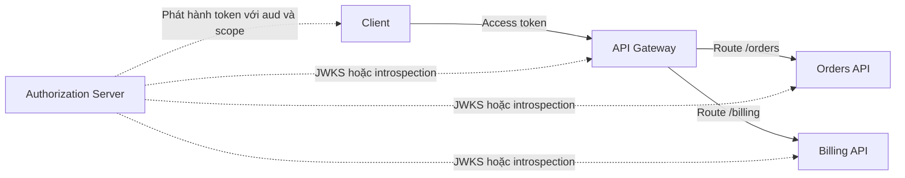
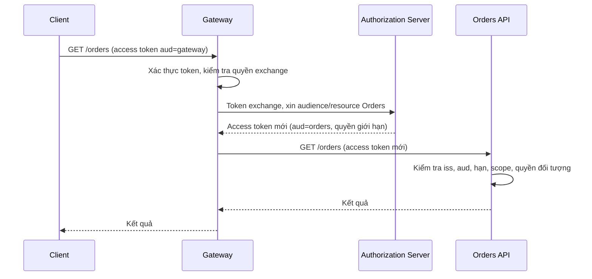

# Audience khi relay token qua API Gateway

## 1. Vấn đề: token hợp lệ về chữ ký nhưng có được dùng ở API đích không?

Trong hệ thống có API Gateway, một access token thường đi qua nhiều thành phần: ứng dụng khách, Gateway, rồi đến các dịch vụ nội bộ. Gateway có thể xác thực token trước khi chuyển tiếp yêu cầu, nhưng **một token được phát hành hợp lệ không có nghĩa là mọi dịch vụ nhận được token đều được phép sử dụng nó**. Đó là lý do cần kiểm tra **audience** (đối tượng tiếp nhận dự kiến).

Ví dụ, client gọi `GET /orders/42` qua Gateway và đính kèm token được cấp cho Orders API. Nếu Gateway chỉ làm điểm định tuyến/bảo vệ tuyến và Orders API là resource server đích, Gateway có thể chuyển tiếp token sau khi kiểm tra các điều kiện an ninh áp dụng cho tuyến. Ngược lại, nếu token được cấp **chỉ cho Gateway**, Orders API không được chấp nhận token ấy dù Gateway đã kiểm tra chữ ký thành công.

Trong phạm vi bảo mật token, *relay token* nghĩa là chuyển chính token nhận được sang hop tiếp theo (thường là `Authorization: Bearer <access-token>`). Hành động này giữ nguyên `iss`, `aud`, `sub`, `scope` và các ràng buộc của token. Relay **không** tự làm thay đổi quyền hạn hay đối tượng tiếp nhận.

Mục tiêu của bài học là biết **khi nào relay an toàn, khi nào phải yêu cầu token đích mới hoặc token exchange, và ai chịu trách nhiệm kiểm tra `aud`**.

## 2. `aud` là gì và khác những claim thường gặp ra sao?

Trong JWT, `aud` (audience) xác định một hoặc nhiều đối tượng mà token được dự kiến dành cho. Theo RFC 7519, bên xử lý JWT phải từ chối JWT nếu mình không thuộc audience được nêu (trong bối cảnh có yêu cầu kiểm tra audience). Với JWT access token theo profile RFC 9068, resource server cần kiểm tra `aud` của access token dành cho mình.

Một access token minh họa sau khi giải mã payload:

```json
{
  "iss": "https://login.example.com",
  "sub": "user-123",
  "aud": "api://orders",
  "client_id": "web-portal",
  "scope": "orders:read orders:write",
  "iat": 1795000000,
  "exp": 1795003600
}
```

Các giá trị và thời điểm ở đây chỉ là dữ liệu minh họa, không phải token thực tế hoặc cấu hình hệ thống có sẵn.

| Trường | Trả lời câu hỏi gì? | Có thay thế `aud` được không? |
| --- | --- | --- |
| `iss` | Ai đã phát hành token? | Không. Cùng issuer có thể phát hành token cho nhiều API. |
| `sub` | Token đại diện cho chủ thể nào? | Không. Biết người dùng không chứng minh token dành cho dịch vụ này. |
| `aud` | Token dành cho resource/API nào? | Đây là điều kiện xác định đối tượng nhận hợp lệ. |
| `scope` hoặc `scp` | Token được cấp những phạm vi quyền nào? | Không. `orders:read` không tự biến token cấp cho API khác thành token của Orders API. |
| `client_id` / `azp` | Ứng dụng/client được cấp hoặc ủy quyền liên quan là ai, tùy chuẩn/token? | Không. Client được tin cậy không đồng nghĩa mọi API đều là audience của token. |
| `exp`, `nbf` | Token có còn trong khoảng hiệu lực? | Không. Token chưa hết hạn vẫn có thể sai audience. |

`aud` có thể là chuỗi hoặc mảng chuỗi, ví dụ `"aud": ["api://orders", "api://billing"]`. Việc một API có mặt trong mảng là điều kiện **cần** để API ấy xử lý token, nhưng vẫn phải kiểm tra issuer, chữ ký hoặc kết quả introspection, thời hạn, quyền truy cập và những ràng buộc khác. Không nên phát token đa audience chỉ để giảm số lần xin token: token càng dùng được ở nhiều resource, phạm vi thiệt hại khi bị lộ càng lớn.

**Phân biệt loại token:** access token dùng để gọi API; ID token trong OpenID Connect chứng minh kết quả xác thực cho client, thường có `aud` là **client ID**, không được coi là access token để gọi backend; refresh token dùng xin access token mới ở Authorization Server, không relay tới Resource Server. JWT và opaque token nói về **định dạng**, không tự nói lên mục đích sử dụng. Opaque access token vẫn có chính sách audience, dù backend phải lấy thông tin qua introspection hoặc cơ chế xác minh được nhà phát hành hỗ trợ.

## 3. Ba vai trò trong đường đi của token



- **Authorization Server (AS)** quyết định quyền yêu cầu token, audience của token, thời hạn, scope, chính sách trao đổi token và thu hồi.
- **Gateway** định tuyến, thực thi chính sách ở biên, có thể xác thực token và kiểm tra audience **tương ứng với tuyến**. Gateway không thể cấp quyền cho Orders API chỉ bằng cách nói rằng nó đã kiểm tra token.
- **Resource Server đích** (Orders/Billing API) cần kiểm tra token dành cho **chính nó**, kèm các quyền của hành động cụ thể. Nếu kiến trúc ủy quyền xác minh hoàn toàn cho Gateway, phải có ranh giới tin cậy và cơ chế bảo vệ danh tính được xác thực rõ ràng; chỉ tin một header do client tự gửi là không đủ.

Một điểm thường nhầm: Gateway không nhất thiết phải có mặt trong `aud` của **mọi** token đi qua nó. Khi Gateway chỉ thực thi policy tại biên cho API phía sau, nó có thể kiểm tra `aud=api://orders` dựa trên tuyến `/orders/**`; Orders API tiếp tục yêu cầu chính audience đó. Nếu Gateway là một resource server độc lập thực sự tiêu thụ token dành riêng cho mình, nó phải yêu cầu audience của Gateway khi xử lý token đó; muốn gọi API khác thì cần token mà API đó chấp nhận.

## 4. Khi nào được relay nguyên access token?

Relay nguyên bản có thể phù hợp khi tất cả điều kiện sau đúng:

1. **Audience phù hợp với API nhận:** ví dụ token có `aud=api://orders` và yêu cầu được relay đến Orders API; Gateway gắn chính sách audience với tuyến, không chỉ kiểm tra một audience chung cho toàn hệ thống.
2. **Issuer và token hợp lệ:** chữ ký JWT/khóa tương ứng đáng tin hoặc opaque token được introspect thành công; token còn hiệu lực, chưa bị từ chối/thu hồi theo chính sách hệ thống, token type và các claim bắt buộc hợp lệ.
3. **Quyền được kiểm tra tại thao tác:** endpoint xác minh `scope`/role/permission và quyền đối với tài nguyên cụ thể. `orders:read` không đồng nghĩa có quyền đọc *mọi* order của người dùng khác.
4. **Mô hình tin cậy chấp nhận chuyển token:** đường truyền đến backend được bảo vệ; Gateway không phát tán token sang dịch vụ không cần nó; policy xác định rõ bên nào được quyền xử lý bearer token.
5. **Mọi ràng buộc sender-constrained được duy trì:** nếu token dùng DPoP hoặc mTLS proof-of-possession, không được xem nó như bearer token có thể chuyển hop tùy ý. Mỗi hop phải đáp ứng đúng bằng chứng sở hữu khóa và chính sách xác thực.

Ví dụ route `/orders/**` dùng target audience `api://orders`. Gateway kiểm tra token người dùng trước khi relay; Orders API độc lập kiểm tra lại `aud` và `orders:read` đối với `GET /orders/42`. Đây là trường hợp hợp lý vì token ngay từ đầu dành cho Orders API. Đừng thêm `aud=api://gateway` vào token chỉ vì mọi request đi ngang qua Gateway.

## 5. Khi nào relay trực tiếp bị sai audience?

| Token client gửi | API đích | Quyết định | Lý do |
| --- | --- | --- | --- |
| `aud=api://orders` | Orders API | Có thể relay nếu các kiểm tra khác đạt | API đích thuộc audience của token. |
| `aud=api://gateway` | Orders API | **Không relay nguyên token như thông tin xác thực của Orders** | Orders API không thuộc audience. |
| `aud=api://orders` | Billing API | **Từ chối hoặc xin token đúng audience** | Có scope phù hợp cũng không sửa được sai audience. |
| `aud=[api://orders, api://billing]` | Billing API | Có thể hợp lệ về audience; xét tiếp policy | Cấp nhiều audience cần có chủ đích và đánh giá rủi ro. |
| ID token `aud=web-portal` | Orders API | **Không dùng làm API access token** | ID token nhằm cho OIDC client. |
| Opaque access token, introspection không cung cấp audience được xác minh | Orders API | Không suy đoán là hợp lệ | Cần hợp đồng xác minh/token policy được AS và resource xác định rõ. |

**Tình huống dễ mắc lỗi:** Gateway chỉ kiểm tra chữ ký và thời hạn, sau đó forward mọi JWT từ một issuer tin cậy đến mọi microservice. Attacker lấy một token hợp lệ dành cho API A và thử gọi API B. Nếu API B cũng bỏ qua `aud`, token có thể bị dùng sai phạm vi phát hành, tạo rủi ro *cross-service token substitution* (dùng token của dịch vụ này cho dịch vụ khác). Đây là lý do RFC 8725 khuyến nghị kiểm tra audience để ngăn JWT dùng sai ngữ cảnh khi một issuer phục vụ nhiều bên.

## 6. Khác biệt giữa relay, token exchange và lấy token cho resource đích

**Relay:** Gateway chuyển cùng một access token. `aud`, `scope`, thời hạn và chủ thể giữ nguyên. Chỉ dùng khi API đích đã là audience hợp lệ và chính sách cho phép.

**Xin access token đúng resource:** Client hoặc thành phần được ủy quyền xin AS phát hành token nhắm tới API đích. OAuth 2.0 Resource Indicators (RFC 8707) định nghĩa tham số `resource` để thể hiện resource mà client muốn truy cập, khi AS hỗ trợ. Ví dụ một client có thể yêu cầu access token cho `https://api.example.com/orders`; AS quyết định audience thực tế và phạm vi cấp quyền theo cấu hình.

**OAuth 2.0 Token Exchange (RFC 8693):** Một thành phần được ủy quyền gửi token đang có tới AS để đổi lấy token mới phù hợp cho backend, có thể giảm scope và đổi audience. Token exchange cần được AS cho phép và kiểm soát bên được quyền trao đổi; không thể tự thực hiện bằng cách chỉnh sửa payload JWT.



Ví dụ minh họa một yêu cầu token exchange phía server (tên `audience`, `resource`, quyền client và các tham số được hỗ trợ phụ thuộc AS):

```http
POST /oauth2/token HTTP/1.1
Host: login.example.com
Content-Type: application/x-www-form-urlencoded
Authorization: Basic <client-credentials-redacted>

grant_type=urn:ietf:params:oauth:grant-type:token-exchange
&subject_token=<incoming-access-token>
&subject_token_type=urn:ietf:params:oauth:token-type:access_token
&requested_token_type=urn:ietf:params:oauth:token-type:access_token
&audience=api://orders
&scope=orders:read
```

Đây là sơ đồ giao thức, **không phải bằng chứng mọi nhà cung cấp OAuth 2.0 hỗ trợ token exchange**. Việc exchange có thể giữ danh tính người dùng (delegation/on-behalf-of) hoặc đại diện cho actor là dịch vụ; cần xác định `sub`, thông tin actor và quyền hiệu lực theo đúng mô hình ủy quyền, không tự giả định token mới đồng nghĩa được cấp mọi quyền người dùng.

## 7. Thiết kế kiểm tra audience ở Gateway và backend

Định nghĩa ánh xạ tuyến → resource dự kiến bằng cấu hình đáng tin, ví dụ:

```yaml
routes:
  - path: /orders/**
    upstream: http://orders.internal
    acceptedAudience: api://orders
    requiredScopes:
      GET: [orders:read]
      POST: [orders:write]
  - path: /billing/**
    upstream: http://billing.internal
    acceptedAudience: api://billing
    requiredScopes:
      GET: [billing:read]
```

Đây là **pseudoconfig**, không phải cấu hình mặc định của một sản phẩm Gateway cụ thể. Trong thực tế phải giải quyết chuẩn hóa path và HTTP method, route precedence, rewrite trước/sau khi kiểm tra policy, tránh tuyến bắt nhầm/đi vòng chính sách, và lưu cấu hình bằng cơ chế kiểm soát thay đổi.

Một thuật toán kiểm tra ở Gateway cho tuyến `/orders/**` có thể diễn đạt:

```text
1. Chọn route đáng tin cậy từ method + path đã chuẩn hóa.
2. Lấy bearer access token từ vị trí được hỗ trợ; từ chối token thiếu/sai dạng.
3. Xác thực token: issuer, chữ ký + thuật toán/khóa được cho phép
   hoặc introspection, exp/nbf, trạng thái và token type thích hợp.
4. expectedAudience = config[route].acceptedAudience.
5. Nếu expectedAudience không thuộc aud đã được xác thực: REJECT.
6. Kiểm tra scope/permission áp dụng và các điều kiện ngữ cảnh.
7. Nếu relay được policy cho phép: chuyển token tới đúng upstream.
   Nếu cần token mới: exchange theo chính sách hoặc từ chối.
8. Backend xác thực token của chính mình và phân quyền từng tài nguyên.
```

Trong JWT, `aud` có thể có dạng chuỗi hoặc mảng; thư viện JWT chuẩn hóa giá trị này cho trình xác thực. Không so khớp bằng `contains` trên **chuỗi thô** (ví dụ `api://order` khớp nhầm `api://orders`) và không chấp nhận wildcard tùy ý. Audience phải so sánh chính xác theo định danh/đối tượng được AS và API thỏa thuận.

Pseudocode diễn đạt rõ thứ tự **xác thực trước, kiểm tra quyền sau**:

```java
// Jwt đã được giải mã VÀ xác thực chữ ký, issuer, thời hạn bởi validator.
String expectedAudience = routeConfig.getAcceptedAudience();
if (!jwt.getAudience().contains(expectedAudience)) {
    throw new InvalidBearerTokenException("Unexpected token audience");
}
if (!permissions.allow(jwt, request, routeConfig)) {
    throw new AccessDeniedException("Insufficient permission");
}
// Chỉ lúc này áp dụng chính sách relay hoặc token exchange của route.
```

Đoạn Java chỉ là ví dụ logic. `jwt.getAudience()` an toàn để dùng cho quyết định này **chỉ sau khi** token được xác thực đầy đủ theo cấu hình resource server. Một `JWT.decode(...)` thuần túy chưa phải là verify; giải mã Base64URL không chứng minh claim đáng tin.

Ở backend, kiểm tra audience là lớp bảo vệ độc lập: Orders API chỉ tin các issuer cấu hình sẵn, chấp nhận `aud=api://orders` theo hợp đồng phát hành, kiểm tra scope và phân quyền theo `orderId` thực tế. Nếu Gateway áp dụng `aud=api://orders` nhưng backend lại chấp nhận bất kỳ `aud`, một cấu hình route sai hoặc request đến backend qua đường khác vẫn có thể trở thành lỗ hổng.

## 8. Những chi tiết bảo mật đi cùng audience

### 8.1. JWT, JWKS và opaque token

Với JWT access token, cần kiểm tra chữ ký, thuật toán được cho phép, khóa lấy từ issuer tin cậy (ví dụ JWKS), `iss`, `aud`, `exp`, `nbf` và các trường mà profile/token contract yêu cầu. Chú ý chọn khóa theo issuer, không lấy khóa/URL tùy ý từ claim do token cung cấp; không chấp nhận `alg=none` hoặc thuật toán không cấu hình. Nếu hệ thống dùng JWT access token profile RFC 9068, có thể yêu cầu kiểu access-token JWT thích hợp (`typ=at+jwt`/`application/at+jwt` tùy biểu diễn) để tránh nhầm loại token, cùng các claim profile bắt buộc.

Với opaque token, Gateway/backend không đọc được `aud` trực tiếp từ chuỗi token. AS có thể cung cấp introspection (RFC 7662) kèm `active`, scope, audience và metadata theo khả năng hỗ trợ. Không suy audience dựa trên độ dài token, tiền tố token hoặc tên scope. Nếu introspection hay hợp đồng nhà cung cấp không cho phép xác định API đích, cần điều chỉnh AS/policy trước khi chấp nhận relay.

### 8.2. Token bị đánh cắp, replay và giới hạn quyền

Audience làm giảm nơi một token có thể được chấp nhận, nhưng **không ngăn replay ngay tại audience hợp lệ**. Bearer token bị lộ vẫn có thể bị người khác dùng tại Orders API cho tới khi hết hạn hoặc bị thu hồi theo cơ chế áp dụng. Biện pháp bổ sung gồm TLS, thời hạn access token ngắn phù hợp, giới hạn scope/resource, kiểm soát nơi lưu token, không log token, và cơ chế phát hiện/thu hồi nếu mô hình hỗ trợ.

Với sender-constrained token (mTLS hoặc DPoP), backend phải xác minh bằng chứng sở hữu khóa theo yêu cầu. DPoP proof gắn phương thức và URI đích (`htm`, `htu`), nên proof client tạo cho URL Gateway không mặc nhiên hợp lệ tại URL backend. Gateway phải xử lý đúng mô hình kết thúc/xác thực hop và phát hành/trao đổi token hoặc bằng chứng phù hợp; chỉ forward token DPoP và header proof cũ thường không đáp ứng ràng buộc. Tương tự, mTLS-bound token không thể tự động coi kết nối mTLS Gateway → backend là sở hữu khóa của client gốc.

### 8.3. Tranh chấp nguồn danh tính và hop nội bộ

Backend không được tin `X-User-Id`, `X-Roles` hoặc `X-Forwarded-Access-Token` chỉ vì request đi qua network nội bộ. Nếu kiến trúc truyền identity bằng header, Gateway phải loại bỏ header giả mạo từ client, ký/xác thực thông tin identity hoặc bảo vệ bằng kênh tin cậy và backend phải chỉ nhận từ thành phần được ủy quyền. Những header đó không tự biến access token sai audience thành token đúng audience.

Gateway chỉ nên gửi token tới upstream được phép. Không chuyển bearer token không cần thiết vào log, tracing baggage, query string, redirect đến domain ngoài hoặc dịch vụ phụ trợ. Khi gọi tiếp một dịch vụ mới (Orders → Inventory), Inventory phải được định nghĩa là audience phù hợp hoặc phải có quy trình lấy/đổi token mới theo chính sách ủy quyền.

## 9. Lỗi thường gặp và cách sửa

| Lỗi | Hậu quả | Cách sửa |
| --- | --- | --- |
| Chỉ kiểm tra signature/`exp`, bỏ qua `aud` | Token phát cho API khác có thể bị dùng sai ngữ cảnh | Bắt buộc kiểm tra audience theo route và tại resource server. |
| Gateway ép mọi token có `aud=api://gateway` rồi relay sang mọi backend | Backend không có audience phù hợp | Xin token API đích hoặc dùng token exchange; xác định rõ vai trò Gateway. |
| So sánh `aud` như substring hoặc wildcard | Nhận nhầm resource không được cấp | So khớp đúng phần tử audience đã được xác thực. |
| Xem scope `orders:read` là đủ | Scope không xác định resource đích | Kiểm `aud` trước, rồi kiểm scope và quyền tài nguyên. |
| Chuyển ID token/refresh token tới backend | Dùng sai loại token, tăng rủi ro lộ bí mật | Chỉ dùng access token dành cho API đó. |
| Tự sửa claim `aud` trong JWT | Chữ ký không còn hợp lệ; nếu chấp nhận là lỗi thiết kế nghiêm trọng | Nhờ AS phát hành/trao đổi token mới. |
| Tin duy nhất kết quả xác thực ở Gateway nhưng để backend công khai | Có thể bypass chính sách Gateway | Giới hạn đường truy cập và xác thực/ủy quyền ở backend hoặc áp dụng mô hình trust có chứng minh. |
| Relay token DPoP/mTLS-bound như bearer token thường | Không bảo đảm proof-of-possession và có thể phá ràng buộc token | Thiết kế kiểm tra bằng chứng ở từng hop, exchange khi cần. |
| Chọn audience từ input do client tự quyết | Client có thể dẫn token sang upstream ngoài phạm vi cho phép | Route → audience/upstream phải thuộc cấu hình policy được kiểm soát. |

**HTTP status thực hành:** Token thiếu, sai chữ ký, hết hạn hoặc sai audience thường bị trả `401 Unauthorized` với thông tin lỗi bearer token thích hợp (`invalid_token`); token hợp lệ cho resource nhưng thiếu scope/quyền thường dẫn tới `403 Forbidden` (trường hợp thiếu scope có thể dùng `insufficient_scope`). Không trả chi tiết token hoặc bí mật xác thực trong response.

## 10. Ví dụ quyết định theo đường đi của request

Giả sử hệ thống có `api://orders` và `api://billing`, Gateway định tuyến hai nhóm endpoint:

**Tình huống A — Relay đúng audience.** Client lấy access token `aud=api://orders`, `scope=orders:read`; gọi `GET /orders/42`. Gateway xác thực token, kiểm tra audience của tuyến `/orders/**`, rồi relay tới Orders API. Backend xác thực lại và kiểm tra người dùng thực sự có quyền đọc order `42`. Yêu cầu có thể thành công nếu mọi bước đều đạt.

**Tình huống B — Dùng lại token để gọi API khác.** Client giữ token ở tình huống A rồi gọi `GET /billing/invoices`. Gateway kỳ vọng `api://billing`, nhưng token chỉ có `api://orders`; từ chối. Việc thêm `billing:read` bằng một chuỗi client tự tạo hoặc đổi tên endpoint không thay đổi audience đã ký.

**Tình huống C — Token chỉ dành cho Gateway.** Gateway nhận access token `aud=api://gateway` để thực thi một nghiệp vụ riêng; nghiệp vụ cần Orders API. Gateway được AS cho phép token exchange thì yêu cầu token mới `aud=api://orders`, scope tối thiểu cần thiết. Orders API kiểm tra token mới, không dựa vào token đầu vào của Gateway.

**Tình huống D — Backend gọi backend.** Orders API đang xử lý yêu cầu của người dùng và muốn gọi Inventory API. Token ban đầu chỉ có `aud=api://orders`, vì vậy không relay tiếp như credential của Inventory. Dùng delegation/token exchange hoặc service access token dành cho Inventory theo đúng yêu cầu nghiệp vụ và chính sách AS; không tự giả làm người dùng.

**Tình huống E — Opaque token.** Client gửi opaque access token. Gateway introspect token với AS, xác định token `active` và audience cụ thể. Nếu audience là Billing API nhưng route là Orders API, từ chối dù introspection trả `active=true`: *active không đồng nghĩa đúng audience*.

## 11. Checklist triển khai và kiểm thử

Trước khi đưa vào môi trường thực tế, nhóm phát triển cần trả lời được: (1) mỗi route/API có audience định danh nào và ai cấu hình nó; (2) AS phát audience nào khi client xin token; (3) Gateway đang xác minh token *thay mặt* resource nào; (4) backend có tự kiểm tra audience không; (5) nếu khác audience, exchange hoặc xin token mới được hỗ trợ thế nào; (6) việc phân quyền đối tượng và sender-constrained token diễn ra ở hop nào.

Kiểm thử nên bao gồm các trường hợp đối chứng sau:

| Test | Đầu vào chính | Kết quả kỳ vọng |
| --- | --- | --- |
| T1 | Access token đúng `iss`, chữ ký, hạn, `aud=orders`, scope phù hợp đến `/orders` | Đi qua bước kiểm tra token; phân quyền đối tượng quyết định cuối cùng. |
| T2 | JWT chữ ký hợp lệ nhưng `aud=billing` đến `/orders` | Từ chối do sai audience. |
| T3 | JWT `aud=orders` nhưng thiếu `orders:read` cho GET | Từ chối do thiếu quyền/scope. |
| T4 | ID token có `aud=web-portal` được gửi làm bearer token đến Orders | Từ chối do sai loại token/audience. |
| T5 | JWT đã sửa `aud` thủ công | Từ chối vì xác thực chữ ký thất bại. |
| T6 | JWT `aud=[billing, orders]` từ AS được tin, policy cho phép | Audience có thể đạt; các bước kiểm tra khác vẫn bắt buộc. |
| T7 | Token hết hạn hoặc introspection `active=false` | Từ chối kể cả audience đúng. |
| T8 | Token đúng audience nhưng truy cập order không thuộc quyền | Từ chối ở bước phân quyền tài nguyên. |
| T9 | Token binding DPoP/mTLS không có bằng chứng hợp lệ tại hop nhận | Từ chối theo chính sách sender-constrained token. |
| T10 | Route rewrite hoặc đường dẫn thay thế dẫn sang backend khác | Không được bỏ qua ánh xạ route → audience. |

Khi quan sát hệ thống, chỉ ghi log metadata an toàn như route ID, issuer đã xác minh, audience mong đợi, mã lỗi kiểm tra và correlation ID; tránh ghi nguyên access token, refresh token, Authorization header và claim chứa dữ liệu nhạy cảm không cần thiết.

## 12. Ghi nhớ và tài liệu chuẩn

**Quy tắc cốt lõi:** *Bearer token chỉ nên được xử lý bởi resource mà Authorization Server dự định cấp token cho nó.* Gateway có thể relay access token khi backend thuộc audience đã xác thực và policy cho phép. Nếu backend không thuộc audience, phải từ chối hoặc dùng quy trình phát hành/trao đổi token phù hợp. `aud` giải quyết **token dành cho ai**; `scope` và phân quyền tài nguyên giải quyết **người mang token được làm gì**. Cả hai đều cần được kiểm tra.

Tài liệu đối chiếu khi xây dựng hệ thống thực tế:

- [RFC 7519 — JSON Web Token (JWT), mục 4.1.3 `aud`](https://www.rfc-editor.org/rfc/rfc7519#section-4.1.3): ý nghĩa audience trong JWT.
- [RFC 8725 — JSON Web Token Best Current Practices](https://www.rfc-editor.org/rfc/rfc8725): phòng chống nhầm token và kiểm tra ràng buộc ngữ cảnh.
- [RFC 9068 — JWT Profile for OAuth 2.0 Access Tokens](https://www.rfc-editor.org/rfc/rfc9068): cấu trúc và xác minh JWT access token.
- [RFC 8707 — Resource Indicators for OAuth 2.0](https://www.rfc-editor.org/rfc/rfc8707): yêu cầu token dành cho resource được chỉ định.
- [RFC 8693 — OAuth 2.0 Token Exchange](https://www.rfc-editor.org/rfc/rfc8693): trao đổi token theo audience/resource và policy của AS.
- [RFC 7662 — OAuth 2.0 Token Introspection](https://www.rfc-editor.org/rfc/rfc7662): xác minh trạng thái và metadata của opaque access token.
- [RFC 9449 — OAuth 2.0 DPoP](https://www.rfc-editor.org/rfc/rfc9449): ràng buộc token với proof-of-possession.
