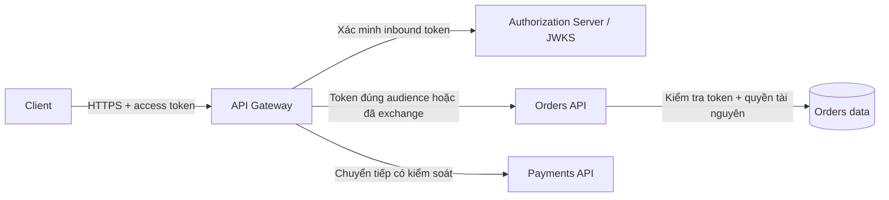
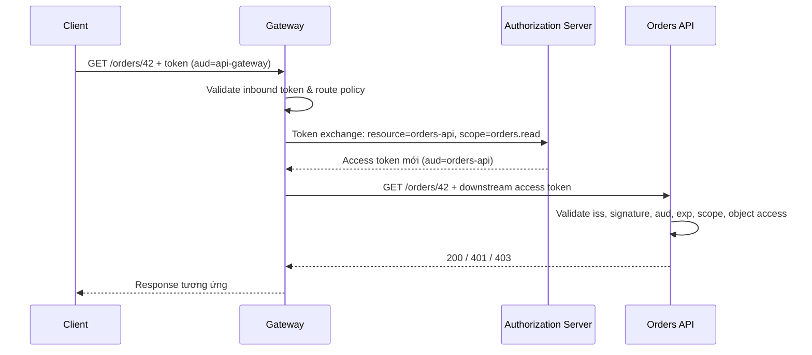

# Downstream trust gateway: Quan hệ tin cậy giữa API Gateway và dịch vụ phía sau

> **Chương:** API gateway  
> **Module:** SECURITY_TOKEN_SECURITY_FUNDAMENTALS — Nắm mô hình tin cậy và vòng đời token bảo mật, phân biệt JWT, opaque token, access token và refresh token trong xác thực, phân quyền và OAuth 2.0/OIDC; kiểm tra claims, scope, audience, lưu trữ, thu hồi và phòng chống đánh cắp hoặc phát lại token.

## 1. Vì sao phải thiết kế downstream trust?

Một hệ thống thường đặt API Gateway ở cửa vào để định tuyến, giới hạn lưu lượng, kiểm tra token và áp dụng chính sách chung. Phía sau gateway là nhiều dịch vụ, chẳng hạn `orders-api`, `payments-api` và `inventory-api`. Câu hỏi quan trọng là: **dịch vụ phía sau có thể tin điều gì do gateway chuyển tiếp, và dựa trên bằng chứng nào?**

Giả sử khách hàng gọi `GET /orders/42` qua gateway. Gateway xác thực thành công một access token **không tự động** khiến `orders-api` được phép tin mọi header, mọi claim hay mọi quyết định phân quyền. Đường kết nối có thể bị cấu hình sai, có tuyến gọi trực tiếp vào backend, hoặc kẻ tấn công có thể giả mạo header danh tính. Thậm chí access token hợp lệ tại gateway có thể được cấp **cho audience khác**, nên backend không được tự ý chấp nhận.

**Downstream trust gateway** là cách thiết lập và duy trì quan hệ tin cậy giữa gateway và các dịch vụ nhận yêu cầu tiếp theo. Nó trả lời đồng thời bốn vấn đề:

1. **Ai đang gọi?** Người dùng (`sub`), ứng dụng khách (`client_id`), gateway hoặc một workload nội bộ?
2. **Bằng chứng nào được chấp nhận?** Access token do authorization server cấp, token được trao đổi, hoặc assertion nội bộ có chữ ký?
3. **Bằng chứng dành cho ai?** Token có `aud` phù hợp với dịch vụ nhận hay không?
4. **Được làm gì?** `scope`, quyền nghiệp vụ, quan hệ sở hữu tài nguyên và ngữ cảnh giao dịch có cho phép thao tác không?

Mục tiêu là **mỗi ranh giới tin cậy đều có cơ chế xác minh rõ ràng**, kể cả khi tất cả dịch vụ cùng nằm trong mạng nội bộ.

### Kết quả học tập

Sau bài này, bạn có thể thiết kế luồng xác thực từ client → gateway → downstream, chọn giữa token relay và token exchange, kiểm tra JWT hoặc opaque token tại backend, bảo vệ danh tính khỏi header giả mạo, đồng thời xây dựng kịch bản kiểm thử cho bypass, token substitution và replay.

## 2. Phân biệt các thực thể và loại token

| Khái niệm | Ý nghĩa trong luồng qua gateway | Điều cần tránh |
|---|---|---|
| **Authorization Server / Identity Provider** | Phát hành hoặc xác nhận access token theo chính sách OAuth 2.0/OIDC | Đồng nhất nó với API Gateway hoặc backend |
| **API Gateway** | Điểm vào cho client, định tuyến và có thể xác thực/trao đổi token | Xem gateway là nguồn danh tính đáng tin mặc định khi không có cơ chế chứng thực |
| **Resource Server** | API thực thi quyền truy cập tài nguyên, ví dụ `orders-api` | Chấp nhận mọi token đã đi qua gateway |
| **Access token** | Bằng chứng để gọi một resource, có thể dạng JWT hoặc opaque | Dùng ID token thay access token |
| **Refresh token** | Dùng với authorization server để xin access token mới theo chính sách | Chuyển tiếp refresh token tới các API nghiệp vụ |
| **JWT access token** | Token chứa claims và có thể xác minh chữ ký cục bộ khi đúng profile | Chỉ giải mã payload rồi tin nội dung |
| **Opaque access token** | Chuỗi tham chiếu, cần cơ chế xác nhận như introspection tại authorization server | Xem chuỗi opaque như JWT, hoặc chỉ kiểm tra token có tồn tại |
| **ID token (OIDC)** | Thông báo kết quả xác thực cho OIDC client; thường có audience là client | Dùng làm bearer credential để gọi downstream API |

**Xác thực (authentication)** xác định chủ thể; **phân quyền (authorization)** quyết định thao tác có được phép hay không. Chữ ký JWT hợp lệ chứng minh token đến từ nguồn phát hành và không bị sửa nội dung; chữ ký **không chứng minh** token được cấp cho đúng API hoặc người dùng được xem đơn hàng bất kỳ.

Một yêu cầu cũng có thể chứa nhiều danh tính:

- **End user:** người dùng thật (`sub = user-123`).
- **OAuth client:** ứng dụng được ủy quyền gọi API.
- **Actor / workload:** gateway hoặc dịch vụ đang hành động thay mặt người dùng.

Nếu authorization server hỗ trợ token exchange, token mới có thể chứa ngữ nghĩa ủy quyền và actor (`act`) theo RFC 8693. Không được giả định mọi token luôn chứa `act` hoặc mọi provider diễn giải claim này giống nhau.

## 3. Ranh giới tin cậy từ client đến downstream



Hình trên có **hai ranh giới độc lập**:

- **Client → Gateway:** gateway kiểm tra tính hợp lệ của token inbound, bảo đảm token dành cho tài nguyên mà gateway đại diện, đồng thời áp dụng định tuyến, hạn mức và chính sách chung.
- **Gateway → Backend:** backend xác minh **ai đã gửi yêu cầu qua kết nối** (ví dụ xác thực workload bằng mTLS) và **token/assertion nào đang cấp quyền truy cập** (ví dụ access token có audience của backend). Backend vẫn tự kiểm tra quyền trên tài nguyên.

Hai kiểu bằng chứng này phục vụ mục đích khác nhau. **mTLS chứng thực workload ở kết nối**, còn **access token chứng thực yêu cầu ủy quyền**. mTLS từ gateway đến backend không tự mang theo quyền của end user; JWT có `sub` của người dùng cũng không tự chứng minh kết nối xuất phát từ gateway.

Đặt backend trong private subnet, dùng service mesh, firewall hoặc NetworkPolicy giúp giảm đường tấn công. Đây là lớp kiểm soát cần thiết, nhưng không thay thế kiểm tra token và quyền nghiệp vụ.

## 4. Các mô hình xây dựng downstream trust

| Mô hình | Gateway gửi gì? | Khi nào phù hợp? | Điều kiện bắt buộc |
|---|---|---|---|
| **Token relay có kiểm soát** | Access token gốc từ client | Token được cấp trực tiếp cho backend, backend là audience hợp lệ | Backend tự xác minh chữ ký/introspection, `iss`, `aud`, thời gian, scope; không relay token không đúng audience |
| **OAuth 2.0 Token Exchange** | Access token mới, thường giới hạn scope và audience | Client gọi gateway nhưng từng backend có ranh giới quyền riêng | Authorization server hỗ trợ trao đổi theo RFC 8693; backend chỉ chấp nhận token dành cho mình |
| **Gateway-issued internal assertion** | Assertion ngắn hạn có chữ ký của issuer nội bộ | Hệ thống có hợp đồng tin cậy nội bộ và kiểm soát chặt | Backend xác minh issuer, audience, chữ ký, hạn dùng, replay và kết nối; issuer nội bộ phải được quản trị rõ |
| **Client credentials / workload token** | Token cho chính gateway hoặc service | Tác vụ máy với máy không đại diện người dùng | Không coi quyền của gateway là quyền của end user; hạn chế scope theo dịch vụ |
| **Opaque token + introspection** | Token gốc hoặc token exchanged dạng opaque | Cần authorization server kiểm tra trạng thái token lúc sử dụng | Introspection được xác thực và kiểm tra `active`, audience/resource, scope, subject cùng các policy liên quan |

### 4.1. Token relay: đơn giản nhưng dễ nhầm audience

Giả sử authorization server cấp token có `aud = orders-api` và `scope = orders.read`. Gateway có thể chuyển token này đến `orders-api` qua kết nối bảo vệ, với điều kiện gateway được cấu hình cho phép và backend xác minh token độc lập.

Nếu token được cấp với `aud = api-gateway`, việc chuyển nguyên token đến `orders-api` **không biến token thành hợp lệ cho orders-api**. Backend phải từ chối. Nếu token có nhiều audience, các resource được liệt kê vẫn phải kiểm tra scope và bối cảnh ủy quyền; multi-audience cũng làm tăng phạm vi ảnh hưởng khi token lộ.

Token relay còn có nguy cơ phát tán bearer token sang nhiều hop, làm tăng bề mặt rò rỉ qua log, tracing hoặc dịch vụ lỗi. Chỉ relay tới đúng resource cần thiết; không chuyển tiếp tùy tiện toàn bộ header `Authorization` đến mọi upstream.

### 4.2. Token exchange: trao quyền theo đích sử dụng

Với OAuth 2.0 Token Exchange (RFC 8693), gateway gửi token inbound hợp lệ đến authorization server và đề nghị token mới cho `orders-api` với quyền hẹp hơn. Authorization server quyết định có cho phép exchange hay không; gateway không tự ý sửa claim `aud` hoặc `scope` của token gốc.

Ví dụ luồng:



Một yêu cầu exchange minh họa (URL và thông tin xác thực chỉ là ví dụ):

```http
POST /oauth2/token HTTP/1.1
Host: auth.example.test
Content-Type: application/x-www-form-urlencoded
Authorization: Basic <gateway-client-credentials>

grant_type=urn:ietf:params:oauth:grant-type:token-exchange&
subject_token=<inbound-access-token>&
subject_token_type=urn:ietf:params:oauth:token-type:access_token&
resource=https://api.example.test/orders&
scope=orders.read
```

Tên `resource`, `audience`, cách xác thực gateway và tập scope được hỗ trợ phụ thuộc authorization server. Đây là grant cần **được triển khai và cấp phép trên authorization server**, không phải bước tự động có ở mọi hệ thống OAuth 2.0. Token exchange không cho phép tùy ý nâng quyền: quyền của token downstream phải được server quyết định trên quyền gốc, danh tính caller và chính sách delegation.

### 4.3. Internal assertion: tin gateway bằng hợp đồng rõ ràng

Trong một số kiến trúc, gateway tạo một assertion JWT ngắn hạn chỉ dành cho `orders-api`. Payload minh họa:

```json
{
  "iss": "https://internal-issuer.example.test",
  "sub": "user-123",
  "aud": ["orders-api"],
  "scope": "orders.read",
  "iat": 1893455700,
  "exp": 1893455760,
  "jti": "unique-request-or-token-id"
}
```

Backend chỉ chấp nhận assertion nếu issuer nằm trong danh sách tin cậy, chữ ký đúng khóa đã cấu hình, `aud` khớp backend, token chưa hết hạn và chính sách replay được đáp ứng. Nếu yêu cầu ràng buộc với đúng gateway, áp dụng thêm mTLS và/hoặc cơ chế sender-constrained tương ứng. Gateway phải kiểm tra token inbound và quyền trước khi phát assertion; không sao chép nguyên giá trị header người dùng gửi vào các claim tin cậy.

Mô hình này tạo thêm trách nhiệm bảo vệ khóa ký, xoay khóa, chính sách phát hành và thu hồi. Khi đã có authorization server hỗ trợ token exchange, thường nên ưu tiên để authorization server quản lý ủy quyền downstream.

### 4.4. Header danh tính: dữ liệu tham khảo, không phải bằng chứng độc lập

Các header như `X-User-Id`, `X-User-Roles`, `X-Authenticated-User`, `X-Forwarded-For` hoặc `X-Forwarded-Proto` có thể bị client tự đặt. Nếu gateway cần truyền metadata qua header, nó phải **loại bỏ giá trị inbound không đáng tin rồi tự thiết lập lại**, và backend chỉ sử dụng theo hợp đồng proxy đã xác thực, có kiểm soát đường truy cập và hop.

Đặc biệt, không nên dùng mỗi `X-User-Id: admin` để cấp quyền. Nếu cần biểu diễn danh tính để backend tin cậy về mặt bảo mật, sử dụng token/assertion có thể kiểm chứng và xác định rõ issuer/audience, hoặc một cơ chế tương đương trong trust boundary đã được kiểm soát.

## 5. Backend phải kiểm tra những gì?

Ví dụ access token JWT (các giá trị chỉ dùng để giải thích):

```json
{
  "iss": "https://auth.example.test",
  "sub": "user-123",
  "aud": ["orders-api"],
  "scope": "orders.read",
  "iat": 1893455700,
  "nbf": 1893455700,
  "exp": 1893456000,
  "client_id": "web-portal"
}
```

| Thành phần | Kiểm tra tại `orders-api` | Vì sao cần? |
|---|---|---|
| Chữ ký và thuật toán | Xác minh bằng khóa/thuật toán cho phép, gắn với issuer tin cậy | Chống sửa token, thuật toán thay thế và khóa giả |
| `iss` | Khớp authorization server được cấu hình | Không nhận token từ issuer khác |
| `aud` | Có resource identifier của `orders-api` | Chống token substitution và confused deputy |
| `exp` / `nbf` | Token đang trong thời gian hợp lệ; xử lý clock skew có giới hạn | Chặn token hết hạn hoặc chưa có hiệu lực |
| `iat` | Áp dụng giới hạn tuổi token nếu chính sách yêu cầu | Hạn chế token cũ trong các luồng nhạy cảm |
| `scope` / authority | Đủ quyền cho method và endpoint | Chặn vượt quyền thao tác |
| `sub`, `client_id`, `act` | Phân biệt người dùng, client, actor theo profile token | Không gán nhầm quyền của gateway cho người dùng |
| Quyền trên đối tượng | User có được truy cập đơn hàng `42` hay không? | Chặn truy cập tài nguyên của người khác (BOLA/IDOR) |
| `typ` / token profile | Khi áp dụng profile JWT access token (ví dụ RFC 9068), kiểm tra đúng loại token | Tránh dùng nhầm ID token hoặc JWT thuộc loại khác |

Không lấy khóa ký từ một URL do JWT tùy ý đề xuất (`jku`, `x5u`) rồi tin ngay; chỉ lấy khóa qua issuer/JWKS đã xác định và cấu hình tin cậy. Thuật toán cũng phải được giới hạn theo cấu hình, không suy luận “thuật toán nào token yêu cầu thì kiểm tra theo thuật toán đó”. Kiểm tra cả issuer **và** audience; hai điều kiện không thể thay thế nhau.

Đối với **opaque access token**, backend có thể gọi OAuth 2.0 introspection (RFC 7662) qua kết nối và phương thức xác thực bảo vệ. Chỉ chấp nhận token khi `active=true` và mọi thuộc tính được trả về đáp ứng yêu cầu của backend: đúng resource/audience (nếu được cung cấp), scope, subject/client, chính sách ủy quyền và hạn dùng. Nếu dữ liệu introspection không cung cấp đủ bằng chứng backend cần, phải điều chỉnh hợp đồng với authorization server; không được suy diễn audience chỉ từ `active=true`.

**Phân biệt mã lỗi:** token thiếu/sai/hết hạn thường trả `401 Unauthorized` (kèm thách thức Bearer phù hợp); token hợp lệ nhưng thiếu quyền trả `403 Forbidden`. Quyền trên từng đối tượng phải được kiểm tra sau bước xác thực, không chỉ tại gateway.

## 6. Ví dụ Java Spring Security ở downstream

Giả sử `orders-api` là Spring Boot Servlet Resource Server. Ví dụ dưới đây minh họa **quyền do backend tự thực thi**, ngay cả khi gateway đã kiểm tra inbound token. Cần dependencies Spring Security, OAuth2 Resource Server và JOSE theo phiên bản Spring Boot đang dùng.

```java
import java.util.List;

import org.springframework.context.annotation.Bean;
import org.springframework.context.annotation.Configuration;
import org.springframework.http.HttpMethod;
import org.springframework.security.config.Customizer;
import org.springframework.security.config.annotation.web.builders.HttpSecurity;
import org.springframework.security.oauth2.core.DelegatingOAuth2TokenValidator;
import org.springframework.security.oauth2.core.OAuth2TokenValidator;
import org.springframework.security.oauth2.jwt.Jwt;
import org.springframework.security.oauth2.jwt.JwtClaimValidator;
import org.springframework.security.oauth2.jwt.JwtValidators;
import org.springframework.security.oauth2.jwt.JwtDecoder;
import org.springframework.security.oauth2.jwt.NimbusJwtDecoder;
import org.springframework.security.web.SecurityFilterChain;

@Configuration
class OrdersSecurityConfig {
    private static final String ISSUER = "https://auth.example.test";
    private static final String JWKS_URI = ISSUER + "/oauth2/jwks";
    private static final String EXPECTED_AUDIENCE = "orders-api";

    @Bean
    SecurityFilterChain securityFilterChain(HttpSecurity http) throws Exception {
        http
            .authorizeHttpRequests(auth -> auth
                .requestMatchers(HttpMethod.GET, "/orders/**")
                    .hasAuthority("SCOPE_orders.read")
                .requestMatchers(HttpMethod.POST, "/orders/**")
                    .hasAuthority("SCOPE_orders.write")
                .anyRequest().denyAll()
            )
            .oauth2ResourceServer(oauth ->
                oauth.jwt(Customizer.withDefaults())
            );
        return http.build();
    }

    @Bean
    JwtDecoder jwtDecoder() {
        NimbusJwtDecoder decoder =
            NimbusJwtDecoder.withJwkSetUri(JWKS_URI).build();

        OAuth2TokenValidator<Jwt> issuerAndTime =
            JwtValidators.createDefaultWithIssuer(ISSUER);

        OAuth2TokenValidator<Jwt> audience =
            new JwtClaimValidator<List<String>>(
                "aud",
                audiences -> audiences != null &&
                    audiences.contains(EXPECTED_AUDIENCE)
            );

        decoder.setJwtValidator(
            new DelegatingOAuth2TokenValidator<>(issuerAndTime, audience)
        );
        return decoder;
    }
}
```

**Lưu ý khi áp dụng:**

- `JWKS_URI` phải là endpoint thực tế của issuer được cấu hình; địa chỉ ở trên chỉ mang tính minh họa. Tại môi trường thật, dùng cấu hình và discovery đáng tin cậy thay vì hardcode URL giả.
- Ví dụ kiểm tra issuer, thời hạn qua validator mặc định, audience và scope ở tuyến API; cần bổ sung profile token, thuật toán được phép, ràng buộc sender, policy trên tài nguyên và các route ngoại lệ theo kiến trúc thực tế.
- Quyền trên đối tượng (`order.ownerId == currentUserId` hoặc chính sách tương đương) phải do tầng nghiệp vụ kiểm tra. `SCOPE_orders.read` không đồng nghĩa được đọc mọi đơn hàng.
- Nếu API dùng cookie/session cho trình duyệt, phải xét CSRF và các cơ chế bảo vệ tương ứng; mẫu này chỉ minh họa phần Resource Server.
- Gateway dùng Spring Cloud Gateway hoặc công nghệ khác cũng cần quy tắc định tuyến và forward token phù hợp. Không giả định tính năng `TokenRelay` tự thực hiện token exchange hay tự đổi audience.

Một tình huống cần bác bỏ:

```http
GET /orders/42 HTTP/1.1
Host: orders-api.internal
Authorization: Bearer <jwt-with-aud-api-gateway>
X-User-Id: admin
```

`orders-api` phải từ chối vì token có audience sai; header `X-User-Id` cũng không được ghi đè principal đã xác minh. Nếu client lách gateway bằng cách gọi trực tiếp backend, kiểm soát mạng nên chặn ngay tại kết nối; nếu yêu cầu vẫn đến được ứng dụng, bộ kiểm tra access token và quyền vẫn phải bảo vệ tài nguyên.

## 7. Bảo vệ từng hop trước đánh cắp, replay và confused deputy

### 7.1. Mã hóa kênh và xác thực workload

Dùng TLS từ client đến gateway; dùng TLS và khi cần **mTLS giữa gateway và backend** hoặc trong service mesh. Phải xác minh danh tính máy chủ/khách theo hostname, chứng chỉ và trust anchor phù hợp. Tránh coi sự hiện diện của chứng chỉ bất kỳ là bằng chứng gateway được phép gọi backend.

Nếu TLS kết thúc ở load balancer hoặc proxy, cần xác định chính xác nơi nào kiểm tra chứng chỉ và cách danh tính được truyền qua hop tiếp theo. Các header do proxy bổ sung chỉ đáng tin khi đường nhận và proxy đó nằm trong trust boundary được cấu hình.

### 7.2. Token dạng bearer và sender-constrained token

Bearer token có thể bị sử dụng bởi người nắm giữ chuỗi token. Giảm rủi ro bằng token ngắn hạn, hạn chế scope/audience, che giấu token khỏi log, quản lý bí mật và lưu token phù hợp với loại client.

Các cơ chế nâng cao gồm:

- **mTLS-bound access token** (RFC 8705): ràng buộc token với chứng chỉ được sử dụng; resource server phải kiểm tra binding.
- **DPoP** (RFC 9449): ràng buộc token với khóa công khai và proof theo HTTP method, URI, thời điểm và định danh proof; resource server phải xác thực proof và chống replay.

Không thể mặc định **relay nguyên một DPoP proof qua gateway** cho request sang backend: đích URI/method/hop và khóa chứng minh có thể khác. Phải thiết kế cách mỗi hop chứng minh đúng khóa và xử lý token gắn với sender, thường dùng token exchange hoặc cơ chế forwarding được chuẩn hóa riêng.

### 7.3. Tránh confused deputy

Confused deputy xuất hiện khi dịch vụ có quyền rộng bị lợi dụng để thực hiện việc vượt quá quyền của người gọi. Ví dụ gateway có service token `payments.write` dùng chung; client chỉ có `orders.read` nhưng khiến gateway gọi `payments-api` bằng quyền của gateway.

Các cách ngăn chặn gồm: phân biệt **token của workload** với **quyền thay mặt người dùng**; xác định chính sách delegation; sử dụng token theo audience và scope tối thiểu; kiểm tra quyền ngay tại payments API; từ chối forward tới host không nằm trong allowlist để chống lạm dụng đường định tuyến.

### 7.4. Độ tin cậy của metadata và redirect

Gateway cần xóa/ghi lại header danh tính do client tự gửi; giới hạn những header forward, chuẩn hóa các trường liên quan địa chỉ nguồn và scheme. Không để client điều khiển host upstream hay URL exchange/introspection. Với webhook hoặc yêu cầu ký riêng, không thay đổi body/headers làm mất tính toàn vẹn chữ ký trước khi backend kiểm tra.

## 8. Vòng đời token khi đi qua gateway

Một thiết kế an toàn phải mô tả toàn bộ vòng đời:

1. **Phát hành:** authorization server cấp access token cho resource/scope được phê duyệt. Nếu có downstream token, gateway xin bằng token exchange hoặc cơ chế phát hành nội bộ có chính sách.
2. **Sử dụng:** gateway xác minh inbound; backend xác minh token downstream, audience, scope và quyền trên dữ liệu.
3. **Lưu trữ tạm:** không lưu access/refresh token trong log, URL, header trace không bảo vệ hoặc cache dùng chung không phân tách principal. Nếu lưu token ở gateway/BFF, dùng kho và chính sách bảo vệ phù hợp.
4. **Hết hạn/đổi mới:** access token nên có TTL phù hợp mức rủi ro. Refresh token thuộc client/authorization server có quyền sử dụng; backend nghiệp vụ thường không cần thấy refresh token.
5. **Thu hồi:** với opaque token có thể sử dụng introspection để cập nhật trạng thái; với JWT tự xác minh, việc thu hồi ngay lập tức không tự xảy ra chỉ vì issuer đã vô hiệu hóa phiên.
6. **Xoay khóa:** backend cập nhật tập khóa tin cậy qua JWKS/cơ chế cấu hình đáng tin cậy, xử lý `kid` và key rollover; không tắt signature validation khi gặp key mới.

**JWT và thu hồi:** token JWT đã được ký thường tiếp tục hợp lệ cho tới `exp` theo logic xác minh cục bộ, trừ khi có danh sách chặn, kiểm tra trạng thái hoặc thiết kế sender/phiên bổ sung. OAuth 2.0 Token Revocation (RFC 7009) nói về yêu cầu thu hồi tại authorization server; resource server phải có cơ chế phù hợp nếu cần hiệu lực thu hồi nhanh.

**Introspection cache:** giảm số lần gọi authorization server nhưng tạo độ trễ nhận biết thu hồi. TTL cache phải được giới hạn bởi `exp` và yêu cầu an ninh; không giữ câu trả lời `active=true` vô thời hạn. Lỗi mạng hoặc timeout xác minh token phải theo chính sách **fail closed** đối với truy cập được bảo vệ, kết hợp timeout/circuit breaker để giữ khả năng phục hồi hệ thống.

**Exchange-token cache:** nếu cache token downstream, khóa cache phải phân biệt tối thiểu subject, client/actor, audience/resource, scope và mọi yếu tố delegation có ảnh hưởng đến quyền. Không tái sử dụng token của người dùng A cho người dùng B hoặc giữa các dịch vụ có audience khác nhau.

## 9. Thiết kế tham chiếu cho Orders và Payments

Giả sử client sử dụng một access token cho `api-gateway`. Gateway mở route `/orders/**` tới `orders-api` và `/payments/**` tới `payments-api`.

| Chặng | Access token/bằng chứng | Quyết định cần có |
|---|---|---|
| Client → Gateway | Token inbound, `aud=api-gateway` | Gateway xác minh issuer, audience, chữ ký hoặc introspection, thời hạn và quyền vào route |
| Gateway → Authorization Server | Token exchange request + xác thực gateway | Authorization server xác định delegation và cấp token đúng resource/scope |
| Gateway → Orders | Token mới, `aud=orders-api`, `scope=orders.read` | Orders xác minh đầy đủ và kiểm tra người dùng có quyền với order ID |
| Gateway → Payments | Token mới, `aud=payments-api`, `scope=payments.read` | Payments xác minh độc lập; từ chối token cấp cho Orders |
| Gateway ↔ dịch vụ | Kết nối TLS/mTLS được cấu hình | Xác thực workload, giới hạn route và mạng; không thay kiểm tra quyền end user |

Không nên có một “siêu token” với `aud=[orders-api,payments-api,...]` và quyền quá rộng chỉ để đơn giản hóa định tuyến. Nếu việc cấp token theo từng resource không khả thi, cần tài liệu hóa rõ giới hạn audience, threat model và các biện pháp cô lập thay thế.

Với luồng **service-to-service không có end user**, gateway có thể dùng client credentials, nhưng backend phải áp dụng policy dành riêng cho client đó. Đừng tạo `sub=user-123` nếu không có nguồn ủy quyền hợp lệ cho người dùng này.

## 10. Kiểm thử các giả định tin cậy

| Tình huống kiểm thử | Kết quả mong đợi |
|---|---|
| JWT chữ ký sai, `alg`/issuer không được phép | Từ chối xác thực (`401`) |
| Token đúng chữ ký nhưng `aud=api-gateway` gửi đến `orders-api` | `orders-api` từ chối (`401`) |
| Token hết hạn hoặc `nbf` trong tương lai ngoài clock skew | `401` |
| Token đúng audience nhưng thiếu `orders.write` khi POST | `403` |
| Có `orders.read` nhưng truy cập order của người khác | `403` hoặc `404` theo chính sách che giấu tài nguyên |
| Client tự gắn `X-User-Id: admin` | Không thay đổi principal hoặc quyền đã xác minh |
| Backend bị gọi trực tiếp, bỏ qua gateway | Bị chặn bởi kiểm soát mạng và/hoặc xác thực/ủy quyền backend |
| Bearer token của Orders gửi sang Payments | Payments từ chối vì audience/resource không khớp |
| Opaque token bị revoke, introspection trả `active=false` | Từ chối; nếu cache, bảo đảm giới hạn trễ thu hồi đã thiết kế |
| Gateway dùng service token đặc quyền để gọi thay user thiếu quyền | Từ chối theo chính sách delegation/authorization |
| DPoP proof bị phát lại hoặc không khớp method/URI/khóa | Từ chối proof; nếu có token binding phải kiểm tra |
| JWKS xoay khóa hoặc authorization server tạm gián đoạn | Xử lý theo key rollover, timeout và fail-closed policy; không bỏ kiểm tra bảo mật |

Kiểm thử phải đi qua cả **đường công khai** lẫn đường backend nội bộ trong môi trường có quyền kiểm thử. Đối với từng route, cần biết ai phát token, ai kiểm tra token, ai kiểm tra quyền tài nguyên và bằng chứng nào được log/audit.

## 11. Sai lầm thường gặp và cách sửa

**“Gateway đã xác thực nên backend bỏ qua security filter.”** Điều này tạo một điểm lỗi duy nhất và cho phép route nội bộ hoặc proxy cấu hình sai trở thành đường bypass. Hãy yêu cầu backend kiểm tra token/assertion dành cho nó và quyền nghiệp vụ.

**“JWT xác minh chữ ký thành công thì token hợp lệ cho mọi API.”** Chữ ký chỉ là một phần. Mỗi API phải kiểm tra issuer, audience, thời hạn, profile và quyền tương ứng.

**“Chuyển `X-User-Roles: ADMIN` từ gateway là đủ.”** Header trần dễ bị giả mạo và gây nhầm ranh giới tin cậy. Chỉ sử dụng metadata do proxy được xác thực kiểm soát, hoặc tốt hơn dùng assertion/token có thể kiểm chứng.

**“Gateway có quyền ghi Payments nên người dùng qua gateway cũng có quyền đó.”** Quyền máy với máy không đồng nghĩa quyền delegated. Cần ủy quyền thay mặt người dùng, scope tối thiểu và kiểm tra tại Payments.

**“Dùng ID token/refresh token làm Authorization cho backend.”** ID token dành cho OIDC client; refresh token dành cho token endpoint. Backend nên nhận access token đúng audience hoặc assertion theo hợp đồng riêng.

**“mTLS đủ để chống replay access token.”** mTLS chứng thực peer, nhưng bearer token vẫn có thể bị dùng sai nơi nếu không được ràng buộc. Khi cần bảo vệ sender, phải triển khai và kiểm tra cơ chế binding của token.

**“Cache introspection vô hạn sẽ tiết kiệm tài nguyên.”** Quyết định `active` cũ có thể trái trạng thái thu hồi. TTL và phương án xử lý lỗi phải bám yêu cầu an ninh.

## 12. Checklist trước khi đưa vào production

- [ ] Vẽ rõ ranh giới client → gateway và gateway → từng backend; hạn chế khả năng gọi trực tiếp backend.
- [ ] Chỉ định issuer, audience, scope và dạng token hợp lệ cho **mỗi** backend; tách access token khỏi ID/refresh token.
- [ ] Chọn relay, exchange, internal assertion hoặc opaque/introspection theo yêu cầu; kiểm soát việc gateway chuyển token.
- [ ] Backend xác minh chữ ký hoặc introspection, thời hạn, issuer, audience, profile token, scope và quyền tài nguyên.
- [ ] Áp dụng TLS/mTLS theo trust boundary; không tin header danh tính do client tự đặt.
- [ ] Hạn chế token trong log, metrics và trace; xử lý token cache, revoke, key rotation và timeout rõ ràng.
- [ ] Kiểm thử token substitution, replay, bypass gateway, phân quyền sai đối tượng và lỗi authorization server.
- [ ] Ghi audit tối thiểu theo request ID, route, actor, subject (khi được phép), quyết định authorization và lý do từ chối; không ghi token hoặc bí mật.

### Câu hỏi tự kiểm tra

1. Vì sao `aud=api-gateway` không đủ để `orders-api` chấp nhận token, dù chữ ký đúng?
2. Khi nào token relay phù hợp, và khi nào token exchange có lợi hơn?
3. mTLS giữa gateway và backend chứng minh điều gì? Nó có thay việc kiểm tra `scope` và quyền trên đơn hàng không?
4. Với opaque token, `active=true` đã đủ để cho phép truy cập mọi resource chưa?
5. Nếu Gateway mất kết nối với authorization server, vì sao “bỏ qua xác thực để giữ uptime” là sai?

### Tài liệu tiêu chuẩn tham chiếu

- **RFC 6749:** OAuth 2.0 Authorization Framework; **RFC 9700:** OAuth 2.0 Security Best Current Practice.
- **RFC 7519:** JSON Web Token (JWT); **RFC 9068:** JWT Profile for OAuth 2.0 Access Tokens.
- **RFC 8693:** OAuth 2.0 Token Exchange; **RFC 8707:** Resource Indicators for OAuth 2.0.
- **RFC 7662:** OAuth 2.0 Token Introspection; **RFC 7009:** OAuth 2.0 Token Revocation.
- **RFC 8705:** OAuth 2.0 Mutual-TLS Client Authentication and Certificate-Bound Access Tokens.
- **RFC 9449:** OAuth 2.0 Demonstrating Proof of Possession (DPoP).
- **OpenID Connect Core 1.0:** Ý nghĩa của ID token và audience dành cho OIDC client.

Quan hệ tin cậy downstream chỉ bền vững khi **mỗi bên biết chính xác mình tin issuer nào, token được cấp cho resource nào và quyền nào phải tự quyết định**. Gateway giúp tập trung kiểm soát đầu vào; downstream vẫn là nơi chịu trách nhiệm cuối cùng cho tài nguyên mà nó sở hữu.
