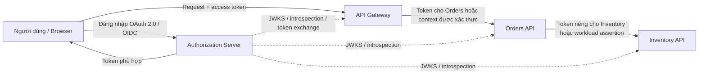
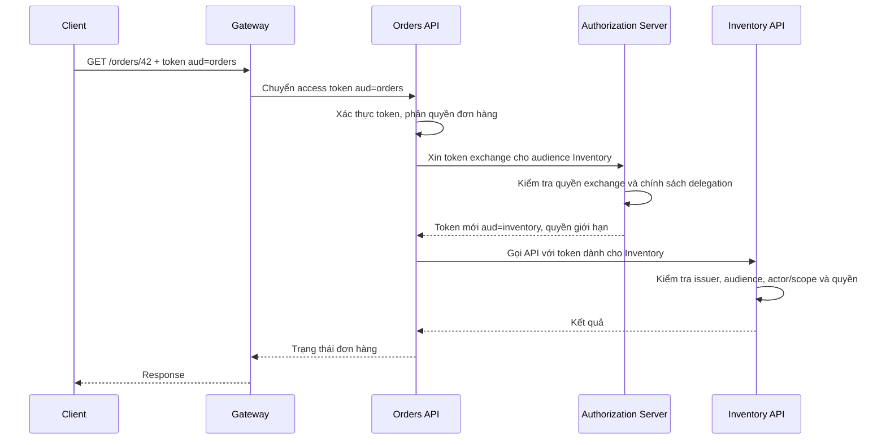

# End-to-end identity propagation qua API Gateway

## 1. Vấn đề cần giải quyết

Một yêu cầu từ người dùng thường đi qua nhiều thành phần: trình duyệt hoặc ứng dụng di động, API Gateway, dịch vụ nghiệp vụ, dịch vụ nội bộ và đôi khi là hàng đợi xử lý bất đồng bộ. Mỗi thành phần cần biết **ai đang yêu cầu**, **dịch vụ nào đang thực sự gọi**, **quyền nào đã được cấp** và **thông tin đó đến từ nguồn nào đáng tin cậy**.

**End-to-end identity propagation** (truyền ngữ cảnh danh tính xuyên suốt chuỗi xử lý) là cách bảo toàn và kiểm tra các thông tin ấy qua từng ranh giới tin cậy. Mục tiêu không nhất thiết là chuyển *cùng một token* tới mọi dịch vụ. Mục tiêu là mỗi hop nhận được **bằng chứng danh tính đúng đối tượng, đúng mục đích, còn hiệu lực và có thể kiểm chứng**, đủ để thực hiện phân quyền, ghi audit và truy vết nghiệp vụ.

Ví dụ: người dùng Alice đăng nhập và yêu cầu xem đơn hàng `42`. Gateway chuyển yêu cầu đến Orders API. Orders API gọi Inventory API để kiểm tra tồn kho. Inventory cần phân biệt:

- **Chủ thể khởi phát**: Alice đang thực hiện nghiệp vụ xem đơn hàng.
- **Bên gọi trực tiếp**: Orders API đang yêu cầu Inventory.
- **Thẩm quyền thực tế**: Orders có thể được phép đọc tồn kho phục vụ đơn hàng, nhưng Alice không mặc nhiên có quyền gọi mọi API nội bộ.
- **Nguồn chứng thực**: những thông tin trên phải được xác minh qua token, bằng chứng xác thực dịch vụ hoặc assertion tin cậy; không lấy từ một header do client tự khai.

Trong chủ đề bảo mật token, danh tính phải gắn với vòng đời của access token, audience, scope, issuer, kiểm tra claims, lưu trữ, thu hồi và phòng chống token bị lộ/phát lại. Nếu chỉ copy `X-User-Id` qua các lớp mà không biết ai đã xác thực nó, hệ thống dễ mắc lỗi giả mạo danh tính, *confused deputy* và vượt quyền.

## 2. Phân biệt các loại danh tính xuyên suốt yêu cầu

Từ `identity` dễ gây hiểu lầm khi mọi hệ thống chỉ sử dụng một trường `userId`. Thực tế cần tách các khái niệm:

| Khái niệm | Ý nghĩa | Ví dụ |
| --- | --- | --- |
| **End user / subject** | Người dùng hoặc chủ thể mà thao tác được thực hiện thay mặt, nếu có. | `sub=user-alice` |
| **Client** | Ứng dụng OAuth đã xin hoặc được cấp token; không đồng nghĩa với người dùng. | `client_id=web-portal` |
| **Calling workload / actor** | Dịch vụ đang trực tiếp thực thi hoặc gọi hop tiếp theo. | `orders-service` |
| **Issuer** | Bên phát hành bằng chứng/token. | `iss=https://auth.example.test` |
| **Audience** | Resource/API dự kiến được phép nhận token. | `aud=api://orders` |
| **Authorization** | Scope, role, permission và quyết định truy cập tài nguyên cụ thể. | `orders:read` + kiểm tra chủ sở hữu đơn |
| **Request correlation** | Định danh nối các sự kiện cùng luồng để chẩn đoán. | `traceparent`, `request-id` |

**Trace ID không phải danh tính xác thực**, và `sub` cũng không tự nói lên quyền. Một service token có `sub` là service account; một user-delegated token có thể biểu thị người dùng và actor theo chính sách của Authorization Server (AS). Khi ghi audit, cần biết cả **người dùng liên quan** lẫn **workload đã thực thi** nếu nghiệp vụ yêu cầu.

### 2.1. Ba chế độ thực thi thường gặp

1. **Theo danh tính người dùng (user delegation/on-behalf-of)**: dịch vụ được phép gọi API khác trong phạm vi quyền của người dùng, theo token được cấp đúng resource đích và thỏa thuận ủy quyền.
2. **Theo danh tính dịch vụ (service identity)**: dịch vụ dùng client credentials hoặc workload identity để gọi API nội bộ. Backend được phép ghi nhận người dùng khởi phát ở audit metadata đã kiểm chứng nếu cần, nhưng quyền truy cập chính thuộc về dịch vụ.
3. **Dịch vụ tự ý đóng giả người dùng (impersonation)**: một thành phần có thể hành động như người dùng chỉ nếu hệ thống có nghiệp vụ, chính sách và dấu vết audit được chấp thuận rõ ràng. Không được mặc định `sub=alice` có thể được tự dựng bởi mọi service.

Không nên gộp ba chế độ trên vào cùng một chuỗi `X-User-Id` để ra quyết định phân quyền.

## 3. Luồng điển hình: từ client tới backend và dịch vụ phụ thuộc



Ở luồng này, **mỗi mũi tên đi vào một API là một lần kiểm tra ranh giới tin cậy**. Thành phần nhận quyết định xem mình tin issuer nào, chấp nhận audience nào và quyền nào đủ để xử lý thao tác. Xác thực ở Gateway rất hữu ích nhưng không tự động biến mọi dữ liệu do Gateway forward thành nguồn đúng cho mọi backend.

Một chuỗi xử lý có thể bảo toàn được danh tính ngay cả khi access token được **thay mới hoặc thu hẹp quyền** ở từng hop. Ngược lại, copy nguyên token xuyên nhiều service nhưng không kiểm audience và không tách actor có thể làm mất tính chính xác của identity propagation.

## 4. Dòng chảy danh tính tại từng hop

### Hop A — Đăng nhập và cấp access token

Client sử dụng luồng OAuth 2.0/OIDC phù hợp với loại ứng dụng. Authorization Server xác thực người dùng khi cần, xác định client, quyền được đồng ý/cấp phát, resource đích và phát hành access token. **ID token** phục vụ việc xác thực của OIDC client, thường có `aud` là client ID; **không** dùng ID token để thay access token gọi API.

Một JWT access token minh họa dành cho Orders API:

```json
{
  "iss": "https://auth.example.test",
  "sub": "user-alice",
  "aud": "api://orders",
  "client_id": "web-portal",
  "scope": "orders:read",
  "iat": 1795000000,
  "exp": 1795000600,
  "jti": "example-unique-token-id"
}
```

Đây là **payload minh họa**, không phải token đã ký. Định dạng claim và quy tắc cấp token tùy AS/profile; không suy quyền chỉ từ việc giải mã payload. JWT là định dạng token, trong khi *access token*, *ID token* và *refresh token* là mục đích sử dụng. Opaque access token cũng có thể chứa metadata danh tính tại AS mà backend kiểm tra bằng introspection.

### Hop B — Gateway kiểm tra và định tuyến

Gateway thường thực thi các kiểm tra đầu vào:

1. Xác định route và API đích theo path/method đã chuẩn hóa, dựa vào cấu hình có kiểm soát.
2. Xác thực access token bằng cơ chế thích hợp: chữ ký JWT với issuer/thuật toán/khóa tin cậy, hoặc opaque-token introspection; kiểm tra thời gian, loại token và trạng thái theo chính sách.
3. Kiểm tra `aud` theo **route/resource đích**, `scope`/permission áp dụng và các ràng buộc như sender-constrained token.
4. Từ chối request sai điều kiện. Nếu đạt, chọn mô hình truyền danh tính đã thiết kế: relay token phù hợp, đổi token, hoặc tạo assertion nội bộ đáng tin.
5. Chỉ chuyển tới upstream được phép; loại bỏ mọi header danh tính không đáng tin từ request bên ngoài trước khi thêm các header nội bộ được xác thực.

Gateway chỉ đóng vai trò kiểm tra ở biên **không nhất thiết phải nằm trong `aud`** của mọi token đi qua. Nếu resource thực sự là Orders API thì `aud=api://orders` có thể đúng. Gateway phải kiểm audience tương ứng route; không đặt một audience cố định cho tất cả backend rồi mặc nhiên relay.

### Hop C — Orders API tự xác thực và phân quyền

Orders API phải biết nguồn identity nào mình chấp nhận. Với access token, API cần xác thực issuer, token signature/introspection, audience `api://orders`, expiration và scope; tiếp đó kiểm tra quyền theo **order 42**. `scope=orders:read` chỉ cấp quyền thực hiện loại thao tác đọc; nó không chứng minh Alice sở hữu đơn của người khác.

Nếu backend chỉ nhận một identity assertion do Gateway phát hành, API cần xác thực assertion và bảo vệ đường gọi bằng cơ chế phù hợp (chẳng hạn mTLS/workload identity, audience nội bộ riêng, TTL ngắn, giới hạn nguồn gọi). Backend không được tin header `X-User-Id: user-admin` mà client có thể tự gửi.

### Hop D — Orders API gọi Inventory API

Access token dành cho Orders API **không mặc nhiên được chấp nhận** ở Inventory API. Nếu `aud=api://orders`, Inventory API phải từ chối token này khi dùng nó như credential của mình, dù token có chữ ký hợp lệ và vẫn còn hạn.

Hai phương án đúng mô hình phổ biến:

- **Ủy quyền tiếp (delegation/token exchange)**: Orders được AS cho phép đổi token người dùng lấy access token mới có `aud=api://inventory` và scope tối thiểu, đồng thời bảo toàn thông tin chủ thể/actor theo chính sách.
- **Dịch vụ gọi dịch vụ (workload/service identity)**: Orders lấy token dành cho Inventory bằng danh tính của Orders, ví dụ client credentials. Nếu nghiệp vụ cần biết Alice, truyền ngữ cảnh tham chiếu đã kiểm chứng cho audit; Inventory vẫn phân quyền lệnh dựa trên service token và chính sách riêng.

Không tự sửa `aud`, `sub`, `scope` trong JWT rồi ký bằng khóa dịch vụ tùy ý, trừ khi dịch vụ được thiết kế rõ ràng làm issuer/authorization service được bên nhận tin cậy.

## 5. Ba cách truyền danh tính thường dùng

| Phương án | Dữ liệu đi giữa các hop | Khi phù hợp | Rủi ro cần quản lý |
| --- | --- | --- | --- |
| **Relay nguyên access token** | Cùng access token nhận từ client | API đích là audience của token, kiến trúc cho phép backend nhận token đó | Token phát tán qua nhiều service, sai audience, replay nếu token bị lộ |
| **Token exchange / on-behalf-of** | Access token mới do AS phát hành cho resource đích | Backend khác audience; cần ủy quyền theo người dùng, giảm scope hoặc thể hiện actor | Cấp quá nhiều quyền; lẫn chủ thể với actor; AS chưa hỗ trợ exchange |
| **Trusted internal identity assertion** | Assertion riêng hoặc metadata được xác thực, kèm workload authentication | Kiến trúc tập trung xác thực ở biên hoặc liên kết với hệ thống backend không dùng access token người dùng | Header spoofing, thiếu audience/TTL/binding, vòng đời kiểm chứng mơ hồ |

Hai công cụ bổ trợ có vai trò khác nhau: OAuth 2.0 **Resource Indicators** (RFC 8707) giúp client yêu cầu token cho một resource cụ thể nếu AS hỗ trợ; OAuth 2.0 **Token Exchange** (RFC 8693) giúp thành phần được phép trao đổi một token thành token phù hợp cho resource khác theo chính sách của AS. Cả hai đều phục vụ audience và giới hạn quyền.

### 5.1. Relay access token đúng mục tiêu

Giả sử Gateway nhận JWT đã được AS phát cho `api://orders`. Gateway định tuyến tới Orders API, xác thực token và có thể relay nguyên token khi chính sách chấp thuận. Orders API **tự xác thực** JWT và chỉ chấp nhận audience của mình. Lúc này cả Gateway và Orders dùng chung bằng chứng, nhưng mỗi bên vẫn xác minh các điều kiện phù hợp.

Không nên relay token Orders tiếp đến Inventory chỉ vì Inventory là dependency của Orders. Nếu access token có nhiều audience, từng resource vẫn phải có mặt trong audience, kiểm tra scope và chịu rủi ro từ token đa resource; không mặc định phát đa audience chỉ để tiện relay.

### 5.2. Token exchange với actor và chủ thể rõ ràng

Một luồng token exchange minh họa:



Ví dụ yêu cầu OAuth 2.0 Token Exchange (các tham số/chứng thực client được AS quyết định):

```http
POST /oauth2/token HTTP/1.1
Host: auth.example.test
Content-Type: application/x-www-form-urlencoded
Authorization: Basic <client-credentials-redacted>

grant_type=urn:ietf:params:oauth:grant-type:token-exchange
&subject_token=<orders-access-token>
&subject_token_type=urn:ietf:params:oauth:token-type:access_token
&requested_token_type=urn:ietf:params:oauth:token-type:access_token
&audience=api://inventory
&scope=inventory:read
```

AS có thể phát hành một access token mới thể hiện danh tính người dùng và actor, tùy chuẩn/profile của hệ thống. RFC 8693 định nghĩa khả năng dùng claim `act` để mô tả actor trong ngữ cảnh delegation; **không mặc định token exchange luôn tạo `act` hoặc giữ nguyên mọi claim gốc**. Backend phải dựa vào cấu hình AS và chính sách thật, phân biệt:

- **Ai là subject được ủy quyền?**
- **Workload nào là actor đang thực thi?**
- **Actor được phép thực hiện hành động gì trên resource đích?**
- **Có điều kiện giảm quyền hoặc không được phép exchange nhiều lần không?**

Quyền hiệu lực có thể bị giới hạn bởi nhiều phía (người dùng, client, workload và resource). Không nên lấy phép hợp của mọi quyền rồi coi đó là quyền được phép sử dụng.

### 5.3. Assertion nội bộ: nhận diện nguồn và ràng buộc người nhận

Một hệ thống có thể dùng JWT assertion **nội bộ** do thành phần tin cậy phát hành, hoặc mTLS cộng metadata đã xác thực, khi backend không tiêu thụ access token bên ngoài. Assertion nội bộ phải có hợp đồng rõ ràng: issuer, audience, subject, actor/nguồn gọi, quyền được phép nếu có, thời hạn, khóa ký/cơ chế bảo vệ, chống phát lại và quy tắc truyền tiếp. Không được gọi một header `X-Authenticated-User` là đáng tin chỉ vì nó được đặt tại Gateway.

Ví dụ **một assertion nội bộ minh họa** (payload chưa ký):

```json
{
  "iss": "https://identity-gateway.internal.example.test",
  "aud": "api://orders-internal",
  "sub": "user-alice",
  "act": {"sub": "gateway-workload"},
  "request_context": {
    "origin": "web-portal",
    "auth_time": 1795000000
  },
  "iat": 1795000001,
  "exp": 1795000061
}
```

Trong ví dụ này, `request_context` là **claim tùy biến**, còn `act` mang ngữ nghĩa actor khi sử dụng theo hợp đồng RFC 8693. Backend phải kiểm chữ ký, issuer, `aud=api://orders-internal`, thời hạn, chính sách actor và mối quan hệ tin cậy của đường gọi; không dùng trực tiếp payload trên như access token OAuth hoặc giả định đây là định dạng do một sản phẩm Gateway phát hành sẵn.

## 6. Ranh giới tin cậy và chống giả mạo identity header

Tấn công phổ biến là client cố tình gửi:

```http
GET /orders/42 HTTP/1.1
Host: api.example.test
Authorization: Bearer <valid-user-access-token>
X-User-Id: super-admin
X-User-Roles: admin
X-Service-Name: billing-service
```

Nếu Gateway không loại bỏ các header bên ngoài, backend có thể nhầm `X-User-Roles: admin` là kết luận xác thực của Gateway. Giải pháp là định nghĩa **một chủ thể chịu trách nhiệm phát hành identity context** và có cơ chế chứng minh nguồn. Gateway loại bỏ những header có tên dành riêng cho nội bộ từ request không tin cậy, xác thực token, rồi chỉ tạo assertion/header mới theo policy. Backend chấp nhận nguồn được xác thực, không dựa vào việc một header xuất hiện.

Đường request có thể đi vòng Gateway qua ingress phụ, service mesh, private load balancer hoặc endpoint nội bộ. Vì vậy cần kết hợp **network policy, xác thực workload giữa service, TLS/mTLS khi phù hợp, audience riêng và xác thực tại resource server**. Dòng `X-Forwarded-For`, `X-Forwarded-User`, `X-Original-URI` và những header tương tự phải được xử lý theo danh sách proxy tin cậy; chúng không tự là bằng chứng danh tính.

Nguyên tắc **zero trust** ở đây là mỗi hop phải xác định danh tính và quyền của bên gọi dựa trên bằng chứng có thể kiểm chứng, kể cả khi đang ở mạng nội bộ. Service account và người dùng cuối là hai kiểu principal khác nhau; không mặc nhiên nâng quyền từ user sang service hoặc ngược lại.

## 7. Thiết kế policy: route, audience, actor và scope

Một cấu hình khái niệm có thể mô tả người nhận và hành động được phép:

```yaml
# Pseudoconfig: mô tả policy, không phải cú pháp của Gateway cụ thể.
routes:
  - path: /orders/**
    methods: [GET]
    upstream: orders-service
    incomingAccessToken:
      trustedIssuer: https://auth.example.test
      audience: api://orders
      requiredScopes: [orders:read]
    identityPropagation:
      mode: relay

outboundCalls:
  - caller: orders-service
    target: inventory-service
    method: GET
    audience: api://inventory
    scopes: [inventory:read]
    identityPropagation:
      mode: token-exchange
      actor: orders-service
```

Policy này chỉ là bản thiết kế. Trên hệ thống thật phải xử lý cẩn thận route rewriting, method normalization, path traversal/encoding, routes có độ ưu tiên khác nhau, quyền theo tenant và kiểm tra đối tượng nghiệp vụ. Không để client tự chọn URL upstream hoặc audience bằng một parameter tùy ý.

Pseudocode ở resource server (Java để gợi ý quy trình, không phải đoạn copy-paste chạy độc lập):

```java
// Framework/security middleware đã xác thực JWT hoặc introspection.
VerifiedPrincipal principal = tokenVerifier.verify(
    request.bearerToken(),
    "https://auth.example.test",
    "api://orders"
);

if (!principal.hasScope("orders:read")) {
    throw new ForbiddenException("Insufficient scope");
}

Order order = orderRepository.findById(orderId);
if (!authorization.canReadOrder(principal.subject(), order)) {
    throw new ForbiddenException("Order is not accessible");
}

audit.record(
    principal.subject(),       // user/subject đã được xác thực
    principal.actor(),         // actor nếu contract token cung cấp
    "orders.read",
    orderId
);
```

`VerifiedPrincipal`, `tokenVerifier` và `authorization` là **kiểu/thành phần giả định** để thể hiện việc xác thực trước khi dùng claim. Trong Spring Security hoặc framework khác, phải cấu hình validator JWT/opaque token tương ứng, đảm bảo `aud` được kiểm chứng, sau đó mới ánh xạ principal và quyền. Chỉ parse Base64URL, gọi `JWT.decode()` hoặc nhận tên người dùng từ HTTP header chưa phải là xác thực.

## 8. Truyền danh tính qua bất đồng bộ, hàng đợi và công việc nền

Khi Orders API phát sự kiện `OrderPlaced` lên queue, consumer có thể xử lý **sau khi access token người dùng hết hạn**. Không nên nhét access token hoặc refresh token của người dùng vào payload để consumer phát lại vô thời hạn.

Thiết kế thích hợp thường gồm:

1. Producer xác thực/phân quyền yêu cầu và ghi nhận **ai đã khởi phát hành động** như audit metadata theo hợp đồng có kiểm chứng.
2. Sự kiện có định danh, timestamp, kiểu sự kiện, dữ liệu nghiệp vụ tối thiểu, phiên bản schema và dấu vết nguồn phát phù hợp.
3. Consumer xác thực nguồn thông điệp (quyền producer, broker ACL, chữ ký nếu cần) và chạy bằng **workload identity riêng**. Nếu consumer bắt buộc hành động thay mặt người dùng, cần cơ chế delegation/persistent authorization được thiết kế rõ, kiểm tra lại quyền khi xử lý nếu yêu cầu nghiệp vụ.
4. Thực thi chống replay/idempotency và giới hạn quyền của consumer. Không xem `userId` trong payload là credential để truy cập API khác.

Ví dụ event metadata:

```json
{
  "eventId": "evt-00042",
  "eventType": "OrderPlaced",
  "orderId": "42",
  "initiatedBy": {
    "subject": "user-alice",
    "issuer": "https://auth.example.test"
  },
  "producer": "orders-service",
  "occurredAt": "2026-11-23T09:00:00Z"
}
```

`initiatedBy` là thông tin **phục vụ audit** đã được producer xác nhận tại thời điểm nghiệp vụ, **không phải bằng chứng để consumer giả danh Alice**. Quyền xử lý cần có ở consumer theo chính sách và các giới hạn nghiệp vụ, có thể kiểm quyền lại khi trạng thái thay đổi.

## 9. Vòng đời token, đánh cắp và replay trên chuỗi nhiều hop

### 9.1. Hạn token và thu hồi

Một token có thể hợp lệ ở Gateway lúc `t0` nhưng hết hạn trước khi Orders gọi Inventory lúc `t1`. Không bỏ qua `exp` vì Gateway đã xác thực trước đó; token đổi mới tại hop sau phải còn hiệu lực tại thời điểm hop đó kiểm tra. Token exchange có thể phát token ngắn hạn cho API đích, giới hạn scope để giảm thiệt hại khi bị lộ.

JWT offline validation có ưu điểm giảm truy vấn AS nhưng không đồng nghĩa **thu hồi tức thì**. Khi cần khả năng thu hồi gần thời gian thực, thiết kế access token ngắn hạn, introspection hoặc cơ chế revoke/blocklist/session management phù hợp với các yêu cầu bảo mật và chi phí vận hành. Với opaque token, resource server có thể introspect `active` theo chính sách cache; kết quả cache cần được kiểm soát TTL. **Refresh token** nên được giữ tại thành phần được cho phép đổi token (client/BFF/AS), không chuyển qua mọi microservice.

### 9.2. Bearer token khác sender-constrained token

Bearer token bị đánh cắp có thể bị phát lại tại **đúng audience** đến khi hết hạn hoặc bị thu hồi; audience chỉ hạn chế nơi sử dụng, không ngăn replay trong chính API đó. Bảo vệ bằng TLS, thời hạn ngắn, giảm quyền, hạn chế nơi lưu token, không ghi log token và giảm số hop cầm credential.

Với **mTLS-bound access token** hoặc **DPoP-bound access token**, bên nhận còn phải kiểm bằng chứng sở hữu khóa. DPoP proof ràng buộc HTTP method/URI và các trường liên quan, vì vậy proof gửi đến URL của Gateway không mặc nhiên hợp lệ cho URL backend. Nếu Gateway termination hoặc proxy làm thay đổi hop, phải có thiết kế xác thực/chuyển giao riêng; **không** chuyển một token/proof đã bị ràng buộc với client sang hop khác như một bearer token thường.

### 9.3. Cảnh báo confused deputy

Inventory có thể tin Orders là service đáng tin, nhưng nếu Orders nhận đầu vào chưa được kiểm quyền rồi dùng service token quyền rộng để gọi Inventory, Orders đã trở thành *confused deputy*. Để ngăn điều này, Orders kiểm quyền của Alice trước khi gọi tiếp, chỉ gửi hành động/dữ liệu đã được phép, giới hạn scope của token service và Inventory vẫn kiểm tra quyền của caller cùng ngữ cảnh tài nguyên. Có quyền service không có nghĩa mọi yêu cầu chuyển tiếp đều được chấp nhận.

## 10. Audit và observability có thể kiểm chứng

Để truy vết một request end-to-end, nên kết hợp ba loại dữ liệu mà không nhầm lẫn:

| Loại dữ liệu | Mục tiêu | Nguồn đáng tin |
| --- | --- | --- |
| **Security identity** | User subject, issuer, client, actor, audience, scope, token type | Token/assertion đã xác thực hoặc hệ thống IAM được tin cậy |
| **Business audit** | Ai khởi tạo, ai phê duyệt, hành động gì trên tài nguyên nào | Quyết định phân quyền và sự kiện nghiệp vụ từ service sở hữu |
| **Distributed tracing** | Request qua những service nào, latency và lỗi ở đâu | Trace context/telemetry, thường có thể bị client khởi tạo nên không dùng làm credential |

Ví dụ log có thể dùng `traceId`, `routeId`, `verifiedIssuer`, `subjectPseudonym`, `actorId`, `decision`, `resourceType`, `outcome`. Không log nguyên `Authorization`, access token, refresh token, JWT payload chứa PII, DPoP proof hoặc bí mật client. Với định danh người dùng, áp dụng nguyên tắc tối thiểu hóa dữ liệu, phân quyền xem audit và thời hạn lưu phù hợp.

Trace `traceparent` giúp tìm các hop của một request nhưng **không chứng minh** request đó đến từ Alice. Nếu backend cho phép quyền admin khi `traceId` trùng một pattern hay khi client tự khai `X-Actor`, đó là lỗi thiết kế phân quyền.

## 11. Bảng quyết định cho các tình huống thường gặp

| Tình huống | Cách xử lý đúng | Điều cần từ chối |
| --- | --- | --- |
| Gateway nhận access token `aud=orders`, gọi Orders | Có thể relay sau xác thực/policy; Orders tự kiểm tra `aud` và phân quyền | Dùng token đó cho mọi backend |
| Orders cần gọi Inventory theo quyền Alice | Xin/đổi token dành cho Inventory theo policy delegation | Copy token `aud=orders` hoặc tự đổi `sub/aud` |
| Orders gọi Inventory vì tác vụ nội bộ của Orders | Dùng service identity với quyền tối thiểu của Orders | Giả làm Alice chỉ vì request xuất phát từ Alice |
| Client gửi `X-User-Roles: admin` | Gateway loại bỏ header không đáng tin; backend tin assertion có xác thực | Tin header từ client |
| Token opaque chưa thể xác minh audience | Introspection/contract AS trước khi chấp nhận | Suy audience từ chuỗi token hoặc scope |
| Service xử lý queue sau nhiều giờ | Dùng workload identity, provenance audit, kiểm quyền/idempotency phù hợp | Lưu rồi phát lại access token người dùng đã hết hạn |
| DPoP/mTLS-bound token đi qua Gateway | Thiết kế xác minh proof ở từng hop hoặc đổi token hợp lệ | Relay như bearer token không còn binding |
| Token có scope đúng nhưng user không sở hữu resource | Trả lỗi phân quyền tài nguyên | Cho qua chỉ vì scope hợp lệ |

### HTTP lỗi nên phân biệt

Với Bearer Token (RFC 6750), access token thiếu/hết hạn/sai chữ ký/sai audience thường dẫn đến `401 Unauthorized` và `WWW-Authenticate` phù hợp (`invalid_token` khi thích hợp). Nếu token hợp lệ nhưng thiếu scope hoặc quyền, thường là `403 Forbidden` (`insufficient_scope` khi áp dụng). Tránh trả về token nguyên vẹn, khóa, nội dung introspection nhạy cảm hoặc chi tiết nội bộ trong response lỗi.

## 12. Checklist thực hành và kịch bản kiểm thử

Khi thiết kế **end-to-end identity propagation**, có thể rà soát theo chuỗi:

1. Xác định user, OAuth client, caller workload và resource server **cho từng hop**; phân biệt người khởi phát với caller thực tế.
2. Xác định issuer, audience, scope, quyền tài nguyên và nơi xác thực mỗi bằng chứng.
3. Quyết định relay, exchange hay service token dựa trên **đối tượng nhận và loại quyền**; ghi rõ chính sách.
4. Loại bỏ header spoofing từ ngoài biên; ràng buộc các assertion nội bộ với issuer, audience, TTL, nguồn gọi và phương pháp xác minh.
5. Thiết kế liên kết audit và trace; bảo đảm trace ID không bao giờ thay thế xác thực.
6. Kiểm tra token hết hạn/thu hồi, sender-constrained token, bất đồng bộ và bảo vệ token trong log, cache, message.
7. Kiểm thử các đường vòng Gateway và trường hợp lỗi cross-service.

Các test nên có cả kết quả thành công lẫn từ chối:

| Test | Bối cảnh | Kỳ vọng |
| --- | --- | --- |
| T1 | Alice có token `aud=orders` + `orders:read`, truy cập order của mình | Token được xác thực; yêu cầu được cho qua nếu policy/tài nguyên cho phép |
| T2 | Token `aud=billing` được gửi đến Orders | Bị từ chối dù chữ ký/issuer hợp lệ |
| T3 | Orders forward token `aud=orders` tới Inventory | Inventory từ chối sai audience |
| T4 | Orders đổi token hợp lệ cho `aud=inventory` với scope tối thiểu | Inventory chấp nhận ở lớp token nếu issuer/actor/claim khác hợp lệ, sau đó phân quyền |
| T5 | Alice có scope đọc nhưng truy cập order của Bob | Bị từ chối tại kiểm tra quyền tài nguyên |
| T6 | Client tự gửi `X-User-Id: admin` | Không tác động đến principal mà backend đã xác thực |
| T7 | Truy cập trực tiếp backend bỏ qua Gateway | Vẫn phải có xác thực/ủy quyền hoặc bị chặn bởi policy ingress |
| T8 | JWT hết hạn, opaque token `active=false` hoặc token bị thu hồi theo policy | Bị từ chối dù metadata user đúng |
| T9 | DPoP/mTLS-bound token không có bằng chứng phù hợp tại hop | Bị từ chối |
| T10 | Event queue có `initiatedBy=Alice` nhưng consumer không có quyền workload | Consumer không được thực hiện thao tác chỉ nhờ `initiatedBy` |
| T11 | Một request có trace ID hợp lệ nhưng không có credential | Không được dùng trace ID để suy identity |
| T12 | Service A gửi header giả là Service B | Bị bác bỏ bởi workload authentication hoặc xác thực assertion |

Trong một hệ thống có nhiều microservice, hãy kiểm thử cả **thất bại ở giữa chuỗi**: nếu token exchange không thành công, Orders phải trả lỗi phù hợp; không fallback sang service token quá quyền hoặc relay token sai audience để cố tiếp tục.

## 13. Kết luận kiến thức và chuẩn tham khảo

**Danh tính end-to-end không đồng nghĩa token end-to-end.** Những gì cần truyền qua từng hop là *ngữ nghĩa danh tính có thể kiểm chứng*: ai là chủ thể, ai là actor gọi trực tiếp, token dành cho API nào, quyền gì đã được AS cấp, và service nào chịu trách nhiệm ra quyết định phân quyền cuối cùng. Gateway xác thực và thực thi policy ở biên; mỗi resource server cần bằng chứng tin cậy dành cho chính mình. Relay dùng khi audience phù hợp, token exchange dùng khi cần token khác cho resource mới, và service identity dùng khi quyền thực thi thuộc workload.

Đọc thêm các chuẩn nền tảng:

- [RFC 6749 — OAuth 2.0 Authorization Framework](https://www.rfc-editor.org/rfc/rfc6749): các vai trò OAuth, access token và client credentials.
- [OpenID Connect Core 1.0](https://openid.net/specs/openid-connect-core-1_0.html): ID token, client và thông tin xác thực người dùng.
- [RFC 7519 — JSON Web Token](https://www.rfc-editor.org/rfc/rfc7519): `iss`, `sub`, `aud`, `exp` và các claim chuẩn.
- [RFC 8725 — JWT Best Current Practices](https://www.rfc-editor.org/rfc/rfc8725): kiểm tra token đúng ngữ cảnh và giảm rủi ro nhầm token.
- [RFC 9068 — JWT Profile for OAuth 2.0 Access Tokens](https://www.rfc-editor.org/rfc/rfc9068): profile và yêu cầu xác minh JWT access token.
- [RFC 8707 — Resource Indicators for OAuth 2.0](https://www.rfc-editor.org/rfc/rfc8707): xác định resource/audience khi xin token.
- [RFC 8693 — OAuth 2.0 Token Exchange](https://www.rfc-editor.org/rfc/rfc8693): đổi token, actor và delegation.
- [RFC 7662 — OAuth 2.0 Token Introspection](https://www.rfc-editor.org/rfc/rfc7662): xác minh opaque token và trạng thái `active`.
- [RFC 6750 — OAuth 2.0 Bearer Token Usage](https://www.rfc-editor.org/rfc/rfc6750): bearer token trong HTTP và phản hồi lỗi.
- [RFC 9449 — OAuth 2.0 Demonstrating Proof of Possession (DPoP)](https://www.rfc-editor.org/rfc/rfc9449): ràng buộc token với khóa và bằng chứng HTTP.
