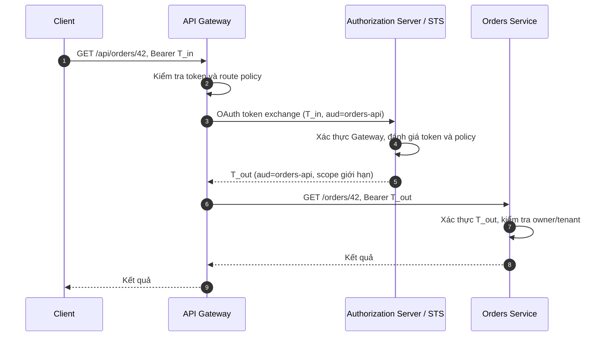

# Token exchange ở API Gateway

## 1. Bài toán: một access token có nên đi qua mọi service?

Một ứng dụng thường cho client gọi **API Gateway** thay vì gọi trực tiếp từng microservice. Client có thể gửi **access token** do Authorization Server cấp để truy cập API công khai. Tuy nhiên, token dành cho Gateway chưa chắc phù hợp để sử dụng tại `orders-service`, `payment-service` hay `inventory-service`: mỗi service có thể cần **audience**, **scope**, thời hạn và chính sách tin cậy khác nhau.

**Token exchange ở Gateway** là quy trình Gateway sử dụng một token đầu vào làm bằng chứng trong yêu cầu tới Authorization Server hoặc Security Token Service (STS), để xin một token mới theo chính sách dành cho service đích. Chuẩn OAuth 2.0 Token Exchange được mô tả trong **RFC 8693**.

Ví dụ:

- Alice đăng nhập và nhận `T_in`, access token có `aud=public-api`, `scope=orders:read`.
- Alice gọi `GET /api/orders/42` qua Gateway với `Authorization: Bearer T_in`.
- Gateway xác định request sẽ đến `orders-service` và được phép gọi thay mặt Alice.
- Gateway được xác thực với STS, yêu cầu đổi `T_in` lấy `T_out` có `aud=orders-api`, `scope=orders:read` và thời hạn phù hợp.
- Gateway gửi **`T_out`** cho `orders-service`. Service xác minh `T_out` và quyền của Alice với đơn hàng `42`.

Giá trị của cách làm này là **giảm phạm vi sử dụng token**: nếu `T_out` bị lộ ở service đơn hàng, nó không được tự động chấp nhận ở service thanh toán chỉ vì cả hai cùng thuộc hệ thống. Điều kiện là từng resource server thực sự phải kiểm tra `aud`, issuer, thời hạn và quyền.

> **Điểm quan trọng:** Token exchange là một giao dịch cấp token mới theo chính sách. Nó không chỉ là giải mã JWT, sửa claim `aud`, đổi tên header, chuyển tiếp `Authorization` hoặc thay chuỗi token bằng một chuỗi tùy ý.

## 2. Vai trò các thành phần và ranh giới tin cậy



| Thành phần | Trách nhiệm |
|---|---|
| **Client** | Gửi access token hợp lệ tới API công khai; không được tự chọn đặc quyền nội bộ |
| **API Gateway** | Kiểm tra đường vào, xác định route đích, yêu cầu token exchange với tư cách OAuth client được phép, chỉ chuyển token cần thiết |
| **Authorization Server / STS** | Xác thực bên yêu cầu, kiểm tra token nguồn, đánh giá chủ thể và quyền, cấp hoặc từ chối token đích |
| **Resource Server (upstream)** | Xác thực token đích, kiểm tra `aud`, `iss`, thời hạn, scope và quyền trên tài nguyên cụ thể |
| **Hệ thống chính sách** | Quyết định Gateway được đại diện chủ thể nào, đến resource/audience nào, với mức quyền tối đa nào |

**Gateway không thể tự khẳng định mình được quyền đổi token.** STS phải xác thực Gateway như một OAuth client và kiểm tra liệu `T_in` có được sử dụng cho audience/scope yêu cầu hay không. Client cũng không được tự gửi `X-Target-Audience: payment-admin` để ép Gateway xin token cho một service khác.

Gateway cần nhận diện route từ cấu hình tin cậy, làm sạch header danh tính do client tự khai và ngăn gọi thẳng service nội bộ để vượt Gateway. Mặt khác, `orders-service` phải tự bảo vệ: việc token được chuyển từ Gateway không làm nó trở nên hợp lệ nếu chữ ký, audience hoặc quyền sai.

## 3. Token exchange khác gì các cơ chế gần giống?

| Cơ chế | Điều thực sự xảy ra | Khi nào phù hợp |
|---|---|---|
| **Token relay** | Chuyển tiếp token hiện có xuống downstream | Token đầu vào đã có đúng audience/scope; downstream tự xác minh |
| **Token exchange** | STS kiểm tra và cấp một token mới cho mục tiêu được phép | Mỗi downstream cần audience/scope hoặc mô hình ủy quyền riêng |
| **Introspection** | Hỏi Authorization Server về trạng thái/thuộc tính của token | Xác minh opaque token hoặc chính sách cần dữ liệu trạng thái |
| **JWT validation** | Kiểm tra chữ ký, issuer, audience, thời hạn và claim của JWT | Resource Server cần xác thực access token dạng JWT |
| **Refresh token grant** | Client sử dụng refresh token để nhận access token mới theo quyền được cấp | Gia hạn phiên/token theo chính sách Authorization Server |
| **Authorization code flow** | Client đổi authorization code lấy token sau luồng cấp quyền | Đăng nhập/ủy quyền ban đầu trong OAuth 2.0/OIDC |

`TokenRelay` của một framework hay `RemoveRequestHeader=Authorization` **không tự thực hiện RFC 8693**. Muốn token exchange cần có lời gọi token endpoint, xác thực OAuth client, xử lý chính sách, kết quả cấp token và đường truyền token mới đến downstream.

**Không dùng ID token như access token của API.** ID token phục vụ xác thực người dùng cho đúng OIDC relying party. **Không gửi refresh token tới API nghiệp vụ** hoặc tự coi refresh token là `subject_token` được phép trao đổi nếu STS không định nghĩa rõ chính sách đó. Trường hợp dùng opaque access token vẫn trao đổi được nếu STS hỗ trợ nhận diện và kiểm tra nó.

## 4. Cơ chế chuẩn OAuth 2.0 Token Exchange (RFC 8693)

Gateway gọi token endpoint bằng yêu cầu **HTTP POST** có body `application/x-www-form-urlencoded`. `grant_type` của token exchange là URN:

```text
urn:ietf:params:oauth:grant-type:token-exchange
```

Các tham số cốt lõi:

| Tham số | Vai trò |
|---|---|
| `grant_type` | Bắt buộc; bằng `urn:ietf:params:oauth:grant-type:token-exchange` |
| `subject_token` | Bắt buộc; token mô tả chủ thể mà Gateway đang yêu cầu thay mặt |
| `subject_token_type` | Bắt buộc; URN chỉ loại subject token, ví dụ access token |
| `requested_token_type` | Tùy chọn theo chuẩn; đề nghị kiểu token đầu ra, nên đặt rõ khi triển khai |
| `audience` | Định danh logic của service/người nhận mà token sẽ phục vụ |
| `resource` | URI của resource đích; có thể dùng thay hoặc cùng `audience` khi STS định nghĩa |
| `scope` | Các quyền yêu cầu cho token đầu ra |
| `actor_token` | Tùy chọn; token mô tả tác nhân thực hiện hành động thay mặt chủ thể trong kịch bản delegation |
| `actor_token_type` | Bắt buộc khi có `actor_token`; xác định loại actor token |

Gateway có thể yêu cầu `audience`, `resource` hoặc cả hai nhưng **Authorization Server mới là bên quyết định** có cấp token phù hợp hay không. Các tham số này là yêu cầu cần được xét duyệt, không phải lệnh được Gateway ép STS tuân theo.

Ví dụ dùng `curl` để minh họa một STS hỗ trợ RFC 8693 (các địa chỉ, token và cách xác thực client là giả định):

```bash
curl --request POST "https://auth.example.com/oauth2/token" \
  --user "gateway-client:<gateway-client-secret>" \
  --header "Content-Type: application/x-www-form-urlencoded" \
  --data-urlencode "grant_type=urn:ietf:params:oauth:grant-type:token-exchange" \
  --data-urlencode "subject_token=<incoming-access-token>" \
  --data-urlencode "subject_token_type=urn:ietf:params:oauth:token-type:access_token" \
  --data-urlencode "requested_token_type=urn:ietf:params:oauth:token-type:access_token" \
  --data-urlencode "audience=orders-api" \
  --data-urlencode "scope=orders:read"
```

Đây là minh họa cú pháp; trong production không đặt client secret hoặc token thật trong lịch sử lệnh, log, biến môi trường chia sẻ hoặc file cấu hình commit lên Git. Tùy STS, Gateway có thể xác thực client bằng `private_key_jwt`, mutual TLS hoặc phương thức được hỗ trợ thay cho HTTP Basic.

Phản hồi thành công có dạng:

```json
{
  "access_token": "<new-access-token-for-orders>",
  "issued_token_type": "urn:ietf:params:oauth:token-type:access_token",
  "token_type": "Bearer",
  "expires_in": 300,
  "scope": "orders:read"
}
```

Trong RFC 8693, `access_token`, `issued_token_type` và `token_type` là những trường bắt buộc trong response thành công; `expires_in` được khuyến nghị. Tên trường `access_token` trong response là tên trường của giao thức, trong khi `issued_token_type` thể hiện loại token thực tế được cấp.

Gateway không chỉ kiểm tra HTTP status `200`; nó cần đọc đúng định dạng, loại token, thời hạn, scope và ràng buộc cần thiết theo hợp đồng STS. Một response lạ hoặc token không phù hợp phải được từ chối, không chuyển thẳng downstream.

### 4.1. Tài nguyên và audience

Có hai hướng chỉ định đích:

- `audience=orders-api`: yêu cầu token mà Orders API sẽ chấp nhận như một audience hợp lệ.
- `resource=https://orders.internal.example.com/`: yêu cầu token dành cho một tài nguyên được nhận diện bằng URI, nếu STS hỗ trợ resource indicator.

Cần cấu hình **allowlist route → target audience/resource → scope tối đa** trong Gateway và STS. Không lấy tùy ý audience từ query parameter hoặc header của client, và không tạo một token bao gồm tất cả audience nội bộ khi request chỉ gọi một service.

### 4.2. Kiểu token đầu vào và đầu ra

```text
subject_token_type   = urn:ietf:params:oauth:token-type:access_token
requested_token_type = urn:ietf:params:oauth:token-type:access_token
```

Hai dòng trên mô tả loại token ở cấp giao thức. **Access token** có thể là JWT hoặc opaque; URN `access_token` không khẳng định chuỗi token có định dạng JWT. STS và Resource Server cần thống nhất cách phát hành, kiểm tra chữ ký hoặc introspection và cách thu hồi token.

Có thể gặp các URN khác trong hệ sinh thái (ví dụ `urn:ietf:params:oauth:token-type:jwt`), nhưng chỉ sử dụng khi STS và upstream hỗ trợ rõ ràng. Không đổi một ID token lấy quyền gọi API bằng quy tắc mặc định thiếu kiểm soát.

## 5. Impersonation và delegation: ai đang hành động?

Token exchange cho phép mô hình cấp token mới với nhiều ngữ nghĩa ủy quyền. Hai khái niệm cần phân biệt:

**Impersonation (đại diện dưới danh tính chủ thể):** token kết quả mô tả Alice như chủ thể truy cập, và upstream thực thi quyền theo Alice trong chính sách cho phép. Token có thể không cho biết Gateway là tác nhân thực hiện nếu hệ thống không truyền thông tin actor.

**Delegation (ủy quyền có tác nhân):** token kết quả có thể mô tả Alice là chủ thể và Gateway là **actor** đang hành động thay mặt Alice. Với JWT theo RFC 8693, claim `act` có thể biểu diễn actor; việc cấp và diễn giải `act` do STS và service quyết định. `actor_token` có thể được dùng để cung cấp bằng chứng về actor nếu chính sách STS yêu cầu.

Ví dụ JWT **minh họa** token đích cho phép delegation:

```json
{
  "iss": "https://auth.example.com/",
  "sub": "alice",
  "aud": "orders-api",
  "scope": "orders:read",
  "act": {
    "sub": "gateway-client"
  },
  "iat": 1730000000,
  "exp": 1730000300
}
```

Thời gian trên chỉ minh họa claim; không phải token đang còn hiệu lực. Một JWT có `act` chỉ hữu ích khi service hiểu chính sách về chủ thể, actor và chuỗi ủy quyền. Không tự thêm `act` vào JWT do client cung cấp: Gateway cần nhận token đích từ STS đáng tin, và upstream cần kiểm tra token đó.

**Đừng nhầm `sub`, `client_id`, `azp` và `act`:**

- `sub` thường xác định principal/chủ thể mà token đề cập.
- `client_id` hoặc `azp` (nếu có) phản ánh những thông tin khác nhau về client theo từng profile.
- `act` dùng để thể hiện tác nhân trong ngữ nghĩa delegation.
- Scope và audience quyết định khả năng dùng token trong ngữ cảnh cụ thể; tên claim không tự sinh ra quyền.

**Token exchange không bảo đảm luôn thực hiện delegation hoặc luôn thực hiện impersonation.** STS phải định nghĩa rõ mô hình và cấp token tương ứng; service phải hiểu đúng. Nếu nghiệp vụ cần audit “Alice yêu cầu, Gateway thực hiện”, hãy bảo đảm nhận diện actor đáng tin và theo dõi sự kiện trao đổi token thay vì chỉ lưu `sub`.

## 6. Thiết kế kiểm tra và cấp quyền trong luồng token exchange

### 6.1. Gateway xác minh token đầu vào

Trước khi trao đổi, Gateway cần áp dụng chính sách bảo mật cho API mà nó đại diện:

1. Nhận `Authorization: Bearer T_in` qua TLS; từ chối token thiếu/sai định dạng.
2. Nếu JWT, kiểm tra chữ ký với khóa đáng tin, thuật toán cho phép, `iss`, `aud`, `exp`, `nbf` (khi có) và claims phù hợp; không tin payload chỉ vì decode được.
3. Nếu opaque token, gọi introspection hoặc cơ chế xác minh được Authorization Server hỗ trợ; xử lý trạng thái active/expiry theo chính sách.
4. Kiểm tra client/token được phép gọi route đã chọn; kiểm tra quyền truy cập có thể xác định được ở Gateway.
5. Suy ra **audience và scope đích từ route policy**, không lấy trực tiếp từ input client.

Gateway xác minh trước giúp từ chối request sai sớm, nhưng **không thay thế** trách nhiệm đánh giá của STS. STS phải kiểm tra nguồn token và quyền đổi token của OAuth client để ngăn một Gateway bị cấu hình sai xin token quá đặc quyền.

### 6.2. STS đánh giá chính sách

STS nên kiểm tra đồng thời:

| Câu hỏi bảo mật | Ví dụ cần chặn |
|---|---|
| Gateway đã xác thực làm đúng OAuth client chưa? | Một client không đăng ký tự gọi token exchange |
| Subject token có hợp lệ và nằm trong nguồn issuer được tin không? | JWT giả, opaque token bị thu hồi, token hết hạn |
| Gateway có quyền exchange token cho chủ thể này không? | Service thông thường dùng token Alice để gọi admin service |
| Target audience/resource có trong allowlist không? | Route Orders xin token cho Payment Admin |
| Scope yêu cầu có nằm trong quyền được cho phép không? | Token đầu vào chỉ có quyền đọc, token đầu ra đòi quyền xóa |
| Actor có hợp lệ trong mô hình delegation không? | Gateway khẳng định actor là privileged service khác |
| Có ràng buộc tenant, client, mục đích và session không? | Token của tenant A đổi thành token có quyền trên tenant B |
| Token đích cần lifetime và sender constraint nào? | Token quá dài hạn hoặc Bearer có phạm vi dùng quá rộng |

Không nên hiểu “đổi token” là **thăng quyền**. STS chỉ cấp quyền theo chính sách đã cấu hình; quyền của token đầu ra thường được thu hẹp cho resource/scope đích. Một số hệ thống có quy tắc chuyển đổi quyền giữa các domain, nhưng quy tắc đó phải rõ ràng, có thể kiểm toán và không được quyết định bằng input tùy ý của client.

### 6.3. Upstream vẫn là resource server

Ở `orders-service`, việc request đến từ private network hoặc từ Gateway **không đủ** để chấp nhận token. Service cần:

- Xác thực JWT bằng issuer/key/algorithm hợp lệ hoặc introspection nếu token opaque.
- Chỉ nhận token có `aud` đúng `orders-api`, đủ scope dành cho endpoint và còn hiệu lực.
- Phân biệt caller là Gateway và subject là Alice theo claim/hợp đồng ủy quyền.
- Kiểm tra quyền trên **đơn hàng cụ thể**: Alice có thực sự sở hữu đơn 42, thuộc đúng tenant không?
- Không tin `X-User-Id`, `X-Role`, `X-Tenant-Id` do client có thể gửi nếu chúng chưa được bảo vệ ở ranh giới tin cậy.

Gateway có thể thực hiện bước phân quyền theo route, nhưng các điều kiện nghiệp vụ như ownership và trạng thái đơn hàng thường phải do service quyết định.

## 7. Điều gì xảy ra với token gốc?

Giả sử:

```text
T_in : aud=public-api, sub=alice, scope=orders:read, exp=t1
T_out: aud=orders-api, sub=alice, scope=orders:read, exp=t2
```

**`T_out` là token mới** do STS phát hành. Nó có thể có định dạng khác, scope khác, actor claim khác và thời hạn khác. **`T_in` không tự bị thu hồi khi token exchange thành công.** Chúng có thể có trạng thái và vòng đời độc lập, trừ khi Authorization Server có chính sách riêng liên kết hoặc thu hồi.

Những hệ quả quan trọng:

- `expires_in=300` trong response mô tả thời hạn token mới (theo phản hồi STS), không có nghĩa Gateway được kéo dài hiệu lực token đầu vào hoặc session của Alice thêm năm phút.
- Token đầu ra nên có lifetime đủ ngắn cho yêu cầu downstream; nếu tác vụ dài, cần cơ chế được thiết kế riêng.
- Với JWT tự chứa, upstream có thể xác minh offline nhưng cũng khó biết ngay một token vừa bị thu hồi nếu không có cơ chế revocation/status phù hợp.
- Với opaque token, upstream thường cần introspection; cache kết quả introspection phải cân nhắc độ trễ thu hồi.
- RFC 8693 không mặc định cho Gateway refresh token mới. Đừng dùng refresh token ở upstream hoặc phát refresh token cho mọi token exchange.
- Token bị lộ vẫn có nguy cơ bị **replay** trong thời gian hợp lệ nếu là bearer token. Token exchange thu hẹp phạm vi tác động nhưng không xóa được nguy cơ đánh cắp.

Nếu cần ràng buộc bên gửi (sender-constrained token), hệ thống có thể dùng **mTLS-bound access token** hoặc **DPoP** theo profile hỗ trợ. Phải nhất quán việc khóa/chứng chỉ nào chứng minh quyền sử dụng token tại mỗi hop. Không thể đơn giản chuyển token DPoP gắn với khóa của client sang Gateway/service rồi giả định bên nhận có thể chứng minh sở hữu khóa đó.

## 8. Cài đặt tại Gateway: điểm gắn filter và contract triển khai

Để dễ vận hành, tách hai trách nhiệm:

1. **Authentication/authorization ở ingress:** xác minh token client, kiểm tra route, làm sạch các header đặc quyền.
2. **Token exchange trước khi gọi upstream:** gọi STS bằng danh tính Gateway, nhận `T_out`, thay `Authorization` cho đúng route và chỉ sau đó chuyển request.

Với Spring Cloud Gateway (WebFlux), có thể hình dung quy trình **mã giả**, không phải class hoàn chỉnh có thể copy chạy:

```java
// Pseudocode: các thành phần đều phải dùng API async/non-blocking.
Mono<Void> filter(ServerWebExchange exchange, GatewayFilterChain chain) {
    AuthenticatedPrincipal principal = authenticatedPrincipal(exchange);
    RoutePolicy policy = trustedRoutePolicy(exchange);

    requireScope(principal, policy.inboundScope());
    requireAllowedTarget(policy.targetAudience());

    return tokenExchangeClient.exchange(
            principal.originalAccessToken(),  // T_in: chỉ từ nguồn đã xác thực
            policy.targetAudience(),           // do route config định nghĩa
            policy.outboundScope())
        .flatMap(outbound -> {
            requireExpectedTokenType(outbound);
            requireAllowedScope(outbound, policy);
            requireValidLifetime(outbound);

            ServerWebExchange downstream = exchange.mutate()
                .request(request -> request.headers(headers -> {
                    headers.remove("Authorization");
                    headers.remove("X-Verified-User"); // client có thể tự khai
                    headers.setBearerAuth(outbound.accessToken()); // T_out
                }))
                .build();

            return chain.filter(downstream);
        });
}
```

Điểm cần triển khai thật nằm ở `tokenExchangeClient.exchange(...)`: client này phải dùng token endpoint qua HTTPS, xác thực client đúng phương thức STS quy định, mã hóa form body chính xác, đọc OAuth response và phân loại lỗi. `authenticatedPrincipal` phải truy cập danh tính/token đã được xác thực; không tự lấy giá trị Bearer chưa kiểm tra rồi chuyển thẳng STS.

**Lưu ý khi dùng Spring Cloud Gateway:**

- Các route filters hoạt động theo thứ tự, và có các global filters khác. Phải kiểm tra thứ tự **xác thực → exchange → thay header → routing** trên phiên bản đang dùng.
- `TokenRelay` có thể chuyển access token của authorized client; không mặc định gọi RFC 8693.
- Gateway dựa trên WebFlux cần network I/O không blocking; không gọi `.block()` trong luồng xử lý request.
- Tránh đồng thời gắn `T_in` và `T_out` vào nhiều `Authorization` headers. HTTP field names không phân biệt chữ hoa/thường; phải xử lý trường hợp header lặp.
- Đối với route không exchange, mô tả rõ hành vi: relay hợp lệ, dùng service credentials, hoặc không yêu cầu danh tính.
- Không để fallback tự động từ `T_out` sang `T_in` khi STS lỗi: làm vậy có thể vô tình gửi token sai audience sang upstream.

Ví dụ policy minh họa cho hai route:

```yaml
# Minh họa hợp đồng cấu hình logic, không phải cú pháp
# cấu hình mặc định của Spring Cloud Gateway.
tokenExchange:
  routes:
    orders-read:
      path: "/api/orders/**"
      method: "GET"
      inboundAudience: "public-api"
      inboundScopes: ["orders:read"]
      targetAudience: "orders-api"
      outboundScopes: ["orders:read"]
      enabled: true
    payment-read:
      path: "/api/payments/**"
      method: "GET"
      inboundAudience: "public-api"
      inboundScopes: ["payments:read"]
      targetAudience: "payments-api"
      outboundScopes: ["payments:read"]
      enabled: true
```

Trong hệ thống thật, cần viết adapter/filter dùng policy này và xác nhận giá trị không bị client sửa. Việc chỉ khai báo YAML không tạo được OAuth Token Exchange filter.

## 9. Bảo mật token trong Gateway

Token exchange mở thêm nơi lưu và truyền access token, do đó phải thiết kế đường đi của bí mật:

| Nguy cơ | Biện pháp giảm thiểu |
|---|---|
| Đánh cắp `T_in` hoặc `T_out` từ log | Che/loại token, Authorization, Cookie trong tracing, access log, exception và APM |
| Gateway đổi token để truy cập service không liên quan | Allowlist target audience/resource và scope; policy tại STS |
| Client giả mạo vai trò bằng header | Loại header tự khai trước khi tạo danh tính đáng tin |
| Token còn hiệu lực bị replay | HTTPS/mTLS, lifetime ngắn, aud/scope hẹp, sender constraint khi phù hợp |
| Client credentials của Gateway bị lộ | Secret manager, rotation, `private_key_jwt` hoặc mTLS phù hợp; không lưu trong source |
| SSRF tới token endpoint | Đặt URL STS cố định từ cấu hình tin cậy; không nhận endpoint tùy ý từ request |
| Gateway bị “confused deputy” | Xác định rõ quyền thay mặt subject, actor, target và yêu cầu nghiệp vụ |
| STS lỗi khiến Gateway bỏ kiểm tra | Fail closed; không chuyển tiếp token gốc theo đường tắt |
| Upstream tin header/token sai audience | Resource server tự kiểm tra issuer/audience/scope và quyền đối tượng |

**Confused deputy** xảy ra khi Gateway có đặc quyền gọi một resource nội bộ và bị client lợi dụng để thực hiện hành động ngoài quyền của client. Ví dụ client có token đọc đơn hàng nhưng yêu cầu Gateway exchange sang audience `admin-api` với `scope=users:delete`. Cả Gateway và STS phải chặn việc mở rộng phạm vi đó.

Ngoài ra, một token JWT có chữ ký hợp lệ **không có nghĩa** nó hợp lệ với bất kỳ service nào. Cần đối chiếu loại token, `iss`, `aud`, `exp`, `nbf`, scope và claims theo resource server. Với hệ thống nhiều issuer, phải dùng mapping đáng tin giữa issuer, khóa, audience và policy; tránh nhập nhằng token được tạo cho môi trường hoặc client khác.

## 10. Cache token exchange mà không mở rộng quyền

Một Gateway có lưu lượng lớn có thể muốn cache `T_out` để giảm độ trễ và tải lên STS. Đây là **tối ưu hóa có điều kiện**; khi chưa có thiết kế revocation/identity rõ, nên bắt đầu bằng phương án không cache và đo hiệu năng.

Nếu cần cache, ít nhất phải phân biệt các yếu tố ảnh hưởng đến quyền:

- Danh tính hoặc fingerprint **không thể đảo ngược** của subject token; không dùng token raw làm key xuất hiện trong logs/metrics.
- OAuth client/actor được xác thực và issuer/tenant của token nguồn.
- Target audience/resource, scope yêu cầu và route policy/version.
- Ngữ cảnh ủy quyền bổ sung nếu STS dựa vào nó, cùng thời hạn và trạng thái token nguồn.

Không tái sử dụng `T_out` của Alice cho Bob chỉ vì họ cùng `audience` và `scope`. Không dùng lại token của tenant A ở tenant B. Không cache vượt thời hạn của `T_out`, và không giả định cache đến `exp` là an toàn khi cần thu hồi gần thời gian thực.

Ví dụ:

```text
SAI: cacheKey = "orders-api:orders:read"

ĐÚNG HƯỚNG:
cacheKey = HMAC(serverKey, subjectTokenFingerprint
                + issuer + actorClientId + tenant
                + audience + resource + requestedScope + policyVersion)
```

Đây là ý tưởng xây khóa phân biệt ngữ cảnh; không phải thiết kế cache hoàn chỉnh. Ngay cả khóa đủ chi tiết cũng không tự giải quyết việc revoke token, token rotation, thay đổi permission hay cạnh tranh nhiều request đồng thời. Cần TTL có giới hạn, single-flight cho yêu cầu trùng, timeout và khả năng vô hiệu hóa cache theo chính sách.

## 11. Lỗi token endpoint và cách Gateway xử lý

Theo RFC 8693, khi STS không thể đáp ứng resource/audience yêu cầu, nó có thể trả lỗi **`invalid_target`**. Những lỗi OAuth khác, tùy nguyên nhân, có thể gồm `invalid_request`, `invalid_grant`, `invalid_client` hoặc `server_error`.

Ví dụ response lỗi:

```json
{
  "error": "invalid_target",
  "error_description": "Requested target is not allowed"
}
```

**Không trả nguyên body lỗi nội bộ** cho client nếu body chứa tên dịch vụ, chính sách nhạy cảm hoặc chi tiết cấu hình STS. Gateway nên lưu error code đã được làm sạch cùng trace ID; log không chứa subject token, issued token hoặc secret.

| Tình huống | Hành vi Gateway gợi ý |
|---|---|
| Không có token đầu vào hoặc token sai/hết hạn | Từ chối xác thực, thường trả 401 theo hợp đồng API |
| Token hợp lệ nhưng user thiếu quyền gọi route | Từ chối phân quyền, thường trả 403 |
| `invalid_target` do route xin audience bị cấm | Từ chối theo chính sách, cảnh báo cấu hình hoặc request bất hợp lệ; không nới target |
| STS trả `invalid_client` cho Gateway | Xử lý như lỗi cấu hình/hạ tầng; không yêu cầu client đăng nhập lại vô ích |
| Timeout/5xx từ STS | Fail closed; trả lỗi Gateway 502/503 phù hợp với hợp đồng |
| Response STS thiếu `access_token` hoặc sai token type | Từ chối chuyển tiếp, ghi cảnh báo hệ thống; không dùng `T_in` thay thế |
| Resource Server trả 403 do quyền đối tượng | Giữ bản chất lỗi, không xin token scope lớn hơn để “thử lại” |

Mã HTTP cụ thể cho từng lỗi là **quyết định thiết kế API**, không có ánh xạ duy nhất cho mọi cách triển khai. Gateway nên có timeout hữu hạn, backpressure, giới hạn retry và circuit breaker hợp lý; retry thiếu kiểm soát có thể làm tăng tải STS. Với lỗi phân quyền/tokens không hợp lệ, không retry mù.

## 12. Tình huống thực tế: đơn hàng, thanh toán và chuỗi service

### 12.1. Gọi một service trực tiếp qua Gateway

Alice có quyền đọc đơn hàng của chính mình:

```http
GET /api/orders/42 HTTP/1.1
Host: api.example.com
Authorization: Bearer <T_in_for_public_api>
```

Gateway thực hiện token exchange có target `orders-api`, sau đó gọi:

```http
GET /orders/42 HTTP/1.1
Host: orders.internal.example.com
Authorization: Bearer <T_out_for_orders_api>
```

`orders-service` kiểm tra `aud=orders-api`, `scope=orders:read`, issuer và expiry, sau đó kiểm tra chủ sở hữu của đơn hàng 42. Nếu Alice không sở hữu đơn hàng, service từ chối dù token hợp lệ.

### 12.2. Orders Service cần gọi Payment Service

Giả sử xử lý đơn hàng cần gọi `payment-service`. **Không mặc định chuyển tiếp `T_out`** đến `payment-service`: token đó có `aud=orders-api`, không phải `payments-api`.

Có hai thiết kế phổ biến tùy nghiệp vụ:

1. **Service credentials:** Orders gọi Payment bằng token định danh chính Orders, chỉ dùng scope tối thiểu; phù hợp thao tác hệ thống không cần đại diện quyền của Alice.
2. **On-behalf-of / token exchange tiếp:** Orders, nếu được STS cấp quyền, dùng token/chuỗi bằng chứng phù hợp để xin token mới có `aud=payments-api`; STS kiểm tra subject, actor và chính sách chuyển tiếp.

Nếu cần audit nhiều hop, hãy thiết kế rõ actor chain/trace và cách mỗi service xác thực token dành riêng cho mình. Không tạo một bearer token `aud=[orders-api, payments-api, admin-api]` chỉ để tiện gọi nhiều service, trừ khi kiến trúc và chính sách thật sự cho phép.

### 12.3. Khi nào không cần exchange?

Nếu Gateway chỉ định tuyến, token đầu vào **đã có đúng audience cho downstream**, scope hợp lệ, không cần chuyển domain tin cậy và downstream tự xác thực đầy đủ, **token relay** có thể đơn giản và hiệu quả hơn. Token exchange có thêm chi phí STS, độ trễ, cache và vận hành; cần lợi ích rõ ràng từ giới hạn audience, phân quyền hoặc delegation.

## 13. Kiểm thử end-to-end

Tập trung vào **token mà upstream thực sự nhận**, cùng quyết định cấp quyền của STS và Resource Server. Chỉ nhìn status 200 của Gateway hoặc decode một JWT chưa đủ.

| Ca kiểm thử | Kết quả mong đợi |
|---|---|
| Token Alice hợp lệ, đúng route `orders:read` | STS cấp `T_out` với `aud=orders-api`; Orders chấp nhận nếu Alice có quyền trên đơn |
| Token đầu vào hết hạn, sai chữ ký, sai issuer hoặc sai audience | Bị từ chối, không gọi upstream như người dùng hợp lệ |
| Client đòi `aud=admin-api` qua header/query | Gateway bỏ qua input không tin cậy; STS không cấp token ngoài allowlist |
| Gateway xin `scope=orders:write` dù policy chỉ `orders:read` | STS từ chối hoặc chỉ cấp phần phù hợp policy; Gateway không nhận quyền nâng cấp |
| Cùng subject nhưng tenant khác | Không thể đổi sang quyền của tenant khác |
| Token có `aud=orders-api` gửi tới Payment | Payment từ chối vì audience không phù hợp |
| `T_out` hết hạn/thu hồi theo policy | Downstream từ chối; cache không tiếp tục dùng token sai |
| STS timeout hoặc trả response thiếu field | Gateway fail closed; không relay `T_in` |
| Header `X-User-Roles: ADMIN` do client chèn | Không làm thay đổi principal/privilege được xác minh |
| JWT giả mạo `act` hoặc token tráo subject | STS và resource server từ chối theo chính sách |
| Hai user cùng target/scope gửi song song | Không xảy ra cache cross-user hoặc nhầm token |
| Gọi trực tiếp địa chỉ nội bộ Orders | Không thể bypass Gateway hoặc xác thực resource server |
| Token thực tế xuất hiện trong log/traces | Hệ thống che/loại bỏ giá trị nhạy cảm |

Trong kiểm thử, dùng token thử nghiệm và môi trường được kiểm soát. Có thể log các trường **không nhạy cảm** như request ID, route ID, target audience, quyết định policy, latency và loại lỗi; không log `subject_token`, `actor_token`, `access_token`, Authorization header hoặc client credentials.

Chỉ số quan sát hữu ích gồm tỷ lệ token exchange thành công/thất bại, độ trễ STS, timeout, lỗi `invalid_target`, số lần cache hit/miss và lỗi downstream `401/403` theo từng route. Giám sát thay đổi bất thường của các chỉ số này để phát hiện cấu hình nhầm hoặc hành vi lạm dụng.

## 14. Checklist thiết kế production

1. **Xác định hợp đồng token:** issuer, loại JWT/opaque, audience/scope đầu vào và đầu ra; phân biệt access/ID/refresh token.
2. **Thiết lập policy hai tầng:** Gateway map route → target/scope; STS kiểm tra client, subject, actor, resource, tenant và quyền tối đa.
3. **Xác thực ở đúng nơi:** Gateway xác thực ingress và STS xác minh exchange; mỗi resource server xác thực `T_out` và kiểm tra quyền nghiệp vụ.
4. **Quản lý bí mật:** cấu hình token endpoint tin cậy, xác thực Gateway bằng phương thức phù hợp, bảo vệ key/secret và tránh log token.
5. **Bảo vệ các hop:** HTTPS, mTLS khi cần, chặn bypass; nếu dùng sender-constrained token thì kiểm tra bằng chứng khóa tại đúng điểm.
6. **Không chuyển tiếp sai token:** thay `Authorization` theo route và filter order; không fallback sang token gốc khi exchange thất bại.
7. **Thiết kế vòng đời token:** thời hạn ngắn, chính sách thu hồi, session và cache phù hợp; token exchange không tự revoke token nguồn.
8. **Kiểm thử lỗi và quyền:** audience mismatch, scope escalation, impersonation/delegation, tenant crossing, STS timeout và downstream denial.
9. **Theo dõi vận hành:** latency, rate limit, retry có giới hạn, trace ID an toàn và báo động các lỗi xác thực bất thường.

**Nguyên tắc cốt lõi:** API Gateway chỉ được đổi token trong phạm vi mà STS cho phép; token cấp ra phải có **đúng mục đích, đúng đối tượng nhận, quyền tối thiểu và vòng đời kiểm soát được**. Việc có token do Gateway chuyển tới không thay thế xác thực và phân quyền của service đích.

### Tài liệu tiêu chuẩn tham khảo

- [RFC 8693 — OAuth 2.0 Token Exchange](https://www.rfc-editor.org/rfc/rfc8693): grant type, actor/subject, audience/resource, response và lỗi `invalid_target`.
- [RFC 6749 — The OAuth 2.0 Authorization Framework](https://www.rfc-editor.org/rfc/rfc6749): OAuth client, token endpoint và các khái niệm cấp quyền.
- [RFC 6750 — OAuth 2.0 Bearer Token Usage](https://www.rfc-editor.org/rfc/rfc6750): truyền và bảo vệ bearer access token.
- [RFC 8707 — Resource Indicators for OAuth 2.0](https://www.rfc-editor.org/rfc/rfc8707): tham số resource và giới hạn token cho resource.
- [RFC 8725 — JSON Web Token Best Current Practices](https://www.rfc-editor.org/rfc/rfc8725): xác thực JWT và ngăn token confusion.
- [RFC 9700 — Best Current Practice for OAuth 2.0 Security](https://www.rfc-editor.org/rfc/rfc9700): các thực hành bảo mật OAuth hiện đại.
- [RFC 9449 — OAuth 2.0 Demonstrating Proof of Possession (DPoP)](https://www.rfc-editor.org/rfc/rfc9449): sender-constrained token dùng DPoP.
