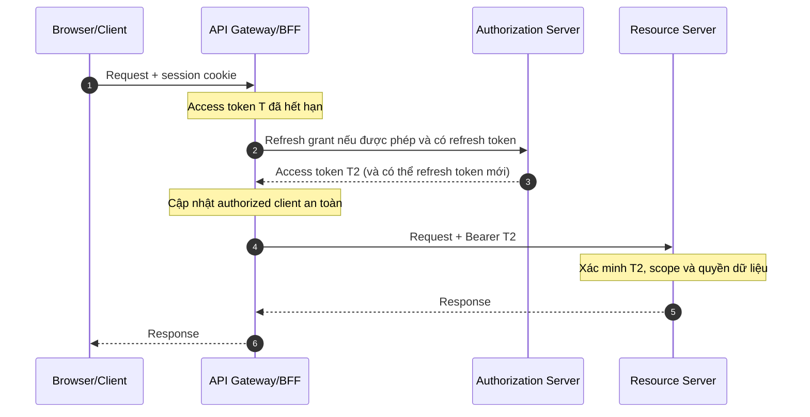

# Gateway cache và token lifetime

Một API Gateway thường đứng giữa hàng nghìn client và nhiều resource server. Mỗi request có thể phải kiểm tra access token, tìm khóa ký JWT, hỏi Authorization Server (AS) về opaque token hoặc xác định quyền truy cập. **Cache** giúp giảm độ trễ và tải cho hệ thống danh tính; **token lifetime** giới hạn khoảng thời gian một chứng cứ ủy quyền có thể được dùng. Nếu phối hợp sai, gateway có thể tiếp tục chấp nhận token đã hết hạn, đã thu hồi hoặc dành cho API khác.

Bài học **Gateway cache và token lifetime** thuộc chương **API gateway** của mô-đun **SECURITY_TOKEN_SECURITY_FUNDAMENTALS**. Phạm vi gồm mô hình tin cậy và vòng đời token bảo mật, phân biệt JWT/opaque, access/refresh token, claims, scope, audience, lưu trữ, thu hồi và chống dùng lại token trong OAuth 2.0/OIDC. Trọng tâm của bài là **cái gì được cache, cache bao lâu và khi nào buộc phải xác minh lại**.

Sau bài này, bạn có thể:

- Phân biệt cache **JWKS**, cache kết quả **introspection**, cache **OAuth2 authorized client**, cache **quyết định phân quyền** và cache **HTTP response**.
- Tính TTL cache không vượt quá tuổi thọ token và ngân sách chấp nhận chậm thu hồi.
- Giải thích sự khác biệt giữa token hết hạn, token bị thu hồi, thay đổi quyền và xoay khóa ký.
- Thiết kế cache an toàn khi gateway có nhiều instance, AS gặp sự cố hoặc khóa ký được thay mới.
- Kiểm tra các lỗi cấp quyền nhầm, replay, tenant isolation và rò rỉ dữ liệu qua cache.

## 1. Hai trục thời gian độc lập: token lifetime và cache lifetime

**Token lifetime** là khoảng hiệu lực của token theo quy tắc của AS và resource server. Với JWT access token, `exp` thường cho biết thời điểm token hết hạn; `nbf` có thể quy định thời điểm bắt đầu có hiệu lực. Với opaque access token, resource server thường biết trạng thái và thời hạn qua **introspection**, khi AS cung cấp các trường tương ứng.

**Cache lifetime** là thời gian gateway được tái sử dụng một dữ liệu đã lấy hoặc một kết quả đã tính. Đó có thể là khóa công khai, kết quả introspection, một authorized client đang giữ access token, hay chính sách phân quyền.

Ví dụ tại 10:00, một access token sẽ hết hạn lúc 10:05:

```text
10:00              10:03             10:05
  |------------------|-----------------|
  | Token hợp lệ theo exp (nếu không bị thu hồi sớm)
  |
  +-- Kết quả introspection được cache 60 giây --> 10:01
  +-- Bộ khóa JWKS được cache 10 phút ----------------> 10:10
```

JWKS còn được cache đến 10:10 **không có nghĩa** access token được phép sử dụng đến 10:10. Khóa ký xác minh tính toàn vẹn và nguồn phát hành; **thời hạn access token phải được kiểm tra độc lập ở mỗi request** hoặc bằng cache xác minh có giới hạn hết hạn nghiêm ngặt.

Ngược lại, nếu token có `exp` đến 10:05 nhưng AS thu hồi lúc 10:02, JWT chỉ kiểm tra offline có thể còn được chấp nhận đến 10:05 nếu không có kiểm tra trạng thái thu hồi. Với cache introspection, cửa sổ chấp nhận sau thu hồi phụ thuộc độ tươi của dữ liệu cache.

### Các mốc thời gian thường gặp

| Mốc hoặc trường | Ý nghĩa | Sai lầm cần tránh |
|---|---|---|
| `iat` | Thời điểm token được phát hành (nếu có) | Lấy `iat` thay cho `exp` để xác định còn hạn |
| `nbf` | Token chưa được dùng trước mốc này (nếu có) | Cache một kết quả “còn chưa hợp lệ” rồi tự động coi là hợp lệ mà không kiểm tra lại |
| `exp` | Token hết hạn; thời điểm được biểu diễn bằng NumericDate với JWT | Cho cache active/valid kéo dài qua `exp` |
| `jti` | Mã định danh token, hỗ trợ đối chiếu khi có thiết kế revocation | Tưởng có `jti` là đã xác minh token chưa bị thu hồi |
| `Cache-Control` hoặc TTL JWKS | Thời gian giữ metadata/khóa công khai | Suy ra hiệu lực access token từ cache JWKS |
| Cache TTL introspection | Thời gian dùng lại kết quả trạng thái token | Cache `active=true` không giới hạn sau khi AS đã thu hồi |
| Lifetime refresh token | Khoảng thời gian/điều kiện để xin token mới | Đem refresh token relay tới resource server |
| Session lifetime | Hiệu lực phiên client với BFF/gateway | Coi cookie phiên còn hiệu lực là access token chưa hết hạn |

**Một yêu cầu có thể đồng thời có token còn `exp`, phiên BFF đã kết thúc và cache JWKS còn khóa cũ.** Cần xác định rõ bộ phận nào quyết định trạng thái hợp lệ tại mỗi ranh giới tin cậy.

## 2. Những dữ liệu nên và không nên cache ở gateway

| Loại cache | Dữ liệu được lưu | Mục tiêu | Nguyên tắc an toàn |
|---|---|---|---|
| **JWKS / discovery metadata** | Khóa công khai và metadata từ issuer tin cậy | Tránh tải JWKS mỗi lần xác minh JWT | Ràng buộc với issuer, làm mới có giới hạn; không kéo dài tuổi token |
| **Opaque token introspection** | `active`, `sub`, `aud`, `scope`, `exp` nếu AS trả về | Giảm số lần gọi AS | TTL ngắn có giới hạn; tôn trọng cache policy và yêu cầu thu hồi |
| **JWT verification result** | Kết quả xác minh chữ ký/claims đã chuẩn hóa | Giảm chi phí xác minh khi lưu lượng lớn | Cache hết hạn trước token; gắn với issuer, audience, cấu hình kiểm tra |
| **OAuth2 authorized client** | Access token, metadata và có thể refresh token ở BFF | Duy trì phiên và xin token mới | Mã hóa/bảo vệ kho, giới hạn theo chủ thể và client registration |
| **Policy/permissions** | Vai trò, mapping scope, ACL/feature policy | Giảm truy vấn dữ liệu chính sách | Version/invalidation; không nhầm scope với quyền trên bản ghi |
| **HTTP response** | Body/status/header trả cho client | Giảm tải backend | Chống lẫn người dùng/tenant; mặc định không cache dữ liệu nhạy cảm |

Không phải mọi dữ liệu đều được cache theo một công thức. **Cache JWKS là cache khóa công khai**, khác bản chất với cache token hoặc kết quả xác thực liên quan danh tính cá nhân. Một cache dùng sai key hoặc TTL có thể gây lỗi bảo mật ngay cả khi thuật toán ký JWT không có lỗi.

### 2.1. Cache JWKS: cache khóa, không cache quyền

Một JWT ký số thường chứa header:

```json
{
  "alg": "RS256",
  "kid": "key-2026-01",
  "typ": "at+jwt"
}
```

Gateway xác định issuer đáng tin cậy từ cấu hình và token, rồi chọn khóa công khai tương ứng trong JWKS của **issuer đó**. Kết quả:

1. Tải và cache JWKS qua HTTPS từ địa chỉ được cấu hình/tìm qua metadata issuer đáng tin cậy.
2. Chọn khóa theo `kid` trong **bộ khóa của issuer đã tin**; kiểm tra thuật toán được phép.
3. Xác minh chữ ký và các điều kiện `iss`, `aud`, `exp`, `nbf`, loại token, scope...
4. Quyết định request có qua gateway hay không theo policy của route; backend vẫn kiểm tra quyền tài nguyên.

Gateway **không** được lấy URL tùy ý trong `jku`, `x5u` hoặc giá trị `kid` do token gửi để tải khóa không được kiểm soát. Khóa và issuer phải gắn với cấu hình đáng tin cậy, tránh **JWT key confusion** và tải URL tùy ý.

**TTL JWKS** có thể dài hơn tuổi thọ của một access token, vì mục đích cache hoàn toàn khác nhau. Tuy nhiên quá dài có thể làm gateway không nhận khóa mới hoặc tiếp tục giữ khóa đã cần loại bỏ khi có sự cố. Cần có cơ chế refresh, cache invalidation và chính sách xử lý khóa không tìm thấy:

- Khi AS **xoay khóa bình thường**, AS nên công bố khóa mới trước khi ký bằng khóa mới, đồng thời duy trì khóa cũ đủ thời gian cho token cũ còn hạn theo chính sách.
- Khi gặp `kid` lạ, gateway có thể làm mới JWKS có giới hạn tần suất; không thực hiện một outbound fetch vô hạn cho mỗi `kid` lạ vì có thể bị tấn công DoS.
- Khi AS **thu hồi khóa do lộ bí mật**, cần có luồng phản ứng khẩn cấp để làm mới/bỏ khóa nhanh hơn TTL thường lệ. Không dùng “stale key vô hạn” cho sự kiện này.
- Khi không lấy được bộ khóa tin cậy cần thiết, phải từ chối request chưa xác minh được, đồng thời ghi nhận sự cố; không cho qua chỉ vì JWKS service lỗi.

Một số hệ thống có thể tiếp tục dùng **JWKS đã được tin cậy và chưa vượt giới hạn stale được quy định** khi endpoint JWKS tạm lỗi. Đây phải là chính sách có thời hạn và đánh giá rủi ro rõ, không phải chế độ “bỏ xác minh”.

### 2.2. Cache introspection: lưu trạng thái có thể đổi

Với **opaque access token**, gateway thường không thể tự kiểm tra chữ ký hoặc giải mã claims. Nó gọi endpoint introspection của AS:

```http
POST /oauth2/introspect HTTP/1.1
Host: id.example.com
Content-Type: application/x-www-form-urlencoded

token=<opaque-access-token>
```

Ví dụ body phản hồi (giản lược):

```json
{
  "active": true,
  "sub": "user-42",
  "aud": ["orders-api"],
  "scope": "orders:read",
  "exp": 1893456000,
  "client_id": "frontend"
}
```

Phản hồi này chỉ đáng tin khi gateway gọi đúng AS qua kênh bảo mật, xác thực được endpoint, xác thực chính mình theo yêu cầu AS và kiểm tra kết quả đúng profile. `active=true` **không thay thế** audience, scope, expiry hoặc chính sách tenant. AS không bắt buộc phải cung cấp mọi trường mong muốn: trường thiết yếu còn thiếu thì phải từ chối hoặc xử lý theo hợp đồng xác thực đã thiết kế, không tự tạo giá trị mặc định có lợi cho client.

Lưu kết quả `active=true` trong cache đồng nghĩa gateway chấp nhận trạng thái đã biết trong một khoảng thời gian. Nếu AS thu hồi token ngay sau cache fill, gateway có thể chưa nhận biết đến khi cache entry hết hạn. Vì vậy **TTL introspection là một phần của cam kết về độ trễ thu hồi**, cần được các bên an ninh và nghiệp vụ chấp thuận.

Chỉ cache nếu AS/policy cho phép. Nếu phản hồi có chỉ thị `Cache-Control: no-store` thì không lưu kết quả vào cache. Nếu AS giới hạn freshness bằng chỉ thị hoặc hợp đồng API, TTL phải tôn trọng giới hạn đó. Không suy đoán `exp` từ thời gian cache.

**Cache kết quả âm tính (`active=false`):** thường không cần cache hoặc chỉ cache rất ngắn khi được phép để giảm tải lúc bị quét token rác. Chú ý chống memory exhaustion từ hàng triệu giá trị token ngẫu nhiên; đặt giới hạn kích thước và cardinality. Không tái sử dụng một lỗi timeout/`5xx` như một kết quả `active=true`.

### 2.3. Cache kết quả xác minh JWT: tối ưu có điều kiện

Nếu bottleneck là chi phí xác minh chữ ký JWT, có thể cache **kết quả xác minh** sau khi đầy đủ chữ ký, issuer, audience và điều kiện thời gian đã đạt. Nhưng cần xác định rõ việc cache thực sự tối ưu phép toán nào.

Ví dụ không an toàn:

```text
key = hash(token)
value = "ALLOW"
ttl = 1 hour
```

Token có thể hết hạn sau 3 phút, policy route có thể thay đổi, hoặc user bị tước quyền sau 10 phút. `ALLOW` chung không cho biết token được phép tới **route nào, audience nào hay với quyền gì**.

Nếu vẫn dùng cache, hãy lưu ngữ cảnh xác minh có cấu trúc (issuer, token fingerprint, validation profile/version, audience, thời điểm hết hạn tuyệt đối), đặt TTL không vượt `exp` và **kiểm tra lại** route/scope/ownership hiện tại ở mỗi request. Khi issuer, key, validator hoặc policy đổi, phải hết hiệu lực các entry có liên quan.

Trong nhiều hệ thống, xác minh JWT offline bằng JWKS cache đủ nhanh. Bắt đầu bằng cách đo latency/CPU; đừng thêm cache kết quả `ALLOW` phức tạp khi chưa chứng minh được lợi ích.

### 2.4. OAuth2 authorized client: đây là kho phiên token

Với Spring Cloud Gateway/BFF đăng nhập qua OAuth 2.0/OIDC, một `OAuth2AuthorizedClient` có thể chứa access token và refresh token được AS cấp cho một người dùng/client registration. Gateway đọc access token từ kho này để gọi downstream, ví dụ qua TokenRelay.

Đây không phải cache `active=true` của opaque token. Nhiệm vụ chính là lưu **chứng cứ có thể sử dụng** và quản lý vòng đời:

- Phân vùng theo **principal/user** và **client registration**, không lấy token của người dùng A để phục vụ người dùng B.
- Bảo vệ token ở trạng thái lưu (encryption/secret storage, giới hạn truy cập); loại bỏ khỏi log và debug dump.
- Không relay **refresh token** tới resource server; chỉ dùng refresh token ở luồng làm mới với AS.
- Khi access token hết hạn, authorized-client manager phải có cấu hình refresh phù hợp hoặc trả về trạng thái cần đăng nhập lại; đừng mặc định mọi TokenRelay filter tự làm mới trong mọi phiên bản.
- Khi logout, thu hồi phiên hoặc thay đổi cấp quyền, cần định nghĩa bước xóa/invalidating bản ghi authorized client và tác động của access token đã phát hành.
- Nếu gateway chạy nhiều instance, cần cơ chế lưu trữ phiên/token nhất quán; bản ghi in-memory trên một node có thể mất khi restart hoặc khác node.

## 3. Thiết kế TTL cache an toàn

### 3.1. Công thức giới hạn TTL

Giả sử gateway nhận kết quả introspection hợp lệ lúc `now`. Các giới hạn:

- `ttl_config`: TTL tối đa do hệ thống đặt cho kết quả introspection.
- `ttl_as`: mức freshness tối đa AS cho phép (nếu có); `no-store` nghĩa là **không cache**.
- `ttl_revocation`: khoảng thời gian tối đa nghiệp vụ chấp nhận có thể dùng trạng thái chưa cập nhật sau thu hồi.
- `exp - now - safety_margin`: thời gian còn lại trước khi token hết hạn, trừ biên an toàn nhỏ dùng cho sai lệch đồng hồ và độ trễ.

Một chính sách TTL thận trọng có thể tính:

\[
TTL_{\text{cache}} =
\max\left(0,\min\left(
TTL_{\text{config}},
TTL_{\text{AS}},
TTL_{\text{revocation}},
exp-now-\delta
\right)\right)
\]

Trong đó `δ` là biên an toàn. Nếu không có `exp`, **không coi hiệu lực là vô hạn**: áp dụng giới hạn TTL rất ngắn đã được chính sách AS/resource server phê duyệt hoặc không cache. Nếu chỉ thị AS cấm cache, bỏ qua công thức và không lưu entry.

Với hệ thống định nghĩa mức chậm thu hồi nghiêm ngặt, còn phải tính tới độ trễ truyền sự kiện thu hồi, đồng bộ node, refresh và đo đồng hồ; con số `TTL_revocation` phải đủ nhỏ để **toàn bộ độ trễ** không vượt yêu cầu.

**Ví dụ tính toán** tại 14:06:00:

| Thông số | Giá trị |
|---|---:|
| Access token `exp` | 14:10:00 |
| Thời gian còn trước `exp` | 240 giây |
| `ttl_config` | 60 giây |
| `ttl_as` | 45 giây |
| `ttl_revocation` | 30 giây |
| `safety_margin` | 5 giây |

Vậy `TTL_cache = min(60, 45, 30, 240 - 5) = 30 giây`. Cache entry này hết hiệu lực lúc **14:06:30**, dù token theo `exp` còn hiệu lực đến 14:10.

Nếu cùng token được introspect lại lúc 14:09:58, còn 2 giây đến `exp` và margin 5 giây thì TTL tính ra **0**. Gateway có thể xác minh từng request còn lại theo policy, nhưng không được tạo cache `active=true` kéo dài qua `exp`.

### 3.2. TTL tuyệt đối, không gia hạn chỉ vì cache hit

Với kết quả token validation, nên gắn **thời điểm hết hạn tuyệt đối** cho mỗi entry:

```text
createdAt = 14:06:00
expiresAt = 14:06:30

cache hit at 14:06:25 -> expiresAt vẫn 14:06:30
cache hit at 14:06:29 -> expiresAt vẫn 14:06:30
after 14:06:30        -> phải lấy dữ liệu mới hoặc từ chối theo policy
```

Không dùng kiểu **sliding expiration** tự động kéo dài thêm 30 giây mỗi lần cache hit, vì hệ thống có lưu lượng lớn có thể giữ `active=true` mãi bằng các hit liên tiếp. Chỉ một lần **tái xác minh hợp lệ** mới được cấp entry mới, với TTL tính lại theo `exp` và quy định hiện hành.

Lưu ý sai lệch đồng hồ: JWT validation thường cho phép một khoảng `clock skew/leeway` nhỏ để giảm lỗi ở biên `nbf`/`exp`. Leeway là quyết định của validator, **không** phải giấy phép kéo dài TTL cache tùy ý. Dùng đồng hồ đáng tin cậy và giới hạn `expiresAt` sao cho cache không vượt giới hạn thời gian đã được phê duyệt.

### 3.3. Key cache và phân vùng tin cậy

Một cache key chỉ chứa `sub=user-42` là nguy hiểm: cùng user có thể có nhiều token, scope, audience, tenant, client hoặc trạng thái thu hồi khác nhau. Cache validation/introspection phải phân biệt **chính token** và phạm vi xác minh.

Khái niệm một cache key đủ chặt:

```text
cache_key =
    trusted_issuer_id
    + token_fingerprint
    + validation_profile_version
    + audience_context_if_result_depends_on_audience
```

Với token có độ nhạy cao, có thể dùng **HMAC-SHA-256 bằng secret nội bộ** để tạo fingerprint; không để token nguyên văn làm key hiển thị trong log, dashboard, metrics hoặc thông báo lỗi. Secret tạo HMAC cũng cần được quản lý như bí mật. Khi chính sách thay đổi, phải invalidation theo version hoặc làm mới cache.

**Quyết định quyền không thể cache chỉ theo token** nếu phụ thuộc HTTP method, route, tenant, resource ID, trạng thái đơn hàng, vai trò mới cập nhật hoặc chính sách hiện hành. Có thể cache claims đã xác minh, nhưng kiểm tra quyền sở hữu bản ghi nên tiếp tục tại backend theo dữ liệu mới nhất cần thiết.

### 3.4. Cache phân tán và thời điểm hết hạn

Trong hệ thống nhiều gateway:

- Tất cả node phải dùng cấu hình issuer, policy và audience nhất quán.
- Cache local nhanh nhưng mỗi node có cửa sổ stale riêng; cache phân tán có thể giảm trùng lặp introspection nhưng tăng phụ thuộc mạng/cache service.
- TTL phải được thực thi theo **deadline tuyệt đối**; khi sao chép/đẩy entry, đừng đặt lại TTL như mới.
- Một instance restart không được dùng dữ liệu cache từ đĩa/backup đã vượt hạn hoặc có version validator cũ.
- Cache bị lỗi phải được xử lý theo chính sách **fail closed** đối với xác thực chưa có căn cứ tin cậy.
- Dùng giới hạn kích thước, eviction có kiểm soát và coalescing/single-flight đối với nhiều request đồng thời cho cùng token để chống quá tải AS.

**Single-flight** giúp 100 request cùng lúc cần introspection cho một token chỉ kích hoạt một cuộc gọi AS tại một thời điểm. Nó là tối ưu tải, không thay đổi yêu cầu phải xác minh đúng token và tuân thủ TTL.

## 4. Token lifetime trong OAuth 2.0/OIDC

Không tồn tại một con số “token lifetime chuẩn” áp dụng cho mọi hệ thống. Thời hạn cụ thể do AS và chính sách bảo mật quyết định theo client, người dùng, mức nhạy cảm và kiểu grant.

### 4.1. Access token

Access token là chứng cứ cho phép truy cập **resource server** trong phạm vi quyền nhất định. Nó có thể là JWT (thường chứa `exp`, `iss`, `aud`, `scope`) hoặc opaque token (quyền và hiệu lực được resource server xác định qua AS).

Chọn lifetime dựa trên rủi ro:

- **Ngắn hơn** giúp giới hạn cửa sổ sử dụng token bị đánh cắp nhưng tăng số lần làm mới và độ nhạy với sự cố AS.
- **Dài hơn** giảm chi phí refresh nhưng kéo dài tác động nếu access token bị lộ hoặc không được thu hồi chủ động.
- Scope và audience hẹp giảm tài nguyên có thể bị lạm dụng, nhưng **không** thay thế cơ chế hết hạn/thu hồi.
- Với API rất nhạy cảm, có thể dùng opaque/introspection hoặc JWT ngắn hạn kết hợp cơ chế kiểm tra trạng thái thu hồi.

Khi relay token tới downstream, **gateway không được sửa `exp`**, bổ sung scope hay thay đổi audience trong JWT để tiện gọi API. Nếu token không được phát hành cho backend, hãy lấy token khác hợp lệ qua OAuth flow phù hợp, ví dụ token exchange với AS hỗ trợ.

### 4.2. Refresh token

Refresh token dùng để yêu cầu AS phát hành access token mới; nó **không phải** access token của `orders-api`. Refresh token có thể có thời hạn tuyệt đối, thời hạn nhàn rỗi, rotation, ràng buộc client và chính sách thu hồi riêng.

Với gateway/BFF quản lý OAuth2 authorized client:



Gateway phải quản lý **refresh token rotation** theo đúng phản hồi AS; nếu AS trả refresh token mới, token cũ có thể không còn dùng được. Trong hệ thống nhiều instance, cần cập nhật atomically để tránh hai luồng refresh cùng sử dụng refresh token cũ. Khi refresh thất bại, không tái sử dụng access token đã hết hạn bằng cách dựa vào cache cũ.

### 4.3. ID token và phiên đăng nhập

ID token của **OpenID Connect** cung cấp thông tin xác thực cho client nhận đăng nhập; không dùng ID token thay access token gửi resource server. Thời hạn `exp` của ID token và thời hạn access token có thể khác nhau.

Một **session cookie** của BFF cũng có lifetime riêng. Phiên còn tồn tại không có nghĩa access token đang lưu đã còn hạn; BFF phải lấy token mới hợp lệ hoặc đưa người dùng qua luồng đăng nhập lại. Ngược lại, người dùng logout không làm JWT access token đã phát hành tự mất hiệu lực nếu resource server chỉ xác minh offline và token chưa tới `exp`.

### 4.4. Token exchange và token mới cho downstream

Khi gateway được phép đổi token theo **OAuth 2.0 Token Exchange (RFC 8693)**, AS có thể phát hành token mới với audience/scope thích hợp cho backend. Token mới có thể có `exp` **khác** token đầu vào.

Nếu cache token exchange, key phải bao gồm ngữ cảnh mà kết quả phụ thuộc: subject/actor, client, requested audience/resource, scope, policy/tenant và các ràng buộc cần thiết. Không lấy T2 của người dùng A cho người dùng B hay một audience khác. TTL entry token exchange phải hết trước `exp` của T2 và tuân thủ điều kiện ủy quyền của AS. Nếu token nguồn bị thu hồi, thiết kế phải xác định tác động lên token đã đổi.

## 5. Thu hồi token: điều gì khiến cache nguy hiểm?

**Hết hạn** xảy ra theo thời gian đã định. **Thu hồi** là thay đổi trạng thái trước hạn, ví dụ người dùng logout, tài khoản bị khóa, ứng dụng client bị thu hồi quyền hoặc nhà vận hành phát hiện token bị lộ.

### 5.1. JWT ký số được xác minh offline

Giả sử access token có `exp=15:00`, bị lộ lúc 14:30 và được AS thu hồi lúc 14:35. Resource server chỉ kiểm tra chữ ký và `exp` sẽ **không tự biết** sự kiện thu hồi. Nó có thể vẫn nhận token đến 15:00, tùy chính sách leeway và các ràng buộc khác.

Các cách giảm khoảng chấp nhận sau thu hồi:

1. Dùng access token ngắn hạn và bảo vệ quá trình refresh.
2. Dùng denylist/revocation registry theo `jti` hoặc fingerprint, có TTL đến khi token hết hạn.
3. Kiểm tra phiên/ủy quyền từ AS hoặc hệ thống trạng thái tin cậy khi cần bảo đảm thu hồi nhanh.
4. Phát sự kiện thu hồi đến gateway và backend, cập nhật cache/token state có version, có cách xử lý mất sự kiện.
5. Chuyển sang opaque/introspection cho các API yêu cầu trạng thái thu hồi cập nhật hơn.

Mỗi cách có độ trễ, chi phí và điểm lỗi khác nhau. Không tuyên bố “JWT bị thu hồi tức thì” nếu không có thành phần cập nhật trạng thái thực sự.

### 5.2. Opaque token với introspection cache

Giả sử opaque token được introspect với `active=true` lúc 10:00 và cache 90 giây. AS thu hồi lúc 10:00:01; gateway có thể còn chấp nhận token đến gần 10:01:30 nếu không nhận và xử lý tín hiệu invalidation. Nếu yêu cầu nghiệp vụ thu hồi trong **30 giây**, TTL 90 giây là không đạt.

Vì vậy cần ghi rõ **revocation SLO**: “Sau sự kiện thu hồi được AS xác nhận, mọi gateway/resource server ngừng chấp nhận token trong tối đa X giây”, nếu hệ thống thực sự có khả năng đo và đáp ứng điều kiện này. Để đạt SLO, phải tính cả propagation, cache, đồng hồ, hệ thống down và các đường gọi backend trực tiếp.

| Tình huống | Cơ chế | Cửa sổ chậm thu hồi |
|---|---|---|
| JWT offline, không kiểm tra trạng thái | Chỉ chữ ký và expiry | Có thể đến thời điểm `exp` |
| Opaque token introspection mỗi request | Hỏi AS khi mỗi request đến | Thường gần trạng thái hiện tại của AS; phụ thuộc tính nhất quán của AS |
| Opaque token introspection cache 30 giây | Cache `active=true` theo TTL tuyệt đối | Có thể tới 30 giây cộng chi phí truyền/đồng bộ |
| JWT + denylist phân tán | Kiểm tra token ID trên từng request | Theo độ trễ cập nhật và khả dụng của denylist |
| JWT ngắn hạn + refresh rotation | Giới hạn thời gian access token tồn tại | Đến access token expiry nếu không có thu hồi bổ sung |

Khi mất kết nối tới AS hoặc cache trạng thái thu hồi, phải có chính sách rõ cho endpoint cần bảo vệ. **Fail closed** nghĩa là không mặc định cấp phép request chưa xác minh được; tùy kiến trúc, có thể dùng dữ liệu đã được tin cậy **chưa quá TTL hợp lệ**, nhưng không cho phép sử dụng entry đã quá hạn chỉ vì hệ thống bên ngoài lỗi.

### 5.3. Key rotation không phải token revocation thông thường

Xoay khóa JWT bình thường có thể giữ khóa cũ đủ lâu để xác minh token hợp lệ cũ. Ngược lại, khi khóa bí mật bị lộ, việc loại bỏ khóa cũ khỏi JWKS hoặc policy phải được xử lý như sự kiện bảo mật. Cache JWKS “stale” quá lâu khiến gateway vẫn xác minh token ký bằng khóa cần loại bỏ.

Gateway cần phân biệt:

- **Refresh JWKS khi `kid` mới**: làm mới có rate limit, chỉ từ endpoint issuer đáng tin.
- **AS công bố bộ khóa mới**: cập nhật cache theo chỉ thị và vòng đời khóa.
- **Thu hồi khóa khẩn cấp**: invalidation có khả năng cưỡng chế; kiểm tra ảnh hưởng tới token cũ.
- **Unknown `kid` liên tục**: chặn request và chống flood fetch JWKS; không fallback sang khóa bất kỳ.

## 6. Phân quyền và HTTP response cache: hai loại “ALLOW” khác nhau

### 6.1. Scope không đồng nghĩa quyền trên tài nguyên

Giả sử gateway đã xác minh một access token với `scope=orders:read`. Người dùng yêu cầu:

```http
GET /orders/123 HTTP/1.1
Authorization: Bearer <access-token>
```

Gateway có thể cho request qua vì token phù hợp route. Nhưng `orders-api` phải kiểm tra đơn 123 có thuộc subject và tenant được cấp quyền không. **Không cache `ALLOW` chung cho user/token rồi áp dụng cho mọi `orderId`.**

Nếu cache một quyết định phân quyền trên tài nguyên cụ thể, key tối thiểu phải xét principal, tenant, action, resource, policy version và các thuộc tính phụ thuộc quyền; TTL/invalidation phải đáp ứng khi owner/role thay đổi. Với dữ liệu thay đổi thường xuyên, kiểm tra trực tiếp tại backend có thể đúng hơn.

### 6.2. HTTP response cache và dữ liệu cá nhân

Cache kết quả token validation không đồng nghĩa cache **HTTP response**. Một reverse proxy hoặc CDN có thể lưu response của `GET /orders/123`. Nếu key chỉ gồm đường dẫn và không phân tách user/tenant, người dùng B có thể nhận body đơn hàng của A dù access token của B hợp lệ.

Quy tắc an toàn cho dữ liệu nhạy cảm theo mặc định:

```http
HTTP/1.1 200 OK
Cache-Control: no-store
Content-Type: application/json
```

`no-store` yêu cầu các cache tuân thủ không lưu response. `private` chỉ giới hạn cache dùng chung, không cấm cache riêng của trình duyệt; vì vậy `private` không luôn thay thế `no-store` cho dữ liệu nhạy cảm.

Nếu muốn cache HTTP response có phân quyền, phải thiết kế policy cụ thể về cache key (principal/tenant/authorization variation), revalidation, trạng thái tài nguyên, quyền thay đổi và dữ liệu nhạy cảm. Các quy tắc HTTP caching như `Vary` và `Cache-Control` phải được áp dụng có chủ đích. Không dựa vào một URI hoặc tham số `userId` do client gửi để quyết định danh tính.

## 7. Quy trình tham chiếu tại gateway

Giả mã dưới đây mô tả bộ kiểm tra opaque token với cache; **không phải triển khai sản xuất**. Thư viện JWT/OAuth và cache thực tế phải được kiểm thử và cấu hình riêng:

```text
authorizeRequest(req):
    route = selectRouteAndPolicy(req.method, normalizedPath(req.path))
    token = parseSingleBearerHeader(req.headers)
    if token is missing or malformed:
        return 401

    if route.tokenType == "jwt":
        jwks = trustedJwksCache.get(route.expectedIssuer)
        if jwks cannot be trusted:
            return 401
        claims = verifySignatureIssuerAudienceTypeAndTime(
            token, jwks, route.allowedAlgorithms,
            route.expectedIssuer, route.expectedAudience, now()
        )
    else:
        key = hmacFingerprint(token, route.expectedIssuer,
                              route.validationProfileVersion)
        entry = introspectionCache.lookup(key)
        if entry exists AND entry.expiresAt > now():
            claims = entry.claims
        else:
            response = trustedAs.introspect(token)
            if response unavailable:
                return 401  // chưa xác minh được, fail closed
            if response.active != true:
                return 401

            claims = validateIntrospectionResponse(response, route)
            ttl = calculateBoundedTtl(
                now(), claims.exp, response.cachePolicy,
                route.maxCacheTtl, route.revocationBudget,
                route.safetyMargin
            )
            if ttl > 0 and cachingAllowed(response):
                introspectionCache.putWithAbsoluteDeadline(
                    key, claims, now() + ttl
                )

    // Thực hiện ở MỌI request, kể cả cache hit:
    if claims invalid or expired or notYetValid:
        return 401
    if route.expectedAudience not in claims.audience:
        return 401
    if not hasRequiredScopes(claims.scopes, route.requiredScopes):
        return 403

    removeClientSuppliedIdentityHeaders(req)
    return forwardToAllowlistedBackend(req, token)

ordersApi(req):
    user = verifyAccessTokenOrTrustedGatewayContext(req)
    requirePermission(user, "orders:read")
    requireOrderBelongsToAuthorizedSubjectAndTenant(req.orderId, user)
    return getOrder(req.orderId)
```

Điểm cốt lõi là **cache hit chỉ thay thế bước lấy dữ liệu đã được xác minh**, không được thay bước kiểm tra audience/scope và quyền tài nguyên. Trong trường hợp token được ràng buộc bằng mTLS/DPoP, cần kiểm tra **proof ở request hiện tại**, không tái sử dụng một kết quả proof hợp lệ từ request khác.

### Ví dụ cấu hình cache có tính chính sách

Cấu hình YAML **minh họa**, không phải schema mặc định của Spring Cloud Gateway, Kong, Envoy hoặc sản phẩm cụ thể:

```yaml
security:
  trustedIssuer: https://id.example.com
  expectedAudience: orders-api

  jwksCache:
    maxTtlSeconds: 600
    refreshOnUnknownKeyId: true
    minSecondsBetweenForcedRefreshes: 30
    allowArbitraryJkuOrX5u: false

  introspectionCache:
    enabled: true
    maxTtlSeconds: 60
    revocationFreshnessBudgetSeconds: 30
    expirySafetyMarginSeconds: 5
    cacheNegativeResults: false
    respectAuthorizationServerCachePolicy: true
    useAbsoluteExpiration: true

  routes:
    - method: GET
      path: /orders/**
      upstream: orders-api
      requiredAudience: orders-api
      requiredScopes: [orders:read]
    - method: POST
      path: /orders
      upstream: orders-api
      requiredAudience: orders-api
      requiredScopes: [orders:write]
```

Mọi tham số phải gắn với khả năng của framework đang sử dụng; không copy nguyên ví dụ như cấu hình sản phẩm. Các thành phần gateway phải xử lý đúng path normalization, route precedence, HTTP method và protected/public endpoint. Trên HTTP client, cấu hình redirect phải không gửi bearer token sang host lạ.

## 8. Lỗi triển khai thường gặp

| Tình huống | Hậu quả | Cách xử lý |
|---|---|---|
| Cache `active=true` 1 giờ, token chỉ còn 5 phút | Chấp nhận token quá hạn nếu chỉ tin cache | TTL không vượt `exp`; kiểm tra thời gian mỗi request |
| Cache introspection lâu hơn ngân sách thu hồi | Token bị thu hồi còn dùng được | Rút TTL, bổ sung invalidation hoặc introspection realtime |
| Sliding TTL reset khi có cache hit | Entry không bao giờ hết hạn nếu có nhiều request | Deadline tuyệt đối theo lần kiểm tra thành công |
| Key cache chỉ theo `sub` | Nhầm scope, token hoặc tenant | Phân biệt token fingerprint và validation context |
| Cache một quyết định `ALLOW` cho mọi route | Quyền đọc bị suy ra quyền ghi | Kiểm tra method, route, audience, scope ở mỗi request |
| Gateway dùng token `aud=profile-api` để gọi `orders-api` | Token dùng sai resource server | Xác minh audience hoặc token exchange |
| Gateway cache JWT validation nhưng không biết policy đổi | Quyền cũ tiếp tục được dùng | Version/invalidate cache và kiểm tra quyền trên tài nguyên |
| Gateway cache JWKS nhưng không làm mới khi xoay khóa | 401 cho token hợp lệ mới | Refresh có rate limit từ issuer tin cậy |
| Gateway nhận khóa `jku` của token từ URL bất kỳ | Bị ép tin khóa của attacker hoặc SSRF | Khóa chặt nguồn JWKS và thuật toán |
| Introspection timeout thì cho phép | Fail open, bỏ qua xác thực | Fail closed; giám sát outage và xử lý dữ liệu còn hợp lệ theo policy |
| Cache kết quả introspection không phân biệt issuer | Tráo token giữa trust domain | Key theo issuer/profile/token fingerprint |
| Cache HTTP response user A cho user B | Rò rỉ đơn hàng/dữ liệu tenant | `no-store` mặc định cho dữ liệu nhạy cảm; kiểm soát cache key |
| BFF lưu refresh token trong log hoặc bộ nhớ không bảo vệ | Đánh cắp token làm mới | Bảo vệ token store, rotation, xóa khi phiên kết thúc |
| Gateway relay DPoP-bound token mà bỏ proof check | Mất tác dụng sender constraint | Kiểm tra proof theo profile/hop hoặc đổi token hợp lệ |
| Cache entry từ node cũ được nhân bản và reset TTL | Trạng thái cũ tồn tại lâu hơn chính sách | Giữ absolute expiration khi replicate hoặc migrate |

## 9. Kiểm thử cache và lifetime theo tình huống

Trước khi đưa gateway vào vận hành, kiểm thử cả đường thành công và lỗi với token test:

1. **Hết hạn trong khi cache còn entry:** token `exp` sau 15 giây, cache mặc định 60 giây; sau `exp` phải từ chối. Kiểm tra cả khi cache hit liên tục.
2. **Thu hồi ngay sau cache fill:** AS trả `active=true`, sau 1 giây thu hồi. Đo độ trễ từ thu hồi đến khi **tất cả gateway node** từ chối, đối chiếu ngân sách thu hồi.
3. **Token khác cùng subject:** hai token cùng `sub` nhưng khác scope, audience hoặc tenant. Cache không được trộn quyền.
4. **Thay đổi policy giữa chừng:** hạ quyền từ `orders:write` xuống `orders:read` theo nguồn quyền đã thiết kế; quyết định mới phải có hiệu lực đúng SLA.
5. **JWKS thêm/thu hồi khóa:** kiểm tra token ký bằng `kid` mới, khóa cũ và khóa khẩn cấp bị loại bỏ; bảo đảm không fetch URL tùy ý.
6. **AS timeout/500:** request chưa có kết quả tin cậy bị chặn; cache entry còn hợp lệ được sử dụng hay không phải đúng chính sách, không “stale forever”.
7. **Đồng hồ lệch:** kiểm tra `exp`, `nbf`, clock skew được giới hạn; cache không tái tạo TTL sau `exp`.
8. **Concurrent refresh:** nhiều request đồng thời lúc access token BFF hết hạn; không dùng refresh token cũ nhiều lần làm hỏng refresh rotation.
9. **Multi-node và restart:** load balancing qua nhiều gateway, restart node; session/authorized client và cache deadline vẫn đúng.
10. **Response caching:** người dùng A xem đơn 123, người dùng B gửi URL tương tự; không bao giờ nhận được body hoặc metadata riêng tư của A.
11. **Proof-of-possession:** với DPoP/mTLS, token và proof đã hết freshness hoặc proof của request khác bị từ chối ngay cả khi token metadata cache còn hợp lệ.
12. **Replay và tracing:** xác minh token không xuất hiện trong request URL, log, trace, metrics label, error page và báo cáo sự cố.

Chỉ số theo dõi nên gồm cache hit/miss theo *loại cache* (không theo giá trị token), latency introspection, lỗi xác minh JWT, timeout AS, phân bố 401/403, số lần forced JWKS refresh, token gần expiry và độ trễ nhận biết thu hồi. Tránh biến fingerprint token thành label có cardinality rất cao hoặc thành dữ liệu có thể liên kết danh tính trong hệ thống quan sát.

## 10. Bài tập suy luận với thời gian cụ thể

Một API Gateway lúc **09:00:00 ngày 24/11/2026 (UTC+07)** introspect opaque access token T và nhận:

```json
{
  "active": true,
  "sub": "user-42",
  "aud": ["orders-api"],
  "scope": "orders:read",
  "exp": 1795485900
}
```

Giá trị `exp` (Unix timestamp, tính bằng giây) tương ứng **09:05:00 cùng ngày**, còn đúng 300 giây. Gateway cấu hình TTL introspection tối đa 120 giây, AS cho phép cache tối đa 60 giây, yêu cầu thu hồi có hiệu lực trong 30 giây và biên an toàn 5 giây. Token bị thu hồi lúc **09:00:10**. Không có push invalidation.

**Câu hỏi 1:** Cache kết quả `active=true` lần đầu tối đa bao lâu? Vì sao?

**Đáp:** `min(120, 60, 30, 300-5) = 30 giây`, tức entry hết hạn lúc **09:00:30**. TTL bị giới hạn bởi ngân sách thu hồi, không bởi thời điểm token hết hạn. Nếu AS cập nhật trạng thái thu hồi kịp thời và các thành phần tuân thủ chính sách, request sau cache expiry sẽ introspect lại và nhận `active=false`.

**Câu hỏi 2:** Nếu gateway dùng sliding expiration 30 giây và mỗi 5 giây có một cache hit, điều gì xảy ra?

**Đáp:** Kết quả `active=true` có thể được gia hạn liên tục dù token đã thu hồi. Đây là lỗi thiết kế vì cache hit không phải một lần xác minh lại.

**Câu hỏi 3:** Nếu gateway vẫn giữ JWKS trong 10 phút, nó có được chấp nhận T đến 09:10 không?

**Đáp:** Không. T là **opaque token** nên JWKS không cung cấp trạng thái introspection của T; dù đang nói tới JWT, cache khóa ký cũng không thay thế kiểm tra `exp` và revocation. Cần tách ba loại dữ liệu: khóa công khai, trạng thái token và quyền trên tài nguyên.

## 11. Checklist thiết kế

- **Định nghĩa chính xác cache nào đang tồn tại:** JWKS, introspection, verified claims, authorized client, policy hay HTTP response; mỗi loại có cách lập key và invalidation riêng.
- **Tính TTL theo biên thấp nhất:** không quá token expiry, cache policy AS, giới hạn vận hành và ngân sách thu hồi. Dùng thời hạn tuyệt đối, không kéo dài theo cache hit.
- **Giữ đúng ranh giới tin cậy:** cố định issuer và thuật toán, kiểm tra audience/scope theo API, bảo vệ backend, không dùng token sai mục đích, không tin header danh tính do client tự đưa.
- **Phân biệt refresh và access token:** refresh token chỉ đi tới AS theo luồng phù hợp, BFF quản lý an toàn, xử lý refresh rotation và lỗi đồng thời.
- **Xử lý outage và key rotation:** fail closed khi chưa xác minh được; refresh JWKS từ nguồn tin cậy có rate limit; có đường thu hồi khóa khẩn cấp.
- **Bảo vệ dữ liệu cache:** không lưu token thô trong log/key hiển thị, mã hóa kho token, phân vùng user/client/tenant, kiểm soát cache nhiều node.
- **Không cache nhầm quyền/response:** kiểm tra quyền bản ghi tại backend; tránh cache response nhạy cảm dùng chung cho nhiều user.
- **Đo và kiểm thử cửa sổ thu hồi:** kiểm thử revoked token, token exp sát biên, policy update, restart, clock skew, AS timeout và sender-constrained token.

**Nguyên tắc kết luận:** *cache chỉ giúp tái sử dụng một sự thật đã được xác minh trong thời gian hữu hạn; nó không kéo dài hiệu lực token hay tạo thêm quyền*. Gateway an toàn khi có thể trả lời rõ **cache dữ liệu gì**, **key gắn với ai và điều kiện nào**, **TTL bị chặn bởi thời hạn nào**, **khi nào invalidation**, và **backend còn phải kiểm tra gì**.

### Tài liệu tiêu chuẩn để tra cứu

- [RFC 6749 — The OAuth 2.0 Authorization Framework](https://www.rfc-editor.org/rfc/rfc6749)
- [RFC 6750 — OAuth 2.0 Bearer Token Usage](https://www.rfc-editor.org/rfc/rfc6750)
- [RFC 7009 — OAuth 2.0 Token Revocation](https://www.rfc-editor.org/rfc/rfc7009)
- [RFC 7662 — OAuth 2.0 Token Introspection](https://www.rfc-editor.org/rfc/rfc7662)
- [RFC 8725 — JSON Web Token Best Current Practices](https://www.rfc-editor.org/rfc/rfc8725)
- [RFC 9068 — JWT Profile for OAuth 2.0 Access Tokens](https://www.rfc-editor.org/rfc/rfc9068)
- [RFC 9449 — OAuth 2.0 Demonstrating Proof of Possession (DPoP)](https://www.rfc-editor.org/rfc/rfc9449)
- [RFC 9111 — HTTP Caching](https://www.rfc-editor.org/rfc/rfc9111)
