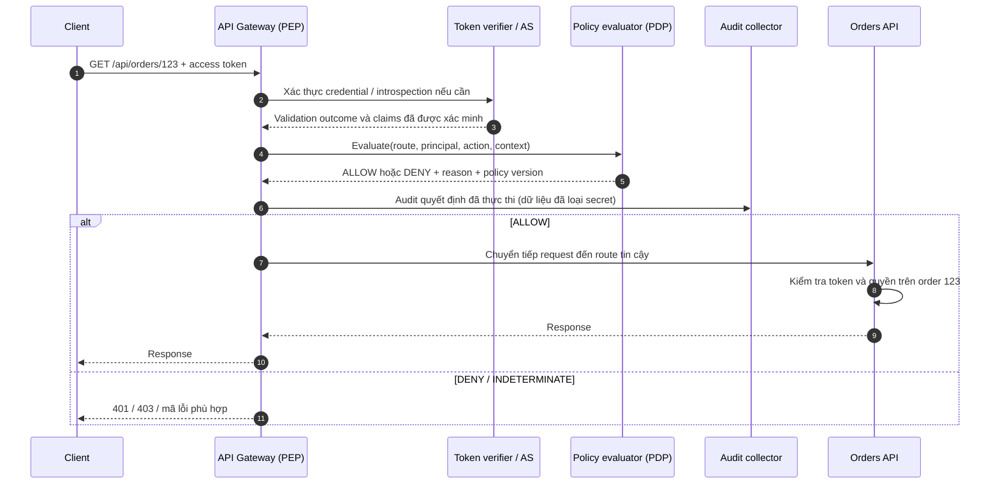
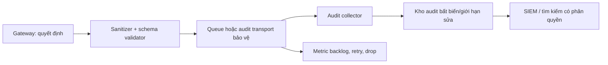

# Audit gateway decision: ghi nhận và truy vết quyết định tại API Gateway

## 1. Mục tiêu và phạm vi

Trong kiến trúc nhiều dịch vụ, **API Gateway** thường là điểm tiếp nhận yêu cầu từ client và đưa ra những quyết định có tác động trực tiếp đến bảo mật: token có hợp lệ không, yêu cầu được phép đi vào route nào, scope có đủ không, có cần chặn vì giới hạn truy cập hay không, và có được chuyển tiếp credential đến downstream hay không. **Audit gateway decision** là quá trình tạo bằng chứng có cấu trúc về **quyết định đã được đánh giá và thực thi tại gateway**, đủ để giải thích về sau *ai hoặc thành phần nào yêu cầu điều gì, dựa trên chính sách nào, gateway đã cho phép hay từ chối, và vì sao*.

Bài thuộc chương **API gateway** của module **SECURITY_TOKEN_SECURITY_FUNDAMENTALS**, gắn với mô hình tin cậy và vòng đời token trong OAuth 2.0/OpenID Connect (OIDC). Các chủ đề JWT, opaque token, access token, refresh token, kiểm tra issuer, claims, scope, audience, phát hành, lưu trữ, thu hồi và chống token bị đánh cắp hoặc phát lại đều có ý nghĩa đối với việc **tạo audit đúng sự thật và an toàn**. Trọng tâm ở đây là các **quyết định của gateway**; audit nghiệp vụ cuối cùng vẫn thuộc trách nhiệm của downstream.

Sau bài này, bạn có thể:

1. Phân biệt **security audit event**, application log, access log, metric và distributed trace.
2. Xác định thời điểm và vị trí phát sinh audit event cho quyết định **ALLOW**, **DENY** và **INDETERMINATE**.
3. Thiết kế schema audit event chứa bằng chứng đủ dùng, không ghi lại access token hoặc các claims nhạy cảm không cần thiết.
4. Liên kết các sự kiện từ gateway, authorization server và downstream mà vẫn giữ đúng ranh giới tin cậy.
5. Thiết lập kiểm soát tính toàn vẹn, khả năng truy xuất, độ tin cậy của pipeline và bộ kiểm thử cho hệ thống audit.

## 2. Audit một quyết định nghĩa là gì?

Ví dụ client gọi `GET /api/orders/123` kèm bearer access token. Gateway kiểm tra chữ ký JWT hoặc trạng thái opaque token qua introspection, đối chiếu `iss`, `aud`, thời hạn, `scope` với yêu cầu của route và có thể kiểm tra rate limit. Nếu hợp lệ, gateway cho phép request đi tiếp tới Orders API; nếu không, gateway chặn tại biên.

Một bản ghi audit có ích cần trả lời được các câu hỏi:

| Câu hỏi | Dữ liệu điển hình | Tại sao quan trọng |
| --- | --- | --- |
| **Khi nào?** | `occurred_at`, `event_id`, `request_id` | Dựng lại thứ tự sự kiện, nhận diện request lặp và điều tra sự cố. |
| **Ở đâu?** | Gateway instance, environment, route ID, downstream logical service | Biết chính sách nào và vị trí nào đã xử lý request. |
| **Ai/yêu cầu từ đâu?** | Chủ thể **đã xác minh**, OAuth client ID, tenant được xác minh nếu cần | Điều tra danh tính một cách có căn cứ. |
| **Làm gì?** | HTTP method, route template, action được ánh xạ | Xác định thao tác được yêu cầu mà không ghi toàn bộ path hay payload nhạy cảm. |
| **Quyết định gì?** | `ALLOW`, `DENY`, `INDETERMINATE`; HTTP status; `enforced` | Phân biệt kết quả đánh giá chính sách và kết quả áp dụng trên lưu lượng. |
| **Dựa vào đâu?** | Policy ID/version, token-validation outcome, audience/scope check, reason code | Giải thích quyết định với chính sách đang hiệu lực. |
| **Có chuyển tiếp?** | Route đã chọn, trạng thái dispatch, downstream response trong sự kiện riêng | Phân biệt được phép chuyển tiếp với thực tế upstream có nhận và xử lý request hay không. |

**Audit khác log thông thường** ở chỗ audit biểu diễn sự kiện bảo mật có ngữ nghĩa, cấu trúc ổn định và được bảo vệ tính toàn vẹn để có thể tra cứu lâu dài. Một dòng debug như `JWT invalid` không đủ biết request, route, lý do bị từ chối và chính sách đã áp dụng.

| Tín hiệu | Mục đích chính | Lưu ý |
| --- | --- | --- |
| **Security audit event** | Bằng chứng quyết định bảo mật và ai đã thực thi | Ghi reason code, policy version, actor đã kiểm chứng và kết quả thực thi; hạn chế quyền sửa/xóa. |
| **Access log** | Theo dõi lưu lượng HTTP, latency, mã phản hồi | Có thể chứa raw URL, user agent hoặc IP; không nên coi là chứng cứ phân quyền đầy đủ. |
| **Application log** | Chẩn đoán lỗi triển khai | Mức log thay đổi, có stack trace; cần lọc secret. |
| **Metric** | Đếm số lần `allow/deny`, tỷ lệ lỗi, latency | Dữ liệu tổng hợp; không thay thế record của từng quyết định quan trọng. |
| **Distributed trace** | Theo dõi request qua nhiều dịch vụ | Trace ID giúp liên kết audit, nhưng span/tag không được chứa bearer token. |

## 3. Mô hình tin cậy: ai quyết định, ai ghi nhận?

Trong một kiến trúc phổ biến:

- **Client** trình bày access token; mọi header tự khai báo danh tính (`X-User-Id`, `X-Roles`...) do client gửi đều là đầu vào chưa đáng tin.
- **Authorization Server** phát hành token và có thể xác minh opaque token qua introspection. Nó có log riêng về phát hành, refresh, thu hồi, token exchange và hoạt động đăng nhập.
- **Gateway** xác thực credential, áp dụng policy gắn với route, giới hạn lưu lượng và quyết định có chuyển tiếp request hay không. Đây là điểm tạo **audit gateway decision**.
- **Downstream Resource Server** kiểm tra audience, scope, tenant và quyền trên đối tượng thực tế. Nó tạo **audit nghiệp vụ/quyết định truy cập của riêng mình**.
- **Audit collector / SIEM** nhận, lưu trữ và cung cấp truy vấn sự kiện với phân quyền chặt chẽ; không trở thành nơi giữ bản sao credential.



**PEP** (*Policy Enforcement Point*) là nơi thực thi kết quả; **PDP** (*Policy Decision Point*) là nơi đánh giá chính sách. Chúng có thể nằm cùng trong gateway hoặc là các thành phần riêng. Nếu PDP trả về `ALLOW` nhưng gateway không gửi được request, không nên ghi rằng downstream đã xử lý thành công. Ngược lại, HTTP `200` từ downstream không thay thế bằng chứng gateway đã đánh giá chính sách nào.

## 4. Phân loại quyết định và điểm phát sinh sự kiện

### 4.1. Phân biệt decision, enforcement và outcome

Thiết kế audit nên tách ba ý:

1. **Decision:** bộ đánh giá trả về `ALLOW`, `DENY` hoặc `INDETERMINATE` (không thể đánh giá đáng tin, chẳng hạn do introspection hoặc PDP timeout).
2. **Enforcement:** gateway thực tế đã cho request đi tiếp hay đã từ chối. Nếu không thể đánh giá an toàn, mặc định **không cấp quyền**; xử lý HTTP status theo loại lỗi.
3. **Outcome:** downstream đã nhận/xử lý thành công, trả lỗi hay chưa được gọi; đây là sự kiện giao tiếp/request completion khác với quyết định phân quyền.

Ví dụ `ALLOW` + `forward_dispatched=false` + `502` nghĩa là gateway cho phép theo policy nhưng upstream lỗi. `DENY` + `forward_dispatched=false` + `403` nghĩa là gateway chủ động chặn. Không nên coi cả hai là cùng một loại thất bại.

| Điểm kiểm tra | Khi chấp nhận | Khi từ chối hoặc không thể xác định | Reason code mẫu |
| --- | --- | --- | --- |
| Bearer credential | Có đúng access token theo cấu hình | Thiếu/sai cú pháp, token bị giả mạo | `MISSING_TOKEN`, `MALFORMED_TOKEN` |
| JWT / opaque token | Issuer, chữ ký/introspection, thời hạn hợp lệ | Hết hạn, bị thu hồi, chữ ký sai, introspection lỗi | `TOKEN_EXPIRED`, `TOKEN_INACTIVE`, `TOKEN_INVALID`, `INTROSPECTION_UNAVAILABLE` |
| Audience / token type | Token dành cho resource/route hiện tại | Dùng ID token, refresh token hoặc token của API khác | `WRONG_TOKEN_TYPE`, `INVALID_AUDIENCE` |
| Scope / role / client | Quyền và client phù hợp với action | Thiếu scope, client bị cấm | `INSUFFICIENT_SCOPE`, `CLIENT_NOT_ALLOWED` |
| Tenant / object context | Ngữ cảnh kiểm chứng thỏa policy gateway có thể đánh giá | Tenant mismatch; quyền trên bản ghi cụ thể phải xét ở downstream | `TENANT_MISMATCH` |
| Route / rate limit | Route hợp lệ và chưa vượt quota | Route bị chặn, quá giới hạn | `ROUTE_DISABLED`, `RATE_LIMITED` |
| PDP / policy system | Trả quyết định đáng tin theo policy version | Không có policy an toàn, timeout, lỗi đánh giá | `POLICY_UNAVAILABLE`, `POLICY_EVALUATION_ERROR` |

`INDETERMINATE` là **kết quả đánh giá**, không phải trạng thái để gateway tự cho request đi qua. Có thể ánh xạ sang HTTP `503` khi hệ thống xác thực/phân quyền tạm thời không sẵn sàng; với credential sai hoặc thiếu thường dùng `401`, thiếu quyền dùng `403`, rate limit dùng `429`. Mã HTTP trả cho client không nhất thiết tiết lộ đầy đủ lý do nội bộ.

### 4.2. Các sự kiện nên có

- `gateway.security_decision.v1`: kết quả xác thực/phân quyền **thực sự áp dụng** tại biên, chứa `decision`, `reason_code`, `policy_version`, `enforced`.
- `gateway.upstream_dispatch.v1`: đã thử gọi downstream nào, thành công gửi request hay gặp lỗi kết nối; không gắn giá trị bearer token.
- `gateway.request_completed.v1`: trạng thái hoàn tất HTTP và latency, để đối chiếu với quyết định trước đó.
- `gateway.audit_pipeline_health.v1` hoặc metric riêng: lỗi xuất bản, độ trễ, backlog, drop count; dùng để phát hiện mất audit.

Không nhất thiết phải tạo cả bốn sự kiện cho mọi request. Với hệ thống nhỏ, có thể gộp thông tin dispatch/completion vào bản ghi bổ sung nhưng phải giữ được ý nghĩa **quyết định** tách biệt **kết quả downstream**. Một request có thể phát sinh nhiều phép kiểm tra và nhiều sự kiện; mọi sự kiện cần `event_id` riêng nhưng có cùng `request_id` hoặc `trace_id` đã chuẩn hóa.

### 4.3. Lưu ý quan trọng về vị trí instrumentation

Trong một số framework, middleware xác thực có thể chặn request **trước** khi request đến các filter định tuyến của gateway. Ví dụ với Spring Security WebFlux, lỗi bearer có thể được trả bởi `ServerAuthenticationEntryPoint` hoặc `ServerAccessDeniedHandler` mà không chạy tới `GlobalFilter` của Spring Cloud Gateway. Nếu chỉ audit trong route filter, bạn sẽ **bỏ sót rất nhiều sự kiện 401/403**.

Do đó cần instrument tại đúng điểm từ chối của lớp authentication/authorization, đồng thời instrument các quyết định riêng ở route/rate limit và chặng dispatch. Tránh ghi trùng `DENY` bằng cách xác định **một nguồn sự thật** cho mỗi decision type, sử dụng `event_id`/`decision_id` để liên kết và deduplicate khi retry.

## 5. Thiết kế schema audit event an toàn

Một event nên dùng schema có phiên bản. Dưới đây là **bản ghi giả định** về token hợp lệ nhưng không đủ `orders:write` để thực hiện `POST /api/orders`:

```json
{
  "schema_version": "1.0",
  "event_type": "gateway.security_decision.v1",
  "event_id": "evt_01JZ4T6B55C9KDQ1A5MEZ4N7RB",
  "occurred_at": "2026-11-23T09:30:01.456Z",
  "environment": "production",
  "gateway_id": "edge-gw-a",
  "request_id": "req_8d13c4",
  "trace_id": "6f3e7cd949d74a07a96a83987dfb238b",
  "route": {
    "id": "orders-write",
    "target_service": "orders-api",
    "http_method": "POST",
    "path_template": "/api/orders"
  },
  "actor": {
    "kind": "user",
    "subject_ref": "user-ref-4f2d",
    "oauth_client_id": "web-client",
    "tenant_ref": "tenant-ref-a19"
  },
  "credential": {
    "kind": "access_token",
    "token_format": "jwt",
    "issuer_id": "trusted-issuer-1",
    "validation": "VALID",
    "audience_check": "PASS",
    "scope_check": "FAIL"
  },
  "policy": {
    "id": "orders-write-policy",
    "version": "2026.11.23-2",
    "required_scope": "orders:write"
  },
  "decision": {
    "result": "DENY",
    "reason_code": "INSUFFICIENT_SCOPE",
    "enforced": true,
    "forward_dispatched": false,
    "http_status": 403
  }
}
```

`subject_ref` và `tenant_ref` là **mã tham chiếu được hệ thống quản lý** đã được suy ra từ danh tính kiểm chứng hoặc ánh xạ theo chính sách; ví dụ này không mô tả thuật toán mã hóa thực tế. Nếu token không xác thực thành công, không lấy `sub`, `client_id`, `tenant` hoặc `iss` chưa được chứng thực từ payload JWT để điền vào `actor` như dữ kiện đáng tin. Có thể ghi `actor.kind=unknown` và reason code của quá trình kiểm tra, kèm metadata kết nối đã được chuẩn hóa nếu cần.

### 5.1. Những trường nên có và nên tránh

| Nên ghi (khi có căn cứ) | Tránh ghi vào audit event |
| --- | --- |
| Event ID, UTC timestamp, route ID, method, path **template** | Đường dẫn thô chứa email, mã truy cập, số tài khoản hoặc định danh bí mật |
| Issuer **đã kiểm chứng** hoặc logical issuer ID | JWT/raw bearer token, opaque token, refresh token, ID token |
| Subject/client/tenant **đã kiểm chứng**, với mã tham chiếu được bảo vệ | Cookie phiên, `Authorization`, `Set-Cookie`, DPoP proof, private key |
| Audience-check và scope-check **outcome**, reason code chuẩn hóa | Toàn bộ tập claims, nguyên văn scope/role nhạy cảm không cần thiết |
| Policy ID/version, decision/enforcement, response status | Request/response body, password, OTP, API key, mã xác thực |
| Trace/request ID tin cậy hoặc đã chuẩn hóa | Raw query string, header tùy ý do client tự gửi, stack trace chứa credential |

**Không hash token bằng SHA-256 trần rồi mặc định an toàn**. Fingerprint ổn định vẫn cho phép liên kết hoạt động và có thể tạo rủi ro nếu credential có entropy thấp hoặc nguồn dữ liệu lộ. Nếu thật sự cần nhận biết token lặp lại khi điều tra, hãy cân nhắc **HMAC với khóa bí mật được bảo vệ**, chính sách luân chuyển khóa, thời hạn giữ dữ liệu và kiểm soát truy cập. Phương án mặc định là **không lưu bất kỳ biểu diễn nào của token**.

Các trường như `sub`, email, IP, `jti`, tenant hoặc client ID có thể là dữ liệu cá nhân hoặc thông tin nhạy cảm theo ngữ cảnh. Chỉ giữ trường phục vụ mục đích audit đã được xác định, dùng pseudonymization khi có thể, hạn chế truy cập và đặt thời hạn lưu/xóa phù hợp.

### 5.2. Chuẩn hóa danh tính và metadata

Định danh người dùng trong OIDC (`sub`) được hiểu **theo issuer**; hai issuer có thể dùng cùng một `sub` cho các danh tính khác nhau. Vì vậy, khóa liên kết audit nên xét cặp `(issuer, subject)` hoặc một mã ánh xạ nội bộ đã được chuẩn hóa. Với token theo client credentials, actor có thể là **service/workload**, không được gán giả danh tính người dùng cuối.

Không tin trực tiếp `X-Forwarded-For`, `Forwarded`, `traceparent`, `X-Request-ID` hoặc `X-Tenant-ID` do client tùy ý truyền. Gateway phải xác định proxy nào đáng tin, loại bỏ/chuẩn hóa header ngoài vùng tin cậy và sinh request ID nội bộ khi cần. Nếu lưu IP để phục vụ điều tra, phải dựa trên chuỗi proxy đáng tin và cân nhắc giảm độ chính xác theo chính sách dữ liệu.

Mọi timestamp nên dùng UTC theo định dạng chuẩn (ví dụ ISO 8601). Các node đồng bộ đồng hồ (NTP hoặc giải pháp tương đương); timestamp chỉ hỗ trợ sắp thứ tự xấp xỉ, **không thay thế** quan hệ nhân quả của `request_id`, `decision_id`, `trace_id` và các sự kiện liên kết.

## 6. Audit gắn với kiểm tra token và policy

### 6.1. Xác thực JWT và opaque access token

Đối với **JWT access token**, gateway cần xác minh chữ ký bằng khóa/thuật toán được cấu hình cho issuer tin cậy, hạn dùng (`exp`), thời điểm hiệu lực (`nbf`), `iss`, `aud` và những ràng buộc token type/profile liên quan. JWKS phải được lấy từ nguồn tin cậy và quản lý vòng đời cache/rotation. Audit ghi **kết quả** xác minh, không ghi lại JWT đã parse như bằng chứng xác thực trước khi chữ ký được kiểm.

Với **opaque access token**, gateway thường hỏi authorization server qua introspection (RFC 7662) bằng kết nối bảo mật và credential phù hợp. Kết quả `active=false` khác với tình huống introspection **timeout/unavailable**: cả hai đều không được phép tiếp tục như một request đã xác thực, nhưng reason code audit khác nhau để xử lý vận hành. Cache introspection phải có TTL giới hạn và nhận thức rằng thông tin thu hồi có thể bị trễ.

**Refresh token** chỉ phục vụ xin access token mới theo đúng luồng được cấp phép; **ID token** dùng cho client OIDC, không thay cho access token truy cập API. Việc gửi nhầm loại token phải tạo quyết định bị từ chối với reason code phù hợp, tránh log bản thân token. Với sender-constrained token như DPoP hoặc mTLS-bound access token, cần audit cả kết quả kiểm tra proof/certificate binding, nhưng không ghi raw proof hoặc chứng chỉ đầy đủ nếu không có yêu cầu rõ ràng.

### 6.2. Audience, scope và route

JWT có chữ ký hợp lệ **chưa đủ** để gateway cho qua. Route `/api/orders/**` chỉ chấp nhận token có audience phù hợp với `orders-api` (hoặc profile tài nguyên được thống nhất). Token dành cho `payments-api` bị từ chối trên route Orders dù issuer và chữ ký đều đúng. `scope=orders:read` không đủ cho `POST /api/orders` yêu cầu `orders:write`.

Audit phải cho thấy **route đích thực tế**, `audience_check`, `scope_check`, `policy_version` và kết quả enforcement. Nếu gateway chuyển sang dùng OAuth 2.0 Token Exchange (RFC 8693) để lấy token riêng cho downstream, có thể audit **quyết định exchange**, audience yêu cầu và kết quả cấp token; không đưa `subject_token` hoặc `issued_token` vào log.

### 6.3. Phân quyền hai tầng

Gateway có thể kiểm tra quyền tổng quát: client được gọi endpoint nào, audience, scope hay tenant context có hợp lệ hay không. Tuy nhiên, quyền **xem/sửa order cụ thể** phải được Orders API xác định theo dữ liệu thực tế. Vì vậy có thể xảy ra:

1. Gateway: `ALLOW` vì token hợp lệ và có `orders:read`.
2. Orders API: `DENY` vì order `123` thuộc tenant khác.

Hai audit event đều đúng. Khi điều tra, liên kết chúng qua `request_id`/`trace_id` nhưng không gộp thành một “gateway DENY” sai sự thật.

### 6.4. Revocation và token replay

Với JWT được xác thực offline, một token đã bị thu hồi có thể vẫn vượt qua kiểm tra chữ ký và `exp` nếu hệ thống không có cơ chế phát hiện thu hồi. Audit nên ghi rõ **kiểu kiểm tra đã áp dụng**, ví dụ `validation_mode=jwt_local` hoặc `validation_mode=introspection`, thay vì tuyên bố token “không thể bị thu hồi”. Sử dụng access token ngắn hạn, cơ chế revoke/denylist khi cần và giám sát tần suất thất bại bất thường để phát hiện hành vi thử lại hoặc phát lại token.

Audit không tự chặn replay. DPoP (RFC 9449), mTLS-bound token, khóa ràng buộc bên gửi và các kiểm tra nonce/jti của proof (khi áp dụng) là **cơ chế phòng ngừa**; audit giúp truy vết việc các cơ chế này cho phép hay từ chối request.

## 7. Quy trình triển khai thực tế

Một luồng xử lý có thể tách thành các bước:

```text
1. Nhận request; sinh request_id, lấy route template và method.
2. Trích xuất credential theo giao thức; không log chuỗi credential.
3. Xác thực token: issuer/signature hoặc introspection, exp/nbf/type.
4. Kiểm tra audience/scope/client/tenant theo route và policy version.
5. Quyết định ALLOW, DENY hoặc INDETERMINATE; xác định xử lý khi lỗi.
6. Ghi audit quyết định và trạng thái enforcement theo chính sách độ bền.
7. Nếu ALLOW và đủ điều kiện, chuyển tiếp đến upstream được cấu hình tin cậy.
8. Ghi thêm dispatch/completion nếu hệ thống cần truy vết toàn hành trình.
```

### 7.1. Pseudocode không phụ thuộc framework

```java
// Pseudocode: các type ở đây là hợp đồng minh họa, không phải API thư viện cụ thể.
GatewayResult handle(Request request) {
    String requestId = requestIds.newTrustedId();
    Route route = routes.matchConfiguredRoute(request); // không lấy URL tùy ý từ client

    ValidationResult validation = tokenVerifier.verifyAccessToken(
        request.getAuthorizationHeader(), route.expectedAudience());

    Decision decision;
    if (validation.isInvalid()) {
        decision = Decision.deny(validation.safeReasonCode(), 401);
    } else if (validation.isUnavailable()) {
        decision = Decision.indeterminate("TOKEN_VERIFIER_UNAVAILABLE", 503);
    } else {
        // Principal và claims ở đây đã được xác minh.
        decision = policy.evaluate(
            validation.verifiedPrincipal(), route.id(), request.method());
    }

    AuditEvent event = AuditEvent.fromVerifiedContext(
        requestId, route.id(), route.pathTemplate(), request.method(),
        validation.verifiedMetadataOrEmpty(),
        policy.activeVersion(), decision,
        /* enforced */ true,
        /* forwarded */ false);

    auditPipeline.record(event);  // dữ liệu được allowlist; không gồm raw token

    if (!decision.isAllow()) {
        return responses.fromDecision(decision); // 401 / 403 / 503 ...
    }

    // Quyền đã được cho phép, nhưng downstream vẫn phải kiểm tra độc lập.
    GatewayResult result = downstream.forwardToTrustedRoute(route, request);
    auditPipeline.recordDispatchOutcome(requestId, route.id(), result.safeMetadata());
    return result;
}
```

Pseudocode minh họa **luồng dữ liệu và ý nghĩa sự kiện**, không phải giải pháp đầy đủ về giao dịch hay độ bền. `auditPipeline.record` cần có hợp đồng rõ ràng: đồng bộ hay bất đồng bộ, có chờ ACK bền vững hay không, xử lý khi thất bại thế nào. Hàm `fromVerifiedContext` tuyệt đối không dùng claims từ token chưa qua xác minh. Việc xác thực token có thể diễn ra **trước** khi route được xác định hoàn toàn; triển khai thật cần thiết kế thứ tự bước và lý do audit cho route không xác định.

### 7.2. Điểm tích hợp trong Spring Security và Spring Cloud Gateway

Với ứng dụng Java/Spring dùng WebFlux, nên phân định rõ:

| Nơi tích hợp | Sự kiện cần quan sát |
| --- | --- |
| Spring Security authentication (`ServerAuthenticationEntryPoint` và xử lý lỗi xác thực token) | Thiếu/sai/expired token, token sai issuer/audience theo validator; response 401 hoặc lỗi hạ tầng được phân loại. |
| Spring Security authorization (`ServerAccessDeniedHandler` hoặc thành phần ủy quyền) | Chủ thể đã xác thực nhưng thiếu quyền, thường response 403. |
| Route policy/`GlobalFilter` của Spring Cloud Gateway | Audience gắn route, scope theo method, rate limit, route bị khóa và yêu cầu được phép đi tiếp. |
| HTTP routing/client filter và completion hooks | Dispatch đến logical upstream, HTTP kết quả, timeout; không nhầm với outcome phân quyền. |

Khi cấu hình Spring Resource Server JWT với `issuer-uri`, **không nên mặc định** rằng nó đã kiểm audience tùy từng route; cần validator/policy tương ứng. Một `GlobalFilter` đơn lẻ có thể không thấy các request bị Spring Security chặn từ sớm. Nếu dùng Spring Cloud Gateway `TokenRelay`, cần hiểu nó thường làm việc với OAuth2 authorized client; relay token phải được thiết kế theo audience và phạm vi tin cậy cụ thể. Audit nên được xây dựng ở **đúng nơi quyết định được thực thi**, không chỉ ở nơi tiện đặt logger.

### 7.3. Không để hệ thống audit làm lệch quyết định bảo mật

Nếu collector chậm hoặc mất kết nối, phải có chính sách **được phê duyệt trước** cho từng loại tác vụ:

- Với request đọc thông thường, có thể chấp nhận **buffer có giới hạn + queue bền vững**, ghi nhận metric mất sự kiện và cảnh báo để tránh quá tải gateway; quyết định này phải phù hợp yêu cầu audit của hệ thống.
- Với thao tác rủi ro cao (ví dụ thay quyền quản trị, chuyển tiền), chính sách có thể yêu cầu **ghi audit bền vững trước khi cho phép thực thi**; nếu không thể bảo đảm, phải chặn thao tác theo quy định ứng dụng.
- Nếu cơ chế lưu audit cần ACK, phải định nghĩa rõ ACK nghĩa là **đã ghi bền vững** hay chỉ đã nhận trong bộ nhớ. Retry gửi event phải giữ cùng `event_id`, hỗ trợ idempotency/deduplication; tránh tạo bản ghi giả vì mỗi retry.

Không được biến lỗi ghi audit thành việc tự ý **nới lỏng** kiểm tra token hoặc policy. Tương tự, việc ghi được một event `ALLOW` không chứng minh downstream đã nhận request. Với các kiến trúc cần bảo đảm audit và nghiệp vụ cùng thành công, phải thiết kế commit/outbox hoặc cơ chế nhất quán riêng phù hợp với ranh giới giao dịch; gateway không có giao dịch ACID tự động bao phủ mọi downstream.

## 8. Pipeline, độ tin cậy và tính toàn vẹn của audit



Các biện pháp cần thiết:

1. **Đầu vào xác thực:** event phải đến từ gateway/collector được cấp danh tính workload (mTLS hoặc cơ chế tương đương); không cho client tự POST event và được coi như log bảo mật chính thức.
2. **Schema ổn định:** version hóa cấu trúc, reason code chuẩn hóa, định dạng thời gian nhất quán. Bổ sung field mới theo hướng tương thích, có quy trình xử lý schema không hợp lệ.
3. **Bảo mật truyền và lưu:** TLS cho kênh gửi, mã hóa khi lưu phù hợp, phân quyền ghi/đọc tách biệt; gateway chỉ có quyền append, không tùy ý sửa/xóa log đã gửi.
4. **Khả năng phát hiện sửa đổi:** dùng kho append-only/WORM khi cần, chữ ký số hoặc hash-chain có quản lý khóa để phát hiện can thiệp, và bảo vệ chính cơ chế xoay vòng/ghi nhận hash.
5. **Độ tin cậy:** queue bền vững, retry có backoff, idempotency theo `event_id`, kiểm soát nghẽn, cảnh báo số sự kiện bị loại bỏ; phân biệt phát hành thành công với chỉ ghi vào bộ nhớ.
6. **Chính sách dữ liệu:** tối thiểu hóa thông tin, thời gian retention rõ ràng, kiểm soát mục đích sử dụng, truy cập theo vai trò, lịch sử truy vấn và xóa/ẩn dữ liệu theo quy định áp dụng.
7. **Đồng bộ thời gian và correlation:** UTC clock, request/trace ID nhất quán giữa các chặng nhưng không tin header do client gửi nếu chưa chuẩn hóa.

### 8.1. Khi lưu lượng hoặc tấn công tăng đột biến

Một đợt brute force có thể sinh hàng triệu request 401. Thiết kế collector phải chịu được burst: batch có giới hạn, queue có quota và backpressure, cảnh báo khi backlog tăng. Metrics hoặc sự kiện tổng hợp có thể giúp giám sát tần suất tấn công, nhưng nếu hệ thống yêu cầu audit **đầy đủ cho từng quyết định**, không được âm thầm sampling sự kiện 401/403. Nếu chấp nhận sampling theo chính sách, ghi rõ loại sự kiện bị sampling và mất mát dự kiến; tránh diễn giải dữ liệu thiếu như là không có tấn công.

### 8.2. Truy vấn và điều tra sự cố

Ví dụ cần xác định vì sao một client bị chặn lúc 09:30 UTC. Quy trình điều tra:

1. Tìm bằng `request_id` hoặc `event_id`; nếu không có, lọc theo khoảng thời gian, route, reason code và actor ref trong phạm vi được phép.
2. Kiểm tra `credential.validation`, `audience_check`, `scope_check`, `policy.version` và `decision.enforced`.
3. So sánh với lịch sử rollout policy, health của JWKS/introspection/PDP và event từ authorization server (nếu có quyền).
4. Với `ALLOW` nhưng khách hàng báo lỗi, nối sang `gateway.upstream_dispatch` và audit của downstream để xác định lỗi mạng hay phân quyền ở resource server.
5. Ghi lại ai đã truy cập audit evidence và kết luận dựa trên những nguồn nào, tránh truy vấn/ xuất dữ liệu nhạy cảm quá phạm vi vụ việc.

**Ví dụ:** `decision=DENY`, `reason_code=INVALID_AUDIENCE`, `route=orders-read`, `issuer=trusted-issuer-1` cho thấy token không dành cho Orders API. Đây là dữ kiện tốt để sửa cấu hình xin token (resource/audience) hoặc thiết kế token exchange; không nên “sửa” bằng cách bỏ kiểm tra audience tại gateway.

## 9. Các lỗi triển khai thường gặp

| Lỗi | Hệ quả | Cách khắc phục |
| --- | --- | --- |
| Chỉ log `200/401/403` | Không biết policy nào quyết định và vì sao | Thêm event decision + reason code + policy ID/version. |
| Audit sau khi route filter chạy | Bỏ sót lỗi authentication xảy ra trước filter | Instrument tại entry point/denied handler và điểm đánh giá policy. |
| Log nguyên header `Authorization` | Lộ credential; có thể dẫn đến replay | Allowlist trường audit, redact secret trước mọi logger/trace/exporter. |
| Dùng claims chưa xác thực | Kẻ tấn công tự chọn `sub` hoặc `tenant` trong log | Chỉ đưa verified principal vào actor; lỗi token ghi `unknown`. |
| Chỉ kiểm chữ ký JWT | Token đúng chữ ký nhưng sai audience/scope vẫn được cho qua | Kiểm `iss`, `aud`, expiry, type, scope theo route và policy. |
| Log raw path/query/body | Lộ dữ liệu cá nhân hoặc token truyền sai cách | Dùng route template, action và metadata tối thiểu. |
| Coi `ALLOW` là upstream success | Báo cáo sai sự thật khi timeout/502 | Tách decision khỏi dispatch/completion. |
| Gộp gateway và downstream audit thành một | Không xác định tầng nào từ chối | Ghi event theo nơi thực thi, liên kết request/trace ID. |
| Coi introspection timeout như `active=true` | Cho token chưa xác minh đi vào API | `INDETERMINATE`, chặn an toàn, ghi nguyên nhân vận hành. |
| Ghi audit vào log dễ sửa/xóa | Không thể tin bằng chứng sau sự cố | Audit transport được xác thực, storage append-only và quyền hạn rõ ràng. |
| Không version policy | Khó tái dựng quyết định sau khi rollout | Mọi event quyết định mang policy ID/version hiệu lực. |
| Retry tạo event ID mới | Đếm trùng số sự kiện, sai số liệu điều tra | Sinh event ID một lần, retry idempotent. |

## 10. Bộ tình huống kiểm thử

| Test case | Đầu vào / tình huống | Gateway và audit mong đợi |
| --- | --- | --- |
| Token hợp lệ, đủ quyền | GET Orders; token `aud=orders-api`, `scope=orders:read` | `ALLOW`, đúng route/policy; dispatch chỉ đến Orders API. |
| Thiếu bearer token | GET route có bảo vệ | 401, `DENY`, `MISSING_TOKEN`, actor `unknown`, không forward. |
| JWT hết hạn | Bearer JWT `exp` đã qua | 401, `TOKEN_EXPIRED`; không lộ JWT trong event hoặc HTTP body. |
| JWT giả mạo | Signature không khớp | 401, `TOKEN_INVALID`, không ghi `sub` chưa xác minh. |
| Sai audience | Token `aud=payments-api` gọi Orders API | 401, `INVALID_AUDIENCE`, không forward. |
| Thiếu scope | `orders:read` gọi `POST /api/orders` | 403, `INSUFFICIENT_SCOPE`, policy version hiện hành. |
| Opaque token inactive | Introspection `active=false` | 401, `TOKEN_INACTIVE`, không forward. |
| Introspection timeout | IdP không phản hồi | `INDETERMINATE`, chặn an toàn, ghi lỗi verifier; không tạo `ALLOW`. |
| Policy service timeout | PDP không sẵn sàng | Không cho phép request khi không có quyết định hợp lệ; reason `POLICY_UNAVAILABLE`. |
| Client giả `X-User-Id` | JWT hợp lệ cho user A, header nói user B | Audit actor là user A từ token đã xác minh; header giả bị bỏ. |
| Gateway cho phép, downstream cấm | Token đúng scope nhưng không sở hữu order | Gateway `ALLOW`; downstream audit riêng `DENY`; correlation ID khớp. |
| Upstream timeout | Gateway đã `ALLOW`, Orders API timeout | Decision vẫn `ALLOW`; dispatch/completion ghi timeout/5xx tương ứng. |
| Rate limit | Vượt quota route | Ghi decision chặn `RATE_LIMITED`, response 429, không forward. |
| Queue audit bị mất kết nối | Collector/transport lỗi | Cảnh báo và áp đúng chính sách độ bền/fail closed đối với route rủi ro cao; không âm thầm mất sự kiện. |
| Thử lấy credential từ log | Kiểm toàn bộ audit, access log, trace, exception | Không thấy access token, refresh token, ID token, cookie phiên hoặc raw DPoP proof. |
| Retry publish audit | Collector ACK chậm dẫn đến retry | Giữ nguyên `event_id`; storage deduplicate, không đếm hai quyết định. |
| Thay policy giữa các request | Rollout policy version mới | Mỗi audit decision chứa đúng policy version đã áp dụng khi đánh giá. |

Ngoài response HTTP, kiểm thử tích hợp cần xác nhận **sự kiện thật sự được ghi** với đúng schema và thời điểm: không bỏ sót 401 do security filter, không lặp event khi retry, không có thông tin bí mật, và `enforced`/`forward_dispatched` phản ánh hành vi thực tế. Với route rủi ro cao phải thử cả kịch bản audit transport mất kết nối để kiểm chứng chính sách vận hành.

## 11. Checklist trước khi vận hành

- [ ] Xác định rõ những quyết định của gateway cần audit và trách nhiệm của downstream.
- [ ] Dùng schema có version cho event, outcome, reason code, route ID và policy ID/version.
- [ ] Ghi sự kiện tại authentication entry point, authorization enforcement, route/rate limit và dispatch theo nhu cầu; tránh bỏ sót hoặc trùng lặp.
- [ ] Chỉ lấy thông tin actor từ token/nguồn **đã xác thực**; phân biệt JWT, opaque, bearer/sender-constrained token và các lỗi xác minh.
- [ ] Kiểm issuer, audience, scope, hạn dùng, token type và chính sách phù hợp trước khi cho đi tiếp; xử lý lỗi theo hướng fail closed.
- [ ] Không lưu access token, refresh token, ID token, DPoP proof, raw query, cookie hoặc request/response body nhạy cảm trong audit.
- [ ] Phân biệt `decision`, `enforced`, `forward_dispatched` và kết quả downstream.
- [ ] Tạo request ID tin cậy, chuẩn hóa metadata proxy và correlation với downstream.
- [ ] Bảo vệ collector bằng danh tính workload, TLS, quyền append và retention; kiểm soát tính toàn vẹn của lưu trữ.
- [ ] Theo dõi backlog, drop, retry và chất lượng audit; có quy trình xử lý khi hệ thống audit không sẵn sàng.
- [ ] Kiểm thử hành vi 401/403/429/503, sai audience/scope, thiếu token, các lỗi issuer/PDP và khả năng chống rò token.

## 12. Tổng kết và tài liệu tham khảo

Audit gateway decision có giá trị khi phản ánh **đúng quyết định đã được thực thi** cùng ngữ cảnh đã được kiểm chứng: *request nào, actor nào, route nào, policy nào, cho phép hay từ chối, vì lý do gì*. Để có thể tin bằng chứng này, cần gắn audit với điểm thực thi thật, bảo vệ token khỏi log và phân biệt rõ quyết định của gateway với phân quyền nghiệp vụ ở downstream. Audit giúp giải thích và phát hiện sự cố; nó không thay thế xác thực access token, phân quyền, thu hồi hay chống token replay.

Các tiêu chuẩn hữu ích để đối chiếu khi triển khai:

- **RFC 6749 / OAuth 2.0:** vai trò authorization server, client, access token và resource server.
- **RFC 6750:** Bearer Token Usage; cách truyền access token và mã lỗi bảo vệ API.
- **RFC 7519:** JSON Web Token (JWT); claims như `iss`, `aud`, `exp`, `sub`.
- **RFC 7662:** OAuth 2.0 Token Introspection cho token không tự xác minh được bằng claims.
- **RFC 7009:** OAuth 2.0 Token Revocation và tác động của thu hồi tới xác thực token.
- **RFC 8693:** OAuth 2.0 Token Exchange khi gateway cần token khác cho downstream.
- **RFC 9068:** JWT Profile for OAuth 2.0 Access Tokens.
- **RFC 9449:** OAuth 2.0 Demonstrating Proof of Possession (DPoP) cho sender-constrained token.
- **OWASP Logging Cheat Sheet:** nguyên tắc security logging, dữ liệu nên tránh và bảo vệ log.
