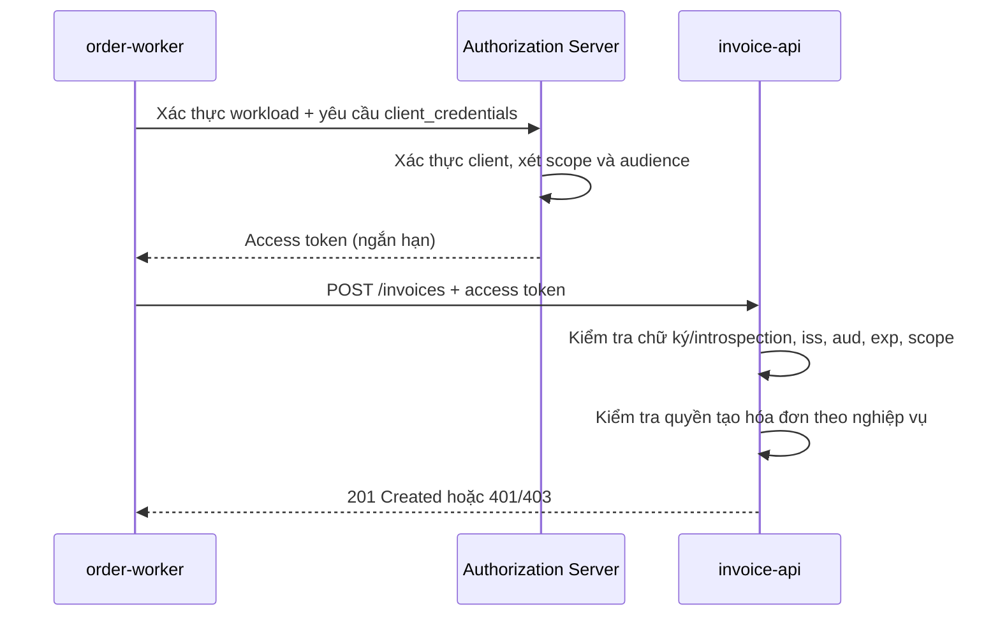

# Service token cho machine identity

## 1. Vì sao dịch vụ cần danh tính riêng?

Trong hệ thống phân tán, một tiến trình có thể gọi API mà không có người dùng đang đăng nhập. Ví dụ, `order-worker` nhận sự kiện đơn hàng rồi gọi `invoice-api` để tạo hóa đơn. `invoice-api` cần biết **workload nào đang gọi**, workload đó được phép tạo hóa đơn hay không và quyền ấy có còn hiệu lực không.

**Machine identity** (danh tính máy hoặc workload) là danh tính được gán cho một thành phần phần mềm như service, job, agent, pod hoặc workload chạy trong cloud. Tên gọi “machine” không có nghĩa danh tính phải gắn cố định với một máy vật lý: một service có thể chạy trên nhiều pod nhưng cùng mang danh tính logic đã được hệ thống cấp phép.

**Service token** là token được phát hành cho một workload/client để gọi một tài nguyên được bảo vệ. Token thường là **access token** theo OAuth 2.0. Nó chứng minh rằng một máy chủ cấp quyền (Authorization Server, AS) đã cấp một tập quyền có giới hạn cho client. Token không tự chứng minh mọi yêu cầu của client đều hợp lệ; API nhận token (Resource Server, RS) vẫn phải kiểm tra token và áp dụng chính sách phân quyền của chính mình.

Ví dụ về nguyên tắc tin cậy:

- `order-worker-prod` có danh tính riêng, tách khỏi `order-worker-staging`.
- `invoice-api` chỉ chấp nhận token do AS đã tin cậy phát hành, dành cho chính `invoice-api`.
- Token của `order-worker-prod` có scope `invoices.create` không đồng nghĩa service được xem, sửa hoặc xóa mọi hóa đơn.
- Mỗi yêu cầu được đánh giá theo **danh tính client + quyền token + chính sách tài nguyên**.

### Phân biệt những khái niệm dễ nhầm

| Khái niệm | Vai trò | Có phải bí mật không? |
|---|---|---|
| **Machine identity / service account** | Xác định workload đang chạy và cơ sở để gán quyền | Định danh như `client_id` thường không bí mật |
| **Client credential** | Chứng minh workload đang sở hữu danh tính: private key, certificate, client secret hoặc bằng chứng liên kết workload | Có; phải bảo vệ secret/private key và bằng chứng xác thực |
| **Access token** | Chuyển quyền gọi API đã được AS cấp trong một khoảng thời gian | Có; bearer token bị lộ có thể bị dùng lại |
| **JWT** | Định dạng token chứa claims, thường có chữ ký để RS kiểm tra cục bộ | Nội dung JWT mã hóa Base64URL, **không được xem là bí mật do mã hóa** |
| **Opaque token** | Chuỗi token không mang ý nghĩa trực tiếp đối với RS; thường cần introspection | Có; người nắm chuỗi vẫn có thể dùng nếu token là bearer |
| **Refresh token** | Credential để xin access token mới trong những grant phù hợp | Có; thường **không cần và không nên phát hành** cho client credentials |
| **ID token (OIDC)** | Cung cấp thông tin về một sự kiện xác thực cho OIDC client | Không dùng thay access token để phân quyền API |

Một service có thể dùng JWT hoặc opaque access token; **JWT/opaque là cách biểu diễn**, còn **access/refresh là mục đích sử dụng**. Không có loại token mặc định nào mang quyền “internal admin” chỉ vì nó được cấp cho service nội bộ.

## 2. Chuỗi tin cậy khi service gọi service

Các thành phần có trách nhiệm độc lập:

1. **Nền tảng chạy workload** xác nhận nguồn gốc danh tính workload, ví dụ certificate, Kubernetes service account được tin cậy, private key, hoặc workload identity federation.
2. **Authorization Server** xác thực client, áp chính sách cấp quyền, giới hạn resource/audience và phát access token.
3. **Client service** nhận token qua kênh an toàn, giữ token trong thời gian ngắn và gửi khi gọi API.
4. **Resource Server** kiểm tra token, xác thực các điều kiện mà token ràng buộc, rồi quyết định quyền đối với endpoint và dữ liệu cụ thể.



Mạng private, DNS nội bộ, API gateway hoặc mTLS chỉ giải quyết một phần bài toán. Chúng không thay cho kiểm tra quyền ở Resource Server. Nếu `invoice-api` tin tất cả token hợp lệ về mặt chữ ký, token được cấp cho một API khác có thể bị dùng sai nơi (*token substitution*).

### OAuth 2.0 Client Credentials

Với cuộc gọi không đại diện người dùng, OAuth 2.0 **Client Credentials Grant** là mô hình phổ biến. Client xác thực với token endpoint và xin access token cho những quyền đã được phép dùng:

```http
POST /oauth2/token HTTP/1.1
Host: auth.example.internal
Authorization: Basic <base64(client_id:client_secret)>
Content-Type: application/x-www-form-urlencoded

grant_type=client_credentials&scope=invoices.create
```

```json
{
  "access_token": "<redacted>",
  "token_type": "Bearer",
  "expires_in": 300,
  "scope": "invoices.create"
}
```

Đây là ví dụ về xác thực client bằng secret qua **HTTPS**. Trong triển khai thực tế, ưu tiên phương pháp phù hợp mức độ tin cậy của hệ thống, chẳng hạn `private_key_jwt`, xác thực client bằng mTLS hoặc **workload identity federation**, để giảm phụ thuộc vào secret dùng chung lâu dài. `client_id` chỉ là tên định danh; biết `client_id` không có nghĩa đã xác thực được client. AS phải kiểm tra client được cấp scope và audience nào; không tin mọi scope do request tự khai báo.

Một số AS hỗ trợ tham số `resource` theo RFC 8707 để chỉ định API đích. Nếu AS không hỗ trợ, audience cần được gán qua cấu hình hoặc chính sách cấp token khác. Client Credentials thường không cần refresh token: workload xác thực lại với AS để lấy access token mới khi gần hết hạn.

## 3. Claims của service token và ý nghĩa bảo mật

Với JWT access token, phần payload có thể có cấu trúc minh họa sau:

```json
{
  "iss": "https://auth.example.internal",
  "sub": "order-worker-prod",
  "aud": ["https://invoice-api.example.internal"],
  "client_id": "order-worker-prod",
  "scope": "invoices.create",
  "iat": 1795400000,
  "nbf": 1795400000,
  "exp": 1795400300,
  "jti": "token-unique-id-123"
}
```

Các giá trị và đường dẫn trên chỉ để minh họa. Trong thực tế, AS quyết định tên claim, kiểu dữ liệu và ý nghĩa `sub` theo hồ sơ token mà hệ thống sử dụng; không được mặc định `sub` luôn bằng `client_id`.

| Claim | Câu hỏi Resource Server phải trả lời |
|---|---|
| `iss` (issuer) | Token có đến từ **đúng** AS tin cậy cho môi trường này không? |
| `aud` (audience) | Token có được cấp cho **API hiện tại** không? |
| `sub` / `client_id` | Chủ thể/client là ai, được ánh xạ vào workload hoặc service account nào? |
| `scope` / `scp` | AS đã cấp những khả năng nào? Mỗi API cần scope nào? |
| `exp`, `nbf`, `iat` | Token có đang trong thời gian hiệu lực không? Các giá trị có hợp lý không? |
| `jti` | Token có định danh duy nhất để phục vụ ghi nhận/kiểm soát thu hồi khi cần không? |
| `cnf` (nếu có) | Token có bị ràng buộc với chứng chỉ hoặc khóa của người gửi không? |

Ví dụ `invoice-api` nhận token có chữ ký hợp lệ và `scope=invoices.create`, nhưng `aud=https://inventory-api.example.internal`: **phải từ chối**. Tương tự, access token hết hạn hoặc từ issuer staging không được chấp nhận trên production dù cấu trúc JWT hợp lệ.

**Chữ ký không phải mã hóa.** Bất kỳ ai cầm JWT thông thường đều có thể đọc header và payload. Không đưa password, private key, dữ liệu khách hàng nhạy cảm hoặc thông tin nội bộ không cần thiết vào claims; không ghi nguyên token vào log, trace, message queue hay URL.

### JWT và opaque token: chọn theo cách kiểm tra

| Tiêu chí | JWT access token có chữ ký | Opaque access token |
|---|---|---|
| Xác thực | RS thường kiểm tra chữ ký và claims bằng public key/JWKS đã tin cậy | RS thường hỏi introspection endpoint của AS |
| Chi phí mỗi yêu cầu | Thường thấp, có thể kiểm tra cục bộ | Có phụ thuộc gọi mạng hoặc cache trạng thái introspection |
| Thu hồi trước hạn | Phức tạp nếu RS chỉ kiểm tra JWT offline; cần denylist, kiểm tra trạng thái hoặc TTL ngắn | AS có thể trả `active=false`; RS vẫn phải quản lý TTL cache |
| Lộ dữ liệu token | Claims có thể đọc được | Chuỗi token không tự bộc lộ claims |
| Phù hợp | API lưu lượng cao, cần xác minh offline, chấp nhận chiến lược thu hồi phù hợp | Hệ thống cần trạng thái token tập trung hoặc thay đổi quyền nhanh |

Chỉ dùng opaque token nếu RS có cơ chế kiểm tra token được AS hỗ trợ; không suy quyền từ tiền tố hay độ dài chuỗi. Với JWT, cần nhận diện token là **access token**, tránh nhầm ID token hoặc token phục vụ mục đích khác.

## 4. Quy tắc xác thực và phân quyền ở Resource Server

Một API nên thực hiện các bước theo thứ tự logic dưới đây:

1. **Kiểm tra kênh truyền và token:** dùng HTTPS, lấy token từ `Authorization: Bearer ...` khi áp dụng Bearer scheme; từ chối token sai định dạng hoặc thiếu.
2. **Xác minh nguồn phát:** chỉ chấp nhận AS đã cấu hình trước. Với JWT, kiểm tra chữ ký bằng khóa công khai/JWKS tin cậy, giới hạn thuật toán được cho phép; không làm theo URL `jku` hoặc khóa do token tự chỉ định. Với opaque token, gọi introspection qua kênh đã xác thực và yêu cầu `active=true`.
3. **Xác minh claims:** `iss` khớp chính xác, `aud` chứa API hiện tại, `exp` chưa qua, `nbf` đã đến; chỉ cho phép dung sai đồng hồ nhỏ, có giới hạn. Nếu dùng hồ sơ JWT access token, kiểm tra cả loại token (`typ`) và các claim bắt buộc theo hồ sơ.
4. **Xác minh người gửi nếu token bị ràng buộc:** với mTLS-bound/DPoP-bound token, kiểm tra bằng chứng sở hữu khóa của **chính request hiện tại**, không chỉ thấy `cnf` xuất hiện.
5. **Phân quyền:** kiểm tra scope, danh tính workload, quyền truy cập dữ liệu và luật nghiệp vụ. Scope cần thiết nhưng không nhất thiết đủ.

Ví dụ chính sách:

| Endpoint | Điều kiện tối thiểu |
|---|---|
| `POST /invoices` | Audience của `invoice-api`, scope `invoices.create`, client nằm trong danh sách được phép |
| `GET /invoices/{id}` | Scope `invoices.read` **và** quyền đọc hóa đơn cụ thể |
| `DELETE /invoices/{id}` | Scope `invoices.delete` **và** chính sách xóa/đối soát cho đối tượng cụ thể |

`401 Unauthorized` thích hợp khi thiếu token hoặc xác thực token thất bại; `403 Forbidden` thích hợp khi đã xác thực nhưng không đủ quyền (ví dụ thiếu scope). Không dùng HTTP 200 kèm body báo lỗi như một cách thay thế kiểm soát truy cập.

### Ví dụ với Spring Security Resource Server

Đối với dịch vụ Java dùng Spring Security, có thể cấu hình một Resource Server xác thực JWT:

```yaml
spring:
  security:
    oauth2:
      resourceserver:
        jwt:
          issuer-uri: https://auth.example.internal
```

```java
@Configuration
@EnableMethodSecurity
class ApiSecurity {
    @Bean
    SecurityFilterChain securityFilterChain(HttpSecurity http) throws Exception {
        return http
            .authorizeHttpRequests(auth -> auth
                .requestMatchers("/actuator/health").permitAll()
                .anyRequest().authenticated())
            .oauth2ResourceServer(oauth -> oauth.jwt(Customizer.withDefaults()))
            .build();
    }
}

@RestController
class InvoiceController {
    @PreAuthorize("hasAuthority('SCOPE_invoices.create')")
    @PostMapping("/invoices")
    ResponseEntity<Void> createInvoice(@RequestBody CreateInvoiceRequest input) {
        // Tiếp tục kiểm tra danh tính client và quyền nghiệp vụ.
        return ResponseEntity.status(201).build();
    }
}
```

Ví dụ cố ý rút gọn phần lớp ứng dụng và các import. Spring Security thường ánh xạ claim `scope` thành authority có tiền tố `SCOPE_`. **Cấu hình `issuer-uri` và kiểm tra scope chưa đủ:** cần thêm `audience` validator cho `invoice-api`, giới hạn client hợp lệ và kiểm tra quyền trên đối tượng cụ thể. Không coi ví dụ này là cấu hình production hoàn chỉnh.

Một custom validator audience có thể được mô tả như sau:

```text
EXPECTED_AUDIENCE = "https://invoice-api.example.internal"
validate(jwt):
    require(jwt.signature_is_valid_for_configured_issuer)
    require(jwt.issuer == CONFIGURED_ISSUER)
    require(now < jwt.expires_at && now >= jwt.not_before_if_present)
    require(EXPECTED_AUDIENCE in jwt.audiences)
    require("invoices.create" in jwt.scopes_for_create_endpoint)
    require(jwt.client_id in ALLOWED_SERVICE_CLIENTS)
    require(business_policy_allows(jwt.client_id, invoice))
```

Phần giả mã diễn đạt **các điều kiện cần kiểm tra**, không phải API lập trình cụ thể. Không tự tin claim `client_id` hoặc `scope` khi chưa xác thực token và xác nhận hợp đồng với AS.

## 5. Vòng đời token: cấp phát, lưu trữ, làm mới, thu hồi

### Khởi tạo và cấp phát

Workload nhận một danh tính riêng cho từng service và môi trường. Nên có quy trình cấp quyền rõ ràng: `order-worker-prod` chỉ có thể xin scope cần cho tác vụ, còn AS chỉ phát token với audience đã được cho phép. Không dùng cùng client secret, certificate hoặc service account cho mọi microservice.

Ưu tiên **credential ngắn hạn, luân chuyển được** hoặc dùng chứng thực workload từ hạ tầng. Nếu dùng client secret lâu dài, lưu trong secret manager có kiểm soát truy cập, tự động xoay vòng và quy trình ứng phó khi lộ. Khóa riêng dùng để ký `private_key_jwt` phải được bảo vệ riêng, không đưa vào image container hoặc repository.

### Lưu và tái sử dụng token

Client chỉ giữ token trong bộ nhớ hoặc cơ chế lưu trữ phù hợp với mô hình đe dọa; giới hạn truy cập của tiến trình. Cache theo **issuer + client identity + audience/resource + scope** để không dùng nhầm token của API khác. Làm mới trước thời điểm `exp` với biên an toàn hợp lý; đồng bộ các yêu cầu xin token khi lưu lượng lớn để tránh nhiều tiến trình cùng xin lại (*token stampede*).

Tuyệt đối không đưa bearer token vào URL/query string, log HTTP, thông báo lỗi, analytics hoặc distributed trace. Cần cấu hình hệ thống observability che `Authorization` và các field chứa token, kể cả ở gateway, proxy và retry middleware.

### Hết hạn và thu hồi

Giữ thời hạn access token ngắn theo độ nhạy của API và khả năng vận hành (ví dụ vài phút với service nhạy cảm). Nếu credential client bị lộ, AS cần vô hiệu hóa hoặc thay credential để chặn **lần cấp token tiếp theo**. Những access token đã được cấp có thể vẫn hợp lệ đến `exp` nếu RS chỉ xác minh JWT offline.

Để thu hồi sớm có thể dùng introspection, denylist có TTL cho `jti`, token phiên bản mới, hoặc cơ chế phối hợp với RS. Mỗi cách có chi phí và độ trễ; cache trạng thái introspection phải có thời hạn đủ ngắn với yêu cầu bảo mật. Luân chuyển signing key của AS là thao tác phạm vi rộng, không phải giải pháp thu hồi riêng cho một client thông thường.

## 6. Chống đánh cắp token và replay

**Bearer token** có tính chất “ai cầm được thì dùng được” trong thời gian token còn hiệu lực. HTTPS mã hóa đường truyền nhưng không giải quyết việc token bị lấy từ log, bộ nhớ bị xâm nhập hoặc cấu hình sai. `jti` là định danh token; chỉ có `jti` **không tự chặn replay** nếu không có cơ chế theo dõi và từ chối lần sử dụng lặp lại phù hợp.

Những biện pháp bổ sung:

| Rủi ro | Kiểm soát chính |
|---|---|
| Token bị chép từ log/tracing | Redact `Authorization`, giới hạn logging, cấp token ngắn hạn |
| Dùng token của API A để gọi API B | Kiểm tra `aud` tại **mọi** Resource Server |
| Service bị chiếm quyền xin quá nhiều scope | Xác thực client mạnh, scope tối thiểu, cấp phép theo client + resource |
| Bearer token bị phát lại bởi kẻ đã đánh cắp | Token ngắn hạn, **sender-constrained token** qua mTLS hoặc DPoP khi phù hợp |
| Credential bị lộ | Xoay vòng/vô hiệu credential, thu hồi token hoặc đợi TTL phù hợp, điều tra truy cập |
| Khóa ký JWT bị thay thế hoặc nhầm thuật toán | Danh sách issuer/thuật toán cố định, kiểm tra JWKS tin cậy, quy trình key rotation |
| Workload ở staging truy cập production | Tách issuer/client/credential/audience hoặc chính sách môi trường rõ ràng |

**mTLS-bound access token** (RFC 8705) có thể ràng buộc token với chứng chỉ client; API cần so khớp bằng chứng mTLS của request với thông tin `cnf` tương ứng. **DPoP** (RFC 9449) ràng buộc token với khóa và từng HTTP request thông qua proof có chữ ký; Resource Server cần kiểm tra phương thức, URI, thời gian, `jti`, khóa và những ràng buộc DPoP liên quan. Chỉ thêm trường `cnf` vào JWT mà không xác thực proof tương ứng không tạo ra bảo vệ sender-constrained.

Sender-constrained token giảm khả năng sử dụng token bị đánh cắp mà không sở hữu khóa, nhưng không loại trừ toàn bộ rủi ro: kẻ điều khiển chính workload hợp lệ có thể dùng khóa của nó để gửi yêu cầu trái phép. Vì vậy vẫn cần quyền tối thiểu, giám sát và kiểm soát workload.

## 7. Nhiều dịch vụ, gateway và ngữ cảnh người dùng

Giả sử `frontend-api` nhận yêu cầu từ người dùng rồi gọi `order-api`, sau đó `order-api` gọi `invoice-api`. Có hai trường hợp khác nhau:

- **Hành động độc lập của service:** `order-api` dùng danh tính của chính nó và client credentials để xin token cho `invoice-api`. Khi đó token nói về quyền của `order-api`, không chứng minh người dùng cuối đã cho phép thực hiện hành động cụ thể.
- **Hành động thay mặt người dùng:** hệ thống cần giữ ngữ cảnh ủy quyền của người dùng. Có thể dùng OAuth 2.0 Token Exchange (RFC 8693) hoặc một cơ chế ủy quyền tương đương được AS hỗ trợ để phát token **mới**, audience mới và quyền đã giới hạn. Không tự sao chép `user_id` trong header rồi coi đó là bằng chứng xác thực.

Không chuyển tiếp nguyên access token tới tất cả các dịch vụ downstream khi `aud` không khớp. Gateway có thể xác thực token ở biên, nhưng Resource Server vẫn cần bảo vệ đường gọi trực tiếp và xác minh những thông tin cần thiết theo kiến trúc đã thiết kế. Nếu gateway thay token bằng một assertion nội bộ, assertion ấy cần issuer, audience, thời hạn, xác thực chữ ký/kênh và hợp đồng tin cậy rõ ràng.

Trong Kubernetes hoặc môi trường đa cloud, **workload identity federation** có thể dùng bằng chứng danh tính do nền tảng cung cấp để AS phát token mục tiêu, giảm nhu cầu phân phát client secret cố định. Tuy nhiên vẫn phải giới hạn audience của bằng chứng nguồn, ràng buộc namespace/service account hoặc danh tính workload, và chống việc tái sử dụng bằng chứng ở môi trường khác.

## 8. Tình huống thực hành: khóa quyền của một service bị xâm nhập

`invoice-api` phát hiện `order-worker-prod` gửi nhiều yêu cầu `POST /invoices` bất thường. Nhóm vận hành cần:

1. Xác định `client_id`, `iss`, `aud`, scope, `jti` và thời điểm từ log metadata đã được kiểm soát; tránh thu thập nguyên bearer token.
2. Chặn cấp token mới cho client hoặc vô hiệu credential nghi bị lộ; xoay khóa/secret cần thiết.
3. Kiểm tra liệu token đã cấp có thể bị thu hồi ngay (introspection/denylist) hay phải chờ TTL; áp giới hạn quyền ở `invoice-api` để ngăn hành động tiếp theo.
4. Truy vết tác vụ, nguồn yêu cầu và tài nguyên bị ảnh hưởng; xem xét rollback các thao tác nghiệp vụ khi phù hợp.
5. Khôi phục bằng credential mới và quyền tối thiểu, rồi giám sát cả luồng xin token và API call.

Điểm dễ sai là chỉ đổi client secret rồi kết luận mọi access token cũ đã vô hiệu. Điều đó **không đúng** với JWT được RS xác minh offline nếu token cũ vẫn còn hạn và không có cơ chế thu hồi khác.

## 9. Checklist khi triển khai

- Mỗi workload và môi trường có machine identity riêng, được cấp quyền rõ ràng.
- Token do AS tin cậy phát hành; client dùng phương thức xác thực phù hợp, credential được bảo vệ và xoay vòng.
- Mỗi token có audience/resource cụ thể và scope tối thiểu.
- Resource Server kiểm tra chữ ký hoặc introspection, issuer, audience, thời hạn và loại token.
- Quyền endpoint, danh tính client và quyền trên dữ liệu được kiểm tra riêng; lỗi 401/403 có ý nghĩa nhất quán.
- Access token ngắn hạn, không bị đưa vào log, URL, image hay source code; cache có phân biệt audience/scope.
- Có quy trình ứng phó khi lộ credential/token, hiểu giới hạn thu hồi JWT.
- Hệ thống nhạy cảm đánh giá mTLS-bound/DPoP-bound token và xác thực proof ở phía Resource Server.
- Nếu cần đại diện người dùng, thiết kế cơ chế delegation/token exchange thay cho giả định client credentials chứa quyền của người dùng.
- Có kiểm thử từ chối token sai `iss`, sai `aud`, hết hạn, thiếu scope, sai client, chữ ký không hợp lệ và token bị thu hồi.

## Tài liệu chuẩn để tra cứu

- [RFC 6749, mục 4.4 — OAuth 2.0 Client Credentials Grant](https://www.rfc-editor.org/rfc/rfc6749#section-4.4)
- [RFC 9068 — JWT Profile for OAuth 2.0 Access Tokens](https://www.rfc-editor.org/rfc/rfc9068)
- [RFC 8725 — JWT Best Current Practices](https://www.rfc-editor.org/rfc/rfc8725)
- [RFC 7662 — OAuth 2.0 Token Introspection](https://www.rfc-editor.org/rfc/rfc7662)
- [RFC 7009 — OAuth 2.0 Token Revocation](https://www.rfc-editor.org/rfc/rfc7009)
- [RFC 8707 — Resource Indicators for OAuth 2.0](https://www.rfc-editor.org/rfc/rfc8707)
- [RFC 8705 — OAuth 2.0 Mutual-TLS Client Authentication and Certificate-Bound Access Tokens](https://www.rfc-editor.org/rfc/rfc8705)
- [RFC 9449 — OAuth 2.0 Demonstrating Proof of Possession (DPoP)](https://www.rfc-editor.org/rfc/rfc9449)
- [RFC 8693 — OAuth 2.0 Token Exchange](https://www.rfc-editor.org/rfc/rfc8693)

**Ghi nhớ:** Service token cho machine identity là một mắt xích trong mô hình tin cậy. Workload phải được xác thực khi xin token; AS cấp đúng audience/scope; API phải kiểm tra token và thực thi quyền nghiệp vụ; việc bảo vệ, giới hạn thời gian sống và thu hồi token phải được thiết kế xuyên suốt vòng đời.
