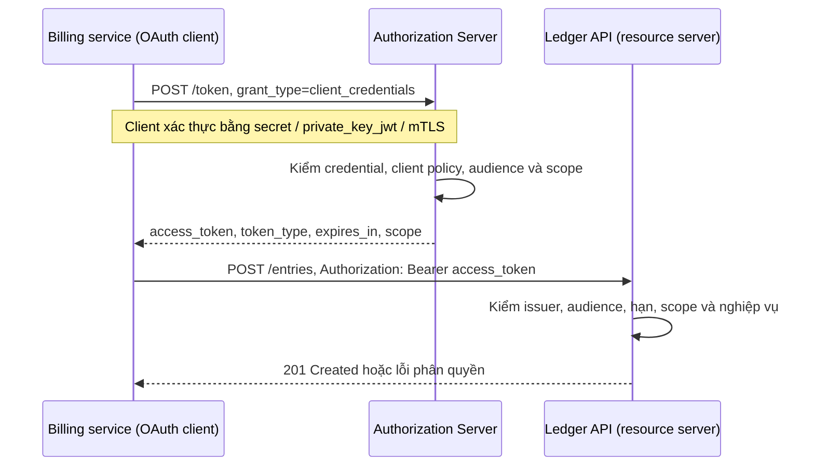

# Cấp token bằng thông tin xác thực service

## 1. Bài toán service-to-service: dịch vụ lấy quyền gọi API bằng cách nào?

Trong một hệ thống gồm nhiều dịch vụ, không phải request nào cũng có người dùng đăng nhập trực tiếp. Ví dụ, `billing-service` chạy tác vụ đối soát định kỳ và cần gọi `ledger-api` để ghi bút toán; `inventory-service` cần cập nhật số lượng tồn kho cho `warehouse-api`; một worker đọc thông điệp từ queue cần gửi kết quả đến dịch vụ báo cáo.

Các dịch vụ này cần chứng minh **danh tính workload/service** và được cấp quyền ở API đích. OAuth 2.0 cung cấp cơ chế **Client Credentials Grant**: một client bảo mật (confidential client) xác thực với Authorization Server (AS), sau đó được AS phát hành **access token** để truy cập resource đã được cấp phép.

Điều quan trọng là phân biệt hai câu hỏi:

- **Authentication:** service nào đang yêu cầu token, và AS dựa vào bằng chứng nào để tin service đó?
- **Authorization:** service ấy được phép xin token để gọi API nào, thực hiện những thao tác nào, trong bao lâu?

Biết `client_id` và xác thực được service không có nghĩa service được toàn quyền trên hệ thống. Access token phải giới hạn bởi audience, scope/quyền, thời hạn và chính sách của resource server.

**Mục tiêu bài học:** hiểu cách cấp token dùng thông tin xác thực service, phân biệt các phương thức client authentication, thực hiện một luồng token request, xác minh token ở API đích, quản lý vòng đời credential/token và phòng ngừa rủi ro đánh cắp hoặc phát lại token.

## 2. Thành phần và thuật ngữ nền tảng

| Thành phần / thuật ngữ | Vai trò trong hệ thống | Ví dụ |
| --- | --- | --- |
| **OAuth client** | Dịch vụ yêu cầu access token từ AS | `billing-service` |
| **Client identifier (`client_id`)** | Định danh công khai do AS đăng ký cho client | `billing-prod` |
| **Client credential** | Bằng chứng client dùng để xác thực với AS | Client secret, khóa riêng ký assertion, chứng chỉ mTLS hoặc bằng chứng workload identity |
| **Authorization Server (AS)** | Xác thực client, kiểm tra chính sách và phát token | `https://login.example.test` |
| **Token endpoint** | Endpoint AS tiếp nhận token request | `/oauth2/token` |
| **Access token** | Credential được cấp để truy cập API đích | JWT access token hoặc opaque access token |
| **Resource server** | API kiểm tra token, audience, quyền và thực thi nghiệp vụ | `ledger-api` |
| **Audience (`aud`)** | Đối tượng/resource dự kiến nhận token | `api://ledger` |
| **Scope** | Phạm vi quyền AS cấp | `ledger:entry:create` |
| **Principal/subject** | Danh tính mà token thể hiện | Service principal; thường không có người dùng cuối |

Một service có thể vừa là **resource server** khi nhận request, vừa là **OAuth client** khi gọi API khác. Mỗi vai trò có credential, audience và chính sách xác minh riêng; không mặc định access token inbound có thể dùng làm outbound token.

Trong OAuth 2.0, *client credentials* là một **grant type** và cũng là thuật ngữ chung chỉ thông tin xác thực client. Cần tách chúng:

- `grant_type=client_credentials` mô tả **cơ sở cấp quyền**: client dùng quyền đã đăng ký của chính mình để xin access token, không cần người dùng cấp quyền ở mỗi request.
- `client_secret_basic`, `private_key_jwt` hoặc mTLS mô tả **cách client xác thực với token endpoint**. Một grant có thể dùng nhiều kiểu client authentication khác nhau nếu AS hỗ trợ.
- **Access token** là kết quả cấp phát dùng tại resource server. Nó không đồng nghĩa với client secret, private key hoặc client assertion.

## 3. Quy trình cấp token bằng Client Credentials Grant

### 3.1. Điều kiện trước khi gọi token endpoint

Trước khi một service xin token, bộ phận vận hành hoặc hệ thống IAM cần thiết lập:

1. Đăng ký OAuth client với AS, cấp một `client_id` và cấu hình phương thức xác thực client cho phép.
2. Cấp hoặc gắn bằng chứng xác thực: secret, khóa riêng, chứng chỉ mTLS hay workload identity tùy nền tảng.
3. Xác định service được phép yêu cầu token cho **resource/audience** nào.
4. Giới hạn scope và quyền tối đa theo trách nhiệm nghiệp vụ; ví dụ `billing-prod` chỉ được ghi ledger theo phạm vi đã phê duyệt.
5. Cấu hình resource server tin đúng issuer, thuật toán/khóa hoặc introspection endpoint và kiểm tra audience.
6. Bảo đảm HTTPS, quản lý credential, log an toàn, thời hạn token và chính sách xoay vòng/thu hồi.

`client_id` không phải bí mật. **Client secret và private key là bí mật**; mất chúng có thể khiến kẻ tấn công xin access token mới dưới danh tính service, ngay cả khi mọi access token hiện hành đã hết hạn.

### 3.2. Luồng phát hành



Các bước phân tách rõ trách nhiệm:

- **AS xác thực client**: kiểm thông tin xác thực và trạng thái client, giới hạn quyền theo cấu hình AS.
- **AS cấp token**: tạo access token có audience/scope/thời hạn phù hợp, hoặc trả lỗi khi client không được phép.
- **Client sử dụng token**: đưa access token vào header HTTP gửi tới API đích, thường là `Authorization: Bearer <access-token>`.
- **API đích xác minh token và phân quyền**: không tin kết quả “token lấy được từ AS” do client tự khẳng định; API phải thực hiện kiểm tra theo hợp đồng tin cậy của mình.

Nếu token được cấp chỉ để gọi Ledger API, một service khác như Payments API không được nhận token ấy trừ khi audience và chính sách thực sự cho phép.

### 3.3. Ví dụ HTTP request với client secret

```http
POST /oauth2/token HTTP/1.1
Host: login.example.test
Content-Type: application/x-www-form-urlencoded
Authorization: Basic <base64-of-url-encoded-client-id-and-secret>

grant_type=client_credentials&scope=ledger%3Aentry%3Acreate&resource=https%3A%2F%2Fapi.example.test%2Fledger
```

Trong ví dụ:

- `Authorization: Basic ...` là **client authentication**. RFC 6749 `2.3.1 yêu cầu mã hóa `client_id` và `client_secret` theo `application/x-www-form-urlencoded` trước khi ghép thành HTTP Basic theo quy định; Base64 chỉ là mã hóa biểu diễn, **không mã hóa bảo mật**. Bắt buộc dùng HTTPS.
- `grant_type=client_credentials` yêu cầu AS cấp token trên quyền của client.
- `scope=ledger:entry:create` yêu cầu một phạm vi quyền. AS có thể hạn chế lại hoặc từ chối dựa trên policy.
- `resource=https://api.example.test/ledger` là ví dụ **Resource Indicators** theo RFC 8707, chỉ có ý nghĩa khi AS hỗ trợ. Nhiều AS dùng tham số cấu hình audience khác; không tự suy một tham số vendor là chuẩn chung.

Phản hồi thành công minh họa:

```http
HTTP/1.1 200 OK
Content-Type: application/json
Cache-Control: no-store
Pragma: no-cache

{
  "access_token": "<opaque-or-jwt-access-token>",
  "token_type": "Bearer",
  "expires_in": 600,
  "scope": "ledger:entry:create"
}
```

`expires_in=600` là 600 giây tính từ thời điểm phản hồi, không phải lời hứa token luôn hiệu lực đủ 600 giây trong mọi tình huống: AS vẫn có thể có cơ chế vô hiệu hóa, và các bên phải tính đến clock skew, mạng hoặc thời gian xử lý. Các trường phản hồi cụ thể phụ thuộc AS/profile. Theo RFC 6749, **AS SHOULD NOT phát refresh token cho Client Credentials Grant**; service thường xin access token mới bằng chính credential của mình khi cần.

### 3.4. Ví dụ gọi resource server

```http
POST /ledger/entries HTTP/1.1
Host: api.example.test
Authorization: Bearer <access-token-issued-for-ledger>
Content-Type: application/json
Idempotency-Key: example-operation-42

{
  "externalReference": "invoice-42",
  "amount": 125000,
  "currency": "VND"
}
```

`Idempotency-Key` là ví dụ cơ chế **nghiệp vụ** để chống xử lý trùng khi retry; không phải trường bắt buộc của OAuth 2.0. Token chỉ chứng minh quyền yêu cầu thao tác, chưa chứng minh bút toán hợp lệ hoặc được phép tạo theo mọi quy tắc tài chính.

## 4. Chọn hình thức xác thực service tại token endpoint

Các cách xác thực client có đặc điểm vận hành khác nhau. Chúng có thể đi cùng cùng một `grant_type=client_credentials`.

| Cách xác thực client | Bằng chứng gửi tới AS | Ưu điểm | Lưu ý bảo mật |
| --- | --- | --- | --- |
| **Shared secret (`client_secret_basic`)** | Client ID + secret qua HTTP Basic trên TLS | Dễ triển khai, được nhiều AS hỗ trợ | Secret đối xứng dễ bị lộ nếu ghi vào repo, config, log, command history; cần secret manager và rotation |
| **Client secret ở form body (`client_secret_post`)** | `client_id`/`client_secret` trong form | Tương thích với AS hỗ trợ | Thường kém ưu tiên hơn HTTP Basic; body cũng có thể bị log, phải dùng TLS |
| **Signed client assertion (`private_key_jwt`)** | JWT do service ký bằng private key, AS xác minh bằng public key | Không cần chia sẻ secret đối xứng; phù hợp quản lý khóa bất đối xứng | Bảo vệ private key, giới hạn assertion TTL, kiểm audience và chống phát lại `jti` |
| **Mutual TLS client authentication** | Chứng chỉ client trong handshake TLS | Danh tính gắn với khóa và chứng chỉ; có thể kết hợp token-bound mTLS | Cần PKI, kiểm chain, policy chứng chỉ, hạn/thu hồi và rotation |
| **Workload identity federation** | Bằng chứng từ nền tảng vận hành, ví dụ token do môi trường phát hành | Giảm secret lâu dài; tận dụng danh tính máy/pod/workload | AS phải tin đúng issuer/audience/subject và trao đổi theo hợp đồng cụ thể |
| **Managed identity** | Cơ chế nhận diện workload do nền tảng cung cấp | Không tự phân phối credential tĩnh ở ứng dụng | Tích hợp và phạm vi tài nguyên phụ thuộc nhà cung cấp, cần ràng buộc workload |

**Không có phương pháp nào tự động cấp quyền cho service.** Sau khi xác thực, AS vẫn phải đánh giá client có được xin token cho audience/scope đó không. Ngược lại, một workload có service account được Kubernetes hoặc cloud nhận diện không có nghĩa resource server bất kỳ đã mặc định tin nó.

### 4.1. Client secret: cách đơn giản nhưng cần quản lý chặt

Với secret, hai bên (service và AS) biết cùng một bí mật. Quy trình nên gồm: khởi tạo bằng nguồn ngẫu nhiên đủ mạnh, lưu trong secret manager, cấp quyền đọc tối thiểu cho workload, truyền qua TLS, và hỗ trợ rotation an toàn. Tránh dùng secret chung cho nhiều service hoặc nhiều môi trường `dev/staging/prod`: khi một secret lộ sẽ khó cô lập và thu hồi.

Lỗi cấu hình thường gặp là lưu:

```yaml
# Ví dụ KHÔNG AN TOÀN, tuyệt đối không lưu bí mật thật trong file cấu hình Git.
oauth:
  client-id: billing-prod
  client-secret: hardcoded-production-secret
```

Thay vào đó, ứng dụng nạp secret qua cơ chế inject của môi trường hoặc secret manager với chính sách truy cập hợp lệ; trong một số kiến trúc có thể chuyển sang private key, mTLS hoặc workload federation để giảm nhu cầu credential lâu dài.

Không đưa client secret vào query string, URL token endpoint, header tracing, log debug hoặc thông báo lỗi. Nếu dùng thư viện HTTP, kiểm tra cài đặt logging vì một số thư viện có thể log Authorization header khi bật chế độ debug.

### 4.2. Private key JWT: service ký assertion để chứng minh mình giữ khóa

Trong mô hình `private_key_jwt`, AS lưu hoặc truy xuất public key đáng tin gắn với client; service dùng private key ký một **client assertion JWT** ngắn hạn. JWT đó dùng để **xác thực service với token endpoint**, không phải access token đưa sang Ledger API.

Payload assertion minh họa:

```json
{
  "iss": "billing-prod",
  "sub": "billing-prod",
  "aud": "https://login.example.test/oauth2/token",
  "iat": 1795000000,
  "exp": 1795000060,
  "jti": "assertion-unique-4f2b"
}
```

Trong mẫu thông dụng, `iss` và `sub` đều biểu thị `client_id`, `aud` là token endpoint hoặc giá trị được AS quy định, `exp` phải ngắn, và `jti` giúp AS nhận diện assertion phát lại. AS phải kiểm chữ ký, thuật toán được cho phép, khóa đúng client, audience, hạn, ID và chính sách chống replay. Trường chính xác theo RFC 7523 và hợp đồng của AS.

Request minh họa (form body được rút gọn):

```text
grant_type=client_credentials
client_id=billing-prod
client_assertion_type=urn:ietf:params:oauth:client-assertion-type:jwt-bearer
client_assertion=<signed-short-lived-jwt>
scope=ledger:entry:create
```

`client_id` trong ví dụ có thể được yêu cầu để định vị client, tùy profile/AS. Giá trị có tên `client_assertion` chỉ là bằng chứng xác thực client; token endpoint vẫn phải **phát access token mới** nếu grant và scope hợp lệ. Không chuyển nguyên assertion sang Ledger API rồi gọi nó là access token.

Khóa riêng cần được bảo vệ trong KMS/HSM hoặc kho khóa phù hợp; khóa có vòng đời, ID khóa, public key phân phối an toàn, cơ chế rotation và thu hồi. Một chữ ký hợp lệ không đủ nếu assertion bị sử dụng sai token endpoint hoặc đã quá hạn.

### 4.3. Mutual TLS: xác thực workload bằng chứng chỉ

Trong **mTLS client authentication** (RFC 8705), AS yêu cầu client xuất trình chứng chỉ tại kết nối TLS. AS xác thực danh tính client dựa trên chứng chỉ và cấu hình tin cậy, sau đó kiểm authorization policy như bình thường. Chứng chỉ là một phần của xác thực client ở *token endpoint*.

RFC 8705 cũng định nghĩa **certificate-bound access token**: token có thông tin ràng buộc với chứng chỉ client; resource server cần kiểm rằng client gọi API sở hữu đúng khóa/chứng chỉ tương ứng. Đây là **hai khả năng liên quan nhưng khác nhau**: dùng mTLS để xác thực ở token endpoint không tự bảo đảm mọi access token về sau đã bị ràng buộc với chứng chỉ, nếu AS không cấp token theo profile/token-binding thích hợp.

Cần tính đến rotation certificate, hết hạn, revocation, proxy chấm dứt TLS và cấu hình chuyển tiếp thông tin chứng chỉ. Nếu một proxy kết thúc mTLS rồi forward request tới backend, phải kiểm tra mô hình nhận diện client ở hop phía sau, không mặc nhiên tin một header certificate do request Internet tự gửi.

### 4.4. Workload identity federation: tránh secret tĩnh

Ở môi trường cloud hoặc Kubernetes, workload có thể nhận một assertion ngắn hạn do nền tảng cấp (ví dụ OIDC token có issuer, audience, subject riêng), rồi dùng assertion đó theo cơ chế federation/exchange được AS hỗ trợ để lấy token cho API đích. Đây là cách giảm nhu cầu gắn một client secret lâu dài vào image hoặc biến môi trường.

Chỉ cho phép federation khi AS kiểm **đúng issuer, audience, subject/workload, signature, thời hạn và trust policy**. Đừng tin “bất kỳ token OIDC hợp lệ” hoặc bất kỳ service account nào trong cluster. Kiểm chứng phải gắn danh tính của đúng workload được phép.

Một số hệ thống dùng RFC 8693 Token Exchange, một số dùng client assertion hoặc API vendor riêng. **Không đồng nhất tất cả federation với grant type `client_credentials`**; grant và chuẩn trao đổi thực tế phải theo AS. Dù cơ chế xin token khác nhau, API đích vẫn yêu cầu access token với audience và quyền dành cho mình.

## 5. Client Credentials Grant khác gì với đăng nhập người dùng?

| Đặc điểm | Client Credentials Grant | Authorization Code + PKCE (luồng người dùng thông dụng) |
| --- | --- | --- |
| Đối tượng khởi phát | Workload/service có danh tính riêng | Ứng dụng thay mặt người dùng tương tác |
| Bằng chứng tại AS | Client authentication hoặc workload credential | Authorization code được gắn với yêu cầu ủy quyền; có thể kèm client authentication tùy loại client |
| User session tại thời điểm xin token | Không bắt buộc | Thường bắt nguồn từ đăng nhập/ủy quyền người dùng |
| `sub` trong access token | Thường là client/service principal theo profile AS | Thường là chủ thể người dùng |
| Cách xác định quyền | Chính sách service, scope, resource, tenant | Quyền theo người dùng + client + resource |
| Refresh token | RFC 6749 khuyến nghị AS không cấp cho client credentials | Có thể được cấp theo policy và loại ứng dụng |
| Trường hợp phù hợp | Batch worker, cron, backend-to-backend, service job | UI gọi API thay mặt user |

Nếu nghiệp vụ cần “Orders gọi Inventory **thay mặt Alice**”, việc dùng client credentials của Orders sẽ chỉ chứng minh Orders; nó **không tự mang quyền hoặc danh tính Alice**. Muốn giữ quan hệ ủy quyền, cần mô hình delegated access/token exchange được phê duyệt. Ngược lại, đưa ID token của Alice vào một cron job và gọi là service token là sử dụng sai loại token.

OAuth 2.0 không mặc nhiên đồng nghĩa với OIDC: OIDC bổ sung đăng nhập và ID token cho client, còn **service-to-service authorization** thường chỉ cần OAuth access token. Đừng dùng ID token làm Bearer token ở business API.

## 6. AS quyết định cấp token theo chính sách nào?

Một Authorization Server thiết kế đúng không chỉ xác thực credential rồi phát token. AS phải thực thi **client policy**:

```text
Client đăng ký: billing-prod
Phương thức xác thực: private_key_jwt
Issuer được tin: login.example.test
Audience được phép: api://ledger
Scopes được phép: ledger:entry:create, ledger:entry:read
Giới hạn thời gian access token: 10 phút
Môi trường/tenant: prod / tenant-01
```

Khi service gửi yêu cầu `scope=admin:*` hoặc `resource=https://api.example.test/customers`, AS phải giới hạn theo quyền đã phê duyệt hoặc từ chối. Phát token có scope/audience rộng chỉ vì client xác thực thành công là một lỗi **cấp quyền quá mức**.

Một thuật toán cấp phát khái niệm:

```text
1. Nhận token request qua HTTPS và kiểm tra grant_type được client cho phép.
2. Xác thực client bằng đúng method đã đăng ký, chống replay credential assertion.
3. Kiểm tra trạng thái đăng ký client, môi trường/tenant và chính sách.
4. Xác định resource/audience đã yêu cầu và đối chiếu allowlist của client.
5. Kiểm tra/thu hẹp scope theo tối thiểu cần thiết.
6. Chọn token format, issuer, audience, subject/client, scope, TTL và binding.
7. Phát access token có cơ chế ký/introspection đáng tin; log metadata an toàn.
8. Trả token hoặc lỗi tương ứng, không trả secret/private key.
```

Trong hệ thống nhiều tenant, `client_id` không phải bằng chứng quyền truy cập mọi tenant. AS có thể giới hạn tenant khi cấp token; resource server vẫn cần kiểm tra quyền đối tượng theo tenant hoặc ràng buộc phù hợp. Đừng nhận `tenantId` tùy ý từ client rồi coi như token đã được phép cho tenant ấy.

### 6.1. JWT access token minh họa

Nếu AS chọn JWT Access Token Profile (RFC 9068), payload có thể có hình thức minh họa sau:

```json
{
  "iss": "https://login.example.test",
  "sub": "billing-prod",
  "aud": "api://ledger",
  "client_id": "billing-prod",
  "scope": "ledger:entry:create",
  "iat": 1795000000,
  "exp": 1795000600,
  "jti": "example-access-token-8d9c"
}
```

Đây là **payload ví dụ** của access token, chưa phải JWT đã ký. Giá trị `sub` trong client credentials thường đại diện service/client; ý nghĩa chính xác do AS/profile quy định. Không dùng nó để khẳng định một người dùng cuối đã đăng nhập.

Với JWT, AS phải ký token bằng khóa đúng; API xác minh signature, issuer, audience, hạn, token type và các điều kiện theo profile. Theo RFC 9068, có thể phân biệt JWT access token nhờ header `typ=at+jwt` (hoặc cách biểu diễn tương đương theo profile) để giảm nhầm lẫn loại JWT.

Với **opaque access token**, nội dung token không thể được client/backend giải mã thành claims theo một định dạng công khai. API dùng introspection (RFC 7662) hoặc cơ chế tin cậy tương đương để nhận `active`, scope, audience và thông tin cần thiết. Không suy quyền từ độ dài token hoặc ký tự đầu token.

## 7. Resource server cần xác minh token như thế nào?

Ví dụ Ledger API nhận `Authorization: Bearer ...`. Một token hợp lệ phải thỏa mãn **cả xác thực token và quyết định ủy quyền thao tác**:

1. Token được truyền qua vị trí/header được chấp nhận, có cú pháp hợp lệ và không bị rò rỉ qua URL/log.
2. Với JWT: chữ ký hợp lệ bởi khóa issuer tin cậy, thuật toán và kiểu JWT được cho phép; không chấp nhận `alg=none` hoặc khóa/JWKS URL tùy ý do token tự khai.
3. Với opaque token: introspection hoặc backend session check hợp lệ, `active=true`; xử lý cache và trạng thái revocation theo policy.
4. `iss` đúng issuer cấu hình; `aud` chứa chính Ledger API, **so khớp phần tử audience chính xác**, không dùng phép chứa chuỗi gần đúng.
5. `exp`, `nbf`, `iat` hoặc các điều kiện thời gian bắt buộc hợp lệ, với clock skew nhỏ được kiểm soát; token type đúng access token.
6. Scope/permission có quyền tương ứng, ví dụ `ledger:entry:create`; caller service là principal được phép trên dữ liệu/tenant cụ thể.
7. Nếu token sender-constrained thì phải xác minh certificate binding hoặc DPoP proof theo thiết kế, không bỏ qua vì JWT đã có chữ ký.
8. Nghiệp vụ có thể yêu cầu thêm idempotency, rate limit, validation, transaction boundary và audit.

Một đoạn mã Java dạng **pseudocode** thể hiện ranh giới kiểm tra:

```java
// Giả định middleware đã xác thực token với trusted issuer và audience.
VerifiedServicePrincipal principal = tokenVerifier.verify(
    request.bearerToken(),
    "https://login.example.test",
    "api://ledger"
);

if (!principal.hasScope("ledger:entry:create")) {
    throw new ForbiddenException("Insufficient scope");
}
if (!ledgerPolicy.mayCreateEntry(principal.clientId(), request.tenantId())) {
    throw new ForbiddenException("Service is not allowed for this tenant");
}

// Thực thi logic nghiệp vụ, chống ghi trùng theo operation/idempotency key.
ledger.createEntry(request);
```

`VerifiedServicePrincipal`, `tokenVerifier` và `ledgerPolicy` ở đây là các thành phần giả định để giải thích thứ tự xử lý. Phần xác thực không được chỉ là `JWT.decode(...)` hoặc đọc Base64URL; phải kiểm chứng chữ ký/introspection trước khi dùng claim. Nếu dùng Spring Security, cần cấu hình resource server validator và policy cho issuer/audience/scope tương ứng với AS của hệ thống.

### 7.1. Vì sao phải kiểm audience?

Billing được cấp token `aud=api://ledger`. Nếu dịch vụ Customer API cũng chấp nhận token này chỉ vì cùng issuer và chữ ký hợp lệ, một token vốn chỉ dành cho ledger có thể bị dùng tại API khác. Đây là lỗi **token substitution / cross-service audience confusion**.

Một token có `scope=ledger:entry:create` không đủ để Customer API coi là token của mình; scope trả lời “được thực hiện loại thao tác nào”, audience trả lời “token dành cho resource nào”. Nếu resource server chỉ nhận token từ Gateway, vẫn phải bảo vệ đường gọi và xác minh đúng identity context được Gateway phát hành.

## 8. Chu kỳ sống của credential và access token trong service

Có **hai tài sản bảo mật khác nhau**: thông tin xác thực client dùng để **xin token mới**, và access token đã phát dùng để **gọi API**. Chúng có vòng đời, TTL và biện pháp xử lý rò rỉ khác nhau.

| Tài sản | Thời gian sống thường gặp | Hành động khi hết hạn/lộ |
| --- | --- | --- |
| Client secret | Do chính sách IAM quyết định, thường dài hơn access token | Xoay/thu hồi secret tại AS và cập nhật workload; rà soát token phát trong thời gian nghi vấn |
| Private key cho client assertion | Theo vòng đời khóa và cơ chế rotation | Thu hồi/loại public key tin cậy, cấp khóa mới, kiểm ảnh hưởng tới client assertion |
| mTLS client certificate | Theo hạn chứng chỉ và chính sách PKI | Gia hạn/thu hồi cert, cập nhật trust store và workload |
| Short-lived workload assertion | Thường rất ngắn theo nền tảng | Yêu cầu assertion mới từ môi trường tin cậy; không hardcode vào image |
| Access token | Thường ngắn hạn và được AS công bố qua `expires_in`/`exp` | Xin token mới khi sắp hết hạn, xử lý 401/thu hồi, không sử dụng token hết hạn |
| Refresh token | Không nên là công cụ mặc định của client credentials | Nếu AS không cấp, client xác thực lại để lấy access token mới |

### 8.1. Cache token và làm mới hợp lý

Một service không cần xin token trước **mọi** API request nếu access token còn hiệu lực. Nên cache theo đúng khóa gồm AS/issuer, client, audience/resource, scope, tenant và binding/certificate nếu áp dụng; không dùng token cached của API này cho API khác.

Quy trình thực hành:

```text
cacheKey = (issuer, clientId, audience, scopes, tenant, binding)
token = cache[cacheKey]

if token exists and token.remainingLifetime > safetyMargin:
    use token
else:
    synchronize refresh for cacheKey
    request new access token from AS
    validate token response and token type
    cache with effective expiry and safetyMargin
    use new token
```

`safetyMargin` là khoảng dự phòng nhỏ có điều chỉnh theo TTL và clock skew; không có một giá trị cố định đúng cho mọi hệ thống. Trong môi trường nhiều replica, kiểm soát tình trạng đồng thời mọi instance xin token mới (*thundering herd*) bằng cache/lock phù hợp với thiết kế; không chia token nhạy cảm rộng hơn cần thiết.

Khi API trả `401 invalid_token`, client có thể xóa token cached và xin mới **một lần có kiểm soát**, sau đó xử lý lỗi nếu vẫn không hợp lệ. Với `403 insufficient_scope`, xin lại token bằng cùng scope thường không giải quyết được; cần xem xét policy và quyền được cấp. Tránh retry vô hạn làm quá tải AS và resource server.

### 8.2. Rotation credential và ứng phó sự cố

Khi rotate client secret hoặc private key, tổ chức cần cơ chế chuyển tiếp không làm gián đoạn service: phát hành credential mới, triển khai workload dùng credential mới, xác minh xin token thành công, rồi thu hồi credential cũ sau khi đánh giá các instance còn sử dụng. Không ghi cả secret cũ/mới vào log để “debug”.

Khi nghi ngờ bị lộ, **đổi secret/khóa ngay theo quy trình sự cố** và rà soát khả năng thu hồi token đã cấp. Thu hồi credential cấp phát không nhất thiết vô hiệu hóa ngay những JWT access token cũ đã được resource server xác minh offline. Cần cân nhắc TTL ngắn, introspection/blocklist, vòng đời khóa ký của AS và policy thu hồi của hệ thống.

### 8.3. Bảo vệ token ở quá trình truyền và lưu

- Dùng TLS cho token endpoint và API; xác minh chứng chỉ server và chống cấu hình bỏ qua kiểm TLS.
- Lưu credential trong secret manager/KMS/HSM hoặc cơ chế workload identity; hạn chế IAM/ACL, không nhúng vào source code, artifact build, container image hay sample cấu hình được commit.
- Giới hạn access token trong bộ nhớ/credential store cần thiết; không đưa vào URL, trace baggage, query string, metrics label, log request/response hoặc crash dump công khai.
- Không forward token đến upstream do người gọi tự chọn; chống SSRF và rò rỉ Authorization header qua redirect hoặc proxy ngoài phạm vi.
- Cấu hình telemetry che Authorization header và body của token request/response; log chỉ metadata phục vụ kiểm toán như client ID, audience, scope, trace ID, kết quả cấp token và mã lỗi.
- Với token gắn khóa bằng mTLS/DPoP, bảo vệ private key và tuân thủ ràng buộc bằng chứng ở mỗi hop.

## 9. Bảo vệ service-to-service trước các kiểu tấn công

### 9.1. Đánh cắp client credential

Nếu client secret hoặc private key bị lộ, attacker có thể giả client để **xin nhiều access token mới** tới khi credential bị thu hồi. Chỉ làm access token ngắn hạn không đủ nếu credential cấp token lâu dài vẫn bị lộ.

**Biện pháp:** mật khẩu/secret mạnh, không dùng lại giữa môi trường, secret scanning, IAM tối thiểu, rotation, short-lived workload credentials khi có thể, monitor token endpoint và chính sách hạn chế client/audience/scope.

### 9.2. Đánh cắp bearer access token và replay

Nếu access token là **bearer**, bất kỳ ai cầm được token có thể phát lại tại API mà token được cấp quyền cho đến khi hết hiệu lực/thu hồi. Scope và audience giới hạn vùng tác động, nhưng không ngăn replay tại **đúng resource**.

**Biện pháp:** TLS, không log token, TTL ngắn, giới hạn audience/scope, kiểm quyền nghiệp vụ, rate limiting và dùng sender-constrained access token khi phù hợp. DPoP (RFC 9449) và mTLS-bound access token có thể yêu cầu proof/key ownership; backend phải thực sự kiểm cơ chế đó.

### 9.3. Cross-service token substitution

Một token do AS phát cho Ledger lại được dùng ở Admin API vì Admin chỉ kiểm chữ ký. Đây là sai audience. **Biện pháp:** mỗi resource server ràng buộc issuer, audience, token type và scope; không mặc định “mọi JWT từ issuer chung đều tin được”.

### 9.4. Service quyền rộng trở thành confused deputy

Billing được AS cấp token quyền ghi ledger. API ngoài hoặc một service ít quyền yêu cầu Billing tạo bút toán bất hợp lệ; nếu Billing chỉ dựa vào quyền của service token mà bỏ qua quyền ngữ cảnh/nghiệp vụ, Billing có thể thực hiện thao tác thay kẻ tấn công.

**Biện pháp:** kiểm đầu vào, xác thực caller trước khi nhận công việc, giới hạn hành động, policy theo đối tượng/tenant, audit actor và áp dụng principle of least privilege ở cả AS lẫn API.

### 9.5. Lẫn danh tính người dùng với service

Token `grant_type=client_credentials` chứng minh quyền service, không chứng minh Alice đã đăng nhập. Nếu hệ thống tự đặt `X-User-Id=Alice` rồi backend cho quyền người dùng từ header đó, attacker có thể lợi dụng để vượt quyền.

**Biện pháp:** service token dùng cho quyền workload; các thao tác theo quyền người dùng phải dùng delegation/token exchange/identity assertion có hợp đồng tin cậy riêng. Khi cần audit cả user và actor, lưu hai danh tính riêng và xác minh nguồn.

## 10. Xử lý lỗi token endpoint và API đích

Ở **token endpoint**, lỗi có thể xuất hiện trước khi phát access token:

| Lỗi thường gặp | Ý nghĩa | Hướng xử lý |
| --- | --- | --- |
| `invalid_client` | Xác thực client thất bại; credential sai/hết hạn/không chấp nhận | Kiểm secret/khóa/chứng chỉ, method và đăng ký client; không retry vô hạn |
| `unauthorized_client` | Client không được phép dùng grant hoặc xin theo yêu cầu | Kiểm client registration và policy AS |
| `unsupported_grant_type` | Token endpoint không hỗ trợ grant được yêu cầu | Kiểm cấu hình AS và `grant_type` |
| `invalid_scope` | Scope sai, không được phép hoặc không hợp lệ | Kiểm scope được client cấp quyền |
| `invalid_request` | Request thiếu/sai tham số, cách xác thực không hợp lệ | Kiểm Content-Type, form encoding và tham số |
| Lỗi mạng/5xx | AS không sẵn sàng hoặc request chưa có kết quả xác định | Retry hữu hạn với backoff, không để lộ credential; monitor |

Mã HTTP chính xác phụ thuộc loại lỗi và AS/profile. Theo RFC 6749, lỗi xác thực client sử dụng HTTP Basic có thể phải trả `401` kèm header `WWW-Authenticate`. Hệ thống cần phân biệt lỗi cấp token (AS) với lỗi API (resource server) trong log/monitoring.

Ở **resource server**, `401 Unauthorized` thường thể hiện token thiếu/không hợp lệ/hết hạn, có thể kèm `WWW-Authenticate: Bearer error="invalid_token"` theo RFC 6750. `403 Forbidden` thường dùng khi caller đã xác thực nhưng thiếu quyền; với scope không đủ có thể phản hồi `insufficient_scope`. Tránh đưa nguyên token hoặc chi tiết credential vào response.

### 10.1. Ví dụ điều tra sự cố thực tế

Một job Billing bắt đầu thất bại sau khi rotate secret. Kiểm tra theo thứ tự:

1. Token endpoint có trả `invalid_client` không? Nếu có, kiểm credential mới có được triển khai đúng workload và AS đã chấp nhận chưa.
2. Nếu xin token thành công nhưng Ledger trả `401`, kiểm token type, issuer, `aud=api://ledger`, `exp` và khóa ký/introspection.
3. Nếu Ledger trả `403`, kiểm scope thực tế của access token và policy của Ledger; đừng tự nâng scope trong request rồi giả định AS sẽ cấp.
4. Nếu lỗi chỉ xảy ra ở một replica, kiểm secret version, cache key và certificate của replica đó.
5. Nếu job retry tạo bút toán trùng, kiểm idempotency và transaction business; thay token không giải quyết lỗi ghi trùng.

## 11. Thiết kế triển khai thực tế: Billing → Ledger

Giả định các thành phần:

- `billing-service`: confidential OAuth client có `client_id=billing-prod`.
- `login.example.test`: AS tin cậy, cấp token cho scope và audience đã đăng ký.
- `ledger-api`: resource server chỉ cho phép tạo bút toán khi token có `aud=api://ledger`, scope `ledger:entry:create` và policy nghiệp vụ đạt.
- Credential: trước mắt dùng client secret trong secret manager, dự kiến chuyển sang `private_key_jwt` hoặc workload identity khi hạ tầng hỗ trợ.

### 11.1. Cấu hình minh họa

```yaml
# Pseudoconfig, tên field tùy framework và Authorization Server.
oauthClient:
  clientId: billing-prod
  tokenEndpoint: https://login.example.test/oauth2/token
  authenticationMethod: client_secret_basic
  credentialReference: secret-manager://prod/billing/oauth-client
  grantType: client_credentials
  resource: https://api.example.test/ledger
  requestedScopes:
    - ledger:entry:create

resourceServer:
  expectedIssuer: https://login.example.test
  expectedAudience: api://ledger
  requiredScopeForCreate: ledger:entry:create
```

`resource` ở ví dụ token request là URI Resource Indicator, còn `expectedAudience` thể hiện audience mà AS đã thỏa thuận với API. **Không giả định URI resource request và giá trị `aud` luôn giống nhau** nếu nhà phát hành dùng ánh xạ nội bộ. Đây chỉ là mô tả chính sách, không phải cấu hình copy-paste cho một framework cụ thể.

### 11.2. Thuật toán của Billing

```text
function postLedgerEntry(entry):
    validateBusinessInput(entry)
    token = oauthClient.getAccessToken(
        resource="https://api.example.test/ledger",
        scopes=["ledger:entry:create"]
    )
    response = ledgerHttpClient.post(
        path="/ledger/entries",
        bearer=token,
        body=entry,
        idempotencyKey=entry.operationId
    )
    if response indicates invalid_token:
        oauthClient.invalidateMatchingCachedToken()
        retry only when safe and bounded
    return response
```

`oauthClient` phải có chiến lược caching, bảo vệ secret và HTTP/TLS; API đích phải tự xác minh token và phân quyền. Không xử lý `403` bằng cách retry liên tục hoặc thay token lấy từ một tài khoản toàn quyền. Việc retry POST cần cân nhắc idempotency và trạng thái giao dịch, kể cả khi request trước đã được Ledger xử lý nhưng phản hồi bị mất.

### 11.3. Quy tắc không được bỏ qua

**Credential cấp token** chỉ dùng giữa Billing và AS; **access token** chỉ dùng với audience được cấp. Secret của Billing không bao giờ được gửi tới Ledger API. Token của Ledger không được đưa vào request tới Customer API hoặc service thứ ba. Nếu Ledger cần gọi tiếp một API khác, Ledger phải quyết định danh tính service/ủy quyền mới và xin token đúng resource tiếp theo.

## 12. Kiểm thử bảo mật và vận hành

| Kịch bản | Input / trạng thái | Kết quả mong đợi |
| --- | --- | --- |
| T1 — Cấp token thành công | Client hợp lệ, `grant_type=client_credentials`, scope/resource cho phép | AS trả access token với quyền giới hạn và TTL hợp lệ |
| T2 — Secret sai | `client_id` đúng, secret sai | AS từ chối `invalid_client`; không phát token |
| T3 — Client bị vô hiệu | Credential đúng nhưng đăng ký client disabled | AS không phát token |
| T4 — Scope vượt quyền | Billing xin `admin:*` | AS từ chối hoặc giới hạn; không phát quyền ngoài policy |
| T5 — Audience sai | Token dành cho Ledger được gửi tới Customer API | Customer API từ chối dù chữ ký hợp lệ |
| T6 — Token hết hạn/thu hồi | `exp` quá hạn hoặc introspection `active=false` | API từ chối và client làm mới token theo chính sách |
| T7 — Assertion bị replay | Client assertion có `jti` đã dùng / quá hạn | AS từ chối theo chính sách chống replay |
| T8 — Certificate binding sai | Token bị ràng buộc chứng chỉ A nhưng request dùng B | API từ chối nếu token/cert binding bắt buộc |
| T9 — Không có user identity | Token client credentials dùng để giả `sub=Alice` | Không được cấp quyền theo user Alice |
| T10 — Lộ credential | Secret cũ bị thu hồi sau rotation | Không xin được token mới bằng secret cũ |
| T11 — Multi-tenant | Billing có token hợp lệ nhưng truy cập tenant ngoài phạm vi | API từ chối theo policy tài nguyên/tenant |
| T12 — Retry mạng | POST ghi ledger mất response rồi gửi lại cùng operation ID | Không tạo bản ghi trùng khi cơ chế idempotency được hỗ trợ |
| T13 — Lỗi quyền | Token có audience đúng nhưng thiếu `ledger:entry:create` | API từ chối do thiếu scope/quyền |
| T14 — Rò rỉ log | HTTP debug bật tại token endpoint và client | Secret, access token, assertion được che; audit metadata vẫn đủ truy vết |

Trong quá trình kiểm thử nên quan sát có kiểm soát số request xin token, tỷ lệ `invalid_client`, lỗi `401/403` tại API đích, độ trễ AS, cache hit/miss, tần suất rotation và dấu hiệu cấp token ngoài mẫu thông thường. Không dùng access token/secret làm metric label hoặc khóa log.

## 13. Checklist áp dụng trong hệ thống

1. **Định danh workload:** mỗi service/môi trường có client/service principal riêng, quyền và trách nhiệm rõ ràng.
2. **Chọn client authentication:** secret được quản lý an toàn, `private_key_jwt`, mTLS hoặc federation theo khả năng AS/nền tảng.
3. **Đăng ký quyền tối thiểu:** xác định grant được phép, audience/resource, scope, tenant và TTL phù hợp.
4. **Phát token chuẩn:** token endpoint qua TLS, xử lý chính xác grant request, kiểm chứng credential và trả lỗi an toàn.
5. **Xác minh tại API đích:** signature/introspection, issuer, audience, expiry, token type, scope, quyền tài nguyên và sender constraint.
6. **Bảo vệ credential:** secret manager hoặc KMS/HSM, quyền đọc tối thiểu, rotation, thu hồi, không đưa bí mật vào mã nguồn và log.
7. **Quản lý token:** cache theo audience/scope, làm mới trước hết hạn, chống retry dồn dập, xử lý invalid-token có giới hạn.
8. **Không nhầm loại token:** client assertion để xác thực với AS; access token để gọi API; ID token phục vụ OIDC client; refresh token không dùng làm API credential.
9. **Kiểm thử tình huống xấu:** sai audience, scope rộng, hết hạn, revoked credential, replay, tenant sai, header spoofing và phân quyền nghiệp vụ.
10. **Theo dõi an ninh:** audit actor/client, issuer/audience dự kiến, quyết định cấp quyền và thất bại mà không lộ credential.

## 14. Ghi nhớ và tài liệu tham khảo

**Cấp token bằng thông tin xác thực service** là một quy trình tin cậy hai lớp: trước hết AS xác thực service bằng credential đã đăng ký, sau đó AS quyết định **token được cấp cho API nào và quyền nào**. Resource server kiểm token và quyền nghiệp vụ tại thời điểm sử dụng. Client secret, private key hoặc chứng chỉ phục vụ xác thực với AS; access token phục vụ truy cập API, có vòng đời và ranh giới tin cậy riêng.

Các chuẩn nên đọc khi thiết kế và kiểm chứng hệ thống:

- [RFC 6749 — OAuth 2.0 Authorization Framework](https://www.rfc-editor.org/rfc/rfc6749), đặc biệt `4.4 (Client Credentials Grant) và `2.3.1 (Client Password): grant type và client authentication.
- [RFC 7523 — JWT Profile for OAuth 2.0 Client Authentication and Authorization Grants](https://www.rfc-editor.org/rfc/rfc7523): signed JWT client assertion.
- [RFC 8705 — OAuth 2.0 Mutual-TLS Client Authentication and Certificate-Bound Access Tokens](https://www.rfc-editor.org/rfc/rfc8705): client authentication và ràng buộc token với chứng chỉ.
- [RFC 8707 — Resource Indicators for OAuth 2.0](https://www.rfc-editor.org/rfc/rfc8707): yêu cầu token dành cho resource cụ thể.
- [RFC 8693 — OAuth 2.0 Token Exchange](https://www.rfc-editor.org/rfc/rfc8693): trao đổi token/delegation khi cần resource hoặc actor khác.
- [RFC 9068 — JWT Profile for OAuth 2.0 Access Tokens](https://www.rfc-editor.org/rfc/rfc9068): cấu trúc JWT access token và quy tắc phía API nhận token.
- [RFC 7662 — OAuth 2.0 Token Introspection](https://www.rfc-editor.org/rfc/rfc7662): kiểm trạng thái/metadata của opaque access token.
- [RFC 6750 — OAuth 2.0 Bearer Token Usage](https://www.rfc-editor.org/rfc/rfc6750): Bearer access token, HTTP header, lỗi `invalid_token` và `insufficient_scope`.
- [RFC 9449 — OAuth 2.0 Demonstrating Proof of Possession (DPoP)](https://www.rfc-editor.org/rfc/rfc9449): ràng buộc access token với bằng chứng sở hữu khóa.
- [RFC 8725 — JSON Web Token Best Current Practices](https://www.rfc-editor.org/rfc/rfc8725): cách xác minh JWT chống nhầm token và thuật toán không đáng tin.
