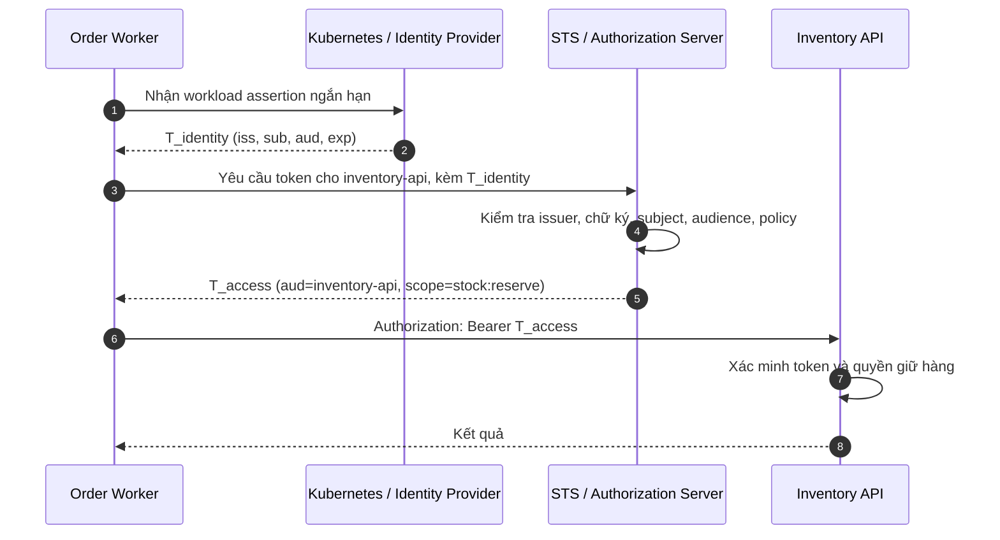

# Workload identity trong xác thực service-to-service

## 1. Workload identity là gì?

**Workload identity** là danh tính được hệ thống tin cậy gán và xác minh cho một **workload đang chạy** — ví dụ Pod, ứng dụng trong container, tác vụ batch, hàm serverless hoặc tiến trình trên máy ảo. Danh tính này cho phép workload chứng minh *“tôi là thành phần nào, đang chạy trong phạm vi nào”* để xin quyền truy cập tới API, database, hàng đợi hoặc dịch vụ đám mây.

Trong kiến trúc **service-to-service (S2S)**, hai dịch vụ thường giao tiếp mà không có người dùng trực tiếp hiện diện. Ví dụ, `order-worker` cần gọi `inventory-api` để giữ hàng. Nếu `inventory-api` chỉ dựa trên IP nội bộ hoặc một header `X-Service-Name: order-worker` thì bên gọi có thể tự khai danh tính. Workload identity giúp ràng buộc lời khẳng định danh tính với bằng chứng do nền tảng cấp, rồi sử dụng danh tính đó trong xác thực và phân quyền.

Đặt trong module **SECURITY_TOKEN_SECURITY_FUNDAMENTALS**, chủ đề này kết nối mô hình tin cậy và vòng đời token bảo mật với OAuth 2.0/OIDC:

- **Danh tính workload** trả lời: *thành phần kỹ thuật nào đang chạy và yêu cầu quyền?*
- **Access token** trả lời: *bằng chứng nào cho phép gọi resource server nào, với scope/quyền nào, trong bao lâu?*
- **Cơ chế attestation/federation** trả lời: *vì sao nhà cấp token tin workload đó thực sự sở hữu danh tính được khai?*
- **Authorization policy** trả lời: *danh tính được xác minh này có quyền làm hành động cụ thể hay không?*

Workload identity **không mặc nhiên là access token**. Một workload có thể sở hữu certificate, service account token hoặc assertion để chứng minh danh tính, rồi nhận access token có `audience` và `scope` phù hợp với API đích.

## 2. Vì sao không nên dùng một API key hoặc client secret chung cho mọi service?

Giả sử hệ thống có 50 bản sao `order-worker` chạy trên các node khác nhau. Cách cũ là đưa cùng một `client_secret` hoặc khóa API vào biến môi trường ở mọi Pod.

| Cách làm | Hệ quả |
|---|---|
| Một secret dùng chung nhiều service | Khó xác định ai gọi; lộ một secret có thể ảnh hưởng nhiều workload |
| Secret tồn tại lâu, lưu trong image hoặc cấu hình | Dễ rò qua Git, CI/CD, backup, log, ảnh container |
| Secret được cấp theo tài khoản quản trị | Một workload bị xâm nhập có thể gọi các API vượt nhu cầu |
| Thay secret phải cập nhật nhiều nơi | Dễ gián đoạn hoặc tiếp tục giữ secret cũ chưa thu hồi |
| Chỉ dựa IP/VPC hoặc header `X-Caller` | Không xác minh được chính xác ứng dụng gọi trong hạ tầng động |

Workload identity khuyến khích **danh tính riêng cho từng workload, bằng chứng ngắn hạn và chính sách cấp quyền tách biệt**. Tuy nhiên, đây không phải cơ chế “không còn bí mật” theo nghĩa tuyệt đối: token, private key tạm thời và certificate vẫn là dữ liệu nhạy cảm. Mục tiêu thực tế là giảm việc phân phối **shared long-lived secrets** và giảm phạm vi lộ lọt.

## 3. Các thành phần của chuỗi tin cậy

Một thiết kế tiêu biểu có các thành phần sau:

| Thành phần | Vai trò |
|---|---|
| **Workload** | Ứng dụng cần gọi API hoặc truy cập resource |
| **Workload orchestrator / identity provider** | Kubernetes, platform identity service hoặc hệ thống attestation xác minh workload đang chạy |
| **Identity assertion** | Token ngắn hạn hoặc certificate mô tả danh tính workload |
| **STS / Authorization Server** | Tin issuer đã cấu hình, đánh giá bằng chứng, ánh xạ identity → quyền và cấp access token |
| **Resource Server** | API đích xác minh token/certificate và quyết định quyền cụ thể |
| **Trust policy** | Quy tắc rõ ràng về issuer, subject, audience, namespace, service account, actor và quyền được phép |

Ví dụ luồng **OIDC workload federation → OAuth access token → API**:



**Chỉ issuer đáng tin mới được cấp danh tính workload**, và chỉ STS/resource server có chính sách tương ứng mới được chấp nhận bằng chứng đó. Một JWT do client tự tạo hoặc chỉ được decode thành JSON **không chứng minh** điều gì nếu chưa kiểm tra chữ ký, issuer và claims.

## 4. Phân biệt workload identity, service account, OAuth client và user identity

Bốn khái niệm này thường cùng xuất hiện nhưng không đồng nhất:

| Khái niệm | Ví dụ | Điều cần nhớ |
|---|---|---|
| **Workload identity** | Pod `orders/order-worker` đã được nền tảng xác thực | Xác định thành phần kỹ thuật đang chạy |
| **Kubernetes ServiceAccount** | `system:serviceaccount:orders:order-worker` | Danh tính dùng trong Kubernetes; quyền RBAC không tự biến thành quyền trên API ngoài cụm |
| **OAuth client identity** | `client_id=order-worker-service` | Định danh một ứng dụng được Authorization Server đăng ký |
| **End-user identity** | `sub=alice` của người dùng | Xác định người sử dụng; không được giả định mọi request S2S có user |

Một workload có thể được ánh xạ sang **OAuth client** tương ứng, nhưng `sub` trong service account token không nhất thiết là `client_id`, và không nhất thiết là `sub` của access token đích.

Tương tự, **xác thực workload** không cấp quyền đọc mọi dữ liệu của Alice. Khi service thực hiện hành động thay mặt người dùng, hệ thống cần tách **workload đang gọi** và **người dùng/actor được ủy quyền**, rồi áp dụng cả hai lớp chính sách.

## 5. Mô hình triển khai workload identity thường gặp

### 5.1. Xác thực trực tiếp bằng certificate và mTLS

Workload có một certificate client ngắn hạn gắn với danh tính của nó. Khi gọi upstream qua **mutual TLS (mTLS)**, bên nhận xác minh chuỗi certificate, trust anchor và danh tính trong SAN. Một kiến trúc như **SPIFFE/SPIRE** có thể cấp **X.509-SVID** để nhận diện workload.

```text
order-worker
  -- mTLS / client X.509-SVID -->
inventory-api
  -- verify CA/trust bundle + SPIFFE ID -->
allow stock:reserve nếu policy cho phép
```

Mô hình này có thể **không cần OAuth Bearer access token** cho mỗi request. Tuy nhiên, certificate hợp lệ mới chứng minh danh tính, chưa tự động quyết định quyền nghiệp vụ. Phải kiểm tra identity được phép gọi endpoint nào.

### 5.2. Workload assertion rồi đổi lấy access token

Workload nhận assertion từ platform, ví dụ **projected Kubernetes ServiceAccount token** hoặc assertion do identity provider cấp. STS xác minh assertion và cấp một access token dành riêng cho API nội bộ:

```text
workload assertion: aud=sts.example.com
        ↓ STS kiểm tra bằng chứng + chính sách
API access token: aud=inventory-api, scope=stock:reserve
        ↓
inventory-api kiểm tra token + quyền tài nguyên
```

Đây là mô hình phổ biến khi tổ chức muốn dùng **OAuth 2.0** để quản lý resource audience, scope, thời hạn, issuer và phân quyền.

### 5.3. Workload dùng danh tính để lấy credential tạm thời của cloud

Các nền tảng cloud có cơ chế liên kết service account/workload với IAM principal. Ví dụ, hệ sinh thái có **AWS IAM Roles for Service Accounts**, **Google Cloud Workload Identity Federation** hoặc **Microsoft Entra Workload ID**. Chi tiết protocol, cấu hình trust relationship và tên token/role **khác nhau theo nhà cung cấp**.

Điểm chung là cloud STS/identity service **kiểm tra assertion workload và trust policy** trước khi cấp credential ngắn hạn cho đúng workload. Không nên suy ra rằng mọi nhà cung cấp đều dùng trực tiếp RFC 8693 hoặc cùng một loại OAuth token.

### 5.4. Machine-to-machine bằng OAuth 2.0 client credentials

Một service có thể dùng `grant_type=client_credentials` để lấy access token dưới danh tính client của chính nó. Nếu client xác thực bằng **mTLS/private_key_jwt** với khóa tạm thời được cấp cho workload, workload identity hỗ trợ việc bảo vệ client authentication. Nếu dùng một `client_secret` tĩnh dùng chung, hệ thống vẫn cần quản lý và luân chuyển secret như trước.

**Client credentials không đại diện cho người dùng cuối.** Nếu service cần truy cập dữ liệu thay mặt Alice, phải có cơ chế delegation hoặc token exchange thích hợp và policy cho phép.

## 6. Kubernetes: ServiceAccount token được gắn với workload thế nào?

Kubernetes có thể cấp **ServiceAccount token thông qua TokenRequest API** và chiếu token đó vào Pod bằng **projected volume**. Khác với việc phân phối một khóa tĩnh, token có thể được cấu hình audience và thời hạn ngắn, đồng thời được kubelet cập nhật trước khi hết hạn theo cơ chế projection.

Ví dụ với service account `order-worker` trong namespace `orders`:

```yaml
apiVersion: v1
kind: Pod
metadata:
  name: order-worker
  namespace: orders
spec:
  serviceAccountName: order-worker
  automountServiceAccountToken: false
  containers:
    - name: worker
      image: registry.example.com/order-worker:1.0
      volumeMounts:
        - name: workload-identity
          mountPath: /var/run/workload-identity
          readOnly: true
  volumes:
    - name: workload-identity
      projected:
        sources:
          - serviceAccountToken:
              path: token
              audience: "sts.example.com"
              expirationSeconds: 3600
```

Đây là **cấu hình minh họa**: người triển khai cần tạo ServiceAccount, điều chỉnh policy admission, issuer được export/JWKS và cách STS nhận diện cụm cụ thể. `automountServiceAccountToken: false` ngăn tự động gắn token mặc định, nhưng volume `serviceAccountToken` được khai báo tường minh vẫn cấp token cho ứng dụng.

Workload đọc token từ `/var/run/workload-identity/token` để làm bằng chứng với STS **nếu STS chấp nhận issuer/audience đó**. Ứng dụng nên đọc lại file khi cần token mới; đừng cache nguyên token trong bộ nhớ vô thời hạn, vì nội dung projected token có thể được rotate.

Một token minh họa (payload **chưa đủ để chứng minh hợp lệ**, và các claim chi tiết có thể khác theo phiên bản Kubernetes):

```json
{
  "iss": "https://k8s-issuer.example.com",
  "sub": "system:serviceaccount:orders:order-worker",
  "aud": ["sts.example.com"],
  "iat": 1730000000,
  "nbf": 1730000000,
  "exp": 1730003600,
  "kubernetes.io": {
    "namespace": "orders",
    "serviceaccount": {
      "name": "order-worker"
    },
    "pod": {
      "name": "order-worker",
      "uid": "example-pod-uid"
    }
  }
}
```

Các timestamp trên chỉ phục vụ minh họa, không phải token đang còn hiệu lực. Không copy payload và ký bằng khóa tùy ý để làm “workload identity” thật.

**Các ràng buộc thiết yếu:**

1. `iss` phải là issuer được STS tin cậy cho **đúng cụm**.
2. `sub` phải khớp chính xác namespace + ServiceAccount đã được ủy quyền, không chỉ kết thúc bằng `order-worker`.
3. `aud` phải bao gồm audience dự kiến của **STS** (nếu dùng để gọi STS). Một token dành cho Kubernetes API hoặc resource khác không nên được chấp nhận nhầm.
4. `exp`, `nbf`, chữ ký và key ID phải được kiểm tra theo thuật toán/keys được cấp phép.
5. Nếu cần trạng thái còn tồn tại của Pod hoặc ServiceAccount, có thể phải xác minh với Kubernetes **TokenReview** hoặc cơ chế phù hợp; **xác minh chữ ký offline không đảm bảo phát hiện tức thì Pod đã bị xóa**.

Token Kubernetes dùng để gọi API Kubernetes và token dùng để liên kết với STS có thể được cấu hình **audience khác nhau**. Việc workload có quyền RBAC `get pods` trong cluster không mặc định trao quyền `stock:reserve` trong inventory-api.

## 7. OIDC federation: biến danh tính workload thành quyền trên API

### 7.1. Liên kết các miền tin cậy

Ví dụ một tổ chức có:

- **Issuer của Kubernetes**: `https://k8s-issuer.example.com`.
- **Workload**: `system:serviceaccount:orders:order-worker`.
- **STS**: `https://auth.example.com/oauth2/token`.
- **Downstream API**: `inventory-api`.
- **Quyền tối đa**: `stock:reserve`.

STS cấu hình trust rule đại ý:

```text
WHEN issuer == "https://k8s-issuer.example.com"
 AND subject == "system:serviceaccount:orders:order-worker"
 AND audience contains "sts.example.com"
 AND token signature/expiry/binding are valid
THEN permit issuing token for
     audience = "inventory-api"
     scopes <= {"stock:reserve"}
ELSE deny
```

Đây là **mô tả chính sách**, không phải cú pháp sử dụng trực tiếp cho một STS bất kỳ. Cấu hình thực tế có thể còn ràng buộc cluster, namespace, Pod identity, organization, network hoặc condition khác.

Một rule `subject startsWith "system:serviceaccount:"` quá rộng sẽ cho nhiều service account dùng chung trust, dẫn đến **confused deputy** và leo thang đặc quyền. Nếu hai cluster có cùng tên namespace/ServiceAccount, policy phải phân biệt được **issuer/trust domain** để tránh nhầm workload khác thành cùng danh tính.

### 7.2. Có bắt buộc dùng RFC 8693 không?

**Không.** Workload federation là khái niệm về trust relationship; protocol đổi assertion sang credential tùy Authorization Server/STS. Các hệ thống có thể dùng OAuth 2.0 Token Exchange (**RFC 8693**), JWT bearer assertion (**RFC 7523**), giao thức riêng của cloud hoặc certificate-based authentication.

Nếu STS **hỗ trợ OAuth 2.0 Token Exchange theo RFC 8693**, request có thể có dạng minh họa:

```http
POST /oauth2/token HTTP/1.1
Host: auth.example.com
Content-Type: application/x-www-form-urlencoded

grant_type=urn:ietf:params:oauth:grant-type:token-exchange&
subject_token=<workload-assertion>&
subject_token_type=urn:ietf:params:oauth:token-type:jwt&
requested_token_type=urn:ietf:params:oauth:token-type:access_token&
audience=inventory-api&
scope=stock%3Areserve
```

Trong request thật, body cần được form-encode chuẩn; `<workload-assertion>` là chỗ giữ chỗ và **không** phải token thật. Cách **xác thực OAuth client** (mTLS, client assertion, public client đã được cho phép hoặc cơ chế phù hợp) phải tuân theo STS; không suy ra chỉ có assertion là đủ cho mọi endpoint. Một số STS yêu cầu `subject_token_type=urn:ietf:params:oauth:token-type:access_token` thay vì `jwt` khi token đầu vào được phân loại là access token. Hãy dùng **loại token đúng với hợp đồng STS**, không dựa vào việc chuỗi trông giống JWT.

Phản hồi khi cấp **OAuth access token** có thể là:

```json
{
  "access_token": "<issued-access-token>",
  "issued_token_type": "urn:ietf:params:oauth:token-type:access_token",
  "token_type": "Bearer",
  "expires_in": 300,
  "scope": "stock:reserve"
}
```

Gateway hoặc workload giữ token nhận được và chỉ gửi xuống `inventory-api` nếu token đó dành đúng audience. Với access token dạng **JWT**, API kiểm tra claims và chữ ký; với **opaque token**, API dùng introspection hoặc cơ chế kiểm tra được hệ thống quy định. Một JWT đã được giải mã ra `sub` chưa phải bằng chứng hợp lệ nếu chưa kiểm tra các yếu tố bắt buộc.

### 7.3. Nếu dùng JWT bearer assertion theo RFC 7523

Khi Authorization Server hỗ trợ profile JWT bearer, một workload có thể dùng JWT làm **authorization grant** hoặc **client authentication assertion**, tùy cấu hình. Đây là cơ chế riêng với token exchange:

```text
grant_type=urn:ietf:params:oauth:grant-type:jwt-bearer
assertion=<signed-jwt>
```

Không đổi ngẫu nhiên `grant_type` giữa hai cơ chế. STS phải công bố rõ issuer nào được tin, audience nào phải có trong assertion, cách xác thực client và token nào sẽ được cấp.

## 8. SPIFFE/SPIRE và nhận diện workload bằng SVID

**SPIFFE** quy định cách nhận diện workload trong trust domain bằng **SPIFFE ID**, ví dụ:

```text
spiffe://example.org/ns/orders/sa/order-worker
spiffe://example.org/ns/inventory/sa/inventory-api
```

Phần path là cấu trúc định danh mà tổ chức chọn; đừng giả định mọi SPIFFE deployment đều dùng `/ns/.../sa/...`. **SPIRE** là một triển khai có thể attestation node/workload và cấp danh tính SPIFFE theo policy.

Hai dạng **SVID** thường gặp:

| Dạng | Chứng minh danh tính bằng | Cách sử dụng |
|---|---|---|
| **X.509-SVID** | Certificate và private key ngắn hạn | mTLS giữa service, kiểm tra URI SAN chứa SPIFFE ID |
| **JWT-SVID** | JWT được issuer SPIFFE tin cậy ký, có audience | Xác thực ở nơi hỗ trợ JWT-SVID và kiểm tra audience |

Một SPIFFE ID chỉ là **tên định danh**, không phải chứng cứ tự thân. Resource server phải xác thực X.509 chain/trust bundle hoặc JWT-SVID theo đúng specification rồi mới dùng ID đó để phân quyền.

Ví dụ policy ở inventory-api:

```text
allow "POST /internal/reservations"
if authenticated_peer_spiffe_id ==
   "spiffe://example.org/ns/orders/sa/order-worker"
```

Đây là logic policy minh họa; có thể bổ sung điều kiện tenant, loại hành động và quyền tài nguyên. Nếu liên kết nhiều trust domain, việc chấp nhận SVID từ domain khác đòi **federation/trust bundle** phù hợp; không tự tin mọi định danh có tiền tố `spiffe://`.

**X.509-SVID và JWT-SVID không tự động tương đương OAuth access token.** Muốn sử dụng chúng để cấp access token, STS phải định nghĩa cơ chế ánh xạ và xác minh rõ ràng.

## 9. Ràng buộc identity với quyền: xác thực chưa phải phân quyền

Một identity mạnh nhưng policy quá rộng vẫn không an toàn. Ví dụ `order-worker` cần gọi inventory-api để giữ hàng, trong khi `report-worker` chỉ cần truy vấn thống kê.

| Workload đã được xác thực | API đích | Quyền hợp lệ |
|---|---|---|
| `orders/order-worker` | `inventory-api` | `stock:reserve` |
| `reports/report-worker` | `inventory-api` | `stock:read` |
| `billing/invoice-worker` | `billing-api` | `invoice:write` |
| `unknown/default` | `inventory-api` | Không cấp quyền |

Policy nên ràng buộc **identity + đúng target + scope/action + điều kiện nghiệp vụ**. Không cấp mọi quyền chỉ vì workload đến từ namespace `prod` hoặc có một certificate do CA nội bộ ký.

Khi gọi API bằng Bearer access token, resource server vẫn cần kiểm tra:

1. **Chữ ký/JWKS** với thuật toán cho phép nếu là JWT; không tin claim chỉ vì parse được.
2. **Issuer `iss`** đúng Authorization Server đã cấu hình; ngăn cross-issuer confusion.
3. **Audience `aud`** bao gồm đúng resource server hiện tại; không lấy ID token hay token dành cho STS làm access token của API.
4. **Thời hạn `exp`, `nbf`** và giới hạn sai lệch đồng hồ hợp lý.
5. **Scope/permission** tương ứng endpoint; khi cần thêm kiểm tra đối tượng cụ thể như tenant, mã đơn hàng hay tài khoản.
6. **Ràng buộc chứng minh quyền sở hữu khóa (`cnf`)** nếu token được cấu hình sender-constrained.
7. **Trạng thái revocation** nếu kiến trúc yêu cầu và có cơ chế khả thi (introspection, denylist hoặc token lifetime ngắn).

### Ví dụ Resource Server với Spring Security

Cấu hình issuer URI cho service nhận JWT do Authorization Server cấp:

```yaml
spring:
  security:
    oauth2:
      resourceserver:
        jwt:
          issuer-uri: https://auth.example.com/
```

**Chỉ cấu hình issuer không thay thế kiểm tra audience.** Ví dụ minh họa cách yêu cầu thêm `aud=inventory-api` trong một ứng dụng Spring Security dùng NimbusJwtDecoder:

```java
@Bean
JwtDecoder jwtDecoder() {
    String issuer = "https://auth.example.com/";
    NimbusJwtDecoder decoder =
            (NimbusJwtDecoder) JwtDecoders.fromIssuerLocation(issuer);

    OAuth2TokenValidator<Jwt> standard =
            JwtValidators.createDefaultWithIssuer(issuer);

    OAuth2TokenValidator<Jwt> audience = jwt ->
            jwt.getAudience().contains("inventory-api")
                    ? OAuth2TokenValidatorResult.success()
                    : OAuth2TokenValidatorResult.failure(
                            new OAuth2Error("invalid_token",
                                    "Unexpected token audience", null));

    decoder.setJwtValidator(
            new DelegatingOAuth2TokenValidator<>(standard, audience));
    return decoder;
}
```

Đoạn code cần khai báo import/bean theo phiên bản Spring Security đang dùng và chỉ minh họa **JWT validation**. Ứng dụng vẫn phải cấu hình HTTP security, scope-authorities và kiểm tra quyền nghiệp vụ. Không dùng nó để xác minh Kubernetes ServiceAccount token trong API nếu issuer/audience của token đó được thiết kế **chỉ dành cho STS**.

## 10. Workload identity khi có người dùng cuối: tránh nhầm chủ thể

Một cuộc gọi S2S có thể xảy ra theo hai mô hình:

**Mô hình A — Tác vụ thuần hệ thống**

```text
order-worker (identity: workload)
  -- client credentials / STS -->
access token (subject/service identity)
  -- stock:reserve -->
inventory-api
```

Không có người dùng cuối; resource server xác thực workload và scope, sau đó kiểm tra policy nghiệp vụ.

**Mô hình B — Tác vụ thay mặt người dùng**

```text
Alice -- access token cho public API --> orders-api
orders-api (workload identity) + bằng chứng ủy quyền từ Alice
       -- delegation / token exchange được STS cho phép -->
token dành cho inventory-api
       -- kiểm tra actor + subject + scope + tenant -->
inventory-api
```

Trong mô hình B, workload identity trả lời **dịch vụ nào đang hành động**, còn token/ngữ cảnh người dùng trả lời **đại diện cho ai**. Nếu sử dụng OAuth 2.0 Token Exchange, STS có thể thể hiện thông tin actor trong token, ví dụ claim `act` theo mô hình delegation được hỗ trợ.

**Đừng coi service-to-service là có quyền làm mọi việc thay người dùng.** Nếu Alice chỉ có quyền xem đơn hàng, workload không được biến bằng chứng của Alice thành token có quyền xóa đơn hàng hoặc truy cập tenant khác. Đồng thời, không nên dùng workload token như ID token của Alice.

## 11. Vòng đời token, certificate và cơ chế thu hồi

Workload có thể thay đổi liên tục: Pod restart, autoscale, node thay thế, image cập nhật hoặc ServiceAccount bị đổi quyền. Vì vậy credential nên được thiết kế ngắn hạn và có thể luân chuyển tự động.

| Thời điểm | Cần xử lý |
|---|---|
| **Phát hành** | Attestation hợp lệ, issuer/trust domain đúng, audience cụ thể, thời hạn ngắn |
| **Sử dụng** | Bảo vệ token/key trong process và khi truyền; dùng TLS/mTLS; không đưa vào log |
| **Luân chuyển** | Kubernetes projected token và SVID có thể tự cập nhật; ứng dụng reload token/cert trước khi hết hạn |
| **Cache** | Cache theo chính identity, actor, audience, scope, tenant và policy; TTL không vượt token lifetime |
| **Thu hồi** | Phân biệt khả năng thu hồi ngay, kiểm tra trạng thái trực tuyến và chờ credential hết hạn |
| **Ngừng workload** | Thu hồi quyền ở trust policy, chặn API/network và xử lý credential còn sống |

**JWT đã ký có thể vẫn xác thực được offline cho đến khi hết hạn**, kể cả khi Pod vừa bị xóa. Việc xóa Pod/ServiceAccount không luôn là bằng chứng token JWT bị vô hiệu hóa tức thời tại mọi bên xác minh. Nếu cần đáp ứng yêu cầu thu hồi nhanh, lựa chọn TokenReview/introspection/denylist hoặc credential rất ngắn hạn theo đặc thù hệ thống.

**Bearer token có thể bị phát lại** nếu bị đánh cắp dù issuer/audience đều đúng. Dùng lifetime ngắn, audience hẹp và endpoint bảo vệ bằng TLS để giảm nguy cơ; nơi yêu cầu bảo vệ cao có thể áp dụng **sender-constrained access token** như mTLS-bound token hoặc DPoP theo profile hỗ trợ. Phải kiểm tra bằng chứng sở hữu khóa đúng tại hop sử dụng; không thể tự chuyển một token gắn với khóa client sang service khác rồi coi như service đó sở hữu khóa.

Certificate mTLS cũng cần xử lý **rotation, trust bundle update và tình trạng khóa riêng bị lộ**. Nếu private key được xuất ra và đánh cắp, SVID vẫn có thể bị lợi dụng trong thời gian hiệu lực, tùy chính sách bảo vệ khóa và thu hồi.

## 12. Phân tích các tình huống tấn công

### Tình huống 1 — Chiếm token của Pod

Một thư viện bị lỗi trong `order-worker` làm lộ projected token thông qua debug log. Attacker lấy token và cố gửi nó tới API quản trị.

- **Sai:** API quản trị chỉ kiểm tra chữ ký và chấp nhận mọi token của issuer Kubernetes.
- **Đúng:** Token có `aud=sts.example.com`, vì vậy API quản trị từ chối vì sai audience. STS kiểm tra chính xác `issuer + subject + audience` và policy; không cấp quyền quản trị cho workload này.
- **Giới hạn:** Attacker vẫn có thể phát lại token tới STS trong thời hạn hợp lệ nếu assertion dạng bearer và không có ràng buộc bổ sung. Cần bảo vệ workload, thời hạn, audit và chính sách STS.

### Tình huống 2 — Giả mạo service account cùng tên ở cluster khác

Một cluster thử nghiệm cũng có ServiceAccount `orders/order-worker`, nhưng do attacker kiểm soát.

- **Sai:** STS chỉ so khớp `sub=system:serviceaccount:orders:order-worker`.
- **Đúng:** STS xác minh **issuer/trust domain chính xác**, chữ ký của issuer được tin cậy, `aud` và các điều kiện workload đã khai báo.

### Tình huống 3 — Quyền IAM wildcard

Trust policy cho phép mọi ServiceAccount trong namespace `production` đổi assertion sang role có quyền quản lý cơ sở dữ liệu.

- **Sai:** Một Pod mới trong namespace `production` có thể mặc nhiên nhận quyền mạnh.
- **Đúng:** Ràng buộc cụ thể workload identity với role/target/scope tối thiểu, tách service account theo tác vụ và giới hạn ai được phép deploy Pod dùng danh tính đó.

### Tình huống 4 — Confused deputy khi gọi thay người dùng

Client gửi một token chỉ cho phép `orders:read` nhưng yêu cầu Gateway/STS đổi thành token `payments:refund`.

- **Sai:** Workload dùng đặc quyền cloud của chính nó để lấy token admin cho bất kỳ yêu cầu từ client.
- **Đúng:** STS kiểm tra nguồn ủy quyền của người dùng, danh tính workload/actor, target, scope và tenant; từ chối yêu cầu vượt quyền.

### Tình huống 5 — Chỉ tin mạng nội bộ

Service `inventory-api` chấp nhận mọi request từ IP trong cluster và đọc `X-Caller: order-worker`.

- **Sai:** Một Pod bị chiếm quyền gửi cùng header, bỏ qua xác thực.
- **Đúng:** API xác thực token hoặc mTLS SVID và phân quyền theo danh tính được xác minh; network policy chỉ là lớp bảo vệ bổ sung.

## 13. Những lỗi cấu hình thường gặp

| Sai lầm | Vì sao nguy hiểm? | Cách khắc phục |
|---|---|---|
| Cho nhiều workload dùng `default` ServiceAccount | Khó phân quyền và audit theo workload | Một ServiceAccount cho mỗi workload hoặc nhóm có cùng trust boundary |
| Cấp IAM role bằng rule quá rộng | Pod khác có thể nhận quyền ngoài phạm vi | Exact match issuer/subject/audience, hạn chế namespace/role |
| Đọc JWT payload mà bỏ kiểm tra chữ ký | Attacker tự tạo claims | Verify chữ ký, thuật toán, issuer, audience và thời hạn |
| Dùng token có audience Kubernetes API cho cloud STS | Token bị tái sử dụng sai ngữ cảnh | Dùng projected token có audience đúng |
| Coi Kubernetes RBAC là quyền của resource server | Quyền hai hệ thống không liên hệ tự động | Cấu hình mapping workload → API scope/action riêng |
| Lưu service account token trong environment lâu dài | Không tự cập nhật khi rotation, dễ log nhầm | Dùng file projection, reload theo vòng đời |
| Tự động fallback sang API key/secret mạnh khi STS lỗi | Bỏ qua kiểm soát workload identity | Fail closed; xử lý lỗi có giới hạn và quan sát rõ |
| Cho API chấp nhận mọi certificate từ CA nội bộ | Certificate hợp lệ nhưng workload sai vẫn gọi được | Kiểm tra SPIFFE ID/subject cụ thể và policy |
| Chỉ kiểm tra scope mà bỏ tenant/ownership | Có thể truy cập chéo dữ liệu | Quyền đối tượng tại resource server |
| Cache access token chỉ theo `aud` | User/workload khác nhận lại token sai | Cache key gồm subject, actor, scope, tenant, audience và chính sách |

## 14. Kiểm thử end-to-end

Kiểm thử cần thấy cả **bằng chứng workload**, **quyết định cấp token của STS** và **kết quả phân quyền của API**. Không dùng token production trong câu lệnh, log hay dịch vụ echo.

| Ca thử | Kết quả kỳ vọng |
|---|---|
| `orders/order-worker` có assertion đúng `aud=sts.example.com` | STS xác minh và cấp token `aud=inventory-api` với scope tối thiểu |
| Assertion hết hạn, sai chữ ký hoặc sai issuer | STS từ chối; không cấp access token |
| ServiceAccount cùng tên ở cluster khác | Không được nhận diện là workload đã ủy quyền |
| Token của `orders/order-worker` xin `billing-admin` | STS từ chối target/scope vượt policy |
| Pod `default` dùng token của chính nó | Không được tự nhận quyền của `order-worker` |
| Token cấp cho `inventory-api` gọi `payments-api` | Payments từ chối vì audience không phù hợp |
| Token Kubernetes dùng trực tiếp tại API chỉ tin OAuth issuer | API từ chối vì issuer/audience/token type sai |
| Xóa Pod hoặc thu hồi quyền workload | Theo cơ chế thiết kế: chặn cấp mới, kiểm tra revocation/binding nếu yêu cầu |
| Chứng chỉ SPIFFE ID sai nhưng cùng trust bundle | API từ chối vì workload identity không nằm trong allowlist |
| Hai workload cùng aud/scope gọi đồng thời | Không bị dùng chung cache token sai identity |
| STS timeout hoặc JWKS không truy cập được | Không bỏ qua xác thực; trả lỗi có thể quan sát |
| Chuỗi log và trace trong ứng dụng | Không chứa assertion, access token, certificate private key hoặc secret |

Để chạy thử, có thể dùng workload thử nghiệm với policy chỉ đọc hoặc quyền mock. Ghi telemetry như `route`, `audience`, `principal_id` được băm/phân loại phù hợp, quyết định policy, mã lỗi và trace ID; **không log nguyên token**, đặc biệt là `Authorization` và nội dung file ServiceAccount token.

Một số lỗi cần phân biệt: **401** thường áp dụng khi thiếu hoặc sai xác thực; **403** khi principal đã xác thực nhưng không có quyền; lỗi **5xx** hoặc trạng thái khác phù hợp khi STS/bên cấp token gặp sự cố. Không biến timeout STS thành token “được tạm chấp nhận”.

## 15. Checklist triển khai an toàn

1. **Đặt danh tính rõ ràng:** xác định workload/namespace/ServiceAccount hoặc SPIFFE ID của từng service; tránh account chung.
2. **Xây trust chain:** ghi rõ ai xác thực workload, issuer nào được tin, cách xác minh chữ ký/chứng chỉ và trust domain.
3. **Ràng buộc audience ở từng hop:** assertion gửi cho STS khác với access token dành cho API; mọi bên nhận kiểm tra audience của chính mình.
4. **Phân quyền tối thiểu:** mapping identity → target resource → scope/action/tenant; không suy quyền chỉ từ mạng nội bộ.
5. **Xác định mô hình user delegation:** phân biệt service chạy độc lập và service hành động thay người dùng.
6. **Quản lý vòng đời:** token/SVID ngắn hạn, reload khi rotate, cache có giới hạn và cơ chế revocation thích hợp.
7. **Bảo vệ bí mật:** TLS/mTLS, không commit/log token hoặc key, giới hạn quyền đọc projected volume và secret.
8. **Kiểm thử sai phạm:** issuer/subject/audience mismatch, token bị đánh cắp, quyền wildcard, cross-tenant và truy cập bỏ qua Gateway.
9. **Giám sát STS và resource server:** tỷ lệ cấp token, 401/403, timeout, lỗi policy, certificate/token rotation và audit theo workload.
10. **Làm rõ quy trình sự cố:** thu hẹp trust policy, vô hiệu hóa workload bị xâm nhập, rotate khóa/credential và xử lý token còn hiệu lực.

**Nguyên tắc cốt lõi:** Workload identity cung cấp cách xác minh *dịch vụ nào đang thực sự gọi*, còn OAuth access token, mTLS và policy quyết định *dịch vụ đó được làm gì*. Một hệ thống an toàn cần cả **bằng chứng danh tính đáng tin**, **audience/scope đúng mục đích**, **quyền tối thiểu** và **vòng đời token được kiểm soát**.

### Tài liệu tiêu chuẩn để tìm hiểu thêm

- [RFC 6749 — OAuth 2.0 Authorization Framework](https://www.rfc-editor.org/rfc/rfc6749): OAuth client, token endpoint và client credentials grant.
- [RFC 6750 — OAuth 2.0 Bearer Token Usage](https://www.rfc-editor.org/rfc/rfc6750): cách truyền và bảo vệ Bearer access token.
- [RFC 7523 — JWT Profile for OAuth 2.0 Client Authentication and Authorization Grants](https://www.rfc-editor.org/rfc/rfc7523): JWT bearer assertion.
- [RFC 8693 — OAuth 2.0 Token Exchange](https://www.rfc-editor.org/rfc/rfc8693): subject token, actor token, audience/resource và cấp token mới.
- [RFC 8725 — JSON Web Token Best Current Practices](https://www.rfc-editor.org/rfc/rfc8725): xác minh JWT, chống token confusion và sử dụng audience đúng.
- [RFC 8705 — OAuth 2.0 Mutual-TLS Client Authentication and Certificate-Bound Access Tokens](https://www.rfc-editor.org/rfc/rfc8705): mTLS client authentication và sender-constrained token.
- [RFC 9700 — Best Current Practice for OAuth 2.0 Security](https://www.rfc-editor.org/rfc/rfc9700): khuyến nghị bảo mật OAuth 2.0.
- [Kubernetes — Service Accounts](https://kubernetes.io/docs/concepts/security/service-accounts/): quản lý danh tính và token ServiceAccount.
- [Kubernetes — Projected Volumes](https://kubernetes.io/docs/concepts/storage/projected-volumes/): ServiceAccountToken projection, audience, thời hạn và rotation.
- [SPIFFE — Workload Identity Overview](https://spiffe.io/docs/latest/spiffe-about/overview/): SPIFFE ID, SVID, trust domain và ứng dụng trong service-to-service.
