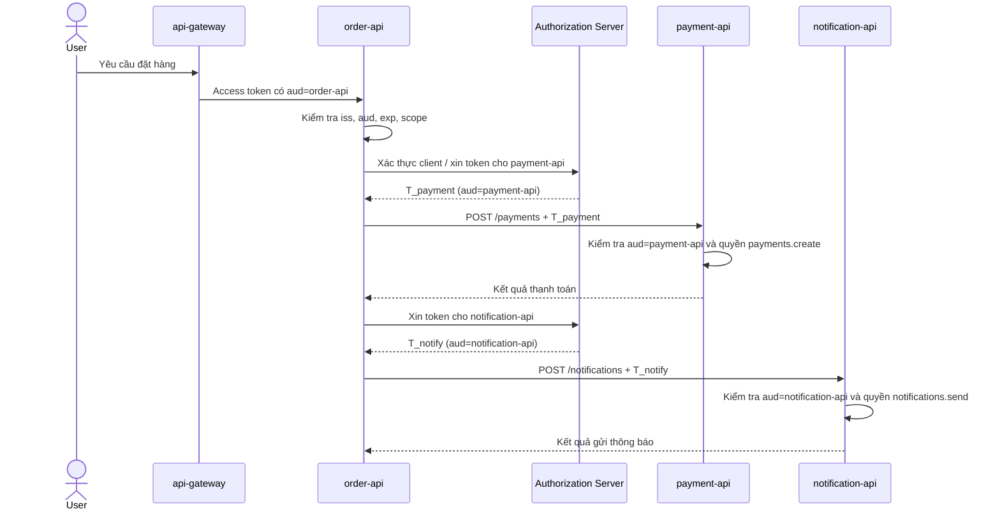

# Audience theo downstream service

## 1. Bài toán: một token đi qua nhiều dịch vụ

Trong kiến trúc microservices, một request thường đi qua nhiều bước: `api-gateway` nhận yêu cầu, `order-api` xử lý đơn hàng, `payment-api` thanh toán và `notification-api` gửi thông báo. Mỗi bước có một **Resource Server** (API nhận token) khác nhau. Dù các service nằm trong cùng cluster, không nên mặc định token dùng cho service đầu tiên có thể được dùng tại tất cả service phía sau.

**Audience (`aud`)** là thông tin cho biết *token được cấp để sử dụng tại tài nguyên/đối tượng nhận nào*. Với OAuth 2.0 access token, audience thường định danh API hay Resource Server đích. Một access token dành cho `order-api` không tự động hợp lệ tại `payment-api`. Việc Resource Server kiểm tra audience giúp ngăn token bị sử dụng sai nơi, còn gọi là **token substitution** hoặc một dạng **confused deputy** khi dịch vụ trung gian bị dụ dùng quyền sai mục đích.

Ví dụ hệ thống đặt hàng:

- Issuer tin cậy: `https://auth.prod.example`.
- Audience của Order API: `urn:service:order-api`.
- Audience của Payment API: `urn:service:payment-api`.
- Audience của Notification API: `urn:service:notification-api`.

Các định danh chỉ mang tính minh họa. Trong thực tế, audience do hợp đồng giữa Authorization Server (AS) và Resource Server (RS) xác định; có thể dùng URI, URN hoặc một định danh ổn định khác, miễn **cấp token và kiểm tra token dùng cùng một giá trị chính xác**.

### Audience khác với issuer, scope và identity

| Thông tin | Trả lời câu hỏi | Ví dụ | Khi nào kiểm tra? |
|---|---|---|---|
| `iss` (issuer) | Ai phát hành token? | `https://auth.prod.example` | Mỗi RS chỉ chấp nhận issuer đã được cấu hình tin cậy |
| `aud` (audience) | Token dành cho API nào? | `urn:service:payment-api` | Mỗi RS phải xác minh token dành cho chính mình |
| `scope` / `scp` | Client được cấp quyền thao tác gì? | `payments.create` | Khi kiểm tra quyền truy cập endpoint |
| `sub` (subject) | Chủ thể được token thể hiện là ai? | `order-worker-prod` | Khi áp chính sách theo chủ thể |
| `client_id` / `azp` (tùy hồ sơ) | Client nào đã xin hoặc được cấp token? | `order-worker-prod` | Khi chính sách cần giới hạn client gọi |
| `exp`, `nbf` | Token còn hiệu lực theo thời gian không? | Unix timestamps | Mỗi lần xác thực token |
| `cnf` (nếu có) | Token bị ràng buộc với khóa/chứng chỉ nào? | Khóa DPoP hoặc chứng chỉ mTLS | Khi RS xác minh sender-constrained token |

**Không thể thay audience bằng scope.** Token có `payments.create` nhưng `aud=urn:service:order-api` vẫn không được dùng để gọi Payment API. Ngược lại, token có audience đúng nhưng thiếu `payments.create` cũng phải bị từ chối thao tác tạo thanh toán. Tương tự, token có chữ ký hợp lệ chưa đủ: nếu issuer không nằm trong danh sách tin cậy của API hoặc token hết hạn, API cũng phải từ chối.

## 2. Luồng cấp và kiểm tra audience cho từng chặng

Giả sử `order-api` cần gọi `payment-api`, rồi gọi `notification-api`. Các token nên được cấp theo đích sử dụng của từng chặng:



Trong sơ đồ, `order-api` thực hiện hành động **bằng danh tính service của chính nó** khi xin token downstream. Nếu nghiệp vụ phải giữ quyền ủy quyền của người dùng, việc xin token sẽ theo mô hình *token exchange/on-behalf-of* hoặc cơ chế ủy quyền tương đương được AS hỗ trợ (xem mục 5).

| Chặng gọi | Token cần có | Token cần bị từ chối |
|---|---|---|
| Gateway → Order API | `aud=urn:service:order-api`, đủ quyền tạo đơn | Token chỉ dành cho `payment-api` |
| Order API → Payment API | `aud=urn:service:payment-api`, scope `payments.create` | Token dành cho `order-api` dù có scope thanh toán |
| Order API → Notification API | `aud=urn:service:notification-api`, scope `notifications.send` | Token dành cho `payment-api` |
| Staging → Production | Token/issuer/audience hợp lệ theo chính sách **production** | Token chỉ hợp lệ cho môi trường staging |

Lưu ý rằng **một service có thể vừa là Resource Server vừa là OAuth client**: `order-api` xác thực token đầu vào tại endpoint của mình, sau đó độc lập xin và sử dụng access token phù hợp khi gọi `payment-api`. Hai vai trò này có ranh giới tin cậy riêng.

## 3. Audience xuất hiện ở đâu trong access token?

Với JWT access token, `aud` là một claim của token. Một ví dụ token được cấp để gọi Payment API:

```json
{
  "iss": "https://auth.prod.example",
  "sub": "order-worker-prod",
  "client_id": "order-worker-prod",
  "aud": "urn:service:payment-api",
  "scope": "payments.create",
  "iat": 1795400000,
  "nbf": 1795400000,
  "exp": 1795400300,
  "jti": "7a1b2c3d"
}
```

Đây là **payload minh họa**, không phải JWT hoàn chỉnh hoặc token hợp lệ để sử dụng; phần chữ ký và quy tắc phát hành nằm ngoài ví dụ. Tên claim, ý nghĩa `sub`, cách diễn đạt `scope` và profile access token thực tế do AS và RS thống nhất. Không tự suy ra `sub` nhất thiết bằng `client_id`.

Theo RFC 7519, `aud` có thể biểu diễn là **chuỗi** hoặc **mảng chuỗi**. Cả hai ví dụ sau đều cần được xử lý nếu hồ sơ token cho phép:

```json
{ "aud": "urn:service:payment-api" }
```

```json
{ "aud": ["urn:service:payment-api", "urn:service:fraud-api"] }
```

Mỗi Resource Server chỉ xác nhận audience của mình **có mặt trong danh sách audience được ký/xác thực bởi AS**, đồng thời áp chính sách của nó. Một JWT có nhiều audience hợp lệ không có nghĩa một service được quyền gọi mọi endpoint của tất cả API đó.

Với **opaque access token**, Resource Server không thể đọc `aud` từ chính chuỗi token. Nó thường phải gọi OAuth 2.0 Token Introspection (RFC 7662) bằng thông tin xác thực của mình, nhận metadata như `active`, `aud`, `scope`, `client_id`, `exp` rồi áp cùng chính sách kiểm tra audience. Các trường thực tế mà introspection endpoint trả về phụ thuộc AS và cấu hình; nếu không có bằng chứng xác thực rằng token dành cho API hiện tại, không được đoán audience từ định dạng chuỗi.

### Audience phải là định danh chính xác

Không chấp nhận các cách đối sánh kiểu:

- `aud.contains("payment")` hoặc khớp chuỗi con.
- Bắt đầu bằng `https://api.company` rồi coi mọi API dưới domain ấy tương đương.
- Tự động chọn audience từ HTTP `Host` hoặc từ một header client có thể sửa.
- Bỏ qua kiểm tra nếu `aud` thiếu hoặc sai kiểu dữ liệu.
- Chấp nhận token từ mọi môi trường vì URI có tên service giống nhau.

Nếu triển khai có nhiều tên miền, phiên bản API hoặc region, nên thống nhất **resource identifier** ổn định theo chính sách của hệ thống. Audience không nhất thiết phải bằng URL request vật lý. Ví dụ `https://payments.internal.svc.cluster.local`, `https://payment-api.example` và `urn:service:payment-api` không được coi là cùng một audience chỉ vì cùng trỏ tới một ứng dụng, trừ khi AS/RS đã cấu hình rõ ràng chúng là những identifier được phép.

## 4. Làm sao để xin token đúng downstream?

### 4.1. Client Credentials cho hành động độc lập của service

Khi `order-worker-prod` thanh toán theo tác vụ của chính service, nó có thể dùng OAuth 2.0 **Client Credentials Grant**. Client xác thực với AS và yêu cầu quyền mà AS đã cho phép:

```http
POST /oauth2/token HTTP/1.1
Host: auth.prod.example
Authorization: Basic <credentials-redacted>
Content-Type: application/x-www-form-urlencoded

grant_type=client_credentials&scope=payments.create&resource=urn%3Aservice%3Apayment-api
```

Ở ví dụ này, `resource` là **Resource Indicator** theo RFC 8707, giúp client báo API đích. AS vẫn phải xác thực client, kiểm tra nó có được xin `payments.create` cho Payment API hay không và phát token với audience phù hợp theo chính sách của mình.

**Không phải Authorization Server nào cũng hỗ trợ tham số `resource`.** Có hệ thống cấu hình audience ở client registration, API permission hoặc một tham số riêng của nhà cung cấp. Người triển khai phải làm theo hợp đồng cụ thể của AS; không mặc định gửi `audience` trong request là chuẩn OAuth 2.0 chung.

Response minh họa:

```json
{
  "access_token": "<opaque-or-jwt-access-token>",
  "token_type": "Bearer",
  "expires_in": 300,
  "scope": "payments.create"
}
```

Response có thể không hiển thị `aud`: cần xác minh token được phát hành đúng audience thông qua hợp đồng với AS, bằng claims đã kiểm chứng hoặc introspection. `token_type` cho biết cách trình bày token khi gọi API; với bearer token, service thường gửi:

```http
POST /payments HTTP/1.1
Host: payment-api.internal
Authorization: Bearer <access-token-for-payment-api>
Content-Type: application/json

{ "orderId": "order-123", "amount": 100000, "currency": "VND" }
```

Không nhúng token trong query parameter, URL, log, nội dung lỗi hoặc event. Token cần được bảo vệ khi lưu trong bộ nhớ hay cache, và được cấp thời hạn sử dụng ngắn phù hợp yêu cầu hệ thống.

### 4.2. Nhiều downstream cần nhiều token?

**Mặc định nên cấp token theo từng Resource Server đích** khi yêu cầu quyền hoặc ranh giới tin cậy khác nhau. Một token cho Payment API mang audience `urn:service:payment-api` và scope `payments.create`; token cho Notification API mang audience `urn:service:notification-api` và scope `notifications.send`.

Một token có **nhiều audience** vẫn có thể là thiết kế có chủ ý khi AS cho phép và các RS thống nhất chính sách. Tuy nhiên, nên đánh giá:
 
| Phương án | Ưu điểm | Đánh đổi |
|---|---|---|
| Một token/audience cho mỗi API | Dễ giới hạn phạm vi khi lộ token; kiểm toán và chính sách rõ | Client phải quản lý/cache nhiều token |
| Một token chứa nhiều audience | Giảm số lần xin token trong một số luồng đặc thù | Một token bị lộ có thể dùng ở nhiều API; khó giới hạn quyền và thu hồi riêng |
| Audience đại diện cả nhóm API | Đơn giản hóa định danh trong một trust domain thống nhất | Cần chứng minh tất cả API thuộc cùng miền bảo mật và policy phù hợp |

Không dùng wildcard `aud=*` hoặc một audience “all-services” chỉ để tránh xin token downstream. Với API nhạy cảm như thanh toán, định danh audience riêng thường dễ kiểm soát hơn.

### 4.3. Cache và làm mới token theo audience

Để tránh dùng nhầm token, client nên cache theo tối thiểu bộ khóa logic:

```text
(issuer, client_identity, target_audience/resource, scopes, auth_context)
```

`auth_context` bao gồm các ràng buộc cần thiết nếu có, ví dụ danh tính người dùng trong luồng delegation, tenant, chứng chỉ/key ràng buộc hoặc grant type. Khi thay audience từ Payment API sang Notification API, phải lấy token phù hợp và cache ở entry khác.

Chỉ tái sử dụng token khi còn đủ thời gian hiệu lực và chính sách của hệ thống cho phép; xử lý clock skew có giới hạn, tránh request đồng thời cùng xin lại nhiều token. Với Client Credentials, thông thường client xác thực lại để xin access token mới thay vì phụ thuộc refresh token.

## 5. Downstream thay mặt người dùng: không chuyển tiếp token tùy tiện

Cần phân biệt hai tình huống:

1. **Service-to-service thuần túy:** `order-api` có quyền độc lập gọi `payment-api` theo một tác vụ backend. Token dành cho Payment API biểu thị quyền của machine identity/caller, thường qua Client Credentials.
2. **Hành động thay mặt người dùng:** `order-api` cần thực hiện thao tác mà kết quả phụ thuộc cả quyền của người dùng cuối. Token cho Payment API phải thể hiện ngữ cảnh ủy quyền phù hợp; đơn thuần dùng quyền của machine identity có thể tạo lỗ hổng vượt quyền.

Giả sử người dùng gọi `order-api` với token có `aud=urn:service:order-api`. `order-api` **không được chuyển nguyên token đó** sang `payment-api` với kỳ vọng Payment API bỏ qua sai audience. Ngay cả khi token có scope `payments.create`, audience vẫn sai.

Một cách triển khai khi AS hỗ trợ là **OAuth 2.0 Token Exchange** (RFC 8693). `order-api` được AS xác thực, gửi bằng chứng/token gốc rồi xin access token mới dành cho Payment API:

```http
POST /oauth2/token HTTP/1.1
Host: auth.prod.example
Authorization: Basic <credentials-redacted>
Content-Type: application/x-www-form-urlencoded

grant_type=urn%3Aietf%3Aparams%3Aoauth%3Agrant-type%3Atoken-exchange&subject_token=%3Credacted-existing-access-token%3E&subject_token_type=urn%3Aietf%3Aparams%3Aoauth%3Atoken-type%3Aaccess_token&resource=urn%3Aservice%3Apayment-api&scope=payments.create
```

AS phải xét quyền chuyển đổi và giới hạn token nhận được theo nguồn token, client trung gian, API đích, scope và chính sách người dùng. Tùy chính sách, token mới có thể biểu diễn **delegation** (ủy quyền, bao gồm actor) hoặc **impersonation** (thực hiện dưới danh tính chủ thể). RFC 8693 mô tả cơ chế token exchange nhưng **không tự bảo đảm** một mô hình ủy quyền cụ thể hay đảm bảo mọi triển khai hỗ trợ token exchange.

Nếu AS chưa hỗ trợ token exchange, cần thiết kế một cơ chế đáng tin cậy khác để truyền ngữ cảnh người dùng. Không tin `X-User-Id`, `X-Roles` hay claims tự dựng bởi client bên ngoài chỉ vì chúng đi qua mạng nội bộ. Nếu gateway hoặc service trung gian phát hành assertion mới, assertion phải có issuer, audience, thời hạn, chữ ký/bằng chứng kênh và chính sách phân quyền rõ ràng.

**ID token của OpenID Connect không thay access token:** ID token thường có audience là OIDC client và dùng để truyền sự kiện xác thực, không phải để gọi Payment API. Dù nội dung có `sub` hay `email`, Resource Server vẫn không được chấp nhận nó như access token.

## 6. Resource Server phải kiểm tra audience tại đâu?

Trong đường gọi `gateway → order-api → payment-api`, kiểm tra ở gateway là hữu ích nhưng **chưa đủ**. `order-api` phải xác thực token dành cho nó; `payment-api` lại xác thực token được gửi đến chính mình. Quy tắc này quan trọng vì các service có thể bị gọi trực tiếp, thông qua job/queue hoặc bởi đường mạng khác không đi qua gateway.

### Luồng kiểm tra đề xuất

1. Lấy access token từ vị trí và scheme đã quy ước, thường là `Authorization: Bearer ...` qua HTTPS.
2. Kiểm tra nguồn phát/issuer đã đăng ký trước. Với JWT: xác minh chữ ký bằng khóa tin cậy từ AS, giới hạn thuật toán được chấp nhận; với opaque: introspection qua kênh an toàn, có xác thực.
3. Kiểm tra loại token theo hồ sơ đang dùng, tránh chấp nhận ID token, refresh token hoặc JWT dùng cho mục đích khác như access token.
4. Kiểm tra `exp`, `nbf`, `iat` theo chính sách, chỉ cho phép clock skew nhỏ và xác định.
5. **Bắt buộc kiểm tra audience chính xác** có chứa resource identifier của API hiện tại.
6. Kiểm tra `scope`/`scp`, identity/client được phép, tenant và quyền trên tài nguyên cụ thể.
7. Nếu access token bị ràng buộc người gửi (mTLS/DPoP), kiểm tra proof của request hiện tại và liên hệ với thông tin `cnf` trong token.
8. Chỉ sau khi các bước cần thiết thành công mới cho phép thao tác nghiệp vụ.

`401 Unauthorized` thường dùng cho token thiếu, hết hạn hoặc xác thực thất bại; `403 Forbidden` dùng khi token hợp lệ nhưng không đủ quyền. Không tiết lộ nguyên token, secret hoặc thông tin nhạy cảm trong thông báo lỗi.

### Ví dụ cụ thể: cấu hình Spring Security Resource Server

Giả sử Payment API dùng Spring Boot/Spring Security ở chế độ JWT Resource Server. Cấu hình `issuer-uri` giúp thiết lập issuer và cơ chế kiểm tra JWT theo thư viện, nhưng **phải bảo đảm audience được kiểm tra** theo phiên bản Spring Security/cấu hình đang dùng.

Ví dụ sau tạo `JwtDecoder` với một tập validator rõ ràng. Đây là ví dụ Java lược bỏ `package` và `import`, thay URI bằng giá trị thực của triển khai:

```java
@Configuration
@EnableMethodSecurity
public class PaymentApiSecurity {

    private static final String ISSUER =
        "https://auth.prod.example";
    private static final String JWKS =
        "https://auth.prod.example/.well-known/jwks.json";
    private static final String AUDIENCE =
        "urn:service:payment-api";

    @Bean
    JwtDecoder jwtDecoder() {
        NimbusJwtDecoder decoder = NimbusJwtDecoder
            .withJwkSetUri(JWKS)
            .build();

        OAuth2TokenValidator<Jwt> standard =
            JwtValidators.createDefaultWithIssuer(ISSUER);

        OAuth2TokenValidator<Jwt> audience = jwt ->
            jwt.getAudience().contains(AUDIENCE)
                ? OAuth2TokenValidatorResult.success()
                : OAuth2TokenValidatorResult.failure(
                    new OAuth2Error(
                        "invalid_token",
                        "Token is not intended for payment-api",
                        null
                    )
                );

        decoder.setJwtValidator(
            new DelegatingOAuth2TokenValidator<>(
                standard,
                audience
            )
        );
        return decoder;
    }

    @Bean
    SecurityFilterChain filterChain(HttpSecurity http) throws Exception {
        return http
            .authorizeHttpRequests(auth -> auth
                .requestMatchers("/actuator/health").permitAll()
                .anyRequest().authenticated()
            )
            .oauth2ResourceServer(
                oauth2 -> oauth2.jwt(Customizer.withDefaults())
            )
            .build();
    }
}
```

Controller có thể yêu cầu scope ở từng thao tác:

```java
@RestController
public class PaymentController {

    @PreAuthorize("hasAuthority('SCOPE_payments.create')")
    @PostMapping("/payments")
    public ResponseEntity<Void> create(
            @RequestBody CreatePaymentRequest request) {
        // Kiểm tra quyền nghiệp vụ, khách hàng, giao dịch,
        // giới hạn số tiền và idempotency ở lớp ứng dụng.
        return ResponseEntity.status(HttpStatus.CREATED).build();
    }
}
```

Các ví dụ trên minh họa đường xác thực và phân quyền; dependency/import, lựa chọn JWKS endpoint, CSRF/session, converter claims, kiểm tra token type và chính sách production phải được hoàn thiện theo phiên bản dự án. `JwtValidators.createDefaultWithIssuer` xử lý các kiểm tra tiêu chuẩn theo Spring Security và issuer; validator riêng thêm yêu cầu audience đúng với Payment API. Spring Security thường ánh xạ `scope` sang authority `SCOPE_...`, nhưng cần điều chỉnh khi AS trả claim `scp` hoặc định dạng khác.

**Không làm như sau:** chỉ dùng `.authenticated()` hoặc chỉ kiểm tra chữ ký RSA rồi coi mọi JWT từ AS đều có quyền gọi Payment API. Chữ ký hợp lệ chứng minh token không bị sửa (theo khóa tin cậy), còn audience chứng minh token được cấp cho đúng API.

### Nếu có nhiều issuer hoặc nhiều audience hợp lệ

Đôi khi API được phép nhận token của nhiều tenant hoặc môi trường. Điều này cần một chính sách cụ thể, ví dụ:

```text
allowed_issuers:
  - https://auth.prod.example/tenant-a
  - https://auth.prod.example/tenant-b
expected_audience:
  - urn:service:payment-api
issuer_to_allowed_keys:
  tenant-a: JWKS-A
  tenant-b: JWKS-B
```

Phần trên là mô hình minh họa, **không phải** cấu hình Spring Security có sẵn. Mỗi issuer phải có khóa/metadata và quy tắc xác minh riêng. Nếu một issuer chỉ được cấp quyền cho một tenant nhất định thì kiểm tra tenant cũng phải phù hợp. Không chấp nhận token chỉ vì một trong các URL JWKS ngẫu nhiên có thể xác minh chữ ký, hoặc chỉ vì claim `aud` trùng.

Trường hợp cần cho phép nhiều audience alias, hãy liệt kê các **giá trị exact-match** được AS hỗ trợ, có thời hạn chuyển đổi rõ ràng. Đừng dùng `startsWith`, regex quá rộng hoặc tự lấy danh sách audience từ dữ liệu token chưa xác thực.

## 7. Những hiểu nhầm thường gây lỗi bảo mật

### 7.1. “Nội bộ thì không cần audience”

Mạng nội bộ có thể bị truy cập thông qua SSRF, service bị chiếm quyền hoặc cấu hình routing sai. Token dành cho một API nếu được chấp nhận tại mọi service sẽ tăng phạm vi tác động của sự cố. mTLS giúp xác thực kênh/kết nối, nhưng **không tự thay thế** audience và quyền nghiệp vụ của access token.

### 7.2. “Cùng issuer và cùng public key là đủ”

AS thường ký token cho nhiều API bằng cùng tập khóa. Một JWT do AS ký có thể hoàn toàn hợp lệ về mặt chữ ký nhưng được cấp cho `notification-api`. Payment API phải từ chối dựa trên `aud`.

### 7.3. “Có scope là được”

Scope thể hiện quyền đã cấp, còn audience giới hạn nơi sử dụng. `payments.create` có thể xuất hiện trong token dành cho API trung gian hoặc trong một grant có ngữ cảnh khác. Không bỏ qua audience chỉ vì tên scope có chữ `payments`.

### 7.4. “Cứ forward token gốc xuống mọi service”

Việc forward token có audience hẹp xuống API khác sẽ gây lỗi hoặc tạo áp lực cấu hình downstream bỏ qua audience. Thay vì nới lỏng kiểm tra, hãy cấp token theo đích hoặc dùng token exchange theo chính sách tin cậy.

### 7.5. “JWT là secret nên bên nhận không đọc được”

Payload JWT có chữ ký thường mã hóa Base64URL và có thể đọc được. Đừng đặt dữ liệu nhạy cảm không cần thiết vào token; không log token hoặc gửi token qua query string. Audience chỉ là claim có ý nghĩa sau khi token được xác thực đầy đủ.

### 7.6. “Opaque token không cần kiểm tra audience”

Opaque token che cấu trúc dữ liệu nhưng không loại bỏ yêu cầu xác minh đúng resource. Resource Server cần kiểm tra kết quả introspection hoặc dùng cơ chế nội bộ tương đương, có ràng buộc audience theo hợp đồng với AS.

### 7.7. “Token có nhiều audience chắc chắn sai”

JWT cho phép nhiều audience; không phải lúc nào cũng là lỗi. Vấn đề là AS đã được phép phát token cho nhiều RS chưa, và mỗi RS có kiểm tra audience, scope, client, quyền nghiệp vụ đúng chưa. Thiết kế nhiều audience nên là quyết định có kiểm soát.

## 8. Thiết kế cho hệ thống production

### 8.1. Gán resource identifier theo hợp đồng rõ ràng

Một mẫu có thể áp dụng:

| Môi trường | Service | Audience |
|---|---|---|
| Production | `order-api` | `urn:prod:service:order-api` |
| Production | `payment-api` | `urn:prod:service:payment-api` |
| Staging | `order-api` | `urn:staging:service:order-api` |
| Staging | `payment-api` | `urn:staging:service:payment-api` |

Hệ thống có thể tách môi trường bằng issuer, client identity hoặc trust policy khác; không bắt buộc mọi thiết kế phải nhúng môi trường trong `aud`. Nếu muốn dùng audience giống nhau giữa các môi trường, cần chứng minh các kiểm soát issuer/keys/tenant và policy khiến token staging không được chấp nhận tại production. Dùng identifier môi trường tách biệt giúp dễ kiểm tra chéo nhưng chưa tự giải quyết mọi rủi ro.

### 8.2. Giới hạn danh tính client và quyền theo từng downstream

AS nên dùng danh sách cho phép theo cặp **client → resource → scope**:

| OAuth client | Downstream resource | Scope tối đa |
|---|---|---|
| `order-worker-prod` | `payment-api` | `payments.create`, `payments.read-status` |
| `order-worker-prod` | `notification-api` | `notifications.send` |
| `report-worker-prod` | `payment-api` | `payments.read-status` |

Từ chối yêu cầu lấy token cho audience hoặc scope ngoài danh sách cấp quyền. Ở RS, scope chỉ là một lớp: giao dịch thanh toán vẫn cần kiểm tra trạng thái đơn, hạn mức, tính hợp lệ của số tiền, chống tạo giao dịch trùng và các quy tắc tương ứng.

### 8.3. Xử lý token bị đánh cắp và replay

**Bearer token** bị lộ có thể dùng lại trong thời gian còn hiệu lực nếu người cầm token gọi đúng audience và đủ quyền. Audience hẹp giảm số API bị ảnh hưởng, nhưng không ngăn replay tại chính API đích.

Kết hợp:

- Token TTL ngắn và cơ chế làm mới/xin lại token qua xác thực client an toàn.
- Redaction ở log, trace, proxy, error report; không lưu token trong source code.
- Secret manager, credential luân chuyển, workload identity federation khi phù hợp.
- **Sender-constrained tokens**, ví dụ mTLS-bound token theo RFC 8705 hoặc DPoP theo RFC 9449; API phải kiểm tra proof hiện tại và liên hệ với token.
- Quy trình thu hồi: introspection/denylist/TTL phù hợp, hiểu rằng vô hiệu client secret không tự thu hồi JWT đã cấp và còn hạn.
- Giám sát các trường metadata như issuer, client, audience đã chuẩn hóa và kết quả từ chối; không cần ghi nguyên chuỗi token.

### 8.4. Hệ thống gateway và service mesh

API gateway có thể xác thực JWT ở ranh giới nhưng không thể bảo đảm các cuộc gọi nội bộ khác cũng đi qua nó. Với service mesh, mTLS xác thực peer/workload; audience và scope xác định mục tiêu sử dụng token và quyền của hành động. Một lớp trung gian có thể thực thi policy, nhưng nếu RS ủy quyền xác thực cho trung gian thì trust contract, nguồn identity đã xác thực, đường bypass và failure mode phải được thiết kế rõ ràng.

Việc có mTLS không đồng nghĩa JWT bearer đã tự ràng buộc với certificate. Chỉ khi cơ chế phát hành token và kiểm tra `cnf`/bằng chứng sở hữu được triển khai đúng thì token mới là certificate-bound.

## 9. Kiểm thử các trường hợp đúng và sai

Giả sử Payment API kỳ vọng:

```text
trusted issuer = https://auth.prod.example
expected audience = urn:service:payment-api
required scope for POST /payments = payments.create
allowed client = order-worker-prod
```

Ma trận kiểm thử tối thiểu:

| Trường hợp | Kết quả mong đợi | Lý do |
|---|---|---|
| JWT được ký đúng, issuer đúng, `aud=payment-api`, scope và client hợp lệ | Cho phép *nếu* nghiệp vụ hợp lệ | Đủ các điều kiện xác thực và phân quyền |
| JWT hợp lệ nhưng `aud=order-api` | 401 | Token không dành cho Payment API |
| JWT có `aud=["order-api", "payment-api"]` và AS đã cho phép | Có thể xác thực, sau đó kiểm tra quyền | Audience chứa đúng đích; policy nhiều audience phải được chấp thuận |
| JWT thiếu `aud` | 401 | Không có bằng chứng token dành cho Payment API |
| JWT có `aud="urn:service:payment-api-extra"` | 401 | Không được đối sánh tiền tố/substring |
| JWT đúng audience nhưng thiếu `payments.create` | 403 | Xác thực được nhưng thiếu quyền endpoint |
| JWT đúng audience nhưng client bị chặn | 403 hoặc từ chối theo chính sách | Quyền của client không còn hợp lệ |
| JWT sai issuer hoặc chữ ký sai | 401 | Không có nguồn phát đã được xác thực |
| JWT hết hạn/chưa đến `nbf` | 401 | Token chưa/không còn hiệu lực |
| Token staging gọi production | 401/403 theo chính sách | Sai ranh giới môi trường |
| Opaque token có introspection `active=false` | 401 | Token không có hiệu lực |
| Opaque token `active=true` nhưng audience khác | 401 | Token không dành cho API hiện tại |
| JWT đúng audience nhưng sai chứng minh mTLS/DPoP | 401 | Sender-constrained token không chứng minh được người gửi |

Mã HTTP thực tế cần theo scheme xác thực và chuẩn lỗi triển khai; bảng dùng `401` cho lỗi xác thực token và `403` cho lỗi phân quyền. Nếu issuer hoặc introspection service không sẵn sàng, không nên tự động chuyển sang chế độ “allow all”; phải có chiến lược cache, timeout, circuit breaker và fail-closed phù hợp.

### Bài tập tự kiểm tra

**Tình huống A.** `order-api` nhận JWT có `iss` hợp lệ, `aud=urn:service:order-api` và scope `payments.create`. Có thể forward JWT này trực tiếp sang Payment API không?

**Trả lời:** Không. `aud` không chứa audience của Payment API. `order-api` cần xin token đúng downstream bằng grant thích hợp; nếu phải giữ ngữ cảnh người dùng thì dùng token exchange/cơ chế delegation được phép.

**Tình huống B.** Payment API đang chấp nhận bất kỳ JWT nào được AS ký, nhưng không kiểm tra `aud`. Một token dành cho Notification API bị lộ. Rủi ro là gì?

**Trả lời:** Token có thể bị dùng sai mục đích tại Payment API nếu những lớp phân quyền khác cũng sai hoặc quá rộng. Payment API phải kiểm tra audience chính xác; đồng thời áp scope, client identity và quyền nghiệp vụ.

**Tình huống C.** `order-worker-prod` cache một token `aud=payment-api`, rồi dùng lại để gọi `notification-api` vì token còn hạn. Đây có phải lỗi hết hạn không?

**Trả lời:** Không. Đây là lỗi lựa chọn token/caching theo audience. Cache cần phân biệt target resource và scope; Notification API từ chối token sai audience.

**Tình huống D.** Payment API cho phép audience `urn:service:payment-api` và nhận token mang `aud` là mảng gồm audience Payment và Fraud. Có chấp nhận không?

**Trả lời:** Có thể, *nếu* AS thực sự phát token theo chính sách đã định, Payment API xác thực token đầy đủ, audience Payment nằm trong mảng và các điều kiện quyền khác thỏa mãn. Phải đánh giá rủi ro một token dùng cho nhiều tài nguyên, không mặc định chấp nhận mọi audience đa đích.

## 10. Checklist triển khai

- Mỗi downstream API có audience/resource identifier được định nghĩa và quản lý rõ ràng.
- AS chỉ phát token cho các cặp client–resource–scope đã được cấp quyền.
- Client xin token theo API đích, không forwarding token đầu vào sang API có audience khác.
- Cache token theo issuer, client identity, audience/resource, scope và ngữ cảnh ủy quyền cần thiết.
- Mọi RS kiểm tra issuer, chữ ký/introspection, loại token, thời hạn và **audience chính xác**.
- Scope, danh tính client, tenant và quyền truy cập đối tượng được kiểm tra thêm sau audience.
- Opaque token được kiểm tra qua introspection hoặc cơ chế tin cậy có metadata audience.
- Nếu xử lý thay mặt người dùng, AS kiểm soát delegation/token exchange thay vì bỏ qua audience.
- Ranh giới production/staging và các issuer/khóa/tenant được kiểm tra đúng cấu hình.
- Có kiểm thử từ chối token thiếu/sai audience, scope thiếu, issuer lạ và token bị thu hồi.
- Cơ chế chống đánh cắp, replay và thu hồi token được thiết kế nhất quán với rủi ro từng service.

## Tài liệu tham khảo

- [RFC 7519 — JSON Web Token (JWT), mục `aud`](https://www.rfc-editor.org/rfc/rfc7519#section-4.1.3): định nghĩa claim audience và cách biểu diễn chuỗi/mảng.
- [RFC 8707 — Resource Indicators for OAuth 2.0](https://www.rfc-editor.org/rfc/rfc8707): yêu cầu access token cho tài nguyên đích.
- [RFC 9068 — JWT Profile for OAuth 2.0 Access Tokens](https://www.rfc-editor.org/rfc/rfc9068): hồ sơ claims và kiểm tra JWT access token.
- [RFC 6749 — The OAuth 2.0 Authorization Framework](https://www.rfc-editor.org/rfc/rfc6749): các vai trò, quyền truy cập và Client Credentials.
- [RFC 8693 — OAuth 2.0 Token Exchange](https://www.rfc-editor.org/rfc/rfc8693): đổi token để phù hợp với context/resource mới.
- [RFC 7662 — OAuth 2.0 Token Introspection](https://www.rfc-editor.org/rfc/rfc7662): xác minh opaque token và trạng thái token.
- [RFC 8725 — JSON Web Token Best Current Practices](https://www.rfc-editor.org/rfc/rfc8725): các yêu cầu kiểm tra JWT và ngăn dùng sai mục đích.
- [RFC 8705 — OAuth 2.0 Mutual-TLS Client Authentication and Certificate-Bound Access Tokens](https://www.rfc-editor.org/rfc/rfc8705).
- [RFC 9449 — OAuth 2.0 Demonstrating Proof of Possession (DPoP)](https://www.rfc-editor.org/rfc/rfc9449).
- [Spring Security — OAuth 2.0 Resource Server JWT](https://docs.spring.io/spring-security/reference/servlet/oauth2/resource-server/jwt.html).

**Ghi nhớ:** `aud` xác định **token dành cho downstream nào**. Khi chuyển chặng giữa các service, caller phải có token được phát hành cho tài nguyên đích; service nhận phải tự xác minh audience và phân quyền. Kiểm tra issuer, chữ ký, scope hay mTLS đều quan trọng, nhưng không thể thay thế yêu cầu audience đúng.
