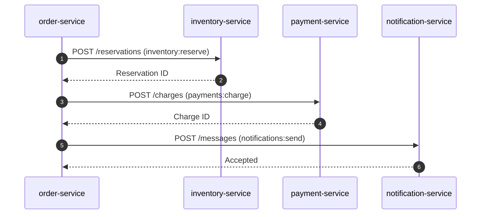
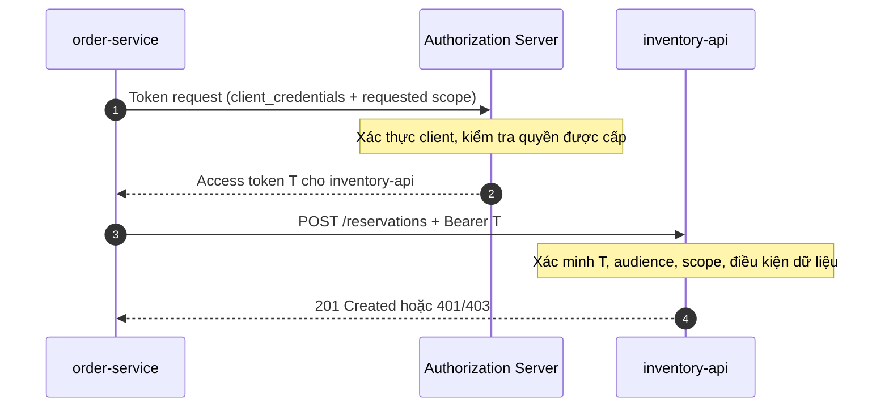
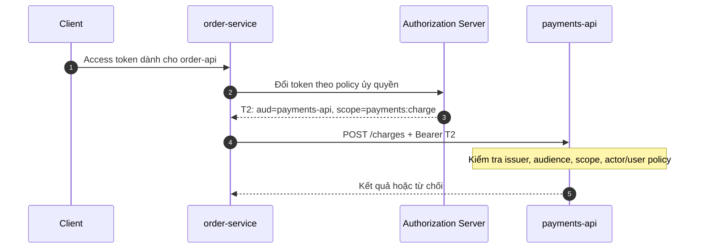

# Scope theo service action

Trong hệ thống microservice, một service thường gọi service khác để hoàn thành công việc: `order-service` tạo đơn, `inventory-service` giữ hàng, `payment-service` thu tiền và `notification-service` gửi thông báo. Nếu mọi lời gọi đều dùng cùng một access token có quyền như `admin` hoặc `service:*`, bất kỳ service nào bị chiếm quyền cũng có thể yêu cầu những hành động không liên quan đến chức năng của nó. **Scope theo service action** giới hạn quyền mà một token được dùng để yêu cầu, dựa trên **service đích** và **hành động được phép**.

Đây là bài trong chương **Service to service** thuộc mô-đun **SECURITY_TOKEN_SECURITY_FUNDAMENTALS**. Để áp dụng đúng, cần hiểu mô hình tin cậy và vòng đời token bảo mật, phân biệt JWT, opaque token, access token, refresh token, cơ chế xác thực và phân quyền của OAuth 2.0/OIDC; đồng thời kiểm tra claims, scope, audience, lưu trữ, thu hồi, và nguy cơ token bị đánh cắp hoặc dùng lại.

Học xong, bạn có thể:

- Thiết kế tập scope nhỏ, rõ nghĩa cho từng hành động của resource server.
- Phân biệt **service identity**, **audience**, **scope**, **role**, **quyền trên dữ liệu** và **ủy quyền thay mặt người dùng**.
- Quy định scope nào được cấp theo `client_credentials` và scope nào cần ngữ cảnh người dùng.
- Ánh xạ HTTP method + route + business action đến scope tối thiểu mà downstream phải xác minh.
- Xử lý các trường hợp scope quá rộng, token sai audience, gọi liên service nhiều hop, token hết hạn hoặc bị thu hồi.
- Kiểm thử chính sách least privilege bằng cả ca thành công và ca từ chối.

## 1. Tại sao gắn scope với service action?

Giả sử ba lời gọi diễn ra trong một giao dịch:



Các hành động có tác động khác nhau:

| Hành động | Service nhận | Mức độ rủi ro minh họa | Scope minh họa |
|---|---|---|---|
| Xem tồn kho | `inventory-service` | Chỉ đọc thông tin hàng | `inventory:read` |
| Giữ số lượng hàng | `inventory-service` | Thay đổi khả năng bán hàng | `inventory:reserve` |
| Điều chỉnh tồn kho | `inventory-service` | Thay đổi số lượng kế toán | `inventory:adjust` |
| Tạo yêu cầu thu tiền | `payment-service` | Tác động tài chính | `payments:charge` |
| Hoàn tiền | `payment-service` | Tác động tài chính ngược | `payments:refund` |
| Gửi thông báo | `notification-service` | Tiết lộ thông tin hoặc gửi spam | `notifications:send` |

Một access token chỉ có `inventory:reserve` không thể tự động được dùng để `payments:refund`. Các scope này là **tên quy ước do hệ thống định nghĩa**, không phải danh sách hành động có sẵn của OAuth 2.0. Authorization Server (AS) và các resource server phải cùng thống nhất ý nghĩa, quyền cấp và quy tắc kiểm tra.

Mục tiêu không chỉ là tạo nhiều chuỗi scope: mỗi scope cần có **ngữ nghĩa đủ hẹp**, ranh giới tin cậy rõ, chủ thể được cấp phù hợp và đường kiểm tra thực sự tại resource server. Một scope có tên rất cụ thể nhưng không được kiểm tra ở backend sẽ không có tác dụng bảo vệ.

## 2. Năm khái niệm cần tách biệt

| Khái niệm | Trả lời câu hỏi nào? | Ví dụ | Ai quyết định? |
|---|---|---|---|
| **Caller identity** | Ai/cái gì đang gọi? | OAuth client `order-worker` | AS xác thực client, API nhận danh tính đã xác minh |
| **Audience (`aud`)** | Token được phép trình tới resource server nào? | `inventory-api` | AS phát hành; resource server xác minh |
| **Scope** | Token mang những phạm vi quyền được cấp nào? | `inventory:reserve` | AS cấp, resource server thực thi |
| **Role/permission** | Vai trò hoặc quyền quản trị/nội bộ của chủ thể là gì? | `stock-operator` | Hệ thống quản lý quyền, không đồng nghĩa scope |
| **Resource-level authorization** | Chủ thể được tác động lên đối tượng này không? | Được giữ hàng của kho A nhưng không phải kho B | Backend sở hữu dữ liệu và policy |

**Audience khác scope.** Một token có `scope=inventory:reserve` nhưng `aud=payments-api` không được `inventory-api` chấp nhận chỉ vì scope trông có vẻ đúng. Mỗi resource server phải xác minh token thực sự dành cho mình.

**Scope khác role.** `warehouse-manager` có thể là một role trong tổ chức; `inventory:adjust` là phạm vi quyền của access token. Không suy diễn tự động “có role X thì mọi token của X đều có scope Y”. Việc chuyển role thành quyền token phải được thực hiện bằng một chính sách cấp quyền rõ ràng.

**Scope không đủ để phân quyền bản ghi.** Nếu `order-service` có scope `inventory:reserve`, nó vẫn không nhất thiết được giữ hàng tại kho thuộc tenant khác, vượt số lượng được phép hoặc đặt giữ hàng cho một đơn không tồn tại. Kiểm tra tenant, đối tượng và điều kiện nghiệp vụ phải diễn ra trong `inventory-service`.

**Danh tính service khác danh tính end user.** Token của `order-worker` sử dụng `client_credentials` chứng minh ứng dụng/máy khách được AS xác thực và cấp quyền; nó không mặc nhiên chứng minh người dùng cuối đã đồng ý thanh toán hay hoàn tiền. Các thao tác thay mặt người dùng cần luồng delegation phù hợp và backend kiểm tra ngữ cảnh người dùng khi chính sách yêu cầu.

## 3. Đặt tên scope theo action

Một quy ước dễ đọc là:

```text
<resource-domain>:<action>

inventory:read
inventory:reserve
inventory:release
inventory:adjust
payments:charge
payments:refund
notifications:send
```

Quy ước `domain:action` chỉ mang tính minh họa; OAuth 2.0 xem scope là một tập chuỗi do AS/resource server quy định. Có thể dùng `inventory.reservation.create` hoặc cấu trúc khác nếu toàn hệ thống áp dụng nhất quán.

Các nguyên tắc:

1. **Hành động rõ và có thể kiểm tra:** phân biệt đọc, tạo, thay đổi, hủy; tách hành động tài chính nhạy cảm như `charge` với `refund`.
2. **Tránh scope bao trùm:** hạn chế `admin`, `*`, `inventory:*` hoặc một scope `write` chung cho tất cả API. Chỉ tạo quyền tổng hợp khi đã có policy cấp quyền và đánh giá rủi ro cụ thể.
3. **Không nhân scope theo từng bản ghi:** `inventory:reserve:order-123` làm số lượng tên scope tăng vô hạn và khó quản lý; kiểm tra `order-123` bằng resource authorization ở backend hoặc dùng quyền bị ràng buộc theo tài nguyên khi có thiết kế riêng.
4. **Xác định thuộc tính nhạy cảm:** hai API cùng gọi là `read` nhưng một API xuất toàn bộ dữ liệu khách hàng có thể cần scope riêng.
5. **Giữ tính ổn định:** đổi tên scope có thể phá token/client đang triển khai; cần có kế hoạch tương thích và chuyển đổi chính sách.
6. **Tài liệu hóa quyền:** ghi rõ ai được cấp, route/action sử dụng, audience, tác động phụ và chính sách phê duyệt.

### Bảng chính sách tối thiểu

| Client/service gọi | Resource server nhận | Action | Scope cần có | Điều kiện bổ sung |
|---|---|---|---|---|
| `order-service` | `inventory-api` | Giữ hàng | `inventory:reserve` | Đơn tồn tại; đúng tenant, kho và số lượng |
| `order-service` | `inventory-api` | Hủy giữ hàng | `inventory:release` | Chỉ được hủy reservation tương ứng |
| `order-service` | `payments-api` | Tạo charge | `payments:charge` | Đúng đơn, số tiền, chống charge trùng |
| `refund-worker` | `payments-api` | Hoàn tiền | `payments:refund` | Quy tắc phê duyệt, hạn mức và idempotency |
| `notification-service` | `profile-api` | Tra thông tin liên hệ | `profiles:contact:read` | Chỉ các trường/tenant được cho phép |
| `order-service` | `notification-api` | Gửi thông báo | `notifications:send` | Template và người nhận được phép |

Hai client có cùng scope `payments:charge` vẫn có thể bị hạn chế khác nhau về merchant, số tiền, môi trường hoặc merchant account. Scope cung cấp một lớp quyền, **không phải danh sách đầy đủ mọi điều kiện để thực thi nghiệp vụ**.

## 4. Cấp token cho service bằng OAuth 2.0 Client Credentials

Với dịch vụ gọi API bằng danh tính máy, luồng **Client Credentials** của OAuth 2.0 thường phù hợp. Giả sử `order-service` được đăng ký tại AS với client ID `order-worker`, phương thức xác thực client an toàn và quyền yêu cầu scope `inventory:reserve` trên `inventory-api`.



Ví dụ yêu cầu token dạng `application/x-www-form-urlencoded` (minh họa; xác thực client được thể hiện riêng theo cấu hình AS):

```http
POST /oauth2/token HTTP/1.1
Host: id.example.com
Content-Type: application/x-www-form-urlencoded

grant_type=client_credentials&scope=inventory%3Areserve
```

Yêu cầu thực tế **phải xác thực client** với AS bằng phương thức đã đăng ký, chẳng hạn `private_key_jwt` hoặc mTLS; nếu dùng client secret, lưu trong secret manager và dùng kênh TLS. Đoạn HTTP đã giản lược thành phần client authentication để tránh lộ thông tin bí mật. Thông số xác định audience/resource phụ thuộc AS và chuẩn extension mà hệ thống sử dụng; **chỉ đặt scope trong token request không bảo đảm token có audience đúng**.

Ví dụ access token theo dạng JWT đã được AS phát hành, payload minh họa:

```json
{
  "iss": "https://id.example.com",
  "sub": "service-order-worker",
  "client_id": "order-worker",
  "aud": ["inventory-api"],
  "scope": "inventory:reserve",
  "exp": 1795510800,
  "iat": 1795507200,
  "jti": "token-order-inventory-73"
}
```

Ở ví dụ, `sub` là định danh được AS chọn; **không giả định** tất cả AS luôn đặt `sub=client_id`. Dữ liệu minh họa không có hiệu lực thực tế nếu chưa được ký và xác minh đúng. Gateway/backend không được chỉ Base64URL-decode payload rồi xem là đã xác thực.

AS nên giới hạn scope được cấp cho client ngay từ registration và policy; **scope client yêu cầu không đồng nghĩa AS đã cấp scope đó**. Trong response token, trường `scope` hoặc thông tin token đã phát hành phải được kiểm tra theo profile của AS khi scope thực cấp khác scope yêu cầu. Service gọi phải chịu được trường hợp yêu cầu quyền không được cấp.

### Một service gọi nhiều resource server

`order-service` có thể cần gọi `inventory-api` và `payments-api`, nhưng không nên dùng chung một access token chỉ vì cả hai request xuất phát từ một service. Thiết kế thận trọng là yêu cầu token phù hợp **từng audience**:

```text
order-service
  |
  +-- T_inventory: aud=inventory-api, scope=inventory:reserve
  |           -> inventory-api
  |
  +-- T_payments: aud=payments-api, scope=payments:charge
              -> payments-api
```

Cách cấp token dành riêng cho resource server khác nhau tùy AS. Có thể dùng các registration/credentials khác nhau, tham số resource/audience theo khả năng của AS, hoặc token exchange được ủy quyền khi thích hợp. Mục tiêu là mỗi API nhận đúng token dành cho nó và chỉ có quyền cần thiết.

## 5. Kiểm tra scope tại resource server

Token chỉ có tác dụng bảo vệ khi resource server áp dụng đúng policy cho mỗi action. Ví dụ `inventory-api` nhận request:

```http
POST /reservations HTTP/1.1
Host: inventory.internal
Authorization: Bearer <access-token>
Content-Type: application/json

{"orderId":"ord-123","sku":"sku-7","quantity":2}
```

Luồng kiểm tra hợp lý:

1. Đọc một header `Authorization: Bearer ...` hợp lệ; xử lý header trùng/malformed nhất quán.
2. Xác minh **issuer**, chữ ký và thuật toán được phép nếu token là JWT; hoặc gọi **introspection** tới AS tin cậy nếu là opaque token.
3. Kiểm tra `aud` chứa `inventory-api`; kiểm tra `exp`, `nbf`, mục đích/loại token và trạng thái thu hồi theo policy.
4. Kiểm tra scope **chính xác** `inventory:reserve` theo tập scope đã được chuẩn hóa và xác minh.
5. Kiểm tra service/client identity `order-worker` có được chấp nhận cho hành động này không nếu policy yêu cầu danh sách caller riêng.
6. Kiểm tra order, SKU, tenant, số lượng và các ràng buộc nghiệp vụ; chống xử lý lặp cho request có tác dụng ghi dữ liệu.
7. Chỉ khi tất cả điều kiện đạt mới tạo reservation.

### Phân biệt ba nhóm từ chối

| Tình huống | Kết quả thường dùng | Diễn giải |
|---|---|---|
| Thiếu token, token sai issuer/audience, hết hạn, không xác minh được | **401 Unauthorized** | Resource server chưa chấp nhận chứng cứ xác thực |
| Token hợp lệ nhưng thiếu `inventory:reserve` | **403 Forbidden** | Có danh tính được xác thực nhưng quyền không đủ |
| Token hợp lệ và có scope nhưng sai tenant/owner hoặc vượt business limit | **403** hay mã lỗi nghiệp vụ phù hợp | Phân quyền/điều kiện tài nguyên không đạt |

Với Bearer authentication, response có thể có `WWW-Authenticate: Bearer` và thông tin lỗi giới hạn phù hợp OAuth 2.0 (RFC 6750); không đưa access token, khóa hoặc nội dung nội bộ vào thông báo lỗi.

### Kiểm tra chính xác membership

Trong JWT access token theo profile RFC 9068, `scope` thường là **chuỗi phân cách bằng dấu cách**, ví dụ:

```json
{
  "scope": "inventory:read inventory:reserve"
}
```

Nếu hệ thống dùng claim `scp` dạng array hoặc claims khác, đó là convention/profile riêng; resource server phải biết đúng định dạng AS phát hành và có mapping đáng tin cậy.

Tránh kiểm tra kiểu:

```text
if "reserve" in rawScopeString:
    allow()
```

Điều kiện trên có thể khớp với scope không liên quan, chẳng hạn `inventory:reserve:preview` hoặc chuỗi chứa `reserve`. Cần parse scope theo cú pháp AS quy định và kiểm tra **phần tử chính xác** trong tập hợp:

```text
required = "inventory:reserve"
granted  = {"inventory:read", "inventory:reserve"}
allow = required in granted
```

Scope là quyền được cấp, **không** được lấy từ request body/query/header do client tự đặt. Đừng chấp nhận `X-Scope: inventory:reserve` hoặc tham số `?scope=inventory:reserve` làm bằng chứng ủy quyền.

## 6. Mapping HTTP endpoint tới service action

Resource server cần policy thể hiện mỗi route/action bắt buộc scope nào. Ví dụ:

| HTTP method + endpoint | Service action | Scope tối thiểu |
|---|---|---|
| `GET /stocks/{sku}` | Đọc tồn kho | `inventory:read` |
| `POST /reservations` | Giữ hàng | `inventory:reserve` |
| `DELETE /reservations/{id}` | Hủy giữ hàng | `inventory:release` |
| `PATCH /stocks/{sku}` | Điều chỉnh tồn kho | `inventory:adjust` |
| `POST /charges` | Thu tiền | `payments:charge` |
| `POST /refunds` | Hoàn tiền | `payments:refund` |

**HTTP method là tín hiệu, không phải policy duy nhất.** Một endpoint `POST /orders/{id}/cancel` có thể yêu cầu quyền khác `POST /orders`; một `GET /export` có thể đọc dữ liệu nhạy cảm hơn `GET /summary`. API có thể thực thi action nội bộ không khớp trực tiếp với tên route; backend phải kiểm tra đúng business action.

Các policy theo path cần xử lý path normalization, percent-encoding, route precedence và endpoint đặc biệt. Nếu một bộ lọc áp dụng `inventory:read` cho toàn bộ `/inventory/**`, request ghi dữ liệu có thể đi qua với scope chỉ đọc.

### Cấu hình policy minh họa

```yaml
resourceServers:
  inventory-api:
    trustedIssuer: https://id.example.com
    expectedAudience: inventory-api
    endpointPolicies:
      - method: GET
        path: /stocks/**
        requiredScopes: [inventory:read]
      - method: POST
        path: /reservations
        requiredScopes: [inventory:reserve]
        allowedClients: [order-worker]
      - method: DELETE
        path: /reservations/**
        requiredScopes: [inventory:release]
        allowedClients: [order-worker]
      - method: PATCH
        path: /stocks/**
        requiredScopes: [inventory:adjust]
        allowedClients: [stock-admin-worker]

  payments-api:
    trustedIssuer: https://id.example.com
    expectedAudience: payments-api
    endpointPolicies:
      - method: POST
        path: /charges
        requiredScopes: [payments:charge]
        allowedClients: [order-worker]
      - method: POST
        path: /refunds
        requiredScopes: [payments:refund]
        allowedClients: [refund-worker]
```

Đây là schema **minh họa**, không phải cấu hình mặc định của Spring Security, Kong, Envoy hoặc một sản phẩm khác. Các điều kiện `allowedClients` chỉ dùng sau khi đã xác minh danh tính client từ token hoặc ngữ cảnh AS tin cậy. Việc check scope, audience và caller identity ở gateway có thể giảm tải, nhưng resource server vẫn cần bảo vệ tài nguyên theo mô hình tin cậy của hệ thống.

## 7. Ví dụ Java với Spring Security Resource Server

Spring Security có thể map chuỗi `scope`/`scp` đã xác minh thành authorities dạng `SCOPE_<scope>` theo cơ chế converter được cấu hình. Với OAuth 2.0 Resource Server, endpoint có thể yêu cầu authority tương ứng.

Ví dụ Spring Boot/Spring Security dùng **Servlet SecurityFilterChain**:

```java
@Configuration
@EnableWebSecurity
public class InventorySecurityConfig {

    @Bean
    SecurityFilterChain securityFilterChain(HttpSecurity http) throws Exception {
        return http
            .authorizeHttpRequests(auth -> auth
                .requestMatchers(HttpMethod.GET, "/stocks/**")
                    .hasAuthority("SCOPE_inventory:read")
                .requestMatchers(HttpMethod.POST, "/reservations")
                    .hasAuthority("SCOPE_inventory:reserve")
                .requestMatchers(HttpMethod.DELETE, "/reservations/**")
                    .hasAuthority("SCOPE_inventory:release")
                .requestMatchers(HttpMethod.PATCH, "/stocks/**")
                    .hasAuthority("SCOPE_inventory:adjust")
                .anyRequest().denyAll())
            .oauth2ResourceServer(oauth2 -> oauth2.jwt(Customizer.withDefaults()))
            .build();
    }
}
```

Ví dụ chỉ thể hiện **mapping scope cho endpoint**. Ứng dụng thực tế phải thêm dependencies và import tương ứng; cấu hình `JwtDecoder` với trusted issuer, bộ khóa/chữ ký và **audience validator phù hợp `inventory-api`**, chính sách CSRF cho API dạng machine-to-machine và những endpoint public cần thiết. `oauth2ResourceServer().jwt()` không nên được hiểu là đã tự thực thi toàn bộ policy audience/caller/tenant của hệ thống.

Ví dụ một điểm kiểm tra nghiệp vụ trong service layer (giả mã Java):

```java
public Reservation reserve(AuthenticatedService caller, ReserveCommand cmd) {
    // Lớp filter đã xác thực token và scope inventory:reserve.
    requireAllowedClient(caller.clientId(), "order-worker");
    requireTenantAccess(caller, cmd.tenantId());
    requireValidOrder(cmd.orderId(), cmd.tenantId());
    requireAvailableStock(cmd.sku(), cmd.quantity());
    return reservations.createIdempotently(cmd);
}
```

Đây không phải các API Spring có sẵn. Các hàm `require...` là điểm policy do ứng dụng triển khai, phải dựa vào **caller identity đã được xác minh**, không lấy `clientId` hoặc `tenantId` do client tùy ý khai. Nếu yêu cầu nhiều scope, xác định rõ điều kiện **AND** hay **OR**; không áp dụng `hasAnyAuthority` khi hành động đòi đồng thời hai quyền.

## 8. Service-to-service nhiều hop và on-behalf-of

Luồng nghiệp vụ có thể là:

```text
frontend -> api-gateway -> order-service -> inventory-service -> payment-service
```

Hai trường hợp có ý nghĩa khác nhau:

**Service gọi bằng danh tính của chính nó.** `order-service` dùng `client_credentials` lấy token cho `inventory-api` với `inventory:reserve`. Resource server ghi nhận hành động do `order-worker` thực hiện. Nếu nghiệp vụ cần biết người dùng nào khởi tạo đơn, định danh người dùng phải đến từ một ngữ cảnh ủy quyền được kiểm chứng, không phải chỉ là giá trị header tự khai báo.

**Service gọi thay mặt người dùng.** `order-service` nhận token người dùng từ gateway rồi cần gọi `payment-service`. Token đầu vào có thể dành cho `order-api`, không dành cho `payments-api`. Trong hệ thống hỗ trợ **OAuth 2.0 Token Exchange (RFC 8693)** hoặc một cơ chế delegation phù hợp, service có thể xin AS cấp token mới hướng tới `payments-api`, với scope cần thiết và ngữ cảnh chủ thể/actor đã được ủy quyền.



**Không chuyển nguyên token của `order-api` sang `payments-api` rồi yêu cầu backend bỏ kiểm tra `aud`.** Token relay chỉ phù hợp khi token thực sự được cấp cho service đích và cơ chế sender constraint được hỗ trợ trên hop nhận.

Nếu dùng cơ chế truyền identity context (chẳng hạn header nội bộ), backend phải chỉ tin gateway/service đã xác thực, kết nối được bảo vệ và ngữ cảnh có nguồn gốc có thể kiểm chứng; tất cả header cùng tên do client gửi phải bị loại bỏ/ghi đè. Scope từ token người dùng không tự cấp cho service thêm quyền máy, và scope của client credentials không tự biến một thao tác thành hành động đã được người dùng đồng ý.

## 9. Principle of least privilege trong vòng đời token

### 9.1. Xin quyền tối thiểu

Service nên xin đúng phạm vi cho tác vụ, ví dụ:

```text
T_inventory: aud=inventory-api
             scope=inventory:reserve

T_payment:   aud=payments-api
             scope=payments:charge
```

Không phát một token cho `order-service` chứa tất cả scope của hệ thống chỉ để giảm số lần gọi AS. Token có nhiều scope và nhiều audience khiến một điểm rò rỉ gây ảnh hưởng trên nhiều resource server.

Nếu AS phát hành một token mang nhiều scope cho cùng resource server, backend vẫn phải kiểm tra chính xác scope theo action. Nếu client chỉ được cấp `inventory:reserve`, nó không được tự thêm scope `inventory:adjust` vào token bằng cách sửa payload JWT: chữ ký sẽ sai, và một token do client tự ký không được xem là từ AS tin cậy.

### 9.2. Access token lifetime, refresh và thu hồi

- **Access token** có thời hạn được AS ấn định. JWT thường được xác minh qua `exp`/`nbf` và các claims; opaque token qua introspection hoặc cơ chế AS hỗ trợ. Gateway/backend không được chấp nhận token đã hết hạn vì cache kết quả cũ.
- **Client Credentials** thường trả access token; không nên **mặc định** sẽ có refresh token. Service có thể xác thực lại bằng client credential được bảo vệ để xin access token mới. Xử lý dựa trên phản hồi và chính sách AS thực tế.
- **Refresh token**, nếu có ở luồng thích hợp, chỉ được dùng với AS, không relay tới resource server. Cần quản lý rotation, thu hồi và bảo vệ token ở trạng thái lưu.
- **Revocation** có thể không được resource server JWT kiểm tra offline nhận biết ngay. Nếu scope bị thu hồi hoặc client bị vô hiệu, token cũ có thể còn được chấp nhận cho tới `exp` trừ khi có denylist, trạng thái session/client hoặc introspection được tích hợp.
- **Cache token/introspection** phải giới hạn bởi expiry và ngân sách chậm thu hồi; cache `active=true` không được dùng vô hạn. Mỗi request vẫn cần kiểm tra route/action, audience và các điều kiện không được cache.

### 9.3. Phòng chống đánh cắp và replay

Bearer access token có thể bị kẻ cầm được token dùng lại, kể cả khi scope hẹp. Thực hành bảo vệ:

1. Dùng TLS trên các hop và xác thực endpoint nội bộ; mTLS thích hợp để bảo vệ kênh và danh tính service.
2. Lưu client secret/private key và token trong secret manager hoặc kho bảo vệ; không hardcode vào image, file cấu hình công khai hay log.
3. Không đưa token vào URL, query string, tracing span, metrics label, exception hoặc response body lỗi.
4. Có thể dùng **sender-constrained access token** như mTLS-bound token hoặc DPoP. Khi đó backend còn phải kiểm tra bằng chứng sở hữu khóa đúng với token; relay chuỗi token đơn thuần có thể không đủ.
5. Với action thay đổi dữ liệu hoặc tài chính, thêm **idempotency key**, unique constraint hoặc transaction logic phù hợp. Scope không bảo vệ hệ thống khỏi thực thi hai lần khi request bị retry/replay.
6. Giới hạn route, upstream và host nhận token. Không forward access token tới URL do client tự cung cấp hoặc redirect ngoài allowlist.
7. Giám sát hành động bất thường theo **service identity + audience + action**, không cần thu thập nguyên token.

## 10. Sai lầm thiết kế thường gặp

| Sai lầm | Tác động | Cách xử lý |
|---|---|---|
| Service nào cũng dùng `admin` | Một service bị xâm nhập có quyền quá rộng | Scope theo domain/action, allowlist caller và cấp tối thiểu |
| Chỉ kiểm tra chữ ký JWT, không kiểm tra `aud` | Token dành cho API A bị dùng ở API B | Gắn audience cụ thể cho mỗi resource server |
| Chỉ kiểm tra `scope` ở gateway | Request vào backend qua đường khác bỏ qua quyền | Backend xác minh token/ngữ cảnh và quyền nghiệp vụ |
| Dùng phép `contains("write")` trên scope string | Scope gần giống bị nhận nhầm | Parse tập scope và so khớp chính xác |
| `inventory:reserve` cho phép mọi kho của mọi tenant | Vượt ranh giới dữ liệu | Backend kiểm tra tenant/resource ownership |
| `order-service` dùng token `payments:charge` để hoàn tiền | Quyền charge bị suy diễn thành quyền refund | Scope `payments:refund` riêng và policy phê duyệt |
| Tin `X-Client-Id` client gửi | Giả mạo service identity | Chỉ dùng claims đã xác minh hoặc kênh service identity tin cậy |
| Dùng ID token OIDC để gọi API | Sai mục đích token | Resource server chỉ chấp nhận access token phù hợp |
| Gửi refresh token qua `Authorization` tới backend | Lộ credential làm mới token | Refresh chỉ với AS theo grant phù hợp |
| Relay token của user dành cho `order-api` tới `payments-api` | Dùng sai audience | Token exchange hoặc thiết kế audience/ủy quyền hợp lệ |
| Cache `ALLOW` theo `sub` rồi dùng cho mọi action | Quyền từ request này áp dụng sai request khác | Cache theo validation context, kiểm tra action/resource mỗi lần |
| JWT đã ký vẫn được dùng sau khi tước scope | Quyền cũ còn hiệu lực cho tới expiry nếu không có thu hồi | TTL hợp lý, revocation policy, introspection/denylist khi cần |
| Service dùng access token trong log và URL | Rò rỉ token, bị sử dụng lại | Chỉ truyền header Bearer qua TLS, redaction và secret protection |

## 11. Kiểm thử quyền theo service action

Đối với `inventory-api`, tạo bộ token thử nghiệm từ AS tin cậy:

| Ca thử | Token / yêu cầu | Kết quả mong đợi |
|---|---|---|
| **Đúng action** | `aud=inventory-api`, `scope=inventory:reserve`, `POST /reservations` | Qua xác thực/scope; chỉ thực thi nếu tenant/order/stock hợp lệ |
| **Thiếu action** | `scope=inventory:read`, `POST /reservations` | 403, không tạo reservation |
| **Scope cùng tiền tố** | `scope=inventory:reserve:preview`, `POST /reservations` | 403 nếu không có scope chính xác `inventory:reserve` |
| **Sai audience** | `aud=payments-api`, `scope=inventory:reserve` | 401 tại inventory-api |
| **Sai issuer** | Token do AS không tin cậy phát hành | 401, không nạp khóa do token chọn |
| **JWT hết hạn** | `exp` đã qua | 401 kể cả khi cache JWKS còn hiệu lực |
| **Opaque đã thu hồi** | Introspection `active=false` | 401; cache trạng thái thu hồi theo chính sách |
| **Sai caller** | Scope hợp lệ nhưng `client_id=other-worker` không nằm trong allowlist | Từ chối theo policy, không thực thi |
| **Cross-tenant** | Token hợp lệ, `orderId` thuộc tenant khác | Backend từ chối trước khi ghi dữ liệu |
| **Sai HTTP method** | `inventory:read` dùng `PATCH /stocks/sku-7` | 403, không thay đổi số lượng |
| **Replay cùng command** | Gửi lại cùng yêu cầu charge/reservation | Không tạo tác dụng phụ trùng khi idempotency policy áp dụng |
| **Sender constraint thiếu proof** | Access token DPoP/mTLS-bound thiếu bằng chứng đúng | Từ chối theo profile |
| **Gateway bypass** | Gọi thẳng backend không đi qua gateway | Backend vẫn yêu cầu authn/authz |
| **AS mất kết nối** | Opaque token chưa có trạng thái hợp lệ | Fail closed, không âm thầm cho qua |

Kiểm tra thêm việc xoay khóa JWKS, clock skew, encoded path, route precedence, token thiếu/nhân đôi header `Authorization`, nhiều gateway instance và sự thay đổi quyền của service khi token đã phát hành.

### Câu hỏi suy luận

`order-worker` có access token JWT hợp lệ về chữ ký và thời hạn:

```json
{
  "iss": "https://id.example.com",
  "client_id": "order-worker",
  "aud": ["inventory-api"],
  "scope": "inventory:read inventory:reserve"
}
```

**Tình huống A:** service gửi `POST /reservations` để giữ hàng trong kho được phép. Nếu đầy đủ claims/thời hạn khác đã hợp lệ và rule kiểm tra `inventory:reserve` đạt, backend **có thể** thực thi sau khi kiểm tra nghiệp vụ, tenant và idempotency.

**Tình huống B:** cùng token gửi `PATCH /stocks/sku-7`. Backend phải **từ chối** vì thiếu `inventory:adjust`, dù token có `inventory:reserve` và `inventory:read`.

**Tình huống C:** cùng token gửi `POST /charges` đến `payments-api`. Backend phải **từ chối** vì token không dành cho `payments-api` và cũng không có `payments:charge`. Không thể giải quyết bằng việc cho một API khác “tin mọi JWT cùng issuer”.

**Tình huống D:** token còn `inventory:reserve` nhưng client `order-worker` bị cấm sử dụng quyền này tại AS sau khi token phát hành. Hệ thống chỉ xác minh JWT offline có thể chưa nhận biết ngay. Cần xác định chính sách lifetime, revocation/introspection/denylist hoặc kiểm tra trạng thái quyền bổ sung theo mức độ rủi ro.

## 12. Checklist đưa vào vận hành

- Scope được đặt tên nhất quán theo **hành động nghiệp vụ** và có bảng owner/allowed caller/API/route cụ thể.
- AS cấp token dựa trên client identity, grant và policy; scope yêu cầu không được tự động xem là scope đã được cấp.
- Mỗi resource server xác minh **issuer, audience, chữ ký/introspection, expiry, token type, scope** và các ràng buộc sender constraint khi áp dụng.
- Backend kiểm tra **tenant, owner, resource ID, số tiền, trạng thái và ràng buộc nghiệp vụ** trước khi thực thi action.
- Các request service-to-service có access token audience hẹp; multi-hop/user delegation có mô hình ủy quyền và token exchange phù hợp nếu cần.
- Không dùng ID token hoặc refresh token gọi API; không tự suy diễn user identity từ client-credentials token.
- Token/credential được bảo vệ lúc lưu và truyền; TTL, cache, refresh, thu hồi và key rotation có quy tắc rõ.
- Có kiểm thử scope thiếu, scope gần giống, sai audience, sai client, token bị thu hồi, lối vào backend trực tiếp, replay và lỗi hệ thống danh tính.
- Monitoring phản ánh **client → API → action → kết quả**, nhưng không tiết lộ token và dữ liệu nhạy cảm.

**Tư duy cốt lõi:** *service identity cho biết ai đang gọi; audience giới hạn token dùng ở đâu; scope nói token cho phép yêu cầu hành động nào; resource authorization quyết định hành động đó có hợp lệ với dữ liệu cụ thể hay không.* Scope theo service action hiệu quả khi cả bốn lớp được kiểm tra nhất quán trong toàn bộ vòng đời access token.

### Tiêu chuẩn tham khảo

- [RFC 6749 — The OAuth 2.0 Authorization Framework](https://www.rfc-editor.org/rfc/rfc6749) (định nghĩa scope và `client_credentials`)
- [RFC 6750 — OAuth 2.0 Bearer Token Usage](https://www.rfc-editor.org/rfc/rfc6750)
- [RFC 7662 — OAuth 2.0 Token Introspection](https://www.rfc-editor.org/rfc/rfc7662)
- [RFC 8693 — OAuth 2.0 Token Exchange](https://www.rfc-editor.org/rfc/rfc8693)
- [RFC 8707 — Resource Indicators for OAuth 2.0](https://www.rfc-editor.org/rfc/rfc8707)
- [RFC 8725 — JSON Web Token Best Current Practices](https://www.rfc-editor.org/rfc/rfc8725)
- [RFC 9068 — JWT Profile for OAuth 2.0 Access Tokens](https://www.rfc-editor.org/rfc/rfc9068)
- [RFC 9449 — OAuth 2.0 Demonstrating Proof of Possession](https://www.rfc-editor.org/rfc/rfc9449)
