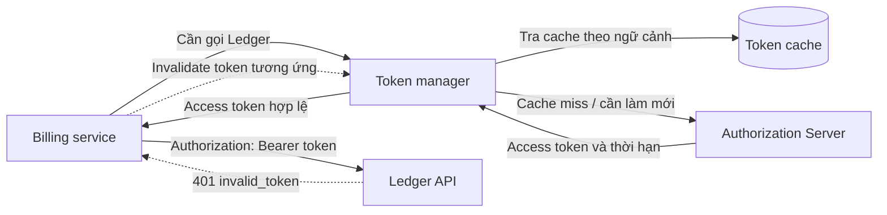
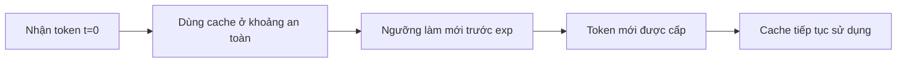
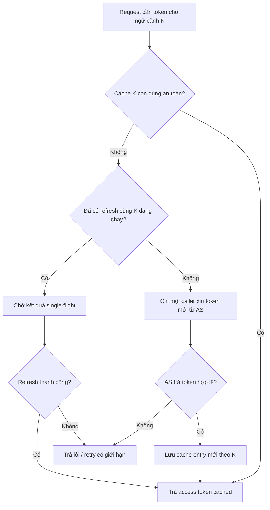

# Token caching và refresh trong giao tiếp service-to-service

## 1. Vì sao phải quản lý cache và làm mới access token?

Trong một hệ thống nhiều microservice, một service có thể gọi API khác hàng trăm hoặc hàng nghìn lần mỗi phút. Nếu mỗi lời gọi lại yêu cầu Authorization Server (AS) cấp access token, ứng dụng sẽ tăng độ trễ, tải lên token endpoint và rủi ro ngừng dịch vụ khi AS gặp sự cố. Vì vậy, thành phần thực hiện giao tiếp **service-to-service** thường cần một **token manager**: tái sử dụng access token đang hợp lệ, lấy token mới đúng thời điểm và không cho request đồng thời phát sinh quá nhiều lần cấp token.

Ví dụ, `billing-service` gọi `ledger-api` bằng OAuth 2.0 Client Credentials Grant:

- AS cấp access token cho audience `api://ledger` với scope `ledger:entry:create` và thời hạn 10 phút.
- Các request phù hợp có thể dùng lại cùng access token trong khoảng thời gian nó vẫn được phép sử dụng.
- Trước khi token hết hạn, Billing xin **access token mới** bằng credential của chính service.
- Nếu Ledger từ chối token đã hết hạn hoặc bị thu hồi, Billing loại token không còn hợp lệ ra khỏi cache và xử lý một lần thử lại có kiểm soát.

Điểm mấu chốt: **cache token** là tối ưu hóa việc lấy và sử dụng token, còn **refresh** là cơ chế duy trì quyền truy cập khi token cũ không dùng được nữa. Refresh không tự cấp thêm quyền; access token mới vẫn phải thỏa chính sách về issuer, audience, scope, tenant và quyền của caller.

Bài này tập trung vào hệ thống bảo mật token: phân biệt JWT và opaque token; access token và refresh token; OAuth 2.0/OIDC; cách tính thời hạn, bảo vệ credential, thu hồi token và chống phát lại hoặc dùng nhầm token giữa các dịch vụ.

## 2. Phân biệt các khái niệm dễ nhầm

| Thuật ngữ | Là gì? | Có dùng gọi API nghiệp vụ không? |
| --- | --- | --- |
| **Access token** | Credential cho phép gọi resource server trong phạm vi quyền được cấp | Có, nếu issuer, audience, scope, hạn và policy đều phù hợp |
| **Refresh token** | Credential dùng tại token endpoint của AS để xin access token mới theo grant được hỗ trợ | Không; không gửi tới resource server |
| **Client credential** | Client secret, private key assertion, chứng chỉ mTLS hoặc bằng chứng workload để xác thực service với AS | Không; chỉ dùng tại cơ chế xác thực đúng đối tượng |
| **JWT access token** | Access token có dạng JWT, có claims và chữ ký/biện pháp bảo vệ được profile xác định | Có sau khi resource server xác thực JWT |
| **Opaque access token** | Chuỗi token mà resource server không giải mã claim theo định dạng công khai | Có, nếu introspection/cơ chế xác minh đáng tin xác nhận hợp lệ |
| **Cached access token** | Access token đã nhận, đang được lưu tạm để tái sử dụng | Có, nếu còn hiệu lực và dùng đúng ngữ cảnh |
| **Token refresh** | Hành động lấy access token mới; có thể bằng refresh-token grant hoặc xác thực service lại | Phụ thuộc loại grant và chính sách AS |
| **Token revocation** | Cơ chế làm token hoặc credential không còn được chấp nhận theo chính sách | Có thể khiến cache token chưa đến hạn trở nên không hợp lệ |

**Hai cách “refresh” cần phân biệt rõ:**

1. **Re-acquire / renew cho Client Credentials Grant:** service xác thực lại với AS bằng client credential để xin **access token mới** qua `grant_type=client_credentials`. RFC 6749 `4.4.3 quy định AS **SHOULD NOT** cấp refresh token cho client credentials. Đây là phương thức mặc định phổ biến của machine-to-machine.
2. **Refresh Token Grant:** một OAuth client **đã được cấp refresh token hợp lệ** gửi `grant_type=refresh_token` để xin access token mới, thường trong các luồng có ủy quyền người dùng hoặc trường hợp AS/profile cho phép. Có thể kèm refresh-token rotation. **Không tự giả định client credentials sẽ có refresh token.**

OIDC **ID token** dành cho OIDC client xác minh phiên đăng nhập; không dùng ID token làm access token gọi microservice. Một JWT có chữ ký hợp lệ vẫn có thể sai loại token hoặc sai audience.

## 3. Kiến trúc token manager trong service-to-service



**Token manager** nên là thành phần chuyên trách, thay vì mỗi HTTP handler tự lưu biến global và gọi token endpoint:

- Tạo **cache key** đúng phạm vi issuer, client, audience, scope, tenant và ràng buộc khóa/certificate.
- Trả token còn thời hạn sử dụng an toàn.
- Khi token không có hoặc sắp hết hạn, yêu cầu token mới theo **grant được AS hỗ trợ**.
- Hợp nhất các yêu cầu làm mới đồng thời cho cùng cache key (*single-flight*).
- Xử lý cache invalidation khi credential thay đổi hoặc API trả lỗi token không hợp lệ.
- Giữ bí mật client credential, refresh token và access token; không phát tán chúng sang log, URL hoặc dịch vụ không cần sử dụng.

Resource server, ví dụ Ledger API, vẫn phải **tự xác thực và phân quyền**: kiểm issuer, chữ ký/introspection, audience, expiry, scope và ràng buộc khác. Sự kiện “có token trong cache” không chứng minh token còn được Ledger chấp nhận.

## 4. Cache key phải tách đúng ngữ cảnh bảo mật

Giả sử Billing có quyền gọi Ledger để ghi bút toán và Inventory để đọc kho. Cả hai token có thể được cấp từ cùng AS và cùng `client_id` nhưng audience và scope khác nhau. Nếu cache chỉ dùng khóa `clientId`, ứng dụng dễ lấy nhầm token Ledger để gửi sang Inventory.

Một cache key có thể gồm:

```text
TokenCacheKey = (
  authorizationServer / issuer,
  tokenEndpointIdentity,
  clientId + credentialVersion,
  grantType / delegatedPrincipal (nếu có),
  tenant / securityContext,
  resource / expectedAudience,
  canonicalScopeSet,
  tokenBindingKeyOrCertificateId (nếu áp dụng)
)
```

**Giải thích:**

- **Issuer / AS:** token từ môi trường test không được dùng ở production; issuer không thể suy bằng hostname gần giống.
- **Client / principal:** mỗi workload có quyền và vòng đời credential riêng. Token thay mặt user Alice không được dùng cho user Bob.
- **Audience/resource:** Ledger và Inventory phải có ranh giới token riêng, trừ khi AS chủ động phát token đa audience và policy cho phép.
- **Scope:** token `ledger:read` không đáp ứng yêu cầu `ledger:write`. Nếu policy cho phép token scope rộng hơn dùng ở thao tác hẹp, phải tính toán tập quyền một cách có chủ đích, không lấy ngẫu nhiên token “gần khớp”.
- **Tenant:** token dành cho tenant A không được dùng cho tenant B. Tenant phải được xác thực qua policy, không chỉ từ input tùy ý.
- **Sender constraint:** token gắn với khóa DPoP hoặc chứng chỉ mTLS chỉ sử dụng được với đúng khóa/chứng chỉ đã ràng buộc.

Tập scope nên được **chuẩn hóa** (bỏ phần tử trùng, sắp xếp ổn định) khi dựng cache key, nhưng không tự đổi ý nghĩa claim scope do AS quy định. Với `resource` của RFC 8707, hãy dùng định danh/URI canonical theo hợp đồng AS; không đoán rằng resource request luôn bằng chính giá trị `aud` đã phát hành.

**Ví dụ sai:**

```java
Map<String, String> tokenCache; // key chỉ là clientId
String token = tokenCache.get("billing-prod");
sendTokenToEveryService(token);  // sai audience/scope
```

**Ví dụ hướng thiết kế phù hợp:**

```text
tokenFor(client="billing-prod",
         audience="api://ledger",
         scopes=["ledger:entry:create"],
         tenant="tenant-01")

tokenFor(client="billing-prod",
         audience="api://inventory",
         scopes=["inventory:read"],
         tenant="tenant-01")
```

Hai lời gọi phải được quản lý như hai ngữ cảnh cấp token khác nhau.

## 5. Tính thời hạn token: không đợi đúng giây `exp`

### 5.1. Từ thời gian phản hồi và các claims

Phản hồi token endpoint điển hình:

```http
HTTP/1.1 200 OK
Content-Type: application/json
Cache-Control: no-store
Pragma: no-cache

{
  "access_token": "<token-value>",
  "token_type": "Bearer",
  "expires_in": 600,
  "scope": "ledger:entry:create"
}
```

`expires_in=600` cho biết thời gian sống tính bằng giây theo phản hồi AS. Nếu access token là JWT, payload có thể bao gồm `exp`, `nbf`, `iat`. Dịch vụ **không được coi payload JWT tự giải mã là bằng chứng đáng tin**; token phải được xác minh ở resource server, và token manager chỉ có thể đọc `exp` làm giới hạn bổ sung trong điều kiện định dạng/hợp đồng issuer đáng tin. Nếu opaque token thì client không thể tự suy `exp` từ chuỗi token.

Một chiến lược thực hành là sử dụng **hạn sớm nhất** giữa thời gian do AS thông báo và hạn token đã được xác minh/đảm bảo theo hợp đồng:

```text
now = thời điểm nhận token response
expiryFromResponse = now + expires_in
expiryFromVerifiedToken = JWT exp (nếu sẵn có và đáng tin)

absoluteExpiry = min(expiryFromResponse, expiryFromVerifiedToken)
usableUntil = absoluteExpiry - safetyMargin - perKeyJitter
```

Nếu chỉ biết `expires_in`, dùng nó làm cơ sở và áp dụng khoảng dự phòng; không bắt buộc phải giải mã JWT ở client. Nếu AS cung cấp lifetime ngắn bất thường hoặc tham số không hợp lệ, phải xử lý như lỗi cấu hình/cấp token thay vì tiếp tục dùng token có hạn âm.

### 5.2. Vì sao cần khoảng dự phòng (*safety margin*)?

Giả sử một token được cấp hạn 10 phút:

- Tại giây `0`, Billing nhận token.
- Tại phút `9:10`, Billing chuẩn bị một request có thể phải đi qua mạng, cân bằng tải và queue ngắn.
- Nếu chờ đến đúng phút `10:00` để đổi, request có thể tới Ledger sau khi token đã hết hạn và bị từ chối.

Bởi vậy Billing có thể coi token cần được làm mới từ khoảng phút `9:00` hoặc sớm hơn theo độ trễ thực tế. Ví dụ **margin 60 giây** cho TTL 600 giây chỉ là cấu hình minh họa; với TTL 30 giây thì margin 60 giây sẽ khiến token luôn ở trạng thái “sắp hết hạn”. Cần điều chỉnh theo TTL, clock skew, network latency và nhu cầu vận hành.



**Clock skew:** đồng hồ AS, client và resource server có thể không hoàn toàn đồng bộ; phép kiểm `exp/nbf` nên áp dụng lệch giờ nhỏ được kiểm soát ở resource server. Đồng bộ NTP đáng tin vẫn cần thiết. Không dùng “cho phép clock skew 30 phút” để che lỗi đồng hồ.

**Jitter:** nếu 100 replica đều nhận token cùng lúc rồi đều refresh ở đúng giây thứ 540, AS có thể bị tăng tải đột biến. Dùng ngưỡng làm mới chênh lệch nhẹ giữa instance hoặc cache key, kết hợp single-flight/backoff. Jitter không được đẩy token vượt quá thời điểm hết hạn.

### 5.3. Không hiểu nhầm thời gian cache với quyền truy cập

**TTL trong cache không phải là quyết định cuối cùng về quyền.** Token có thể đã bị AS thu hồi, client bị vô hiệu, audience policy thay đổi, hoặc backend áp dụng chính sách mới. Nếu có cơ chế revoke/introspection/denylist, resource server có thể từ chối token trước khi nó hết hạn. Token manager phải xử lý phản hồi đó.

## 6. Hai cơ chế lấy token mới

### 6.1. Client Credentials: lấy access token mới bằng credential của service

Đây là trường hợp điển hình khi service gọi service với quyền của chính workload.

```http
POST /oauth2/token HTTP/1.1
Host: login.example.test
Content-Type: application/x-www-form-urlencoded
Authorization: Basic <client-credentials-redacted>

grant_type=client_credentials&
scope=ledger%3Aentry%3Acreate&
resource=https%3A%2F%2Fapi.example.test%2Fledger
```

Biểu diễn dòng được xuống hàng cho dễ đọc; request form thực tế phải được mã hóa chính xác. `resource` là Resource Indicator theo RFC 8707, chỉ dùng nếu AS hỗ trợ.

Khi token gần hết hạn, Billing có thể gọi lại **cùng loại grant** để xin token mới, với policy được AS kiểm tra lại. Không cần (và thường không có) refresh token. Nếu client secret đã bị thu hồi hoặc client bị vô hiệu, AS phải từ chối; không dùng token cũ vô thời hạn để “vượt lỗi”.

### 6.2. Refresh Token Grant: chỉ khi AS thật sự cấp refresh token

Trong một số kiến trúc service đóng vai trò confidential client đại diện cho người dùng (ví dụ một BFF) hoặc theo profile khác, AS có thể cấp refresh token cùng access token. Khi đó client sử dụng:

```http
POST /oauth2/token HTTP/1.1
Host: login.example.test
Content-Type: application/x-www-form-urlencoded
Authorization: Basic <client-authentication-redacted>

grant_type=refresh_token&
refresh_token=<previous-refresh-token>&
scope=orders%3Aread
```

AS có thể kiểm tra client authentication, grant, refresh token có còn hiệu lực/đúng client hay không, phạm vi scope và policy hiện hành. Không gửi refresh token đến Orders API hoặc Ledger API.

**Refresh token rotation:** AS có thể phát refresh token mới và làm mất hiệu lực refresh token cũ. Client phải lưu **token mới một cách nguyên tử** trước khi các thao tác phụ thuộc sử dụng nó; các luồng cùng principal không được đồng thời đổi cùng refresh token theo cách gây replay detection hoặc ghi đè kết quả mới bằng giá trị cũ.

Không xử lý `invalid_grant` bằng cách retry mãi cùng refresh token. Nó có thể đã hết hạn, bị thu hồi, đã được dùng theo rotation hoặc không thuộc client này. Trong luồng người dùng, có thể cần người dùng xác thực/ủy quyền lại. Trong client credentials, quay lại cơ chế xin access token bằng client authentication thay vì phát minh refresh token.

### 6.3. Bảng quyết định

| Bối cảnh | Khi access token gần hết hạn | Lưu ý |
| --- | --- | --- |
| `client_credentials` chuẩn của Billing | Gọi lại token endpoint bằng client credential | AS thông thường không cấp refresh token cho grant này |
| Confidential client được cấp refresh token hợp lệ | Dùng `grant_type=refresh_token` theo policy | Cần rotation, lưu an toàn, xử lý `invalid_grant` |
| Token exchange theo delegation | Xin/đổi token mới cho audience đích nếu AS cho phép | Không biến token cũ thành refresh token; phải còn cơ sở ủy quyền hợp lệ |
| Workload identity federation | Lấy assertion mới từ nền tảng rồi xin/đổi access token theo giao thức được hỗ trợ | Không cache assertion nền tảng vô hạn hoặc tái dùng sai audience |
| Token đã bị resource server từ chối | Invalidate đúng token trong cache, xem xét lấy token mới có kiểm soát | Không retry vô hạn, không tự tăng scope |

## 7. Thuật toán cache an toàn và xử lý đồng thời

### 7.1. Quy trình cơ bản



**Single-flight** đảm bảo nhiều request cùng thiếu token cho **cùng một cache key** dùng chung một lần xin token đang chạy. Ví dụ 50 HTTP request cùng lúc đến Billing, cache đã hết hạn: chỉ một request liên hệ AS; 49 request còn lại chờ kết quả thay vì 50 lần gọi AS. Việc chờ cần timeout, giới hạn lượng request và cơ chế hủy phù hợp.

### 7.2. Pseudocode đọc nhanh

```text
function getAccessToken(key):
    current = cache.get(key)
    if current != null and now() < current.usableUntil:
        return current.value

    return singleFlight(key, function:
        again = cache.get(key)
        if again != null and now() < again.usableUntil:
            return again.value

        response = requestAccessToken(key, configuredGrantAndCredential)
        validateTokenResponse(response, key)

        newEntry = buildEntry(
            token=response.accessToken,
            expiry=earliestTrustedExpiry(response),
            usableUntil=expiry - margin - jitter
        )

        if now() >= newEntry.usableUntil:
            fail "Token lifetime too short or invalid"

        cache.put(key, newEntry)
        return newEntry.value
    )
```

Bước kiểm tra lại cache **bên trong single-flight** giúp tránh một request khác vừa làm mới token trước khi caller giành được quyền refresh. Không cho phép cache entry rỗng, token sai định dạng hoặc response thiếu thông tin tối thiểu trở thành token hợp lệ.

### 7.3. Java minh họa cho thiết kế single-flight

Ví dụ Java giả định có `TokenEndpoint` thực hiện HTTP/TLS, client authentication, kiểm phản hồi và tính thời hạn. Mã dưới đây minh họa **cấu trúc phối hợp đồng thời**, không phải một OAuth client hoàn chỉnh:

```java
record TokenKey(
    String issuer,
    String clientId,
    String audience,
    String normalizedScopes,
    String tenant,
    String credentialVersion,
    String bindingKeyId
) {}

record TokenEntry(String value, Instant usableUntil) {
    boolean usable(Instant now) {
        return now.isBefore(usableUntil);
    }
}

interface TokenEndpoint {
    // Phải có timeout, xác thực server TLS, kiểm response,
    // tính usableUntil theo expires_in/exp, margin và jitter.
    TokenEntry obtain(TokenKey key);
}

class ServiceTokenCache {
    private final Clock clock;
    private final TokenEndpoint tokenEndpoint;
    private final ConcurrentHashMap<TokenKey, TokenEntry> cache =
        new ConcurrentHashMap<>();
    private final ConcurrentHashMap<TokenKey,
        CompletableFuture<TokenEntry>> inFlight =
        new ConcurrentHashMap<>();

    ServiceTokenCache(Clock clock, TokenEndpoint tokenEndpoint) {
        this.clock = clock;
        this.tokenEndpoint = tokenEndpoint;
    }

    String tokenFor(TokenKey key) {
        TokenEntry existing = cache.get(key);
        if (existing != null && existing.usable(clock.instant())) {
            return existing.value();
        }

        CompletableFuture<TokenEntry> mine = new CompletableFuture<>();
        CompletableFuture<TokenEntry> future = inFlight.putIfAbsent(key, mine);
        if (future == null) {
            future = mine;
            try {
                // Kiểm lại để giảm cấp token thừa nếu refresh trước đã kết thúc.
                TokenEntry latest = cache.get(key);
                if (latest == null || !latest.usable(clock.instant())) {
                    latest = tokenEndpoint.obtain(key);
                    if (latest == null || !latest.usable(clock.instant())) {
                        throw new IllegalStateException("Unusable access token");
                    }
                    cache.put(key, latest);
                }
                mine.complete(latest);
            } catch (Throwable failure) {
                mine.completeExceptionally(failure);
            } finally {
                inFlight.remove(key, mine);
            }
        }

        return future.join().value();
    }

    void invalidateIfCurrent(TokenKey key, String rejectedToken) {
        cache.computeIfPresent(key, (k, current) ->
            current.value().equals(rejectedToken) ? null : current
        );
    }
}
```

Ở đây, `ConcurrentHashMap` và `CompletableFuture` là các lớp JDK thông dụng; cần import từ `java.util.concurrent`, cùng `java.time`. Ví dụ chỉ để diễn giải. Trong production phải bổ sung **deadline/timeout, cancellation, bounded pending requests, xử lý exception an toàn, theo dõi concurrency, credential manager, HTTP client tin cậy và cơ chế xử lý refresh token nếu grant có nó**.

Đặc biệt, `invalidateIfCurrent` chỉ xóa entry nếu vẫn chứa token bị từ chối: request đến muộn mang token cũ sẽ không xóa nhầm access token **mới** vừa được request khác làm mới. Không đưa access token vào log khi debug phương thức này.

## 8. Chiến lược làm mới: lazy, proactive và cache phân tán

### 8.1. Lazy refresh (on demand)

Chỉ khi request thực sự cần token và cache không còn trong thời gian dùng an toàn thì mới lấy token mới.

**Ưu điểm:** đơn giản, tránh cấp token khi service không hoạt động. **Đánh đổi:** request đầu tiên sau khoảng rảnh phải chờ token endpoint. Đây thường là lựa chọn tốt nếu service có tải thấp hoặc không cần latency cực nhỏ.

### 8.2. Proactive refresh (làm mới trước hạn)

Token manager chủ động lấy access token mới trong một ngưỡng trước thời điểm hết hạn, khi có nhu cầu duy trì một cache entry nóng.

**Ưu điểm:** giảm độ trễ của request đầu tiên khi token cũ sắp hết hạn. **Đánh đổi:** có thể lấy token không dùng, làm tăng tải AS; scheduler phải được dừng đúng cách khi workload tắt và không truy vấn AS hàng loạt trên mọi replica.

Chọn margin và jitter theo TTL thực tế. Không yêu cầu token mới chỉ vì “đã qua 50% TTL” nếu không có ích cho nghiệp vụ. Nếu token mới trả về TTL quá ngắn, cần sửa chính sách trước thay vì vòng lặp refresh liên tục.

### 8.3. Cache trên từng instance hay dùng kho chia sẻ?

| Mô hình | Phù hợp | Lợi ích | Rủi ro / chi phí |
| --- | --- | --- | --- |
| **In-memory per instance** | Service riêng lẻ hoặc số replica vừa phải | Đơn giản, latency thấp, giảm phụ thuộc hạ tầng | Mỗi replica có token riêng; refresh đồng thời giữa replica vẫn có thể xảy ra |
| **Distributed cache** | Nhiều replica, nhu cầu chia sẻ token theo policy chặt | Có thể giảm số lần cấp token trên toàn cụm | Token trở thành bí mật lưu tập trung; IAM/network/encryption/TTL và khóa phân tán cần thiết |
| **Persistent secure store** | Chủ yếu cho refresh token hoặc credential dài hạn thực sự phải sống qua restart | Duy trì trạng thái cần thiết khi restart, hỗ trợ rotation atomic | Tăng bề mặt lộ bí mật, cần encryption và concurrency control |
| **Không cache token** | Tác vụ hiếm, token một lần hoặc chính sách không cho tái dùng | Ít trạng thái lưu | Latency và tải AS tăng; không phù hợp tần suất cao |

**Không bắt buộc dùng Redis cho mọi service-to-service.** Cache in-memory là điểm khởi đầu hợp lý. Nếu dùng distributed cache, TTL của entry phải **ngắn hơn thời hạn dùng token an toàn**, key cần phân tách ngữ cảnh, dữ liệu cache có kiểm soát truy cập, encryption khi lưu/truyền, tuyệt đối không public endpoint, và cơ chế chống refresh đồng thời across replicas.

Một **distributed lock** phải có TTL/lease và xử lý khi owner chết. Không giữ lock vô hạn hoặc tin rằng lock chỉ tồn tại trong một instance đủ để điều phối toàn cụm. Khi lock gặp sự cố, fail-closed hoặc thực hiện refresh có giới hạn theo policy; không trả token hết hạn chỉ để duy trì hệ thống.

### 8.4. Vấn đề stale-while-revalidate

Một số hệ cache web cho phép trả dữ liệu cũ trong khi cập nhật nền. Với **access token**, không nên dùng chiến lược đó sau ngưỡng hết hạn hợp lệ. Trả token quá hạn hoặc đã biết bị thu hồi có thể gây nhiều request lỗi và tạo rủi ro vận hành. Nếu muốn giảm latency, proactive refresh là cách có kiểm soát hơn.

Một token chưa tới `exp` nhưng đã qua `usableUntil` (vùng safety margin) về lý thuyết có thể còn được AS/resource chấp nhận. Việc cho phép “stale token” trong vùng đó cần chính sách rõ ràng, cân nhắc thời gian xử lý request và không bao giờ cho phép sau expiry hoặc sau khi bị xác định invalid/revoked.

## 9. Refresh token rotation: xử lý riêng khi grant có refresh token

Trong luồng có refresh token, **bí mật này thường sống lâu hơn access token và có khả năng lấy token mới**, nên phải bảo vệ chặt. Khi AS bật rotation, mỗi lần refresh có thể tạo một cặp:

```text
Trước refresh:
  access_token = AT-1
  refresh_token = RT-1

Gửi RT-1 tới AS (một lần, có client authentication nếu yêu cầu)

Phản hồi thành công:
  access_token = AT-2
  refresh_token = RT-2

Cam kết trạng thái mới (atomic):
  lưu AT-2 + RT-2
  không dùng RT-1 nữa
```

Nếu hai worker cùng dùng `RT-1`, AS có thể xem lần dùng sau là replay. Tùy chính sách rotation/reuse detection, cả chuỗi refresh token có thể bị vô hiệu hóa. Do đó cần **single-flight theo principal + client + AS**, cùng cơ chế CAS/transaction nếu trạng thái nằm ở kho chia sẻ.

Vấn đề crash cũng cần xử lý: AS đã nhận `RT-1` và trả `RT-2`, nhưng ứng dụng chết trước khi lưu `RT-2`. Sau restart, ứng dụng có thể chỉ còn `RT-1` đã bị vô hiệu. Không thể bảo đảm giao dịch nguyên tử trải qua AS và database của client nếu không có cơ chế hỗ trợ; hệ thống phải có chính sách phục hồi, có thể cần ủy quyền lại.

**Giới hạn phạm vi:** refresh token không được gửi cho downstream API, không chia sẻ qua mọi microservice, không đưa vào queue/event và không log. Với client credentials thông thường, **đừng thiết kế rotation refresh token khi AS không hề cấp refresh token**.

## 10. Xử lý lỗi 401, 403 và các lỗi từ Authorization Server

### 10.1. Tại resource server

| Phản hồi | Diễn giải thông thường | Hành động client an toàn |
| --- | --- | --- |
| `401 Unauthorized` + `invalid_token` | Token thiếu, sai, hết hạn hoặc bị từ chối | Invalidate **đúng entry/token bị lỗi**, thử xin token mới một lần khi policy cho phép |
| `401` do audience/issuer sai | Token không dành cho API hoặc AS sai | Sửa cache key/config/policy, không retry vô hạn |
| `403 Forbidden` + `insufficient_scope` | Token hợp lệ nhưng thiếu scope/quyền | Kiểm quyền cấp phát, scope và policy; không chỉ refresh cùng scope |
| `403` do quyền tài nguyên/tenant | Caller không được phép thao tác dữ liệu | Dừng thao tác, xử lý phân quyền nghiệp vụ |
| `429 Too Many Requests` | API đang rate limit | Retry có giới hạn theo `Retry-After` và idempotency nếu phù hợp |
| `5xx` / timeout | API hoặc đường truyền gặp sự cố | Retry có giới hạn, tuân thủ idempotency; không mặc định token là nguyên nhân |

Một `401` không phải lúc nào cũng do token hết hạn; có thể do issuer/audience sai, certificate binding, cấu hình validator hoặc bị thu hồi. Không dùng vòng lặp “thấy 401 → đổi token → retry” vô hạn. Với lệnh có side effect, retry API nghiệp vụ phải bảo đảm idempotency hoặc xác định kết quả request trước.

### 10.2. Tại token endpoint

| Lỗi AS | Ý nghĩa | Cách xử lý |
| --- | --- | --- |
| `invalid_client` | Xác thực client thất bại, secret/khóa/chứng chỉ sai hoặc không được chấp nhận | Xem lại credential, rotation, AS config; không retry cùng bí mật vô hạn |
| `unauthorized_client` | Client không được phép dùng grant | Kiểm client registration và policy |
| `invalid_scope` | Scope yêu cầu không hợp lệ hoặc vượt quyền | Sửa scope/cấp quyền, không tự tăng quyền |
| `invalid_grant` | Thường liên quan refresh token/authorization grant không hợp lệ, hết hạn hoặc đã bị dùng | Kiểm rotation/trạng thái; có thể cần đăng nhập lại nếu là luồng user |
| `unsupported_grant_type` | AS không hỗ trợ grant yêu cầu | Kiểm luồng OAuth và cấu hình |
| `429` / `5xx` / timeout | Lỗi tạm thời hoặc quá tải | Backoff + jitter, circuit breaker/timeout hợp lý, giới hạn concurrency |

Một lỗi AS không cho phép ứng dụng **tự tạo access token**, bypass signature validation hoặc bỏ qua audience. Hành vi khi AS không hoạt động phải được định nghĩa trước: tiếp tục sử dụng token còn hiệu lực *trong chính khoảng dùng an toàn* theo policy, hoặc báo lỗi; không “gia hạn” hạn bằng cách sửa cache TTL.

### 10.3. Retry có giới hạn

Ví dụ quy tắc ở client:

```text
callResource(token):
    response = send(token)
    if response == 401 invalid_token and retryCount == 0:
        tokenCache.invalidateIfCurrent(cacheKey, token)
        replacement = tokenCache.getAccessToken(cacheKey)
        if replacement == token:
            stop with error
        retry once if request replay is safe
    else:
        return response
```

Với POST tạo giao dịch, phải quyết định rõ request có thể phát lại không. Token refresh và **business request retry** là hai luồng khác nhau: việc có token mới không tự bảo đảm POST cũ chưa được xử lý.

## 11. JWT, opaque token, introspection cache và revocation

### 11.1. JWT access token

Nếu access token là JWT, resource server có thể xác minh chữ ký, issuer, audience và các claim như `exp`, `nbf` mà không liên hệ AS mỗi request (tùy mô hình). Điều này giảm độ trễ nhưng có nghĩa token chưa hết hạn **có thể vẫn được chấp nhận sau khi credential client bị thu hồi**, trừ khi có cơ chế quản lý phiên/revocation/denylist hoặc TTL rất ngắn.

Token manager ở client không nên tự kết luận token đã thu hồi chỉ vì JWT còn hạn; revocation là chính sách của AS/resource server. Không bao giờ tin `exp` hoặc `scope` từ payload JWT chưa được xác thực để ra quyết định phân quyền API.

### 11.2. Opaque access token và introspection

Resource server nhận opaque token thường gọi AS introspection (RFC 7662) để biết `active`, audience, scope và metadata. Để giảm tải, **resource server** có thể cache **kết quả introspection** trong thời gian rất ngắn theo chính sách bảo mật; đây là một cache khác với **access-token cache của OAuth client**.

| Loại cache | Ai sử dụng? | Chứa gì? | Mục đích |
| --- | --- | --- | --- |
| Access-token cache | Billing (OAuth client) | Access token + ngữ cảnh cấp phát và thời hạn | Tránh xin token mới quá thường xuyên |
| Introspection-result cache | Ledger (resource server) | Kết quả xác minh `active`, issuer/audience/scope/metadata | Tránh introspect cùng token trên mọi request |
| JWKS/public-key cache | JWT verifier | Public keys/metadata tin cậy, có cơ chế rotation | Tránh tải JWKS liên tục và vẫn xác minh JWT được |
| Refresh-token store | Client được AS cấp refresh token | Refresh token bảo vệ an toàn + phiên bản/rotation state | Xin access token mới theo Refresh Token Grant |

Đặc biệt, **introspection cache dương** tạo độ trễ phát hiện token vừa bị thu hồi. TTL cache phải dựa trên giới hạn AS/profile và nhu cầu thu hồi; không vượt quá `exp` của token hay cửa sổ chấp nhận theo policy. Cache âm cũng cần TTL hợp lý, tránh lưu kết quả lỗi tạm thời như `active=false` vĩnh viễn. Không biến lỗi introspection timeout thành “mặc định active=true”.

### 11.3. Thu hồi và thay đổi quyền

Các sự kiện như service bị khóa, tenant bị vô hiệu, scope bị thu hồi, client secret bị lộ, signer key bị xoay hoặc sự cố an ninh có thể yêu cầu vô hiệu hóa token sớm. AS có thể hỗ trợ OAuth 2.0 Token Revocation (RFC 7009) cho loại token và profile thích hợp; với JWT offline validation, phải có cơ chế resource server thật sự kiểm được tình trạng thay đổi hoặc chấp nhận độ trễ tới expiry.

**Token đã lưu trong cache vẫn cần được kiểm ở resource server.** Không coi kết quả “client đã lấy token trước khi sự cố” là quyền vĩnh viễn.

## 12. Sender-constrained token và cache gắn khóa

Với bearer token, bất kỳ ai lấy được token có thể dùng nó tại audience hợp lệ cho tới khi token hết hạn hoặc bị thu hồi. Cache token phải bảo vệ truy cập bộ nhớ, log, dump, đồng bộ và kết nối đến các service.

Có thể dùng **sender-constrained access token** để giảm replay:

- **mTLS certificate-bound token** (RFC 8705): access token gắn với chứng chỉ client. Resource server kiểm certificate binding theo hợp đồng. Cache key cần gắn với **chứng chỉ/khóa** đang sử dụng; token gắn với chứng chỉ A không dùng được trên kết nối với chứng chỉ B.
- **DPoP-bound token** (RFC 9449): token ràng buộc với public key. Khi gọi API, client tạo proof cho HTTP method/URI thích hợp và token; resource server xác minh proof và binding. Cache key cần gắn **khóa DPoP**, không dùng chung token giữa các process/instance không sở hữu đúng khóa.

DPoP proof có thời hạn và các trường phục vụ kiểm chống replay. **Không cache một DPoP proof rồi dùng lại như access token**. Có thể cache access token bound với khóa DPoP, nhưng proof phải được tạo phù hợp cho **mỗi yêu cầu** theo quy định và chính sách nonce/replay của server.

Trường hợp API Gateway termination hoặc service mesh thay đổi kết nối TLS cần thiết kế rõ ranh giới chứng thực từng hop. Không mặc định token bị ràng buộc với TLS client ở hop trước sẽ vẫn hợp lệ ở hop sau.

## 13. Thiết kế Java/Spring và tình huống vận hành thực tế

### 13.1. Cấu hình token client ở mức khái niệm

```yaml
# Pseudoconfig, không phải cấu hình nguyên dạng của một Spring release cụ thể.
oauthClient:
  registration: billing-to-ledger
  clientId: billing-prod
  tokenEndpoint: https://login.example.test/oauth2/token
  authenticationMethod: client_secret_basic
  grantType: client_credentials
  credentialReference: secret-manager://prod/billing/oauth
  resource: https://api.example.test/ledger
  expectedAudience: api://ledger
  scopes:
    - ledger:entry:create

tokenCache:
  type: local-memory
  refreshAheadFraction: 0.10
  maximumSafetyMarginSeconds: 60
  singleFlightPerKey: true
  tokenRequestTimeoutMillis: 3000
  maximumRetryAttempts: 2
  jitterEnabled: true
```

Tất cả tên field trên là **giả lập để mô tả hợp đồng**, không phải cấu hình mặc định của Spring Security. Trong Spring Security, có thể tổ chức `OAuth2AuthorizedClientManager` cùng provider hỗ trợ `client_credentials` hoặc `refresh_token` khi phù hợp, và một HTTP client tích hợp OAuth2. Cần xác minh cách framework định danh authorized client, nơi lưu token, cách làm mới và xử lý 401 trong phiên bản thực tế trước khi quyết định cấu hình production.

Nếu resource request dùng URI `https://api.example.test/ledger` nhưng token trả về `aud=api://ledger`, đó là ánh xạ **do AS/policy quy định**, không phải đặc điểm hiển nhiên của JWT.

### 13.2. Ví dụ số liệu minh họa

Giả sử Billing có 10 instance, mỗi instance thực hiện 100 request/giây tới Ledger. AS cấp token TTL 600 giây, cache in-memory mỗi instance, margin 60 giây.

- Nếu gọi token endpoint **mỗi business request**, tổng sẽ là 1.000 lần cấp token/giây, không phù hợp với nhu cầu tái sử dụng access token.
- Nếu mỗi instance sử dụng cache đúng và làm mới khoảng mỗi 540 giây, số lần cấp token dài hạn chỉ khoảng 10/540 ≈ 0,019 lần/giây **trong kịch bản đơn giản, ổn định**.
- Thực tế còn có restart, lỗi AS, nhiều audience/scope/tenant và jitter; vì vậy không xem con số minh họa này là SLA hoặc công suất hệ thống.

Khi service restart đồng loạt, “cold cache” khiến nhiều instance xin token mới cùng lúc; startup jitter, backoff và rate limit theo AS có thể giảm đỉnh tải. Nếu số context cache quá lớn, cần giới hạn kích thước/TTL để tránh tăng bộ nhớ không kiểm soát.

### 13.3. Sự cố rotation client secret

Một đợt rotate secret khiến một số replica dùng secret cũ. Biểu hiện: một số request xin token bị `invalid_client`, trong khi những replica còn giữ access token cached vẫn gọi Ledger thành công. Khi token cached hết hạn, lỗi lan rộng.

Trình tự điều tra:

1. So sánh phiên bản credential theo replica, không in giá trị bí mật.
2. Kiểm token endpoint error code và thời gian bắt đầu lỗi.
3. Kiểm hệ thống phân phối secret, quyền truy cập secret manager và client authentication method.
4. Cập nhật replica dùng credential đúng, kiểm một token request mới thành công.
5. Sau khi xác minh, thu hồi credential cũ theo quy trình rotation; rà soát token cấp trong thời gian nghi vấn.
6. Theo dõi tỷ lệ `401`, `invalid_client` và thời gian làm mới token, tránh retry dồn dập.

Access token cached **không đảm bảo cơ chế rotation hoàn tất**; phải kiểm cả khả năng xin token **mới**.

## 14. Checklist kiểm thử cache và refresh

| Test | Điều kiện | Kết quả mong đợi |
| --- | --- | --- |
| T1 — Cache hit | Token còn trong `usableUntil`, context giống nhau | Tái sử dụng token, không gọi AS |
| T2 — Cache miss | Chưa có token trong key tương ứng | Xin một token mới đúng audience/scope và lưu cache |
| T3 — Hết hạn an toàn | `now >= usableUntil` | Làm mới trước khi token quá hạn, không chuyển token hết hạn |
| T4 — Scope khác | Cùng client nhưng `ledger:read` và `ledger:entry:create` | Hai context/token entry riêng theo chính sách |
| T5 — Audience khác | Ledger và Inventory | Không gửi token Ledger đến Inventory |
| T6 — Tenant khác | Cùng client, khác tenant | Không dùng nhầm token/identity giữa tenant |
| T7 — Concurrent requests | 100 request cùng key bị cache miss | Single-flight làm giảm số lần cấp token trong cùng instance |
| T8 — Nhiều replica | Các replica hết hạn gần nhau | Jitter/backoff giảm đỉnh tải; không bị refresh storm |
| T9 — Lỗi `invalid_client` | Secret hoặc key bị thu hồi | Không bypass AS/không retry vô hạn; báo lỗi có kiểm soát |
| T10 — 401 token cũ | API từ chối token vừa bị thay thế | Invalidate đúng token cũ; không xóa token mới đã cache |
| T11 — 403 thiếu scope | Token đúng audience nhưng scope thiếu | Dừng/kiểm policy, không giải quyết bằng refresh lặp |
| T12 — Refresh token rotation | Hai request cố dùng RT cũ cùng lúc | Chỉ một refresh; RT mới được lưu nguyên tử theo khả năng hệ thống |
| T13 — AS unavailable | Token cached còn hạn hoặc đã quá hạn | Theo policy dùng token còn hợp lệ; fail-closed khi quá hạn |
| T14 — JWT revoked | JWT chưa tới `exp` nhưng policy revocation đã đánh dấu | Resource server từ chối theo cơ chế thực tế |
| T15 — Opaque introspection | Introspection trả `active=false` | Resource server từ chối; cache introspection không giữ active cũ quá policy |
| T16 — DPoP/mTLS mismatch | Token ràng buộc khóa A được dùng bằng khóa B | API từ chối ràng buộc sai |
| T17 — Cache exposure | Bật HTTP debug, tracing, metrics | Không ghi access token, refresh token hoặc client secret |
| T18 — POST retry | Request tạo bút toán bị timeout sau khi backend đã xử lý | Retry chỉ khi idempotency/logic nghiệp vụ cho phép |

Kiểm thử cần bao gồm lỗi mạng giữa client và AS, token endpoint trả response thiếu `access_token`/`token_type`, `expires_in` âm hoặc quá nhỏ, cache key xung đột, service restart và thay đổi certificate. Một cơ chế cache đúng về hiệu năng vẫn có thể nguy hiểm nếu làm sai audience hoặc làm lộ token.

## 15. Giám sát hiệu quả và an ninh

Theo dõi các chỉ số đã loại bí mật:

- **Cache hit ratio** theo service/cụm và loại token cache, không gắn nguyên token làm label.
- **Token request rate**, latency, lỗi token endpoint và thời gian chờ single-flight.
- **Refresh storm**: số lần refresh đồng thời/cùng cache key; số token request bị retry.
- **401 invalid_token** và **403 insufficient_scope** phân biệt theo API và route.
- **Credential rotation status** và số replica dùng phiên bản credential được cho phép.
- **Thời gian sử dụng token còn lại** trước khi gửi request; độ lệch đồng hồ và tỷ lệ token hết hạn.
- **Revocation/introspection cache freshness** nếu resource server có dùng introspection.

Log chỉ metadata tối thiểu như trace ID, issuer đã cấu hình, audience dự kiến, client ID không nhạy cảm, cache hit/miss, lý do làm mới, thời gian còn lại làm tròn và kết quả request. **Không log** giá trị access token, refresh token, client assertion, secret, private key hoặc dữ liệu claim nhạy cảm. Không lấy token làm Prometheus label hoặc cache debug key lộ ra dashboard.

## 16. Tổng hợp nguyên tắc và tài liệu tham khảo

Token cache tốt giúp giảm tải AS và latency nhưng không làm giảm yêu cầu xác thực/ủy quyền. Một thiết kế đáng tin cần bảo đảm: **cache key đúng ngữ cảnh**, **hạn dùng ngắn hơn expiry**, **single-flight + jitter**, **refresh đúng grant**, **không retry vô hạn**, **phân biệt 401 với 403**, **bảo vệ token như secret** và **resource server luôn kiểm tra token tại thời điểm sử dụng**.

Đặc biệt, trong service-to-service bằng `client_credentials`, “refresh access token” thường chỉ là **yêu cầu access token mới bằng credential của workload**; đừng lẫn với **Refresh Token Grant**. Với luồng được AS cấp refresh token, phải xử lý rotation và lưu trạng thái an toàn. JWT, opaque token, access token và refresh token có mục đích kiểm chứng và ranh giới lưu trữ khác nhau.

Các chuẩn hữu ích để đối chiếu khi triển khai:

- [RFC 6749 — OAuth 2.0 Authorization Framework](https://www.rfc-editor.org/rfc/rfc6749): `4.4 Client Credentials`, `6 Refreshing an Access Token`, `5.1 token response.
- [RFC 6750 — OAuth 2.0 Bearer Token Usage](https://www.rfc-editor.org/rfc/rfc6750): truyền access token trong HTTP và lỗi `invalid_token` / `insufficient_scope`.
- [RFC 7009 — OAuth 2.0 Token Revocation](https://www.rfc-editor.org/rfc/rfc7009): yêu cầu thu hồi token theo khả năng AS.
- [RFC 7662 — OAuth 2.0 Token Introspection](https://www.rfc-editor.org/rfc/rfc7662): xác minh opaque token, trạng thái `active` và metadata.
- [RFC 8707 — Resource Indicators for OAuth 2.0](https://www.rfc-editor.org/rfc/rfc8707): xin token theo resource đích.
- [RFC 8705 — OAuth 2.0 Mutual-TLS Client Authentication and Certificate-Bound Access Tokens](https://www.rfc-editor.org/rfc/rfc8705): xác thực mTLS và token gắn chứng chỉ.
- [RFC 9068 — JWT Profile for OAuth 2.0 Access Tokens](https://www.rfc-editor.org/rfc/rfc9068): JWT access token và xác minh audience/claims.
- [RFC 9449 — OAuth 2.0 Demonstrating Proof of Possession (DPoP)](https://www.rfc-editor.org/rfc/rfc9449): proof-of-possession cho access token.
- [RFC 9700 — Best Current Practice for OAuth 2.0 Security](https://www.rfc-editor.org/rfc/rfc9700): bảo vệ access/refresh token, rotation và các thực hành OAuth 2.0.
