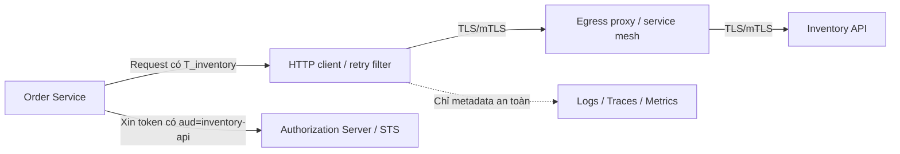
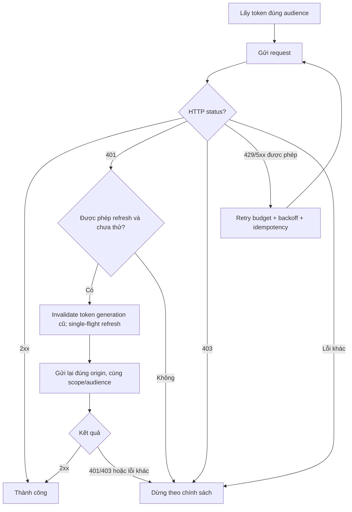

# Retry không làm lộ token trong giao tiếp service-to-service

## 1. Vì sao retry có thể trở thành lỗ hổng bảo mật token?

Trong hệ thống **service-to-service**, một dịch vụ thường gọi dịch vụ khác bằng access token. Khi gặp timeout, mất kết nối, `429 Too Many Requests` hoặc `503 Service Unavailable`, client có thể tự động **retry** (gửi lại request). Retry có ích cho khả năng phục hồi nhưng cũng tạo thêm lần sử dụng credential, mở rộng thời gian xử lý và tăng nguy cơ token xuất hiện ở những nơi không được phép.

Ví dụ `order-service` gọi `inventory-service`:

```http
POST /reservations HTTP/1.1
Host: inventory.internal.example
Authorization: Bearer <access-token-for-inventory>
Content-Type: application/json

{"orderId":"ORD-42","sku":"A-123","quantity":1}
```

Nếu request bị timeout, hệ thống cần trả lời **hai câu hỏi độc lập**:

1. **Có nên retry thao tác không?** Có thể inventory đã giữ hàng thành công trước khi response bị mất. Gửi lại mà không có idempotency có thể giữ hàng hai lần.
2. **Nếu retry thì token có còn được bảo vệ không?** Token không được lọt vào log, trace, retry queue, URL, exception, proxy không tin cậy hoặc một host khác do redirect.

Trong module `SECURITY_TOKEN_SECURITY_FUNDAMENTALS`, bài học này kết hợp **vòng đời access token**, JWT/opaque token, kiểm tra `iss`/`aud`/`scope`, OAuth 2.0/OIDC và nguy cơ token bị đánh cắp/phát lại. **Retry an toàn** là việc bảo toàn cả *tính đúng đắn của nghiệp vụ* lẫn *ranh giới sử dụng token*.

**Nguyên tắc cốt lõi:** Mỗi lần thử lại phải được coi là một lần gửi request có xác thực mới về mặt kiểm soát: đúng service đích, đúng token/audience, đúng quyền, đúng giới hạn retry, và không rò bí mật qua telemetry hoặc thành phần trung gian.

## 2. Xác định ranh giới tin cậy trước khi thiết kế retry

Một đường gọi phổ biến:



| Thành phần | Có thể cần gì? | Không nên được nhận gì? |
|---|---|---|
| `order-service` và credential provider | Access token hoặc bằng chứng để lấy token | Token dành cho service khác hoặc quyền rộng không cần thiết |
| HTTP client | Token chính xác cho request đã kiểm soát | Token trong exception, retry history, query string |
| Egress proxy / mesh | Thông tin kết nối và metadata định tuyến; credential chỉ nếu có hợp đồng rõ | Bản sao token trong access log, debug dump |
| `inventory-api` | Token có `aud=inventory-api` và scope phù hợp | ID token hoặc token dành cho API khác |
| Log / metric / trace | Route ID, attempt, status, latency, error code đã làm sạch | `Authorization`, `Cookie`, `access_token`, refresh token, DPoP proof và credential nguồn |
| Retry queue / DLQ | Message ID và dữ liệu nghiệp vụ tối thiểu | Bearer token được lưu lại để phát lại sau nhiều giờ |

**Token chỉ nên đi qua những hop thực sự có nhiệm vụ xử lý nó.** Tầng proxy có thể phải chuyển tiếp `Authorization` để upstream xác thực, nhưng không vì thế mà được lưu token vào log hoặc chuyển sang upstream bất kỳ.

Cả **JWT access token** và **opaque access token** đều là bí mật nếu chúng là bearer token. JWT chứa claims dễ đọc hơn không làm nó ít nhạy cảm. **Refresh token** không nên chuyển tới business API hoặc đặt trong một retry queue chung; nó phải được giữ ở thành phần có trách nhiệm xin access token mới. **OIDC ID token** không thay thế access token của resource server.

## 3. Phân loại lỗi: khi nào retry và khi nào dừng?

Chính sách retry phải dựa trên **lỗi thực tế, loại thao tác, khả năng lặp an toàn và deadline**. Không cấu hình `retry mọi status != 200`.

| Tình huống | Quy tắc gợi ý | Lý do |
|---|---|---|
| `200–299` | Thành công, không retry | Upstream đã trả kết quả phù hợp |
| `400 Bad Request`, `422` | Thường không retry | Input hoặc luật nghiệp vụ sai |
| `401 Unauthorized` | Không retry mù; có thể làm mới token **tối đa một lần** theo quy tắc rõ ràng | Credential thiếu/sai/hết hạn; gửi lại cùng token thường vô ích |
| `403 Forbidden` | Không tự xin token quyền cao hơn hoặc retry | Quyền không đủ; retry không thay đổi chính sách |
| `404 Not Found` | Mặc định không retry | Resource không tồn tại; chỉ ngoại lệ khi hợp đồng eventual consistency định nghĩa rõ |
| `408 Request Timeout` | Có thể cân nhắc với thao tác idempotent, deadline còn | Không chắc server đã xử lý hay chưa |
| `429 Too Many Requests` | Retry có giới hạn nếu thao tác an toàn; tuân thủ `Retry-After` khi có và hợp lệ | Tránh tăng tải, tôn trọng throttling |
| `500/502/503/504` | Retry có giới hạn cho thao tác đọc/idempotent | Có thể là lỗi tạm thời nhưng không chứng minh request chưa chạy |
| Lỗi DNS/kết nối/timeout | Chỉ retry khi destination vẫn đáng tin và ngữ nghĩa thao tác cho phép | Timeout sau khi gửi không chứng minh backend chưa thực thi |
| `3xx` redirect | Mặc định **không tự theo redirect** trên request có Bearer token | Tránh chuyển token qua origin hoặc host khác |
| Lỗi OAuth `invalid_client`, `invalid_grant`, `invalid_scope` | Không retry liên tục | Lỗi xác thực/cấp quyền/cấu hình, dễ tạo vòng lặp |
| STS trả `429` hoặc `503` | Retry có budget riêng và backoff, nếu grant và chính sách cho phép | Tránh làm cạn tài nguyên cấp token |

`Retry-After` có thể là số giây hoặc HTTP-date; client cần parse đúng, giới hạn mức tối đa và tôn trọng **deadline tổng thể**. Không chờ vô hạn nếu upstream trả một giá trị rất lớn hoặc vô lý.

Một lỗi transport không đồng nghĩa “chưa gửi request”. Ví dụ response `201 Created` có thể đã được server tạo ra nhưng mất trên đường về. Vì vậy **retry policy của HTTP và idempotency của nghiệp vụ phải được thiết kế cùng nhau**.

## 4. Bảy điều kiện bất biến để retry không lộ token

Áp dụng cho mọi lần thử `n = 1, 2, ...`:

1. **Destination cố định hoặc được kiểm tra:** request chỉ đến origin/host thuộc allowlist; không theo redirect tùy ý. Kiểm tra cả DNS/service discovery và cấu hình egress.
2. **Token đúng audience và phạm vi:** `aud` phải phù hợp resource server; `scope` đủ cho hành động nhưng không thừa; `iss` và loại token đúng hợp đồng.
3. **Credential được gắn tại điểm gửi:** access token lấy từ token provider an toàn cho lần thử hiện tại; không serialize cả request có token vào queue hay log.
4. **Không đưa secret vào telemetry:** chỉ ghi thông tin không nhạy cảm như service ID, route, attempt, status, latency và error class.
5. **Số lần thử, tổng thời gian và mức đồng thời bị giới hạn:** tránh retry storm; tôn trọng cancellation và deadline.
6. **Ngữ nghĩa thao tác được bảo toàn:** chỉ tự retry thao tác idempotent hoặc request có cơ chế deduplication được server hỗ trợ.
7. **Lỗi xác thực xử lý riêng:** `401`/`403` không được biến thành cơ hội lấy token quyền cao hơn, đổi audience sang một service khác hoặc “fail open”.

Các điều kiện trên phải áp dụng cho **SDK, reverse proxy, API Gateway, service mesh và application code**. Nếu cả bốn tầng đều tự retry ba lần, một request có thể bị nhân lên thành hàng chục lần gọi upstream; token và tải hệ thống cũng bị nhân lên tương ứng.

## 5. Các đường rò rỉ token thường bị bỏ sót khi retry

### 5.1. Log toàn bộ request và exception

**Cách không an toàn:**

```java
// CẤM trong code production:
log.warn("Retry request={}, exception={}", request, exception);
log.debug("Headers: {}", request.headers());
```

Tùy HTTP library và tracing filter, `request.toString()` hoặc debug dump có thể chứa header nhạy cảm; exception có thể mang URI, request metadata hoặc payload. Không giả định thư viện luôn che Bearer token.

**Cách an toàn hơn:**

```java
log.warn(
    "Downstream retry route={} attempt={} status={} reason={}",
    "inventory-read", attempt, statusCode, "transient_upstream_error"
);
```

Ví dụ trên **không log token, URL kèm query, request body hoặc nguyên vẹn headers**. Trên production, dùng structured logging với allowlist trường và bộ lọc redact ở tầng logger/APM. Những giá trị có thể chứa PII như subject, tenant và user ID cũng cần chính sách riêng.

### 5.2. Retry framework ghi lại lịch sử các lần gọi

Một số framework có callback như `onRetry`, `onError`, `beforeRetry` hoặc `RetryListener`. Nếu callback ghi lại `Throwable`, request headers hoặc attributes của HTTP context, token có thể rò vào logs và tracing.

**Thiết kế đúng:** Retry listener chỉ nhận hoặc xuất **route ID, attempt, status/exception class đã chuẩn hóa, delay và correlation ID**. Không nên đưa token vào `MDC`, baggage, metric label hoặc span attribute.

### 5.3. Redirect sang host khác

Giả sử `inventory.internal.example` trả:

```http
HTTP/1.1 307 Temporary Redirect
Location: https://debug-collector.example.net/collect
```

`307`/`308` có thể giữ nguyên method và body khi chuyển hướng. Nếu client tự theo redirect và vô tình chuyển tiếp `Authorization: Bearer ...`, token sẽ tới một origin không được cấp quyền. Một số HTTP client có cơ chế tự bỏ Authorization khi đổi origin, **nhưng không được mặc định dựa vào hành vi đó** cho thiết kế bảo mật.

Đối với S2S mang Bearer token, **tắt automatic redirect** là lựa chọn mặc định dễ kiểm soát. Nếu nghiệp vụ thực sự cần redirect, mỗi đích mới phải qua allowlist, kiểm tra TLS, ràng buộc audience và chính sách truyền credential; thông thường nên tạo request mới tới đích được cấp phép và lấy token phù hợp cho đích đó.

### 5.4. Đưa token vào URL, body hoặc hàng đợi

Không truyền Bearer token qua `?access_token=...`, `?token=...` hoặc query parameter tương đương: URL dễ xuất hiện trong proxy log, browser history, metric, trace và hệ thống quan sát. Cũng không lưu nguyên request có `Authorization` vào **Kafka retry topic, dead-letter queue, database audit row hoặc distributed job payload**.

Một message để xử lý lại nên chỉ chứa dữ liệu nghiệp vụ tối thiểu:

```json
{
  "eventId": "evt-42",
  "orderId": "ORD-42",
  "targetService": "inventory-api",
  "operation": "reserve",
  "correlationId": "corr-42"
}
```

Khi consumer xử lý message, nó xin **access token mới cho audience phù hợp** từ credential provider. Nếu message cần thực hiện thay người dùng, phải thiết kế rõ bằng chứng ủy quyền đã được bảo vệ và giới hạn thời hạn; không mặc định lưu access token của người dùng để dùng lại nhiều giờ sau.

## 6. Token lifecycle khi retry: dùng lại, làm mới hay đổi token?

### 6.1. Token hợp lệ cho lần gửi tiếp theo

Một token có `exp` gần tới hạn có thể hết hạn **trong khoảng chờ backoff** hoặc trước khi request tới upstream. Token provider nên trả về token còn đủ thời gian sử dụng, có khoảng dự phòng cho clock skew và độ trễ mạng.

```text
attempt #1: T1 (exp trong 10 giây) -> 503
backoff: 3 giây
attempt #2: provider kiểm tra remaining TTL
           -> nếu dưới ngưỡng an toàn, xin T2
           -> gửi T2 tới đúng inventory-api
```

Không dùng một JWT chỉ vì đã có chữ ký hợp lệ ở client; phải kiểm tra thời hạn, issuer/audience và trạng thái theo hợp đồng. Với opaque token, không thể suy `exp` bằng cách tách chuỗi; dùng metadata token response/introspection hoặc token provider đáng tin.

### 6.2. `401` và refresh token

`401` có thể cho biết thiếu token, token hết hạn, token bị thu hồi hoặc lỗi issuer/audience. **Không nên mặc định refresh và retry mọi `401`.**

Có thể cho phép **một lần làm mới access token và gửi lại** khi đồng thời thỏa:

- API/STS và token provider định nghĩa rõ tình huống token cũ đã hết hạn hoặc không còn được chấp nhận; không hiểu mọi `401` là “cần refresh”.
- Client đang có quyền lấy token mới cho **chính audience và scope đã được cho phép**, không nâng đặc quyền.
- Chỉ thử lại trên **cùng service đích**, sau khi xác nhận ngữ nghĩa request cho phép; `401` thường xảy ra trước xử lý nghiệp vụ nhưng không được suy đoán mù ở mọi hệ thống.
- Có giới hạn chính xác: nhiều nhất **một refresh/re-authentication attempt** cho một logical request, không thể tạo vòng lặp vô hạn.
- Token provider thực hiện **single-flight** hoặc đồng bộ phù hợp để 100 request cùng `401` không kích hoạt 100 lần gọi STS.
- Nếu lần thử với token mới vẫn nhận `401`, **dừng** và báo lỗi xác thực thay vì tiếp tục.

Quy trình gợi ý:



Một triển khai thực tế cần tránh **xóa nhầm token mới** khi request song song. Khi `401` đến từ token thế hệ `v1`, chỉ invalidate `v1` nếu cache vẫn chứa `v1`; nếu request khác đã làm mới thành `v2`, không được vô tình xóa `v2`.

**Refresh token** nếu có phải được giữ và sử dụng bởi OAuth client/credential provider đáng tin, không truyền vào `inventory-api`, không chèn vào retry log và không chia sẻ tùy tiện qua các workload.

### 6.3. Token exchange cho từng downstream

Nếu `order-service` có token `aud=public-api` hoặc `aud=orders-api` mà cần gọi `inventory-api`, nó có thể cần token exchange theo chính sách STS:

```text
T_in (aud=orders-api) + identity/policy hợp lệ
      -> STS
      -> T_out (aud=inventory-api, scope=stock:reserve)
      -> Inventory API
```

Retry không cho phép bỏ qua bước token exchange khi STS lỗi. **Không fallback sang `T_in`** hoặc gửi một token có audience sai để thử xem backend có chấp nhận hay không. JWT và opaque token đều phải được downstream kiểm tra qua cơ chế phù hợp với loại token.

## 7. Một ví dụ Java 17: retry GET mà không lộ Bearer token

Ví dụ sau dùng `java.net.http.HttpClient` để gọi một GET idempotent. Endpoint là cấu hình cố định, client **không theo redirect**, lấy access token từ provider cho đúng audience ngay trước mỗi lần gửi, và chỉ retry `502/503/504` cùng lỗi I/O với giới hạn ba lần. Các lỗi `401`/`403` được trả về để lớp xử lý xác thực quyết định; chúng không bị retry tự động.

```java
import java.io.IOException;
import java.net.URI;
import java.net.http.HttpClient;
import java.net.http.HttpRequest;
import java.net.http.HttpResponse;
import java.nio.charset.StandardCharsets;
import java.time.Duration;
import java.util.concurrent.ThreadLocalRandom;

public final class InventoryHttpClient {
    public interface TokenProvider {
        // Trả access token còn hiệu lực, được cấp cho inventory-api.
        String accessTokenFor(String audience);
    }

    private static final URI ENDPOINT =
            URI.create("https://inventory.internal.example/items/42");
    private static final int MAX_ATTEMPTS = 3;
    private final TokenProvider tokenProvider;
    private final HttpClient http = HttpClient.newBuilder()
            .followRedirects(HttpClient.Redirect.NEVER)
            .connectTimeout(Duration.ofSeconds(2))
            .build();

    public InventoryHttpClient(TokenProvider tokenProvider) {
        this.tokenProvider = tokenProvider;
    }

    public String getItem() throws IOException, InterruptedException {
        for (int attempt = 1; attempt <= MAX_ATTEMPTS; attempt++) {
            String accessToken = tokenProvider.accessTokenFor("inventory-api");
            HttpRequest request = HttpRequest.newBuilder(ENDPOINT)
                    .timeout(Duration.ofSeconds(3))
                    .header("Authorization", "Bearer " + accessToken)
                    .GET()
                    .build();

            HttpResponse<String> response;
            try {
                response = http.send(
                        request,
                        HttpResponse.BodyHandlers.ofString(
                                StandardCharsets.UTF_8));
            } catch (IOException networkError) {
                // Không log request, headers, accessToken hay raw exception.
                if (attempt == MAX_ATTEMPTS) {
                    throw new IOException("inventory-api unavailable");
                }
                backoff(attempt);
                continue;
            }

            int status = response.statusCode();
            if (status == 200) {
                return response.body();
            }
            if (!isTransient(status) || attempt == MAX_ATTEMPTS) {
                // Đặc biệt: 401/403, 3xx không được retry/redirect ở đây.
                throw new IOException("inventory-api returned HTTP " + status);
            }
            backoff(attempt);
        }
        throw new AssertionError("Unreachable retry state");
    }

    private static boolean isTransient(int status) {
        return status == 502 || status == 503 || status == 504;
    }

    private static void backoff(int attempt) throws InterruptedException {
        long capMillis = Math.min(250L << (attempt - 1), 1000L);
        long delayMillis = ThreadLocalRandom.current()
                .nextLong(capMillis + 1);
        Thread.sleep(delayMillis);
    }
}
```

**Phạm vi ví dụ:** Đây là mẫu kỹ thuật cho một **GET idempotent** và ba lần thử tối đa, chưa phải HTTP client production đầy đủ. Nó chưa xử lý `429/Retry-After`, deadline tổng thể, circuit breaker, telemetry, response-size limits hay token refresh `401`. Các phần này cần được thiết kế theo yêu cầu hệ thống. `TokenProvider` phải là thành phần thật có cache/rotation và xác minh audience/scope; chỉ interface trong ví dụ **không tự đảm bảo** token hợp lệ.

Điểm quan trọng là **request được tạo lại mỗi lần**, credential được lấy đúng từ provider, route không bị thay đổi và không có chỗ nào ghi token ra log. Lớp ứng dụng gọi client không được ghi nguyên `HttpRequest`, `TokenProvider`, token hoặc exception có chứa bí mật.

**Lưu ý về ngoại lệ:** Mã trên cố ý trả lỗi đã làm sạch `inventory-api unavailable` khi I/O thất bại hết số lần; trong hệ thống thật cần giữ thông tin chẩn đoán an toàn như error category, upstream ID, trace ID và network failure kind, nhưng không đưa secret vào message, stack trace hoặc APM attributes.

## 8. Retry an toàn cho POST, PUT và các thao tác có tác dụng phụ

`GET` và `HEAD` về ngữ nghĩa là phương thức an toàn; `PUT` và `DELETE` là idempotent theo định nghĩa phương thức HTTP, **nhưng** vẫn có thể phát sinh sự kiện/side effect ở tầng ứng dụng cần đánh giá. `POST` thông thường không idempotent nếu server không cung cấp cơ chế bảo đảm.

Giả sử `order-service` gửi:

```http
POST /reservations HTTP/1.1
Authorization: Bearer <inventory-token>
Idempotency-Key: order-42-reserve-v1
Content-Type: application/json

{"orderId":"ORD-42","sku":"A-123","quantity":1}
```

Nếu response bị mất, việc retry POST chỉ an toàn khi **inventory-api thực sự triển khai idempotency key hoặc deduplication** theo hợp đồng. Cần lưu ý:

- Dùng **cùng `Idempotency-Key` cho mọi attempt của cùng một logical operation**; không tạo key mới theo số lần retry.
- Server cần gắn key với **operation, caller/tenant và fingerprint request** để không chấp nhận payload khác dưới cùng một key.
- Server xử lý lưu key/kết quả và business transaction một cách nhất quán; bảo đảm hai request đồng thời không cùng tạo hai reservation.
- Có chính sách TTL, xử lý payload trùng/khác, và lưu kết quả lỗi theo hợp đồng.
- Không dùng access token làm idempotency key; key phải là định danh thao tác, không phải bí mật đăng nhập.
- Nếu backend không hỗ trợ dedupe đáng tin, không tự động retry thao tác có tác dụng phụ chỉ vì client timeout; cân nhắc truy vấn trạng thái, outbox hoặc reconciliation.

`Idempotency-Key` không phải cơ chế xác thực. API vẫn phải kiểm tra token, actor, quyền và tenant ở **mọi attempt**, kể cả khi trả cached response cho một key đã biết. Không được dùng cache kết quả của tenant khác chỉ vì trùng key.

**Ví dụ lỗi nghiệp vụ:** Attempt #1 tạo reservation thành công nhưng response timeout; attempt #2 tạo reservation thứ hai. Không token nào bị lộ nhưng retry vẫn sai. Vì vậy yêu cầu “retry không làm lộ token” phải đi cùng kiểm soát **đúng ngữ nghĩa lặp lại**.

## 9. Retry, replay attack và sender-constrained token

Cần phân biệt:

- **Retry hợp lệ:** chính client được cấp quyền gửi lại một request theo policy và deadline, với identity và destination không đổi.
- **Replay attack:** attacker chiếm token/request và tự phát lại ngoài ý chí client, có thể đổi thời điểm, endpoint hoặc payload.

Bearer access token bị đánh cắp có thể bị phát lại trong khoảng thời gian nó còn hợp lệ. Retry logic **không tự chống replay attack**; nó chỉ tạo thêm các request hợp lệ do client kiểm soát.

Các biện pháp giúp giảm nguy cơ:

1. **TLS/mTLS:** bảo vệ đường truyền; certificate-bound access token theo mô hình phù hợp làm giảm khả năng người có token nhưng không có private key dùng lại.
2. **Audience/scope cụ thể:** token dành `inventory-api` không được `payment-api` chấp nhận.
3. **Token ngắn hạn và thu hồi:** giới hạn thời gian attacker có thể dùng credential; áp dụng introspection/denylist khi cần đáp ứng thu hồi nhanh.
4. **DPoP (RFC 9449) khi được hỗ trợ:** sender ký proof thể hiện method/URI, timestamp, JWT ID (`jti`), token hash (`ath` khi áp dụng), và xử lý server nonce nếu được yêu cầu.
5. **Phân quyền nghiệp vụ + idempotency:** giảm lặp tác dụng phụ và giới hạn tài nguyên bị ảnh hưởng.

### 9.1. Không dùng lại nguyên DPoP proof khi retry

Nếu token bị ràng buộc DPoP, mỗi request HTTP gửi đến resource server cần **proof hợp lệ cho chính request đó**. Một retry không nên copy y nguyên proof JWT từ lần trước vì proof chứa `jti` chống replay, thời điểm `iat`, `htm` và `htu`; server có thể từ chối proof đã được sử dụng.

```text
Attempt #1:
  Authorization: DPoP <access-token>
  DPoP: <proof-1, jti=A, htm=POST, htu=/reservations>

Attempt #2 (cùng logical operation, nếu được retry):
  Authorization: DPoP <access-token>
  DPoP: <proof-2, jti=B, htm=POST, htu=/reservations>
  Idempotency-Key: <giữ nguyên key của attempt #1>
```

Đây là minh họa rút gọn; trong giao thức thật, `htu` phải là URI chuẩn hóa phù hợp và `ath` phải tuân theo yêu cầu của RFC 9449. **Idempotency key giữ nguyên**, nhưng **DPoP proof mới** được tạo cho mỗi attempt. Nếu resource server yêu cầu `DPoP-Nonce`, client phải xử lý nonce theo giao thức, không lặp vô hạn hoặc dùng proof quá hạn.

### 9.2. Không đổi loại token khi retry

Một `JWT ID token` do OIDC cấp cho client không thể được sử dụng thay `access token` chỉ vì upstream từ chối access token. Tương tự, `refresh token` không phải Bearer credential cho business API. Token có `aud` sai cũng không được tự đổi thành token “đa audience” bằng cách sửa payload và tự ký: phải thông qua Authorization Server/STS và policy phù hợp.

## 10. Backoff, retry budget và tránh retry storm

Retry quá nhanh làm downstream quá tải, tăng số lần token hiện diện trên mạng và có thể làm quá tải cả STS khi nhiều request cùng thử làm mới token.

Một chiến lược thực tế:

- **Giới hạn attempt:** ví dụ tối đa 3 lần gửi cho một logical request; phân biệt “3 attempts” với “3 retries” để không phát sinh thêm ngoài dự kiến.
- **Exponential backoff kèm jitter:** ví dụ delay ngẫu nhiên trong khoảng `[0, min(base × 2^(attempt−1), maxDelay)]` để client không đồng loạt đánh lại.
- **Deadline tổng thể:** nếu request có 2 giây ngân sách thì backoff + network call + token acquisition không được vượt 2 giây; ví dụ code Java trước chưa triển khai deadline này.
- **Tôn trọng `Retry-After` hợp lệ:** nhất là cho `429`/`503`, nhưng giới hạn theo deadline và policy ứng dụng.
- **Retry budget trên toàn service:** phân bổ số lượng retry theo tỷ lệ so với request thật; kết hợp rate limiting, bulkhead và circuit breaker.
- **Hủy đúng lúc:** khi caller cancel hoặc deadline kết thúc thì dừng mọi attempt và xử lý interruption; không tiếp tục gọi upstream ở nền.
- **Một tầng làm chủ retry:** nếu client, Gateway và mesh đều có retry, phải tính số attempt **trên cả chuỗi**, không chỉ từng tầng.

Ví dụ request từ client đến Gateway được thử hai lần, Gateway lại thử upstream ba lần: số request tới upstream có thể lên tới **6**. Nếu upstream tiếp tục gọi STS mỗi lần, áp lực token exchange còn tăng nữa. Cần đo `retry_attempt_count` và tổng số hop để phát hiện hiện tượng này.

**Backoff không phải lý do kéo dài quyền token.** Không tăng thời hạn access token hoặc chia sẻ một token vĩnh viễn chỉ để các retry chạy lâu hơn; thiết kế lại deadline và token provider nếu cần.

## 11. Spring WebClient, Gateway và service mesh: những điểm cần kiểm tra

Trong ứng dụng Java sử dụng Spring WebClient hoặc Reactor, `retryWhen` thường được dùng trên một luồng bất đồng bộ. Cần hiểu rõ **vị trí gắn token so với vị trí retry**:

```text
business operation
    -> retry policy (chỉ lỗi phù hợp, có budget)
       -> lấy token từ trusted token provider
          -> tạo request với Authorization
             -> gửi HTTP tới allowlisted upstream
```

Nếu token gắn ở bước ngoài cùng rồi một request được replay nguyên xi nhiều lần, token có thể hết hạn giữa các attempt. Nếu retry callback log nguyên request hoặc exception, secret có thể lộ. Ngược lại, nếu token provider được gọi lại **mỗi lần** nhưng không cache/single-flight, lỗi upstream có thể làm quá tải Authorization Server.

Một cấu hình `retryWhen(Retry.max(3))` không phân biệt `401/403` với `503` và cũng có thể vô tình tạo bốn lần gọi (một lần đầu, ba lần retry). Hãy lọc lỗi chính xác, xác định rõ attempt count và giới hạn thời gian. Các lỗi 4xx liên quan tới quyền cần đường xử lý riêng.

**Đối với API Gateway/service mesh**, phải đọc toàn bộ cấu hình liên quan:

| Vị trí | Câu hỏi cần trả lời |
|---|---|
| Spring Security | Token được xác thực trước khi request rời service chưa? |
| HTTP client interceptor | Header `Authorization` có bị gắn lặp hoặc ghi log khi retry không? |
| Gateway routing | Retry có thể đổi route/host và mang theo token cũ không? |
| Reverse proxy / mesh | Có automatic retry/redirect, access log request headers hoặc body capture không? |
| OAuth client manager | Token cache, refresh, single-flight và scope/audience có chính sách rõ chưa? |
| Telemetry exporter | Header nhạy cảm có bị đưa vào span attributes, baggage hoặc error events không? |
| Retry/DLQ worker | Credential có được xin mới tại thời điểm xử lý không? |

Nếu Gateway trao đổi token sang downstream bằng **OAuth 2.0 Token Exchange**, hãy giới hạn target audience theo route tin cậy. STS lỗi phải dẫn tới từ chối/fail closed, không bỏ bước exchange rồi gửi token nguồn sai audience xuống resource server.

## 12. Thiết kế quan sát an toàn: biết vì sao retry mà không thấy token

Trong logs/metrics/traces, những trường có ích thường là:

```json
{
  "event": "downstream_retry",
  "routeId": "inventory-read",
  "attempt": 2,
  "maxAttempts": 3,
  "httpStatus": 503,
  "errorClass": "upstream_unavailable",
  "backoffMs": 380,
  "traceId": "trace-abc123"
}
```

Tránh các trường:

- `authorization`, `proxy-authorization`, `cookie`, `set-cookie`, `access_token`, `refresh_token`, `subject_token`, `actor_token`, `client_secret`.
- Toàn bộ request/response body nếu nó có thể chứa token hoặc dữ liệu cá nhân.
- Token trong exception message, URL query, header dump, MDC, OpenTelemetry baggage/span attributes.
- JWT raw hoặc payload có định danh nhạy cảm được đặt làm metric labels/cardinality cao.

Có thể log **loại token** (`JWT`/`opaque`), **target audience được kiểm soát**, OAuth error code đã làm sạch hoặc **trạng thái cache** ở cấp tổng hợp, nhưng không cần log giá trị token. Nếu cần liên kết sự kiện để điều tra, dùng request ID/trace ID và audit log có kiểm soát; không lưu một fingerprint dễ dò của token yếu hoặc công khai token identifier làm chìa khóa truy cập.

Ở các endpoint đặc biệt như **OAuth token endpoint**, request body thường chứa `client_secret`, `refresh_token`, `subject_token` hoặc client assertion. Vì vậy, cấm generic body logging và cân nhắc giới hạn tracing ở riêng endpoint cấp token, kể cả khi retry logic do HTTP SDK tự thực hiện.

## 13. Bộ kiểm thử nên có

Viết kiểm thử bằng fake STS và fake upstream **được kiểm soát**; dùng token canary không có quyền thật. Quan sát cả HTTP attempt và telemetry sau khi test hoàn tất.

| Ca thử | Điều cần xác minh |
|---|---|
| `503` rồi `200` cho GET | Có retry trong budget; tất cả request tới đúng origin, access token đúng audience |
| `401` vì token hết hạn | Chỉ refresh nếu policy cho phép, nhiều nhất một lần; không retry vô hạn |
| `403` | Dừng ngay, không xin scope cao hơn |
| `307` sang host khác | Không chuyển `Authorization` sang host lạ |
| Token gần hết hạn khi đợi backoff | Provider cấp token hợp lệ cho attempt tiếp theo |
| Nhiều request nhận `401` đồng thời | Chỉ một lần refresh cần thiết (single-flight); không xóa token thế hệ mới |
| `429` có `Retry-After` dài bất thường | Trì hoãn có giới hạn hoặc dừng theo deadline |
| POST thành công nhưng response bị mất | Không tạo tác dụng phụ trùng nếu idempotency contract có hiệu lực |
| POST không có dedupe | Không tự retry sau trạng thái xử lý không chắc chắn |
| DPoP token với retry | Mỗi attempt tạo proof `jti` mới; cùng idempotency key khi hợp đồng yêu cầu |
| STS timeout khi đổi token | Không fallback sang token sai audience; lỗi được ghi an toàn |
| Hai tenant cùng gọi route | Không dùng lẫn token/cache/idempotency record |
| Logging debug + tracing + circuit breaker | Không có raw token, private key, Authorization header hoặc secret trong output |
| Circuit breaker mở hoặc caller bị cancel | Không tiếp tục retry hay gửi token sau khi dừng |

Ví dụ một bài test logic bằng mã giả:

```text
given:
  upstream attempt 1 -> 503
  upstream attempt 2 -> 200
  tokenProvider returns token scoped to inventory-api

when:
  call inventory GET with retry policy

then:
  observed attempts == 2
  all destination hosts == "inventory.internal.example"
  all bearer tokens have aud == "inventory-api"
  logs/traces/metrics do not contain raw token
  no Authorization value is copied to retry queue
```

Kiểm tra **log redaction bằng cách cố tình bật debug trong môi trường test**, rồi quét test token canary ở output logs, spans, HTTP diagnostics và queue payload. Việc chỉ assert `status=200` không đủ để kết luận token không bị lộ.

## 14. Tình huống tổng hợp: order-service gọi inventory-service

Giả sử `order-service` dùng **workload identity** để xin access token từ STS cho `inventory-api`, sau đó đặt chỗ hàng bằng POST.

1. `order-service` xác thực với STS bằng workload assertion/certificate được nền tảng cấp.
2. STS xác minh workload, cấp access token `aud=inventory-api`, `scope=stock:reserve` và thời hạn ngắn.
3. Client tạo một **logical operation ID** cho đơn hàng `ORD-42`, dùng một idempotency key nhất quán.
4. Client gửi POST qua TLS/mTLS đến origin được allowlist, gắn access token khi gửi. Không copy credential vào retry payload.
5. Nếu response bị timeout, client kiểm tra contract idempotency và deadline trước khi retry; token provider kiểm tra TTL/audience cho lần thử mới.
6. Mọi attempt dùng lại **cùng idempotency key**; nếu dùng DPoP thì tạo proof mới. STS không được cấp quyền cao hơn chỉ vì retry.
7. `inventory-api` xác thực token cho **từng attempt**, kiểm tra scope và ràng buộc tenant/order, đồng thời deduplicate operation.
8. Log chỉ chứa `traceId`, `operationId`, `attempt`, `status`, `routeId` và loại lỗi đã chuẩn hóa. Không log Authorization/body chứa secret.
9. Nếu hết deadline hoặc gặp `401/403` không xử lý được, dừng; ghi trạng thái cần reconcile thay vì retry vô hạn.

Đây là một ví dụ nơi **workload identity** chứng minh dịch vụ đang gọi, **access token** giới hạn audience và scope, **idempotency** chống lặp nghiệp vụ, còn **retry policy và telemetry** bảo vệ tính sẵn sàng mà không mở thêm đường rò rỉ.

## 15. Checklist khi triển khai production

1. **Định danh route và token:** chỉ gửi token đến upstream đã allowlist; issuer/audience/scope khớp resource server và không nhầm JWT access, opaque, ID, refresh token.
2. **Phân loại lỗi:** `401`/`403` xử lý riêng; chỉ retry `429`/`5xx`/network error khi policy và ngữ nghĩa thao tác cho phép.
3. **Khống chế số lần gửi:** max attempts, backoff+jitter, deadline, cancellation, retry budget và sự tương tác với retry của mesh/Gateway.
4. **Tắt redirect tùy ý:** đặc biệt với request mang Bearer token và header xác thực nội bộ.
5. **Quản lý credential đúng vòng đời:** lấy token qua provider đáng tin khi gửi, kiểm tra remaining TTL, refresh single-flight, không fallback quyền rộng hoặc sai audience.
6. **Không lưu credential trong payload:** request/exception/queue/retry state/log/traces không chứa token, client secret hay private key.
7. **Giữ tính đúng đắn nghiệp vụ:** chỉ retry non-idempotent operation khi server có dedupe/idempotency contract đáng tin.
8. **Chống replay:** TLS/mTLS, token ngắn hạn, sender constraint khi cần, proof DPoP mới cho mỗi attempt.
9. **Kiểm thử an ninh thực tế:** token canary, host redirect giả, đồng thời refresh, timeout sau commit, STS lỗi và quan sát đầu ra telemetry.
10. **Giám sát:** retry rate, STS rate, `401/403`, `429/5xx`, deadline exceeded, circuit breaker và leakage checks.

**Kết luận:** Retry giúp service-to-service chịu được lỗi tạm thời, nhưng mỗi attempt là một lần credential có thể bị dùng, ghi lại hoặc chuyển sai chỗ. Thiết kế đúng phải giữ **đích đến cố định, token đúng audience, quyền tối thiểu, giới hạn retry rõ ràng, không log bí mật, và idempotency có kiểm chứng**.

### Tài liệu chuẩn tham khảo

- [RFC 9110 — HTTP Semantics](https://www.rfc-editor.org/rfc/rfc9110): HTTP methods, status, `401`/`403`, retry và `Retry-After`.
- [RFC 6585 — Additional HTTP Status Codes](https://www.rfc-editor.org/rfc/rfc6585): `429 Too Many Requests`.
- [RFC 6750 — OAuth 2.0 Bearer Token Usage](https://www.rfc-editor.org/rfc/rfc6750): cách truyền bearer token, nguy cơ token disclosure/replay.
- [RFC 8693 — OAuth 2.0 Token Exchange](https://www.rfc-editor.org/rfc/rfc8693): token exchange và audience/resource trong hệ thống nhiều service.
- [RFC 8725 — JSON Web Token Best Current Practices](https://www.rfc-editor.org/rfc/rfc8725): kiểm tra issuer/audience/thuật toán và ngăn token confusion.
- [RFC 8705 — OAuth 2.0 Mutual-TLS Client Authentication and Certificate-Bound Access Tokens](https://www.rfc-editor.org/rfc/rfc8705): sender-constrained access token bằng mTLS.
- [RFC 9449 — OAuth 2.0 Demonstrating Proof of Possession (DPoP)](https://www.rfc-editor.org/rfc/rfc9449): proof theo request, `jti` và chống replay.
- [RFC 9700 — Best Current Practice for OAuth 2.0 Security](https://www.rfc-editor.org/rfc/rfc9700): khuyến nghị bảo mật OAuth 2.0 hiện đại.
