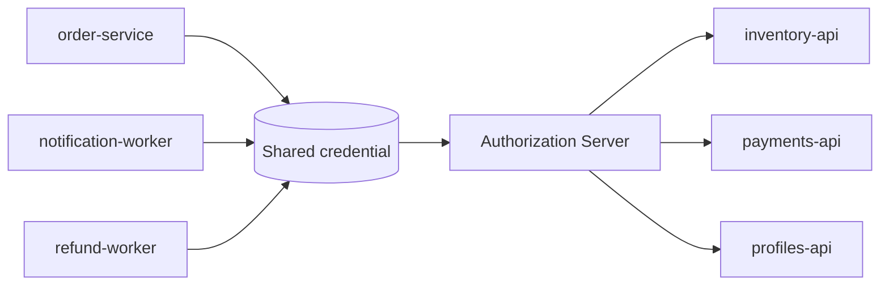
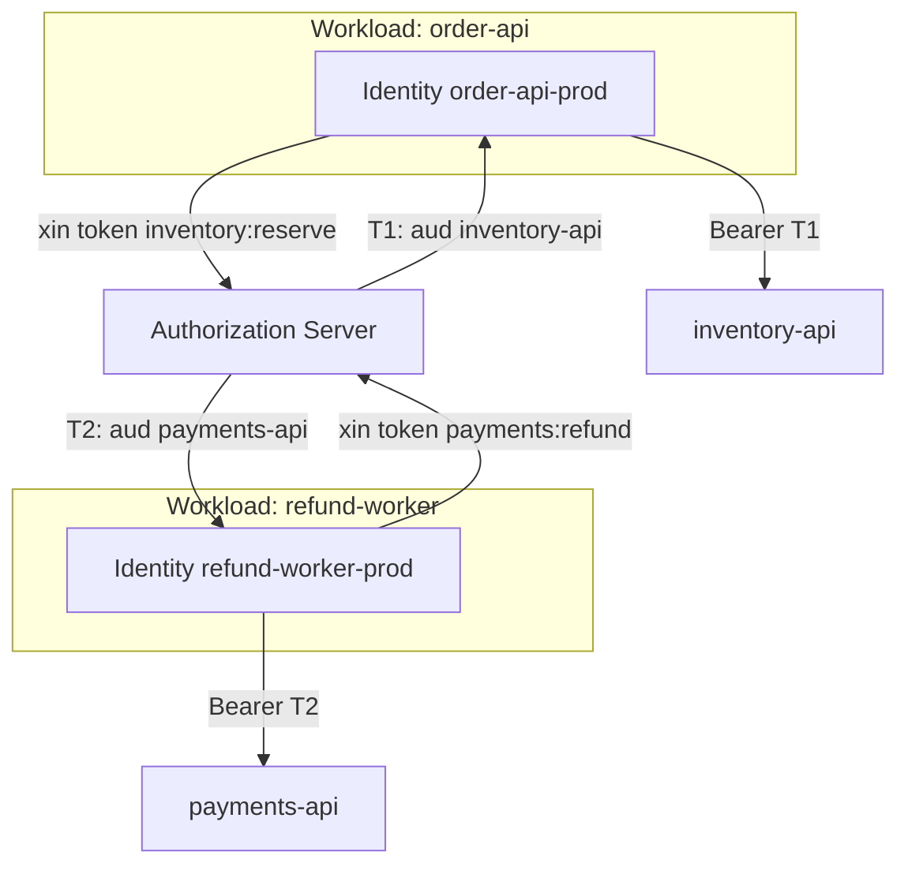
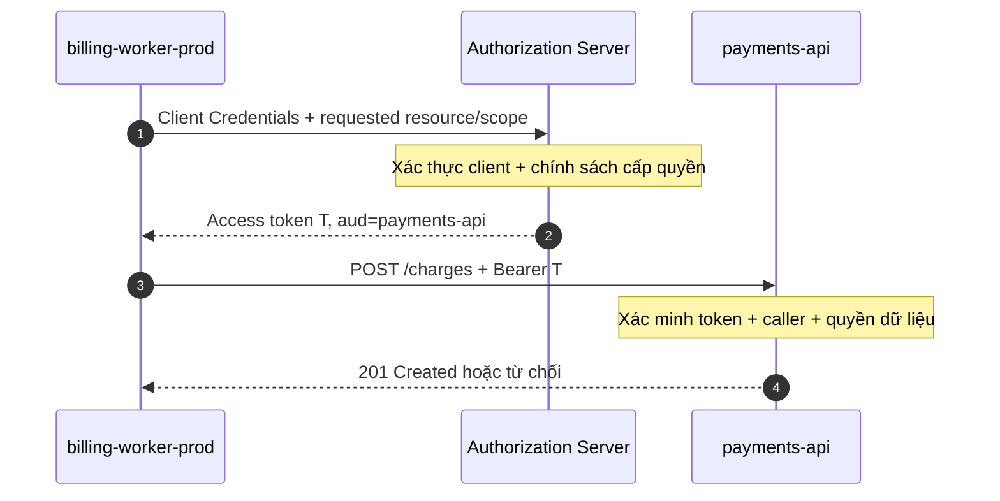

# Service account isolation

Trong kiến trúc microservice, các tiến trình thường gọi API của nhau mà không có người dùng trực tiếp tham gia. Một `order-service` có thể xin giữ hàng tại `inventory-service`; `billing-worker` có thể tạo hóa đơn; `refund-worker` có thể xử lý hoàn tiền. Nếu tất cả các tiến trình cùng sử dụng **một service account, một client secret và một bộ quyền**, việc lộ thông tin xác thực của một service có thể cho phép kẻ tấn công dùng quyền của nhiều service khác. **Service account isolation** là thiết kế tách định danh, thông tin xác thực, quyền và vòng đời của từng workload để giảm phạm vi ảnh hưởng khi một thành phần bị xâm nhập.

Bài thuộc chương **Service to service** của mô-đun **SECURITY_TOKEN_SECURITY_FUNDAMENTALS**. Nội dung tập trung vào mô hình tin cậy và vòng đời token trong OAuth 2.0/OIDC: JWT và opaque token, access/refresh token, issuer, audience, scope, lưu trữ khóa, thu hồi và giảm nguy cơ token bị đánh cắp hoặc dùng lại. Khi vận dụng, phải phân biệt rõ **định danh service account** với **access token** mà service dùng để truy cập resource server.

Sau bài này, bạn có thể:

- Giải thích service account là gì và phân biệt danh tính workload, OAuth client, service principal và danh tính người dùng cuối.
- Chọn ranh giới cô lập theo **workload, môi trường, trust domain, tenant và mục đích nghiệp vụ**.
- Thiết kế quyền, audience và scope tối thiểu cho từng cặp caller → resource server.
- Bảo vệ và luân chuyển client credentials; đánh giá khi nào cần workload identity federation, mTLS hoặc token có ràng buộc người gửi.
- Ngăn một service mượn nhầm định danh, dùng token sai audience hay truy cập tài nguyên thuộc tenant khác.
- Kiểm thử và xử lý sự cố lộ service account mà không làm tê liệt toàn hệ thống.

## 1. Service account là gì?

**Service account** là định danh được cấp cho một ứng dụng, dịch vụ, tác vụ tự động hoặc workload. Tên gọi thay đổi theo nền tảng: service account trong Kubernetes, service principal trong một hệ IAM, OAuth 2.0 confidential client, workload identity hoặc một định danh máy do tổ chức quản lý.

Những khái niệm đó **có thể được liên kết với nhau nhưng không tự động là một**:

| Khái niệm | Mục đích | Ví dụ |
|---|---|---|
| **Workload/service identity** | Định danh tiến trình thực sự đang chạy | `order-service/prod` |
| **OAuth client registration** | Danh tính ứng dụng được Authorization Server (AS) xác thực khi xin token | `order-api-prod` |
| **Service account trong nền tảng** | Danh tính tiến trình trong Kubernetes/cloud/IAM | `system:serviceaccount:orders:order-api` |
| **Client credential** | Chứng cứ workload dùng để chứng minh định danh | private key, mTLS certificate, workload assertion hoặc client secret |
| **Access token** | Chứng cứ truy cập API do AS cấp, mang audience/scope/thời hạn | Token dùng gọi `inventory-api` |
| **End-user identity** | Danh tính người dùng thực hiện tác vụ/ủy quyền | `user-42` |

Một service account **không phải** access token. Nó là định danh có thể được xác thực bằng nhiều phương pháp và được cấp access token theo chính sách. Cũng không nên coi `client_id` là bí mật: client ID thường là định danh công khai; khả năng xác thực phụ thuộc chứng cứ kèm theo và chính sách AS.

Trong OAuth 2.0, **Client Credentials grant** (RFC 6749) thường phù hợp với machine-to-machine khi client hành động bằng quyền được cấp cho chính nó. OAuth client phải được AS xác thực theo phương thức đã đăng ký. Luồng này **không chứng minh có người dùng cuối đang đăng nhập**; nếu hành động cần sự chấp thuận hoặc quyền của người dùng, phải thiết kế cơ chế ủy quyền người dùng hoặc delegation phù hợp.

## 2. Bài toán: dùng chung một service account

Giả sử nhóm vận hành tạo client `backend-global` với quyền:

```text
client_id = backend-global
allowed audiences = inventory-api, payments-api, profiles-api
allowed scopes    = inventory:reserve payments:charge
                    payments:refund profiles:export
credential        = cùng một client secret cho mọi service
```

`order-service`, `notification-worker` và `refund-worker` đều được cấp secret này vì triển khai thuận tiện:



Khi `notification-worker` bị tấn công, kẻ tấn công có thể dùng credential dùng chung để xin token có quyền `payments:refund` hoặc `profiles:export`, dù việc gửi thông báo không đòi hai quyền ấy. Hệ thống cũng khó phân biệt hành vi thực sự do service nào thực hiện nếu cả ba cùng xác thực bằng một client.

Hậu quả:

- **Lateral movement:** từ một workload yếu chuyển sang API hoặc dữ liệu nhạy cảm hơn.
- **Blast radius lớn:** phải xoay credential ở nhiều ứng dụng; một lần thu hồi có thể khiến mọi service mất quyền.
- **Không có trách nhiệm riêng:** audit log chỉ thấy `backend-global`, không biết workload nào tạo yêu cầu.
- **Khó thực thi least privilege:** cấp quyền cho một service đồng thời tăng quyền cho tất cả service dùng chung định danh.
- **Trộn trust boundary:** dev, staging và production hoặc các tenant có thể vô tình chia sẻ danh tính và token.

Service account isolation thay thế định danh dùng chung bằng **các định danh riêng cùng policy hẹp**. Không có tiêu chuẩn nào quy định “bắt buộc một service account cho mỗi container”: phạm vi hợp lý phải dựa trên mức tin cậy, hành động được phép và cách triển khai thực tế.

## 3. Cô lập theo các ranh giới nào?

### 3.1. Theo workload và trách nhiệm nghiệp vụ

Hai service có trách nhiệm khác nhau nên có định danh và quyền riêng:

| Workload | OAuth client/service account minh họa | Resource server được dùng | Scope điển hình |
|---|---|---|---|
| `order-api` | `order-api-prod` | `inventory-api` | `inventory:reserve`, `inventory:release` |
| `billing-worker` | `billing-worker-prod` | `payments-api` | `payments:charge` |
| `refund-worker` | `refund-worker-prod` | `payments-api` | `payments:refund` |
| `notification-worker` | `notification-worker-prod` | `messages-api` | `notifications:send` |
| `analytics-export` | `analytics-export-prod` | `reports-api` | `reports:export` |

Mỗi workload chỉ nhận scope thực sự cần thiết. Một quyền như `payments:refund` nên được cấp cho workflow hoàn tiền có điều kiện bổ sung, không cấp cho mọi service gọi `payments-api`.

Sơ đồ trust boundary riêng:



Hai workload vẫn có thể chạy cùng cluster, nhưng **không dùng chung credential** và AS chỉ cấp quyền dựa trên định danh cụ thể.

### 3.2. Theo môi trường triển khai

Production, staging và development thường có yêu cầu bảo vệ, dữ liệu và vòng đời triển khai khác nhau. Nên tách định danh và credential:

```text
order-api-dev       -> inventory-api-dev
order-api-staging   -> inventory-api-staging
order-api-prod      -> inventory-api-prod
```

AS/resource server cần thực thi audience, issuer, trust domain và policy phù hợp. Không chỉ thêm hậu tố `-prod` vào client ID rồi coi như đã cách ly: nếu nhiều môi trường dùng chung client secret, chấp nhận token chéo audience hoặc có quyền cloud IAM xuyên môi trường, ranh giới vẫn có thể bị phá.

Phân tách có thể bao gồm realm/tenant AS riêng, cloud account/project, namespace, secret store, network segment và policy. Mức phân tách tùy rủi ro, nhưng phải kiểm thử tình huống lấy credential môi trường dev để xin token gọi API production.

### 3.3. Theo tenant, tài nguyên nhạy cảm và blast radius

Trong hệ multi-tenant, một service chung có thể phục vụ hàng nghìn tenant. Không phải lúc nào cũng cần một OAuth client cho từng tenant; điều quan trọng là mỗi request có **tenant context đáng tin** và backend kiểm tra quyền trên tài nguyên.

Các mức cô lập có thể chọn:

1. **Client theo workload, tenant kiểm tra ở backend:** phù hợp service dùng chung hạ tầng với policy tenant chặt chẽ.
2. **Client hoặc workload identity riêng cho tenant nhạy cảm:** giảm phạm vi ảnh hưởng khi một tenant/workload bị xâm nhập, đánh đổi chi phí vận hành.
3. **Trust domain/IAM/AS riêng:** phù hợp khi cần cô lập mạnh về pháp lý, dữ liệu hoặc vận hành.

Không dùng `tenantId` trong URL, header `X-Tenant` do client tự khai hoặc cache key chỉ có `sub` để cấp quyền. Tenant phải được ràng buộc với danh tính/quyền đã xác minh và được đối chiếu với tài nguyên đích.

### 3.4. Theo mục đích khẩn cấp và đặc quyền

Các tác vụ đặc quyền như migration, export hàng loạt, rotation hoặc khôi phục dữ liệu cần định danh riêng, quyền ngắn hạn và khả năng audit tốt. Không cho `order-api` thường ngày sở hữu vĩnh viễn quyền `database:admin` chỉ vì đôi khi có migration.

Break-glass identity nếu được tổ chức sử dụng phải có quy trình cấp, giám sát và thu hồi riêng, không đặt chung secret trong deployment của ứng dụng thường.

## 4. Cấp và xác minh access token cho một service account

### 4.1. Client Credentials với quyền hẹp

Ví dụ `billing-worker-prod` đã được đăng ký với AS, được phép xin scope `payments:charge` cho audience `payments-api`. Client dùng credential riêng để xác thực với AS:



Ví dụ yêu cầu dạng form minh họa, cố ý lược bỏ cơ chế xác thực client cụ thể:

```http
POST /oauth2/token HTTP/1.1
Host: id.example.com
Content-Type: application/x-www-form-urlencoded

grant_type=client_credentials&scope=payments%3Acharge
```

Trong triển khai thật, request **phải xác thực client** theo cấu hình AS, chẳng hạn mTLS, `private_key_jwt` hoặc client secret qua kênh bảo vệ. Tham số xác định resource/audience tùy AS và khả năng hỗ trợ Resource Indicators (RFC 8707) hoặc cơ chế tương đương; chỉ yêu cầu scope `payments:charge` không đảm bảo AS phát hành token có audience đúng.

JWT access token minh họa:

```json
{
  "iss": "https://id.example.com",
  "sub": "service-billing-worker-prod",
  "client_id": "billing-worker-prod",
  "aud": ["payments-api"],
  "scope": "payments:charge",
  "iat": 1893452400,
  "nbf": 1893452400,
  "exp": 1893456000,
  "jti": "charge-req-token-8b2"
}
```

Các timestamp chỉ dùng để minh họa. Tùy profile phát hành, `sub` có thể là định danh client hoặc một giá trị khác; backend phải dùng claim định danh **được AS xác nhận và hợp đồng tin cậy quy định**, không đoán `sub` luôn bằng `client_id`. Token ví dụ không có chữ ký nên không thể dùng như chứng cứ xác thực.

### 4.2. Resource server phải kiểm tra những gì?

Khi `payments-api` nhận `POST /charges`, cần thực hiện các lớp kiểm tra:

1. **Token xác thực được:** JWT ký số phải có issuer và khóa tin cậy, thuật toán nằm trong allowlist, chữ ký hợp lệ; opaque token cần introspection/cơ chế AS đáng tin cậy.
2. **Token đúng đích:** `aud` có `payments-api` và mục đích token là access token dùng cho API này, không nhận ID token/refresh token.
3. **Token đúng thời điểm:** kiểm tra `exp`, `nbf` và các điều kiện lifetime khác. JWKS cache còn khóa không làm token hết hạn trở lại hợp lệ.
4. **Scope đúng action:** thao tác charge yêu cầu `payments:charge`, refund yêu cầu `payments:refund`. Parse scope theo định dạng của AS và kiểm tra membership chính xác.
5. **Caller phù hợp:** nếu policy yêu cầu chỉ `billing-worker-prod` được tạo charge, kiểm tra client identity đã xác minh và allowlist; scope có thể là cần thiết nhưng chưa đủ.
6. **Điều kiện tài nguyên:** kiểm tra merchant, tenant, order, số tiền, giới hạn, idempotency và trạng thái đơn trước khi thực hiện.
7. **Sender constraint nếu có:** token ràng buộc mTLS/DPoP phải được chứng minh đúng trên hop nhận, không chỉ có chuỗi token.

Token có scope `payments:charge` không có nghĩa ai cầm token đều được tạo charge cho mọi merchant. Quyền theo tenant, tài khoản và trạng thái nghiệp vụ vẫn thuộc `payments-api`.

### 4.3. Audience và scope tách bạch

Một token `T_payment`:

```text
aud = payments-api
scope = payments:charge
client_id = billing-worker-prod
```

Không được dùng nó gọi `inventory-api`, kể cả khi một route tại gateway vô tình chuyển request đến đó. Nếu service cần gọi nhiều API, ưu tiên lấy access token theo từng resource:

| Access token | Audience | Scope | Dịch vụ có thể nhận |
|---|---|---|---|
| `T_stock` | `inventory-api` | `inventory:reserve` | `inventory-api` |
| `T_charge` | `payments-api` | `payments:charge` | `payments-api` |
| `T_notify` | `messages-api` | `notifications:send` | `messages-api` |

AS có thể cố ý cấp token nhiều audience, nhưng phạm vi sử dụng rộng sẽ làm tăng hậu quả khi token bị lộ. Một service bị chiếm quyền không nên tự sử dụng token audience rộng để đi ngang sang các API khác.

## 5. Những cách xác thực service account và độ mạnh cô lập

**Không nên đồng nhất “có service account riêng” với “đã an toàn”.** Nếu mọi workload đều đọc được secret của nhau, khả năng giả mạo định danh vẫn tồn tại.

| Phương thức | Chứng cứ service sử dụng | Ưu điểm | Điều kiện/rủi ro cần quản lý |
|---|---|---|---|
| **Client secret** | Shared secret đăng ký tại AS | Dễ tích hợp, tương thích rộng | Secret tĩnh dễ bị sao chép; cần storage, rotation, phân quyền riêng |
| **`private_key_jwt`** | Client ký JWT assertion bằng private key | Không cần gửi shared secret đến AS | Khóa riêng phải bảo vệ, ràng buộc client/AS, thời hạn assertion ngắn, chống replay |
| **mTLS client authentication** | Chứng thư và private key client | Xác thực thông qua TLS, thuận tiện với hạ tầng mesh/PKI | Quản lý chứng thư, private key, identity mapping và rotation |
| **Workload identity federation** | Assertion ngắn hạn từ nền tảng/trust domain | Có thể tránh phát tán client secret dài hạn | Chỉ tin issuer/audience/subject được cấu hình; chống giả và mapping nhầm workload |
| **SPIFFE/SPIRE hoặc identity trong service mesh** | Workload identity/X.509 SVID hoặc JWT-SVID theo mô hình triển khai | Định danh workload và mTLS nội bộ | Trust domain, attestation, policy và liên kết sang OAuth client nếu cần |

Một cách triển khai phổ biến là **platform cấp chứng cứ workload ngắn hạn**, AS hoặc bộ trao đổi token xác minh chứng cứ đó rồi phát access token dành cho API. Quy trình liên kết identity của Kubernetes/cloud với OAuth client cần được thiết kế chính xác: bản thân một Kubernetes service account token **không tự trở thành** OAuth access token hợp lệ cho mọi API.

### 5.1. Client secret: tách bí mật theo định danh

Nếu chọn client secret, tối thiểu cần:

- Mỗi OAuth client/workload có **secret riêng**, sinh ngẫu nhiên đủ mạnh; không dùng chung giữa môi trường.
- Secret không xuất hiện trong image, git, log, terminal history hoặc response lỗi; lấy qua secret manager/identity platform được kiểm soát.
- Quyền đọc secret chỉ dành cho workload tương ứng và thành phần vận hành được ủy quyền.
- Có quy trình **cấp mới, thử nghiệm, xoay, vô hiệu và audit**; chuẩn bị xử lý secret bị lộ.
- Nếu AS hỗ trợ chồng lấn phiên bản credential để luân chuyển không gián đoạn, phải có giới hạn thời gian và thu hồi secret cũ sau khi chuyển đổi.

Đừng chỉ đặt secret khác nhau nhưng để cả namespace đọc được toàn bộ secret. Cách ly secret store và quyền truy cập là phần thiết yếu của service account isolation.

### 5.2. Workload identity federation: định danh đúng workload

Ví dụ một workload chạy trong namespace `orders` được platform cấp assertion với subject cụ thể:

```text
issuer:   https://cluster-issuer.example.com
subject:  system:serviceaccount:orders:order-api
audience: token-exchange.example.com
expiry:   ngắn hạn
```

AS/token-exchange service chỉ chấp nhận assertion từ issuer tin cậy, kiểm tra chữ ký, audience, thời hạn và subject chính xác rồi ánh xạ sang `order-api-prod`. Mapping quá rộng như “mọi service account trong cluster đều là `billing-worker-prod`” sẽ phá cô lập.

Các kiểm soát đi kèm:

1. Giới hạn workload nào có thể nhận assertion dành cho AS; không mount token đến pod không cần.
2. Ràng buộc issuer–audience–subject rõ ràng; không chấp nhận assertion chỉ vì nó được ký bởi bất kỳ cluster nào.
3. Bảo vệ endpoint metadata/token exchange trước việc workload khác truy cập và giả mạo identity.
4. Kiểm tra thời gian, khả năng thu hồi và vòng đời chứng cứ sau khi service bị thay thế.
5. Khi workload chạy trong môi trường đa tenant hoặc nhiều cluster, tách trust domain và chính sách mapping tương ứng.

Federation giảm quản lý secret tĩnh nhưng vẫn có thể bị lạm dụng khi attacker đang kiểm soát chính workload hợp lệ; cần audience hẹp, quyền ít và phát hiện bất thường.

### 5.3. mTLS: định danh kênh và token sender constraint

**mTLS** xác thực hai phía kết nối TLS khi cấu hình và kiểm chứng chứng thư đúng. Nó có thể giúp bảo đảm kết nối đến từ workload đã được cấp chứng thư, nhưng **mTLS ở hop A → B không tự thay thế quyền trên token** hoặc policy thao tác tại API.

OAuth 2.0 mTLS client authentication và mTLS-bound access token (RFC 8705) là hai mục tiêu liên quan nhưng khác:

- mTLS client authentication dùng chứng thư để **xác thực OAuth client với AS**.
- Certificate-bound access token ràng buộc token với chứng thư, nên resource server cần xác minh bằng chứng ràng buộc trên kết nối hoặc theo profile đã triển khai.

Khi có gateway/sidecar chấm dứt TLS, phải xác định hop nào kiểm chứng certificate binding. Không coi việc chuyển nguyên header `Authorization` qua proxy là đã giữ nguyên bằng chứng sở hữu khóa. Nếu không truyền được proof hợp lệ, có thể cần token exchange hoặc một cơ chế ủy quyền nội bộ thích hợp.

## 6. Ví dụ bố trí service account theo Kubernetes

Kubernetes service account là một **định danh workload ở mức nền tảng**. Cấu hình dưới đây chỉ minh họa phân tách account giữa hai deployment; nó **không tự triển khai OAuth client, cấp quyền OAuth hay bảo đảm network isolation**.

```yaml
apiVersion: v1
kind: ServiceAccount
metadata:
  name: order-api
  namespace: orders
automountServiceAccountToken: false
---
apiVersion: v1
kind: ServiceAccount
metadata:
  name: refund-worker
  namespace: payments
automountServiceAccountToken: false
```

Trên deployment `order-api`:

```yaml
apiVersion: apps/v1
kind: Deployment
metadata:
  name: order-api
  namespace: orders
spec:
  replicas: 2
  selector:
    matchLabels:
      app: order-api
  template:
    metadata:
      labels:
        app: order-api
    spec:
      serviceAccountName: order-api
      automountServiceAccountToken: false
      containers:
        - name: order-api
          image: registry.example.com/order-api:1.0.0
```

**Tại sao đặt `automountServiceAccountToken: false`?** Nếu ứng dụng không cần gọi Kubernetes API hoặc dùng projected service account token cho federation, tránh mount token mặc định sẽ giảm bề mặt lộ Kubernetes API credential. Nếu thực sự cần workload identity federation dựa trên projected token, phải cấu hình **projection có audience/expiry phù hợp** theo khả năng nền tảng và chỉ cấp token vào workload cần thiết, thay vì bật mount tùy tiện.

Ví dụ projection khi federation thật sự cần (minh họa, phải phù hợp cấu hình workload/AS):

```yaml
volumes:
  - name: workload-identity
    projected:
      sources:
        - serviceAccountToken:
            path: assertion
            audience: token-exchange.example.com
            expirationSeconds: 3600
```

Một token projected như vậy phải được mount ở đường dẫn phù hợp cho container cần dùng; bên nhận phải xác minh issuer/audience/subject của assertion, và TTL do platform thực thi có thể khác giá trị yêu cầu tùy giới hạn hệ thống. **Đây là chứng cứ dùng cho federation**, không phải tự động là access token dành cho `payments-api`.

Để cô lập thực sự, phối hợp thêm:

- **RBAC:** chỉ cấp quyền Kubernetes API nếu workload cần, hạn chế quyền đọc Secret, tạo Pod và quyền impersonate.
- **Network policy/egress:** giới hạn service nào được gọi API và endpoint token/metadata nào.
- **Secret access policy:** service `order-api` không được đọc key của `refund-worker`.
- **Namespace/project isolation:** tổ chức theo trust domain và vận hành, không mặc nhiên coi namespace là ranh giới bảo mật đầy đủ.
- **Pod/container security:** hạn chế quyền truy cập host, volume và khả năng đọc credential của workload khác.

## 7. Chính sách cấp quyền theo service account

Một thiết kế có thể mô hình hóa dưới dạng quan hệ:

```text
authenticated workload identity
    -> registered OAuth client
    -> allowed audience(s)
    -> allowed scope(s)
    -> resource-server authorization
    -> concrete business resource
```

Ví dụ policy **minh họa**, không phải syntax cấu hình mặc định của một AS/gateway cụ thể:

```yaml
serviceAccounts:
  order-api-prod:
    workloadSubjects:
      - "system:serviceaccount:orders:order-api"
    allowedTokenRequests:
      - audience: inventory-api
        scopes: [inventory:reserve, inventory:release]

  billing-worker-prod:
    workloadSubjects:
      - "system:serviceaccount:payments:billing-worker"
    allowedTokenRequests:
      - audience: payments-api
        scopes: [payments:charge]

  refund-worker-prod:
    workloadSubjects:
      - "system:serviceaccount:payments:refund-worker"
    allowedTokenRequests:
      - audience: payments-api
        scopes: [payments:refund]

resourceServers:
  payments-api:
    expectedIssuer: https://id.example.com
    expectedAudience: payments-api
    routePolicies:
      - method: POST
        path: /charges
        requiredScopes: [payments:charge]
        allowedClients: [billing-worker-prod]
      - method: POST
        path: /refunds
        requiredScopes: [payments:refund]
        allowedClients: [refund-worker-prod]
```

Các điều kiện `allowedClients` chỉ có giá trị khi `client_id` hoặc định danh tương ứng đến từ **access token đã xác minh** và profile AS tin cậy. Không lấy `X-Client-ID`, `clientId` trong body hoặc URL làm bằng chứng caller identity.

Phân biệt **quyền cấp token** với **quyền thực thi API**:

- AS kiểm soát **ai được xin token có audience và scope nào**.
- Resource server kiểm soát **token này được phép gọi action nào**.
- Logic nghiệp vụ kiểm soát **action có hợp lệ với dữ liệu cụ thể hay không**.

Với một action nhạy cảm, nên kết hợp cả scope và allowlist caller hoặc chính sách thuộc tính. Ví dụ `payments:refund` có thể cần approval workflow, hạn mức, merchant/tenant constraint và idempotency, ngay cả khi token đã có scope phù hợp.

## 8. Spring Security: kiểm tra scope và caller service

Với `payments-api` dùng Spring Security OAuth2 Resource Server ở kiến trúc Servlet, có thể yêu cầu scope cho từng HTTP endpoint:

```java
@Configuration
@EnableWebSecurity
public class PaymentsSecurityConfig {

    @Bean
    SecurityFilterChain securityFilterChain(HttpSecurity http) throws Exception {
        return http
            .authorizeHttpRequests(auth -> auth
                .requestMatchers(HttpMethod.POST, "/charges")
                    .hasAuthority("SCOPE_payments:charge")
                .requestMatchers(HttpMethod.POST, "/refunds")
                    .hasAuthority("SCOPE_payments:refund")
                .anyRequest().denyAll())
            .oauth2ResourceServer(oauth2 -> oauth2
                .jwt(Customizer.withDefaults()))
            .build();
    }
}
```

Ví dụ chỉ thể hiện ánh xạ scope → endpoint. Cần cấu hình `JwtDecoder` với issuer, khóa và thuật toán được phép; **audience validator** phải kiểm tra `payments-api`, bởi cấu hình resource server phổ biến không nên mặc định được hiểu là đã thực thi mọi policy audience/caller. Khi dùng opaque token, cấu hình introspection thay JWT decoder theo profile của AS.

Phần ràng buộc service account và quyền trên dữ liệu có thể nằm ở service layer (giả mã Java):

```java
public ChargeResult createCharge(AuthenticatedCaller caller, ChargeCommand cmd) {
    // Authorization filter đã xác minh access token và scope payments:charge.
    requireClientId(caller, "billing-worker-prod");
    requireMerchantTenantPermission(caller, cmd.merchantId(), cmd.tenantId());
    requireOrderAndAmountMatch(cmd.orderId(), cmd.amount());
    return charges.createWithIdempotency(cmd.idempotencyKey(), cmd);
}
```

`AuthenticatedCaller` và các hàm `require...` là cấu trúc minh họa do ứng dụng thiết kế. `caller` phải được tạo từ token/identity đã xác minh, không tự gán từ dữ liệu gửi lên. Cần xử lý chính sách chi tiết khi endpoint có nhiều phương thức, encoded path, route rewrite hoặc các đường gọi nội bộ không qua gateway.

## 9. Giới hạn lateral movement giữa nhiều hop

Xét chuỗi:

```text
frontend -> api-gateway -> order-api -> inventory-api -> payments-api
```

Nếu token người dùng ban đầu có `aud=order-api`, `order-api` không được chuyển nó sang `payments-api` rồi yêu cầu bỏ kiểm tra `aud`. Tương tự, một token `client_credentials` có `aud=inventory-api` không được tái sử dụng ở `payments-api`.

Có ba mô hình cần phân biệt:

| Mô hình | Ai là chủ thể chính | Backend nhận gì | Khi nào phù hợp |
|---|---|---|---|
| **Machine-to-machine** | Service account gọi | Access token cấp cho chính client và API đích | Tác vụ máy có quyền độc lập, không cần quyền người dùng |
| **On-behalf-of / token exchange** | Người dùng + service đang hành động thay mặt | Access token mới có audience/scope đúng downstream theo policy AS | Cần giữ ngữ cảnh ủy quyền của người dùng qua nhiều hop |
| **Trusted internal context** | Gateway/service ủy nhiệm đã xác thực | Ngữ cảnh danh tính có nguồn gốc bảo đảm | Hệ thống nội bộ chủ đích ủy nhiệm xác thực thay cho relay token gốc |

OAuth 2.0 Token Exchange (RFC 8693) có thể hỗ trợ đổi token theo policy AS; hệ thống phải quản lý principal, actor, audience và scope khi phát hành. **Không tự ghi thêm `sub` của người dùng vào token client_credentials rồi coi như có sự chấp thuận của người dùng.** Đây có thể là giả mạo delegation.

Mọi bước gọi downstream nên dùng token **đúng audience** và **scope tối thiểu**. Kết hợp network egress policy và allowlist downstream để một workload bị chiếm quyền khó gọi các API không thuộc chức năng của nó. Network policy chỉ giảm khả năng kết nối; nó không thay thế việc backend xác minh token và quyền.

## 10. Vòng đời credential và token riêng cho mỗi account

### 10.1. Tách vòng đời credential khỏi lifetime access token

| Thành phần | Vòng đời | Hậu quả nếu nhầm |
|---|---|---|
| Client secret/private key/certificate | Được cấp, luân chuyển, thu hồi riêng cho service account | Credential bị lộ có thể tiếp tục xin **token mới** |
| Access token JWT/opaque | AS phát hành với `exp`, audience, scope và policy thu hồi | Token đã cấp có thể dùng đến expiry nếu chưa bị vô hiệu theo cơ chế kiểm tra |
| Refresh token | Có ở những luồng được AS cho phép; thường không nên mặc định có cho client_credentials | Refresh token bị gửi nhầm sang API hoặc lưu trữ không bảo vệ |
| Session/identity assertion | Có TTL và chính sách xác minh của platform | Workload cũ/khác dùng assertion để giả service account |
| JWKS / introspection cache | Tái dùng khóa hoặc trạng thái đã xác minh trong TTL hợp lệ | Chấp nhận token cũ sau thu hồi hoặc quá hạn |

**Thu hồi client secret không đồng nghĩa mọi access token đã phát hành lập tức mất hiệu lực.** Nếu resource server chỉ kiểm tra JWT offline, token đã được cấp có thể còn hiệu lực đến `exp`. Quy trình xử lý sự cố phải xét cả việc chặn cấp token mới **và** chặn token cũ đang lưu hành.

### 10.2. Lấy token mới và refresh

Client Credentials thường dùng client authentication để xin access token mới khi token sắp hết hạn; **không nên giả định AS trả refresh token**. Nếu triển khai một cơ chế refresh riêng, chỉ dùng refresh token với AS theo grant được phép. Không relay ID token hoặc refresh token xuống backend nghiệp vụ.

Nên cache access token theo:

```text
cacheKey = (serviceAccountIdentity,
            trustedIssuer,
            requestedAudience,
            requestedScopes,
            relevantAuthorizationContext)
```

Không lấy token của `refund-worker-prod` từ cache để phục vụ `billing-worker-prod` chỉ vì cả hai gọi `payments-api`. Cache token phải có thời hạn tuyệt đối trước `exp` và có biện pháp tránh nhiều instance cùng refresh/đổi token gây lỗi. Token có DPoP/mTLS binding còn phải được gắn với đúng key/certificate khi tái sử dụng.

### 10.3. Xoay credential và thu hồi khẩn cấp

Quy trình xoay định kỳ:

1. Tạo credential mới cho **đúng** service account, lưu trong secret store có kiểm soát.
2. Nếu AS hỗ trợ chấp nhận đồng thời bản cũ và mới trong cửa sổ ngắn, triển khai dần workload với credential mới.
3. Kiểm thử xin token cho audience/scope đã được cấp; quan sát tỷ lệ 401/token endpoint failure.
4. Vô hiệu credential cũ, xóa bản sao khỏi hệ thống triển khai và xác minh không còn workload dùng bản cũ.
5. Đánh giá token đã phát hành trước khi xoay còn được phép sử dụng đến lúc nào và cần thu hồi bổ sung hay không.

Khi credential **bị lộ**, ưu tiên khóa việc phát token mới, thu hồi/giới hạn token đang lưu hành theo cơ chế AS, giảm quyền truy cập mạng và audit các API đã bị gọi. Các bước có thể cần làm đồng thời tùy mức độ nghiêm trọng, nhưng không cần xoay credential của những service khác nếu đã cô lập thật sự.

### 10.4. Revocation và token bị đánh cắp

Bearer access token có thể bị sử dụng lại bởi bất kỳ bên nào cầm được token cho tới khi nó hết hiệu lực hoặc bị chặn. Cần kết hợp:

- **TTL access token hợp lý** theo rủi ro.
- **Audience và scope hẹp**, giảm các API/hành động có thể bị lạm dụng.
- **Opaque token introspection** hoặc cơ chế revocation của JWT (denylist, cập nhật trạng thái) khi cần phát hiện thu hồi sớm.
- **Sender-constrained token** như mTLS-bound access token hoặc DPoP với resource server kiểm chứng đúng proof.
- **Bảo vệ nơi lưu credential**, không ghi token hoặc secret trong log, trace, URL hay thông báo lỗi.
- **Giám sát bất thường theo service identity**, audience, action, nguồn kết nối và tần suất.

Nếu `active=true` của opaque token được cache tại gateway/resource server, thời gian cache phải tính đến yêu cầu chậm thu hồi; cache hit không được gia hạn trạng thái hợp lệ vô hạn. Với JWT ký số, cache JWKS còn khóa không cho phép bỏ qua `exp` hay `aud` của token.

## 11. Kiểm toán và quan sát theo từng service identity

Cô lập account giúp truy vết hành động:

```text
event: payment_charge_created
authenticated_client: billing-worker-prod
issuer: id.example.com
audience: payments-api
action: payments:charge
tenant: tenant-17
request_id: req-8321
decision: allow
```

Đây là ví dụ log khái niệm; cần giảm dữ liệu cá nhân và thông tin nhạy cảm theo chính sách. Không ghi access token thô, refresh token, private key, client secret hay bearer header. Khi cần tương quan token, cân nhắc fingerprint/HMAC nội bộ phù hợp và giới hạn quyền xem, không dùng token nguyên văn làm metrics label.

Giám sát nên trả lời:

- Service account nào xin token, cho audience nào, với scope gì và tần suất bao nhiêu?
- API nào nhận request từ identity nào, hành động gì, cho tenant/resource nào (trong giới hạn logging)?
- Một client vốn chỉ gọi `inventory-api` có bắt đầu xin token `payments-api` không?
- Credential cũ còn được dùng sau thời gian rotation không?
- Tỷ lệ lỗi 401/403, introspection timeout, JWKS refresh và token exchange bất thường tăng ở đâu?

Đừng tin header `X-Service-Name` do caller tự gửi để làm định danh audit. Log phải dựa trên client identity/token đã xác minh hoặc kênh mTLS đáng tin cậy.

## 12. Các lỗi thiết kế phổ biến

| Sai lầm | Rủi ro | Thiết kế phù hợp |
|---|---|---|
| Mọi service dùng `backend-global` | Một credential lộ mở quyền trên nhiều API | Account và credential riêng theo workload/trust boundary |
| Có client ID riêng nhưng chung client secret | Service này có thể giả danh service khác nếu AS/mapping cho phép | Secret/key riêng, quyền truy cập credential riêng |
| Dev và prod cùng định danh/quyền | Workload môi trường thấp đi vào production | Tách môi trường, issuer/audience/policy và credential |
| Pod nào cũng đọc được token/secret mọi service | Di chuyển ngang và giả mạo identity | K8s RBAC, secret access, pod security và isolation |
| Chỉ phân quyền bằng `client_id` trong request body | Client tự khai danh tính | Chỉ tin client ID/subject đã được AS/PKI xác minh |
| Không kiểm tra `aud` của JWT | Token cấp API khác được tái sử dụng | Mỗi resource server xác minh audience của mình |
| Scope `service:admin` dùng cho mọi action | Lộ token gây toàn quyền | Phân tách scope theo service/action |
| Có `payments:charge` là được hoàn tiền | Trộn quyền thanh toán và hoàn tiền | `payments:refund` riêng + policy phê duyệt |
| JWT hợp lệ được dùng cho mọi tenant | Cross-tenant access | Tenant/resource authorization tại backend |
| Chuyển token người dùng `aud=order-api` sang payment API | Dùng token sai recipient | Token exchange/delegation hoặc access token đúng audience |
| Thu hồi secret nhưng không xét token đã phát hành | Token cũ có thể còn hiệu lực | Chính sách revocation và time-to-expiry |
| Cache token chỉ theo tên API | Dùng nhầm token giữa service accounts | Cache key gồm principal, audience, scope, issuer |
| Bật mTLS nhưng bỏ scope/permission | Service hợp lệ có thể làm mọi action | Xác thực kênh + token validation + authorization |
| DPoP/mTLS-bound token được relay thiếu proof | Ràng buộc người gửi bị mất/kiểm tra sai | Proof đúng mỗi hop hoặc token exchange |
| Ghi `Authorization` vào log | Token bị lộ, replay | Redaction, không log credential, giám sát an toàn |
| Refresh token được gửi tới resource server | Lộ công cụ cấp access token mới | Refresh chỉ với AS, nếu grant hỗ trợ |

## 13. Kiểm thử cách ly bằng các tình huống âm tính

Hệ thống nên có test với các service account mẫu `order-api-prod`, `billing-worker-prod`, `refund-worker-prod`:

| Ca kiểm thử | Hành động | Kỳ vọng |
|---|---|---|
| **Đúng định danh/quyền** | `billing-worker-prod` xin T có `aud=payments-api`, `payments:charge` rồi POST /charges | Qua kiểm tra token/scope; nghiệp vụ kiểm tra merchant/tenant/idempotency |
| **Sai service account** | `order-api-prod` yêu cầu scope `payments:refund` | AS từ chối cấp hoặc chỉ cấp quyền được phép |
| **Sai audience** | Token `aud=inventory-api` gọi `payments-api` | Resource server từ chối 401 |
| **Thiếu scope** | `payments:charge` gọi POST /refunds | 403, không hoàn tiền |
| **Scope gần giống** | `payments:charge:preview` gọi POST /charges | Không chấp nhận thay `payments:charge` khi policy yêu cầu so khớp chính xác |
| **Credential chéo môi trường** | Secret dev dùng xin token prod hoặc gọi API prod | Bị từ chối tại AS/API theo thiết kế trust domain |
| **Secret chéo service** | Workload `order-api` đọc credential của `refund-worker` | Truy cập secret bị chặn |
| **Caller giả header** | Gửi `X-Client-ID: refund-worker-prod` | Không được cấp quyền refund |
| **User token không delegation** | Token end user dành cho `order-api` gọi `payments-api` | Bị từ chối sai audience hoặc thiếu delegation |
| **Cross-tenant** | Token scope đúng yêu cầu dữ liệu tenant khác | Backend từ chối quyền trên tài nguyên |
| **Expired/revoked token** | Token quá `exp` hoặc introspection `active=false` | 401; không phụ thuộc JWKS còn cache |
| **Sender constraint sai** | Token DPoP/mTLS-bound thiếu proof hợp lệ | Bị từ chối |
| **Credential bị thu hồi** | Client đã vô hiệu thử xin token mới | AS từ chối; token cũ xử lý theo revocation policy |
| **Backend bypass** | Gọi trực tiếp API không qua gateway | Backend vẫn kiểm tra authn/authz |
| **Cache sai principal** | Tạo token cho account A rồi request account B | Cache không trả token của A cho B |
| **Mất AS/introspection** | Token mới chưa được xác minh | Fail closed; không dùng entry quá TTL |

Ngoài test chức năng, có thể **mô phỏng xâm nhập một workload trong môi trường thử nghiệm** để đo giới hạn blast radius: workload đó có đọc được secret của service khác, xin được scope nhạy cảm, gọi API môi trường khác hay vượt tenant không? Đây là phép thử cấu hình thực sự, hiệu quả hơn việc chỉ đọc danh sách role trên giấy.

## 14. Checklist triển khai

1. **Inventory workload:** liệt kê tất cả service, job, worker, cron task và nơi chúng chạy; chỉ ra workload nào thực sự cần danh tính máy.
2. **Xác định ranh giới:** tách account theo trách nhiệm và môi trường; tách thêm theo trust domain/tenant/privilege khi yêu cầu.
3. **Đăng ký identity riêng:** OAuth client hoặc workload identity có owner, mục đích, phương thức xác thực và quy trình vòng đời.
4. **Định nghĩa policy cấp token:** cho mỗi client chỉ cho audience, scope và grant phù hợp; không coi scope được yêu cầu là scope được cấp.
5. **Bảo vệ credential:** secret/key/cert riêng, hạn chế quyền đọc, rotation, thu hồi và audit; ưu tiên chứng cứ ngắn hạn khi platform hỗ trợ.
6. **Bảo vệ resource server:** xác minh issuer, signature/introspection, expiry, token type, audience, scope, service identity và ràng buộc sender constraint.
7. **Phân quyền nghiệp vụ:** kiểm tra tenant, owner, merchant, số tiền, trạng thái, idempotency; identity máy không thay thế quyền người dùng.
8. **Bảo vệ luồng nhiều hop:** lấy token đúng audience, dùng delegation/token exchange khi cần, hạn chế egress và tránh forwarding tùy ý.
9. **Thiết lập vòng đời:** giới hạn lifetime access token, bảo vệ token cache, quản lý keys/JWKS/introspection, revocation và xử lý sự cố mất AS.
10. **Kiểm thử đường xấu:** sai account/secret/audience/scope/tenant, token hết hạn/bị thu hồi, lộ credential, backend bypass và chứng cứ mTLS/DPoP.

### Bài tập suy luận

Hệ thống có `order-api-prod` và `refund-worker-prod` với hai private key khác nhau. AS cấp:

```text
T1:
  client_id = order-api-prod
  aud       = inventory-api
  scope     = inventory:reserve

T2:
  client_id = refund-worker-prod
  aud       = payments-api
  scope     = payments:refund
```

**Tình huống A:** attacker lấy được `T1` và gọi `payments-api` để hoàn tiền. **Kết quả:** `payments-api` phải từ chối vì audience và scope không phù hợp. Việc service account được tách riêng làm giảm tài nguyên attacker có thể truy cập từ token này.

**Tình huống B:** attacker kiểm soát `order-api-prod` và cố xin token `payments:refund` từ AS. **Kết quả:** AS phải từ chối theo policy của account này; sở hữu credential của `order-api-prod` không đồng nghĩa có quyền dùng identity `refund-worker-prod`.

**Tình huống C:** attacker đọc được **private key của `refund-worker-prod`** từ shared secret store. **Kết quả:** sự cô lập đã bị phá ở lớp bảo vệ credential, dù hai client ID có tên khác nhau. Cần sửa quyền đọc secret, thu hồi/luân chuyển key bị lộ và kiểm tra token đã phát hành.

**Tình huống D:** AS đã vô hiệu `refund-worker-prod`, nhưng một JWT T2 còn hạn và `payments-api` chỉ xác minh offline. **Kết quả:** backend có thể tiếp tục chấp nhận T2 đến `exp` nếu không có cơ chế thu hồi hoặc trạng thái bổ sung. Việc vô hiệu client cần được phối hợp với chiến lược revocation của resource server.

**Nguyên tắc rút ra:** *cô lập service account chỉ có tác dụng khi định danh, credential, khả năng xin token, audience, scope và quyền trên tài nguyên được cô lập đồng thời*. Tên service account khác nhau là bước đầu; hệ thống phải chứng minh một workload bị xâm nhập không thể dễ dàng mượn danh tính hoặc quyền của workload khác.

### Tài liệu tiêu chuẩn để tra cứu

- [RFC 6749 — The OAuth 2.0 Authorization Framework](https://www.rfc-editor.org/rfc/rfc6749) (Client Credentials)
- [RFC 6750 — OAuth 2.0 Bearer Token Usage](https://www.rfc-editor.org/rfc/rfc6750)
- [RFC 7009 — OAuth 2.0 Token Revocation](https://www.rfc-editor.org/rfc/rfc7009)
- [RFC 7662 — OAuth 2.0 Token Introspection](https://www.rfc-editor.org/rfc/rfc7662)
- [RFC 8693 — OAuth 2.0 Token Exchange](https://www.rfc-editor.org/rfc/rfc8693)
- [RFC 8705 — OAuth 2.0 Mutual-TLS Client Authentication and Certificate-Bound Access Tokens](https://www.rfc-editor.org/rfc/rfc8705)
- [RFC 8707 — Resource Indicators for OAuth 2.0](https://www.rfc-editor.org/rfc/rfc8707)
- [RFC 8725 — JSON Web Token Best Current Practices](https://www.rfc-editor.org/rfc/rfc8725)
- [RFC 9068 — JWT Profile for OAuth 2.0 Access Tokens](https://www.rfc-editor.org/rfc/rfc9068)
- [RFC 9449 — OAuth 2.0 Demonstrating Proof of Possession (DPoP)](https://www.rfc-editor.org/rfc/rfc9449)
