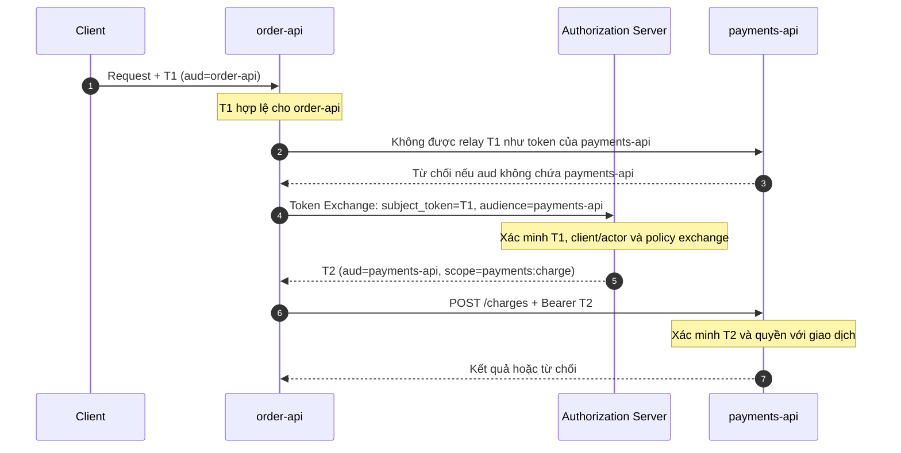
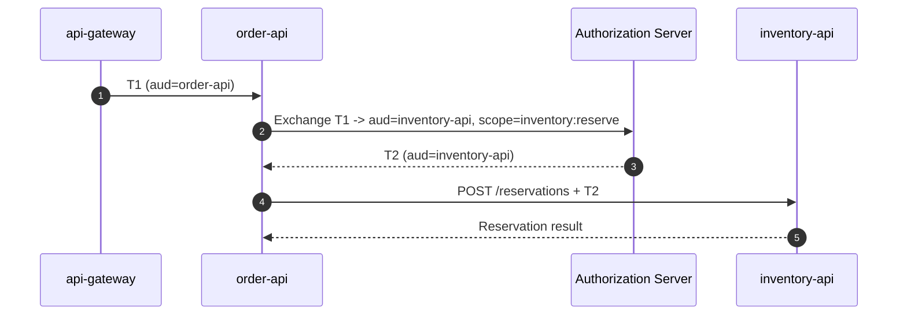

# Đổi token cho audience khác

Trong kiến trúc nhiều service, một client có thể nhận access token để gọi `order-api` nhưng sau đó cần gọi `payments-api` hoặc `inventory-api`. Chuyển nguyên token ban đầu sang API khác có thể vi phạm audience: token được phát hành cho một resource server không tự động hợp lệ ở resource server khác. **Token exchange** giải quyết tình huống này bằng cách yêu cầu Authorization Server (AS) xác minh token/ngữ cảnh đầu vào và phát hành một token mới dành cho đích sử dụng được cho phép.

Bài **Đổi token cho audience khác** thuộc chương **Token exchange** của mô-đun **SECURITY_TOKEN_SECURITY_FUNDAMENTALS**. Nội dung gắn với mô hình tin cậy và vòng đời token: phân biệt JWT, opaque token, access token, refresh token; hiểu claims, scope, audience; xác minh, lưu trữ, thu hồi và phòng chống token bị đánh cắp hoặc phát lại trong OAuth 2.0/OIDC.

Sau bài này, bạn có thể:

- Giải thích vì sao token dành cho API A không thể tự động dùng gọi API B.
- Mô tả grant Token Exchange trong **RFC 8693**, bao gồm `subject_token`, `actor_token`, `audience`, `resource` và `scope`.
- Phân biệt **impersonation** và **delegation**, nhận diện chủ thể và tác nhân trong chuỗi gọi service.
- Thiết kế chính sách cấp token mới theo audience và quyền tối thiểu.
- Xác minh token đích, xử lý token hết hạn/bị thu hồi và kiểm soát việc exchange nhiều hop.
- Tránh các lỗi như tin audience do client tự chọn, tự sửa JWT, đổi token thành quyền rộng hơn hoặc dùng ID/refresh token sai mục đích.

## 1. Vì sao phải đổi token khi audience khác?

Giả sử người dùng đăng nhập và nhận access token `T1` để gọi `order-api`:

```json
{
  "iss": "https://id.example.com",
  "sub": "user-42",
  "aud": ["order-api"],
  "scope": "orders:read orders:create",
  "exp": 1795509000
}
```

Sau khi xử lý đơn hàng, `order-api` cần yêu cầu `payments-api` tạo giao dịch. Dù chữ ký `T1` hợp lệ, `payments-api` phải kiểm tra audience của chính nó. Vì `aud` chỉ chứa `order-api`, token không được chấp nhận để gọi `payments-api`.



**Token exchange không phải thao tác sửa claim `aud` trong JWT.** AS xác minh token đầu vào, kiểm tra client được phép đổi token cho resource đích hay không, rồi phát hành một token mới theo policy. Token mới có thể có audience, scope, lifetime, định dạng và thông tin actor/subject phù hợp với downstream.

Nếu `order-api` tự giải mã JWT, thay `aud` từ `order-api` thành `payments-api` rồi ký bằng một khóa bất kỳ, `payments-api` phải từ chối vì chữ ký không thuộc issuer tin cậy. Ngay cả khi service có khóa ký riêng, việc tự phát hành token không được AS ủy quyền vẫn không tạo thành OAuth Token Exchange.

## 2. Audience, resource và scope là ba yếu tố khác nhau

| Thành phần | Ý nghĩa | Ví dụ |
|---|---|---|
| **Audience (`aud`)** | Resource server được phép nhận token | `payments-api` |
| **Resource (`resource`)** | Định danh URI của tài nguyên đích trong yêu cầu OAuth | `https://api.example.com/payments` |
| **Scope (`scope`)** | Hành động/phạm vi quyền token mới được cấp | `payments:charge` |

Audience trả lời **token dành cho ai**; scope trả lời **token được cấp quyền gì**. Một token có `aud=payments-api` nhưng chỉ `payments:read` vẫn không được dùng để tạo charge. Một token có `payments:charge` nhưng audience chỉ là `order-api` cũng không được `payments-api` chấp nhận.

`aud` trong access token là claim được resource server kiểm tra. Tham số `audience` trong Token Exchange là yêu cầu về bên nhận token mới; AS phải đối chiếu yêu cầu đó với chính sách. `resource` theo RFC 8707 có thể xác định URI của resource server. Không phải AS nào cũng hỗ trợ cùng một tập tham số; phải theo tài liệu và cấu hình của AS.

Ví dụ ma trận quyền:

| Token | Audience | Scope | API được nhận |
|---|---|---|---|
| `T1` | `order-api` | `orders:read` | `order-api` |
| `T2` | `payments-api` | `payments:charge` | `payments-api` |
| `T3` | `inventory-api` | `inventory:reserve` | `inventory-api` |

Token có nhiều audience có thể được phát hành nếu AS cho phép, nhưng làm rộng phạm vi sử dụng khi token bị lộ. Khi các API có ranh giới tin cậy và quyền khác nhau, token riêng theo audience thường dễ giới hạn rủi ro hơn.

## 3. OAuth 2.0 Token Exchange theo RFC 8693

**OAuth 2.0 Token Exchange** được định nghĩa trong RFC 8693. Nó cho phép một client trình token đầu vào và yêu cầu AS phát hành token mới với ngữ cảnh sử dụng khác theo policy. Grant type có giá trị:

```text
urn:ietf:params:oauth:grant-type:token-exchange
```

Các tham số chính:

| Tham số | Ý nghĩa |
|---|---|
| `grant_type` | Chỉ định Token Exchange grant |
| `subject_token` | Token đại diện cho chủ thể mà quyền truy cập gắn với |
| `subject_token_type` | Kiểu token của `subject_token` |
| `actor_token` | Token đại diện cho tác nhân đang hành động thay mặt subject, nếu luồng dùng actor token |
| `actor_token_type` | Kiểu token của `actor_token` |
| `requested_token_type` | Kiểu token client mong AS phát hành, ví dụ access token |
| `audience` | Một hoặc nhiều định danh audience đích được yêu cầu |
| `resource` | URI của resource đích được yêu cầu |
| `scope` | Scope mong muốn của token mới |

Các token type phổ biến được định danh bằng URN, ví dụ:

```text
urn:ietf:params:oauth:token-type:access_token
urn:ietf:params:oauth:token-type:refresh_token
urn:ietf:params:oauth:token-type:id_token
urn:ietf:params:oauth:token-type:jwt
```

Không phải mọi AS hỗ trợ mọi token type hoặc mọi loại subject/actor token. Trong API resource server thông thường, client thường yêu cầu **access token**; không mặc định yêu cầu refresh token hay ID token.

### 3.1. Subject token và actor token

Hai tham số có vai trò khác nhau:

- **Subject token** đại diện cho chủ thể mà quyền truy cập liên quan tới, ví dụ người dùng `user-42`.
- **Actor token** đại diện cho ứng dụng/service đang thực hiện hành động thay mặt subject, ví dụ `order-api`.

Ví dụ người dùng yêu cầu tạo đơn. `order-api` xử lý và gọi `payments-api` theo quyền được ủy quyền. Token mới có thể mang ngữ cảnh subject là người dùng và actor là service, nếu AS và token profile hỗ trợ mô hình đó:

```text
subject = user-42
actor   = order-api
target  = payments-api
action  = payments:charge
```

Actor token là tham số tùy chọn trong RFC 8693. Việc có cần gửi hay không phụ thuộc policy của AS và mô hình delegation. Client gọi token endpoint vẫn phải **xác thực chính mình**; AS cần phân biệt client đang xin đổi token với subject và actor được mô tả trong request.

### 3.2. Impersonation và delegation

| Mô hình | Chủ thể hành động | Ý nghĩa |
|---|---|---|
| **Impersonation** | Service được phép hành động như subject | Downstream có thể nhìn thấy subject mà không giữ đầy đủ thông tin actor, tùy token profile |
| **Delegation** | Service hành động thay mặt subject, actor vẫn được biểu diễn | Downstream có thể phân biệt ai là chủ thể và service nào thực hiện |

Trong thực tế, cách thể hiện cụ thể phụ thuộc AS và token profile. JWT có thể dùng claim `act` để biểu diễn actor theo profile tương ứng; không tự suy luận rằng claim này luôn có trong mọi access token. Nếu cần audit, chính sách nên giữ được cả subject, actor, client và ngữ cảnh ủy quyền có thể xác minh.

**Không tự thêm `sub=user-42` vào token client credentials** rồi coi đó là delegation. Việc đại diện người dùng phải được AS chấp thuận từ subject token/authorization context hợp lệ và policy tương ứng.

## 4. Gửi yêu cầu Token Exchange

Giả sử `order-api` đã xác thực với AS và được phép exchange subject token `T1` thành access token dành cho `payments-api`. Ví dụ request dạng form:

```http
POST /oauth2/token HTTP/1.1
Host: id.example.com
Content-Type: application/x-www-form-urlencoded
Authorization: Basic <client-authentication>

grant_type=urn%3Aietf%3Aparams%3Aoauth%3Agrant-type%3Atoken-exchange&subject_token=<T1>&subject_token_type=urn%3Aietf%3Aparams%3Aoauth%3Atoken-type%3Aaccess_token&requested_token_type=urn%3Aietf%3Aparams%3Aoauth%3Atoken-type%3Aaccess_token&audience=payments-api&scope=payments%3Acharge
```

Đây là ví dụ minh họa; client authentication có thể dùng `private_key_jwt`, mTLS hoặc cơ chế khác theo đăng ký tại AS. Không đưa token thật vào shell history, tài liệu, log hay ví dụ chia sẻ. Một số AS dùng `resource` URI theo RFC 8707 thay hoặc bổ sung `audience`; chỉ gửi các tham số được AS hỗ trợ.

AS cần xác minh ít nhất:

1. Client đã xác thực và được phép sử dụng grant Token Exchange.
2. `subject_token` có nguồn tin cậy, đúng loại, còn hiệu lực và được phép dùng trong exchange.
3. Nếu có `actor_token`, token actor hợp lệ và quan hệ actor-subject được policy chấp nhận.
4. Client/actor có quyền yêu cầu audience/resource đích hay không.
5. Scope yêu cầu có nằm trong tập quyền có thể cấp cho subject/actor/client và resource đích không.
6. Token mới có lifetime, loại token và ràng buộc bảo mật phù hợp.

### 4.1. Phản hồi từ AS

Ví dụ phản hồi thành công:

```json
{
  "access_token": "<T2>",
  "issued_token_type": "urn:ietf:params:oauth:token-type:access_token",
  "token_type": "Bearer",
  "expires_in": 300,
  "scope": "payments:charge"
}
```

Các trường cho biết AS đã phát hành token mới, kiểu token, token type và thời hạn còn lại tính bằng giây. Response thực tế có thể có thêm trường theo AS; client phải đọc kết quả theo hợp đồng, không giả định scope trả về luôn giống scope yêu cầu. Nếu scope thực cấp hẹp hơn, client phải sử dụng đúng scope đã cấp hoặc từ chối luồng nếu nghiệp vụ đòi quyền rộng hơn.

Ví dụ claims của `T2` nếu AS phát hành JWT:

```json
{
  "iss": "https://id.example.com",
  "sub": "user-42",
  "aud": ["payments-api"],
  "scope": "payments:charge",
  "act": {
    "sub": "order-api"
  },
  "iat": 1795507200,
  "exp": 1795507500,
  "jti": "exchanged-token-91"
}
```

Đây là payload minh họa cho một profile có biểu diễn actor. Cấu trúc claim actor cụ thể phải tuân theo AS/token profile; không được tự thêm claim `act` vào token hoặc xem payload chưa xác minh là sự thật. Nếu AS phát hành opaque token, resource server cần introspection hoặc cơ chế xác minh được AS hỗ trợ thay vì tự giải mã.

### 4.2. Dùng token mới gọi API đích

Sau khi nhận `T2`, `order-api` gọi:

```http
POST /charges HTTP/1.1
Host: payments.internal
Authorization: Bearer <T2>
Content-Type: application/json

{"orderId":"ord-123","amount":250000,"currency":"VND"}
```

`payments-api` vẫn phải xác minh issuer, audience `payments-api`, thời hạn, loại access token, scope `payments:charge` và các ràng buộc actor/subject cần thiết. Sau đó backend kiểm tra đơn hàng, merchant, tenant, số tiền, trạng thái và idempotency. Việc AS đã exchange thành công không thay thế authorization tại resource server.

## 5. Scope và quyền trong token mới

Token exchange không phải cơ chế tăng quyền mặc định. AS có thể cấp token mới với scope hẹp hơn hoặc khác theo policy, nhưng client không thể yêu cầu tùy ý để nhận mọi quyền.

Ví dụ:

| Subject token | Yêu cầu exchange | Kết quả hợp lệ theo policy |
|---|---|---|
| `T1` có `orders:read`, `aud=order-api` | `aud=payments-api`, `scope=payments:charge` | Có thể bị từ chối nếu subject không có quyền thanh toán |
| `T1` đại diện user đã được cấp quyền thanh toán | `aud=payments-api`, `scope=payments:charge` | AS có thể cấp scope tương ứng nếu client/actor được phép |
| `T1` có quyền đọc profile | `aud=payments-api`, `scope=payments:refund` | Từ chối vì không có cơ sở ủy quyền refund |
| `T1` đã hết hạn hoặc thu hồi | Bất kỳ audience/scope nào | Từ chối exchange |

Một chính sách bảo thủ có thể yêu cầu:

- Scope của token đích nằm trong **giao của quyền subject, quyền actor/client, quyền resource và policy AS**.
- Quyền nhạy cảm như `payments:refund` cần phê duyệt hoặc workflow riêng, không được suy ra từ `payments:charge`.
- Token mới không có scope rộng hơn chỉ vì client yêu cầu `scope=admin`.
- Audience chỉ được chọn trong allowlist hoặc tập resource được policy cho phép; không chấp nhận host/resource tùy ý.
- Thời hạn token mới không vượt các giới hạn về subject/session/ủy quyền và policy AS.

Không phải hệ thống nào cũng định nghĩa scope theo tập con toán học đơn giản; một số quyền phụ thuộc role, tenant, amount hoặc resource. Khi đó AS cần policy engine phù hợp, và backend vẫn kiểm tra thuộc tính nghiệp vụ cụ thể.

## 6. Token exchange trong chuỗi service-to-service

### 6.1. Đổi token khi một service gọi API khác

Luồng cơ bản:



Ở đây `order-api` có thể đang hành động theo user hoặc theo service identity. AS phải biết mô hình nào đang dùng:

- Nếu là **user delegation**, subject token phải đại diện cho user và actor/client được xác minh.
- Nếu là **machine-to-machine**, client có thể exchange token service theo quyền được cấp hoặc lấy token bằng Client Credentials cho resource đích. Không cần giả tạo user subject.
- Nếu downstream chỉ cần xác thực `order-api` mà không cần token gốc, có thể cân nhắc service credential riêng hoặc trusted identity context; không bắt buộc exchange cho mọi hop.

### 6.2. Exchange nhiều hop và chuỗi actor

Ví dụ `order-api` đổi token cho `inventory-api`; sau đó `inventory-api` cần gọi `warehouse-api`. Có thể xuất hiện chuỗi:

```text
user-42
  -> order-api
      -> inventory-api
          -> warehouse-api
```

Mỗi lần đổi token cần xác định subject, actor hiện tại, resource đích, scope và policy cho phép. Không mặc định token T2 có thể đổi tiếp thành T3 chỉ vì T2 hợp lệ. AS cần quyết định delegation có được tiếp tục, actor nào được thêm, chuỗi actor được giữ ra sao và giới hạn số hop nếu cần.

Giữ actor context giúp audit thấy service nào thực hiện hành động thay mặt subject. Nếu một token exchange bỏ mất actor chain, downstream có thể chỉ thấy subject và khó truy nguyên. Nếu lưu quá nhiều thông tin actor hoặc claims không cần thiết, token lại tăng dữ liệu và rủi ro riêng tư; chỉ giữ ngữ cảnh cần thiết theo policy.

### 6.3. Impersonation và delegation trong thực tế

**Impersonation** thường khiến downstream xử lý request như subject đang trực tiếp gọi. Nó phù hợp một số kiến trúc nhưng giảm khả năng phân biệt actor nếu không có ngữ cảnh bổ sung.

**Delegation** giữ thông tin service hành động thay mặt subject. Downstream có thể áp dụng policy như “user được thanh toán, nhưng chỉ order-api được phép khởi tạo thao tác trong workflow này”. Đây thường là lựa chọn rõ ràng hơn cho audit và kiểm soát nhiều service, nếu AS và resource server hỗ trợ.

Không dùng delegation để bỏ qua sự chấp thuận cần thiết của người dùng. AS phải xác định client/actor có quyền thực hiện hành động thay mặt subject hay không và scope nào được phép.

## 7. JWT, opaque token và token type khi exchange

Token đầu vào và token đầu ra không bắt buộc có cùng định dạng:

| Đầu vào | Đầu ra | Cách xử lý |
|---|---|---|
| JWT access token | JWT access token | AS xác minh JWT đầu vào và ký token đích; resource server đích xác minh JWT mới |
| JWT access token | Opaque access token | AS tạo reference token; resource server introspect |
| Opaque access token | JWT access token | AS introspect/tra cứu trạng thái đầu vào, sau đó phát JWT đích |
| Opaque access token | Opaque access token | AS xác minh token đầu vào và phát reference token mới |

**JWT** thường cho phép resource server xác minh chữ ký và claims offline bằng JWKS; cần kiểm tra issuer, audience, expiry, thuật toán, loại token và scope. **Opaque token** không có claims có thể tự tin cậy bằng giải mã; resource server thường dùng introspection hoặc cơ chế AS cung cấp.

Token exchange phải phân biệt **token type** đầu vào với mục đích token:

- **Access token** là chứng cứ gọi resource server.
- **Refresh token** dùng với AS để lấy access token mới, không được relay tới API nghiệp vụ. Nếu AS cho phép dùng một loại token cụ thể làm subject token trong exchange, phải tuân theo policy và đặc tả; không coi refresh token là access token.
- **ID token** xác nhận sự kiện đăng nhập cho client OIDC; không dùng thay access token để gọi API. AS chỉ chấp nhận ID token làm input nếu profile/chính sách exchange cho phép rõ ràng.

Không chỉ dựa vào định dạng JWT để nhận diện access token: ID token cũng thường là JWT nhưng audience và mục đích khác. Hãy xác minh đúng token profile và loại token.

## 8. Lifetime, cache và thu hồi của token đã exchange

Token đích `T2` có lifetime riêng. Một số AS phát hành T2 ngắn hơn subject token; có AS áp dụng giới hạn theo phiên/ủy quyền nguồn. Client phải dùng `expires_in`/`exp` của token mới và policy AS, không copy `exp` từ T1.

Ví dụ:

| Token | Audience | Thời hạn minh họa | Ý nghĩa |
|---|---|---:|---|
| `T1` | `order-api` | 15 phút | Token đầu vào |
| `T2` | `payments-api` | 5 phút | Token dành cho downstream |

Việc T2 ngắn hơn T1 giảm cửa sổ lạm dụng nếu T2 bị lộ, nhưng không bảo đảm T2 tự mất hiệu lực ngay khi T1 bị thu hồi. Tác động thu hồi phụ thuộc AS, token format và cơ chế resource server kiểm tra.

### Cache token exchange

Có thể cache token mới để giảm tải AS, nhưng cache key phải gắn với ngữ cảnh quyền:

```text
exchange_cache_key =
    trusted_issuer
    + subject_token_fingerprint
    + actor/client_identity
    + audience_or_resource
    + requested_scope
    + requested_token_type
    + authorization_context_version
```

Token cache không được chia sẻ giữa user, actor, tenant, audience hoặc scope khác nhau. TTL phải kết thúc trước `exp` của T2 và không vượt chính sách cache/thu hồi. Không gia hạn sliding TTL chỉ vì cache hit. Với token có sender constraint, cache phải gắn đúng key/certificate của workload và proof phải được tạo/xác minh theo request.

### Thu hồi và token nguồn

Khi T1 bị thu hồi sau khi T2 đã được phát hành, không được mặc định T2 tự động bị thu hồi. Có thể cần:

- Access token T2 thời hạn ngắn.
- AS quản lý quan hệ token nguồn → token đổi và có thể thu hồi/đánh dấu trạng thái liên quan.
- Introspection hoặc denylist/check trạng thái cho API nhạy cảm.
- Sự kiện logout/disable user/client được truyền tới hệ thống quản lý session/token.
- Quy tắc không tiếp tục exchange từ subject/actor token đã hết hạn hoặc bị thu hồi.

JWT đã ký và được xác minh offline có thể còn được chấp nhận tới `exp` nếu resource server không kiểm tra trạng thái. Opaque T2 qua introspection có thể phản ánh thu hồi sớm hơn, nhưng cache `active=true` cũng tạo cửa sổ stale. Cần đặt mục tiêu **revocation latency** và đo thực tế.

## 9. Bảo vệ endpoint Token Exchange

Token endpoint là điểm nhạy cảm vì có khả năng phát hành chứng cứ truy cập mới. Cần kiểm soát:

1. **Client authentication:** chỉ client đã đăng ký mới gọi exchange; dùng phương thức mạnh và bảo vệ private key/secret.
2. **Subject token validation:** xác minh issuer, chữ ký hoặc introspection, expiry, token type, audience/authorization context và trạng thái thu hồi.
3. **Actor validation:** nếu có actor token, xác minh actor, client binding và quan hệ được phép với subject.
4. **Audience/resource allowlist:** chỉ cho đổi tới resource server được policy cho phép; không nhận URL đích tùy ý khiến AS trở thành token minting oracle.
5. **Scope restriction:** chỉ cấp scope AS cho phép dựa trên subject, actor, client và resource; không cấp quyền lớn hơn chỉ vì client yêu cầu.
6. **Lifetime:** giới hạn `exp`, thời gian session và thời hạn delegation; token mới không được sống vượt policy.
7. **Replay protection:** kiểm soát assertion/actor token nếu chúng có thể bị phát lại; dùng nonce/`jti`/thời hạn ngắn theo profile khi thích hợp.
8. **Transport and storage:** HTTPS, không ghi token vào log, bảo vệ token cache và secret store.
9. **Abuse controls:** rate limit, phát hiện exchange bất thường, giới hạn chuỗi delegation và theo dõi lượng token được phát.
10. **Audit:** ghi client/actor/subject (đã giảm dữ liệu), audience, scope được cấp, kết quả và correlation ID; không log token nguyên văn.

Không cho phép mọi service có quyền exchange mọi subject token. **Quyền gọi token endpoint** và **quyền exchange một subject sang resource cụ thể** là hai điều kiện cần kiểm soát.

## 10. Lỗi thường gặp và phản hồi phù hợp

| Tình huống | Nguy cơ | Xử lý |
|---|---|---|
| Relay T1 sang API có audience khác | Token dùng sai resource server | Từ chối; exchange hoặc lấy token đúng audience |
| Client tự chọn audience bất kỳ | AS cấp token như một token minting oracle | Allowlist/policy audience/resource theo client, subject và actor |
| Scope yêu cầu rộng hơn quyền subject | Nâng quyền khi exchange | AS chỉ cấp quyền policy cho phép; trả scope thực cấp |
| Không xác thực client gọi token endpoint | Bất kỳ bên nào cũng có thể thử đổi token | Bắt buộc client authentication và authorization |
| Không kiểm tra subject token expiry/revocation | Token cũ đổi ra token mới | AS xác minh token nguồn trước khi exchange |
| Tin actor token do caller tự khai | Giả mạo service hành động thay mặt user | Xác minh actor token và quan hệ actor-subject |
| Nhầm impersonation với delegation | Mất audit actor hoặc cấp quyền sai | Quy định rõ semantics và claims |
| Dùng ID token gọi API | Token sai mục đích/audience | Dùng access token đích |
| Dùng refresh token như Bearer token | Lộ credential làm mới | Refresh token chỉ với AS; tuân thủ policy exchange nếu dùng làm input |
| Tự sửa JWT `aud` rồi ký lại | Token không do AS phát hành | Dùng RFC 8693/flow được AS hỗ trợ |
| Cache T2 chỉ theo subject | Dùng token nhầm actor/scope/audience | Cache key gồm subject fingerprint, actor, client, resource và scope |
| T2 vẫn sống sau khi T1 bị thu hồi | Quyền tiếp tục tồn tại | TTL ngắn, revocation propagation hoặc introspection |
| Exchange nhiều hop không giới hạn | Delegation lan rộng, khó truy vết | Policy cho từng hop, giới hạn actor chain và scope |
| Ghi T1/T2 vào log hoặc trace | Token bị đánh cắp/replay | Redaction, fingerprint an toàn và audit metadata |
| Token DPoP/mTLS relay thiếu proof | Mất sender constraint | Kiểm tra proof đúng profile/hop hoặc exchange sang token phù hợp |

Lỗi token đầu vào không hợp lệ thường dẫn tới từ chối xác thực tại token endpoint; client không được thử đổi token bằng cách bỏ qua validation. Nếu client không được phép exchange cho audience/scope cụ thể, AS phải từ chối theo chính sách và không tiết lộ quá nhiều chi tiết nhạy cảm.

## 11. Ví dụ policy minh họa

Một AS có thể áp dụng policy khái niệm:

```yaml
tokenExchange:
  clients:
    order-api:
      allowedSubjectIssuers:
        - https://id.example.com
      allowedAudiences:
        - payments-api
        - inventory-api
      allowedScopes:
        payments-api: [payments:charge]
        inventory-api: [inventory:reserve, inventory:release]
      maxIssuedTokenLifetimeSeconds: 300
      allowActorToken: true

    reporting-worker:
      allowedSubjectIssuers:
        - https://id.example.com
      allowedAudiences:
        - reports-api
      allowedScopes:
        reports-api: [reports:read]
      maxIssuedTokenLifetimeSeconds: 180
      allowActorToken: false
```

Đây là cấu hình giả lập, không phải schema chuẩn RFC 8693. AS phải còn kiểm tra subject token, actor, tenant, grant và quyền của người dùng; allowlist trên không tự chứng minh mọi user đều được thanh toán. Token đích chỉ được cấp khi tất cả điều kiện liên quan cùng đạt.

## 12. Kịch bản kiểm thử

| Ca kiểm thử | Đầu vào | Kết quả mong đợi |
|---|---|---|
| Exchange đúng | T1 hợp lệ, client được phép, audience payments-api, scope payments:charge | AS cấp T2 đúng audience/scope |
| Subject token hết hạn | T1 quá `exp` | AS từ chối |
| Subject token sai issuer | Token từ AS không tin cậy | AS từ chối |
| Subject token sai loại | Gửi ID token trong khi policy chỉ nhận access token | AS từ chối |
| Client không được exchange | Client chưa được cấp quyền grant | AS từ chối |
| Audience ngoài allowlist | Yêu cầu `admin-api` | AS từ chối |
| Scope vượt quyền | Subject chỉ có read nhưng yêu cầu refund | AS không cấp quyền refund |
| Actor token không hợp lệ | Actor sai issuer/hết hạn hoặc không liên hệ được subject | AS từ chối |
| Actor không được phép | order-api cố dùng actor identity của refund-worker | AS từ chối |
| API nhận T1 sai audience | `payments-api` nhận token chỉ dành cho `order-api` | Resource server từ chối |
| API nhận T2 hợp lệ | T2 đúng audience, scope, expiry | Qua xác thực; backend vẫn kiểm tra tài nguyên |
| T1 bị thu hồi sau exchange | T2 còn hạn | Hành vi theo revocation policy; không mặc định T2 tự mất hiệu lực |
| Token cache khác scope | T2 charge được cache rồi request refund | Không trả nhầm token; refund bị từ chối |
| Token exchange replay | Cùng assertion/actor token bị phát lại trái policy | Phát hiện/từ chối theo cơ chế bảo vệ |
| AS outage | Không thể xác minh T1 hoặc cấp T2 | Không tự phát token; fail closed |
| DPoP/mTLS proof sai | Token đích bị gửi thiếu proof hoặc proof khác key | Resource server từ chối |
| Exchange nhiều hop | T2 tiếp tục đổi sang API thứ ba | Chỉ thành công nếu AS policy cho phép actor chain và scope |

### Bài tập suy luận

`order-api` nhận T1 từ client:

```json
{
  "iss": "https://id.example.com",
  "sub": "user-42",
  "aud": ["order-api"],
  "scope": "orders:create",
  "exp": 1795509000
}
```

`order-api` cần gọi `payments-api` để thu tiền. AS chỉ cho phép `order-api` exchange token khi subject được cấp quyền thanh toán và actor `order-api` được ủy quyền. Token mới được yêu cầu với `audience=payments-api` và `scope=payments:charge`.

**Câu hỏi 1:** Có thể relay T1 sang `payments-api` không?

**Đáp:** Không. `aud` của T1 chỉ có `order-api`; `payments-api` phải từ chối.

**Câu hỏi 2:** Chỉ cần thêm `payments:charge` vào tham số `scope` là AS phải cấp T2?

**Đáp:** Không. Scope yêu cầu chỉ là yêu cầu; AS xác minh subject, actor, client, resource và policy. Nếu user không được phép thanh toán hoặc actor không được delegation, AS phải từ chối.

**Câu hỏi 3:** T2 đã cấp rồi, T1 bị thu hồi thì T2 có tự hết hiệu lực?

**Đáp:** Không thể mặc định. Tác động phụ thuộc AS có liên kết token nguồn và token đổi để thu hồi, T2 là JWT hay opaque, và resource server có kiểm tra trạng thái thu hồi không. Phải có lifetime/revocation strategy được xác định.

**Câu hỏi 4:** `payments-api` nhận T2 có scope đúng thì có thể thu tiền bất kỳ đơn nào?

**Đáp:** Không. Backend vẫn kiểm tra tenant, order, merchant, amount, trạng thái giao dịch và idempotency.

## 13. Checklist thiết kế và vận hành

- **Xác định lý do exchange:** token đầu vào không dành cho downstream, cần audience khác hoặc cần giảm quyền cho một hop.
- **Xác định subject và actor:** ai là người/chủ thể được đại diện, service nào thực hiện hành động; phân biệt impersonation với delegation.
- **Xác thực client:** chỉ client đã đăng ký và được cấp quyền mới gọi Token Exchange grant.
- **Kiểm tra token nguồn:** issuer, loại token, chữ ký/introspection, audience hiện tại, expiry và trạng thái thu hồi.
- **Giới hạn resource/audience:** chỉ cho resource server nằm trong policy; không nhận URI tùy ý.
- **Thu hẹp scope:** scope token mới được AS cấp theo quyền subject + actor + client + resource, không theo yêu cầu đơn phương.
- **Giới hạn lifetime:** T2 có thời hạn rõ, phù hợp phiên/ủy quyền và chính sách; không copy expiry của T1 một cách mù quáng.
- **Giữ actor context:** khi cần audit/delegation, downstream có thể xác định service nào hành động thay mặt subject.
- **Xác minh token đích:** resource server kiểm tra issuer, audience, scope, expiry, type, sender constraint và quyền tài nguyên.
- **Quản lý cache/thu hồi:** cache key tách subject/actor/audience/scope; TTL trước expiry; có phương án khi T1 hoặc client bị thu hồi.
- **Bảo vệ bí mật:** HTTPS, client credential an toàn, không log token; rate limit token endpoint và phát hiện exchange bất thường.
- **Kiểm thử chuỗi nhiều hop:** sai audience, scope vượt quyền, actor giả mạo, replay, token hết hạn, AS outage và revocation.

**Nguyên tắc cốt lõi:** *Token Exchange chuyển một ngữ cảnh ủy quyền đã được xác minh thành token mới cho resource đích theo chính sách của AS.* Nó giúp tách audience và thu hẹp quyền qua nhiều service, nhưng chỉ an toàn khi subject, actor, client, audience, scope, lifetime và quyền trên tài nguyên đều được kiểm soát.

### Tiêu chuẩn tham khảo

- [RFC 6749 — The OAuth 2.0 Authorization Framework](https://www.rfc-editor.org/rfc/rfc6749)
- [RFC 6750 — OAuth 2.0 Bearer Token Usage](https://www.rfc-editor.org/rfc/rfc6750)
- [RFC 7662 — OAuth 2.0 Token Introspection](https://www.rfc-editor.org/rfc/rfc7662)
- [RFC 8693 — OAuth 2.0 Token Exchange](https://www.rfc-editor.org/rfc/rfc8693)
- [RFC 8705 — OAuth 2.0 Mutual-TLS Client Authentication and Certificate-Bound Access Tokens](https://www.rfc-editor.org/rfc/rfc8705)
- [RFC 8707 — Resource Indicators for OAuth 2.0](https://www.rfc-editor.org/rfc/rfc8707)
- [RFC 8725 — JSON Web Token Best Current Practices](https://www.rfc-editor.org/rfc/rfc8725)
- [RFC 9068 — JWT Profile for OAuth 2.0 Access Tokens](https://www.rfc-editor.org/rfc/rfc9068)
- [RFC 9449 — OAuth 2.0 Demonstrating Proof of Possession (DPoP)](https://www.rfc-editor.org/rfc/rfc9449)
