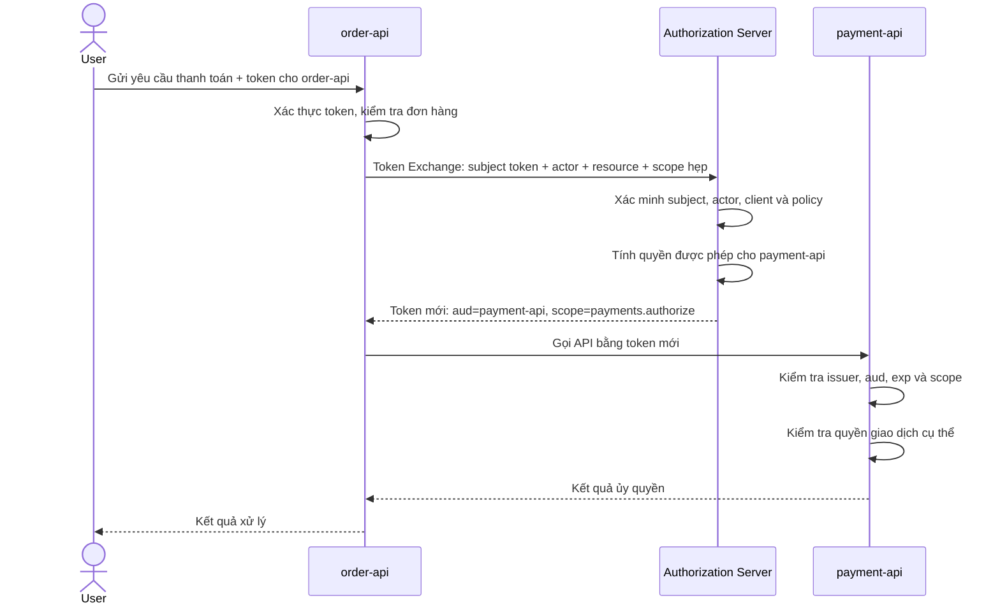

# Giảm scope khi exchange

## 1. Vì sao phải giảm scope khi đổi token?

Trong hệ thống nhiều dịch vụ, một service thường nhận access token ở một phạm vi rồi cần gọi một API downstream với quyền hẹp hơn. Ví dụ, `order-api` nhận yêu cầu tạo đơn từ một người dùng, sau đó gọi `payment-api` để yêu cầu thanh toán. Token đầu vào có thể chứa nhiều quyền phục vụ `order-api`; nếu chuyển nguyên token đó sang Payment API hoặc đổi token mà giữ toàn bộ quyền cũ, một sự cố ở service trung gian có thể làm lộ phạm vi quyền lớn hơn mức cần thiết.

**Giảm scope khi exchange (scope downscoping)** là việc Authorization Server (AS) phát hành token mới với tập quyền nhỏ hơn, phù hợp với hành động và tài nguyên đích. Token mới thường có:

- **Audience/resource** dành cho đúng API downstream.
- **Scope** chỉ bao gồm thao tác cần thiết cho lần gọi đó.
- **Thời hạn** phù hợp với mức độ nhạy cảm và vòng đời tác vụ.
- **Subject và actor** thể hiện đúng ngữ cảnh chủ thể và service đang thực hiện hành động, nếu mô hình token có sử dụng các thông tin này.

Ví dụ, token đầu vào cho phép đọc đơn hàng, xem hồ sơ và tạo thanh toán. Khi `order-api` chỉ cần xác nhận một khoản thanh toán, token exchange có thể tạo token chỉ có `payments.authorize` dành cho `payment-api`. Nếu token mới bị lộ, người cầm token không nên có thêm quyền đọc hồ sơ hoặc quản trị đơn hàng.

Giảm scope là một phần của nguyên tắc **least privilege** (quyền tối thiểu): mỗi thành phần chỉ nhận quyền cần cho nhiệm vụ hiện tại và trong khoảng thời gian cần thiết.

## 2. Phân biệt subject token, actor và token được phát hành

OAuth 2.0 Token Exchange được mô tả trong RFC 8693. Một yêu cầu exchange có thể mang các thông tin sau:

| Thành phần | Ý nghĩa | Ví dụ trong luồng đặt hàng |
|---|---|---|
| `subject_token` | Token đại diện cho chủ thể mà quyền đang được sử dụng hoặc chuyển đổi | Access token của người dùng đã đăng nhập |
| `subject_token_type` | Loại token của `subject_token` | OAuth access token |
| `actor_token` (tùy chọn) | Token đại diện cho actor đang thực hiện hành động thay mặt subject | Danh tính workload của `order-api` |
| `actor_token_type` (khi có actor token) | Loại của actor token | OAuth access token hoặc loại token được AS hỗ trợ |
| `resource` / `audience` | Tài nguyên hoặc audience đích của token mới | `urn:service:payment-api` |
| `scope` | Những quyền client yêu cầu trong token mới | `payments.authorize` |
| Access token được phát hành | Token mới theo chính sách của AS | Token ngắn hạn dành cho Payment API |

**Subject và actor không phải lúc nào cũng là cùng một danh tính.** Subject có thể là người dùng cuối; actor có thể là service đang gọi downstream thay mặt người dùng. Với hành động độc lập của service, subject có thể chính là workload/service account. Cách biểu diễn phụ thuộc grant và chính sách của AS.

RFC 8693 mô tả cơ chế chuyển đổi token; nó **không tự động đảm bảo token mới đã bị giảm quyền**. AS phải kiểm tra token đầu vào, client đang exchange, actor (nếu có), resource đích, scope được yêu cầu và chính sách cấp quyền trước khi phát token mới. Việc client gửi `scope=payments.authorize` chỉ thể hiện yêu cầu; nó không buộc AS phải cấp quyền đó.

### Scope, audience và danh tính trả lời các câu hỏi khác nhau

| Thuộc tính | Câu hỏi |
|---|---|
| Subject | Quyền đang được sử dụng cho chủ thể nào? |
| Actor/client | Thành phần nào đang thực hiện hoặc yêu cầu hành động? |
| Audience/resource | Token mới được phép trình cho API nào? |
| Scope | Token mới cho phép những nhóm thao tác nào tại API đó? |
| Thời hạn | Token có thể được sử dụng trong khoảng thời gian nào? |

Một token có scope hẹp nhưng audience sai vẫn phải bị từ chối. Một token có audience đúng nhưng scope quá rộng vẫn làm tăng tác động nếu bị lộ. Cần giới hạn đồng thời cả **nơi sử dụng** và **hành động được phép**.

## 3. Mô hình quyền: token mới không được vượt quyền được ủy quyền

Có thể mô hình hóa tập quyền của token mới như một tập con của các quyền AS xác định là hợp lệ cho giao dịch exchange:

```text
S_issued ⊆ S_effective(subject, actor, client, resource, policy)
```

Trong đó:

- `S_issued` là các scope thực tế được AS cấp trong token mới.
- `subject` là chủ thể được đại diện.
- `actor/client` là workload hoặc client thực hiện exchange.
- `resource` là API đích.
- `policy` là chính sách ủy quyền, consent, tenant, trạng thái tài khoản và các điều kiện nghiệp vụ liên quan.

Biểu thức trên là **mô hình tư duy**, không phải công thức chuẩn bắt buộc của RFC 8693. Scope ở hai API khác nhau có thể mang ý nghĩa khác nhau, vì vậy không phải lúc nào cũng có thể lấy giao hai chuỗi scope của token cũ và token mới. AS cần ánh xạ quyền theo tài nguyên và chính sách thực tế.

Ví dụ, token đầu vào có:

```json
{
  "sub": "user-204",
  "aud": "urn:service:order-api",
  "scope": "orders.read orders.update payments.create profiles.read",
  "exp": 1795400300
}
```

`order-api` cần yêu cầu Payment API thực hiện bước ủy quyền thanh toán cho đơn hàng. AS có thể phát hành token mới:

```json
{
  "iss": "https://auth.example.internal",
  "sub": "user-204",
  "aud": "urn:service:payment-api",
  "scope": "payments.authorize",
  "iat": 1795400100,
  "exp": 1795400220,
  "jti": "exchanged-token-91"
}
```

Đây là claims minh họa, không phải token thật. Token mới có audience Payment API và scope riêng cho thao tác ủy quyền. Nó không mang `orders.update` hoặc `profiles.read`.

AS chỉ nên phát token trên nếu chính sách xác nhận người dùng có quyền thực hiện giao dịch, `order-api` được phép đại diện người dùng ở luồng đó, và Payment API chấp nhận scope này. Không thể suy ra quyền thanh toán chỉ từ việc subject có token hợp lệ tại Order API.

### Một số quy tắc giảm quyền

1. **Không mở rộng quyền ngoài grant/policy:** exchange không phải cách nâng quyền hoặc bỏ qua consent.
2. **Giới hạn theo resource:** scope phải có ý nghĩa tại API đích và token phải có audience tương ứng.
3. **Giới hạn theo actor:** client/service chỉ được exchange khi có quyền đại diện subject cho mục đích đó.
4. **Chỉ cấp scope cần dùng:** không sao chép tất cả scope từ token đầu vào.
5. **Giới hạn theo ngữ cảnh:** có thể ràng buộc tenant, loại giao dịch, trạng thái đơn, hạn mức hoặc thuộc tính khác trong policy.
6. **Giới hạn thời gian:** token mới thường có TTL ngắn hơn hoặc bằng thời gian quyền được phép sử dụng; không để token exchange sống lâu hơn giới hạn mà policy yêu cầu.
7. **Không tin scope do caller tự khai:** AS phải quyết định scope được cấp và trả về phạm vi thực tế.

## 4. Luồng Token Exchange giảm scope

Giả sử người dùng `user-204` gọi Order API. Order API cần gọi Payment API để ủy quyền thanh toán một đơn hàng. AS hỗ trợ Token Exchange và chính sách cho phép `order-api` thực hiện delegation trong ngữ cảnh này.



Các bước cần được giữ rõ ràng:

- Order API xác thực token đầu vào và quyết định có cần gọi Payment API không.
- Order API xác thực chính nó với AS theo phương thức client authentication đã cấu hình.
- Order API gửi subject token và actor token nếu mô hình delegation yêu cầu.
- AS kiểm tra subject token, actor/client, resource đích và policy.
- AS phát token mới có scope tối thiểu và audience Payment API.
- Payment API tự xác thực token mới và thực thi quyền ở endpoint cũng như ở dữ liệu/giao dịch cụ thể.

**Không chuyển tiếp token đầu vào như token downstream.** Token gốc được gửi cho AS như một đầu vào exchange; token mới được gửi đến Payment API. Payment API không cần tin header tự khai về user hoặc quyền từ Order API.

## 5. Ví dụ request và response

Một request minh họa theo RFC 8693 có thể như sau:

```http
POST /oauth2/token HTTP/1.1
Host: auth.example.internal
Authorization: Basic <client-credentials-redacted>
Content-Type: application/x-www-form-urlencoded

grant_type=urn%3Aietf%3Aparams%3Aoauth%3Agrant-type%3Atoken-exchange&subject_token=%3Credacted-user-access-token%3E&subject_token_type=urn%3Aietf%3Aparams%3Aoauth%3Atoken-type%3Aaccess_token&actor_token=%3Credacted-order-api-token%3E&actor_token_type=urn%3Aietf%3Aparams%3Aoauth%3Atoken-type%3Aaccess_token&resource=urn%3Aservice%3Apayment-api&scope=payments.authorize
```

Các giá trị token đã được che. Request thực tế cần encode đúng form-urlencoded và theo đúng loại token AS chấp nhận. Ví dụ này dùng `resource` theo Resource Indicators (RFC 8707); một số AS dùng `audience` hoặc cấu hình resource riêng. Chỉ dùng tham số được AS hỗ trợ.

Response minh họa:

```json
{
  "access_token": "<redacted-exchanged-access-token>",
  "issued_token_type": "urn:ietf:params:oauth:token-type:access_token",
  "token_type": "Bearer",
  "expires_in": 120,
  "scope": "payments.authorize"
}
```

Trong response Token Exchange, `issued_token_type` cho biết loại token được phát hành. Trường `scope` biểu diễn scope thực tế nếu được trả về. Theo quy tắc OAuth, khi scope được cấp khác scope yêu cầu, response cần cho client biết scope đã cấp. Client không nên suy luận rằng AS luôn cấp đủ mọi scope đã yêu cầu.

Nếu AS từ chối một phần hoặc toàn bộ yêu cầu, client phải xử lý theo response thực tế. Không được tự gắn scope vào token, tự sửa claims hoặc tiếp tục gọi downstream bằng token cũ như thể exchange đã thành công.

### Kiểm tra scope thực tế sau exchange

Giả sử client yêu cầu:

```text
scope=payments.authorize payments.refund
```

AS chỉ cấp:

```text
scope=payments.authorize
```

Order API phải xem token mới chỉ có quyền `payments.authorize`. Nếu tác vụ cần refund, phải dừng hoặc đi qua luồng ủy quyền phù hợp. Không được giả định `payments.refund` vẫn tồn tại chỉ vì nó xuất hiện trong request.

## 6. Thiết kế scope theo hành động downstream

Scope nên thể hiện khả năng mà API có thể kiểm tra, với mức hạt phù hợp. Một số ví dụ:

| Scope | Ý nghĩa tại Payment API | Mức quyền |
|---|---|---|
| `payments.read-status` | Xem trạng thái thanh toán | Đọc |
| `payments.authorize` | Yêu cầu ủy quyền thanh toán | Ghi có giới hạn |
| `payments.capture` | Thu tiền từ khoản đã được ủy quyền | Ghi |
| `payments.refund` | Hoàn tiền theo chính sách | Nhạy cảm |
| `payments.admin` | Thao tác quản trị thanh toán | Rất rộng, cần hạn chế nghiêm ngặt |

Nếu một tác vụ chỉ cần xem trạng thái, không yêu cầu `payments.admin` hoặc `payments.refund`. Nếu tác vụ cần authorize, không cấp thêm capture/refund trừ khi quy trình thực sự yêu cầu và policy cho phép.

### Scope không thay thế quyền trên đối tượng

Scope thường mô tả nhóm thao tác ở cấp API. Nó không nhất thiết thể hiện đầy đủ quyền với một bản ghi hoặc giao dịch cụ thể. Ngay cả khi token có `payments.authorize`, Payment API vẫn phải kiểm tra:

- Đơn hàng thuộc tenant/người dùng phù hợp.
- Số tiền, loại tiền và trạng thái đơn hợp lệ.
- Giao dịch chưa bị xử lý trùng.
- Người dùng/subject có quyền với đơn hàng đó.
- Actor/service được phép thực hiện hành động trong ngữ cảnh hiện tại.
- Các hạn mức và quy tắc chống gian lận được đáp ứng.

Không đưa ID giao dịch hay mọi điều kiện nghiệp vụ vào scope nếu chúng cần được kiểm tra động tại API. Có thể dùng claim hoặc authorization context bổ sung, nhưng Resource Server vẫn phải xác thực nguồn và áp policy.

### Tránh scope quá rộng hoặc quá vụn

Scope kiểu `payments.full_access` làm giảm hiệu quả của downscoping. Ngược lại, tạo một scope riêng cho từng object có thể gây khó quản trị, khó cache và khó vận hành. Chọn ranh giới theo hành động bảo mật có ý nghĩa, ví dụ read, authorize, capture, refund; dùng policy/ABAC hoặc kiểm tra đối tượng cho các điều kiện chi tiết.

## 7. Giảm scope qua nhiều lần exchange

Trong hệ thống có nhiều hop, token có thể được đổi nhiều lần. Ví dụ:

1. Gateway nhận token của người dùng dành cho Order API.
2. Order API exchange token để gọi Payment API với `payments.authorize`.
3. Payment API gọi Fraud API để đánh giá rủi ro, chỉ cần `fraud.evaluate`.
4. Fraud API có thể gọi một dịch vụ dữ liệu khác với quyền đọc rất hẹp.

Mỗi lần exchange phải xét lại chủ thể, actor, resource đích và policy. Quyền của token ở hop sau phải được giới hạn cho nhiệm vụ tiếp theo. Không truyền scope của Payment API sang Fraud API nếu chúng không cùng ý nghĩa.

Có thể biểu diễn một chuỗi giảm quyền theo mục đích:

```text
User grant
  └─ Order API token: orders.read, orders.update
       └─ Payment API token: payments.authorize
            └─ Fraud API token: fraud.evaluate
                 └─ Risk data token: risk.read-summary
```

Sơ đồ này chỉ mô tả **quyền theo từng chặng**, không khẳng định các scope là tập con theo tên gọi hoặc chuỗi. AS phải xác định quan hệ ủy quyền giữa các resource. Không được tự động coi một scope ở API trước tương đương scope cùng tên ở API sau.

### Actor chain và dấu vết delegation

RFC 8693 mô tả cách biểu diễn actor trong token, thường thông qua claim `act` và cơ chế liên quan như `may_act`. Khi hệ thống dùng actor chain, Resource Server và hệ thống kiểm toán cần hiểu:

- Subject là ai hoặc quyền đang được đại diện cho ai.
- Actor hiện tại là service nào.
- Actor có được phép hành động thay mặt subject không.
- Token được phát hành cho resource nào.
- Quyền downstream được cấp trong phạm vi nào.

Không tự dựng claim `act` hoặc `may_act` ở client. Chỉ AS có thẩm quyền mới phát hành chúng theo chính sách. Không dùng một header `X-Actor` hoặc `X-User` chưa được xác thực làm căn cứ cấp quyền.

## 8. Kiểm tra token mới tại Resource Server

Payment API cần thực hiện đầy đủ các bước xác thực access token:

1. Xác minh issuer tin cậy và chữ ký JWT bằng khóa được cấu hình; hoặc introspection opaque token qua kênh đã xác thực.
2. Kiểm tra token đúng loại access token theo profile được chấp nhận.
3. Kiểm tra audience chứa đúng Payment API.
4. Kiểm tra thời hạn `exp`, `nbf` và các ràng buộc thời gian khác.
5. Kiểm tra scope được cấp, ví dụ `payments.authorize` cho endpoint authorize.
6. Nếu policy yêu cầu, kiểm tra subject, actor, client, tenant và quan hệ delegation.
7. Kiểm tra quyền với đối tượng/giao dịch cụ thể.
8. Nếu token sender-constrained, xác minh proof mTLS/DPoP tương ứng với request hiện tại.

Với JWT access token, chữ ký hợp lệ không tự chứng minh scope đúng cho endpoint. Với opaque token, `active=true` cũng chưa đủ nếu audience hoặc scope không phù hợp. Mỗi RS phải kiểm tra đúng tài nguyên của mình.

### Ví dụ Spring Security Resource Server

Một Payment API dùng Spring Security có thể bảo vệ endpoint theo scope:

```java
@Configuration
@EnableMethodSecurity
class PaymentApiSecurity {

    @Bean
    SecurityFilterChain filterChain(HttpSecurity http) throws Exception {
        return http
            .authorizeHttpRequests(auth -> auth
                .requestMatchers("/actuator/health").permitAll()
                .anyRequest().authenticated())
            .oauth2ResourceServer(oauth -> oauth.jwt(Customizer.withDefaults()))
            .build();
    }
}

@RestController
class PaymentController {

    @PreAuthorize("hasAuthority('SCOPE_payments.authorize')")
    @PostMapping("/payments/authorize")
    ResponseEntity<Void> authorize(@RequestBody PaymentRequest request) {
        // Tiếp tục kiểm tra subject, actor, đơn hàng, hạn mức
        // và idempotency theo chính sách nghiệp vụ.
        return ResponseEntity.accepted().build();
    }
}
```

Đây là ví dụ minh họa, lược bỏ import và cấu hình issuer/JWKS. Trong production cần thêm validator audience cho Payment API, kiểm tra token type theo profile và kiểm tra các claim delegation nếu policy yêu cầu. Spring Security thường ánh xạ claim `scope` thành authority có tiền tố `SCOPE_`; nếu AS dùng `scp` hoặc cấu trúc riêng, cần cấu hình converter tương ứng.

Cấu hình Resource Server chỉ kiểm tra token nhận ở Payment API. Việc **giảm scope khi exchange** phải được thực hiện tại AS hoặc dịch vụ cấp quyền có thẩm quyền; annotation `@PreAuthorize` không thể làm cho token đã cấp trở nên hẹp hơn.

## 9. Cache, TTL và thu hồi token exchange

Token được exchange nên được cache theo ngữ cảnh đầy đủ, không chỉ theo subject:

```text
(issuer, subject, actor/client, target_resource, granted_scopes,
 tenant, delegation_context, sender_key)
```

Nếu cùng một user nhưng khác actor, resource, tenant hoặc scope thì không được dùng chung cache entry một cách tùy tiện. Không trả token có scope rộng cho một tác vụ chỉ yêu cầu scope hẹp. Khi tái sử dụng token, client cần xác nhận token còn đủ thời gian hiệu lực cho tác vụ và vẫn phù hợp policy.

Một số nguyên tắc:

- TTL của token mới nên ngắn theo tác vụ và không vượt giới hạn mà AS/policy cho phép.
- Không tự tăng `exp` hoặc sửa claims để kéo dài token.
- Không lưu token trong log, URL, exception, trace hay message không được bảo vệ.
- Bảo vệ cache, giới hạn quyền đọc token và xóa entry khi ngữ cảnh/credential không còn hợp lệ.
- Khi subject, actor hoặc quyền bị thu hồi, xem xét introspection, denylist, revocation hoặc TTL tùy loại token và khả năng của AS/RS.
- Không giả định thu hồi token đầu vào tự động làm vô hiệu mọi token đã exchange. Cần cơ chế lan truyền trạng thái hoặc thời hạn đủ ngắn để giới hạn cửa sổ rủi ro.

Nếu token mới là JWT được Resource Server xác minh offline, token có thể tiếp tục được chấp nhận đến khi hết hạn nếu không có denylist hoặc cơ chế kiểm tra trạng thái bổ sung. Với opaque token, introspection có thể cung cấp trạng thái mới hơn nhưng cache introspection cũng tạo độ trễ thu hồi.

## 10. Lỗi thường gặp khi giảm scope

| Lỗi | Hệ quả | Cách xử lý |
|---|---|---|
| Sao chép toàn bộ scope đầu vào sang token mới | Token downstream giữ quyền không cần thiết | AS tính lại scope theo resource và tác vụ |
| Tin scope client yêu cầu | Client có thể tự yêu cầu quyền ngoài grant | AS kiểm tra policy, chỉ trả scope được cấp |
| Chỉ đổi audience nhưng giữ quyền quá rộng | Token đúng API nhưng vẫn có nhiều quyền hơn cần thiết | Downscope đồng thời với resource restriction |
| Chỉ giảm scope mà không đổi audience | Token có thể được dùng sai API | Cấp audience riêng cho downstream |
| Coi scope cùng tên ở hai API là cùng quyền | Sai ánh xạ quyền giữa resource | AS định nghĩa mapping theo resource |
| Không kiểm tra actor | Service trung gian có thể đại diện subject trái phép | Xác thực client/actor và policy delegation |
| Tin header user/role tự khai | Có thể giả mạo ngữ cảnh ủy quyền | Dùng token/assertion do issuer tin cậy phát hành |
| Cache theo user mà bỏ qua resource/scope | Trả nhầm token rộng cho tác vụ hẹp | Cache theo đầy đủ ngữ cảnh exchange |
| Cho rằng đổi client secret thu hồi token đã cấp | Token cũ có thể vẫn còn hiệu lực | Có cơ chế revocation/introspection hoặc TTL ngắn |
| Cho phép exchange lặp để tăng quyền | Privilege escalation qua chuỗi dịch vụ | AS kiểm tra quyền mỗi hop, không cho quyền mới vượt policy |

## 11. Ma trận kiểm thử

Giả sử Order API được phép exchange token của người dùng sang Payment API. Policy yêu cầu client `order-api` hợp lệ, subject được phép thanh toán, resource là `urn:service:payment-api` và scope tối đa `payments.authorize`.

| Trường hợp | Kết quả mong đợi | Lý do |
|---|---|---|
| Subject hợp lệ, actor hợp lệ, yêu cầu scope hẹp và resource đúng | Cấp token theo policy | Các điều kiện exchange thỏa mãn |
| Client yêu cầu thêm `payments.refund` ngoài policy | Từ chối hoặc chỉ cấp tập scope được policy cho phép, tùy hợp đồng AS | Không mở rộng quyền |
| Subject token hết hạn hoặc sai chữ ký | Từ chối exchange | Không có subject token hợp lệ |
| Actor/client không được phép exchange | Từ chối exchange | Không có quyền delegation |
| Resource không được phép | Từ chối exchange | Không được phát token cho target đó |
| Subject không có quyền thanh toán theo policy | Từ chối hoặc không cấp scope thanh toán | Client không thể tự nâng quyền subject |
| AS chỉ cấp `payments.authorize` dù client xin thêm scope | Client chỉ dùng quyền thực tế đã cấp | Không giả định scope yêu cầu đều được cấp |
| Token mới có audience sai | Payment API từ chối | Token không dành cho resource hiện tại |
| Token mới đúng audience nhưng thiếu scope endpoint | Payment API trả 403 | Đã xác thực nhưng không đủ quyền |
| Token mới đã bị thu hồi/hết hạn | Payment API từ chối theo cơ chế kiểm tra trạng thái | Không tiếp tục dùng quyền cũ |

Nên kiểm thử cả đường thành công và đường từ chối. Log phục vụ điều tra nên ghi mã client, subject identifier đã chuẩn hóa, resource, scope được cấp, kết quả policy và correlation ID; **không ghi raw token**.

## 12. Checklist thiết kế và vận hành

- AS xác thực subject token và client/actor trước khi exchange.
- Policy xác định resource đích và quyền delegation của client.
- Scope yêu cầu được kiểm tra; scope thực tế được cấp được thể hiện rõ cho client.
- Token mới có audience/resource đúng downstream và chỉ có scope cần cho tác vụ.
- Scope được ánh xạ theo ý nghĩa của từng API, không chỉ giao chuỗi tên scope.
- Không cho phép exchange làm tăng quyền ngoài grant, consent và policy.
- Nếu dùng actor chain, claim actor do AS phát hành và Resource Server hiểu đúng.
- Downstream kiểm tra issuer, chữ ký/introspection, audience, thời hạn, scope và quyền đối tượng.
- Cache phân biệt subject, actor, resource, scope, tenant và ràng buộc sender.
- Token có TTL phù hợp; có kế hoạch xử lý thu hồi token đã exchange.
- Token không xuất hiện trong log, URL, source code hoặc telemetry.
- Có kiểm thử privilege escalation, scope không hợp lệ, actor không được phép và token sai audience.

## Tài liệu chuẩn để tra cứu

- [RFC 8693 — OAuth 2.0 Token Exchange](https://www.rfc-editor.org/rfc/rfc8693): subject token, actor token, token được phát hành và các tham số exchange.
- [RFC 6749 — The OAuth 2.0 Authorization Framework](https://www.rfc-editor.org/rfc/rfc6749): scope, token endpoint, client authentication và lỗi OAuth.
- [RFC 8707 — Resource Indicators for OAuth 2.0](https://www.rfc-editor.org/rfc/rfc8707): xác định resource đích khi xin token.
- [RFC 9068 — JWT Profile for OAuth 2.0 Access Tokens](https://www.rfc-editor.org/rfc/rfc9068): profile JWT access token và yêu cầu xác minh.
- [RFC 7662 — OAuth 2.0 Token Introspection](https://www.rfc-editor.org/rfc/rfc7662): kiểm tra trạng thái và metadata của opaque token.
- [RFC 7009 — OAuth 2.0 Token Revocation](https://www.rfc-editor.org/rfc/rfc7009): thu hồi token.
- [RFC 8725 — JSON Web Token Best Current Practices](https://www.rfc-editor.org/rfc/rfc8725): kiểm tra JWT an toàn và ngăn token bị dùng sai mục đích.
- [Spring Security — OAuth 2.0 Resource Server JWT](https://docs.spring.io/spring-security/reference/servlet/oauth2/resource-server/jwt.html): xác minh JWT và cấu hình Resource Server.

**Ghi nhớ:** Token Exchange là cơ chế cấp token mới theo một ngữ cảnh khác. Để giảm scope an toàn, AS phải xác minh subject, actor/client, resource và policy rồi chỉ cấp những quyền downstream cần thiết. Resource Server vẫn phải xác minh audience, scope và quyền nghiệp vụ trên từng request.
