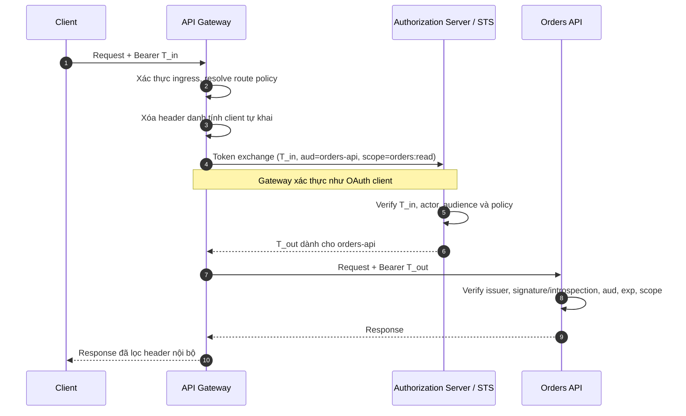

# Token exchange trong Gateway

## 1. Vì sao API Gateway cần token exchange?

Trong kiến trúc microservices, client thường gửi một access token đến **API Gateway**. Gateway xác thực request, chọn route rồi gọi service nội bộ. Nhưng access token đầu vào không nhất thiết phù hợp với service đích:

- Token có thể được cấp cho public API hoặc Gateway, với `aud` không chứa service nội bộ.
- Token có thể có scope rộng hơn nhu cầu của một route.
- Service đích cần biết request đang được thực hiện thay mặt người dùng nào và Gateway là actor nào.
- Tổ chức muốn mỗi resource server chỉ chấp nhận token dành riêng cho nó, thay vì tin một token được chuyển tiếp qua toàn hệ thống.

**Token exchange trong Gateway** là việc Gateway, với tư cách một OAuth client được cấp quyền, gửi token đầu vào tới Authorization Server hoặc Security Token Service (STS) để yêu cầu một token mới dành cho downstream service. Gateway chuyển token mới tới đúng service theo route policy.

Ví dụ: Alice gọi `GET /api/orders/42` bằng token `T_in`. Gateway xác định route tới `orders-api`, xin STS đổi `T_in` thành `T_orders` có `aud=orders-api` và `scope=orders:read`. Gateway gọi Orders Service bằng `T_orders`. Orders Service tiếp tục xác thực token và kiểm tra Alice có quyền xem đơn hàng 42 hay không.

Cơ chế chuẩn cho luồng này là **OAuth 2.0 Token Exchange — RFC 8693**. Token exchange không phải thao tác đổi chuỗi, decode JWT rồi sửa `aud`, cũng không phải chỉ bật một filter chuyển tiếp Authorization header.

## 2. Các vai trò trong luồng Gateway → STS → Service

| Thành phần | Vai trò |
|---|---|
| **Client** | Gửi access token đầu vào tới API công khai |
| **API Gateway** | Xác thực request, chọn route policy, xác thực với STS và yêu cầu token dành cho service đích |
| **Authorization Server / STS** | Xác thực OAuth client, kiểm tra subject token, actor và policy; quyết định cấp hay từ chối token |
| **Downstream Resource Server** | Xác minh token đầu ra và phân quyền endpoint/tài nguyên |
| **Policy configuration** | Ánh xạ route → audience/resource → scope tối đa và yêu cầu delegation |



Có hai quyết định bảo mật độc lập:

1. **Gateway có được phép xin token không?** STS xác thực Gateway và đánh giá Gateway có quyền trao đổi token cho chủ thể/đích đó không.
2. **Service có chấp nhận token không?** Resource Server tự xác minh token đầu ra và kiểm tra quyền của chủ thể trên tài nguyên.

Việc request đến từ Gateway hoặc mạng nội bộ không thay thế được hai bước này.

## 3. Phân biệt token relay, client credentials và token exchange

| Cơ chế | Gateway làm gì? | Token tới downstream |
|---|---|---|
| **Token relay** | Chuyển tiếp token đầu vào | Chính `T_in` |
| **Client credentials** | Gateway xin token dưới danh tính client của Gateway | Token đại diện cho Gateway/service client, không mặc định đại diện người dùng |
| **Token exchange** | Gateway gửi subject token (và có thể actor token) tới STS để xin token mới | `T_out` được cấp theo subject, actor, target và policy |
| **Introspection** | Gateway hỏi trạng thái/thuộc tính của token | Không tự cấp token mới |
| **Refresh token grant** | OAuth client dùng refresh token để lấy access token mới theo phiên/quyền | Access token mới của client; không đồng nghĩa token exchange |

Dùng **token relay** khi token đầu vào đã dành cho đúng downstream, có scope phù hợp và service tự xác minh token. Dùng **client credentials** khi service gọi thay mặt chính workload, không cần danh tính người dùng. Dùng **token exchange** khi cần chuyển token/ủy quyền sang resource hoặc trust boundary khác, giới hạn audience/scope hoặc thể hiện delegation.

Không dùng OIDC ID token làm access token của API. ID token chứng minh sự kiện xác thực cho OIDC client có audience tương ứng. Cũng không gửi refresh token tới downstream business API. STS phải công bố rõ loại subject token được chấp nhận.

## 4. Gateway cần xác thực những gì trước khi exchange?

Gateway là điểm nhận request từ client nên phải xác định request có được phép đi vào route đó không. Một pipeline thường gồm:

1. Nhận request qua TLS; kiểm soát proxy hop và host.
2. Xác thực access token đầu vào. Với JWT, kiểm tra chữ ký, thuật toán cho phép, `iss`, `aud`, `exp` và `nbf` khi có. Với opaque token, dùng introspection hoặc cơ chế đã cấu hình.
3. Kiểm tra token type và quyền cần thiết để gọi route.
4. Xác định subject, tenant, client và ngữ cảnh ủy quyền từ dữ liệu đã xác minh.
5. Resolve route tới policy đích được cấu hình tin cậy.
6. Xóa các header danh tính/role/tenant do client tự khai.
7. Gọi STS bằng thông tin xác thực của Gateway và subject token hợp lệ.

**Gateway validation không thay thế STS validation.** STS vẫn phải tự xác minh subject token, issuer, audience, trạng thái và quyền exchange. Client không được ép Gateway xin token cho audience bất kỳ bằng query parameter hoặc header như `X-Target-Audience`.

Gateway cũng không nên lấy `sub` từ JWT mới chỉ decode. Payload có thể đọc được mà không cần chữ ký hợp lệ; mọi thông tin dùng để quyết định quyền phải đến từ token đã được xác minh hoặc nguồn tin cậy.

## 5. Cấu hình route policy: target không do client tự chọn

Gateway cần một mapping tường minh giữa route và quyền downstream. Ví dụ logic:

```yaml
# Pseudoconfig minh họa, không phải schema mặc định
# của Spring Cloud Gateway.
tokenExchange:
  routes:
    orders-read:
      path: /api/orders/**
      methods: [GET]
      targetAudience: orders-api
      outboundScopes: [orders:read]
      inboundScopes: [orders:read]
      subjectTokenType: access_token
      enabled: true

    inventory-reserve:
      path: /api/inventory/reservations
      methods: [POST]
      targetAudience: inventory-api
      outboundScopes: [stock:reserve]
      inboundScopes: [orders:write]
      subjectTokenType: access_token
      enabled: true
```

Đây là cấu hình khái niệm để minh họa policy. Ứng dụng thực tế cần định nghĩa schema, validation lúc khởi động và cơ chế gắn policy vào route.

Các nguyên tắc:

- `targetAudience` được lấy từ cấu hình route đã được kiểm soát, không lấy trực tiếp từ request.
- Scope đầu ra là **tập quyền tối đa** được policy cho phép; không tự động copy mọi scope của token đầu vào.
- Phân biệt inbound scope và outbound scope. Client có quyền gọi public route chưa chắc đã có mọi quyền nội bộ.
- Nếu một route có nhiều downstream, xác định rõ token cho từng service và không phát một token đa audience chỉ để tiện.
- Policy cần hỗ trợ tenant và actor khi có delegation; không để namespace hoặc tenant do client tự khai quyết định quyền.
- Tắt exchange ở route không cần nó; token relay hoặc service identity có thể phù hợp hơn.

## 6. Gọi OAuth 2.0 Token Exchange theo RFC 8693

Gateway gửi HTTP POST tới token endpoint của STS với content type `application/x-www-form-urlencoded`. Grant type là:

```text
urn:ietf:params:oauth:grant-type:token-exchange
```

Các tham số chính:

| Tham số | Ý nghĩa |
|---|---|
| `grant_type` | Bắt buộc; định danh grant Token Exchange |
| `subject_token` | Token mô tả subject mà Gateway muốn hành động thay mặt |
| `subject_token_type` | Bắt buộc; loại token của `subject_token` |
| `requested_token_type` | Loại token đầu ra mong muốn; có thể được STS hỗ trợ hoặc giới hạn |
| `audience` | Audience logic của bên nhận token |
| `resource` | URI resource được yêu cầu, nếu STS hỗ trợ Resource Indicators |
| `scope` | Scope yêu cầu cho token đầu ra |
| `actor_token` | Token mô tả actor trong mô hình delegation, nếu cần |
| `actor_token_type` | Loại actor token; cần có khi gửi `actor_token` |

Ví dụ request minh họa:

```bash
curl --request POST "https://auth.example.com/oauth2/token" \
  --user "gateway-client:<client-secret>" \
  --header "Content-Type: application/x-www-form-urlencoded" \
  --data-urlencode "grant_type=urn:ietf:params:oauth:grant-type:token-exchange" \
  --data-urlencode "subject_token=<incoming-access-token>" \
  --data-urlencode "subject_token_type=urn:ietf:params:oauth:token-type:access_token" \
  --data-urlencode "requested_token_type=urn:ietf:params:oauth:token-type:access_token" \
  --data-urlencode "audience=orders-api" \
  --data-urlencode "scope=orders:read"
```

Các URL, client và token trên là ví dụ. Production nên dùng phương thức xác thực client được STS hỗ trợ như mTLS hoặc `private_key_jwt` khi phù hợp. Không ghi secret/token trong shell history, CI output, debug log hay source control. Gateway phải gọi endpoint cố định qua TLS, có egress allowlist và không lấy token endpoint từ dữ liệu client để tránh SSRF.

**Xác thực Gateway và actor token là hai việc khác nhau.** OAuth client authentication chứng minh Gateway đang gọi token endpoint bằng client credential. `actor_token` (nếu dùng) mang bằng chứng về actor trong ngữ nghĩa delegation. Một số STS có thể ánh xạ actor từ client identity theo policy; không mặc định mọi triển khai đều cần actor token.

### 6.1. Subject token type và requested token type

Nếu subject token là OAuth access token, `subject_token_type` thường dùng URN:

```text
urn:ietf:params:oauth:token-type:access_token
```

URN này mô tả loại token theo giao thức, không khẳng định access token là JWT. Token có thể là opaque. Nếu STS chấp nhận một JWT assertion theo profile khác, phải khai báo đúng loại theo hợp đồng STS; đừng suy luận token type chỉ vì chuỗi có ba phần phân cách dấu chấm.

### 6.2. Response từ STS

Một response thành công minh họa:

```json
{
  "access_token": "<token-for-orders-api>",
  "issued_token_type": "urn:ietf:params:oauth:token-type:access_token",
  "token_type": "Bearer",
  "expires_in": 300,
  "scope": "orders:read"
}
```

Gateway cần kiểm tra cấu trúc response, token type, thời hạn, scope được cấp và các ràng buộc theo hợp đồng. `scope` thực tế có thể bị STS thu hẹp so với yêu cầu. Không giả định STS đã cấp đúng mọi quyền chỉ vì HTTP status là 200.

RFC 8693 quy định response thành công có `access_token`, `issued_token_type` và `token_type`; `expires_in` và `scope` có thể xuất hiện theo điều kiện/hợp đồng. Gateway phải từ chối response thiếu dữ liệu bắt buộc hoặc token không phù hợp.

## 7. Delegation và impersonation trong Gateway

Gateway thường nhận request có người dùng cuối. Khi gọi service thay mặt người dùng, cần phân biệt:

- **Subject:** chủ thể mà token đại diện, ví dụ Alice.
- **Actor:** thành phần thực hiện hành động thay mặt subject, ví dụ Gateway hoặc một backend service.
- **OAuth client:** ứng dụng được đăng ký ở Authorization Server, ví dụ `gateway-client`. Client identity dùng để xác thực token endpoint; không nhất thiết đồng nghĩa với actor trong mọi mô hình.
- **Resource/audience:** API sẽ chấp nhận token, ví dụ `orders-api`.

**Impersonation** thường biểu diễn request downstream theo danh tính subject; **delegation** thể hiện actor đang hành động thay mặt subject. Trong JWT theo RFC 8693, claim `act` có thể biểu diễn actor khi STS phát hành token với ngữ nghĩa đó.

Ví dụ claim minh họa:

```json
{
  "iss": "https://auth.example.com/",
  "sub": "alice",
  "aud": "orders-api",
  "scope": "orders:read",
  "act": {
    "sub": "gateway-client"
  },
  "exp": 1730000300
}
```

Các claim trên chỉ minh họa, không phải token hợp lệ để sử dụng. Service phải hiểu contract của STS và kiểm tra token đầy đủ. Không được tự chèn `act` vào token nguồn hoặc tin `X-Actor` do client gửi.

Khi request tiếp tục từ Orders sang Payments, token có `aud=orders-api` không mặc nhiên dùng được ở `payments-api`. Orders phải dùng cơ chế được cho phép để xin token mới dành cho Payments, với subject/actor chain và scope phù hợp. Không biến Gateway thành **confused deputy** có thể đổi token của bất kỳ user nào sang mọi service.

## 8. Thay Authorization header đúng cách

Khi Gateway đã nhận `T_out`, request outbound phải dùng đúng token mới. Trình tự logic:

1. Giữ token đầu vào trong ngữ cảnh xác thực nội bộ đủ lâu để exchange.
2. Xóa header danh tính nội bộ do client tự gửi, ví dụ `X-Authenticated-User`, `X-User-Roles`, `X-Tenant-Id`.
3. Xóa hoặc thay thế `Authorization` trên request outbound theo mô hình route.
4. Gắn đúng một `Authorization: Bearer T_out` nếu downstream dùng Bearer token.
5. Không chuyển refresh token, ID token, actor assertion hoặc client secret tới business API.
6. Không lưu token trong query string, request body không cần thiết, retry queue hoặc trace attributes.

```http
GET /orders/42 HTTP/1.1
Host: orders.internal
Authorization: Bearer <T_out_for_orders_api>
```

Không gửi đồng thời hai Authorization headers hoặc giữ `T_in` trong một header phụ. Nếu upstream cần biết actor, dùng token claim đã được STS phát hành hoặc một assertion được bảo vệ theo hợp đồng; không tin header do client gửi.

### 8.1. Response cũng cần được lọc

Gateway nên loại bỏ header nội bộ hoặc debug từ response trước khi trả client, ví dụ `X-Internal-Debug`, `X-Backend-Token`. Giữ các header giao thức cần thiết như `WWW-Authenticate`, `Cache-Control` hoặc `Set-Cookie` theo contract của API. Không xóa hàng loạt response headers vì có thể phá authentication, cache hoặc bảo mật trình duyệt.

## 9. Mẫu tích hợp với Spring Cloud Gateway

Spring Cloud Gateway dựa trên WebFlux. Một triển khai token exchange cần một thành phần chuyên trách, ví dụ `TokenExchangeClient`, thực hiện HTTP call bất đồng bộ tới STS. Gateway filter chịu trách nhiệm lấy route policy, context đã xác thực, gọi exchange và thay Authorization trước khi routing.

Mã dưới đây là **pseudocode minh họa luồng**, không phải class hoàn chỉnh có thể copy chạy nguyên trạng:

```java
Mono<Void> filter(ServerWebExchange exchange,
                  GatewayFilterChain chain) {
    AuthenticatedPrincipal principal = requireAuthenticated(exchange);
    RoutePolicy policy = trustedPolicyFor(exchange);

    requireInboundPermission(principal, policy);
    stripUntrustedIdentityHeaders(exchange);

    return tokenExchangeClient.exchange(
            principal.subjectToken(),
            policy.targetAudience(),
            policy.outboundScopes(),
            gatewayClientAuthentication())
        .flatMap(token -> {
            requireAccessToken(token);
            requireExpectedAudienceContract(token, policy);
            requireAllowedScopes(token, policy);
            requireSufficientLifetime(token);

            ServerWebExchange outbound = exchange.mutate()
                .request(request -> request.headers(headers -> {
                    headers.remove("Authorization");
                    headers.setBearerAuth(token.accessToken());
                }))
                .build();

            return chain.filter(outbound);
        });
}
```

Trong code thật:

- `AuthenticatedPrincipal` phải chứa dữ liệu đã được xác minh; không lấy raw Bearer header rồi coi là principal.
- `trustedPolicyFor` chỉ tra policy cấu hình theo route đã resolve; không nhận target tùy ý từ client.
- `TokenExchangeClient` phải dùng TLS, client authentication và form encoding đúng; có timeout, connection pool và xử lý OAuth error.
- `requireExpectedAudienceContract` chỉ kiểm tra audience nếu Gateway có khả năng xác minh token/metadata theo contract. Với opaque token, cần metadata/introspection hoặc dựa vào bảo đảm STS đã xác thực; đừng decode chuỗi opaque.
- Header replacement phải xảy ra trước khi request được gửi upstream và không để filter khác gắn lại `T_in` sau đó.
- Không dùng blocking call như `.block()` trong reactive request path.

### 9.1. Không nhầm TokenRelay với RFC 8693

Spring Cloud Gateway có cơ chế **TokenRelay** để chuyển access token của authorized client tới downstream. TokenRelay không mặc định thực hiện OAuth Token Exchange. Nếu cần RFC 8693, cần một custom filter/client hoặc tích hợp hỗ trợ rõ ràng từ Authorization Server và framework.

### 9.2. Không coi YAML minh họa là cấu hình thực thi

Chỉ khai báo `targetAudience` trong route config không tự tạo token mới. Cần filter có logic gọi STS, xử lý response, thay token và có test tích hợp chứng minh upstream thực sự nhận `T_out`. Cần xác định thứ tự giữa Spring Security authentication, global filters, route filters và routing filter trên đúng phiên bản đang triển khai.

## 10. Cache token đầu ra an toàn

Token exchange mỗi request có thể làm tăng latency và tải STS. Gateway có thể cache `T_out` nhưng phải phân biệt đúng **chủ thể, actor, tenant, đích và quyền**.

Một cache key có thể dựa trên fingerprint có khóa của subject token cùng các trường policy:

```text
cacheKey = HMAC(serverKey,
    issuer
  + subjectTokenFingerprint
  + actorClientId / actorIdentity
  + tenant
  + targetAudience
  + resource
  + normalizedScope
  + policyVersion
  + senderBinding
)
```

Đây là hướng thiết kế, không phải thuật toán cache hoàn chỉnh. Không dùng raw token làm key xuất hiện trong log/metrics; fingerprint nên dùng HMAC với khóa server-side để giảm khả năng dò ngược.

Các điều kiện bắt buộc:

- Không dùng token của Alice cho Bob chỉ vì cùng audience và scope.
- Không dùng token của tenant A cho tenant B.
- Nếu token ràng buộc mTLS/DPoP, cache phải phân biệt đúng certificate/key binding; không đưa token bound-to-key sang một sender khác.
- TTL cache không vượt thời hạn token đầu ra và nên có khoảng dự phòng cho clock skew/độ trễ.
- Nếu subject token bị revoke hoặc policy thay đổi, cần chiến lược invalidate hoặc giới hạn TTL theo yêu cầu thu hồi.
- Có single-flight để các request cùng context không đồng loạt gọi STS.
- Không cache lỗi xác thực/quyền như thể đó là token hợp lệ.

**Không cache DPoP proof.** Proof gắn với từng request và cần tạo mới theo method/URI, thời điểm, `jti` và nonce nếu có. Access token có thể được cache theo contract, còn proof phải được tạo cho lần gọi cụ thể.

## 11. Token lifecycle và lỗi STS

Gateway phải theo dõi lifetime của `T_out`. Token có thể hết hạn trong khi chờ xử lý hoặc khi service downstream xử lý chậm. Với JWT, service kiểm tra `exp`; với opaque token, service dùng introspection hoặc cơ chế đã thỏa thuận.

| Tình huống | Hành vi Gateway |
|---|---|
| Subject token không hợp lệ/hết hạn | Từ chối; không exchange bằng token khác không liên quan |
| `invalid_target` | Từ chối route/target theo policy; cảnh báo cấu hình nếu cần |
| `invalid_grant` | Không retry mù; xem xét token nguồn, trạng thái và policy |
| `invalid_client` | Lỗi xác thực Gateway với STS; xử lý như lỗi cấu hình/hạ tầng |
| `invalid_scope` | Không tự mở rộng scope; trả lỗi phù hợp |
| STS timeout/`5xx` | Fail closed; không relay token nguồn sai audience |
| Response thiếu access token hoặc sai token type | Không gửi request downstream |
| `T_out` hết hạn trước request | Xin token mới theo policy nếu subject/actor còn hợp lệ |
| Downstream `401` | Kiểm tra audience/issuer/lifetime; không refresh vô hạn |
| Downstream `403` | Dừng; không tự xin scope cao hơn |

Token exchange **không tự thu hồi token nguồn**. `T_in` và `T_out` có vòng đời riêng. JWT tự chứa có thể được xác minh offline tới khi hết hạn nếu không có revocation check; opaque token thường dựa vào introspection. Gateway cần hiểu yêu cầu thu hồi, session và cache của hệ thống.

Không log token hoặc raw OAuth response khi chẩn đoán lỗi STS. Chỉ log route ID, target audience đã cấu hình, OAuth error code đã làm sạch, status, latency và trace ID. Token endpoint có thể nhận `subject_token`, `actor_token`, client assertion và client credentials nên cần redaction cả request body lẫn exception.

## 12. Chống SSRF, redirect và token leakage ở Gateway

Gateway có quyền gọi nhiều service nên dễ trở thành **confused deputy** nếu target hoặc token endpoint do request điều khiển.

- Chỉ gọi STS endpoint được cấu hình tin cậy; không lấy URL token endpoint từ header/query/body.
- Target audience/resource phải thuộc allowlist và gắn với route policy.
- Chặn hoặc kiểm soát redirect từ STS và downstream; không tự chuyển Bearer token sang origin khác.
- Xác minh TLS certificate và hostname; dùng mTLS nếu policy yêu cầu.
- Chặn egress tới địa chỉ/link-local/private metadata không nằm trong danh sách đích được phép để giảm SSRF.
- Không log `Authorization`, `Cookie`, token endpoint body, client secret, private key hoặc access token.
- Không đưa token vào URL, metric label, trace baggage, exception message hoặc distributed cache không bảo vệ.
- Giới hạn timeout, request size, rate và concurrency tới STS.

Nếu Gateway dùng token exchange để gọi upstream, STS không nên cho phép Gateway xin token tới mọi service chỉ vì Gateway có một client credential mạnh. Quyền của Gateway phải giới hạn theo route, tenant, subject và scope được ủy quyền.

## 13. Kiểm thử end-to-end

Test cần chứng minh **token nào thực sự đến downstream**, không chỉ kiểm tra Gateway trả HTTP 200.

| Ca kiểm thử | Kết quả kỳ vọng |
|---|---|
| Token đầu vào hợp lệ, route Orders cho phép | STS cấp `T_out` đúng audience/scope; Orders xác minh và chấp nhận |
| Client gửi `X-Target-Audience: admin-api` | Gateway bỏ qua; target lấy từ route policy |
| Client gửi `X-User-Roles: ADMIN` | Header bị strip; không tăng quyền |
| Token đầu vào sai `iss`, `aud`, chữ ký hoặc hết hạn | Gateway/STS từ chối; không gọi upstream như principal hợp lệ |
| Token opaque | Gateway/STS dùng introspection hoặc contract phù hợp; không decode giả định |
| `T_out` có audience sai | Gateway/STS contract hoặc Resource Server từ chối |
| STS cấp scope hẹp hơn yêu cầu | Gateway xử lý theo policy; không giả định scope đã được cấp đầy đủ |
| STS trả `invalid_target`/`invalid_scope` | Không retry vô hạn, không fallback sang `T_in` |
| STS timeout/5xx | Fail closed; không gửi token đầu vào tới service sai audience |
| Downstream Orders token được gửi tới Payments | Payments từ chối audience mismatch |
| Hai user/tenant gọi cùng route đồng thời | Cache không dùng lẫn token |
| Token endpoint redirect sang host khác | Không chuyển credential/token sang origin lạ |
| Response upstream có header debug/secret | Gateway loại bỏ theo response policy |
| Debug logs, traces, metrics và exception | Không chứa token, secret, Authorization header hoặc raw OAuth body |
| Gọi trực tiếp upstream bỏ qua Gateway | Bị chặn ở mạng hoặc vẫn phải xác thực/phân quyền đầy đủ |

Trong môi trường test, có thể dùng fake STS và echo service nội bộ để quan sát header mà upstream nhận. Chỉ dùng token canary không có quyền thật; sau test quét log/traces để tìm token canary và xác nhận không xuất hiện.

## 14. Tình huống tổng hợp: Gateway gọi Orders và Inventory

Giả sử Alice gửi request tạo đơn:

```http
POST /api/orders HTTP/1.1
Host: api.example.com
Authorization: Bearer <T_in_for_public_api>
Content-Type: application/json

{"sku":"A-123","quantity":1}
```

Gateway xử lý theo route:

1. Xác minh `T_in`, xác định Alice và quyền được phép tạo đơn.
2. Xóa header danh tính do client tự khai.
3. Tra route policy: Orders API nhận `orders:write`.
4. Exchange `T_in` lấy `T_orders` có `aud=orders-api`.
5. Gọi Orders bằng `T_orders`. Orders xác minh token và kiểm tra nghiệp vụ.
6. Nếu Orders cần giữ hàng, nó dùng workload identity hoặc token exchange tiếp để xin `T_inventory` có `aud=inventory-api` và `scope=stock:reserve`.
7. Inventory xác minh `T_inventory` và quyền trên SKU/tenant.
8. Response quay về Gateway; Gateway lọc header nội bộ trước khi trả client.

Không dùng `T_orders` gọi Inventory chỉ vì cả hai là service nội bộ. Mỗi resource server phải nhận token được cấp cho đúng audience và scope. Nếu service gọi thay mặt Alice, cần giữ ngữ nghĩa subject/actor; nếu chỉ thực hiện tác vụ nền của hệ thống, service identity có thể phù hợp hơn.

## 15. Checklist triển khai production

1. **Chọn đúng cơ chế:** token relay nếu token đầu vào phù hợp; client credentials nếu gọi với danh tính service; token exchange nếu cần chuyển subject/actor sang resource khác.
2. **Xác thực ingress:** JWT/opaque token được kiểm tra đúng issuer, audience, thời hạn và trạng thái.
3. **Policy theo route:** audience/resource/scope được cấu hình tin cậy, không do client tự chọn.
4. **STS bảo vệ exchange:** xác thực OAuth client, xác minh subject/actor, tenant và quyền tối đa; giới hạn target.
5. **Header outbound:** strip header giả mạo, thay đúng một Authorization bằng `T_out`; không chuyển refresh/ID token tới API.
6. **Resource server tự bảo vệ:** xác minh `T_out` và kiểm tra quyền đối tượng; không tin Gateway hoặc mạng nội bộ một cách mù quáng.
7. **Cache đúng ngữ cảnh:** subject, actor, tenant, audience, scope, policy version và sender binding; TTL ngắn, single-flight.
8. **Fail closed:** STS lỗi, token sai hoặc scope không hợp lệ thì dừng; không fallback sang token nguồn.
9. **Bảo vệ vận hành:** TLS/mTLS, egress allowlist, timeout, rate limit, redaction logs/traces và audit an toàn.
10. **Kiểm thử end-to-end:** audience mismatch, cross-tenant, spoofed headers, STS outage, token leakage và bypass upstream.

**Nguyên tắc cốt lõi:** Gateway chỉ nên phát hành request downstream sau khi STS cấp token cho **đúng subject/actor, đúng resource, đúng scope và đúng thời hạn**. Gateway quản lý việc chuyển token; Resource Server vẫn là nơi xác minh token và quyết định quyền trên dữ liệu của mình.

### Tài liệu chuẩn tham khảo

- [RFC 8693 — OAuth 2.0 Token Exchange](https://www.rfc-editor.org/rfc/rfc8693): grant type, subject/actor token, audience/resource, response và lỗi.
- [RFC 6749 — The OAuth 2.0 Authorization Framework](https://www.rfc-editor.org/rfc/rfc6749): OAuth client, token endpoint và client authentication.
- [RFC 6750 — OAuth 2.0 Bearer Token Usage](https://www.rfc-editor.org/rfc/rfc6750): cách truyền và bảo vệ Bearer access token.
- [RFC 8707 — Resource Indicators for OAuth 2.0](https://www.rfc-editor.org/rfc/rfc8707): tham số resource và giới hạn token theo resource.
- [RFC 8725 — JSON Web Token Best Current Practices](https://www.rfc-editor.org/rfc/rfc8725): xác minh JWT, issuer/audience và ngăn token confusion.
- [RFC 8705 — OAuth 2.0 Mutual-TLS Client Authentication and Certificate-Bound Access Tokens](https://www.rfc-editor.org/rfc/rfc8705): xác thực client bằng mTLS và token ràng buộc certificate.
- [RFC 9700 — Best Current Practice for OAuth 2.0 Security](https://www.rfc-editor.org/rfc/rfc9700): khuyến nghị bảo mật OAuth 2.0 hiện đại.
