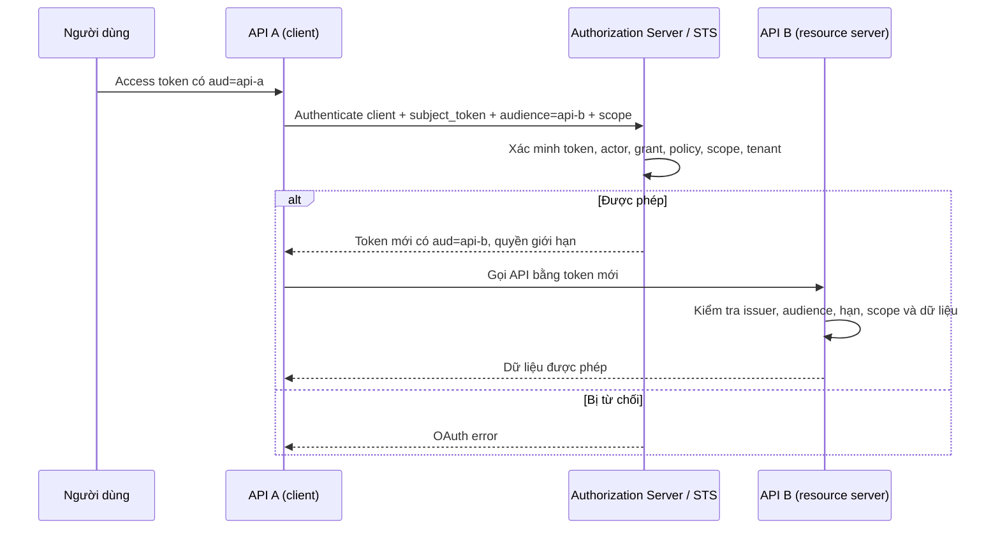

# Xác minh quyền đổi token (Authorization for Token Exchange)

## 1. Mục tiêu và bối cảnh

Khi một dịch vụ nhận được access token và cần gọi một dịch vụ khác, **không thể mặc nhiên lấy token cũ đổi thành token mới**. Token có chữ ký hợp lệ chỉ chứng minh token được phát hành bởi một chủ thể tin cậy và chưa bị thay đổi; nó **không chứng minh bên đang cầm token có quyền đổi token**, được phép đại diện người dùng, hoặc được quyền truy cập API đích.

**Xác minh quyền đổi token** là quyết định của **Authorization Server (AS)**, thường đóng vai trò **Security Token Service (STS)**, về việc có cấp token mới theo yêu cầu hay không. OAuth 2.0 Token Exchange được mô tả trong **RFC 8693**; chuẩn xác định giao thức yêu cầu/phản hồi, còn quan hệ tin cậy và chính sách cho phép đổi token do hệ thống triển khai quyết định.

Sau bài này, người học có thể:

1. Phân biệt **xác thực client**, **xác minh token đầu vào**, **ủy quyền đổi token** và **kiểm tra token tại resource server**.
2. Xác định vai trò của `subject`, `actor`, OAuth client, bên phát hành token và tài nguyên đích.
3. Thiết kế chính sách kiểm tra grant type, nguồn token, quan hệ ủy quyền, `audience`, `resource`, `scope`, tenant và thời hạn.
4. Phân biệt **delegation** (đại diện có danh tính actor) với **impersonation** (hoạt động theo danh tính subject) để tránh vượt quyền.
5. Kiểm thử cả đường đi thành công và các tình huống token bị đánh cắp, sai đối tượng nhận, yêu cầu mở rộng quyền.

Phạm vi bài học nằm trong bảo mật token của OAuth 2.0/OIDC, bao gồm JWT, opaque token, access token và các rủi ro khi đổi token. **Token exchange không đồng nghĩa refresh token flow**: refresh thường xin access token mới dựa trên refresh token và grant riêng; exchange xin một token phù hợp với ngữ cảnh/dịch vụ đích theo chính sách STS. ID token của OIDC chứng minh thông tin xác thực đăng nhập cho client có `aud` phù hợp; không được tự coi ID token là access token cấp quyền truy cập API.

## 2. Ai đang xin đổi token, đổi cho ai và để làm gì?

Ví dụ: người dùng `user-42` gọi **API A** bằng access token có `aud=api-a` và quyền `orders.read`. API A muốn gọi **API B** thay mặt người dùng. API A gửi yêu cầu đến STS để xin một access token mới có `aud=api-b`. STS phải xét cả **quyền của API A được đổi token** và **quyền của user-42 được đọc đơn hàng tại API B**.

| Thành phần | Ý nghĩa | Cần xác minh |
| --- | --- | --- |
| `subject` | Chủ thể mà token đại diện, chẳng hạn `user-42` | Danh tính hợp lệ, quyền nguồn, trạng thái tài khoản/tenant theo chính sách |
| OAuth client | Ứng dụng gửi yêu cầu exchange, chẳng hạn `api-a` | Danh tính client, phương thức xác thực, được bật grant token exchange |
| `actor` | Bên thực sự hành động thay subject khi dùng delegation | Danh tính actor, được subject/chính sách cho phép hành động, quan hệ với client |
| `subject_token` | Token thể hiện subject được đem đi đổi | Loại token, issuer, hạn sử dụng, tính toàn vẹn, phạm vi sử dụng, trạng thái thu hồi |
| `actor_token` | Token tùy chọn mô tả actor dự kiến | Nguồn tin cậy, tính hợp lệ và có khớp actor/client được phép hay không |
| `audience` / `resource` | API/tài nguyên dự kiến sử dụng token mới | Có nằm trong danh sách đích được phép của client và subject hay không |
| `scope` | Quyền được yêu cầu cho token mới | Chỉ cấp quyền được phép sau khi áp dụng giới hạn và ánh xạ chính sách |
| STS / AS | Nơi xác minh và cấp token mới | Đưa ra quyết định **allow/deny**, phát hành token kèm ràng buộc phù hợp |
| API B | Resource server nhận token đã exchange | Tự kiểm tra token mới, `aud`, scope, actor và quyền truy cập dữ liệu thực tế |

`client_id` không phải `sub`. Trong giao dịch người dùng, `sub` thường là danh tính người dùng; `client_id` nhận diện ứng dụng đã xin token; `act.sub` có thể biểu diễn dịch vụ đang hành động thay người dùng. Không được suy ra tất cả các danh tính này là một chỉ vì API A đang giữ access token.



Điểm mấu chốt: **STS quyết định có được đổi token**, còn **API B quyết định có được thực hiện thao tác cụ thể**. Hai bước đều cần thiết; API B không nên tin token chỉ vì nó được nhận qua API A.

## 3. Bốn lớp kiểm tra bắt buộc trước khi cấp token

### 3.1. Xác thực ứng dụng yêu cầu exchange

Trước khi phân quyền, STS xác định client bằng cơ chế phù hợp: `client_secret_basic`, `private_key_jwt`, mutual TLS (mTLS) hoặc cách khác được AS hỗ trợ. Ưu tiên cơ chế mạnh cho service-to-service và bảo vệ khóa/secret trong secret manager. **Có client ID không có nghĩa đã xác thực client**; client ID là định danh công khai trong nhiều ngữ cảnh.

STS cần kiểm tra:

- Client đang hoạt động, dùng phương thức xác thực được đăng ký và được phép sử dụng grant `urn:ietf:params:oauth:grant-type:token-exchange`.
- Client có được phép đổi token do issuer liên quan phát hành, đại diện subject/actor đó và xin token cho dịch vụ đích đó không.
- Nếu có `actor_token`, danh tính actor trong token có phù hợp với client được xác thực và mô hình ủy quyền hay không. Không cho client A tự khai actor B để nhận quyền của B.
- Với public client không thể giữ secret, chính sách phải xét rủi ro cầm token bị đánh cắp, sender constraint và các điều kiện bổ sung. RFC 8693 không bắt buộc mọi triển khai đều xác thực client, nhưng bỏ xác thực client làm giảm khả năng kiểm soát bên được phép exchange.

**Sai lầm thường gặp:** chỉ cần `subject_token` hợp lệ là exchange thành công. Khi token nguồn bị lộ, kẻ cầm token có thể biến nó thành token dùng ở một API khác nếu STS không kiểm tra client, actor và target.

### 3.2. Xác minh token đầu vào

Việc khai `subject_token_type` chỉ **mô tả loại token**; STS không được tin giá trị đó mà bỏ qua kiểm tra token thực tế.

| Loại token | Hướng xác minh | Lưu ý |
| --- | --- | --- |
| JWT access token | Kiểm tra định dạng, chữ ký bằng khóa của issuer đáng tin, thuật toán được cho phép, `iss`, `exp`, `nbf`, `aud` theo policy, các claim cần thiết và trạng thái thu hồi nếu có | Không tin JWT chỉ vì decode được payload hoặc header `alg` tự khai |
| Opaque access token | Xác minh qua kho token/authorization server hoặc introspection (RFC 7662), kiểm tra `active` cùng thuộc tính ngữ cảnh | Không suy đoán scope hay subject từ chuỗi token |
| Refresh token | Chỉ chấp nhận nếu chính sách AS cho phép loại token này tham gia exchange, xác minh chủ sở hữu/binding và vòng đời riêng | Thông thường ưu tiên dùng refresh grant đúng mục đích, tránh biến refresh token thành vé đổi tự do |
| OIDC ID token | Chỉ dùng khi chính sách và ngữ nghĩa exchange cho phép, kiểm tra issuer/audience/nonce theo ngữ cảnh | **Không dùng ID token thay access token** để kết luận quyền gọi API |
| Token từ issuer khác | Kiểm tra trust federation, khóa, token type, audience và ánh xạ danh tính được cấu hình | Không tự động tin một JWT chỉ vì chữ ký hợp lệ bằng khóa bất kỳ |

Ngoài tính hợp lệ mật mã, STS phải kiểm tra token **được phép đem tới STS trong ngữ cảnh này**. Ví dụ: access token cấp cho API A không mặc nhiên hợp lệ để client khác đem tới đổi. Với JWT, kiểm tra `aud` theo quan hệ tin cậy/đích đã quy định; với opaque token, dùng metadata đã xác minh thay cho suy đoán. Có thể kiểm tra `jti`, trạng thái phiên, consent, tenant và revocation tùy thiết kế. **Chữ ký hợp lệ là điều kiện cần, không phải giấy phép exchange.**

### 3.3. Xác minh quan hệ ủy quyền giữa subject và actor

**Impersonation:** client nhận token để hành động trong danh tính subject theo một phạm vi quyền được giới hạn. RFC 8693 mô tả trường hợp chỉ có `subject_token`, không có `actor_token` là dạng yêu cầu có ngữ nghĩa impersonation trong ví dụ của chuẩn. Do đó phải có chính sách rõ ràng cho phép client thực hiện kiểu hành động này; không nên bật rộng cho mọi service.

**Delegation:** actor là danh tính riêng đang hành động thay subject. Yêu cầu có thể có `actor_token` để chỉ ra actor; token mới dạng JWT có thể chứa `act` nhằm giữ danh tính actor. Cần kiểm tra actor có thực sự được ủy quyền trong quan hệ subject → actor và quyền được ủy quyền có bao gồm thao tác/đích đang xin hay không.

Hai claim liên quan:

- `may_act` trong subject token, nếu có, biểu thị bên **được xác nhận có thể trở thành actor**. STS vẫn phải kiểm tra issuer, chính sách tin cậy, client, mục tiêu và điều kiện hiện hành; claim này không tự mở khóa mọi quyền.
- `act` trong token mới biểu thị **actor đang hành động**. Với chuỗi ủy quyền nhiều bước, `act` có thể lồng nhau. Theo RFC 8693, khi resource server quyết định quyền truy cập, chỉ các claim cấp cao nhất và actor **hiện tại** ở `act` ngoài cùng có ý nghĩa áp dụng chính sách; actor lịch sử ở `act` lồng sâu là thông tin truy vết.

Ví dụ payload **rút gọn để minh họa**, sau khi STS xác minh việc API A được đại diện user-42 để đọc đơn hàng tại API B:

```json
{
  "iss": "https://auth.example.test",
  "sub": "user-42",
  "aud": "api-b",
  "client_id": "api-a",
  "scope": "orders.read",
  "act": { "sub": "api-a" },
  "iat": 1893456000,
  "exp": 1893456300
}
```

Payload trên chỉ có ngữ nghĩa delegation nếu nó thực sự được STS **phát hành và bảo vệ toàn vẹn** sau khi xét chính sách. Không thể để client tự thêm `act` hoặc `may_act` vào token rồi yêu cầu hệ thống tin. Trong môi trường nhiều issuer/tenant, định danh actor có thể cần kết hợp `iss` và `sub` để tránh trùng tên; dùng một chuỗi `sub` riêng lẻ không phải lúc nào cũng đủ.

### 3.4. Xác minh mục tiêu, quyền và thời hạn của token mới

STS nên dùng **allowlist đích** cụ thể cho từng client và tenant, tránh chấp nhận một `audience` do client tùy ý cung cấp. `audience` và `resource` là hai cách biểu đạt tài nguyên đích theo RFC 8693; yêu cầu chứa nhiều đích kết hợp với nhiều scope có thể tạo quyền rất rộng, nên cần giới hạn mạnh hoặc từ chối.

STS xác định quyền phát hành bằng chính sách, không sao chép nguyên scope đầu vào:

```text
requested = quyền client xin tại API B
subjectAllowed = quyền người dùng được phép tại API B
actorAllowed = quyền API A được phép thực hiện thay người dùng tại API B
targetAllowed = quyền API B hỗ trợ và chính sách môi trường cho phép

issued = requested ∩ subjectAllowed ∩ actorAllowed ∩ targetAllowed
```

Đây là **mô hình minh họa** khi các quyền đã được quy về cùng một tập permission. Trong thực tế, `orders.read` ở API A và `orders.view` ở API B có thể khác tên: phải qua **bảng ánh xạ quyền tường minh** trước khi giao tập. Không được dùng phép giao chuỗi scope một cách máy móc khi chúng mang ngữ nghĩa khác nhau. Nếu quyền yêu cầu không được chấp nhận, AS có thể từ chối hoặc cấp phạm vi hẹp hơn theo hợp đồng client; client phải kiểm tra scope thực nhận và không giả định toàn bộ quyền đã được cấp.

Token phát hành nên có `aud` giới hạn cho API B, `iss` của STS tin cậy, thời hạn ngắn, `exp` không vượt giới hạn phiên/policy/token nguồn theo thiết kế, định danh chủ thể/actor rõ ràng và thuộc tính ràng buộc người giữ token khi có thể. **Đổi token không được làm tăng đặc quyền hoặc hồi sinh quyền đã bị thu hồi**; đặc biệt không tự nâng từ `orders.read` lên `orders.write`.

## 4. Chính sách allow/deny: nhìn theo từng điều kiện

Giả sử có cấu hình nội bộ (không phải schema của RFC 8693):

```yaml
client: api-a
grant_type: urn:ietf:params:oauth:grant-type:token-exchange
accepted_subject_token_types:
  - urn:ietf:params:oauth:token-type:access_token
trusted_issuers:
  - https://auth.example.test
accepted_input_audiences:
  - api-a
allowed_target_audiences:
  - api-b
delegation:
  allowed: true
  require_verified_actor: true
  permitted_actor: api-a
scope_mapping:
  orders.read: orders.read
max_issued_ttl_seconds: 300
cross_tenant: deny
```

Chính sách chỉ minh họa cách mô hình hóa quyền; tên key phụ thuộc sản phẩm AS/STS. Không xem cấu hình mẫu này là cấu hình có thể đưa thẳng vào Keycloak, Spring Authorization Server hoặc một vendor cụ thể.

| Tình huống | Quyết định | Lý do |
| --- | --- | --- |
| `api-a` đã xác thực, subject hợp lệ, actor hợp lệ, xin `api-b` / `orders.read` cùng tenant | **ALLOW** | Khớp nguồn, quan hệ ủy quyền, đích và quyền |
| Client `reporting-job` được xác thực nhưng không được bật token exchange | **DENY** | Không có quyền sử dụng grant |
| `api-a` xin `aud=admin-api` không nằm trong allowlist | **DENY** | Đích không được cấp phép |
| Subject chỉ có quyền đọc nhưng xin `orders.write` | **DENY** hoặc thu hẹp theo policy đã công bố | Không được nâng đặc quyền |
| `api-a` tự trình token actor ghi `api-admin` | **DENY** | Actor không khớp danh tính/quyền được xác minh |
| Token nguồn hết hạn, bị thu hồi hoặc issuer chưa được tin cậy | **DENY** | Không đủ cơ sở tin cậy |
| Subject thuộc tenant X nhưng yêu cầu dữ liệu tenant Y khi không có ủy quyền liên tenant | **DENY** | Chống truy cập chéo tenant |
| Yêu cầu đồng thời nhiều audience/scope tạo tập quyền quá rộng | **DENY** hoặc yêu cầu tách token | Giảm bề mặt tấn công |

Nguyên tắc **deny by default**: thiếu một dữ kiện cần thiết để chứng minh quyền thì không phát hành token. Trong trường hợp policy phụ thuộc vào nhiều hệ thống (introspection, kho consent, danh sách thu hồi), lỗi xác minh quan trọng phải dẫn đến từ chối có kiểm soát thay vì tự cho phép.

## 5. Yêu cầu OAuth 2.0 Token Exchange cụ thể

Client gửi `POST` đến token endpoint, dùng `application/x-www-form-urlencoded`. Ví dụ minh họa với client API A **đã được xác thực** bằng HTTP Basic; trong sản phẩm thật có thể dùng mTLS hoặc private-key JWT thay thế:

```http
POST /oauth2/token HTTP/1.1
Host: auth.example.test
Authorization: Basic <client-credentials-encoded>
Content-Type: application/x-www-form-urlencoded

grant_type=urn%3Aietf%3Aparams%3Aoauth%3Agrant-type%3Atoken-exchange
&subject_token=<encoded-subject-access-token>
&subject_token_type=urn%3Aietf%3Aparams%3Aoauth%3Atoken-type%3Aaccess_token
&requested_token_type=urn%3Aietf%3Aparams%3Aoauth%3Atoken-type%3Aaccess_token
&audience=api-b
&scope=orders.read
```

Các dấu xuống dòng phần body chỉ nhằm dễ đọc; HTTP form body thực tế được URL-encode thành một chuỗi. `subject_token` và `subject_token_type` là bắt buộc theo RFC 8693; `requested_token_type`, `audience`, `resource`, `scope` và `actor_token` là các tham số tùy chọn tùy ngữ cảnh. Nếu yêu cầu delegation có `actor_token`, phải gửi kèm `actor_token_type` và STS phải kiểm tra actor đó theo chính sách. Client authentication và actor token có thể cùng xác nhận những khía cạnh khác nhau; chúng **không tự thay thế nhau**.

Trường hợp thành công, phản hồi thường có dạng:

```http
HTTP/1.1 200 OK
Content-Type: application/json
Cache-Control: no-store

{
  "access_token": "<new-token-for-api-b>",
  "issued_token_type": "urn:ietf:params:oauth:token-type:access_token",
  "token_type": "Bearer",
  "expires_in": 300,
  "scope": "orders.read"
}
```

`issued_token_type` cho biết **kiểu security token được phát hành**; `token_type` (ví dụ `Bearer`) cho biết cách dùng access token ở OAuth resource server. Token trông giống JWT vẫn có thể được mô tả bằng `issued_token_type=...:access_token` vì token đó được cấp và được dùng như OAuth access token. Client cần dùng token mới để gọi API B, **không chuyển tiếp token của API A**. API B phải kiểm tra `aud=api-b` và các thuộc tính bảo mật liên quan.

Một số lỗi chuẩn cần phân biệt:

| Tình huống | Mã lỗi OAuth | Cách xử lý |
| --- | --- | --- |
| Token nguồn/actor không hợp lệ hoặc không chấp nhận theo policy exchange | `invalid_request` theo RFC 8693 `2.2.2 | Từ chối; tránh lộ chi tiết token qua thông báo |
| Không thể/không muốn cấp token cho `resource` hay `audience` yêu cầu | `invalid_target` | Kiểm tra đích hợp lệ; không tự đổi sang một đích rộng hơn |
| Client xác thực sai | `invalid_client` theo OAuth | Khắc phục xác thực client; không phát token |
| Client không được phép dùng grant đã xin | `unauthorized_client` theo OAuth | Cập nhật đăng ký/chính sách bằng quy trình quản trị |
| Scope không hợp lệ hoặc vượt quyền được AS chấp nhận | `invalid_scope` khi phù hợp | Chỉ xin quyền đủ dùng; không tự tăng quyền |

**Lưu ý:** provider có thể áp dụng chính sách và mô tả lỗi chi tiết khác nhau. Đặc biệt, với token nguồn/actor không hợp lệ hoặc không được chấp nhận, RFC 8693 quy định `invalid_request`; không tự giả định mọi hệ thống đều trả `invalid_grant` cho tình huống này.

## 6. Pseudocode kiểm tra quyền ở STS

Ví dụ theo phong cách Java mô tả **thứ tự quyết định**, không phải mã hoàn chỉnh có thể chạy độc lập. Phần xác thực mật mã, introspection, kiểm tra thu hồi và ký token cần do thư viện/giao diện tin cậy thực hiện; không tự xây thuật toán JWT verifier.

```java
ExchangeDecision authorize(AuthenticatedClient client, ExchangeRequest req) {
    // 1. Client đã qua OAuth client authentication tại token endpoint.
    require(client.isActive(), "invalid_client");
    require(client.allowsGrant(TOKEN_EXCHANGE), "unauthorized_client");

    // 2. Xác minh token nguồn theo loại token và issuer đáng tin.
    ValidatedToken subject = tokenVerifier.verifySubject(req.subjectToken(),
                                                          req.subjectTokenType());
    require(subject.isActive() && subject.isValidNow(), "invalid_request");
    require(policy.acceptsSource(client, subject), "invalid_request");

    // 3. Xác minh actor (nếu có) và quan hệ được ủy quyền.
    Actor actor = actorVerifier.resolveAndVerify(client, req.actorToken(),
                                                req.actorTokenType());
    require(policy.mayActFor(actor, subject, client), "invalid_request");

    // 4. Chặn xin token cho target/tenant không được phép.
    Target target = policy.resolveTarget(req.audience(), req.resource());
    require(policy.targetAllowed(client, subject, actor, target), "invalid_target");

    // 5. Ánh xạ quyền có kiểm soát; không phát hành quyền vượt thẩm quyền.
    Set<String> requested = parseAndValidateScopes(req.scope());
    Set<String> eligible = policy.mapEligibleScopes(subject, actor, client, target);
    require(eligible.containsAll(requested), "invalid_scope");

    // 6. Ràng buộc hạn sống và người nắm giữ; audit theo decision.
    Duration ttl = policy.boundedLifetime(subject, actor, target);
    return ExchangeDecision.allow(subject.id(), actor.id(), target,
                                  requested, ttl, policy.senderConstraint(client));
}
```

Trong hệ thống thật, `resolveAndVerify` phải có nhánh riêng cho impersonation khi **không gửi** `actor_token`, và chỉ cho phép nhánh đó nếu policy chấp nhận. Hàm `mayActFor` cần xét issuer + subject + actor + tenant + consent/ủy quyền và trạng thái hiện hành, không chỉ so sánh chuỗi tên. `boundedLifetime` không được trả TTL dương khi nguồn/phiên đã hết hiệu lực. Có thể phát token scope hẹp hơn khi chính sách hỗ trợ và hợp đồng client cho phép, nhưng lựa chọn này cần được thiết kế và kiểm thử rõ ràng.

Quyết định nên lưu audit tối thiểu: thời gian, `client_id`, issuer/định danh tham chiếu của subject, actor, target, requested/granted scopes, kết quả và mã lý do. **Không log token thô, client secret, refresh token hoặc toàn bộ thông tin định danh nhạy cảm**. Nếu lưu `jti` hoặc hash để truy vết, cần áp dụng chính sách retention và bảo vệ log.

## 7. Phòng chống token bị đánh cắp, phát lại và lạm dụng exchange

**Đánh cắp token nguồn:** một bearer token bị lộ có thể bị bất kỳ ai đang giữ nó thử đưa tới STS. Giảm rủi ro bằng client authentication mạnh, policy actor/target rõ ràng, token ngắn hạn, kiểm tra revocation và hạn chế cách token nguồn được chấp nhận để exchange.

**Replay:** TLS bảo vệ token khi truyền nhưng không ngăn người đã có bản sao token phát lại. Khi hệ thống cần chứng minh bên đang sử dụng token là bên được cấp, cân nhắc **sender-constrained token** qua mTLS (RFC 8705) hoặc DPoP (RFC 9449), kiểm tra proof/binding tại đúng điểm sử dụng. Các kiểm soát như `jti`, nonce, timestamp hay one-time-use phải được triển khai đồng bộ theo loại token và use case; không mặc định mọi access token đều dùng một lần.

**Token substitution và audience confusion:** không đưa token có `aud=api-a` sang API B chỉ vì API B xác minh được chữ ký. STS phải phát hành token có audience phù hợp; API B phải kiểm tra audience của chính nó và từ chối token phát hành cho dịch vụ khác.

**Confused deputy:** API A có đặc quyền riêng có thể bị lợi dụng để xin token phục vụ hành vi mà user không được phép. Chính sách phải giao quyền user, quyền actor và quyền target; tránh “API A có quyền cao” trở thành “mọi user gọi qua API A đều có quyền cao”.

**Cross-tenant / cross-issuer:** tách chính sách theo tenant và trust boundary; xác thực liên kết định danh giữa các issuer, tránh ánh xạ hai `sub` giống tên thành cùng người dùng. Với ủy quyền nhiều chặng, giới hạn độ sâu ủy quyền hoặc yêu cầu phê duyệt từng bước theo rủi ro.

**Quyền tồn tại quá lâu:** không cấp thời hạn dài cho token B chỉ vì token A còn hợp lệ tại thời điểm exchange. Cần cân nhắc trạng thái revocation, phiên, consent, risk signals và việc truyền/giám sát thay đổi quyền. RFC 8693 **không tự động định nghĩa chuỗi thu hồi token** giữa token nguồn và token đã đổi; hệ thống phải thiết kế cách xử lý phù hợp.

## 8. Kiểm thử chính sách exchange

Tối thiểu nên có các ca kiểm thử độc lập sau; mọi ca **DENY** đều phải xác minh rằng STS không phát hành token:

1. **Luồng hợp lệ:** client A xác thực, subject/actor hợp lệ, scope và target được phép → cấp token B có `aud`, `scope`, `exp`, `act` đúng policy.
2. **Client không có grant exchange:** dùng subject token hợp lệ nhưng client chưa được cấp grant → DENY.
3. **Subject token hết hạn, bị thu hồi hoặc sai issuer:** mọi trường hợp → DENY, kể cả chữ ký có thể xác minh.
4. **Sai actor:** client A trình actor token của client C hoặc actor không được subject/chính sách ủy quyền → DENY.
5. **Xin quyền cao hơn:** nguồn chỉ được đọc nhưng yêu cầu ghi/xóa → DENY hoặc kết quả được thu hẹp theo policy, không phát quyền vượt mức.
6. **Xin audience ngoài allowlist hoặc nhiều target quá rộng:** → DENY và kiểm tra mã lỗi phù hợp.
7. **Vượt tenant / issuer:** token từ tenant X được dùng xin dữ liệu tenant Y khi không có bridge policy hợp lệ → DENY.
8. **Dùng token sai API:** API B từ chối token gốc `aud=api-a`, còn API A từ chối token mới `aud=api-b` khi các policy không cho phép sử dụng chéo.
9. **Bearer token bị copy/replay:** khi có sender constraint, yêu cầu thiếu/sai proof hoặc certificate-binding → DENY.
10. **Thu hồi quyền khi token mới còn hạn:** xác định kết quả mong muốn theo chiến lược revocation/introspection/cache đã thiết kế, không giả định exchange tự động lan truyền thu hồi.

Mỗi test cần kiểm tra cả **quyết định tại STS** và **thực thi tại resource server**. Không dùng tình trạng HTTP `200` một mình để kết luận an toàn; phải đối chiếu các claim, scope, actor, thời hạn và quyền dữ liệu.

## 9. Checklist khi review thiết kế

- [ ] Client được xác thực và có grant token exchange; danh tính client và actor được đối chiếu.
- [ ] Token nguồn được xác minh đúng loại (JWT/opaque), issuer, thời hạn, audience, trạng thái và ngữ cảnh sử dụng.
- [ ] Quan hệ subject–actor được xác minh trước khi cho impersonation/delegation; `may_act` không được tin độc lập với policy.
- [ ] `audience`/`resource` có allowlist, scope được ánh xạ về quyền thực và không mở rộng đặc quyền.
- [ ] Có kiểm tra tenant/issuer boundary, giới hạn TTL, revocation và sender constraint khi cần.
- [ ] Token đích có claim/audience phù hợp và API đích tự thực thi quyền; audit không lộ token/secret.
- [ ] Có test allow/deny, token bị đánh cắp/phát lại, sai audience và quyền bị thu hồi.

## 10. Câu hỏi tự kiểm tra

**Q1. Vì sao JWT có chữ ký hợp lệ vẫn không đủ để STS đồng ý đổi token?** Vì chữ ký chỉ chứng minh tính toàn vẹn/nguồn phát hành theo khóa tin cậy. Quyền exchange còn phụ thuộc client, actor, subject, mục tiêu, scope, tenant và chính sách hiện hành.

**Q2. Client A có thể đổi mọi access token của user sang `aud=api-b` không?** Không. STS chỉ được phép khi token nguồn thích hợp, A có quyền dùng exchange, quan hệ đại diện hợp lệ và quyền cho API B không vượt giới hạn.

**Q3. `act` và `may_act` khác nhau thế nào?** `act` ghi actor hiện tại trong token đã được phát hành có ngữ nghĩa delegation; `may_act` biểu thị actor được đề xuất/cho phép hành động theo thông tin do issuer cung cấp, phải qua xác minh policy trước khi STS cho phép.

**Q4. Refresh token và token exchange có giống nhau không?** Không. Refresh token grant chủ yếu gia hạn/lấy access token theo grant refresh; token exchange chuyển đổi ngữ cảnh token dựa trên ủy quyền và quyền đích, có thể thay audience, dạng token hoặc actor.

**Q5. Đã exchange thành công thì API B có thể bỏ qua authorization không?** Không. API B vẫn phải xác minh token mới và áp dụng quyền ở cấp endpoint, tài nguyên và dữ liệu.

## Tài liệu chuẩn để tra cứu

- [RFC 8693 – OAuth 2.0 Token Exchange](https://www.rfc-editor.org/rfc/rfc8693): request/response, `subject_token`, `actor_token`, `act`, `may_act`, lỗi `invalid_target`.
- [RFC 7662 – OAuth 2.0 Token Introspection](https://www.rfc-editor.org/rfc/rfc7662): xác minh trạng thái và thuộc tính opaque token.
- [RFC 7009 – OAuth 2.0 Token Revocation](https://www.rfc-editor.org/rfc/rfc7009): cơ chế thu hồi token theo OAuth.
- [RFC 8707 – Resource Indicators for OAuth 2.0](https://www.rfc-editor.org/rfc/rfc8707): dùng `resource` để chỉ rõ tài nguyên đích.
- [RFC 8705 – OAuth 2.0 Mutual-TLS](https://www.rfc-editor.org/rfc/rfc8705) và [RFC 9449 – DPoP](https://www.rfc-editor.org/rfc/rfc9449): ràng buộc token với bên nắm giữ.
- [RFC 9700 – Best Current Practice for OAuth 2.0 Security](https://www.rfc-editor.org/rfc/rfc9700): các biện pháp giảm rủi ro trong OAuth hiện đại.
