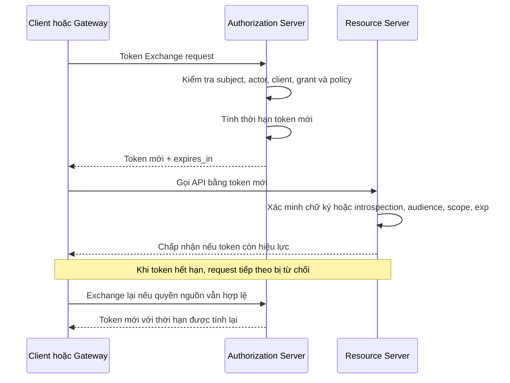
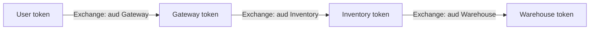

# Expiration token mới

Trong **Token Exchange**, authorization server nhận một token hiện có và phát hành một token khác phù hợp với dịch vụ, tài nguyên hoặc phạm vi quyền cần truy cập. Token được phát hành có thời hạn riêng. Thời điểm hết hạn của token mới quyết định resource server còn được phép chấp nhận token đó hay không, đồng thời giới hạn khoảng thời gian mà quyền được ủy quyền có thể tiếp tục được sử dụng.

Điểm cần nắm vững là token mới có danh tính, audience, scope và thời hạn do authorization server quyết định theo chính sách phát hành. Không thể suy ra thời hạn của nó chỉ bằng cách nhìn vào loại token hoặc trường `exp` của token đầu vào. RFC 8693 định nghĩa giao thức trao đổi token, còn thời hạn cụ thể được authorization server áp dụng theo chính sách và ngữ cảnh cấp quyền.

## 1. Token mới có vòng đời riêng

Một yêu cầu Token Exchange thường có các thành phần sau:

- `subject_token`: token đại diện cho chủ thể mà quyền truy cập đang được yêu cầu, chẳng hạn người dùng đã đăng nhập.
- `actor_token`: token tùy chọn đại diện cho tác nhân đang thực hiện hành động thay mặt chủ thể, chẳng hạn API gateway hoặc một service.
- `audience` hoặc `resource`: xác định dịch vụ hay tài nguyên đích mà token mới hướng tới.
- `scope`: các quyền mà client đề nghị được cấp cho token mới.
- `requested_token_type`: loại token mà client muốn nhận, ví dụ access token.

Authorization server kiểm tra token đầu vào, danh tính client, quan hệ ủy quyền và chính sách dành cho tài nguyên đích. Nếu yêu cầu hợp lệ, server phát hành token mới. Token mới có thể là JWT hoặc opaque token; nó có thể chứa tập claim và quyền hẹp hơn token đầu vào.

Ví dụ: người dùng đăng nhập và nhận access token dành cho API gateway. Gateway cần gọi Inventory API. Gateway gửi token người dùng trong yêu cầu exchange, chỉ định Inventory API làm audience và yêu cầu scope `inventory.read`. Authorization server có thể cấp một access token mới chỉ dùng cho Inventory API và chỉ có quyền đọc tồn kho.

Token mới bắt đầu vòng đời của chính nó tại thời điểm phát hành. Nó có thời hạn do authorization server đặt ra. Việc token đầu vào còn hiệu lực là điều kiện để authorization server xem xét yêu cầu exchange; điều đó không tự động quyết định toàn bộ thời hạn của token mới.

## 2. Phân biệt `expires_in`, `exp` và trạng thái introspection

Ba thông tin thường xuất hiện khi làm việc với thời hạn token có ý nghĩa khác nhau:

| Thông tin | Nằm ở đâu | Ý nghĩa |
|---|---|---|
| `expires_in` | Token response | Thời lượng sống của token, tính bằng giây theo thời điểm authorization server tạo response. |
| `exp` | Claim của JWT | Thời điểm hết hạn tuyệt đối, biểu diễn bằng NumericDate (số giây tính từ Unix Epoch). |
| `active` | Introspection response | Cho biết opaque token có đang được authorization server xem là hoạt động hay không. Token hết hạn thường được trả về với `active: false`. |

### `expires_in`: thời lượng sống được trả về

Ví dụ response của một lần exchange:

```json
{
  "access_token": "<new-access-token>",
  "issued_token_type": "urn:ietf:params:oauth:token-type:access_token",
  "token_type": "Bearer",
  "expires_in": 300,
  "scope": "inventory.read"
}
```

Giá trị `expires_in: 300` cho biết token có thời lượng sống 300 giây, tức khoảng 5 phút tính từ lúc authorization server tạo response. Thời gian truyền response qua mạng cũng tiêu tốn một phần thời hạn này. Client không nên cộng đủ 300 giây kể từ lúc nhận response rồi mặc định token vẫn còn hiệu lực đến thời điểm đó.

`expires_in` là thông tin hữu ích để client lập lịch gọi lại dịch vụ hoặc chuẩn bị exchange tiếp theo. Đây không phải claim nằm bên trong mọi loại token và cũng không phải một timestamp tuyệt đối.

### `exp`: thời điểm hết hạn của JWT

Với JWT, payload có thể chứa claim `exp`:

```json
{
  "iss": "https://auth.example.com",
  "sub": "user-123",
  "aud": "https://inventory.example.com",
  "iat": 1795453200,
  "exp": 1795453500,
  "scope": "inventory.read",
  "act": {
    "sub": "gateway-service"
  }
}
```

Các giá trị thời gian trong ví dụ chỉ nhằm minh họa định dạng NumericDate. `iat` là thời điểm phát hành; `exp` là thời điểm hết hạn. Theo quy tắc JWT, nếu token có `exp`, thời điểm hiện tại phải nằm trước `exp` để token được chấp nhận. Resource server có thể cho phép một khoảng sai lệch đồng hồ nhỏ, có giới hạn, nhưng không nên dùng khoảng dung sai lớn để kéo dài đáng kể thời hạn token.

Không được nhầm `iat` với `exp`: token được phát hành lúc nào không cho biết nó sống bao lâu nếu không có thời điểm hết hạn hoặc chính sách thời hạn tương ứng. Với JWT access token tuân theo profile RFC 9068, claim `exp` là bắt buộc. Với các loại JWT nói chung, cần kiểm tra profile và hợp đồng phát hành đang áp dụng.

### Opaque token: kiểm tra trạng thái từ authorization server

Opaque token thường là chuỗi ngẫu nhiên, không chứa payload JWT để resource server tự giải mã. Resource server hoặc gateway có thể gọi endpoint introspection theo RFC 7662. Authorization server trả về `active` và có thể trả thêm `exp`, `scope`, `aud`, `client_id` hoặc thông tin liên quan.

Nếu `active` là `false`, resource server phải từ chối token. Nếu response có `exp`, hệ thống cũng cần tôn trọng thời điểm đó. Nếu không có `exp`, resource server dựa vào trạng thái do authorization server quản lý và hợp đồng introspection; không được tự coi token là vô thời hạn.

## 3. Authorization server quyết định thời hạn token mới như thế nào?

RFC 8693 mô tả cách gửi yêu cầu và trả kết quả Token Exchange. Giao thức không bắt buộc mọi authorization server phải dùng cùng một công thức tính thời hạn token mới. Trong thực tế, chính sách phát hành có thể xét nhiều yếu tố:

1. **Thời hạn tối đa của loại token:** access token nội bộ cho một service có thể chỉ sống vài phút, trong khi token dùng cho một phiên tương tác có chính sách khác.
2. **Audience hoặc resource đích:** token dành cho một API cụ thể thường có thời hạn và quyền phù hợp với mức độ rủi ro của API đó.
3. **Scope được cấp:** quyền nhạy cảm hoặc có khả năng gây tác động lớn có thể đi kèm thời hạn ngắn hơn.
4. **Thời hạn của subject token và actor token:** nếu chính sách yêu cầu quyền được ủy quyền không kéo dài quá token nguồn, thời hạn token mới phải bị giới hạn bởi thời điểm hết hạn còn lại của các token liên quan.
5. **Phiên đăng nhập và grant:** token mới cần tôn trọng thời hạn phiên, trạng thái đăng nhập, sự đồng ý và giới hạn ủy quyền có liên quan.
6. **Ngữ cảnh bảo mật:** mức độ tin cậy của client, phương thức xác thực, rủi ro của yêu cầu và yêu cầu vận hành của tài nguyên đích có thể ảnh hưởng đến TTL.

Một chính sách thường dùng là lấy giới hạn sớm nhất trong các mốc áp dụng:

```text
new_exp = min(
  now + maximum_ttl_for_target,
  subject_token_exp,
  actor_token_exp,
  session_exp,
  grant_exp
)
```

Đây là **mẫu chính sách khuyến nghị**, không phải công thức bắt buộc được RFC 8693 quy định cho mọi hệ thống. Chỉ đưa các mốc thực sự áp dụng vào phép tính. Chẳng hạn, nếu không có `actor_token` thì không có `actor_token_exp` để xét. Với opaque token, authorization server cần tra trạng thái và thời hạn trong dữ liệu quản lý hoặc introspection thay vì cố giải mã token.

Điều quan trọng là không được coi một thời hạn không biết là thời hạn vô hạn. Nếu authorization server không xác định được token nguồn còn hiệu lực hay grant còn hợp lệ, nó phải xử lý theo chính sách xác minh và từ chối khi không đủ căn cứ cấp quyền.

### Token mới có thể sống lâu hơn token nguồn không?

Không có quy tắc chung rằng `exp` của token mới luôn phải bằng `exp` của `subject_token`. Token Exchange tạo một token mới và thời hạn của nó do authorization server quyết định. Một số hệ thống có thể cho phép token mới tồn tại sau thời điểm token nguồn hết hạn, nếu có grant hoặc phiên độc lập còn hiệu lực và chính sách cho phép.

Tuy vậy, nếu token mới đại diện cho quyền được ủy quyền từ token nguồn, để token mới sống lâu hơn token nguồn có thể làm quyền tiếp tục tồn tại sau khi thông tin xác thực ban đầu đã hết hạn. Đây là một quyết định bảo mật có chủ đích, cần được ràng buộc bằng grant, phiên và chính sách rõ ràng. Với mô hình on-behalf-of thông thường, nên giới hạn token mới trong thời hạn quyền ủy quyền còn hiệu lực, thường là không vượt quá mốc hết hạn sớm nhất của các thông tin xác thực và phiên liên quan.

### Client có thể yêu cầu TTL bằng tham số chuẩn không?

RFC 8693 có `requested_token_type` để chỉ định **loại token** mong muốn. Tham số này không có nghĩa là yêu cầu thời hạn sống. RFC 8693 cũng không định nghĩa một tham số chuẩn chung để client tùy ý đặt `expires_in` cho token mới. Nhà cung cấp có thể hỗ trợ extension riêng, nhưng client chỉ được sử dụng khi tài liệu của authorization server xác nhận rõ.

Các tham số `audience`, `resource` và `scope` giới hạn đích đến hoặc quyền được cấp; bản thân chúng không đặt TTL. Client phải đọc `expires_in` trong response hoặc tuân theo cơ chế thời hạn mà nhà cung cấp công bố.

## 4. Ví dụ tính thời hạn trong một lần exchange

Giả sử gateway nhận access token của người dùng và yêu cầu token mới cho Inventory API. Chính sách của Inventory API giới hạn token mới tối đa 5 phút.

| Mốc | Thời điểm |
|---|---:|
| Gateway gửi yêu cầu exchange | 14:10:00 |
| Subject token hết hạn | 14:12:00 |
| TTL tối đa của token Inventory | 5 phút |
| Thời điểm hết hạn theo TTL tối đa | 14:15:00 |
| Thời điểm hết hạn token mới theo chính sách giới hạn bởi subject token | 14:12:00 |

Trong ví dụ này, subject token chỉ còn 2 phút. Nếu chính sách yêu cầu token mới không vượt quá thời hạn subject token, authorization server chỉ cấp token mới sống tối đa khoảng 2 phút và trả `expires_in` xấp xỉ 120 giây. Client không được giả định token mới sẽ luôn sống đủ 5 phút chỉ vì TTL tối đa của Inventory API là 5 phút.

Nếu subject token còn hiệu lực đến 14:30:00 và các giới hạn khác đều cho phép, chính sách trên có thể cấp token mới hết hạn lúc 14:15:00, tương ứng TTL 5 phút. Hai lần exchange có cùng audience và scope nhưng có thể nhận `expires_in` khác nhau vì thời hạn của phiên hoặc token nguồn khác nhau.

## 5. Dòng đời token mới trong hệ thống

Quy trình từ lúc exchange đến khi token hết hạn có thể mô tả như sau:



Resource server phải tự xác minh token theo loại token và profile đã thống nhất. Với JWT, việc xác minh không dừng ở kiểm tra chữ ký: cần kiểm tra issuer, audience, thời hạn, thời điểm bắt đầu hiệu lực nếu có, loại token và quyền cần thiết. Với opaque token, cần kiểm tra trạng thái qua introspection hoặc cơ chế tin cậy tương đương.

Khi token hết hạn, resource server từ chối request được xác thực bằng token đó. Client có thể thực hiện một lần exchange mới nếu `subject_token`, `actor_token` và grant liên quan vẫn hợp lệ. Nếu token nguồn đã hết hạn hoặc bị thu hồi, client phải dùng luồng gia hạn hoặc xác thực lại được authorization server cho phép. Token Exchange không tự động làm mới token nguồn và cũng không bảo đảm response luôn có refresh token.

## 6. Token Exchange qua nhiều service

Trong kiến trúc nhiều service, một token có thể được đổi qua nhiều chặng:



Mỗi lần exchange tạo một token có mục đích sử dụng cụ thể. Gateway token có thể chỉ dành cho gateway; Inventory token chỉ dành cho Inventory API; token dành cho Warehouse chỉ có quyền cần thiết tại Warehouse. Khi chuyển qua chặng tiếp theo, service nên yêu cầu audience và scope hẹp nhất có thể.

Nếu chính sách ràng buộc thời hạn theo chuỗi ủy quyền, mỗi chặng phải tiếp tục tôn trọng thời hạn còn lại của phiên và các token nguồn liên quan. Không nên để mỗi service tự đặt TTL dài hơn mà không xét quyền mà nó nhận được từ chặng trước. Việc phát hành token mới không phải lý do để kéo dài vô hạn một phiên người dùng.

Thiết kế tốt thường có các đặc điểm sau:

- Token chỉ dành cho đúng audience/resource cần gọi.
- Scope của token mới bằng hoặc hẹp hơn quyền được phép ủy quyền.
- TTL ngắn theo mức độ nhạy cảm và thời gian cần thiết để hoàn thành công việc.
- Authorization server kiểm tra trạng thái token nguồn tại thời điểm exchange.
- Service không chuyển tiếp token rộng quyền cho mọi dịch vụ downstream khi có thể exchange token chuyên biệt.

## 7. Hết hạn, thu hồi và hết phiên là ba trạng thái khác nhau

| Trạng thái | Điều gì xảy ra | Cách xử lý |
|---|---|---|
| Hết hạn (`expired`) | Thời điểm hiện tại đã đạt hoặc vượt quá thời hạn token. | Từ chối token; xin token mới qua luồng được cấp phép. |
| Bị thu hồi (`revoked`) | Authorization server vô hiệu hóa token trước thời điểm hết hạn, ví dụ khi phát hiện rủi ro hoặc người dùng đăng xuất. | Kiểm tra trạng thái qua introspection, danh sách thu hồi hoặc cơ chế cập nhật trạng thái phù hợp. |
| Phiên hoặc grant hết hiệu lực | Điều kiện nền tảng cho quyền ủy quyền không còn hợp lệ, dù token có thể chưa đến `exp`. | Không cấp token mới; vô hiệu hóa hoặc từ chối token theo chính sách phiên/grant. |

Với opaque token, introspection có thể phản ánh trạng thái thu hồi tương đối trực tiếp. Với JWT được xác minh hoàn toàn tại resource server, chữ ký hợp lệ và `exp` còn ở tương lai không tự chứng minh token chưa bị thu hồi. Nếu cần thu hồi sớm, hệ thống phải có cơ chế bổ sung như introspection, denylist, sự kiện thu hồi hoặc TTL ngắn để giới hạn khoảng thời gian rủi ro.

Cache kết quả introspection giúp giảm tải authorization server nhưng tạo độ trễ khi token bị thu hồi. Thời gian cache không nên dài hơn thời hạn còn lại của token và cần phù hợp với yêu cầu phản ứng khi thu hồi. Với API có rủi ro cao, cần cân nhắc cache ngắn hoặc kiểm tra trạng thái thường xuyên hơn.

## 8. Lập lịch sử dụng và đổi token an toàn

Client nên quản lý thời hạn token mới ngay khi nhận response:

1. Đọc `expires_in` nếu authorization server cung cấp và lưu thời điểm hết hạn dự kiến theo đồng hồ đáng tin cậy.
2. Trừ một khoảng an toàn nhỏ để bù thời gian mạng, độ trễ xử lý và sai lệch đồng hồ; không đợi đến đúng giây hết hạn mới bắt đầu exchange.
3. Dùng token mới cho đúng audience và scope đã được cấp.
4. Khi nhận lỗi do token hết hạn, chỉ exchange lại nếu token nguồn và grant còn hiệu lực; tránh vòng lặp retry vô hạn.
5. Xóa token khỏi bộ nhớ hoặc kho lưu trữ khi không còn cần dùng; không ghi access token, subject token hay actor token vào log.

Đối với JWT, resource server phải kiểm tra `exp` trên mỗi lần xác thực theo profile đã chọn. Có thể cho phép clock skew nhỏ, được cấu hình thống nhất giữa các service. Khoảng dung sai phải đủ để xử lý chênh lệch đồng hồ thực tế và không được biến token đã hết hạn từ lâu thành token hợp lệ.

Đối với opaque token, resource server dựa vào introspection. Nếu introspection trả `active: false`, phải từ chối. Nếu authorization server cung cấp `exp`, hệ thống có thể dùng nó để giới hạn cache và lập lịch, nhưng `active` vẫn là tín hiệu trạng thái quan trọng.

Không nên coi `expires_in` là thời gian tính từ lúc client đọc xong response. Authorization server tạo response trước khi response đến client; vì vậy thời gian truyền mạng làm thời hạn thực còn lại ngắn hơn. Client có thể áp dụng biên an toàn, hoặc sử dụng thời gian server được cung cấp theo hợp đồng triển khai, để tránh gửi token sát thời điểm hết hạn.

## 9. Những lỗi thiết kế thường gặp

| Lỗi | Hậu quả | Cách khắc phục |
|---|---|---|
| Cấp token mới với TTL dài mặc định cho mọi audience | Token bị lộ có thể bị lạm dụng trong thời gian dài. | Đặt TTL theo tài nguyên, scope và rủi ro; dùng thời hạn ngắn khi phù hợp. |
| Cho rằng token mới luôn có cùng `exp` với subject token | Client và service hiểu sai thời hạn thực tế. | Dùng `expires_in`, `exp` hoặc introspection của chính token mới. |
| Cho rằng token mới luôn sống đủ TTL tối đa của service | Bỏ qua thời hạn còn lại của subject token, actor token hoặc phiên. | Áp dụng các giới hạn ủy quyền có liên quan khi tính TTL. |
| Chỉ kiểm tra chữ ký JWT | Token có thể đúng chữ ký nhưng sai audience hoặc đã hết hạn. | Kiểm tra issuer, audience, thời hạn, loại token và scope. |
| Giả định opaque token không có `exp` là vô thời hạn | Token có thể được chấp nhận sai sau khi hết hạn. | Dựa vào introspection và trạng thái do authorization server quản lý. |
| Đợi token hết hạn mới bắt đầu exchange | Request có thể thất bại giữa lúc tải hoặc xử lý công việc. | Lập lịch đổi sớm với biên an toàn hợp lý. |
| Retry exchange liên tục khi subject token hết hạn | Tạo tải không cần thiết và che giấu lỗi xác thực. | Dừng retry; chuyển sang luồng refresh hoặc đăng nhập được cho phép. |
| Dùng clock skew quá lớn | Token hết hạn vẫn được chấp nhận lâu hơn dự kiến. | Đồng bộ đồng hồ và đặt dung sai nhỏ, có giới hạn. |
| Cho rằng exchange luôn trả refresh token | Client xây dựng quy trình gia hạn không tồn tại. | Chỉ dùng refresh token nếu response thực sự cấp và chính sách cho phép. |

## 10. Checklist khi triển khai

**Authorization server**

- Xác minh subject token và actor token (nếu có) còn hợp lệ tại thời điểm exchange.
- Kiểm tra client, grant, audience/resource và scope trước khi phát hành.
- Áp dụng TTL tối đa theo loại token và tài nguyên đích.
- Ràng buộc thời hạn token mới với thời hạn phiên, grant và token nguồn khi mô hình ủy quyền yêu cầu.
- Trả `expires_in` chính xác khi có thể và bảo đảm các claim thời gian phản ánh cùng chính sách.
- Có cách xử lý thu hồi hoặc thay đổi trạng thái phiên trước khi token hết hạn tự nhiên.

**Client hoặc gateway**

- Đọc thời hạn của token mới từ response và quản lý thời gian sử dụng còn lại.
- Không tự tăng TTL hoặc tự sửa claim thời gian.
- Không dùng token mới cho audience hay scope khác với mục đích được cấp.
- Exchange lại bằng thông tin xác thực còn hiệu lực; xử lý yêu cầu đăng nhập lại khi quyền nguồn không còn.
- Bảo vệ token khỏi log, URL, mã nguồn và nơi lưu trữ không an toàn.

**Resource server**

- Xác minh token theo đúng profile JWT hoặc opaque token đã thống nhất.
- Kiểm tra thời hạn và các điều kiện xác thực khác trước khi xử lý request.
- Từ chối token hết hạn, bị thu hồi hoặc không còn gắn với phiên/grant hợp lệ theo chính sách.
- Đặt cache introspection phù hợp với TTL và yêu cầu thu hồi.

## 11. Kết luận

Thời hạn của token mới là một phần của quyết định ủy quyền khi Token Exchange. Authorization server phát hành token cho một mục đích cụ thể và áp dụng TTL theo chính sách, thông tin xác thực nguồn, actor, phiên, grant và mức độ rủi ro. Client phải quản lý thời hạn được trả về; resource server phải xác minh thời hạn của chính token đang được sử dụng. Khi token hết hạn, hệ thống chỉ được cấp token tiếp theo nếu quyền và thông tin xác thực nền tảng vẫn còn hợp lệ.

## Tài liệu tham khảo

- [RFC 8693 — OAuth 2.0 Token Exchange](https://www.rfc-editor.org/rfc/rfc8693): định nghĩa yêu cầu và response của Token Exchange, subject token, actor token và issued token.
- [RFC 6749 — The OAuth 2.0 Authorization Framework](https://www.rfc-editor.org/rfc/rfc6749): định nghĩa token response và ý nghĩa của `expires_in`.
- [RFC 7519 — JSON Web Token (JWT)](https://www.rfc-editor.org/rfc/rfc7519): định nghĩa claim `exp`, `iat` và NumericDate.
- [RFC 7662 — OAuth 2.0 Token Introspection](https://www.rfc-editor.org/rfc/rfc7662): định nghĩa cách truy vấn trạng thái token, bao gồm `active`.
- [RFC 9068 — JWT Profile for OAuth 2.0 Access Tokens](https://www.rfc-editor.org/rfc/rfc9068): quy định profile JWT dành cho access token, trong đó có claim thời hạn.
