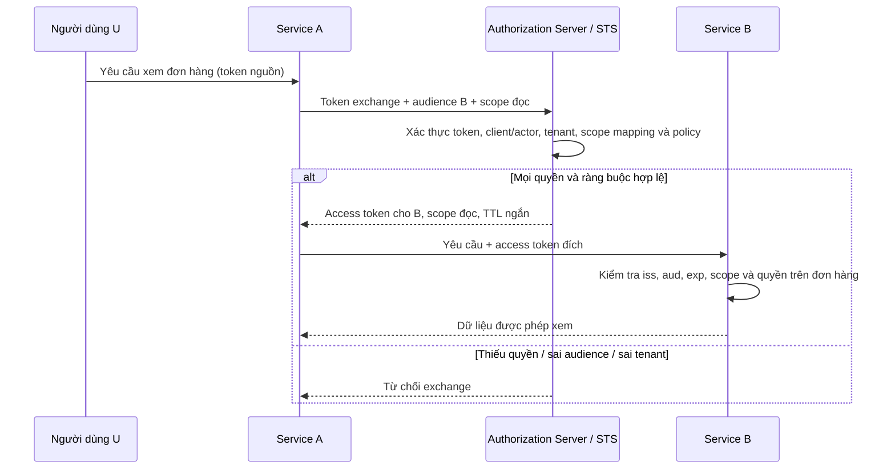

# Không mở rộng quyền trong Token Exchange

## 1. Vì sao trao đổi token có thể trở thành đường leo thang đặc quyền?

Trong hệ thống sử dụng OAuth 2.0/OIDC, một ứng dụng thường nhận **access token** cho API ở ranh giới bên ngoài rồi cần gọi dịch vụ nội bộ thay mặt người dùng. **OAuth 2.0 Token Exchange** (RFC 8693) cho phép một bên trình token đang có tới **Authorization Server / Security Token Service (STS)** để yêu cầu token mới phù hợp hơn với đối tượng nhận, phạm vi sử dụng hoặc chuỗi ủy quyền.

Khả năng cấp token mới **không tự bảo đảm tính an toàn**: nếu STS tin mọi `scope`, `audience`, `resource`, vai trò hoặc tenant mà bên yêu cầu gửi lên, kẻ tấn công có thể biến một token quyền thấp thành token quyền cao. Bài học này tập trung vào bất biến thiết kế: **exchange chỉ chuyển đổi hoặc thu hẹp quyền theo chính sách đã kiểm chứng; không tự tạo thêm đặc quyền từ một token đầu vào**.

Ngữ cảnh áp dụng là vòng đời token bảo mật: token có thể là JWT hoặc opaque; access token có thể được xác thực bằng chữ ký hoặc introspection tùy kiến trúc; refresh token dùng cho vòng đời phiên và không được mặc nhiên coi là bằng chứng đủ để xin thêm quyền. Dù token theo dạng nào, **bên phát hành token đích** phải tự quyết định quyền được cấp. Resource Server chỉ tin token đích sau khi kiểm tra issuer, audience, thời hạn và chính sách phân quyền của chính nó.

Sau bài này, người học có thể xác định nơi thực thi kiểm soát quyền trong token exchange, thiết kế *downscoping*, xử lý ủy quyền giữa dịch vụ, phân biệt thay đổi tên scope với mở rộng quyền thật sự, và xây dựng phép thử chống leo thang đặc quyền.

## 2. Hiểu chính xác các thực thể và quyền trong một lần exchange

Một yêu cầu theo RFC 8693 thường sử dụng `grant_type=urn:ietf:params:oauth:grant-type:token-exchange`, kèm `subject_token` và `subject_token_type`. Yêu cầu có thể chứa `actor_token`, `actor_token_type`, `scope`, `resource`, `audience` và `requested_token_type` nếu hệ thống hỗ trợ. Client gọi endpoint cần được xác thực theo chính sách của Authorization Server; chỉ sở hữu một chuỗi token không có nghĩa là được quyền đổi sang mọi loại token.

| Thành phần | Ý nghĩa đối với việc giữ nguyên/thu hẹp quyền |
| --- | --- |
| `subject_token` | Bằng chứng về chủ thể và ngữ cảnh đã được cấp trước đó; phải kiểm tra tính hợp lệ và mục đích sử dụng của token. |
| Client / actor đang exchange | Danh tính dịch vụ gọi STS; phải được phép thực hiện exchange và hành động thay mặt subject trong ngữ cảnh cụ thể. |
| `scope` được yêu cầu | **Yêu cầu đầu vào chưa đáng tin**. STS xác định nó có nằm trong tập quyền được phép hay không. |
| `audience` / `resource` | API đích; phải được phép nhận token cho subject/client này, không cho phép tự chọn một audience nhạy cảm bất kỳ. |
| `sub`, `act`, tenant, claims liên quan | Thể hiện ai là chủ thể, ai đang thực hiện hành động và ranh giới tổ chức; không lấy các giá trị này trực tiếp từ dữ liệu do client tự khai. |
| Token được cấp | Chỉ có hiệu lực tại audience đích, với quyền, thời hạn và các ràng buộc đã được STS chấp thuận. |

**Delegation (ủy quyền thực hiện)** có nghĩa dịch vụ A hành động thay người dùng U; token đích có thể biểu diễn `sub=U` và thông tin actor A qua claim `act` nếu định dạng và profile được dùng hỗ trợ. **Impersonation (đại diện danh tính)** có ngữ nghĩa khác và có thể không hiển thị actor theo cùng cách. STS phải áp dụng chính sách cho đúng mô hình, không suy ra quyền chỉ từ sự xuất hiện của `sub` hay `act`.

Với OIDC, **ID token dùng để cung cấp thông tin xác thực cho client**, không được mặc nhiên chuyển thành access token có quyền gọi API. Các ứng dụng phải phân biệt bằng chứng danh tính và quyền thực thi hành động.

## 3. Bất biến phân quyền: quyền đích phải có nguồn gốc hợp lệ

Trong một hệ thống mà nguồn và đích dùng **cùng một bộ quyền**, trực giác đúng là:

```text
Quyền được cấp <= quyền đã được ủy quyền hợp lệ cho ngữ cảnh hiện tại

Allowed = Requested
          ∩ SubjectAllowed
          ∩ ActorDelegable
          ∩ ClientAllowed
          ∩ TargetPolicyAllowed
```

Đây là **mô hình tư duy về giao của các ràng buộc**, không phải công thức chuẩn được RFC 8693 quy định. Tất cả tập hợp cần dùng **cùng ngữ nghĩa quyền** trước khi giao nhau. Nếu yêu cầu đòi quyền ngoài `Allowed`, STS nên từ chối phần yêu cầu không hợp lệ (thường từ chối toàn bộ yêu cầu để client nhận thấy lỗi) thay vì âm thầm nâng quyền.

Trong thực tế, API ngoài có thể dùng `orders.read`, còn dịch vụ nội bộ dùng `inventory:orders:view`. Hai chuỗi scope khác nhau **không thể so sánh bằng phép bao hàm chuỗi**. Cần một ánh xạ quyền được cấu hình, có thể kiểm toán:

```text
Quyền nguồn:        orders.read
Ánh xạ được duyệt: orders.read -> inventory:orders:view
Quyền yêu cầu:      inventory:orders:view
Kết quả:           Được xét cấp, nếu client, actor, tenant và API đích đều hợp lệ.

Quyền nguồn:        orders.read
Quyền yêu cầu:      orders.refund
Kết quả:           Từ chối, vì không có quyền hoàn tiền được ủy quyền.
```

Do đó, **không mở rộng quyền** có nghĩa không tăng khả năng hành động thực tế sau khi xét danh tính, đối tượng tài nguyên, điều kiện và ánh xạ quyền; không có nghĩa mọi token đích bắt buộc chứa đúng chuỗi scope là tập con của chuỗi scope nguồn. Một token với scope trông hẹp nhưng `aud` chuyển sang API quản trị vẫn có thể làm quyền thực tế tăng mạnh.

### Những thuộc tính bắt buộc ràng buộc khi exchange

1. **Chủ thể và nguồn tin cậy:** xác minh issuer, chữ ký hoặc introspection, loại token, trạng thái còn hiệu lực, thời gian `exp`/`nbf`, và chính sách cho phép loại token này được dùng làm đầu vào exchange. Token chỉ hợp lệ với API nguồn không nhất thiết được đem dùng tùy ý ở mọi STS.
2. **Danh tính client/actor:** xác thực client, kiểm tra quyền gọi exchange, quan hệ ủy quyền với subject và có thể yêu cầu `actor_token` hợp lệ. Một service account không tự nhận được quyền của người dùng chỉ nhờ khai `sub` của người đó.
3. **Đích sử dụng:** áp dụng allowlist audience/resource; xét quyền của subject và actor tại chính tài nguyên đích. Không cấp token cho nhiều audience khi yêu cầu thực tế chỉ cần một audience.
4. **Quyền chức năng:** ánh xạ scope hoặc role theo chính sách tường minh, từ chối mọi scope không được ánh xạ/ủy quyền. Không tự copy `roles`, `groups`, `admin=true` hay toàn bộ claims từ token nguồn sang token đích.
5. **Ranh giới tenant và dữ liệu:** tenant, tổ chức, đối tượng sở hữu và giới hạn truy cập theo bản ghi phải được lấy từ ngữ cảnh đã kiểm chứng. Quyền đọc đơn hàng tenant A không thể đổi thành quyền đọc tenant B.
6. **Thời hạn và ràng buộc sở hữu token:** token đích nên ngắn hạn, không kéo dài tùy tiện quyền ủy nhiệm; cân nhắc thu hồi, sự kiện logout, ràng buộc thiết bị/khóa (mTLS hoặc DPoP khi hệ thống hỗ trợ), và rủi ro token bị sao chép.

## 4. Luồng exchange an toàn giữa hai dịch vụ

Giả sử người dùng U đã đăng nhập và chỉ được xem đơn hàng. Gateway chuyển token liên quan đến U cho Service A; A muốn gọi Service B để lấy chi tiết đơn hàng. Service B dùng scope nội bộ `orders.detail.read`.



Điểm quyết định nằm ở cả **STS** và **Service B**. STS kiểm soát việc phát hành token; B vẫn phải áp dụng quy tắc truy cập tài nguyên (*object-level authorization*), ví dụ đơn hàng `order-789` có thuộc tenant và người dùng được phép hay không. Không được coi việc STS cấp `orders.detail.read` là quyền đọc mọi đơn hàng.

### Ví dụ HTTP: yêu cầu hợp lệ

Ví dụ minh họa dưới đây dùng tên miền giả, các chuỗi token thay thế và giả định STS hỗ trợ RFC 8693. Client cần cơ chế xác thực phù hợp (mTLS, `private_key_jwt`, client secret, v.v. theo cấu hình); không đưa credential thật vào ví dụ.

```http
POST /oauth2/token HTTP/1.1
Host: auth.example.test
Content-Type: application/x-www-form-urlencoded
Authorization: Basic <client-credentials-placeholder>

grant_type=urn:ietf:params:oauth:grant-type:token-exchange&
subject_token=<validated-source-access-token>&
subject_token_type=urn:ietf:params:oauth:token-type:access_token&
requested_token_type=urn:ietf:params:oauth:token-type:access_token&
audience=https%3A%2F%2Forders.internal.example.test&
scope=orders.detail.read
```

Đây là payload trình bày nhiều dòng để dễ đọc; khi gửi thật cần form encode chính xác, không để ký tự xuống dòng làm sai giá trị. STS kiểm tra client, token nguồn và ánh xạ `orders.read` → `orders.detail.read` đã được duyệt trước khi phát hành phản hồi minh họa:

```json
{
  "access_token": "<short-lived-token-for-orders-service>",
  "issued_token_type": "urn:ietf:params:oauth:token-type:access_token",
  "token_type": "Bearer",
  "expires_in": 300,
  "scope": "orders.detail.read"
}
```

Nếu access token đích là JWT, các claim có thể mang ý nghĩa minh họa như sau (tên tenant và cấu trúc claim là quy ước ứng dụng, không mặc định của RFC):

```json
{
  "iss": "https://auth.example.test",
  "sub": "user-42",
  "aud": "https://orders.internal.example.test",
  "scope": "orders.detail.read",
  "tenant_id": "tenant-A",
  "act": { "sub": "service-A" },
  "exp": 1900000300,
  "iat": 1900000000
}
```

Ví dụ JWT chỉ mô tả **claims logic** chứ không phải token đã được ký. Nếu token đích là opaque, Resource Server phải lấy thông tin liên quan qua cơ chế đã được tin cậy, chẳng hạn introspection, rồi kiểm tra cùng chính sách.

### Ví dụ yêu cầu bị từ chối

Service A chỉ có quyền đọc nhưng gửi `scope=orders.refund` với ý định hoàn tiền. Client A được phép gọi STS không đồng nghĩa với việc có quyền hoàn tiền trên danh nghĩa U. STS không tìm thấy ánh xạ và ủy quyền tương ứng nên từ chối, chẳng hạn:

```http
HTTP/1.1 400 Bad Request
Content-Type: application/json

{
  "error": "invalid_scope",
  "error_description": "Requested scope is not authorized for this exchange"
}
```

Nội dung lỗi là minh họa, không nên tiết lộ dữ liệu nhạy cảm về chính sách nội bộ. Với audience/resource không được phép hoặc không được hỗ trợ, RFC 8693 cũng định nghĩa lỗi `invalid_target`.

## 5. Chính sách tại STS: cấp quyền bằng allowlist

Tránh hai cách làm nguy hiểm: (a) lấy nguyên `scope` người gọi yêu cầu rồi đưa vào token mới; (b) lấy mọi `roles`/`claims` của token nguồn và đổi riêng `aud`. Cả hai có thể tạo ra **privilege laundering** (hợp thức hóa quyền cao bằng token mới).

Mã giả Java dưới đây diễn tả thứ tự kiểm soát. `verify`, `mapScopes`, `mayExchange` và các hàm policy là những thành phần bảo mật cần được triển khai thực tế, không phải API có sẵn của Spring Security:

```java
ExchangeResult exchange(ExchangeRequest req, AuthenticatedClient client) {
    VerifiedToken subject = verifier.verifySubjectToken(req.subjectToken());
    TargetPolicy target = targets.requireAllowed(req.audience());

    if (!subject.isActive() || !client.mayExchangeTo(target)) {
        return ExchangeResult.denied("access_denied");
    }
    if (!delegationPolicy.mayActFor(client, subject, target)) {
        return ExchangeResult.denied("access_denied");
    }
    if (!tenantPolicy.allows(subject.tenant(), client, target)) {
        return ExchangeResult.denied("access_denied");
    }

    // Các scope dưới đây đều đã chuẩn hóa sang ngữ nghĩa của API đích.
    Set<String> requested = target.parseRequestedScopes(req.scope());
    Set<String> sourceMapped = scopePolicy.mapScopes(subject, target);
    Set<String> delegated = delegationPolicy.allowedTargetScopes(client, subject, target);
    Set<String> clientAllowed = client.allowedScopesFor(target);
    Set<String> allowed = intersection(
        sourceMapped, delegated, clientAllowed, target.allowedScopes());

    // Fail closed: tuyệt đối không cấp thêm bất kỳ scope nào ngoài allowed.
    if (!allowed.containsAll(requested) || requested.isEmpty()) {
        return ExchangeResult.denied("invalid_scope");
    }

    return issuer.issueAccessToken(
        subject.verifiedSubject(), client.verifiedActor(), target.audience(),
        requested, subject.tenant(), tokenLifetimePolicy.limit(subject, target));
}
```

Ở sản phẩm thật cần thêm xác minh loại token/issuer, proof-of-possession nếu có, policy ràng buộc tài nguyên, dấu vết ủy quyền nhiều tầng, phiên đã bị thu hồi và tính nhất quán của claims. `subject.verifiedSubject()` phải lấy từ bằng chứng đã kiểm chứng; đối tượng `client` phải là danh tính vừa được xác thực, không phải chuỗi `client_id` tự khai trong body.

Nếu scope bị bỏ trống, **không chọn mặc định mọi quyền mà subject hoặc client có**. Chỉ cấp default scope tối thiểu, được cấu hình rõ cho API đích; nếu không có default an toàn, từ chối yêu cầu. Những quyền cấp bổ sung như `admin`, `refund`, `impersonate`, `offline_access` hoặc quyền đa tenant phải đi qua luồng cấp phép riêng và bằng chứng tương ứng (ví dụ đồng ý của người dùng, step-up authentication, hoặc phê duyệt được quy định), không tự xuất hiện sau exchange.

## 6. Các kịch bản thường gây mở rộng quyền

| Kịch bản | Sai sót phổ biến | Kiểm soát cần có |
| --- | --- | --- |
| `orders.read` → `orders.refund` | STS chép `scope` từ request | Ánh xạ quyền tường minh, deny `orders.refund` nếu không được ủy quyền. |
| Token audience A → API quản trị B | STS đổi `aud` mà không xét mức nhạy cảm | Allowlist API đích và kiểm tra quyền độc lập cho B. |
| Tenant A → tenant B | Client gửi `tenant_id=B` và STS tin ngay | Lấy tenant từ nguồn đáng tin và kiểm tra cả chính sách truy cập bản ghi. |
| Service A thay mặt U → quyền service admin | Chỉ kiểm tra quyền của A, bỏ qua quyền U | Kiểm tra cả subject, actor/client, quan hệ ủy quyền và mục đích dùng. |
| Token do issuer không tin cậy cấp | Chỉ giải mã JWT, bỏ xác minh chữ ký/issuer | Xác minh cấu hình tin cậy, thuật toán, khóa, audience và trạng thái token. |
| Chuỗi A → B → C | B làm mất actor/giới hạn ban đầu khi exchange tiếp | Bảo toàn ngữ nghĩa chuỗi ủy quyền và giới hạn quyền qua từng hop theo policy. |
| Token bị đánh cắp | Kẻ tấn công tái sử dụng bearer token để đổi token mới | Phát hiện bất thường, xác thực client, hạn chế replay, token ngắn hạn và sender-constrained token nếu phù hợp. |

Đặc biệt với **confused deputy**, một dịch vụ được tin cậy có thể bị lợi dụng làm trung gian gọi API mà kẻ yêu cầu không có quyền trực tiếp. Việc xác thực service A mới chứng minh *ai gọi*, chưa chứng minh *tại sao A được phép làm hành động đó thay U*. Phải có kiểm tra cả mục đích, subject, actor, target và tenant.

## 7. Kiểm thử, giám sát và tiêu chí nghiệm thu

Một hệ thống an toàn cần kiểm thử theo **khả năng thực hiện hành động thực tế**, ngoài việc kiểm tra chuỗi scope ở token đầu ra:

| Bài kiểm thử | Kết quả mong đợi |
| --- | --- |
| User có quyền đọc, exchange sang scope đọc tương ứng cho API được phép | Thành công; token đích chỉ dùng được tại API được phép và có TTL giới hạn. |
| User chỉ có quyền đọc, xin quyền ghi/xóa/hoàn tiền | STS từ chối; không có token quyền cao. |
| Đổi sang audience không nằm trong allowlist | Từ chối (`invalid_target` nếu phù hợp). |
| Actor/client không được phép đại diện subject | Từ chối dù `subject_token` hợp lệ. |
| Gửi tenant khác, role giả hoặc `sub` giả trong request | Không ảnh hưởng danh tính/tenant đã kiểm chứng; từ chối truy cập trái phép. |
| Dùng token hết hạn, sai issuer, bị thu hồi hoặc sai ràng buộc khóa | Exchange thất bại. |
| Dùng token đích gọi Resource Server không đúng `aud` hoặc truy cập bản ghi không sở hữu | Resource Server từ chối kể cả token có chữ ký hợp lệ. |
| Exchange nhiều hop A → B → C | Không xuất hiện thêm quyền mới; chuỗi ủy quyền được kiểm tra theo từng hop. |

Khi giám sát, ghi sự kiện **ai** thực hiện exchange (client/actor), subject tham chiếu, issuer nguồn, audience đích, scope được xin/cấp, tenant đã xác minh, quyết định policy và mã lỗi. Tránh ghi token thô, refresh token, client secret hay dữ liệu nhận dạng không cần thiết vào log. Cảnh báo với tỷ lệ `invalid_scope`, `invalid_target` tăng đột biến, trao đổi token sang API nhạy cảm hoặc hành vi một actor yêu cầu nhiều tenant trong thời gian ngắn.

### Checklist dành cho người triển khai

- STS xác minh token nguồn, danh tính client/actor và loại token được phép dùng trong exchange.
- Audience/resource và scope đích được kiểm soát bằng chính sách tường minh, ánh xạ quyền có thể kiểm toán.
- Quyền phụ thuộc đồng thời vào subject, actor/client, tenant, tài nguyên và điều kiện ủy quyền; yêu cầu lạ bị từ chối theo nguyên tắc *default deny*.
- Token đích dùng audience cụ thể, scope tối thiểu, TTL ngắn; Resource Server tiếp tục kiểm tra ủy quyền ở cấp tài nguyên.
- Các tình huống xin vượt quyền, đổi tenant, đổi audience, chuỗi exchange và token bị đánh cắp đều có phép thử phủ định.

**Điều cần nhớ:** Token Exchange là một cơ chế yêu cầu và phát hành token theo chính sách, **không phải một cơ chế tự chứng minh rằng quyền đã được thu hẹp**. Chỉ khi STS kiểm tra đầy đủ nguồn quyền và Resource Server thực thi ràng buộc ở đích, việc đổi token mới giữ được nguyên tắc đặc quyền tối thiểu.

## Tài liệu tham khảo

- IETF, **RFC 8693 — OAuth 2.0 Token Exchange**: cú pháp request/response, `subject_token`, `actor_token`, `audience`, `resource`, các khái niệm delegation và impersonation. <https://www.rfc-editor.org/rfc/rfc8693>
- IETF, **RFC 6749 — The OAuth 2.0 Authorization Framework**: khái niệm access token, scope và lỗi tại token endpoint. <https://www.rfc-editor.org/rfc/rfc6749>
- IETF, **RFC 8707 — Resource Indicators for OAuth 2.0**: yêu cầu token theo resource cụ thể. <https://www.rfc-editor.org/rfc/rfc8707>
- IETF, **RFC 9449 — OAuth 2.0 Demonstrating Proof of Possession (DPoP)**: giảm giá trị lạm dụng khi access token bị sao chép. <https://www.rfc-editor.org/rfc/rfc9449>
