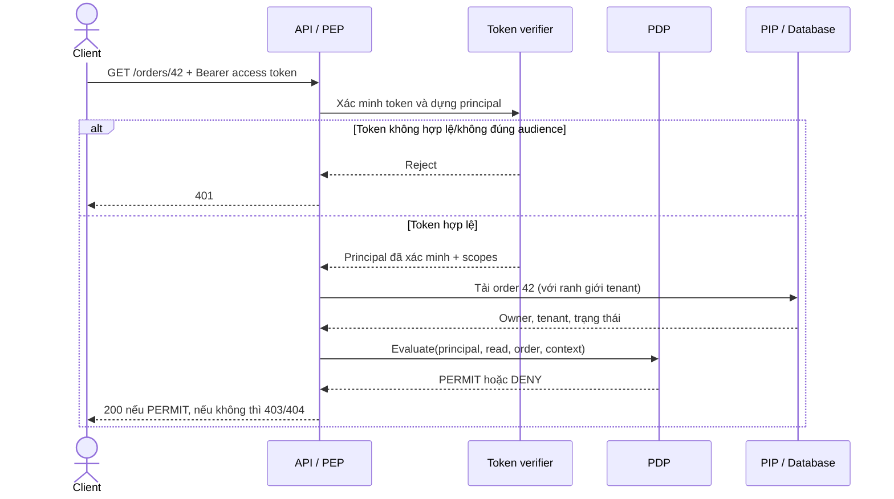

# Quyết định principal được làm gì

## Mục tiêu học tập

Trong chương **Authorization** của học phần bảo mật token, câu hỏi trung tâm không chỉ là “token có hợp lệ không?” mà còn là **“principal này có được thực hiện hành động cụ thể trên tài nguyên cụ thể, trong hoàn cảnh hiện tại không?”**.

Sau bài học, bạn có thể:

1. Phân biệt **authentication**, **token validation** và **authorization**; hiểu vai trò của principal trong quyết định cấp quyền.
2. Mô tả một yêu cầu phân quyền bằng bốn thành phần: **principal, action, resource, context**; thiết kế chính sách mặc định từ chối.
3. Áp dụng **scope**, **role**, **permission**, quyền sở hữu, quan hệ và ranh giới **tenant** mà không nhầm chúng với nhau.
4. Nhận diện các lỗi **Broken Object Level Authorization (BOLA/IDOR)**, vượt quyền và truy cập chéo tenant dù token đã được xác minh.
5. Đặt điểm kiểm tra quyền tại API/service, viết mã kiểm tra có thể kiểm thử và xử lý trường hợp quyền thay đổi sau khi token được phát hành.

## 1. Principal là ai, và “được làm gì” nghĩa là gì?

**Principal** là danh tính/chủ thể mà hệ thống bảo mật sử dụng để đánh giá một yêu cầu. Trong ứng dụng, principal có thể là người dùng đã đăng nhập, dịch vụ gọi dịch vụ khác, hoặc một workload được xác thực. Principal có thể được biểu diễn bằng đối tượng `Authentication` của framework, một service identity hay một cấu trúc nội bộ chứa các thuộc tính đã kiểm chứng.

Với hệ thống sử dụng OAuth 2.0/OIDC và token bảo mật, cần tách các khái niệm:

| Khái niệm | Trả lời câu hỏi | Ví dụ |
|---|---|---|
| **Authentication (xác thực)** | Ai hoặc thành phần nào đã được xác thực? | Người dùng `user-123` đăng nhập qua nhà cung cấp danh tính. |
| **Token validation (kiểm tra token)** | Bằng chứng được trình có đáng tin và có thể dùng tại API này không? | Access token có issuer/chữ ký hoặc introspection hợp lệ, đúng audience, còn hiệu lực. |
| **Principal** | Hệ thống đang xét quyền cho danh tính nào? | `user-123` trong tenant `tenant-a`, hoặc `billing-worker`. |
| **Authorization (phân quyền)** | Chủ thể đó có được phép làm hành động này trên đối tượng này không? | `user-123` có được đọc đơn hàng `42` không? |

Nếu API dùng **bearer access token**, token chứng minh yêu cầu có một thông tin ủy quyền được chấp nhận theo chính sách. Nó **không tự chứng minh** người đang cầm token là chủ thể ban đầu: token có thể bị đánh cắp và phát lại. Với cơ chế **sender-constrained token** như DPoP hoặc mTLS, API có thể yêu cầu bằng chứng sở hữu khóa/chứng chỉ để giảm rủi ro này.

Trong luồng OAuth 2.0, cần phân biệt **resource owner/subject** và **client**. Access token được cấp cho client để truy cập tài nguyên theo ủy quyền; token trong luồng người dùng có thể nói về người dùng, còn token trong `client_credentials` thường đại diện cho ứng dụng/dịch vụ. Đừng lấy `client_id` làm `userId` hay mặc định `sub` luôn là người dùng cuối. **ID token** của OIDC dành cho client xác thực người dùng, không được mặc nhiên dùng làm access token gọi API nghiệp vụ.

## 2. Quyết định phân quyền cần bốn đầu vào

Một cách mô tả đơn giản:

```text
decision = authorize(principal, action, resource, context, policy)
result   = PERMIT | DENY
```

Trong đó:

- **Principal:** danh tính đã được thiết lập từ nguồn tin cậy; ví dụ `user-123`, tenant `tenant-a`, quyền hiện có.
- **Action:** thao tác thực tế, như `orders:read`, `orders:update`, `payments:refund` hoặc `report:export`.
- **Resource:** tài nguyên cụ thể, như đơn hàng `42` thuộc `tenant-a`, người sở hữu `user-123`.
- **Context:** thông tin liên quan đến quyết định, như trạng thái đơn hàng, yêu cầu MFA gần đây, tenant đang hoạt động, loại thao tác hoặc chính sách rủi ro.
- **Policy:** các luật được máy chủ quản lý, ví dụ “khách hàng chỉ đọc đơn của mình” hoặc “nhân viên hỗ trợ chỉ xem đơn trong tenant được giao”.

Không phải mọi context đều cần thiết cho mọi quyết định; chỉ dùng thuộc tính có giá trị nghiệp vụ và kiểm chứng được. Nguyên tắc là **mặc định từ chối (default deny/fail closed)**: khi thiếu quyền, thiếu thuộc tính bắt buộc hoặc không xác minh được dữ liệu, không tự chuyển sang cho phép.

### Ví dụ xuyên suốt: API đơn hàng

Giả sử hệ thống có hai tenant `tenant-a` và `tenant-b`; `user-123` thuộc tenant A và tạo đơn `order-42`. Chính sách mong muốn:

1. Người có token hợp lệ cho `orders-api` và scope `orders:read` chỉ được đọc đơn hàng thuộc tenant của mình **và** đơn do mình sở hữu, trừ khi có quyền hỗ trợ được cấp rõ ràng.
2. Nhân viên hỗ trợ có permission `orders:read:any` được đọc đơn hàng trong **tenant đã được cấp quyền**, không tự vượt sang tenant khác.
3. Cập nhật hoặc hoàn tiền là **action khác**, cần quyền riêng; không suy ra từ việc được đọc.

Một access token có scope `orders:read` không biến mọi đơn hàng trong cơ sở dữ liệu thành dữ liệu công khai. Quyết định cuối cùng phải phụ thuộc vào `ownerId`, `tenantId` và các luật nghiệp vụ ở máy chủ.

## 3. Từ access token đến một principal đáng tin

**Không đọc trực tiếp payload token để tự cấp quyền.** Principal dùng trong phân quyền phải được tạo từ kết quả xác minh token và dữ liệu chính sách đáng tin cậy.

Với **JWT access token**, Resource Server cần dùng thư viện phù hợp để kiểm tra chữ ký bằng khóa/thuật toán đã cho phép, đối chiếu `iss` và `aud`, `exp`/`nbf`, loại token và các điều kiện khác của profile. Với **opaque access token**, API cần tra cứu hoặc gọi **token introspection** ở nguồn tin cậy, kiểm tra token còn `active` và nhận đúng metadata bắt buộc. Cả hai dạng đều phải áp dụng kiểm soát thu hồi/trạng thái nếu hệ thống yêu cầu thu hồi trước khi token hết hạn.

Ví dụ access token JWT minh họa chứa các claims sau, **chỉ được dùng sau khi token đã được xác minh**:

```json
{
  "iss": "https://auth.example.test",
  "sub": "user-123",
  "aud": "orders-api",
  "scope": "orders:read",
  "tenant_id": "tenant-a",
  "client_id": "shop-web",
  "exp": 1893456900
}
```

Các lưu ý quan trọng:

- `iss` xác định issuer và `aud` giới hạn API được phép nhận token. **Chữ ký hợp lệ từ issuer đúng vẫn chưa đủ** nếu audience hoặc loại token không phù hợp.
- `sub` là chủ thể được mô tả trong token; không mặc nhiên chứng minh bên gửi request chính là người dùng gốc. `client_id` là định danh client, không thay thế `sub`.
- `scope` là phạm vi ủy quyền để gọi API theo ngữ nghĩa do Authorization Server và Resource Server thống nhất. Scope không tự biểu diễn toàn bộ quyền trên bản ghi.
- `tenant_id` là **claim riêng theo hợp đồng ứng dụng**, không phải claim bắt buộc trong mọi JWT. Chỉ sử dụng sau khi xác minh nguồn và kiểm tra nó có hợp lệ với tenant mà API đang xử lý không.
- Claims như role/permission có thể **cũ** nếu quyền người dùng thay đổi sau lúc cấp token. Với hành động nhạy cảm, API có thể phải kiểm tra quyền hiện tại ở nguồn dữ liệu/chính sách thay vì chỉ dùng bản chụp trong JWT.
- Không lấy `userId` hoặc `role` do client truyền trong header `X-User-Id`, query hay JSON body làm principal đáng tin, trừ khi có **một kênh chuyển tiếp danh tính được xác thực** và ranh giới trust được thiết kế riêng.

Quá trình tạo principal nên là một chặng tập trung, được kiểm thử. Các API nghiệp vụ nhận **security context đã xác minh**, thay vì mỗi controller tự giải mã JWT theo cách riêng.

## 4. Scope, role, permission và quyền trên tài nguyên

Những từ này liên quan nhưng không đồng nghĩa:

| Cơ chế | Câu hỏi được giải quyết | Ví dụ | Giới hạn |
|---|---|---|---|
| **OAuth scope** | Client được ủy quyền gọi API với phạm vi nào? | `orders:read` | Không đủ kết luận được đọc mọi order. |
| **Role** | Chủ thể thuộc nhóm trách nhiệm nào? | `customer`, `support-agent` | Một role thô dễ cấp quá nhiều quyền. |
| **Permission** | Chủ thể có quyền thực hiện thao tác nào? | `orders:read:any` | Có thể vẫn bị giới hạn theo tenant/đối tượng. |
| **Ownership/ACL** | Chủ thể sở hữu hoặc được liệt kê quyền trên đối tượng nào? | `order.ownerId == principal.sub` | Phải kiểm tra đối tượng đang truy cập. |
| **Attribute rule** | Thuộc tính của principal, tài nguyên, ngữ cảnh có thỏa luật không? | Chỉ sửa đơn còn ở trạng thái `DRAFT` | Thuộc tính phải cập nhật và có nguồn đáng tin. |
| **Relationship rule** | Có quan hệ được cho phép với tài nguyên không? | Thành viên dự án được xem tài liệu dự án | Cần nguồn dữ liệu quan hệ và ranh giới phù hợp. |

### RBAC, ABAC và ReBAC

- **RBAC (Role-Based Access Control):** gom permission thành role, rồi gán role cho principal. Ví dụ `support-agent` có quyền đọc đơn hàng trong phạm vi được quản lý. Vẫn nên kết hợp kiểm tra tenant và đối tượng.
- **ABAC (Attribute-Based Access Control):** xét thuộc tính của principal/tài nguyên/ngữ cảnh. Ví dụ cho sửa đơn khi `ownerId` khớp và trạng thái đơn là `DRAFT`.
- **ReBAC (Relationship-Based Access Control):** xét quan hệ giữa chủ thể và tài nguyên. Ví dụ người dùng là thành viên của nhóm quản lý tài liệu cụ thể. Có thể biểu diễn bằng dữ liệu quan hệ/đồ thị.

Nhiều hệ thống kết hợp cả ba. Cách kết hợp phải được mô tả rõ: quyền một role cấp có bị ràng buộc tiếp bởi tenant và trạng thái tài nguyên không? Khi chính sách có luật cho phép và cấm cùng lúc, quy tắc ưu tiên/ghép kết quả là gì? Nếu không có định nghĩa nhất quán, các endpoint dễ cho kết quả khác nhau.

**Ví dụ:** người dùng có role `admin` của `tenant-a`. Không suy ra người đó là admin của mọi tenant. Quyết định cuối phải dùng `(tenant, role, action, resource)` thay vì chỉ kiểm tra `role == admin`.

## 5. Vị trí thực hiện quyết định: PEP, PDP và nguồn thuộc tính

Trong kiến trúc phân quyền, có thể tách các thành phần:

- **Policy Enforcement Point (PEP):** điểm chặn ở API/gateway/service, nơi **bắt buộc thực thi** quyết định; không được bỏ qua một nhánh truy cập dữ liệu.
- **Policy Decision Point (PDP):** nơi đánh giá luật và trả quyết định `PERMIT`/`DENY` hoặc kết quả tương đương.
- **Policy Information Point (PIP):** nguồn thuộc tính cần cho quyết định, như dữ liệu tenant, ownership, trạng thái tài khoản, membership hay trạng thái order.
- **Policy Administration Point (PAP):** nơi quản lý luật, quyền và thay đổi chính sách.

Đây là **vai trò logic**, có thể triển khai trong cùng service hoặc qua dịch vụ policy riêng. Việc tách thuật ngữ giúp xác định **ai** bắt buộc kiểm tra, **ai** quyết định và **dữ liệu nào** được tin.



Gateway có thể chặn yêu cầu không có token hoặc scope, nhưng **gateway thường không biết đầy đủ ownership/trạng thái của order cụ thể**. Service sở hữu dữ liệu vẫn cần kiểm tra quyền tại nơi thực thi nghiệp vụ. Không giả định frontend ẩn nút “Xóa” hay gateway cho qua là đã đủ.

## 6. Viết một policy cho thao tác đọc đơn hàng

Giả sử yêu cầu nghiệp vụ là:

- Phải có principal đang hoạt động và token đã được xác minh cho `orders-api` ở lớp bảo mật.
- Phải có scope `orders:read`.
- Order phải thuộc đúng tenant được cấp cho principal.
- Trong tenant đó, principal phải là chủ sở hữu order **hoặc** có permission hỗ trợ `orders:read:any`.

Mã Java sau **chỉ minh họa phần policy**. Nó giả định `PrincipalContext` được dựng từ security context đã xác minh và đã chuẩn hóa ở máy chủ; `Order` đến từ cơ sở dữ liệu, không lấy từ body do client tự khai báo.

```java
import java.util.Objects;
import java.util.Set;

record PrincipalContext(
    String subjectId,
    String tenantId,
    Set<String> scopes,
    Set<String> permissions,
    boolean active
) {}

record Order(String id, String ownerId, String tenantId) {}

final class OrderPolicy {
    static boolean canRead(PrincipalContext principal, Order order) {
        if (principal == null || order == null || !principal.active()) {
            return false;
        }
        if (principal.scopes() == null
                || !principal.scopes().contains("orders:read")) {
            return false;
        }
        if (principal.tenantId() == null
                || principal.tenantId().isBlank()
                || !Objects.equals(principal.tenantId(), order.tenantId())) {
            return false;
        }
        boolean ownsOrder = principal.subjectId() != null
                && Objects.equals(principal.subjectId(), order.ownerId());
        boolean supportCanRead = principal.permissions() != null
                && principal.permissions().contains("orders:read:any");

        return ownsOrder || supportCanRead;
    }
}
```

Trong ứng dụng thật, lớp xác minh token cần bảo đảm audience, issuer, thời hạn, loại token và trạng thái phù hợp **trước khi** tạo `PrincipalContext`. Nếu role/permission thay đổi thường xuyên, `permissions` phải được lấy hoặc xác nhận từ nguồn policy có độ tươi đáp ứng yêu cầu nghiệp vụ. Kiểm tra token và kiểm tra resource policy là **hai bước bắt buộc phối hợp**.

### Điểm gọi policy trong service

```text
order = repository.load(orderId)            # dữ liệu tin cậy từ máy chủ
principal = verifiedSecurityContext.currentPrincipal()

if order is missing:
    return 404
if not OrderPolicy.canRead(principal, order):
    return 403  # hoặc 404 nếu cần che giấu sự tồn tại
return 200 with OrderDto.fromAuthorizedFields(order)
```

Cần đặt policy trên **đường xử lý dữ liệu thực tế**, kể cả thao tác qua job, event handler hoặc endpoint khác. Một method chỉ bảo vệ controller web nhưng service có nhiều đường gọi có thể bỏ lọt quyền. Khi tìm order, nên ưu tiên truy vấn có ràng buộc tenant hoặc cơ chế cô lập dữ liệu tương đương; vẫn thực hiện policy cho ownership/permission và xác định rõ hành vi khi không tìm thấy hoặc bị cấm.

## 7. Những lỗi phân quyền thường gặp khi đã dùng token

| Tình huống | Sai lầm | Hệ quả | Cách xử lý |
|---|---|---|---|
| `GET /orders/42` với token có `orders:read` | Chỉ kiểm tra scope, không kiểm tra owner/tenant. | **BOLA/IDOR**: đọc đơn của người khác. | Kiểm tra quyền trên từng order. |
| Cùng một JWT được gửi từ client A tới API B | API B chỉ kiểm tra chữ ký, bỏ qua `aud`. | Token bị dùng sai dịch vụ. | Kiểm tra audience và mục đích access token. |
| Form gửi `{ "role": "admin" }` | API coi role trong body là quyền thực. | Nâng quyền do dữ liệu tự khai báo. | Lấy role từ policy/nguồn đã xác minh. |
| Admin tenant A gọi `/orders?tenant=tenant-b` | Tin tenant từ query mà không đối chiếu principal. | Truy cập chéo tenant. | Tách ranh giới tenant; kiểm tra cả quyền quản trị theo tenant. |
| Token hợp lệ chứa role cũ | Người dùng bị thu hồi quyền nhưng JWT còn hạn. | Quyền cũ tiếp tục có tác dụng. | Kiểm tra phiên/policy hiện tại cho thao tác nhạy cảm; TTL/thu hồi phù hợp. |
| Frontend ẩn nút hoàn tiền | Backend không kiểm tra `refund`. | Gọi API trực tiếp vượt luồng giao diện. | Kiểm tra action tại service/API. |
| Endpoint `PATCH` chấp nhận mọi field | Chỉ kiểm tra quyền sửa đơn, nhưng client gửi `tenantId`, `ownerId`. | **Mass assignment** thay đổi thuộc tính nhạy cảm. | Dùng DTO allowlist, kiểm tra quyền theo từng thao tác/field. |
| Quyết định dựa trên dữ liệu cũ | Trạng thái order thay đổi trước khi ghi. | **TOCTOU**: thao tác thực hiện khi điều kiện đã hết đúng. | Kiểm tra lại trong transaction/điều kiện ghi nguyên tử khi cần. |

### BOLA và kiểm tra cấp đối tượng

Lỗi BOLA (Broken Object Level Authorization) xảy ra khi API **nhận ID hợp lệ** rồi truy xuất đối tượng mà không kiểm tra người gọi có quyền đối với **chính đối tượng đó**. ID có ngẫu nhiên hoặc khó đoán cũng không thay cho kiểm tra quyền; attacker có thể thu thập ID qua liên kết, log, thông báo hoặc nguồn khác. Đổi `/orders/42` thành `/orders/43` là ví dụ đơn giản để kiểm thử sự cô lập.

Ngoài kiểm tra `read`, các thao tác `update`, `delete`, `approve`, `refund`, `export` cũng cần **action policy riêng**. Có quyền xem không kéo theo quyền sửa; có quyền sửa địa chỉ giao hàng không kéo theo quyền thay đổi số tiền hoặc tenant.

## 8. Phân quyền theo ngữ cảnh, trạng thái và thời điểm

Một hệ thống có nhiều lớp điều kiện. Ví dụ người dùng chỉ được **hủy đơn** khi:

1. Token là access token hợp lệ dành cho `orders-api` và scope cho phép yêu cầu hủy.
2. Principal có quyền thao tác với đơn này theo ownership và tenant.
3. Order đang ở trạng thái `PENDING`; order đã vận chuyển thì không thể hủy theo cùng chính sách.
4. Các điều kiện nghiệp vụ bổ sung, nếu có, được kiểm tra tại lúc ghi.

Khi cần đảm bảo trạng thái không đổi giữa kiểm tra và cập nhật, có thể đưa điều kiện vào lệnh cập nhật nguyên tử hoặc dùng cơ chế transaction/locking phù hợp. Ví dụ minh họa về ý tưởng:

```sql
UPDATE orders
SET status = 'CANCELLED'
WHERE id = :orderId
  AND tenant_id = :verifiedTenantId
  AND owner_id = :verifiedSubjectId
  AND status = 'PENDING';
-- Chỉ coi là thành công nếu số dòng được cập nhật bằng 1.
```

Nếu chính sách cho nhân viên hỗ trợ hủy hộ người dùng, phải xây dựng **nhánh điều kiện được phép rõ ràng** cho permission ấy; không loại bỏ toàn bộ kiểm tra tenant/ownership chỉ vì caller có role rộng. Các giá trị `verifiedTenantId` và `verifiedSubjectId` phải được lấy từ security context đã xác minh, không trực tiếp từ request.

### Khi quyền thay đổi trong lúc token còn hạn

JWT ký hợp lệ mang role hoặc permission có thể tiếp tục biểu diễn trạng thái **tại thời điểm cấp token**. Sau khi thu hồi role, khóa tài khoản hay thay đổi membership, API chỉ dựa vào claim cũ có thể cho phép thao tác thêm một khoảng thời gian. Giải pháp tùy mức độ nhạy cảm:

- Access token có TTL ngắn, scope và audience hẹp.
- Token introspection hoặc kiểm tra phiên/chính sách hiện tại khi cần hiệu lực thu hồi nhanh.
- Quy tắc cache rõ thời gian sống và cơ chế vô hiệu hóa khi permission/membership thay đổi.
- Kiểm tra lại các điều kiện đối tượng ngay tại service hoặc transaction, nhất là tác vụ tài chính và thay đổi quyền.

Không phải mọi request đều cần gọi cơ sở dữ liệu chỉ để đọc quyền; quyết định kiến trúc là **đánh đổi độ trễ với độ tươi của quyền**, theo mức độ rủi ro và yêu cầu thu hồi của từng thao tác.

## 9. Kết quả quyết định và cách phản hồi an toàn

| Tình huống | Cách phản hồi thường dùng | Ý nghĩa |
|---|---|---|
| Thiếu access token hoặc token không hợp lệ/hết hạn/sai audience | **401 Unauthorized** | Yêu cầu thiếu thông tin xác thực có thể chấp nhận; với bearer có thể dùng `WWW-Authenticate` phù hợp. |
| Token hợp lệ nhưng scope/permission không đủ | **403 Forbidden** | Principal chưa được phép thực hiện action. |
| Token hợp lệ nhưng order thuộc người khác | **403** hoặc **404** theo chính sách | Không cho truy cập; dùng 404 khi cần hạn chế tiết lộ sự tồn tại của đối tượng. |
| Tài nguyên thực sự không tồn tại | **404 Not Found** | Không có tài nguyên tương ứng. |

Không đưa token nguyên văn, refresh token, secret hoặc dữ liệu nhạy cảm của resource vào log hay lỗi trả về. Audit nên ghi **ai được xác định**, **action**, **resource ID/tenant đã được phép ghi log**, quyết định và lý do ở mức an toàn. Không tin giá trị principal/client lấy trực tiếp từ body khi làm audit về quyền; việc đó khiến điều tra sự cố sai lệch.

Một số hệ thống trả `404` cho cả resource không tồn tại và resource không được phép để hạn chế dò tìm. Cách trả HTTP không thay đổi yêu cầu cốt lõi: **không được lộ tài nguyên khi chính sách từ chối**.

## 10. Ma trận kiểm thử quyết định phân quyền

Giả sử `order-42` thuộc `tenant-a` và do `user-123` sở hữu; mặc định các token trong bảng đều được xác minh đúng trừ khi có ghi khác:

| Principal và yêu cầu | Kỳ vọng | Lý do |
|---|---|---|
| `user-123`, tenant A, scope `orders:read`, đọc order-42 | **PERMIT** | Đúng scope, tenant, owner. |
| `user-456`, tenant A, scope `orders:read`, đọc order-42 | **DENY** | Cùng tenant nhưng không phải owner, không có permission hỗ trợ. |
| `user-789`, tenant B, scope `orders:read`, đọc order-42 | **DENY** | Khác tenant. |
| Support tenant A có `orders:read:any` và scope `orders:read` | **PERMIT** | Được cấp quyền hỗ trợ trong đúng tenant. |
| Support tenant B có `orders:read:any` và scope `orders:read` | **DENY** | Permission không vượt ranh giới tenant. |
| `user-123` nhưng token chỉ có scope `orders:write` | **DENY** | Không có scope đọc theo hợp đồng API minh họa. |
| `user-123` với token hết hạn hoặc `aud=billing-api` | **DENY** | Chưa qua lớp kiểm tra token; không hình thành principal được chấp nhận cho API này. |
| `user-123` với `orders:read` yêu cầu xóa order-42 | **DENY** | Quyền đọc không cấp quyền xóa. |
| User bị khóa sau khi nhận token, thao tác nhạy cảm | **DENY theo chính sách thu hồi/kiểm tra trạng thái** | Không chấp nhận quyền bị thu hồi chỉ vì claim cũ còn tồn tại. |

Khi viết test, cần thử cả **đúng đối tượng** và **sai đối tượng**, thay đổi ID, tenant, scope, trạng thái order, chủ sở hữu và quyền trong khi token còn hiệu lực. Nếu hệ thống hỗ trợ nhiều đường gọi cùng một service, kiểm tra rằng chính sách được thực thi tại tất cả các đường gọi ấy. Thử nghiệm `PERMIT` quan trọng để tránh chặn sai chức năng hợp lệ, nhưng tình huống `DENY` mới phát hiện nhiều lỗi vượt quyền.

## 11. Tình huống tự luyện

**Tình huống A — Có JWT và role `admin`:** API nhận JWT đúng chữ ký, có `role=admin`, nhưng `aud` dành cho dịch vụ khác. Có cho phép cập nhật quyền người dùng không?

**Trả lời:** Không. JWT không được phát hành cho API hiện tại; sau khi token phù hợp, API vẫn phải xét permission cụ thể, tenant và đối tượng người dùng bị thay đổi.

**Tình huống B — Đọc được nhưng không được sửa:** Token có `orders:read`, chủ thể sở hữu order. Gọi `PATCH /orders/42` có hợp lệ không?

**Trả lời:** Không nếu chính sách sửa yêu cầu scope/permission khác. Quyền trên một action không suy ra quyền trên action khác.

**Tình huống C — Admin theo tenant:** Tài khoản có role `tenant-admin` của tenant A. Request gửi query `tenant=tenant-b`. Có cho phép xem báo cáo tenant B không?

**Trả lời:** Không, trừ khi có một chính sách ủy quyền xuyên tenant được cấp riêng và xác minh đầy đủ. Tenant trong query chỉ là dữ liệu yêu cầu, không phải quyền.

**Tình huống D — Thu hồi permission:** Một nhân viên vừa mất quyền `payments:refund` nhưng JWT còn hạn 20 phút. API chỉ đọc role trong JWT có thể vẫn cho phép không?

**Trả lời:** Có thể. Đó là rủi ro quyền bị cũ; tác vụ nhạy cảm cần cơ chế cập nhật/thu hồi quyền kịp thời theo chính sách.

**Tình huống E — Token opaque:** Introspection trả `active: true`, có scope `orders:read` và audience đúng. Người gọi muốn xem order của người khác. API phải làm gì?

**Trả lời:** Tiếp tục kiểm tra owner, tenant và quyền hỗ trợ trên **order cụ thể**. `active: true` mới xác nhận một phần trạng thái token, không phải quyết định truy cập bản ghi.

## Ghi nhớ

**Xác minh token tạo nền tảng tin cậy cho principal; authorization quyết định principal được làm gì trên từng tài nguyên.** Để cho phép một thao tác, hệ thống cần token đúng issuer/audience/mục đích và còn hiệu lực, scope/quyền phù hợp, chính sách trên tài nguyên và tenant, cùng trạng thái nghiệp vụ cho phép. Cách tổ chức role, permission, ABAC hoặc quan hệ có thể khác nhau, nhưng quyết định phải được **thực thi phía máy chủ**, trên dữ liệu đáng tin cậy, với nguyên tắc mặc định từ chối.

### Tài liệu tham khảo

- [RFC 6749 — The OAuth 2.0 Authorization Framework](https://www.rfc-editor.org/rfc/rfc6749)
- [RFC 6750 — OAuth 2.0 Bearer Token Usage](https://www.rfc-editor.org/rfc/rfc6750)
- [RFC 7662 — OAuth 2.0 Token Introspection](https://www.rfc-editor.org/rfc/rfc7662)
- [RFC 8725 — JSON Web Token Best Current Practices](https://www.rfc-editor.org/rfc/rfc8725)
- [RFC 9068 — JSON Web Token Profile for OAuth 2.0 Access Tokens](https://www.rfc-editor.org/rfc/rfc9068)
- [OWASP API Security Top 10 (2023): API1 — Broken Object Level Authorization](https://owasp.org/API-Security/editions/2023/en/0xa1-broken-object-level-authorization/)
