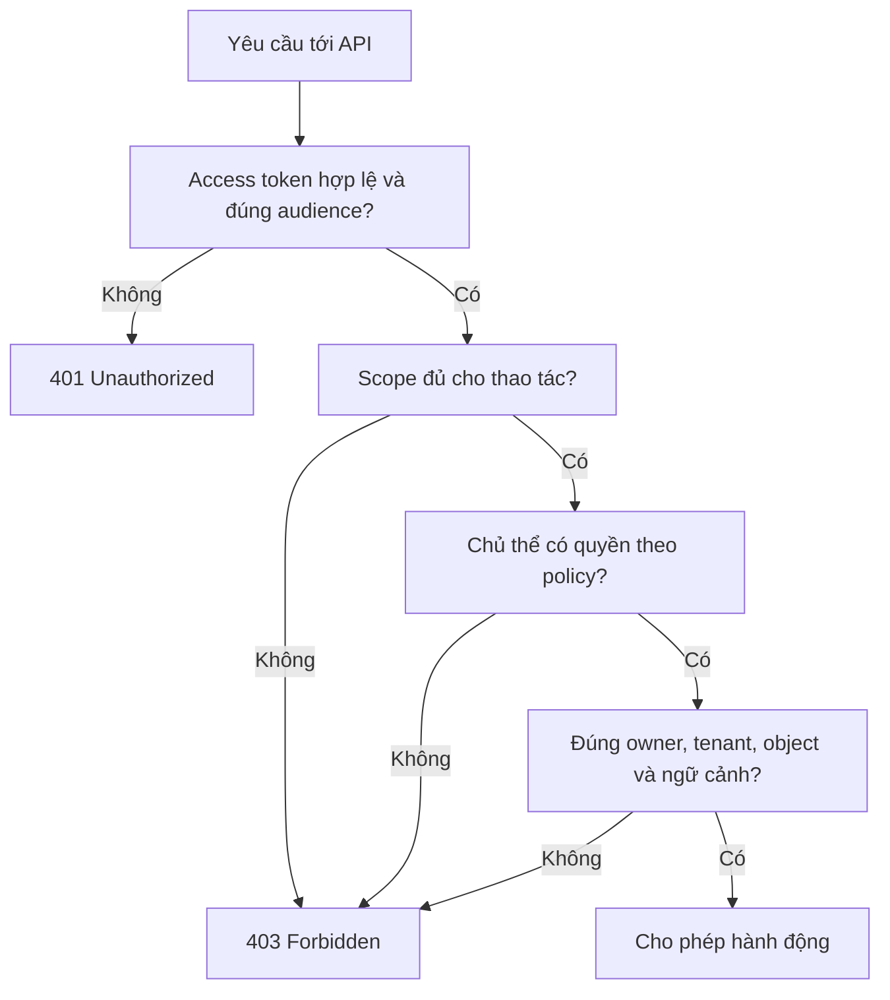
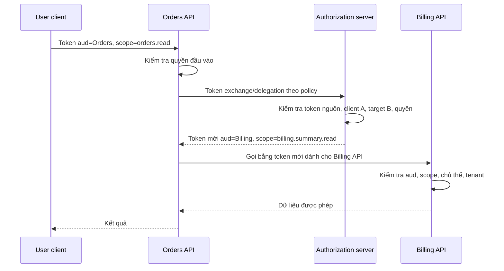

# Least privilege cho token

Một hệ thống có thể kiểm tra chữ ký JWT hoàn toàn chính xác mà vẫn để lộ dữ liệu. Ví dụ, `reporting-service` chỉ cần đọc báo cáo tổng hợp nhưng lại được phát access token có thể xóa đơn hàng, truy cập hồ sơ nhân viên và gọi mọi API. Khi token đó bị đánh cắp, kẻ tấn công thừa hưởng những quyền không cần thiết ấy. Đây là lỗi **phân quyền quá mức** (overprivilege), không phải lỗi thuật toán ký.

Nguyên tắc **least privilege** (đặc quyền tối thiểu) yêu cầu mỗi người dùng, ứng dụng, dịch vụ và token chỉ nhận **những quyền thực sự cần để hoàn thành một nhiệm vụ, đối với đúng tài nguyên, trong thời gian cần thiết**. Với token, nguyên tắc này tác động đến phạm vi cấp quyền, nơi token được dùng, cách API kiểm tra quyền và cơ chế thu hồi khi rủi ro thay đổi.

Bài thuộc chương **Authorization** của module **SECURITY_TOKEN_SECURITY_FUNDAMENTALS**. Nội dung liên hệ mô hình tin cậy, vòng đời token, JWT/opaque token, access/refresh token, OAuth 2.0/OIDC, issuer, scope, audience, claims, lưu trữ, thu hồi và phòng chống token bị đánh cắp hoặc phát lại.

Sau bài học, bạn có thể:

- Thiết kế access token có scope, audience, chủ thể và thời hạn phù hợp với từng API và tác vụ.
- Phân biệt **quyền của token**, **quyền của người dùng/service** và **quyền trên một bản ghi cụ thể**.
- Vận dụng least privilege cho web, mobile và service-to-service (S2S), kể cả khi API gọi thay mặt người dùng.
- Giải thích tại sao chữ ký hợp lệ, role `admin` hoặc scope rộng không thể tự cho phép mọi thao tác.
- Thiết kế kiểm tra quyền, giảm quyền khi chuyển tiếp, quản lý vòng đời, giám sát và kiểm thử chống leo thang quyền.

## 1. Least privilege áp dụng ở những ranh giới nào?

Giả sử nhân viên bán hàng đăng nhập thành công rồi muốn xem một đơn hàng. Quyền thực tế phải được đánh giá từ nhiều góc:

1. **Danh tính:** ai đang yêu cầu? Có tin issuer đã cấp credential không?
2. **Khả năng của token:** access token dùng được ở API nào, có scope/permission gì?
3. **Quyền của chủ thể:** người dùng/service có role, quan hệ hay quyền nghiệp vụ nào theo chính sách hiện hành?
4. **Đối tượng dữ liệu:** đơn hàng thuộc đúng tenant/cửa hàng/người dùng được phép truy cập không?
5. **Ngữ cảnh giao dịch:** thao tác có đòi MFA đủ mới, phê duyệt bổ sung, hạn mức hoặc trạng thái nghiệp vụ phù hợp không?

**Một điều kiện đúng không bù được điều kiện sai.** Access token có `orders.read` không tự cho phép xem mọi đơn hàng. Nhân viên có role `manager` không được dùng token dành cho API khác. MFA mạnh không tự cấp quyền `payments.refund`.



Mô hình kiểm tra quyền là **phép giao các điều kiện được phép**, không phải phép cộng quyền. Nếu token chỉ có `orders.read` nhưng user được phép ghi, request sửa đơn vẫn bị từ chối bằng token ấy. Nếu token có `orders.write` nhưng user không thuộc tenant chứa đơn, API vẫn phải từ chối.

## 2. Những chiều cần giới hạn của một access token

| Chiều giới hạn | Câu hỏi thiết kế | Ví dụ |
| --- | --- | --- |
| **Chủ thể và client** | Token gắn với người dùng, service hay ứng dụng nào? | `sub=user-42`, `client_id=backoffice-web` |
| **Audience / resource** | Token chỉ được dùng tại API nào? | `aud=https://api.example.com/orders` |
| **Thao tác** | Được đọc, tạo, sửa, xóa hay hoàn tiền? | `scope=orders.read` |
| **Dữ liệu cụ thể** | Chủ thể có quyền với bản ghi/tenant này không? | Chỉ các đơn của `tenant-a` |
| **Thời gian và phiên** | Quyền tồn tại bao lâu, gia hạn/thu hồi thế nào? | Access token hết hạn sau thời gian ngắn |
| **Ngữ cảnh và delegation** | Có cần phê duyệt, xác thực mới hay giữ dấu vết service gọi thay user không? | Hoàn tiền cần ngữ cảnh đủ tin cậy |

Access token thường là **bearer token**: bên nào sở hữu chuỗi token có thể thử sử dụng quyền mà nó đại diện. Giới hạn quyền và thời hạn làm giảm thiệt hại khi lộ token; HTTPS, bảo vệ thiết bị, chống XSS, giám sát và sender-constrained token giúp giảm khả năng bị lấy và phát lại.

### Scope, role và object policy là những lớp khác nhau

| Khái niệm | Ví dụ | Nơi quyết định chính |
| --- | --- | --- |
| **Scope của access token** | `orders.read`, `orders.create` | Authorization server cấp theo policy; resource server xác minh |
| **Role/permission nghiệp vụ** | `seller`, `store-manager` | Hệ thống phân quyền và dữ liệu đáng tin |
| **Object-level policy** | Người bán chỉ xem đơn thuộc cửa hàng mình | Resource server kiểm tra với dữ liệu nghiệp vụ |
| **Context policy** | Hoàn tiền lớn cần MFA mới và phê duyệt | Dịch vụ nghiệp vụ/IdP/risk policy |

OAuth 2.0 `scope` mô tả phạm vi truy cập được ủy quyền. Nó **không có bộ tên chung** cho mọi API: `orders.read` và `refund.execute` là các tên do hệ thống tự quy định. Role trong JWT cũng không mang cùng ngữ nghĩa giữa các hệ thống khi chưa có hợp đồng. Claim `tenant_id`, nếu có, chỉ đáng tin sau khi xác minh nguồn phát hành; nó không mặc nhiên thay thế kiểm tra quyền tenant theo dữ liệu hiện hành.

## 3. Authorization server và resource server chia trách nhiệm

**Authorization server (AS)** xác định client, chủ thể, các quyền có thể cấp, chính sách và API mục tiêu trước khi phát hành access token. AS phải **giới hạn yêu cầu của client**: client xin `admin:*` không đồng nghĩa AS sẽ cấp `admin:*`. Sự đồng ý (consent) của người dùng không thể vượt quyền hiện có của họ hay quyền client được phép nhận.

**Resource server (RS)** là API nắm tài nguyên. RS kiểm tra token **và** tự quyết định request có được thực hiện hay không. Không thể suy ra scope tồn tại trong token thì đơn hàng cụ thể thuộc quyền người dùng. Kiểm tra phải được áp dụng nhất quán ở endpoint và logic nghiệp vụ, bao gồm cả đường gọi nội bộ.

```mermaid
sequenceDiagram
    participant C as Client
    participant AS as Authorization server
    participant API as Orders API
    participant DB as Dữ liệu/Policy
    C->>AS: Xin access token cho Orders API + orders.read
    AS->>AS: Kiểm tra client, chủ thể, policy và scope
    AS-->>C: Token đúng audience/scope/expiry
    C->>API: GET /orders/42 + bearer token
    API->>API: Chữ ký/introspection, iss, aud, exp, scope
    API->>DB: Kiểm tra owner, tenant, trạng thái đơn 42
    DB-->>API: Quyết định policy hiện hành
    API-->>C: 200 nếu mọi kiểm tra PASS; ngược lại từ chối
```

**Claims là dữ liệu xác nhận từ bên phát hành, không phải chỉ thị buộc API cho phép.** Một request tự gửi `X-Role: admin` hoặc `tenant_id=other-company` không được nâng quyền nếu các giá trị đó chỉ đến từ client.

## 4. Thiết kế scope vừa đủ chi tiết

### 4.1. Chọn tên scope theo khả năng nghiệp vụ

Với Orders API, một hợp đồng scope có thể là:

| Scope | Tác dụng mong muốn | Ai thường cần? |
| --- | --- | --- |
| `orders.read` | Đọc đơn hàng mà chủ thể có quyền xem | Web bán hàng, báo cáo |
| `orders.create` | Tạo đơn mới trong phạm vi hợp lệ | Checkout service |
| `orders.update` | Sửa trường được chính sách cho phép | Nhân viên xử lý đơn |
| `orders.cancel` | Hủy đơn theo điều kiện trạng thái | Dịch vụ xử lý hủy |
| `orders.refund` | Khởi tạo hoàn tiền theo policy riêng | Refund service/nhân viên được ủy quyền |

Không nên cấp `orders.manage` cho tất cả client khi `report-dashboard` chỉ cần đọc và `checkout-service` chỉ cần tạo. Tuy nhiên **không nhất thiết phải tạo một scope cho mỗi endpoint hoặc mỗi bản ghi**: chia quá nhỏ có thể khiến policy khó quản lý, khó audit và phát sinh nhiều quyền không dùng đến.

Ranh giới hợp lý là **khả năng nghiệp vụ có ý nghĩa**. Đọc thường tách khỏi ghi; hủy/hoàn tiền nhạy cảm nên tách khỏi cập nhật thông thường. Tên scope cần được tài liệu hóa, gắn với hành động rõ ràng và có chiến lược thay đổi khi API tiến hóa.

### 4.2. Vì sao `orders.read` vẫn phải kiểm tra owner?

Giả sử access token có payload JWT minh họa như sau (chưa thể tin claims khi chưa xác minh chữ ký):

```json
{
  "iss": "https://auth.example.com",
  "sub": "user-42",
  "aud": "https://api.example.com/orders",
  "scope": "orders.read",
  "iat": 1795000000,
  "exp": 1795000900
}
```

Token này chỉ biểu thị rằng yêu cầu đọc Orders API **có thể được xét**. Nó không xác nhận `user-42` sở hữu mọi đơn hàng. Khi client gọi `GET /orders/9001`, API vẫn phải tra dữ liệu và kiểm tra owner, tenant, quan hệ nghiệp vụ/role trước khi trả kết quả. Nếu chỉ dựa vào scope, API mắc lỗi **Broken Object Level Authorization (BOLA/IDOR)**.

Một số nguyên tắc triển khai:

- **Deny by default:** nếu không có policy cho phép rõ ràng, từ chối.
- Xác minh principal và quyền từ nguồn đáng tin; đối chiếu với dữ liệu hiện hành.
- Kiểm tra cả quyền trên **bản ghi (row/object)** và trên **trường (field/property)** khi cần.
- Không dùng tenant ID do client gửi làm bằng chứng được phép truy cập tenant đó.
- Áp dụng cùng một chính sách ở REST, GraphQL, jobs, bulk/export endpoints và các luồng gọi nội bộ.

## 5. Audience: token phải dùng ở đúng API

**Audience** thường là lớp giới hạn quan trọng ngay sau scope. Token cấp cho Billing API không được Inventory API chấp nhận chỉ vì cùng issuer và chữ ký hợp lệ. Nếu API bỏ qua `aud`, kẻ tấn công có thể sử dụng token hợp lệ ở nơi khác.

Ví dụ một JWT access token minh họa (payload đã giải mã):

```json
{
  "iss": "https://auth.example.com",
  "sub": "inventory-service",
  "aud": "https://api.example.com/pricing",
  "client_id": "inventory-service",
  "scope": "prices.read",
  "iat": 1795000000,
  "nbf": 1795000000,
  "exp": 1795000600,
  "jti": "pricing-token-001"
}
```

`pricing-api` có thể xem xét token nếu issuer, chữ ký, profile, audience và các điều kiện hợp lệ; `payroll-api` phải từ chối vì token **không dành cho nó**. Giá trị `aud` là identifier được thỏa thuận, không nhất thiết là URL có thể truy cập. Một token có nhiều audience có thể được cấp theo kiến trúc cụ thể, nhưng nên tránh audience rộng không cần thiết vì tăng số dịch vụ chấp nhận token.

OAuth 2.0 có **Resource Indicators** (RFC 8707): client có thể chỉ định tài nguyên đích, ví dụ `resource=https://api.example.com/pricing`. AS vẫn quyết định yêu cầu có hợp lệ và cách ánh xạ tài nguyên thành audience. **Không được giả định** chỉ cần gửi `resource` thì chắc chắn nhận được `aud` tương ứng; client và API phải theo đúng hợp đồng triển khai.

### Scope không thay thế audience

| Token | Audience | Scope | Quyền sử dụng |
| --- | --- | --- | --- |
| A | Orders API | `orders.read` | Chỉ Orders API, theo policy chủ thể |
| B | Pricing API | `prices.read` | Chỉ Pricing API, theo policy |
| C | Orders API | `orders.cancel` | Chỉ hủy đơn thuộc quyền của chủ thể |
| D | Billing API | `payments.refund` | Chỉ Billing API, theo quy trình hoàn tiền |

Hai API có thể cùng định nghĩa một tên scope nhưng mang ý nghĩa khác nhau. Kết hợp **audience đúng** với **scope đúng** ngăn token được đem dùng sai tài nguyên.

## 6. Không nhầm loại token với mức quyền

| Thành phần | Mục đích | Quy tắc least privilege |
| --- | --- | --- |
| **Access token** | Client trình đến resource server để yêu cầu truy cập | Giới hạn audience, scope, chủ thể, tuổi thọ và ngữ cảnh |
| **Refresh token** | Client trình đến AS để xin access token mới | Giới hạn client, phiên/quyền đã cấp, bảo vệ lưu trữ, rotation/thu hồi |
| **ID token (OIDC)** | Truyền kết quả xác thực danh tính đến OIDC client | Không dùng làm access token gọi API |
| **Session cookie** | Liên kết browser với phiên ứng dụng/IdP | Giới hạn phạm vi cookie, thời hạn, quyền phiên backend |

**JWT hoặc opaque là định dạng/kiểu biểu diễn, không phải mức quyền.** JWT có thể chứa quá nhiều scope; opaque token cũng có thể quá quyền dù không đọc được nội dung. JWT ký thông thường (JWS) bảo vệ tính toàn vẹn và nguồn ký, **không mã hóa** payload. Opaque access token thường được API kiểm tra qua token introspection hoặc kho trạng thái đáng tin.

ID token OIDC thường có `aud` là **OIDC client**, không phải resource server. API không được chấp nhận ID token như bearer access token chỉ vì chữ ký hợp lệ. Để tránh nhầm lẫn giữa các loại JWT, phải kiểm tra issuer, audience, mục đích/token profile và những thuộc tính được quy định (ví dụ `typ` khi áp dụng).

## 7. Phát hành scope tối thiểu trong OAuth 2.0

### 7.1. Ứng dụng có người dùng: Authorization Code + PKCE

Ứng dụng web/mobile public client thường dùng Authorization Code Flow với PKCE. Người dùng xác thực tại AS; client chỉ yêu cầu scopes cần cho tính năng đang thực hiện. Ví dụ authorization request (dòng được xuống để dễ đọc; triển khai thật cần URL-encode theo chuẩn):

```http
GET /authorize?response_type=code&client_id=orders-mobile
    &redirect_uri=https%3A%2F%2Fapp.example.com%2Foauth%2Fcallback
    &scope=openid%20orders.read
    &resource=https%3A%2F%2Fapi.example.com%2Forders
    &state=unpredictable-state
    &code_challenge=derived-challenge
    &code_challenge_method=S256 HTTP/1.1
Host: auth.example.com
```

Đây là ví dụ học thuật, chưa chứa toàn bộ điều kiện đăng ký client/redirect và xử lý lỗi. `openid` yêu cầu lớp OIDC; `orders.read` là scope nghiệp vụ. Khi cần tạo đơn, client có thể xin `orders.create` phù hợp trong phạm vi policy. **Yêu cầu thêm scope không tự cấp quyền:** AS phải kiểm tra policy/consent, và API vẫn kiểm tra object policy.

**Incremental authorization** là chỉ xin quyền mở rộng khi thực sự cần chức năng đó, nếu AS và trải nghiệm ứng dụng hỗ trợ. Ứng dụng chỉ xem đơn trong lần đầu không cần xin `orders.refund` sẵn. Cũng cần tránh yêu cầu consent lặp đi lặp lại gây khó chịu nếu không có lợi ích an toàn tương xứng.

### 7.2. Service-to-service: Client Credentials

Workload không có người dùng tương tác có thể sử dụng `grant_type=client_credentials`. AS xác thực service qua mTLS, private-key JWT, workload identity hoặc secret được bảo vệ theo chính sách.

```http
POST /oauth2/token HTTP/1.1
Host: auth.example.com
Content-Type: application/x-www-form-urlencoded

grant_type=client_credentials&scope=prices.read&resource=https%3A%2F%2Fapi.example.com%2Fpricing
```

Ví dụ chủ động không trình bày credential client: **chỉ gửi `grant_type` và `scope` không đủ để được cấp token**. Nếu `inventory-service` chỉ đọc giá, AS nên cấp `prices.read` cho Pricing API. Không dùng một `super-service-account` có thể gọi mọi dịch vụ cho mọi workload; không ghi credential trong repo, image, CI log hay cấu hình công khai.

Với Client Credentials, thông thường service chỉ xin access token mới thay vì dùng refresh token. Khi cache token, cần phân tách theo **audience, scope, client identity** và thời hạn, không dùng token API A cho API B.

### 7.3. AS phải giới hạn quyền thay vì tin yêu cầu của client

Ví dụ mô hình ý tưởng:

```text
requested_scopes = {"orders.read", "orders.refund"}
client_allowed_scopes = {"orders.read"}
subject_allowed_scopes = {"orders.read", "orders.create"}
resource_allowed_scopes = {"orders.read", "orders.create"}

issued_scopes = requested_scopes
                INTERSECT client_allowed_scopes
                INTERSECT subject_allowed_scopes
                INTERSECT resource_allowed_scopes
# Kết quả: {"orders.read"}
```

Đây là mô hình giải thích, **không phải thuật toán OAuth bắt buộc**. AS thực tế còn kiểm tra loại grant, tenant, consent, chính sách tổ chức, assurance và điều kiện khác; có hệ thống sẽ từ chối hoàn toàn request thay vì cấp scope ít hơn. Client phải xác định scope **thực tế được cấp**, không mặc định mọi scope đã yêu cầu đều được chấp thuận.

## 8. Giảm quyền khi gọi nhiều dịch vụ

Backend thường gặp tình huống người dùng gọi **Orders API (A)**, sau đó A phải gọi **Billing API (B)**. Token người dùng có `aud=A`. A không được chuyển nguyên token sang B chỉ vì hai API ở cùng mạng nội bộ; B phải kiểm tra audience.



OAuth 2.0 Token Exchange (RFC 8693) mô tả cơ chế xin token mới dựa trên token/chứng từ đầu vào nếu AS hỗ trợ. Chính sách phải giới hạn audience, tác vụ và quyền của token đầu ra, đồng thời ghi nhận danh tính service đang hành động. **Token exchange không tự động bảo đảm downscoping**; cấp quyền và ràng buộc actor/delegation phụ thuộc cấu hình AS.

Có trường hợp A chỉ cần dùng **danh tính service** qua Client Credentials, không nhân danh user, ví dụ đồng bộ danh mục giá. Nhưng nếu B cần xác định user nào tạo đơn hoặc quyền đối với dữ liệu cá nhân, token service thuần có thể không đủ ngữ cảnh. Cần thiết kế on-behalf-of/delegation rõ ràng, xác định user, actor, tenant và kiểm tra cuối cùng tại B.

### Tránh confused deputy

**Confused deputy** là khi một dịch vụ có nhiều quyền bị lợi dụng để làm việc thay client/người dùng ít quyền hơn. Ví dụ API nhận `GET /export?tenant=other-company` rồi dùng token service toàn quyền để xuất dữ liệu bất kỳ tenant nào. Dù token downstream có quyền kỹ thuật, service vẫn phải kiểm tra **người yêu cầu có quyền đối với đối tượng và mục đích này không**.

Mạng nội bộ hoặc service mesh không xóa nhu cầu phân quyền. mTLS giúp xác thực workload và mã hóa kênh truyền, nhưng API vẫn cần quyết định service nào được gọi thao tác nào và được xử lý dữ liệu nào.

## 9. Resource server triển khai least privilege

### 9.1. Xác minh token trước khi diễn giải claims

Với JWT access token:

1. Nhận token từ nguồn giao thức được phép, thường là header `Authorization: Bearer ...` qua HTTPS; không dùng token trong query string.
2. Xác minh chữ ký bằng khóa của issuer đáng tin đã cấu hình trước; quản lý JWKS và rotation, allowlist thuật toán, không tin `alg=none` hoặc URL khóa do token tự chỉ định.
3. Kiểm tra `iss`, `aud`, `exp`, `nbf`, profile/token type; kiểm tra `iat` theo policy, có thể cho clock skew nhỏ rõ ràng.
4. Đọc scope/permission theo hợp đồng của issuer, không mặc định `scope`, `scp`, `roles` có cùng semantics.
5. Kiểm tra principal, tenant và **policy trên từng object**, kể cả trạng thái nghiệp vụ hoặc thay đổi quyền hiện hành.
6. Nếu token dùng DPoP hoặc mTLS, xác minh proof hoặc liên kết khóa/chứng chỉ với đúng request/token.

Với opaque access token, API dùng introspection/kho trạng thái **đáng tin**, kiểm tra `active`, audience, scope, hạn hiệu lực và quyền dữ liệu. Cache có thể kéo dài thời gian áp dụng thu hồi.

### 9.2. Mã giả: đọc đơn hàng không vượt tenant

```text
token = readBearerToken(request.headers.Authorization)
claims = verifyOAuthAccessToken(
    token,
    trustedIssuer="https://auth.example.com",
    expectedAudience="https://api.example.com/orders",
    allowedAlgorithms=["RS256"]
)
if claims INVALID:
    return 401 Unauthorized

if "orders.read" not in parseScopes(claims.scope):
    return 403 Forbidden

actor = resolveTrustedActor(claims)
order = loadOrderById(request.path.orderId)
if order NOT_FOUND:
    return 404 Not Found

if !policy.canReadOrder(
    actor=actor,
    order=order,
    membership=loadCurrentMembership(actor),
    state=order.status
):
    return 403 Forbidden   # hoặc 404 để che sự tồn tại

return 200 OK with onlyAllowedFields(order, actor)
```

Đây là **pseudocode**, không phải mã triển khai trực tiếp. Nên dùng thư viện xác minh token và policy engine hoặc cơ chế phân quyền đã được kiểm thử, không tự viết thuật toán mật mã.

`401 Unauthorized` thường biểu thị thiếu hoặc không có credential xác thực hợp lệ; `403 Forbidden` dùng khi đã xác thực nhưng không có quyền. Với bearer OAuth, API có thể gửi `WWW-Authenticate: Bearer error="insufficient_scope"` theo giao thức. Khi cần tránh tiết lộ sự tồn tại của đối tượng, có thể trả `404` theo policy.

### 9.3. Phân quyền theo trường (field-level)

Một endpoint có thể trả cả dữ liệu công khai lẫn dữ liệu nhạy cảm. Ví dụ `GET /customers/42` chứa tên hiển thị, lịch sử mua hàng và số định danh. API nên dùng **response DTO/filter** chỉ gồm trường được phép, tránh serialize toàn bộ entity rồi hy vọng frontend sẽ tự ẩn dữ liệu.

Tương tự, `customers.update` không tự cho client sửa `role=admin`, `creditLimit` hoặc `tenantId`. Hãy whitelist trường có thể cập nhật và bảo vệ thao tác quản trị bằng permission/phê duyệt riêng. Đây cũng là cách giảm rủi ro **mass assignment**.

## 10. Least privilege trong web, mobile và S2S

| Kiến trúc | Credential | Cách giảm quyền và rủi ro |
| --- | --- | --- |
| **Web có BFF** | Browser giữ session cookie; backend giữ OAuth token | BFF xin scope/audience đúng chức năng, bảo vệ phiên, chống CSRF/XSS |
| **SPA gọi API trực tiếp** | Public client nhận access token | Code + PKCE, scope tối thiểu, token hạn ngắn, chống XSS; không dùng ID token cho API |
| **Mobile** | Public client nhận token qua luồng đăng nhập | PKCE, redirect được bảo vệ, Keychain/Keystore cho credential dài hạn, không nhúng secret chung |
| **Backend/S2S** | Workload được AS xác thực và cấp access token | Tách service identity, Client Credentials, workload identity, quyền theo nhiệm vụ, bảo vệ secret/cache |
| **Service gọi thay người dùng** | Token trao đổi/delegation hoặc cơ chế đáng tin khác | Kiểm tra quyền user đầu vào, giảm quyền downstream, giữ ngữ cảnh actor và tenant |

Với **BFF**, browser thường nhận session cookie `Secure`, `HttpOnly`, `SameSite`; backend giữ OAuth token. Nhưng nếu backend có token toàn quyền dùng cho mọi request, rủi ro vẫn lớn. `HttpOnly` ngăn JavaScript đọc trực tiếp cookie, không tự ngăn script độc hại gửi request trong phiên; cần chống XSS/CSRF và kiểm soát logic.

Với **SPA**, `localStorage`/`sessionStorage` có thể bị mã độc JavaScript đọc khi XSS xảy ra. Giữ access token trong memory làm giảm tồn tại lâu hơn, nhưng không loại bỏ rủi ro XSS. PKCE bảo vệ authorization code, **không bảo vệ tuyệt đối access token đã cấp**.

Với **mobile**, Keychain/Keystore giúp bảo vệ credential dài hạn khi lưu trữ, nhưng thiết bị bị chiếm quyền vẫn có thể lạm dụng phiên. Least privilege làm giảm hậu quả, còn rotation và thu hồi hạn chế cửa sổ tấn công.

Với **S2S**, không coi token `client_credentials` là bằng chứng người dùng đã đăng nhập. `sub` có thể biểu thị client/service tùy profile. Nếu thao tác phát sinh từ user, service phải làm rõ ngữ cảnh phân quyền trước khi thực thi.

## 11. TTL, refresh token và giảm quyền theo thời gian

Least privilege bao gồm cả **thời gian được phép**:

- **Access token** có thời hạn phù hợp rủi ro; token nhiều quyền hoặc bearer dễ bị lộ thường cần thời gian ngắn và kiểm soát thu hồi.
- **Refresh token** giới hạn theo client, phiên, quyền và thời gian đã được cấp; không nên có thể tự nâng quyền quản trị chỉ vì client vẫn giữ refresh token.
- **Refresh token rotation/reuse detection** giúp phát hiện token refresh bị sao chép; khi reuse, AS có thể thu hồi token family/phiên theo chính sách.
- **Role/tenant membership thay đổi** có thể khiến claims trong JWT đã phát hành lỗi thời; API nhạy cảm cần cách kiểm tra policy hiện hành hoặc TTL đủ ngắn.
- **Logout/khóa tài khoản** cần kế hoạch chấm dứt phiên, thu hồi refresh token và xử lý access token còn hạn.

Không có TTL duy nhất cho mọi hệ thống. Khoảng 5–15 phút chỉ là **ví dụ**, phải chọn theo rủi ro, trải nghiệm, hiệu năng và khả năng thu hồi. Với JWT tự chứa được API xác minh offline, logout hoặc revocation phía AS **không tự động** làm token cũ mất hiệu lực trước `exp`. Nếu cần chặn nhanh, phải thiết kế denylist, kiểm tra trạng thái phiên/policy, TTL ngắn hoặc một cơ chế trung tâm khác. Với opaque token, introspection có thể phản ánh thay đổi ngay tại AS, nhưng cache API làm phát sinh độ trễ.

### Có thể giảm scope khi gia hạn không?

Một số authorization server cho phép client yêu cầu scope ít hơn khi dùng refresh token. Tuy nhiên **không được giả định mọi nhà cung cấp có cùng hỗ trợ và semantics**. Client phải xác định scope thực tế được cấp. Quy trình gia hạn không nên mở rộng quyền vượt grant/chính sách hiện có; nâng quyền thực sự có thể yêu cầu consent, phê duyệt, xác thực lại hoặc một luồng ủy quyền mới.

## 12. Token theft, replay và hậu quả của quyền quá rộng

| Rủi ro | Quyền quá rộng khiến hậu quả gì? | Biện pháp |
| --- | --- | --- |
| **XSS lấy access token SPA** | Đọc/ghi trên nhiều API | Scope/audience tối thiểu, token hạn ngắn, BFF khi phù hợp, chống XSS |
| **Lộ credential S2S** | Xin token cho nhiều dịch vụ | Workload identity, credential riêng, scope/resource policy, secret rotation |
| **Replay bearer token** | Dùng bản sao trong thời gian token còn hạn | TLS, TTL ngắn, DPoP/mTLS khi phù hợp, phát hiện/thu hồi |
| **Token substitution** | Token cấp cho API A được chấp nhận tại API B | Kiểm tra `iss`, `aud` và loại token |
| **Đổi ID để xem dữ liệu khác** | Đọc dữ liệu user/tenant khác dù có scope đọc | Object-level authorization và tenant isolation |
| **Role bị gỡ** | Token cũ vẫn mang quyền quá hạn | TTL, kiểm tra policy/trạng thái, thu hồi |
| **Refresh token bị lộ** | Duy trì truy cập lâu dài | Rotation, reuse detection, giới hạn phiên, thu hồi |

**Sender-constrained token** dùng DPoP hoặc mTLS để ràng buộc token với khóa/chứng chỉ, giúp bản sao token khó dùng nếu không có khóa tương ứng. Cần xác minh proof/handshake và chống replay đúng profile. Cơ chế này **không thay thế** scope, audience hay kiểm tra quyền tài nguyên.

Không ghi bearer token, refresh token, OTP hoặc credential vào log, tracing, crash report, analytics hay URL/query string. Khi cần giám sát, ghi sự kiện/identifier tối thiểu và bảo vệ dữ liệu audit phù hợp.

## 13. Case study: ba client cùng liên quan đến đơn hàng

Nền tảng thương mại có `seller-web`, `delivery-mobile` và `reporting-service`. Cả ba đều chạm tới dữ liệu đơn hàng nhưng có nhiệm vụ khác nhau:

| Client | Nhiệm vụ | Audience | Scope phù hợp | Policy API cần thêm |
| --- | --- | --- | --- | --- |
| `seller-web` | Xem/sửa đơn cửa hàng | Orders API | `orders.read`, `orders.update` khi cần | Chỉ đơn của tenant/cửa hàng có quyền, không sửa trường quản trị |
| `delivery-mobile` | Xem/cập nhật chuyến giao | Delivery API | `deliveries.read-assigned`, `deliveries.update-status` | Chỉ chuyến được giao, chỉ trường cần thiết |
| `reporting-service` | Đọc dữ liệu tổng hợp | Reporting API | `reports.read` | Chỉ dataset, tenant và kỳ báo cáo cho phép |

**Thiết kế sai:** cả ba client đều nhận token `aud=*`, `scope=orders.admin reports.admin deliveries.admin`, thời hạn dài. Nếu token trên điện thoại tài xế bị lộ, kẻ tấn công có thể dùng quyền không liên quan để truy cập báo cáo tài chính hoặc xóa đơn.

**Thiết kế đúng hơn:** tách client/service identity và audience, chỉ phát scope cần thiết cho nhiệm vụ; API kiểm tra tenant, assignment, trạng thái, trường dữ liệu; hoàn tiền cần permission/phê duyệt riêng. Khi service gọi API khác, xin token dành cho đích thay vì truyền token toàn quyền.

### Một bảng test nhỏ cho Orders API

User `user-7` thuộc `store-A`, access token có `aud=orders-api` và `scope=orders.read`:

| Request | Token đúng? | Kết quả mong muốn |
| --- | --- | --- |
| `GET /orders/101`, đơn thuộc `store-A` | Có | 200 nếu policy cho phép |
| `GET /orders/202`, đơn thuộc `store-B` | Có | 403 hoặc 404, không chỉ dựa vào scope |
| `DELETE /orders/101` | Có | 403 vì thiếu quyền xóa |
| `GET /finance` trên Reporting API bằng token Orders API | Sai audience | Từ chối |
| `PATCH /orders/101` với `tenantId=store-B` | Có | Không cho phép đổi tenant qua dữ liệu client tự khai |

Các tình huống này tách biệt ba câu hỏi: **token hợp lệ không? thao tác được cấp trong token không? chủ thể có quyền trên object không?**

## 14. Kiểm thử và audit chính sách least privilege

Nên có ma trận kiểm thử cho mỗi endpoint và loại client:

1. **Thiếu token, sai chữ ký, hết hạn:** không thể truy cập.
2. **Sai issuer, audience hoặc token type:** token của API/hệ thống khác bị từ chối.
3. **Thiếu scope hoặc scope giảm:** endpoint cần quyền cao bị từ chối, dù user có role lớn.
4. **Đúng scope nhưng sai owner/tenant:** không trả dữ liệu khác tenant, kể cả API list, bulk, search, export.
5. **Quyền đã đổi hoặc credential thu hồi:** hành vi đúng theo chính sách TTL và mục tiêu thu hồi.
6. **Chuyển tiếp A sang B:** không chấp nhận token sai audience; kiểm tra actor và ngữ cảnh delegation.
7. **Mass assignment:** không sửa được trường nhạy cảm qua JSON/GraphQL mutation.
8. **Token theft/replay:** khả năng phát hiện, ràng buộc người gửi, chặn và phản ứng sự cố hoạt động theo thiết kế.

Ghi audit các trường cần thiết như **client/service, principal, audience, scope được yêu cầu/cấp, action, đối tượng ở mức hợp lệ, kết quả allow/deny, lý do policy và correlation ID**. Không ghi nguyên token hay dữ liệu cá nhân vượt nhu cầu. Audit giúp phát hiện scope rất ít dùng, client liên tục xin quyền quá rộng và số lượng `403` tăng bất thường sau đổi policy.

Định kỳ rà soát scopes, client được cấp, quyền nào không còn cần, API nào thiếu kiểm tra object/tenant. Least privilege là quy trình liên tục vì nhu cầu ứng dụng và quyền của người dùng thay đổi theo thời gian.

## 15. Những hiểu nhầm thường gặp

| Nhận định sai | Cách hiểu đúng |
| --- | --- |
| “JWT ký hợp lệ nên API nào cũng dùng được.” | API phải xác minh issuer, audience, loại token, thời hạn, scope và policy. |
| “User là admin nên token không cần scope.” | Quyền token và quyền chủ thể là hai giới hạn cần kiểm tra. |
| “Có `orders.read` là xem được mọi đơn.” | Scope không thay thế kiểm tra owner, tenant và quan hệ nghiệp vụ. |
| “ID token và access token hoán đổi được.” | ID token dành cho OIDC client; API cần access token đúng audience. |
| “Opaque token luôn an toàn hơn JWT.” | Cả hai có thể bị cấp quá quyền; thiết kế policy, xác minh, vòng đời mới quyết định. |
| “API nội bộ không cần authorization.” | Mạng nội bộ/mTLS không tự đảm bảo quyền trên hành động và dữ liệu. |
| “Logout thì mọi JWT cũ hết hiệu lực ngay.” | JWT offline có thể còn hợp lệ tới `exp` nếu không có cơ chế thu hồi bổ sung. |
| “PKCE ngăn token bị đánh cắp sau đăng nhập.” | PKCE bảo vệ authorization code; token đã cấp vẫn cần bảo vệ và giới hạn quyền. |

## 16. Checklist thiết kế token theo least privilege

Trước khi triển khai hoặc review:

1. **Ai dùng token?** Client và principal nào được nhận? Người dùng hay workload?
2. **Dùng ở đâu?** Token có audience/resource rõ ràng và từng API đã kiểm tra đúng audience chưa?
3. **Dùng để làm gì?** Scopes có giới hạn theo nhu cầu nghiệp vụ không?
4. **Dữ liệu nào?** API có kiểm tra từng object, tenant, field, trạng thái và hành động?
5. **Ai có quyền cấp?** AS có chặn scope vượt policy, grant và quyền chủ thể?
6. **Chuyển tiếp thế nào?** Token downstream đúng audience, đúng tác vụ và không vượt quyền người gọi?
7. **Hiệu lực bao lâu?** TTL, refresh rotation, thay đổi role, khóa tài khoản, thu hồi được xử lý?
8. **Nếu bị lộ?** Thiệt hại bị giới hạn ra sao, có phòng replay và giám sát?
9. **Kiểm thử?** Có negative test cho sai audience, thiếu scope, vượt tenant, mass assignment và token bị thu hồi?

Một token “ít quyền” không chỉ là token có ít scope. Nó là credential cấp **cho đúng client/chủ thể, đúng API, đúng khả năng, đúng thời hạn và đúng ngữ cảnh**, rồi chỉ được resource server chấp nhận sau khi kiểm tra quyền trên **tài nguyên cụ thể**. Cách thiết kế này giảm hậu quả của token bị đánh cắp, bị dùng nhầm hoặc bị cấp quyền sai.

## Tài liệu tham khảo

- [RFC 6749 — The OAuth 2.0 Authorization Framework](https://www.rfc-editor.org/rfc/rfc6749): scopes, grant và vai trò OAuth.
- [RFC 6750 — OAuth 2.0 Bearer Token Usage](https://www.rfc-editor.org/rfc/rfc6750): sử dụng bearer token và lỗi `insufficient_scope`.
- [RFC 8707 — Resource Indicators for OAuth 2.0](https://www.rfc-editor.org/rfc/rfc8707): xác định tài nguyên đích.
- [RFC 8693 — OAuth 2.0 Token Exchange](https://www.rfc-editor.org/rfc/rfc8693): trao đổi token/delegation.
- [RFC 9068 — JWT Profile for OAuth 2.0 Access Tokens](https://www.rfc-editor.org/rfc/rfc9068): JWT access token.
- [RFC 7662 — OAuth 2.0 Token Introspection](https://www.rfc-editor.org/rfc/rfc7662): tra cứu trạng thái token.
- [RFC 7009 — OAuth 2.0 Token Revocation](https://www.rfc-editor.org/rfc/rfc7009): thu hồi token.
- [RFC 9449 — OAuth 2.0 Demonstrating Proof of Possession (DPoP)](https://www.rfc-editor.org/rfc/rfc9449): ràng buộc token với khóa.
- [RFC 9700 — Best Current Practice for OAuth 2.0 Security](https://www.rfc-editor.org/rfc/rfc9700): thực hành bảo mật OAuth.
- [OWASP API Security Top 10](https://owasp.org/API-Security/): rủi ro phân quyền ở cấp object/function.
