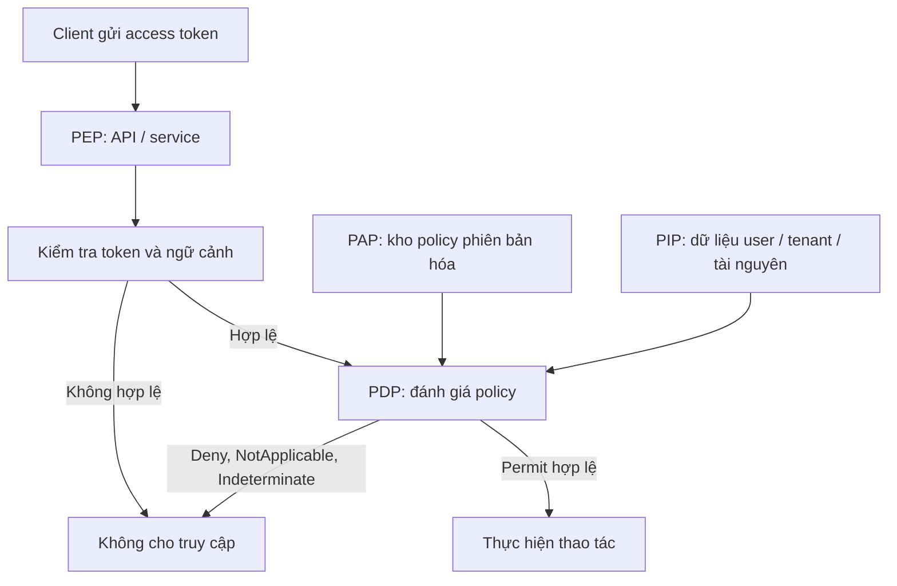
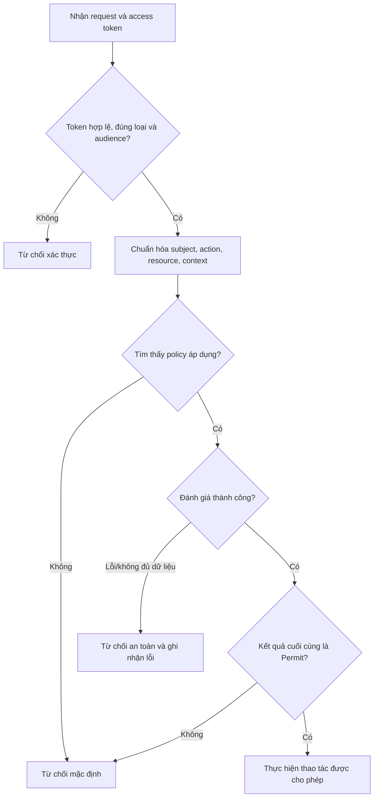

# Từ chối mặc định khi không có policy

Trong phân quyền (**authorization**), một yêu cầu chỉ được truy cập tài nguyên khi hệ thống tìm thấy **quy tắc cho phép rõ ràng**, áp dụng đúng chủ thể, hành động, tài nguyên và ngữ cảnh. Nếu không có policy phù hợp, kết quả an toàn phải là **từ chối** (*deny by default*, còn gọi là *default deny* hoặc *fail secure*). Không được suy diễn rằng “không thấy quy tắc cấm” nghĩa là “được phép”.

Đây là nguyên tắc cốt lõi của module **SECURITY_TOKEN_SECURITY_FUNDAMENTALS**: hiểu mô hình tin cậy và vòng đời token, phân biệt JWT, opaque token, access token, refresh token trong OAuth 2.0/OIDC; kiểm tra issuer, audience, claims, scope; và bảo vệ quyền truy cập ngay cả khi token đã phát hành hợp lệ. Bài học thuộc phần **Authorization** và tập trung vào hành vi khi policy thiếu, không khớp, lỗi hoặc chưa được triển khai.

## 1. Mục tiêu học tập

Sau bài học, bạn có thể:

1. Giải thích vì sao xác thực thành công hoặc sở hữu access token hợp lệ **không tự tạo quyền truy cập**.
2. Phân biệt các kết quả đánh giá policy: **Permit**, **Deny**, **NotApplicable** và **Indeterminate**.
3. Thiết kế luồng ra quyết định: chỉ **Permit** khi có policy phù hợp và mọi điều kiện đều thỏa; còn lại từ chối hoặc xử lý lỗi theo chính sách an toàn.
4. Áp dụng default deny ở API gateway, resource server, method/service và truy vấn dữ liệu.
5. Viết cấu hình Spring Security và kiểm soát quyền theo tài nguyên để tránh endpoint “lọt” do thiếu rule.
6. Xây dựng kiểm thử hồi quy, quan sát và quy trình triển khai policy mới mà không mở quyền ngoài ý muốn.

## 2. Default deny giải quyết vấn đề gì?

Giả sử một API có ba endpoint:

| Endpoint | Chính sách dự kiến | Nếu không có default deny |
| --- | --- | --- |
| `GET /api/orders/{id}` | Chủ đơn hàng có scope `orders:read` mới được đọc | Có thể cho qua vì chỉ kiểm tra “đã đăng nhập” |
| `POST /api/orders/{id}/cancel` | Chủ đơn hàng hoặc nhân viên đủ quyền, theo trạng thái đơn | Có thể bị mở cho tất cả user có token |
| `GET /api/internal/reports` | Chỉ role nội bộ được cấp riêng | Endpoint mới triển khai có thể chưa gắn policy |

Rủi ro xuất hiện khi developer thêm route, sửa tên method, gộp router, đổi reverse proxy hoặc vô tình bỏ annotation phân quyền. Nếu hệ thống cho phép truy cập khi “không tìm thấy rule cấm”, lỗi cấu hình sẽ thành lỗ hổng. Default deny khiến trường hợp này **bị chặn cho đến khi có người chủ động khai báo quyền**.

Đặt cạnh nhau hai cách tư duy:

- **Allow by default**: kiểm tra có lý do từ chối hay không; không tìm thấy thì cho phép.
- **Deny by default**: kiểm tra có căn cứ cho phép hay không; không tìm thấy thì từ chối.

Nguyên tắc này còn được gọi là **complete mediation** khi hệ thống thực sự kiểm tra quyền tại mọi đường truy cập tài nguyên. Default deny ở một gateway chưa đủ nếu có cách gọi thẳng service hoặc truy xuất dữ liệu từ đường khác.

### 2.1. Xác thực khác phân quyền

**Authentication** trả lời “chủ thể là ai hoặc thuộc client nào?”. **Authorization** trả lời “chủ thể đó có được làm hành động này trên tài nguyên này, trong bối cảnh này không?”.

Một JWT access token có thể:

- Được ký đúng bằng khóa của issuer tin cậy.
- Có `iss`, `aud`, `exp` hợp lệ và scope `orders:read`.
- Vẫn **không được phép** xem đơn hàng `order-900` nếu đơn thuộc người dùng/tenant khác.
- Bị từ chối nếu endpoint chưa có policy hoặc policy chưa khai báo quyền cho hành động đó.

Tương tự, opaque token được introspection là `active: true` chỉ chứng minh token đang hoạt động theo nhà cấp phát. API vẫn cần quyết định phân quyền dựa trên scope và policy ứng dụng.

**Không có policy phù hợp = không có căn cứ cấp quyền.** Đây là kết luận độc lập với việc người dùng đã đăng nhập thành công hay chưa.

## 3. Mô hình ra quyết định: ai hỏi, ai quyết định, ai chặn?

Một kiến trúc phân quyền rõ ràng có thể tách thành:

- **PEP — Policy Enforcement Point**: nơi chặn hoặc cho phép yêu cầu, ví dụ middleware, filter, API handler, service hoặc data access layer.
- **PDP — Policy Decision Point**: nơi đánh giá policy và trả quyết định về quyền.
- **PAP — Policy Administration Point**: nơi quản trị, duyệt, xuất bản và phiên bản hóa policy.
- **PIP — Policy Information Point**: nguồn cung cấp thuộc tính cho quyết định, như chủ sở hữu đơn hàng, tenant, trạng thái hợp đồng hoặc thuộc tính user.

Đây là mô hình khái niệm; ứng dụng nhỏ có thể đặt PEP và PDP trong cùng một service, miễn vẫn giữ được nguyên tắc **chặn trước khi trả dữ liệu hoặc gây side effect**.



### 3.1. Bốn kết quả cần phân biệt

| Kết quả PDP | Ý nghĩa | PEP phải làm gì? |
| --- | --- | --- |
| **Permit** | Policy áp dụng, cho phép rõ ràng và đủ điều kiện | Cho phép sau khi hoàn tất mọi kiểm tra và nghĩa vụ liên quan |
| **Deny** | Có policy áp dụng và quyết định không cho phép | Chặn |
| **NotApplicable** | Không có policy/rule áp dụng cho yêu cầu này | **Chặn theo mặc định** |
| **Indeterminate** | Không thể kết luận vì lỗi, thiếu thuộc tính, timeout hoặc cấu hình hỏng | **Chặn và ghi nhận lỗi**, không biến lỗi thành Permit |

Ví dụ: một nhân viên yêu cầu `POST /api/payments/approve`. Policy chỉ có cho `GET /api/payments`. Kết quả đối với thao tác POST là **NotApplicable**; không thể lấy quyền đọc làm lý do cấp quyền phê duyệt.

Một tình huống khác: policy yêu cầu kiểm tra `resource.tenantId` nhưng dịch vụ tra cứu tenant timeout. Kết quả là **Indeterminate**; không được bỏ qua điều kiện rồi cho phép.

### 3.2. Thứ tự và chiến lược kết hợp policy

Khi nhiều policy có thể áp dụng, hệ thống phải khai báo **thuật toán kết hợp**. Ví dụ:

- **Deny-overrides**: một rule từ chối áp dụng sẽ thắng các rule cho phép; hữu ích khi có lệnh khóa tài khoản hoặc giới hạn dữ liệu đặc biệt.
- **Permit-overrides**: một rule cho phép có thể thắng rule từ chối; chỉ dùng khi thật sự phù hợp hợp đồng an ninh, không chọn vô thức.
- **First-applicable**: quy tắc phù hợp đầu tiên quyết định kết quả; phải kiểm soát thứ tự thật cẩn thận.

Default deny giải quyết tình huống **không có quyền cho phép**, nhưng không tự quyết định chiến lược xử lý **mâu thuẫn** giữa các policy. Phải thiết kế cả hai.

Nguyên tắc triển khai thực dụng: **chỉ chấp nhận một kết quả Permit cuối cùng do PDP tin cậy trả về**. Không để các giá trị `null`, exception, chuỗi lạ hoặc kết quả parse lỗi được diễn giải thành `true`.

## 4. Cấu trúc của một policy có thể thực thi

Một quyết định phân quyền nên trả lời đủ những thuộc tính sau:

| Thành phần | Ví dụ | Câu hỏi kiểm tra |
| --- | --- | --- |
| **Subject** | `user-42`, `service-inventory` | Ai đang yêu cầu? Chủ thể có được xác minh từ token/phiên tin cậy không? |
| **Action** | `orders:read`, `orders:cancel` | Hành động cụ thể nào đang được thực hiện? |
| **Resource** | `order-900` | Tài nguyên nào bị tác động? |
| **Environment/context** | tenant, trạng thái đơn, thời điểm, rủi ro | Điều kiện ngữ cảnh nào cần đúng? |
| **Policy effect** | `Permit` hoặc `Deny` | Kết luận được khai báo là gì? |

Một policy diễn giải bằng ngôn ngữ nghiệp vụ:

> Cho phép **đọc đơn hàng** khi token đã được xác minh, đúng audience `orders-api`, có scope `orders:read` và `subject` là chủ đơn hàng thuộc đúng tenant. Trong mọi trường hợp còn lại, không cho truy cập.

Đây là kiểm soát theo đối tượng; một scope rộng như `orders:read` **không** thay thế điều kiện “đơn thuộc chủ thể/tenant”.

### 4.1. Quy tắc nào là công khai?

Endpoint thật sự công khai là **ngoại lệ Permit được khai báo chủ động**, ví dụ:

```text
GET /health/liveness     -> PUBLIC: cho phép, chỉ trả tình trạng tối thiểu
GET /api/orders/{id}     -> policy order.read
POST /api/orders/{id}/cancel -> policy order.cancel
mọi route/action khác    -> DENY
```

Không dùng `permitAll()` cho toàn bộ `/api/**` với kỳ vọng các lớp phía sau sẽ tự bổ sung phân quyền. Không coi “không cần đăng nhập” là “không cần policy”; route công khai cũng nên nằm trong danh mục đã được phê duyệt và được kiểm thử.

### 4.2. Phân biệt rule không khớp với rule từ chối

Với yêu cầu `DELETE /api/orders/900`:

- Nếu policy chỉ định nghĩa `GET` và `POST`, kết quả là **NotApplicable**, PEP từ chối.
- Nếu có policy `DELETE` nhưng chỉ role `orders_admin` được xóa và user không có role này, kết quả là **Deny**, PEP từ chối.
- Nếu policy cần kiểm tra trạng thái đơn nhưng dữ liệu không tải được, kết quả là **Indeterminate**, PEP chặn và ghi log nguyên nhân phù hợp.

Ba tình huống đều chặn, nhưng **lý do khác nhau**, dẫn tới cách sửa khác nhau: thêm policy hợp lệ, cấp quyền đúng quy trình, hoặc sửa lỗi nguồn thuộc tính.

## 5. Liên hệ OAuth 2.0/OIDC và các loại token

Token có nhiệm vụ hỗ trợ quyết định, không thay thế chính quyết định đó.

### 5.1. Access token: quyền được ủy quyền trong phạm vi nhất định

Access token có thể là JWT hoặc opaque:

- **JWT access token**: resource server kiểm tra chữ ký, issuer, audience, thời gian, loại token và claims bắt buộc. Payload JWT ký số thường đọc được; không tin claim trước khi xác minh.
- **Opaque access token**: resource server có thể gọi introspection qua kênh tin cậy, kiểm tra `active`, issuer/audience, thời gian và scope theo hợp đồng token.

**Scope** thể hiện quyền mà authorization server cấp cho client, ví dụ `orders:read`. Scope có thể là **điều kiện cần**, nhưng thường không đủ để quyết định quyền trên một bản ghi cụ thể. **Audience** ngăn token cấp cho API A được dùng nhầm ở API B.

Ví dụ token minh họa cho API đơn hàng:

```json
{
  "iss": "https://auth.example.test",
  "sub": "user-42",
  "aud": "orders-api",
  "scope": "orders:read",
  "iat": 1800000000,
  "exp": 1800000900,
  "jti": "illustrative-id-42"
}
```

Đây chỉ là **payload mô phỏng**, không phải JWT có chữ ký. Ngay cả khi các claim đã được kiểm chứng, API vẫn phải xét policy cho `GET /api/orders/900`. Nếu không có policy áp dụng thì **Deny**, dù token hợp lệ.

### 5.2. Refresh token và ID token không dùng để vượt policy

- **Refresh token** được client gửi tới token endpoint để xin access token mới. API nghiệp vụ không dùng refresh token làm bằng chứng cho phép truy cập.
- **ID token** trong OIDC cung cấp thông tin về xác thực cho OIDC client. API nghiệp vụ không chấp nhận ID token như access token chỉ vì có `sub` hoặc chữ ký hợp lệ.
- **Client credentials access token** có thể đại diện cho service, không có user đăng nhập. Policy cần phân biệt quyền của client và quyền của người dùng, không tự suy ra chủ sở hữu bản ghi từ token của máy.

**Đăng nhập thành công**, **được cấp token**, **scope hiện diện** và **policy Permit** là những bước khác nhau. Bỏ qua một bước có thể tạo ra truy cập trái phép.

### 5.3. Chuỗi quyết định an toàn



## 6. Thiết kế thuật toán phân quyền: Permit phải tường minh

Mã giả dưới đây nhấn mạnh hành vi khi policy trống, không khớp hoặc gặp lỗi:

```text
authorize(request):
    token = authenticateAndValidateAccessToken(request)
    if token is invalid:
        return UNAUTHENTICATED

    subject = trustedIdentityFrom(token)
    action = canonicalAction(request.method, request.route)
    resource = loadAuthoritativeResourceMetadata(request.resourceId)
    context = trustedContext(request, token, resource)

    try:
        policies = policyStore.findApplicable(subject, action, resource, context)
        if policies is empty:
            audit("NOT_APPLICABLE", request)
            return FORBIDDEN

        decision = policyEngine.evaluate(policies, subject, action, resource, context)
        if decision is not exactly PERMIT:
            audit(decision, request)
            return FORBIDDEN

        return AUTHORIZED
    catch PolicyLoadError or AttributeLookupError or EvaluationError:
        audit("INDETERMINATE", request)
        return FORBIDDEN
```

Điểm cần hiểu:

1. **Chỉ `PERMIT` là kết quả thành công**. Không coi giá trị rỗng hoặc lỗi là quyền được cấp.
2. Thuộc tính tin cậy phải lấy từ token **đã xác minh** và nguồn dữ liệu có thẩm quyền. Không tin `ownerId`, `tenantId` hay `isAdmin` chỉ vì client tự gửi.
3. Tài nguyên cần được xác định trước khi đánh giá quyền; nếu không tồn tại, trả mã phù hợp và tránh rò rỉ thông tin tồn tại của tài nguyên nhạy cảm.
4. Policy phải được kiểm tra **trước thao tác tạo side effect** (sửa, xóa, gửi tiền, phê duyệt...). Với dữ liệu nhạy cảm, nên đặt kiểm soát gần nơi thực thi nhất.
5. Có thể cần thêm nghĩa vụ (*obligations*) khi Permit, như lọc trường kết quả, che dữ liệu, giới hạn số bản ghi hoặc ghi audit. Chưa thực hiện nghĩa vụ bắt buộc thì không coi việc xử lý hoàn tất.

**Lưu ý về kết quả HTTP:** thông thường trả `401 Unauthorized` khi không có hoặc không hợp lệ thông tin xác thực; trả `403 Forbidden` khi yêu cầu đã xác thực nhưng không được cấp quyền. Hệ thống có thể cố ý trả `404 Not Found` để tránh tiết lộ sự tồn tại của tài nguyên, miễn không làm lộ dữ liệu. Lỗi PDP/nguồn thuộc tính có thể được ánh xạ thành `403` hoặc `503` theo hợp đồng API, nhưng **không được cho phép truy cập**.

## 7. Ví dụ Java với Spring Security: chặn route chưa khai báo

### 7.1. Cấu hình mẫu ở HTTP layer

Ví dụ Spring Security hiện đại sau tập trung vào một API bảo vệ bằng JWT và một endpoint sức khỏe được khai báo công khai. Mã minh họa cấu hình phân quyền, chưa bao gồm cấu hình issuer/audience validator và xử lý nghiệp vụ đầy đủ:

```java
@Configuration
@EnableMethodSecurity
public class ApiSecurityConfig {

    @Bean
    SecurityFilterChain securityFilterChain(HttpSecurity http) throws Exception {
        http
            .authorizeHttpRequests(auth -> auth
                // Chủ động cho phép một route liveness tối thiểu.
                .requestMatchers(HttpMethod.GET, "/health/liveness").permitAll()

                // Chỉ match route được khai báo rõ ràng.
                // Điều kiện sở hữu đơn hàng được kiểm tra ở method/service.
                .requestMatchers(HttpMethod.GET, "/api/orders/{orderId}")
                    .hasAuthority("SCOPE_orders:read")

                // Không có policy/route phù hợp => từ chối.
                .anyRequest().denyAll()
            )
            .oauth2ResourceServer(oauth -> oauth.jwt(Customizer.withDefaults()));

        return http.build();
    }
}
```

**Điểm chính:** `anyRequest().denyAll()` tạo chốt mặc định ở HTTP layer. Khi thêm `POST /api/orders` hay `GET /api/internal/reports` mà chưa khai báo rule, route không tự mở. Nếu có nhiều `SecurityFilterChain`, phải kiểm tra thứ tự và phạm vi matcher của **tất cả** chain; một chain không bao phủ request thì không bảo vệ request đó.

Trong Spring Security, các rule ở `authorizeHttpRequests` được xét theo thứ tự; rule rộng đặt trước có thể bắt các route hẹp phía sau. Cần tránh matcher `/api/**` với `permitAll()` hoặc rule `authenticated()` quá rộng làm vô hiệu ý định chỉ cho phép các thao tác được khai báo.

Cấu hình trên **chưa đủ** để quyết định quyền theo từng đơn hàng: nó chỉ kiểm tra scope ở HTTP layer. Phải thêm kiểm soát đối tượng tại nơi thực hiện truy vấn.

### 7.2. Policy mức tài nguyên ở service

Một controller có thể yêu cầu kiểm tra quyền trước khi gọi nghiệp vụ:

```java
@RestController
@RequestMapping("/api/orders")
class OrderController {
    private final OrderService orderService;

    OrderController(OrderService orderService) {
        this.orderService = orderService;
    }

    @GetMapping("/{orderId}")
    @PreAuthorize("@orderPolicy.canRead(authentication, #orderId)")
    OrderDto getOrder(@PathVariable Long orderId) {
        return orderService.getOrder(orderId);
    }
}
```

Policy giả định đơn chỉ được đọc bởi chủ đơn hàng trong cùng tenant:

```java
@Component("orderPolicy")
class OrderPolicy {
    private final OrderRepository orders;

    OrderPolicy(OrderRepository orders) {
        this.orders = orders;
    }

    public boolean canRead(Authentication authentication, Long orderId) {
        // Chưa có Authentication hợp lệ hoặc sai loại token => deny.
        if (!(authentication instanceof JwtAuthenticationToken token)
                || !authentication.isAuthenticated() || orderId == null) {
            return false;
        }

        boolean hasScope = authentication.getAuthorities().stream()
            .anyMatch(a -> "SCOPE_orders:read".equals(a.getAuthority()));
        if (!hasScope) {
            return false;
        }

        Jwt jwt = token.getToken(); // Đã được Resource Server xác minh.
        String subject = jwt.getSubject();
        String tenantId = jwt.getClaimAsString("tenant_id");
        if (subject == null || tenantId == null) {
            return false; // Thiếu thuộc tính policy bắt buộc.
        }

        // Kho dữ liệu xác thực quyền sở hữu và tenant.
        return orders.existsByIdAndTenantIdAndOwnerId(
            orderId, tenantId, subject
        );
    }
}
```

Các lớp, import và repository method cần được định nghĩa phù hợp với dự án; đây là ví dụ về **vị trí và hướng kiểm tra policy**, không phải mẫu triển khai hoàn chỉnh. Cần cấu hình `JwtDecoder` xác minh issuer, audience, chữ ký, thời hạn và kiểu access token theo profile của hệ thống. Claim `tenant_id` chỉ đáng tin sau khi token được xác minh và issuer được phép phát hành thuộc tính đó.

Trong hệ thống thực, nên kiểm tra quyền ở **service** hoặc data access để mọi caller (HTTP, job, event handler, RPC) đều đi qua cùng ranh giới; chỉ đặt annotation ở controller có thể bỏ sót các đường gọi nội bộ. Khi cần chống chênh lệch giữa bước kiểm tra và thao tác ghi (*time-of-check/time-of-use*), dùng transaction hoặc thao tác SQL cập nhật có điều kiện quyền trực tiếp.

### 7.3. Ví dụ phản diện: default “đã đăng nhập là được”

```java
// KHÔNG ĐỦ cho API có yêu cầu phân quyền theo từng thao tác.
http.authorizeHttpRequests(auth -> auth
    .anyRequest().authenticated()
);
```

Đoạn trên chủ yếu yêu cầu người gọi đã xác thực. Nó **không chứng minh** người gọi có quyền xóa đơn, xem báo cáo hay truy cập dữ liệu thuộc tenant khác. Nếu không có lớp kiểm soát policy khác, route mới có thể trở nên truy cập được với bất kỳ người dùng đã đăng nhập.

## 8. Những chỗ dễ phá vỡ default deny

### 8.1. Policy không khớp do path hoặc HTTP method

Không suy diễn GET có quyền đồng nghĩa PUT/POST/DELETE có quyền. Kiểm thử:

- `GET /api/orders/5` được cấp theo policy đọc.
- `PATCH /api/orders/5` phải bị từ chối nếu chưa có policy cập nhật.
- `GET /api/orders/5/export` phải bị từ chối nếu không được khai báo, dù tiền tố đường dẫn giống nhau.
- `GET /api/internal/../orders/5` và các biến thể encoding/path normalization phải được router và lớp bảo mật chuẩn hóa/khớp nhất quán.

Các trường hợp như phân biệt chữ hoa/thường, dấu gạch chéo cuối URL, rewrite tại proxy, phương thức `HEAD`, `OPTIONS` và phiên bản API cần có chính sách rõ ràng. CORS preflight có thể được xử lý riêng, nhưng **CORS không phải cơ chế cấp quyền truy cập API**.

### 8.2. Thiếu rule ở một đường truy cập khác

Một API gateway có thể bảo vệ `/orders/**` nhưng một job nội bộ hoặc message consumer gọi thẳng service không đi qua gateway. Nếu logic quyền chỉ nằm ở gateway, thao tác dữ liệu bên dưới có thể thiếu bảo vệ. Hãy đặt PEP tại các ranh giới phù hợp, đặc biệt trước thao tác nhạy cảm và tại tầng dịch vụ/dữ liệu.

### 8.3. Sai ngữ cảnh tenant hoặc chủ sở hữu

Không dùng `tenantId` hoặc `ownerId` từ request body làm căn cứ duy nhất để cho phép. Kẻ tấn công có thể thay đổi các giá trị đó. Policy phải so sánh thuộc tính chủ thể được xác minh với thuộc tính tài nguyên lấy từ kho dữ liệu tin cậy.

Ví dụ người dùng thuộc `tenant-A` có token `orders:read`. Yêu cầu `GET /api/orders/900` nhắm đến đơn của `tenant-B`. Dù scope đúng, kết quả **Deny** vì không khớp ranh giới tenant.

### 8.4. Trạng thái đặc biệt của resource

Quyền có thể phụ thuộc tình trạng nghiệp vụ:

- Đơn đã giao không còn được hủy.
- Hồ sơ đang khóa không được sửa.
- Giao dịch vượt hạn mức cần phê duyệt thêm.

Nếu policy cần trạng thái mà nguồn dữ liệu trả rỗng, không được mặc định “thông qua”. Trường hợp không có trạng thái cần được định nghĩa: từ chối, báo lỗi hoặc xử lý tài nguyên không tồn tại, nhưng không phát sinh Permit.

### 8.5. Quyền quá rộng và wildcard

Các role `admin` hoặc scope `*` không nên tự động bỏ qua mọi kiểm soát. Nếu doanh nghiệp cần quyền đặc biệt, khai báo policy rõ tài nguyên, hành động, phạm vi, audit và thời hạn. Tránh cơ chế “superuser” phát sinh từ việc không tìm thấy policy cụ thể.

## 9. Lỗi hệ thống policy: fail closed nhưng vẫn vận hành được

Một lỗi nghiêm trọng là:

```text
try:
    return policyService.canAccess(request)
catch:
    return true   // SAI: lỗi kiểm tra biến thành quyền truy cập
```

Cần thiết kế rõ cách xử lý từng tình huống:

| Tình huống | Hành vi an toàn |
| --- | --- |
| Không có policy cho route/action | Từ chối, ghi nhận `NotApplicable` |
| Policy áp dụng và trả Deny | Từ chối, ghi lý do không nhạy cảm |
| Policy syntax hỏng khi triển khai | Không kích hoạt bản policy lỗi; hoặc chặn những thao tác phụ thuộc policy đó |
| PDP timeout hoặc không sẵn sàng | Không cấp Permit mới từ kết quả không xác định; chặn truy cập có bảo vệ |
| Thiếu dữ liệu tenant/owner | Từ chối hoặc báo lỗi an toàn; không bỏ điều kiện |
| Cache policy cũ | Tuân thủ TTL/invalidation và mức rủi ro cho phép |
| JWT hợp lệ nhưng bị thu hồi theo chính sách phiên | Áp dụng cơ chế kiểm tra thu hồi mà hệ thống đã thiết kế |

**Fail closed không có nghĩa mọi lỗi đều trả cùng HTTP 403**: hệ thống có thể dùng 503 để phản ánh phụ thuộc bị lỗi, nhưng không cho chạy nghiệp vụ chưa được cấp quyền. Điều này giúp người vận hành phân biệt tấn công với sự cố hạ tầng mà vẫn duy trì an toàn.

### 9.1. Cache quyết định phân quyền

Cache giúp giảm tải nhưng có thể kéo dài quyền đã bị thu hồi. Nếu sử dụng, khóa cache phải tính đúng những thuộc tính ảnh hưởng quyết định: subject, action, resource, tenant, policy version và các thuộc tính ngữ cảnh liên quan. Không cache Permit chỉ theo `userId` nếu quyền phụ thuộc từng đơn hàng.

Một quyết định Permit cũ không nên còn hiệu lực sau khi:

- Policy đã bị thay đổi hoặc thu hồi.
- Tài khoản/phiên/token đã bị vô hiệu hóa.
- Tài nguyên đổi chủ sở hữu, tenant hoặc trạng thái nghiệp vụ.

Chọn TTL và cơ chế invalidation theo yêu cầu an ninh; với thao tác rủi ro cao có thể cần tái đánh giá ngay thay vì tin cache.

### 9.2. Versioning và quy trình phát hành policy

Lưu policy có phiên bản, review và môi trường kiểm thử. Khi thêm endpoint mới:

1. Xác định action và resource, các chủ thể được quyền truy cập.
2. Viết policy rõ ràng và xác định default deny cho các trường hợp còn lại.
3. Kiểm thử cả trường hợp Permit và các trường hợp Deny/NotApplicable/Indeterminate.
4. Triển khai policy và ứng dụng theo thứ tự có kiểm soát để không tạo cửa sổ truy cập ngoài ý muốn.
5. Ghi nhận phiên bản policy trong audit và theo dõi số lần default deny phát sinh sau triển khai.

Nếu policy chưa sẵn sàng khi route đã xuất hiện, route cần **bị khóa** cho đến khi chính sách được xét duyệt và kích hoạt.

## 10. Quan sát, audit và xử lý yêu cầu bị từ chối

Hệ thống nên ghi nhận sự kiện quyết định phân quyền với dữ liệu tối thiểu:

| Trường audit | Mục đích |
| --- | --- |
| `requestId` / trace ID | Liên kết các bước của một request |
| `action`, route chuẩn hóa | Biết thao tác nào không có policy |
| Subject/client đã chuẩn hóa | Điều tra đối tượng gọi, theo quyền truy cập log |
| Resource type và ID được bảo vệ/ẩn khi cần | Xác định ngữ cảnh mà không lộ dữ liệu nhạy cảm |
| `policyId`, `policyVersion` | Biết bản policy nào đã đưa quyết định |
| `decision`, `reasonCode` | Phân biệt Permit, Deny, NotApplicable và Indeterminate |
| Thời gian đánh giá, dependency status | Phân biệt lỗi hệ thống và truy cập không hợp lệ |

Không log nguyên access token, refresh token, JWT payload nhạy cảm, password hoặc khóa ký. Có thể log token ID đã được xử lý theo chính sách khi thật sự cần tương quan sự kiện. Phân quyền cả người được xem audit log.

Những cảnh báo hữu ích:

- Số lần `NotApplicable` tăng mạnh sau một đợt release: có thể vừa thêm route mà quên policy.
- Lượng `Deny` tăng đột biến trên tài nguyên không thuộc người dùng: có thể là dò quét hoặc lỗi client.
- `Indeterminate` do PDP/PIP timeout: vấn đề vận hành cần khắc phục, không được tự bỏ qua kiểm soát.
- Permit xuất hiện tại route vốn là internal: cần rà soát rule, matcher và thay đổi phiên bản policy.

Để hỗ trợ người dùng, response chỉ nên nêu thông tin cần thiết; không tiết lộ chi tiết nội bộ của policy hoặc sự tồn tại của tài nguyên nhạy cảm.

## 11. Tình huống thực tế: endpoint mới chưa được gắn policy

Ứng dụng bán hàng đã có hai API:

```text
GET /api/orders/{id}         -> order.read
POST /api/orders/{id}/cancel -> order.cancel
```

Một developer thêm `GET /api/orders/{id}/invoice` và gọi service trả hóa đơn, nhưng chưa tạo policy `invoice.read`.

**Với allow by default:** nếu ứng dụng chỉ kiểm tra login hoặc chỉ có danh sách route bị cấm, user có access token hợp lệ có thể truy cập hóa đơn trước khi policy được bổ sung.

**Với deny by default:** đường gọi mới không khớp rule nào nên bị từ chối. Hệ thống ghi `NotApplicable`; người phát triển biết cần khai báo policy. Khi policy được thêm, chỉ những user có quyền đúng tenant, đúng hóa đơn và đúng loại token mới được cấp Permit.

Xét thêm bốn yêu cầu:

| Request | Trạng thái token và policy | Quyết định |
| --- | --- | --- |
| User A xem đơn của A | Token hợp lệ, `orders:read`, policy cho phép đúng chủ/tenant | **Permit** |
| User A xem đơn của B | Token hợp lệ, scope đủ nhưng sai chủ/tenant | **Deny** |
| User A xem hóa đơn qua route mới | Token hợp lệ, chưa có policy `invoice.read` | **NotApplicable → từ chối** |
| User A xem hóa đơn lúc PDP lỗi | Không thể xác định quyền | **Indeterminate → từ chối**, ghi nhận lỗi |

Phân biệt nguyên nhân cho phép đội phát triển sửa đúng vấn đề mà không làm giảm mức bảo vệ mặc định.

## 12. Kiểm thử default deny

Đừng chỉ kiểm tra trường hợp được quyền truy cập; phải kiểm tra **mọi đường thiếu quyền** và **lỗi của bộ ra quyết định**.

### 12.1. Ma trận kiểm thử tối thiểu

| Tình huống | Kết quả mong đợi |
| --- | --- |
| Route công khai được khai báo cụ thể | Cho phép theo public policy đã phê duyệt |
| Route nghiệp vụ có policy Permit và đầy đủ điều kiện | Cho phép |
| Route mới chưa có policy | Từ chối (`NotApplicable`) |
| HTTP method khác với method được định nghĩa | Từ chối |
| Token thiếu, sai chữ ký, hết hạn | Không xác thực/không cho truy cập |
| JWT của issuer hoặc audience khác | Không xác thực/không cho truy cập |
| ID token dùng thay access token | Không cho truy cập API |
| Opaque token `active: false` | Không xác thực/không cho truy cập |
| Token đúng nhưng thiếu scope | Từ chối |
| Token đúng scope nhưng sai chủ tài nguyên | Từ chối |
| Chủ thể đúng nhưng tenant không khớp | Từ chối |
| Chính sách chứa điều kiện bị thiếu hoặc sai kiểu | Từ chối (`Indeterminate` hoặc `Deny` theo contract) |
| PDP timeout, policy store hỏng | Chặn, ghi lỗi; không fail open |
| Policy mới xóa quyền đã cấp trước đó | Quyết định mới phản ánh việc thu hồi trong giới hạn cache thiết kế |
| Truy cập trực tiếp service bỏ qua gateway | Vẫn được kiểm tra tại lớp bảo vệ phù hợp |

### 12.2. Kiểm thử với Spring MockMvc (minh họa)

Với cấu hình HTTP layer ở trên, hãy kiểm tra route chưa khai báo không thể truy cập. Mã mẫu dưới đây là ý tưởng test; cách thiết lập token thử nghiệm và filter chain phụ thuộc môi trường dự án:

```java
@Test
void newlyAddedRouteWithoutPolicyIsDenied() throws Exception {
    mockMvc.perform(get("/api/internal/reports")
            .with(jwt().authorities(
                new SimpleGrantedAuthority("SCOPE_orders:read"))))
        .andExpect(status().isForbidden());
}

@Test
void writeMethodCannotBorrowReadPermission() throws Exception {
    mockMvc.perform(post("/api/orders/900/cancel")
            .with(jwt().authorities(
                new SimpleGrantedAuthority("SCOPE_orders:read"))))
        .andExpect(status().isForbidden());
}
```

Đây là các ví dụ **giả định route/filter được thiết lập đúng như cấu hình ở mục 7**. Nếu ứng dụng chưa có route, framework có thể trả `404` trước/sau các tầng xử lý tùy cấu hình; điều quan trọng của bài test là không có dữ liệu hoặc side effect nào được thực thi và một route **đã tồn tại nhưng thiếu policy** vẫn bị từ chối.

Với bài test tích hợp, nên xác minh thêm: service/repository không bị gọi khi bị từ chối; không có dữ liệu trả ra; và các decision audit phản ánh đúng `NotApplicable` hoặc `Deny`. Đặc biệt kiểm thử thứ tự matcher, nhiều security filter chain, request qua proxy và các entry point nội bộ.

### 12.3. Kiểm thử biến đổi dữ liệu

Với một request được Permit, lần lượt thay đổi **một** yếu tố:

1. `sub` sang người dùng khác.
2. `aud` sang API khác.
3. `scope` bỏ quyền cần thiết.
4. `resource.tenantId` sang tenant khác.
5. HTTP method từ GET sang DELETE.
6. Xóa policy tương ứng hoặc mô phỏng PDP timeout.

Mỗi lần thay đổi làm mất điều kiện Permit phải dẫn đến **không truy cập được**. Đây là cách thực tế để phát hiện các lối tắt phân quyền mà kiểm thử đường đi thành công dễ bỏ sót.

## 13. Checklist triển khai

- [ ] Mỗi route/action nhạy cảm có policy được khai báo rõ; endpoint công khai cũng được phê duyệt tường minh.
- [ ] Tại ranh giới thực thi, chỉ **Permit** sau khi đánh giá thành công mới cho thao tác chạy.
- [ ] **NotApplicable** và **Indeterminate** đều không dẫn đến cho phép.
- [ ] Cấu hình framework có chốt từ chối mọi request chưa được match; kiểm tra thứ tự và phạm vi của các filter chain.
- [ ] Token được xác minh đúng issuer, audience, thời hạn, kiểu và scope; refresh token/ID token không được dùng thay access token.
- [ ] Policy đối tượng kiểm tra cả subject, hành động, resource, tenant và ngữ cảnh nghiệp vụ.
- [ ] Không tin thuộc tính chủ thể/tenant nhạy cảm do client tự khai báo mà chưa được xác minh.
- [ ] Cổng API, service, background job và đường truy vấn dữ liệu được bảo vệ theo ranh giới phù hợp.
- [ ] Lỗi PDP/PIP, policy store hoặc dữ liệu bị thiếu không biến thành Permit.
- [ ] Policy có phiên bản, quy trình review, kiểm thử Permit/Deny/NotApplicable/Indeterminate và kế hoạch triển khai.
- [ ] Có audit theo reason code, cảnh báo route thiếu policy và quản lý cache quyền đã bị thu hồi.
- [ ] Kiểm thử route mới, method mới, truy cập khác tenant, token sai audience và lỗi dịch vụ phân quyền.

## 14. Tự kiểm tra kiến thức

**Câu 1. Nếu người dùng đã đăng nhập và token hợp lệ nhưng không có policy nào khớp request, có được cho phép không?** Không. Token hợp lệ chỉ chứng minh thông tin xác thực/quyền được cấp trong phạm vi nhất định. **Không có Permit tường minh thì từ chối**.

**Câu 2. `NotApplicable` và `Deny` khác nhau thế nào?** `NotApplicable` là không có policy nào áp dụng; `Deny` là policy áp dụng và quyết định từ chối. Cả hai đều không được phép tiếp tục thao tác.

**Câu 3. Nếu PDP timeout, trả Permit để tránh gián đoạn dịch vụ có hợp lý không?** Không. Không thể xác minh quyền thì phải chặn thao tác được bảo vệ. Có thể trả mã lỗi dịch vụ thích hợp và cảnh báo vận hành.

**Câu 4. Vì sao `anyRequest().authenticated()` không tương đương default deny cho nghiệp vụ?** Vì điều kiện chỉ yêu cầu người dùng đã xác thực, chưa xác định họ có quyền trên **hành động và tài nguyên** cụ thể.

**Câu 5. Có `orders:read` thì người dùng có xem mọi đơn hàng không?** Không. Policy còn phải kiểm tra chủ sở hữu, tenant và các giới hạn nghiệp vụ.

**Câu 6. Có nên giữ `/health/liveness` công khai không?** Có thể, nếu được khai báo chủ động, chỉ trả dữ liệu tối thiểu và phù hợp chính sách triển khai. Những endpoint khác không tự kế thừa quyền public đó.

**Câu 7. Một gateway đã từ chối mặc định thì service còn cần kiểm soát quyền không?** Có khi service còn đường vào khác, hoặc phải kiểm tra quyền theo đối tượng mà gateway không có đủ ngữ cảnh. Kiểm soát cần hiện diện tại các ranh giới thực thi có thể bị truy cập.

**Câu 8. Khi policy thay đổi để thu hồi quyền, kết quả Permit cũ trong cache có còn an toàn không?** Chỉ trong giới hạn đã được chấp nhận rõ ràng. Cần cơ chế TTL/invalidation phù hợp, đặc biệt với thao tác rủi ro cao.

**Quy tắc kết thúc bài:** Trong authorization, **sự im lặng của policy không phải sự đồng ý**. Chỉ một **Permit rõ ràng, dựa trên dữ liệu đáng tin và được thực thi tại đúng ranh giới** mới cho phép truy cập; mọi trường hợp còn lại phải dừng một cách an toàn.
