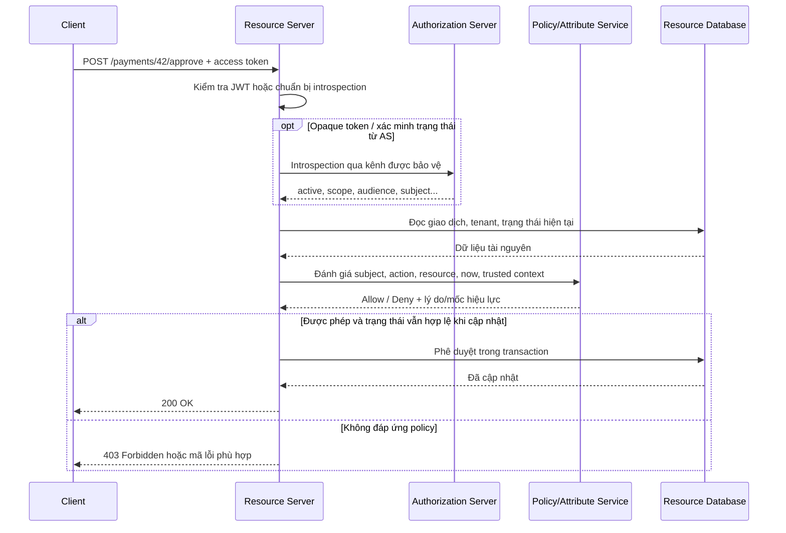

# Authorization theo thời điểm hoặc context

Trong hệ thống dùng **access token** để gọi API, một token hợp lệ không có nghĩa là mọi thao tác mà token từng được cấp đều được phép thực hiện **tại thời điểm hiện tại**. Một nhân viên có scope phê duyệt vẫn có thể chỉ được phê duyệt trong ca trực; một khóa API được phép hoạt động từ ngày mai; một yêu cầu sửa cấu hình chỉ được thực hiện từ thiết bị đáp ứng chính sách bảo mật; hoặc một lệnh chuyển tiền phải được xác thực mạnh lại vì giao dịch có rủi ro cao.

**Authorization theo thời điểm hoặc context** là việc quyết định quyền truy cập bằng cách kết hợp danh tính, quyền đã được cấp với **thời gian**, **trạng thái tài nguyên** và **ngữ cảnh của yêu cầu** tại lúc thực thi. Đây là phần mở rộng cần thiết cho mô hình phân quyền chỉ xét role hoặc scope tĩnh, đặc biệt trong OAuth 2.0/OpenID Connect (OIDC), JWT và opaque token.

## 1. Từ quyền tĩnh đến quyền theo thời điểm và ngữ cảnh

Xét dịch vụ `payment-api` cho phép người dùng phê duyệt lệnh thanh toán. Người dùng có access token với scope `payments:approve`, token được phát hành bởi authorization server đáng tin cậy, còn hạn và dành cho đúng API. Tuy nhiên, thao tác chỉ hợp lệ nếu:

1. Người dùng thuộc đúng **đơn vị/tenant** sở hữu lệnh thanh toán.
2. Lệnh vẫn ở trạng thái `PENDING`, thuộc hạn mức người dùng được phê duyệt.
3. Thời điểm thực hiện nằm trong **cửa sổ phê duyệt** đã quy định.
4. Nếu số tiền vượt ngưỡng, có bằng chứng **xác thực gần đây và đủ mạnh** theo chính sách.
5. Thiết bị hoặc kết nối đáp ứng các điều kiện được tổ chức tin cậy, nếu nghiệp vụ yêu cầu.

Nếu chỉ kiểm tra chữ ký JWT và `scope`, API sẽ bỏ qua các điều kiện có thể thay đổi theo giờ hoặc theo từng giao dịch. Vì thế, cần phân biệt:

| Cơ chế | Câu hỏi trả lời | Ví dụ | Giới hạn |
| --- | --- | --- | --- |
| **RBAC** (Role-Based Access Control) | Chủ thể mang vai trò nào? | `FINANCE_APPROVER` | Vai trò không nói người đó đang trực ca hay có quyền với giao dịch cụ thể |
| **Scope OAuth 2.0** | Client/token được cấp phạm vi truy cập nào? | `payments:approve` | Scope không tự kiểm tra số tiền, owner, giờ hay trạng thái giao dịch |
| **ABAC** (Attribute-Based Access Control) | Thuộc tính chủ thể, tài nguyên, hành động và môi trường có thỏa policy? | Đúng tenant, hạn mức và khung giờ | Cần nguồn thuộc tính đáng tin cậy và đánh giá kịp thời |
| **Context-aware authorization** | Điều kiện hiện tại của yêu cầu có cho phép? | Thiết bị được quản lý, xác thực gần đây, rủi ro thấp | Ngữ cảnh động có thể thiếu, cũ hoặc bị giả mạo |
| **Time-based authorization** | Quyền có hiệu lực tại thời điểm nào? | Từ 09:00 đến 17:00 các ngày làm việc | Cần múi giờ, mốc thời gian và nguồn giờ chuẩn |

RBAC, scope, ABAC và context không loại trừ nhau. Một chính sách thực tế thường kết hợp tất cả; **mặc định từ chối** khi điều kiện bắt buộc không được đáp ứng hoặc không xác minh được.

Có thể biểu diễn quyết định bằng một công thức:

```text
allow(subject, action, resource, environment, now)
  = valid_access_token
    AND correct_issuer_and_audience
    AND required_scope
    AND authorized_subject_for_resource
    AND resource_state_is_valid
    AND inside_allowed_time_window(now)
    AND required_trusted_context_is_satisfied
```

Trong đó `environment` là tập dữ liệu đáng tin tại thời điểm đánh giá, ví dụ kết quả chứng thực thiết bị, trạng thái ca trực hoặc mức rủi ro giao dịch. Từng điều kiện phải xác định được **nguồn dữ liệu**, **đơn vị chịu trách nhiệm kiểm tra** và **cách xử lý khi dữ liệu không sẵn có**.

## 2. Ranh giới tin cậy giữa client, authorization server và resource server

Trong OAuth 2.0, ba vai trò liên quan đến quyết định truy cập:

| Thành phần | Trách nhiệm | Không được mặc định |
| --- | --- | --- |
| **Client** | Xin access token theo luồng được phép, lưu và trình token khi gọi API | Không được tự nâng quyền bằng cách gửi `role=admin`, `shift=active` hay đồng hồ do client khai |
| **Authorization server (AS)** | Xác thực client theo loại client; cấp token với issuer, audience, scope, thời hạn; quản lý gia hạn/thu hồi | Không nhất thiết biết trạng thái nghiệp vụ mới nhất của mọi tài nguyên |
| **Resource server (RS)** | Xác minh token và **đánh giá authorization cho hành động trên tài nguyên cụ thể** | Không coi token hợp lệ hoặc scope đúng là quyết định cho phép cuối cùng |

Ví dụ: AS đã cấp token cho nhân viên lúc 08:55, còn hạn tới 09:55. Đến 09:10, người này bị rút quyền phê duyệt hoặc đổi ca trực. Nếu RS chỉ dựa vào claim cũ trong JWT, nó có thể không biết quyền đã thay đổi. RS cần cơ chế phản ánh thay đổi phù hợp: tra cứu quyền hiện hành, introspection, denylist, token sống ngắn hoặc kết hợp các cách đó.

Access token dạng **JWT** cho phép RS thường xác minh chữ ký và claim mà không gọi AS trong mỗi request. Access token dạng **opaque** có thể được kiểm tra qua token introspection. Cả hai vẫn cần áp dụng **policy theo thời gian và context ở phía tin cậy**. Hình thức token không thay thế bước phân quyền nghiệp vụ.



Policy engine có thể nằm ngay trong RS hoặc là dịch vụ riêng. Nếu tách thành **Policy Decision Point (PDP)** và **Policy Enforcement Point (PEP)**, PEP phải gọi/áp dụng kết quả PDP đúng lúc, đồng thời bảo vệ đường truyền và dữ liệu ngữ cảnh. PDP trả về `allow` không làm cho yêu cầu phía client trở thành nguồn tin cậy.

## 3. Phân biệt thời gian sống của token với thời gian được phép hành động

Cần tách **thời hạn kỹ thuật của token** khỏi **cửa sổ thời gian nghiệp vụ**.

| Giá trị/thông tin | Ý nghĩa | Bên kiểm tra |
| --- | --- | --- |
| `iat` (JWT) | Thời điểm token được phát hành | RS/validator theo profile token; không chứng minh quyền đang còn hiệu lực |
| `nbf` (JWT) | Token chưa được chấp nhận trước thời điểm này | RS xác minh trước khi tin token |
| `exp` (JWT) | Token không được chấp nhận tại hoặc sau thời điểm hết hạn | RS xác minh trước khi xử lý request |
| `auth_time` (OIDC) | Thời điểm người dùng được xác thực tại OpenID Provider | RP xác minh trong ID token; API chỉ dùng khi có ngữ cảnh xác thực được chuyển đến bằng cơ chế tin cậy |
| `valid_from`, `valid_until` của chính sách | Khoảng thời gian **quyền nghiệp vụ** có hiệu lực | RS/PDP từ kho chính sách có thẩm quyền |
| Ca trực, lịch bảo trì, hạn chốt giao dịch | Điều kiện lịch nghiệp vụ, thường theo múi giờ xác định | RS/PDP với dữ liệu lịch đang có hiệu lực |

Giả sử token có `nbf=08:00` và `exp=18:00`, nhưng chính sách chỉ cho phê duyệt trong **09:00–17:00**. Token vẫn hợp lệ lúc 17:30, song hành động phê duyệt **không được phép**. Ngược lại, một lịch cho phép phê duyệt tới 17:00 không giúp token hết hạn lúc 16:00 có hiệu lực trở lại.

Với khoảng thời gian nghiệp vụ, cách quy ước phổ biến là **[bắt đầu, kết thúc)**:

```text
allowed_at(now) = (now >= valid_from) AND (now < valid_until)

Ví dụ:
valid_from  = 2026-11-23T09:00:00+07:00
valid_until = 2026-11-23T17:00:00+07:00

08:59:59 -> Deny
09:00:00 -> có thể Allow nếu mọi điều kiện khác đạt
16:59:59 -> có thể Allow
17:00:00 -> Deny
```

Quy tắc này tránh hai lịch liên tiếp cùng bao gồm chính xác mốc kết thúc/bắt đầu. Nếu dữ liệu lưu trong database, nên chuẩn hóa các **mốc tuyệt đối thành `Instant`/UTC**, còn múi giờ gắn với các **quy tắc lịch địa phương**.

### 3.1. Đồng hồ của ai đáng tin?

**Không dùng giờ do trình duyệt hoặc mobile gửi lên** làm nguồn quyết định cuối cùng. Người dùng có thể chỉnh đồng hồ thiết bị hoặc thay giá trị trong request. RS/PDP dùng đồng hồ phía server được vận hành và đồng bộ đáng tin; trong hệ thống phân tán cần theo dõi độ lệch đồng hồ giữa các node.

Không dùng đơn thuần `new Date()` phía client để xác định «đang trong giờ làm». Frontend có thể hiển thị thông tin hỗ trợ người dùng, nhưng backend phải **tính lại điều kiện** khi xử lý.

**Múi giờ và DST (Daylight Saving Time)** cũng quan trọng. Quy tắc «09:00–17:00 ngày làm việc tại Hà Nội» cần `ZoneId` rõ ràng, ví dụ `Asia/Ho_Chi_Minh`; quy tắc ở nơi có DST cần xác định cách xử lý giờ không tồn tại hoặc lặp lại khi đồng hồ chuyển mùa. Không cộng cố định 24 giờ để suy ra «cùng giờ địa phương ngày mai» ở vùng có DST.

### 3.2. Độ mới của thông tin xác thực

Một thao tác có rủi ro cao có thể yêu cầu người dùng **xác thực lại trong vòng 5 phút**. Trong OIDC, RP có thể yêu cầu `max_age=300` ở authorization request, rồi kiểm tra `auth_time` trong **ID token đã xác minh**. `iat` của ID token mới không thay cho `auth_time`: OP có thể phát hành ID token mới dựa trên phiên SSO cũ.

Khi API cần thông tin xác thực gần đây, phải có cơ chế đã thống nhất để **đưa kết quả xác thực đáng tin** tới authorization ở RS, chẳng hạn claim access token theo profile của AS, introspection hoặc một quyết định từ backend tin cậy. **Không lấy ID token của client làm access token**, cũng không tin `auth_time` hoặc `mfa=true` trong header/JSON client tự khai.

## 4. Những loại context thường ảnh hưởng đến authorization

Context là dữ liệu mô tả hoàn cảnh của một request. Độ tin cậy của mỗi thuộc tính quan trọng không kém giá trị của nó.

| Loại context | Ví dụ | Nguồn nên tin cậy | Rủi ro thiết kế |
| --- | --- | --- | --- |
| **Chủ thể (subject)** | User/service principal, tenant, nhóm, hạn mức | AS đã xác minh và/hoặc hệ thống quản lý quyền hiện hành | Claim cũ, nhầm người dùng với client service |
| **Tài nguyên (resource)** | Owner, tenant, trạng thái, nhãn nhạy cảm, số tiền | Database/service làm chủ tài nguyên | Chỉ tin ID/owner do client gửi; lỗi IDOR/BOLA |
| **Thời gian (time)** | Giờ làm việc, thời hạn ủy quyền, lịch trực, ngày chốt | Đồng hồ server và lịch có thẩm quyền | Sai múi giờ, cache quá hạn, lẫn `iat` với quyền |
| **Xác thực (authentication)** | `auth_time`, lớp assurance `acr`, kết quả step-up | OP/AS và phiên backend được bảo vệ | Tin client khai MFA, tự suy diễn bảo đảm từ tên `amr` |
| **Thiết bị (device posture)** | Thiết bị được quản lý, chứng thực khóa, tuân thủ cấu hình | Hệ thống MDM/attestation có xác minh và chống phát lại | Tin user-agent, localStorage hoặc cờ `trustedDevice=true` |
| **Mạng/vị trí** | Kết nối qua kênh tin cậy, dải IP doanh nghiệp | Mạng hạ tầng/gateway tin cậy và cấu hình proxy chuẩn | Tin `X-Forwarded-For` từ Internet hoặc GPS tự khai |
| **Rủi ro giao dịch** | Giao dịch vượt hạn mức, đối tượng nhận mới | Fraud/risk engine và dữ liệu giao dịch thật | Dùng điểm rủi ro đã hết hạn hoặc có thể bị client thay đổi |
| **Mối quan hệ** | Trưởng nhóm của owner, người được ủy quyền | Nguồn HR/ACL/relationship graph có thẩm quyền | Quan hệ đã bị thu hồi nhưng cache chưa cập nhật |

Context do client cung cấp vẫn có thể được **sử dụng như dữ liệu đầu vào không đáng tin**, chẳng hạn vị trí người dùng khai để tính gợi ý. Tuy nhiên, nếu một thuộc tính quyết định cấp quyền, cần có cơ chế xác minh nguồn và tính mới phù hợp với mức rủi ro. Có thể quy định `device_posture` chỉ hợp lệ khi kết quả attestation được ký, gắn với thiết bị/yêu cầu và chưa hết hạn.

Một chính sách tốt ghi rõ **bên nào có quyền phát biểu sự thật về một thuộc tính**. Ví dụ, user agent không chứng minh thiết bị được quản lý; header `X-Forwarded-For` chỉ đáng tin khi do proxy nằm trong trust boundary đã cấu hình ghi đè và đường truy cập trực tiếp vào RS bị kiểm soát.

## 5. Thiết kế một policy theo thời điểm và context

Giả sử chức năng phê duyệt chi phí có các quy tắc:

- Người gọi cần access token từ `https://auth.example.test`, dành cho `payments-api`, có scope `payments:approve`.
- Người phê duyệt phải là người có quyền với tenant của giao dịch, không được tự phê duyệt yêu cầu do mình tạo và chưa vượt hạn mức.
- Giao dịch ở trạng thái `PENDING`.
- Chỉ cho phép từ 09:00 đến trước 17:00, từ thứ Hai đến thứ Sáu theo `Asia/Ho_Chi_Minh`, ngoài ngày nghỉ công ty.
- Với số tiền trên 100 triệu VND, cần assurance đã thỏa thuận với OP và kết quả xác thực không quá 300 giây.

Có thể biểu diễn yêu cầu bằng policy minh họa, **không phải cấu hình của một framework cụ thể**:

```yaml
action: payments.approve
token:
  issuer: https://auth.example.test
  audience: payments-api
  required_scope: payments:approve
subject:
  same_tenant_as_resource: true
  cannot_approve_own_request: true
  enforce_current_approval_limit: true
resource:
  required_status: PENDING
time:
  timezone: Asia/Ho_Chi_Minh
  weekdays: [MON, TUE, WED, THU, FRI]
  local_window: "[09:00, 17:00)"
  exclude_company_holidays: true
step_up:
  if_amount_greater_than_vnd: 100000000
  required_acr: "urn:example:assurance:strong"
  max_authentication_age_seconds: 300
on_missing_required_context: DENY
```

Tách cấu hình chính sách khỏi code có thể giúp kiểm toán và cập nhật, nhưng vẫn cần **version, chủ sở hữu policy, quy trình phê duyệt thay đổi và cơ chế phân phối nhất quán**. Một thay đổi nhầm giờ hoặc nhầm giới hạn có thể ảnh hưởng tới toàn hệ thống; không nên để client gửi policy tùy ý.

### 5.1. Thứ tự xử lý ở resource server

Một request thành công đi qua các lớp điều kiện sau:

1. **Xác thực token**: lấy bearer token từ kênh được bảo vệ; xác minh issuer, audience, chữ ký/khóa JWT hoặc introspection, `exp`/`nbf`, loại token và ràng buộc mTLS/DPoP nếu áp dụng.
2. **Kiểm tra phạm vi cơ bản**: token phải có scope thích hợp với API/hành động. Scope là điều kiện cần, chưa đủ.
3. **Lấy dữ liệu tài nguyên thực**: truy vấn bản ghi và chủ sở hữu/tenant/trạng thái theo ID yêu cầu; không lấy thuộc tính phân quyền từ JSON client.
4. **Lấy context đáng tin**: giờ server, lịch ca trực, hạn mức, trạng thái quyền hiện hành, assurance/step-up nếu nghiệp vụ yêu cầu.
5. **Đánh giá policy**: kết hợp tất cả điều kiện; không có bằng chứng bắt buộc thì từ chối an toàn.
6. **Thực hiện hành động có kiểm soát**: với thao tác thay đổi dữ liệu, xử lý thay đổi trạng thái cạnh tranh trong transaction hoặc bằng cập nhật có điều kiện, tránh cho phép trên dữ liệu đã lỗi thời.
7. **Ghi audit có chọn lọc**: lưu quyết định, lý do, resource, thời điểm, phiên bản policy; không ghi nguyên bearer/refresh/ID token.

Thứ tự có thể tối ưu để tránh truy vấn không cần thiết, nhưng **không được bỏ qua** các điều kiện cần thiết khi request được thực hiện.

## 6. Ví dụ Java: kiểm soát khung giờ, tenant và trạng thái

Giả sử resource server dùng thư viện bảo mật đã xác minh access token và trả về đối tượng `VerifiedAccessToken`. Đoạn code dưới đây là **pseudocode gần cú pháp Java** để minh họa luồng quyết định; các lớp `VerifiedAccessToken`, `Payment` và `Response` chỉ là interface/đối tượng giả định.

```java
Response approvePayment(String bearerToken, String paymentId) {
    // Phải là access token đúng issuer/audience, còn hạn và đúng
    // các ràng buộc sender-constrained nếu token sử dụng mTLS/DPoP.
    VerifiedAccessToken token = tokenVerifier.verify(
        bearerToken,
        "https://auth.example.test",
        "payments-api"
    );
    if (!token.hasScope("payments:approve")) {
        return forbidden("Thiếu scope");
    }

    // Đọc và khóa tài nguyên trong transaction, không tin client
    // tự gửi tenantId, ownerId, amount hay status.
    return transaction.run(() -> {
        Payment payment = paymentRepository.lockById(paymentId);
        if (payment == null) {
            return notFound();
        }

        if (!token.tenantId().equals(payment.tenantId())) {
            return forbidden("Sai tenant");
        }
        if (!accessPolicy.isCurrentApprover(token.subject(), payment)) {
            return forbidden("Không có quyền phê duyệt");
        }
        if (payment.requesterId().equals(token.subject())
                || !payment.status().equals("PENDING")) {
            return forbidden("Không thỏa điều kiện giao dịch");
        }

        // Clock được inject từ server; tuyệt đối không dùng clientTime.
        Instant now = clock.instant();
        ZoneId businessZone = ZoneId.of("Asia/Ho_Chi_Minh");
        ZonedDateTime local = now.atZone(businessZone);
        DayOfWeek weekday = local.getDayOfWeek();
        LocalTime localTime = local.toLocalTime();

        boolean workingDay = weekday != DayOfWeek.SATURDAY
                && weekday != DayOfWeek.SUNDAY
                && !companyCalendar.isHoliday(local.toLocalDate());
        boolean workingHours = !localTime.isBefore(LocalTime.of(9, 0))
                && localTime.isBefore(LocalTime.of(17, 0));

        if (!workingDay || !workingHours) {
            return forbidden("Ngoài khung giờ phê duyệt");
        }

        if (!approvalLimits.canApprove(token.subject(), payment.amount())) {
            return forbidden("Vượt hạn mức");
        }

        if (payment.amount().compareTo(new BigDecimal("100000000")) > 0
                && !assurancePolicy.isSatisfied(
                    token.subject(), payment.id(), now,
                    "urn:example:assurance:strong", Duration.ofMinutes(5))) {
            return stepUpRequired(); // Theo giao thức/UX đã tích hợp
        }

        payment.approve(token.subject(), now);
        paymentRepository.save(payment);
        return ok();
    });
}
```

Điểm cần chú ý:

- `tokenVerifier.verify` phải dùng thư viện và cấu hình chuẩn; hàm minh họa không định nghĩa cách tự giải mã JWT. RS phải phân biệt **401** khi chưa xác thực/token không hợp lệ và **403** khi đã xác thực nhưng không đủ quyền; việc che giấu tài nguyên bằng 404 là một chính sách riêng.
- `companyCalendar`, `accessPolicy` và `approvalLimits` cần nguồn dữ liệu có thẩm quyền. `assurancePolicy` nhận bằng chứng step-up từ **luồng server đáng tin**, không phải cờ do trình duyệt gửi.
- Transaction cùng thao tác khóa/cập nhật trạng thái giúp ngăn hai người phê duyệt cùng bản ghi cũ. Trong thực tế vẫn phải xác định thời điểm hiệu lực của quyết định và cách xử lý giao dịch kéo dài qua mốc 17:00.
- Nếu chính sách yêu cầu «phải còn trong khung giờ **tại lúc ghi nhận kết quả**», phải đặt kiểm tra thời gian đủ gần bước ghi có hiệu lực (hoặc thực thi ràng buộc phía database) và định nghĩa rõ cách xử lý giao dịch chờ lâu. Một kiểm tra lúc vào API không đảm bảo bước commit diễn ra trước giờ đóng.
- Ví dụ giả định token đại diện cho người dùng. Token `client_credentials` thường đại diện cho client/dịch vụ; phải có policy riêng thay vì coi `sub` luôn là mã người dùng.

### 6.1. Tại sao chỉ dựa vào thời gian trong JWT là chưa đủ?

Giả sử AS phát hành JWT với `exp` lúc 18:00. Nếu ca trực của nhân viên kết thúc sớm vào 15:00, dữ liệu trong token có thể không phản ánh thay đổi đó. Kiểm tra `exp` thành công chỉ bảo đảm token **chưa hết hạn**, không chứng minh nhân viên đang trực hoặc còn được giao quyền.

Ngược lại, nếu policy cho phép từ 09:00 nhưng token có `nbf` là 10:00, token **chưa được sử dụng** trong khoảng 09:00–10:00 dù ca trực đã bắt đầu. Điều kiện token và điều kiện nghiệp vụ luôn được áp dụng đồng thời.

## 7. Context thay đổi nhanh: cache, thu hồi và đồng bộ chính sách

Context theo thời gian là **dữ liệu sống**. Nếu RS cache một quyết định `allow` từ lúc 16:59:50 trong 5 phút thì có thể cho phép sau 17:00, trái với policy.

Đối với quyết định có thể cache, thời gian tồn tại của cache không được vượt quá **thời điểm điều kiện sắp đổi**, chẳng hạn:

```text
decision_cache_ttl <= min(
    token_remaining_lifetime,
    time_until_next_policy_window_boundary,
    trusted_attribute_validity,
    configured_max_decision_cache_age
)
```

Đây là giới hạn minh họa; nếu quyền có thể bị rút đột ngột, còn cần **invalidation**, tra cứu quyền hiện hành hoặc không cache quyết định đối với hành động rủi ro cao. Khóa cache phải bao gồm những đầu vào thực sự ảnh hưởng đến kết quả: principal, tenant, action, resource, trạng thái/phiên bản policy và các context liên quan. **Không cache `allow` chỉ theo token hoặc chỉ theo URL** khi dữ liệu mỗi giao dịch khác nhau.

Phân biệt các cơ chế:

| Cơ chế | Có thể giúp gì? | Không tự giải quyết điều gì? |
| --- | --- | --- |
| **JWT access token sống ngắn** | Giảm khoảng thời gian chấp nhận claim cũ | Quyền có thể bị rút trước `exp`; không biết trạng thái tài nguyên |
| **Opaque token + introspection** | RS có thể hỏi AS về trạng thái hoạt động của token | AS không nhất thiết biết lịch nghiệp vụ hay owner giao dịch |
| **Revocation/denylist** | Chặn token cụ thể bị lộ hoặc không còn được phép | Không thay cho kiểm tra tenant, số tiền và ca trực |
| **Policy/attribute service** | Cung cấp quyền, lịch, trạng thái hiện hành | Chất lượng phụ thuộc nguồn dữ liệu, TTL và xử lý sự cố |
| **Versioning và event invalidation** | Giảm thời gian sử dụng policy/attribute cũ | Không đảm bảo tức thì nếu event bị chậm hoặc mất |

Khi một nguồn context bắt buộc không sẵn sàng, hệ thống cần chính sách lỗi rõ: với thao tác nhạy cảm, **không biến timeout thành `allow`**. Có thể trả lỗi tạm thời khi hệ thống không đủ dữ liệu để kết luận thay vì đánh đồng «thiếu dữ liệu» với «người dùng không có quyền». Dù chọn phản hồi HTTP nào, quyết định thực thi vẫn phải từ chối an toàn.

## 8. TOCTOU: thời điểm kiểm tra khác thời điểm thực thi

**TOCTOU** (*Time-of-check to time-of-use*) là lỗi khi điều kiện được kiểm tra ở thời điểm A, nhưng thay đổi trước lúc thao tác ở thời điểm B.

Ví dụ:

```text
16:59:59.900  RS kiểm tra "đang trong giờ phê duyệt" -> Allow
17:00:00.020  Transaction bị trì hoãn, cuối ca đã đến
17:00:00.300  RS ghi "APPROVED" dù policy yêu cầu trước 17:00
```

Trước khi xử lý, phải quy định **mốc thời gian nào là mốc quyết định có hiệu lực**: nhận request, bắt đầu giao dịch, thực hiện thay đổi trạng thái hay commit. Các hệ thống tài chính và quản trị thường cần kiểm tra gần điểm thực hiện có hiệu lực và ghi lại thời điểm đó vào audit.

Cách giảm rủi ro:

1. Với trạng thái tài nguyên cạnh tranh, sử dụng **transaction, row lock, optimistic locking** hoặc cập nhật có điều kiện (`WHERE status = 'PENDING' AND version = ?`).
2. Với thời gian, đánh giá sát điểm commit theo quy định nghiệp vụ; cân nhắc kiểm soát thời gian ở cùng tầng phát sinh thay đổi hoặc đưa thời điểm quyết định vào transaction.
3. Nếu policy hoặc thông tin ca trực có thể đổi trong lúc giao dịch, quy định cách kiểm tra lại/khóa phiên bản hoặc từ chối yêu cầu đang chờ quá lâu.
4. Với thao tác bất đồng bộ, **không dùng kết quả `allow` từ lúc enqueue như quyền vĩnh viễn**. Worker cần có khả năng đánh giá lại policy/authorization khi xử lý, hoặc sử dụng một ủy quyền có giới hạn và ràng buộc cụ thể theo thiết kế.

Một điểm kiểm tra đúng ở API gateway chưa đủ nếu backend xử lý hàng đợi sau nhiều giờ. Cần xác định ranh giới giữa **được phép yêu cầu** và **được phép thực hiện**.

## 9. Context và step-up authentication

**Step-up authentication** thường xuất hiện khi quyền phụ thuộc độ nhạy cảm và mức bảo đảm xác thực của giao dịch. Ví dụ:

- Xem lịch sử thanh toán: scope `payments:read` và quyền trên tài khoản là đủ.
- Phê duyệt dưới 100 triệu VND: ngoài quyền cơ bản, yêu cầu đúng ca trực.
- Phê duyệt trên 100 triệu VND: ngoài các điều kiện trên, yêu cầu xác thực mạnh và **mới** trong 5 phút.

Trong OIDC, OP có thể phát hành ID token có:

- `auth_time`: người dùng được xác thực khi nào;
- `acr`: lớp ngữ cảnh xác thực theo hợp đồng OP–client;
- `amr`: các phương thức xác thực được ghi nhận.

Ứng dụng có thể yêu cầu `max_age`, `acr_values` trong luồng OIDC rồi **kiểm tra kết quả thực sự**; gửi yêu cầu ACR không có nghĩa OP chắc chắn đã đáp ứng. `acr` và `amr` cần được hiểu theo hợp đồng với OP, không suy diễn «mạnh» chỉ từ tên chuỗi.

Để dùng assurance vào quyền API, client và AS/RS phải có cơ chế liên kết bằng chứng đã xác minh với đúng người dùng, client, phiên và hành động; ví dụ access token theo profile chứa context đáng tin hoặc phản hồi introspection được xác minh. Không gửi trực tiếp ID token của RP cho RS để thay thế access token.

Nếu RS quyết định mức token hiện tại chưa đủ, một hệ thống được tích hợp phù hợp có thể trả **step-up challenge** theo giao thức hỗ trợ (ví dụ RFC 9470), thay vì tự tạo một header tin cậy do client đặt. Sau step-up, RS vẫn phải kiểm tra **scope, audience, tenant, trạng thái tài nguyên và cửa sổ thời gian**; xác thực mạnh không tự cấp quyền nghiệp vụ.

## 10. Phòng chống lạm dụng context và token

| Lỗi | Hệ quả | Biện pháp |
| --- | --- | --- |
| Tin `now`, `timezone` do frontend gửi | Client vượt giờ cấm bằng cách đổi request | Lấy thời gian từ server; quy tắc giờ theo cấu hình nghiệp vụ |
| Tin `tenantId`, `ownerId` từ body | Đọc/sửa tài nguyên tenant khác (BOLA/IDOR) | Đọc thuộc tính tài nguyên thật và so với principal đã xác minh |
| Coi `exp` chưa hết hạn là đủ quyền | Tiếp tục cho phép sau khi lịch/role đổi | Kiểm tra policy động và cơ chế thu hồi/đồng bộ quyền |
| Cache `allow` quá lâu | Quyết định cũ tồn tại sau giờ đóng hoặc thu hồi | TTL theo mốc policy, invalidation, không cache thao tác nhạy cảm |
| Dùng `iat` để chứng minh MFA vừa xong | Token mới nhưng xác thực có thể cũ | Dùng `auth_time` từ ngữ cảnh OIDC đã xác minh |
| Tin `X-Forwarded-For` hoặc GPS do client khai | Giả vị trí/dải mạng được phép | Thiết lập trust boundary với proxy, nguồn định vị và attestation phù hợp |
| Tin `amr=["pwd","otp"]` là đủ mọi mức bảo đảm | Phương thức có thể không đáp ứng chính sách rủi ro | Thỏa thuận nghĩa `acr`/assurance; xác minh kết quả step-up |
| Dùng ID token hoặc access token sai `aud` | Token dành cho hệ thống khác bị sử dụng sai | Kiểm tra loại token, issuer, audience ở từng RS |
| Bearer token bị đánh cắp và dùng lại trước `exp` | Kẻ tấn công lạm dụng quyền đang có | HTTPS, token sống ngắn, bảo vệ lưu trữ, thu hồi và sender-constrained token khi cần |
| Xét policy trước khi xử lý bất đồng bộ nhiều giờ | Dữ liệu/thời gian thay đổi trước lúc thực thi | Đánh giá lại tại thời điểm thực hiện hoặc giới hạn ủy quyền cụ thể |
| Không ghi lý do từ chối | Khó phát hiện policy sai hoặc truy cập bất thường | Audit quyết định, mốc giờ, nguồn context, policy version; không ghi raw token |

Token dạng **bearer** có thể bị sử dụng bởi bất kỳ ai nắm giữ nó trong phạm vi các điều kiện chấp nhận. Với rủi ro cao, có thể cân nhắc **DPoP hoặc mTLS** để ràng buộc token với khóa của bên sử dụng và chống một số trường hợp token bị phát lại. Tuy nhiên, các cơ chế này **không thay thế** việc kiểm tra context, scope và quyền trên tài nguyên.

## 11. Thiết kế kiểm thử cho authorization theo thời gian

Kiểm thử nên bao quát **điểm biên thời gian, nguồn context và thay đổi đồng thời**, không chỉ happy path.

| Trường hợp kiểm thử | Đầu vào/giả định | Kết quả kỳ vọng |
| --- | --- | --- |
| Bắt đầu ca | 09:00:00, ngày làm việc, mọi điều kiện khác đạt | Allow |
| Ngay trước ca | 08:59:59.999 | Deny |
| Ngay trước kết thúc | 16:59:59.999 | Allow nếu điều kiện khác đạt |
| Đúng giờ kết thúc | 17:00:00 | Deny |
| Cuối tuần/ngày nghỉ | 10:00 thứ Bảy hoặc ngày nghỉ đã cấu hình | Deny |
| Token hết hạn | `now >= exp` dù trong ca | 401 hoặc lỗi token không hợp lệ theo giao thức |
| Token chưa tới `nbf` | `now < nbf` dù trong ca | Từ chối token |
| Quyền bị rút giữa ca | Token còn hạn nhưng quyền hiện hành đã bị thu hồi | Deny theo chính sách cập nhật |
| Sai tenant | Scope đúng, giao dịch thuộc tenant khác | Deny |
| Đối tượng đổi trạng thái | Giao dịch không còn `PENDING` | Deny |
| Context quan trọng bị thiếu | Service kiểm tra ca trực không phản hồi | Không thực thi; lỗi an toàn đã định nghĩa |
| Chỉ có bằng chứng xác thực cũ | ACR đủ nhưng `auth_time` quá ngưỡng | Yêu cầu step-up hoặc deny |
| Client sửa giờ/địa chỉ IP | Payload chứa `now` giả và `X-Forwarded-For` tự khai | Quyết định không thay đổi vì đầu vào không đáng tin |
| Cache qua ranh giới giờ | `allow` cache lúc 16:59:59, request lúc 17:00 | Deny |
| Race hai yêu cầu | Cùng phê duyệt một giao dịch `PENDING` | Tối đa một lần chuyển trạng thái hợp lệ |
| Xử lý queue bị trì hoãn | Job enqueue trong ca, chạy sau giờ đóng | Theo policy tại thời điểm thực thi, không tự động allow |
| Múi giờ khác nhau | Server đặt UTC, nghiệp vụ dùng `Asia/Ho_Chi_Minh` | Kết quả nhất quán theo múi giờ nghiệp vụ |

Trong test, nên **inject `Clock` cố định** để kiểm tra chính xác mốc biên; không phụ thuộc thời gian thực rồi `sleep`. Kiểm tra thêm thời điểm DST tại vùng có đổi giờ, thời hạn ủy quyền qua nửa đêm, chính sách theo ngày lễ, clock skew và độ trễ khi thay đổi policy. Với các hành động quan trọng, log kiểm toán phải đủ dữ liệu để giải thích *vì sao* `allow`/`deny` ở thời điểm đó.

## 12. Checklist áp dụng trong hệ thống token bảo mật

Trước khi đưa authorization theo thời gian hoặc context vào production, hãy xác nhận:

1. **Định nghĩa policy:** Subject, action, resource, môi trường và từng điều kiện phải rõ, có thứ tự ưu tiên hoặc phương pháp kết hợp minh bạch.
2. **Xác minh token:** RS kiểm tra đúng issuer, audience, thời hạn, loại token, scope và ràng buộc sender nếu có; không nhận ID token làm access token.
3. **Nguồn context:** Mỗi thuộc tính có nguồn có thẩm quyền, độ mới và phương án xử lý khi thiếu dữ liệu. Không tin giờ, quyền hoặc posture do client tự khai.
4. **Múi giờ:** Quy định `ZoneId`, ranh giới khoảng thời gian, ngày nghỉ và các trường hợp lịch qua đêm/DST; dùng đồng hồ server.
5. **Quyền trên tài nguyên:** Luôn kiểm tra owner, tenant, hạn mức và trạng thái hiện tại bên cạnh scope.
6. **Độ mới của xác thực:** Với thao tác rủi ro, có chính sách assurance và `auth_time` từ nguồn OIDC tin cậy; phân biệt thời điểm token phát hành.
7. **Thu hồi/cập nhật:** Nêu rõ mức trễ chấp nhận được khi role, ca trực hoặc policy đổi; giới hạn TTL cache theo thời điểm điều kiện hết hiệu lực.
8. **Chống race và replay:** Kiểm soát TOCTOU, cập nhật đồng thời, chống dùng lại token/giao dịch theo rủi ro; xét lại quyền khi chạy job bất đồng bộ.
9. **Audit và kiểm thử:** Ghi quyết định cùng thời điểm, policy version và lý do; kiểm thử biên thời gian, tenant, context thiếu và các trường hợp thu hồi.

## Tổng kết

**Authorization theo thời điểm hoặc context** yêu cầu resource server (hoặc policy engine đáng tin) đánh giá quyền **khi thực hiện hành động**, dựa trên token hợp lệ **và** các thuộc tính hiện hành của chủ thể, tài nguyên, thời gian và môi trường. Claim `exp`/`nbf` giới hạn thời hạn sử dụng token; chúng không thay thế khung giờ nghiệp vụ, trạng thái tài nguyên hoặc chính sách thu hồi. Để có quyết định đúng trong OAuth 2.0/OIDC, cần xác minh issuer/audience/scope, sử dụng nguồn context có thẩm quyền, xử lý cache và TOCTOU, và kết hợp step-up authentication khi cần nhưng không nhầm xác thực mạnh với quyền thực hiện hành động.

**Tài liệu tìm hiểu thêm:** RFC 6749 (OAuth 2.0), RFC 6750 (Bearer Token Usage), RFC 7662 (Token Introspection), RFC 7009 (Token Revocation), RFC 8725 (JWT Best Current Practices), RFC 9068 (JWT Profile for OAuth 2.0 Access Tokens), RFC 9700 (OAuth 2.0 Security Best Current Practice), RFC 9470 (OAuth 2.0 Step Up Authentication Challenge Protocol), OpenID Connect Core và NIST SP 800-162 (Guide to Attribute Based Access Control).
