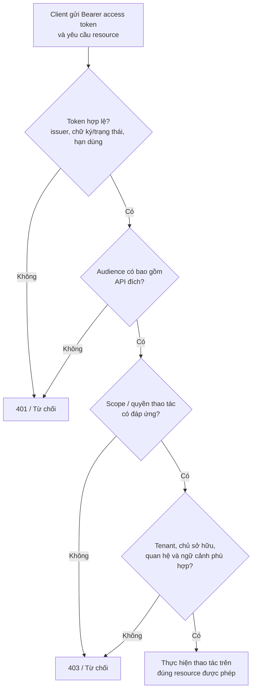
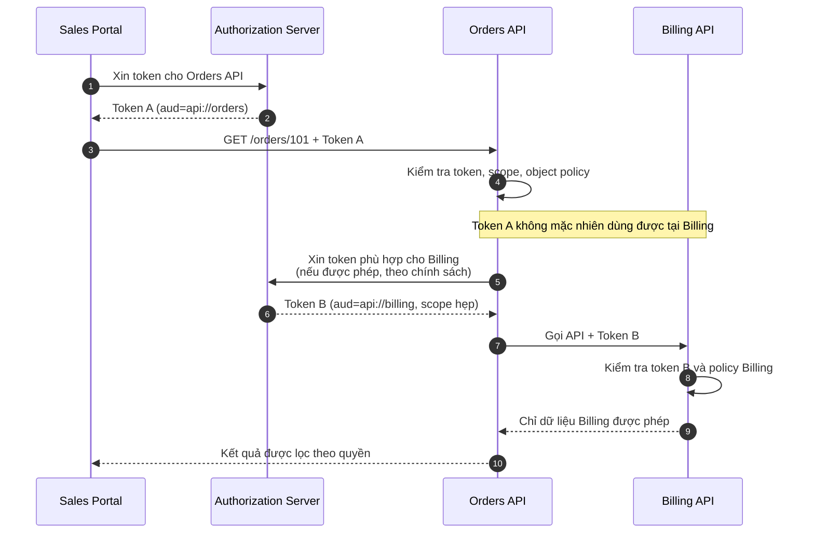

# Token không nên chứa quyền vượt resource

## Mục tiêu học tập

Trong module **SECURITY_TOKEN_SECURITY_FUNDAMENTALS**, token là một mắt xích giữa xác thực, phân quyền và mô hình tin cậy của OAuth 2.0/OIDC. Bài này tập trung vào nguyên tắc: **access token nên được cấp cho đúng tài nguyên đích, đúng thao tác được phép và phạm vi dữ liệu cần thiết; API phải kiểm tra quyền thực tế trước khi xử lý từng yêu cầu**.

Sau bài học, bạn có thể:

- Phân biệt **resource server** (API nhận token) với **resource instance** (đơn hàng, tài liệu, tài khoản, tenant cụ thể).
- Hiểu sự khác nhau giữa `aud` (token dành cho ai), `scope` (được phép làm loại thao tác nào), role/permission và chính sách truy cập một đối tượng cụ thể.
- Giải thích vì sao access token có chữ ký hợp lệ hoặc có claim `admin` chưa đủ để truy cập mọi resource.
- Thiết kế quá trình cấp token có quyền tối thiểu, giới hạn audience, scope, thời hạn và ngữ cảnh tenant.
- Phát hiện và ngăn token bị dùng sai API, sai đối tượng, sai tenant hoặc bị chuyển tiếp qua nhiều dịch vụ.
- Áp dụng kiểm soát tương ứng với JWT, opaque access token, refresh token và các kịch bản OAuth 2.0/OIDC.

## 1. “Resource” có hai lớp cần phân biệt

Trong OAuth 2.0, **Resource Server (RS)** là nơi lưu trữ/cung cấp tài nguyên được bảo vệ, thường là một API. Trong nghiệp vụ, **resource instance** là từng bản ghi hoặc đối tượng cụ thể nằm sau API đó. Hai lớp này có cơ chế phân quyền liên quan nhưng không thay thế nhau.

Ví dụ một hệ thống bán hàng gồm:

```text
Authorization Server: https://identity.example.com

Resource Server A: Orders API
  Audience: api://orders
  Resources: order-101 (tenant A), order-202 (tenant B)

Resource Server B: Billing API
  Audience: api://billing
  Resources: invoice-51, invoice-92, ...
```

Một access token để **đọc đơn hàng** có thể có `aud = "api://orders"` và `scope = "orders:read"`. Hai claim này **chưa chỉ ra** người gọi được đọc mọi đơn hàng. Nếu `order-101` thuộc tenant A còn người gọi chỉ được đọc dữ liệu tenant B, Orders API vẫn phải từ chối truy cập `order-101`.

| Cấp kiểm soát | Ví dụ câu hỏi | Thường được quyết định ở đâu? |
| --- | --- | --- |
| **Issuer / trust** | Token có phải do Authorization Server mà API tin cậy cấp không? | Resource Server xác minh token/đầu mối introspection. |
| **Audience** | Token có được cấp **cho Orders API** không? | AS đặt audience; Resource Server xác minh. |
| **Scope / action** | Token có quyền thao tác loại `orders:read` không? | AS giới hạn scope; Resource Server kiểm tra trên endpoint. |
| **Tenant / object / relation** | Người hoặc dịch vụ này có quyền đọc **order-101** không? | Resource Server và hệ thống phân quyền nghiệp vụ. |
| **Điều kiện ngữ cảnh** | Trạng thái đơn hàng, thời gian, tài khoản bị khóa có cho phép thao tác không? | Chính sách nghiệp vụ được đánh giá tại thời điểm yêu cầu. |

Vì vậy, nói “token không nên chứa quyền vượt resource” có ít nhất **hai ý**: token không nên được cấp quyền quá rộng cho API/tài nguyên đích và API không được suy diễn quyền lên **mọi đối tượng** từ một token hợp lệ.

## 2. Quyền tối thiểu là giao của nhiều điều kiện

Một mô hình kiểm soát hữu ích là:

> **Quyền thực sự trên một request** = token hợp lệ ∩ đúng audience ∩ scope đủ ∩ chính sách của chủ thể/client ∩ quyền trên đối tượng ∩ ngữ cảnh hiện tại.

Dấu “∩” thể hiện rằng **tất cả điều kiện đều phải thỏa**; đây là cách mô tả logic, không phải một công thức tính điểm quyền. Bất kỳ bước nào từ chối thì API phải dừng xử lý hoặc trả kết quả không tiết lộ tài nguyên trái phép.



*Mã trạng thái trong sơ đồ chỉ minh họa. Theo chính sách chống lộ thông tin, API có thể trả `404` cho đối tượng không được phép tiết lộ sự tồn tại; khi thiếu phạm vi OAuth, có thể kèm lỗi Bearer `insufficient_scope` phù hợp.*

### Những claim không đồng nghĩa với nhau

| Claim / thuộc tính | Vai trò | Không nên suy luận |
| --- | --- | --- |
| `iss` | Nguồn phát hành token. | Issuer đáng tin là đủ để API chấp nhận mọi token. |
| `sub` | Chủ thể mà token mô tả; có thể là user hoặc service principal tùy luồng/profile. | Chủ thể này sở hữu hoặc được phép đọc mọi bản ghi. |
| `client_id` | Client tham gia việc xin token theo profile. | Client đã được cấp quyền trên tất cả API. |
| `aud` | Tập đối tượng nhận token hợp lệ, có thể là một hoặc nhiều audience theo hợp đồng. | Token dành cho một API thì có thể sử dụng tự do ở API khác. |
| `scope` / `scp` | Phạm vi thao tác được cấp; tên claim `scp` phụ thuộc nhà cung cấp. | Có `orders:read` nghĩa là đọc mọi tenant và mọi order. |
| `roles` / `permissions` | Thông tin vai trò/quyền theo mô hình của issuer và ứng dụng. | Claim `ADMIN` có hiệu lực toàn hệ thống nếu không gắn chính sách/resource. |
| `tenant_id` | Ngữ cảnh tenant nếu được issuer xác thực và khai báo trong hợp đồng token. | Chỉ cần chuỗi tenant trong token là đủ, không cần kiểm tra ownership của đối tượng. |
| `exp` | Hạn hết hiệu lực của token. | Token chưa hết hạn thì chắc chắn chưa bị thu hồi hoặc quyền chưa thay đổi. |

Scope không phải hệ thống phân quyền hoàn chỉnh. Trong thực tế, AS có thể phát hành `orders:read` để cho phép **gọi chức năng đọc** nhưng kiểm tra từng đối tượng vẫn do Orders API thực hiện thông qua RBAC, ABAC hoặc chính sách dựa trên quan hệ (ReBAC).

## 3. Ví dụ: một access token giới hạn cho Orders API

Giả sử nhân viên `user-42` của tenant `tenant-a` được ủy quyền xem đơn hàng, ứng dụng `sales-portal` yêu cầu access token. Sau khi xác thực và ủy quyền theo luồng OAuth phù hợp, AS có thể phát hành JWT access token có payload minh họa:

```json
{
  "iss": "https://identity.example.com",
  "sub": "user-42",
  "client_id": "sales-portal",
  "aud": "api://orders",
  "scope": "orders:read",
  "tenant_id": "tenant-a",
  "iat": 1800000000,
  "exp": 1800000600
}
```

Đây là **payload minh họa**, không phải JWT hoàn chỉnh hoặc một định dạng claim bắt buộc cho mọi AS. Khi dùng JWT access token profile RFC 9068, còn có các yêu cầu về token header (chẳng hạn `typ = "at+jwt"`) và claims theo profile. Mỗi API phải dựa vào **hợp đồng token đã cấu hình**, không đoán rằng mọi AS đều dùng `tenant_id` hoặc `scope` theo cùng cách.

Với token này:

1. **Orders API** kiểm tra token được issuer tin cậy phát hành, chữ ký/thuật toán hoặc cơ chế xác minh thích hợp, `aud = api://orders`, thời hạn và scope.
2. `GET /orders/order-101` yêu cầu `orders:read`. Nếu đơn hàng thuộc `tenant-a` và `user-42` được phân quyền trên đơn này, API có thể trả dữ liệu.
3. `GET /orders/order-202` có thể bị từ chối nếu đơn hàng thuộc `tenant-b`, dù cùng `aud` và scope.
4. **Billing API** phải từ chối token vì `aud` không dành cho Billing API, dù Billing cũng tin cùng issuer.
5. `POST /orders` phải bị từ chối nếu cần `orders:write` và token chỉ có `orders:read`.

Không nên biến token thành một giấy phép tổng quát bằng cách nhồi các quyền như `all:read`, `*:*` hoặc `roles = ["SUPER_ADMIN"]` chỉ để nhiều API khỏi phải định nghĩa quyền riêng. Các quyền kiểu wildcard có thể hợp lý trong cơ chế nội bộ được kiểm soát chặt, nhưng làm tăng rủi ro nếu được áp dụng vượt ranh giới resource; cần giới hạn và kiểm thử tường minh.

## 4. Vì sao token quá rộng gây rủi ro?

Giả sử một dịch vụ nhận token:

```json
{
  "iss": "https://identity.example.com",
  "sub": "report-service",
  "aud": ["api://orders", "api://billing", "api://users"],
  "scope": "orders:read orders:write billing:read users:admin",
  "exp": 1800003600
}
```

Không phải token có nhiều audience hoặc nhiều scope **luôn sai theo chuẩn**. Tuy nhiên, với một tác vụ chỉ cần tổng hợp số đơn hàng, token này trao cho bên giữ token quá nhiều quyền và mở rộng hậu quả khi bị đánh cắp.

- **Lan truyền thiệt hại:** nếu token bị lộ từ `report-service`, người nắm token có thể thử gọi nhiều API hoặc thao tác vượt mục đích ban đầu.
- **Confused deputy:** dịch vụ trung gian có quyền cao có thể bị lợi dụng thực hiện yêu cầu từ một bên có quyền thấp hơn, nếu không kiểm tra đối tượng và mục đích.
- **Privilege escalation:** một API ánh xạ sai claim `users:admin` hoặc tên role chung `ADMIN` thành quyền quản trị dù token không dành cho chức năng đó.
- **Sai ngữ cảnh tenant:** token chứa quyền rộng nhưng hệ thống bỏ qua phép kiểm tra `tenantId` ở dữ liệu khiến người dùng từ tenant A đọc được tenant B.
- **Khó thu hồi:** JWT tự chứa vẫn có thể được chấp nhận tới `exp` nếu Resource Server không có cơ chế thu hồi hoặc kiểm tra trạng thái bổ sung.

Thiết kế tốt hơn cho tác vụ chỉ đọc báo cáo đơn hàng:

```json
{
  "iss": "https://identity.example.com",
  "sub": "report-service",
  "aud": "api://orders",
  "scope": "orders:summary:read",
  "exp": 1800000600
}
```

Scope `orders:summary:read` chỉ là **ví dụ về một quyền nghiệp vụ được định nghĩa riêng**, không phải scope tiêu chuẩn của OAuth. AS chỉ cấp scope mà client đã được phép; Orders API chỉ cho phép nó trên endpoint báo cáo cần thiết. Nếu tác vụ không cần dữ liệu nhạy cảm của từng đơn hàng, API có thể cung cấp bản tổng hợp thay cho toàn bộ bản ghi.

## 5. Ranh giới của Authorization Server và Resource Server

### 5.1. AS: cấp đúng tài nguyên, đúng scope

AS biết client, người dùng (nếu có), nguồn đồng ý/ủy quyền và chính sách phát hành. Khi nhận yêu cầu cấp access token, AS nên:

1. **Xác định chủ thể và client** theo luồng OAuth: quyền của người dùng trong Authorization Code khác quyền của chính service trong Client Credentials.
2. **Xác định resource mục tiêu** dựa vào tham số được hỗ trợ, đăng ký client, yêu cầu ủy quyền và policy, thay vì để client tùy chọn audience không được kiểm soát.
3. **Giới hạn scope** theo giao của quyền client, quyền người dùng hoặc service principal, resource và chính sách AS.
4. **Phát hành token có hạn dùng phù hợp**, chỉ chứa claims cần thiết cho Resource Server.
5. **Quản lý trạng thái**: kiểm soát phiên/consent, revoke khi cần, quan sát hành vi cấp token bất thường.

Ví dụ yêu cầu dùng OAuth 2.0 **Resource Indicators** (RFC 8707), nếu AS hỗ trợ:

```http
POST /oauth2/token HTTP/1.1
Host: identity.example.com
Authorization: Basic <registered-client-credentials>
Content-Type: application/x-www-form-urlencoded

grant_type=client_credentials&scope=orders%3Asummary%3Aread&resource=https%3A%2F%2Fapi.example.com%2Forders
```

Tham số `resource` giúp chỉ rõ Resource Server đích. **Nó là yêu cầu cần được AS kiểm tra**, không có nghĩa client có quyền chọn bất kỳ resource nào. Giá trị `aud` thực tế phụ thuộc hợp đồng AS/RS: có hệ thống dùng URL trong `resource` làm audience, có hệ thống ánh xạ sang một resource identifier đã đăng ký như `api://orders`. Resource Server phải xác minh theo **giá trị audience mà hệ thống quy định**.

### 5.2. RS: luôn thực thi phân quyền tại nơi sử dụng

Ngay cả khi AS đã kiểm tra quyền lúc phát hành token, Resource Server vẫn cần xác minh:

- Token được phát hành bởi issuer được tin cậy cho **chính API này** và là **access token đúng loại**.
- `aud` đúng, chữ ký/thuật toán và thời hạn hợp lệ, hoặc phản hồi introspection đáng tin cậy chỉ ra token đang active và có thông tin dùng được.
- Scope/permission cho hành động được yêu cầu có trong token hợp lệ.
- Chủ thể và client được phép truy cập **resource instance** cụ thể, xét tenant, owner, ACL, trạng thái dữ liệu và ngữ cảnh đang hiệu lực.

Quyền có thể bị thay đổi **sau thời điểm token được phát hành**. Với dữ liệu cần thu hồi quyền gần như tức thì, chỉ tin claims cũ trong JWT có TTL dài là không đủ; cần chính sách TTL ngắn, tham vấn dữ liệu phân quyền cập nhật, introspection hoặc cơ chế thu hồi thích hợp.

## 6. Áp dụng nguyên tắc ở lớp đối tượng: RBAC, ABAC, ReBAC

Giả sử `GET /orders/{id}` được bảo vệ bằng scope `orders:read`. Đó mới là **cửa đầu tiên**:

| Mô hình | Quyết định ví dụ | Cần dữ liệu gì? |
| --- | --- | --- |
| **RBAC** (vai trò) | Chỉ nhân viên có vai trò `sales-reader` được gọi API xem đơn hàng. | Vai trò đáng tin cậy trong ngữ cảnh ứng dụng/tenant. |
| **ABAC** (thuộc tính) | Chỉ đọc đơn thuộc cùng tenant, đang ở khu vực được phụ trách, khi tài khoản đang hoạt động. | Thuộc tính chủ thể, đối tượng và ngữ cảnh tại lúc yêu cầu. |
| **ReBAC** (quan hệ) | Người dùng đọc được đơn nếu là người tạo, thành viên nhóm xử lý hoặc được chia sẻ trực tiếp. | Quan hệ chủ thể–resource trong nguồn dữ liệu có thẩm quyền. |

Một hệ thống có thể kết hợp cả ba. Điều then chốt là quyền phải được đánh giá ở **resource thực được yêu cầu** và theo dữ liệu đáng tin cậy; không chỉ đọc giá trị `tenantId` do client đưa vào path/query rồi coi đó là quyền.

### Ví dụ API chống IDOR/BOLA

Đây là pseudocode Java biểu thị thiết kế, **không phải API cụ thể của Spring Security**:

```java
OrderDetails getOrder(String orderId, HttpRequest request) {
    // Middleware xác minh chữ ký/issuer/audience/expiration hoặc introspection.
    VerifiedAccessToken token = resourceServer.authenticate(request);

    requireAudience(token, "api://orders");
    requireScope(token, "orders:read");
    requireTokenType(token, "access_token");

    Order order = orderRepository.findById(orderId)
        .orElseThrow(NotFoundException::new);

    // Dùng tenant từ resource trong DB và identity đã xác minh.
    // Không tin client truyền tenantId hay ownerId để tự cấp quyền.
    boolean canRead = authorizationService.canReadOrder(
        token.subject(),
        token.clientId(),
        token.tenantContext(),
        order.tenantId(),
        order.ownerId(),
        order.status()
    );

    if (!canRead) {
        throw new ForbiddenException();
    }
    return mapToAuthorizedView(order);
}
```

Ví dụ thiếu an toàn:

```java
// SAI: chỉ có scope rồi lấy đơn hàng bất kỳ bằng ID do client cung cấp.
if (token.hasScope("orders:read")) {
    return orderRepository.findById(request.orderId());
}
```

Lỗi này thường được gọi là **Broken Object Level Authorization (BOLA)** hoặc **Insecure Direct Object Reference (IDOR)**: người gọi chỉ cần thay ID ở URL để truy cập dữ liệu của người khác nếu API không kiểm tra quyền trên từng đối tượng.

Khi áp dụng, nên đẩy điều kiện tenant/quyền vào query hoặc tầng truy cập dữ liệu khi có thể (ví dụ tìm đơn theo `orderId` **và** tập tenant/chủ thể được phép), đồng thời kiểm tra các thao tác ghi ngay thời điểm thay đổi để tránh lỗi race condition. Tên vai trò trong token có thể hỗ trợ coarse-grained check, nhưng chính sách dữ liệu động cần nguồn dữ liệu đủ cập nhật.

## 7. Nhiều API và dịch vụ trung gian: không chuyển tiếp quyền tùy tiện

Hệ thống phân tán thường có luồng:



Sơ đồ chỉ minh họa bước xin **một token phù hợp**: tùy hệ thống, Orders API có thể sử dụng token exchange (RFC 8693), một grant phù hợp cho danh tính dịch vụ hoặc cơ chế delegation khác. Việc chuyển đổi token **không tự động được cho phép**; AS phải kiểm tra chính sách giao quyền, danh tính actor, mục tiêu và scope đích.

**Không gửi thẳng Token A đến Billing API** rồi hy vọng Billing chấp nhận vì hai API dùng chung issuer. Một Resource Server có thể tin đúng issuer nhưng vẫn phải từ chối token không có audience phù hợp. Token A bị chuyển tiếp sai đối tượng nhận vừa có thể làm lộ token, vừa tạo điều kiện *confused deputy* nếu API downstream không thực thi audience.

### Downscoping và token exchange

Khi dịch vụ chỉ cần một phần quyền của request gốc, nó nên yêu cầu token hẹp hơn theo hợp đồng hỗ trợ:

| Đầu vào | Đầu ra mong muốn |
| --- | --- |
| Client có quyền gọi Orders API để xử lý đơn `order-101`. | Token chỉ được dùng tại Billing API cho nghiệp vụ liên quan `order-101`, với phạm vi và thời hạn tối thiểu. |
| Service có quyền `orders:read orders:write`. | Token cho job báo cáo chỉ có `orders:summary:read`. |
| API nhận request đại diện người dùng. | Token downstream phản ánh chuỗi ủy quyền/actor theo chính sách, không âm thầm nâng thành quyền quản trị của service. |

Trong OAuth Token Exchange (RFC 8693), các khái niệm `subject_token` và `actor_token` có thể hỗ trợ diễn tả ủy quyền/đại diện theo profile. Đây **không phải** phép gán toàn bộ quyền của token đầu vào cho token đầu ra: AS vẫn phải kiểm soát client được yêu cầu exchange hay không, resource/audience và quyền nhận được. Không phải nhà cung cấp nào cũng hỗ trợ cùng cấu trúc claims.

Một API tổng hợp dữ liệu phải áp dụng **quyền tối thiểu của tác vụ**, tránh dùng credential có quyền hệ thống để “nâng hộ” yêu cầu từ người dùng quyền thấp.

## 8. Cấp quyền theo client, người dùng và tenant

Hai luồng OAuth thường dẫn đến **nguồn thẩm quyền khác nhau**:

| Luồng | Quyền đến từ đâu? | Quy tắc khi gọi resource |
| --- | --- | --- |
| **Authorization Code (có PKCE khi áp dụng)** | Quyền/ủy quyền người dùng, client, chính sách AS và API. | API kiểm tra user, scope, audience và quyền trên đối tượng; client không thể sử dụng token user để vượt quyền user. |
| **Client Credentials** | Quyền của ứng dụng hoặc service principal, chính sách AS. | Không có ngữ cảnh người dùng cuối mặc định; API giới hạn theo client identity và phạm vi dữ liệu của service. |

Ví dụ worker kế toán được cấp `billing:read` theo client credentials. Điều đó **không cho phép** ứng dụng dùng token worker để đọc thông tin cá nhân của một người dùng qua `GET /users/{id}`. Kể cả khi một API kết hợp nhiều endpoint trong cùng tiến trình, cần thiết kế audience và chính sách theo ranh giới tài nguyên rõ ràng.

Trong multi-tenant, không coi claim `tenant_id` tự nó là toàn bộ phân quyền. AS phải phát hành claim đó dựa trên dữ liệu tin cậy nếu nó được dùng; Resource Server phải kiểm tra tài nguyên nằm trong tenant đó và chủ thể có quyền tương ứng. Khi một user được phép vào nhiều tenant, context tenant đang chọn phải được ràng buộc với phiên/token/chính sách và đối tượng thực, không để query parameter quyết định đơn phương.

### Role “admin” nên có phạm vi rõ ràng

Role `ADMIN` có thể mang các nghĩa khác nhau:

- Quản trị cấu hình cho **tenant A**.
- Quản trị tập đơn hàng thuộc **phòng bán hàng**.
- Quản trị hệ thống định danh ở phạm vi **toàn AS**.

Không được tự động coi ba vai trò này tương đương. Một claim có thể dùng định danh rõ `tenant-admin:tenant-a` theo hợp đồng, hoặc token chỉ chứa ID vai trò và API tra cứu scope của role từ nguồn có thẩm quyền. Nếu chính sách động và rủi ro cao, nên giảm thông tin quyền cố định trong JWT, đánh giá ở Resource Server hoặc PDP tập trung.

## 9. JWT, opaque token, refresh token và ID Token: quyền nằm ở đâu?

| Token | Chứa/đại diện điều gì? | Giới hạn sử dụng |
| --- | --- | --- |
| **JWT access token** | Tập claims đã được issuer ký, có thể gồm audience, scope, client, subject, hạn dùng. | Resource Server xác minh token và kiểm tra policy; không chấp nhận claim ngoài hợp đồng hoặc sai audience. |
| **Opaque access token** | Một chuỗi tham chiếu, không thể tự suy claim nội dung. | Resource Server dùng introspection endpoint đáng tin cậy (RFC 7662), kiểm tra `active`, audience/scope và quyền. |
| **Refresh token** | Credential để client xin access token mới tại AS theo chính sách. | Không gửi cho Resource Server và không coi là quyền trực tiếp đọc/ghi dữ liệu; bảo vệ và thu hồi nghiêm ngặt. |
| **OIDC ID Token** | Chứa thông tin xác thực về end-user cho OIDC client. | Không dùng làm OAuth access token tại API; audience và purpose khác. |

**JWT ký hợp lệ ≠ đã được phép truy cập.** Chữ ký giúp xác minh nguồn và tính toàn vẹn khi khóa thuộc issuer đúng; việc dùng token còn phải thỏa issuer, audience, expiry, token type, scope và quyền tài nguyên.

**Opaque token `active = true` ≠ có mọi quyền.** AS introspection có thể trả thông tin audience/scope/client theo hợp đồng; API không được suy diễn rằng trạng thái active có nghĩa token được cấp cho API mình. Nếu thiếu thông tin cần thiết để chứng minh quyền, nên từ chối theo chính sách hoặc sửa hợp đồng introspection, không đoán.

**Thu hồi quyền là vấn đề vòng đời.** Nếu user mất quyền xem tài liệu sau khi JWT đã được cấp, API dựa hoàn toàn vào role cũ trong token có thể còn chấp nhận đến `exp`. Thiết kế cần chọn mức nhất quán phù hợp: token sống ngắn, kiểm tra quyền động tại API, kiểm tra phiên/introspection hoặc denylist khi cần. Cache quyết định phân quyền phải có thời hạn hợp lý và được làm mới khi quyền thay đổi.

## 10. Giảm thiệt hại khi token bị đánh cắp hoặc phát lại

Một token quá rộng khiến việc đánh cắp trở nên nguy hiểm hơn. Nguyên tắc *least privilege* không thay thế bảo mật vận chuyển và lưu trữ:

1. **Audience hẹp:** một API hoặc tập API cần thiết theo thiết kế; hạn chế token dùng được trên nhiều hệ thống không liên quan.
2. **Scope hẹp và rõ:** tránh wildcard nếu không cần; tách quyền đọc, ghi, xóa, duyệt; dùng permission gắn với loại resource.
3. **TTL hợp lý:** access token ngắn hạn tùy rủi ro và hiệu năng; không kéo dài chỉ để tránh refresh/xin token mới.
4. **Không lộ token:** HTTPS, không đưa bearer token vào URL, không ghi token/credential vào log, không chuyển token giữa dịch vụ tùy tiện.
5. **Sender-constrained token khi phù hợp:** mTLS certificate-bound access token (RFC 8705) hoặc DPoP (RFC 9449) giúp giảm khả năng sử dụng token bị sao chép nếu cả AS và RS kiểm tra bằng chứng sở hữu khóa đúng cách.
6. **Thu hồi và giám sát:** giám sát sử dụng bất thường theo client/resource, có quy trình vô hiệu hóa, thay credential và xử lý token đã cấp. Đổi client secret không mặc nhiên khiến mọi access token cũ bị thu hồi.

Với **bearer token**, ai giữ được token có thể thử dùng nó tới khi bị từ chối. Giới hạn scope và audience giảm tác động, nhưng không phải biện pháp phòng chống phát lại hoàn chỉnh. Nếu yêu cầu bảo mật cao, cần cơ chế ràng buộc token với bên gửi và chính sách phát hiện/thu hồi phù hợp.

## 11. Mẫu triển khai: kiểm tra đồng thời audience, scope và object policy

Giả định Orders API chấp nhận JWT access token từ:

```yaml
trustedIssuer: "https://identity.example.com"
expectedAudience: "api://orders"
acceptedTokenKind: "access_token"
requiredScopeForGetOrder: "orders:read"
```

Đây chỉ là **cấu hình minh họa**, không phải schema của framework cụ thể.

Luồng xử lý an toàn:

```text
Request GET /orders/order-101
  1. Xác minh token đúng issuer, chữ ký, thuật toán, hạn dùng, loại.
  2. Kiểm tra aud chứa api://orders.
  3. Kiểm tra scope chứa orders:read.
  4. Truy xuất order-101 từ nguồn dữ liệu có thẩm quyền.
  5. Kiểm tra tenant, owner/assignee, trạng thái và chính sách hiện tại.
  6. Chỉ trả các trường dữ liệu được quyền xem.
```

Điểm quan trọng ở bước 4–5 là **quyền trên đối tượng**. Một kẻ tấn công không nên có thể đổi `order-101` thành `order-202` để đọc dữ liệu khác, dù bearer token hợp lệ và có scope `orders:read`.

### Kiểm tra phủ định cần có trong test

| Tình huống đầu vào | Kết quả mong đợi | Lý do |
| --- | --- | --- |
| Token hợp lệ, `aud = api://orders`, scope đủ, user được đọc `order-101`. | Cho phép theo policy. | Đúng API, hành động và đối tượng. |
| Token còn hạn nhưng `aud = api://billing`. | Từ chối. | Sai đối tượng nhận. |
| Token đúng audience nhưng chỉ có `orders:read`, gọi endpoint xóa đơn. | Từ chối, thường là 403. | Thiếu quyền thao tác. |
| Token đúng audience và scope, `order-202` thuộc tenant khác. | Từ chối, có thể trả 404 theo chính sách. | Không có quyền trên đối tượng. |
| Token có role `ADMIN` của tenant A, nhưng yêu cầu tài nguyên tenant B. | Từ chối. | Role không vượt phạm vi tenant. |
| Token từ issuer lạ dù chứa `aud` và scope phù hợp. | Từ chối. | Nguồn phát hành không đáng tin. |
| JWT đã hết hạn, dù scope và đối tượng hợp lệ. | Từ chối, thường là 401. | Token không còn hiệu lực. |
| Opaque token introspection trả `active=true` nhưng không chứng minh audience phù hợp. | Từ chối hoặc yêu cầu hoàn thiện hợp đồng xác thực. | `active` không tự chứng minh quyền của API này. |
| ID Token OIDC được ký hợp lệ, `sub` là user thật nhưng gửi thay access token. | Từ chối. | Sai mục đích token. |
| Token cũ chứa role đã bị gỡ, tài nguyên yêu cầu thu hồi quyền tức thời. | Từ chối sau khi kiểm tra trạng thái/quyền động. | Token claim cũ không vượt quyền hiện tại. |

## 12. Tình huống thực hành

Một hệ thống có ba Resource Server:

```text
Orders API:     aud = api://orders;  scopes = orders:read, orders:write
Billing API:    aud = api://billing; scopes = billing:read, billing:approve
Document API:   aud = api://docs;    scopes = docs:read, docs:share
```

User `u-15` thuộc tenant A, được đọc đơn `O-1` của tenant A nhưng không được đọc `O-2` của tenant B. Client `portal-app` xin access token có `aud=api://orders` và scope `orders:read`.

**Câu hỏi:**

1. Client dùng token đó gọi `GET /billing/invoices`. Billing API phải kiểm tra gì trước tiên và xử lý thế nào?
2. Client dùng token đó gọi `GET /orders/O-2`. Vì sao scope `orders:read` chưa đủ để cho phép?
3. Client muốn chia sẻ một tài liệu qua Document API. Có nên chuyển tiếp token Orders đang có không? Nếu không, cần điều kiện gì để có token cho Document API?
4. User được cấp role `tenant-admin` cho tenant A. Có thể xem role đó như quyền quản trị trên tenant B không?
5. Một service trung gian cần phê duyệt hóa đơn thay user. Vì sao việc sử dụng token Client Credentials có `billing:approve` của chính service có thể gây lỗi ủy quyền, nếu chính sách yêu cầu user được phép phê duyệt?
6. Sau khi AS đã phát hành JWT sống 30 phút, quyền xem `O-1` của user bị thu hồi. Thiết kế nào có thể giúp hệ thống từ chối sớm hơn?

**Gợi ý trả lời:**

1. Billing phải xác minh issuer, token type, thời hạn và đặc biệt audience; `api://orders` không phù hợp với Billing nên từ chối.
2. `orders:read` chỉ là quyền gọi thao tác đọc. Orders API phải kiểm tra đối tượng `O-2` thuộc tenant nào và user `u-15` có quan hệ truy cập hay không.
3. Không chuyển tiếp token sai audience. Client phải được AS cấp token cho Document API với scope `docs:share` theo quyền user/client và policy phù hợp.
4. Không. Quyền admin có phạm vi; Resource Server phải kiểm tra tenant tương ứng.
5. Client Credentials thể hiện quyền của ứng dụng, không mặc nhiên chứng minh người dùng đã ủy quyền hoặc đủ điều kiện phê duyệt. Cần cơ chế delegation/on-behalf-of hoặc quyết định nghiệp vụ phù hợp.
6. Dùng kiểm tra quyền/ACL động theo mỗi request (hoặc cache TTL ngắn), introspection/trạng thái phiên hoặc biện pháp thu hồi token phù hợp, kết hợp access token sống ngắn.

## 13. Checklist thiết kế và vận hành

- [ ] Định danh rõ từng Resource Server và audience được chấp nhận; AS chỉ cấp audience mà client/subject được phép yêu cầu.
- [ ] Định nghĩa scope theo hành động/resource, tách quyền nhạy cảm khỏi quyền đọc thông thường.
- [ ] Tách kiểm tra token (issuer/chữ ký/expiry/type/audience) khỏi kiểm tra chính sách đối tượng, nhưng bắt buộc cả hai.
- [ ] Ràng buộc quyền theo tenant, owner, quan hệ và trạng thái bản ghi; bảo vệ mọi endpoint lấy đối tượng bằng ID.
- [ ] Không coi role chung `ADMIN` là toàn cục nếu chưa có phạm vi hợp đồng chính xác.
- [ ] Hạn chế chuyển tiếp bearer token qua nhiều API; dùng token exchange/downscoping khi được hỗ trợ và có ủy quyền.
- [ ] Phân biệt quyền service principal (Client Credentials) với quyền người dùng (delegated access).
- [ ] Thiết kế cache, TTL, thu hồi và cập nhật quyền để tránh chấp nhận quyền đã lỗi thời.
- [ ] Không đưa token/secret vào log, URL; bảo vệ HTTPS và cân nhắc sender-constrained token khi cần.
- [ ] Kiểm thử sai issuer, sai audience, thiếu scope, truy cập sai tenant, IDOR/BOLA, token hết hạn, token sai loại và quyền bị thu hồi.

## Tài liệu nền tảng

- **RFC 6749 — The OAuth 2.0 Authorization Framework:** access token, scope, client và các grant.
- **RFC 6750 — The OAuth 2.0 Authorization Framework: Bearer Token Usage:** cách dùng bearer token và các lỗi xác thực/phạm vi.
- **RFC 7662 — OAuth 2.0 Token Introspection:** kiểm tra trạng thái và metadata của opaque access token.
- **RFC 8707 — Resource Indicators for OAuth 2.0:** yêu cầu access token cho Resource Server đích.
- **RFC 8693 — OAuth 2.0 Token Exchange:** cơ chế trao đổi token theo chính sách AS.
- **RFC 9068 — JWT Profile for OAuth 2.0 Access Tokens:** claims và quy tắc cho JWT access token.
- **RFC 8705 — OAuth 2.0 Mutual-TLS Client Authentication and Certificate-Bound Access Tokens:** token ràng buộc chứng chỉ.
- **RFC 9449 — OAuth 2.0 Demonstrating Proof of Possession (DPoP):** token gắn với bằng chứng sở hữu khóa.

**Ghi nhớ:** Access token phải mang **đủ quyền cho mục đích được cấp**, không vượt sang API, thao tác hoặc tập dữ liệu không cần thiết. `aud` giới hạn **API đích**, scope giới hạn **loại thao tác**, còn quyền trên **từng resource instance** phải được Resource Server đánh giá. Một token hợp lệ về chữ ký và còn hạn vẫn có thể — và thường phải — bị từ chối khi request vượt ranh giới quyền của tài nguyên.
