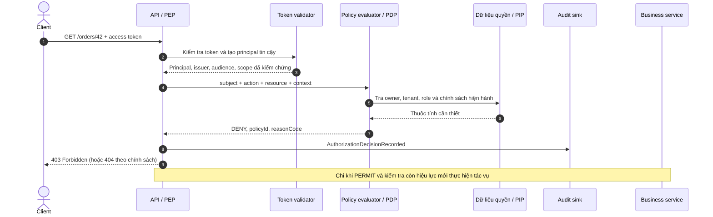

# Audit quyết định authorization

Một nhân viên được xác thực hợp lệ và có access token với scope `orders.read`. Người đó thử đọc đơn hàng thuộc tenant khác và API từ chối yêu cầu. Vài tuần sau, đội bảo mật cần trả lời: **ai đã thử truy cập, lúc nào, tài nguyên nào, hệ thống đã áp dụng chính sách gì và vì sao từ chối?** Nếu chỉ lưu dòng `GET /orders/42 403`, không đủ dữ liệu để giải thích một quyết định phân quyền. Ngược lại, ghi nguyên JWT vào log để điều tra có thể biến chính log thành nơi làm lộ thông tin xác thực.

Bài thuộc chương **Authorization** của module `SECURITY_TOKEN_SECURITY_FUNDAMENTALS`. Trọng tâm là thiết kế *authorization decision audit* (nhật ký kiểm toán quyết định phân quyền) cho hệ thống bảo mật token OAuth 2.0/OpenID Connect (OIDC): truy vết nguồn tin cậy của principal, claims, scope, audience, chính sách và đối tượng truy cập; đồng thời bảo vệ bằng chứng trước việc sửa đổi hoặc bị lợi dụng để đánh cắp/phát lại token.

## 1. Audit quyết định authorization là gì?

**Authorization** trả lời: “Chủ thể này có được thực hiện **hành động này** trên **tài nguyên này**, trong **ngữ cảnh hiện tại** không?”. **Authorization audit** lưu một bản ghi có cấu trúc về **quá trình và kết quả của quyết định đó**, đủ để tái dựng lý do mà hệ thống đã cho phép hoặc từ chối.

Phân biệt các loại sự kiện thường nằm cạnh nhau trong hệ thống:

| Loại sự kiện | Điều nó mô tả | Ví dụ |
|---|---|---|
| **Authentication event** | Việc xác thực principal/credential có thành công không. | JWT hết hạn; client OIDC xác minh ID token thành công. |
| **Authorization decision event** | Principal đã xác thực có được phép làm gì trên tài nguyên nào. | `DENY` vì thiếu `orders.write`; `PERMIT` theo chính sách owner. |
| **Enforcement event** | Cổng thực thi đã chặn hay chấp nhận quyết định thế nào. | API trả `403`; lớp PEP cho phép chuyển yêu cầu đến service. |
| **Business action event** | Tác vụ sau khi được cho phép có thật sự thực hiện thành công không. | Đơn hàng được cập nhật; giao dịch thất bại do xung đột dữ liệu. |
| **Administrative policy change** | Ai thay đổi chính sách, role, quan hệ quyền và thời điểm có hiệu lực. | Quản trị viên gỡ quyền `orders.approve` khỏi nhóm. |

Một bản ghi **`PERMIT` không chứng minh thao tác đã thành công**: sau đó cơ sở dữ liệu có thể lỗi hoặc transaction có thể bị rollback. Một bản ghi `DENY` cũng không nhất thiết chứng minh người dùng đã nhập sai mật khẩu: họ có thể được xác thực thành công nhưng thiếu quyền. Vì vậy cần liên kết các loại sự kiện bằng `trace_id`, `request_id` hoặc `decision_id` phù hợp.

## 2. Decision audit nằm ở đâu trong kiến trúc?

Trong mô hình kiểm soát truy cập, các vai trò hữu ích gồm:

- **PEP (Policy Enforcement Point):** điểm tiếp nhận yêu cầu và thực thi kết quả, ví dụ API gateway, servlet filter hoặc service method. PEP phải ngăn tác vụ khi quyết định là từ chối.
- **PDP (Policy Decision Point):** thành phần đánh giá quy tắc để trả về `PERMIT`, `DENY` hoặc trạng thái khác nếu mô hình chính sách hỗ trợ.
- **PIP (Policy Information Point):** cung cấp dữ liệu cho PDP, ví dụ quyền hiện hành, quan hệ owner, tenant và trạng thái đơn hàng.
- **PAP (Policy Administration Point):** nơi quản lý, sửa đổi và phiên bản hóa chính sách. Không phải mọi hệ thống đều triển khai PAP/PIP thành dịch vụ riêng.
- **Audit collector / audit sink:** tiếp nhận sự kiện đã chuẩn hóa và đưa vào kho lưu kiểm toán được bảo vệ.



Với JWT, **resource server** cần kiểm tra chữ ký/thuật toán, issuer tin cậy, audience, hạn dùng và loại token trước khi tin claims phục vụ PDP. Với **opaque access token**, resource server có thể lấy trạng thái và metadata đã được xác thực qua introspection của authorization server. **Không** xây dựng audit từ những claims do client tự gửi trong header hoặc payload JWT mới giải mã nhưng chưa xác minh.

## 3. Xác định “đơn vị kiểm toán”: một quyết định cụ thể

Một quyết định authorization có thể được mô tả bằng bộ thông tin:

\[
\text{Decision} = f(\text{subject}, \text{action}, \text{resource}, \text{context}, \text{policy version})
\]

Trong đó:

- **Subject:** principal đã kiểm chứng, có thể là người dùng, service account hoặc client OAuth 2.0; cặp `iss` và `sub` thường quan trọng khi nhiều issuer cùng tồn tại.
- **Action:** hành động mang nghĩa nghiệp vụ như `orders.read`, `orders.approve`, `refund.issue`; không chỉ là phương thức HTTP.
- **Resource:** loại và định danh tài nguyên đích, chẳng hạn đơn hàng `order-42`, kèm tenant hoặc phạm vi quản lý cần thiết.
- **Context:** thời điểm, hệ thống gọi, trạng thái tài nguyên, điều kiện phiên, mức đảm bảo xác thực khi áp dụng và thuộc tính đáng tin cậy khác.
- **Policy version:** phiên bản hoặc dấu vân tay bộ quy tắc/ACL được dùng tại thời điểm ra quyết định.

### Kết quả quyết định và kết quả thực thi không đồng nghĩa

Các policy engine có thể chỉ trả `allow/deny`, hoặc phân biệt thêm `INDETERMINATE` (không thể đánh giá vì lỗi/thiếu dữ liệu) và `NOT_APPLICABLE` (không có quy tắc phù hợp). Nếu engine hỗ trợ những trạng thái này, **phải ghi lại đúng giá trị gốc** và cách PEP xử lý. Hệ thống nên có nguyên tắc *fail closed*: khi không đủ căn cứ cấp quyền, **không tự coi lỗi đánh giá là `PERMIT`**.

| Decision của PDP | Ý nghĩa | Enforcement thường phù hợp |
|---|---|---|
| `PERMIT` | Chính sách hiện tại cho phép với điều kiện đã kiểm tra. | Tiếp tục thực thi, nếu các điều kiện và kiểm tra cần thiết vẫn hợp lệ. |
| `DENY` | Chính sách từ chối một cách có chủ đích. | Chặn yêu cầu, ghi mã lý do. |
| `INDETERMINATE` | Không đánh giá đáng tin được, ví dụ policy engine hoặc nguồn thuộc tính lỗi. | Chặn theo chính sách an toàn, phân biệt lỗi hệ thống trong audit. |
| `NOT_APPLICABLE` | Không có quy tắc áp dụng (nếu engine sử dụng kết quả này). | Xử lý theo default-deny hoặc chính sách kết hợp đã định nghĩa, và ghi nhận kết quả. |

Không gộp tất cả thành thông điệp `access denied` vì như vậy khó phân biệt **hành vi không được phép** với **sự cố khiến hệ thống không thể quyết định**.

## 4. Thiết kế schema sự kiện audit

Một sự kiện nên **có cấu trúc, dễ tìm kiếm, có mã nguyên nhân ổn định và không chứa bí mật**. Các nhóm trường có thể thiết kế như sau:

| Nhóm | Trường gợi ý | Mục đích |
|---|---|---|
| Định danh sự kiện | `event_id`, `schema_version`, `decision_id`, `trace_id`, `request_id` | Chống trùng, tương quan giữa lớp API, PDP, service và audit store. |
| Thời điểm và nguồn | `occurred_at`, `recorded_at`, `service`, `environment`, `instance_id` nếu cần | Truy vết thời gian và thành phần phát sinh; sử dụng UTC và đồng bộ đồng hồ. |
| Principal tin cậy | `principal_type`, `issuer`, `subject_ref`, `client_id`, `tenant_ref` | Xác định người dùng, service hay client được kiểm chứng; không dựa vào tên hiển thị. |
| Credential/token | `token_type`, `token_validation`, `audience`, `scope`, `token_ref` tùy chọn | Giải thích ràng buộc token mà hệ thống đã kiểm tra; `token_ref` không được là token gốc. |
| Yêu cầu | `action`, `resource_type`, `resource_ref`, `target_tenant_ref` | Biết người gọi muốn thực hiện điều gì trên tài nguyên nào. |
| Chính sách | `policy_id`, `policy_version`, `decision`, `reason_code` | Cho biết quy tắc và nguyên nhân dẫn đến kết luận. |
| Thực thi | `enforcement_result`, `http_status`, `obligations` nếu có | Kiểm chứng PEP đã chặn/cho phép đúng quyết định; không nhầm với kết quả nghiệp vụ. |

**Không nhất thiết cần tất cả trường cho mọi loại event.** Dữ liệu phải phù hợp rủi ro và yêu cầu kiểm toán. Ví dụ nếu không có token (yêu cầu chưa xác thực), trường `issuer`/`subject_ref` có thể vắng mặt và sự kiện nên thuộc loại `AUTHENTICATION_REJECTED` thay vì gán một principal giả định.

### Ý nghĩa của `reason_code`

Chọn một bộ mã nguyên nhân có thể thống kê, ví dụ:

| Mã | Diễn giải | Quyết định điển hình |
|---|---|---|
| `OWNER_MATCH` | Chủ thể được quyền thao tác trên bản ghi thuộc sở hữu. | `PERMIT` |
| `APPROVER_ROLE_MATCH` | Có vai trò phê duyệt hợp lệ với tác vụ. | `PERMIT` |
| `MISSING_SCOPE` | Token có hiệu lực nhưng thiếu scope cần thiết. | `DENY` |
| `CROSS_TENANT` | Tài nguyên nằm ngoài tenant/phạm vi được phép. | `DENY` |
| `RESOURCE_POLICY_DENIED` | Quy tắc theo trạng thái tài nguyên chặn hành động. | `DENY` |
| `ATTRIBUTE_LOOKUP_FAILED` | Không lấy được dữ liệu thuộc tính cần để quyết định. | `INDETERMINATE` |
| `NO_MATCHING_POLICY` | Không có chính sách phù hợp theo mô hình engine. | `NOT_APPLICABLE` hoặc kết quả đã được kết hợp theo chính sách. |

Mã lý do là **hợp đồng nội bộ**: tên trong bảng chỉ là ví dụ, không phải enum chuẩn của OAuth/OIDC. Không ghi thông điệp exception nguyên bản hoặc dữ liệu bí mật vào `reason_code`.

## 5. Ví dụ bản ghi JSON: từ chối và cho phép

Sự kiện từ chối đọc đơn hàng khác tenant (giá trị giả lập, không có token thật):

```json
{
  "event_type": "AUTHORIZATION_DECISION",
  "schema_version": "1.0",
  "event_id": "evt-a1f0",
  "decision_id": "dec-8e31",
  "occurred_at": "2026-11-23T01:50:00Z",
  "service": "orders-api",
  "environment": "production",
  "trace_id": "trace-f41a",
  "principal": {
    "type": "user",
    "issuer": "https://id.example.test",
    "subject_ref": "user-an",
    "client_id": "orders-web",
    "tenant_ref": "tenant-a"
  },
  "credential": {
    "type": "access_token",
    "validation": "VERIFIED",
    "audience": ["orders-api"],
    "scopes": ["orders.read"]
  },
  "request": {
    "action": "orders.read",
    "resource_type": "order",
    "resource_ref": "order-42",
    "target_tenant_ref": "tenant-b"
  },
  "policy": {
    "id": "orders.tenant-boundary",
    "version": "v7",
    "decision": "DENY",
    "reason_code": "CROSS_TENANT"
  },
  "enforcement": {
    "result": "BLOCKED",
    "http_status": 403
  }
}
```

Với cùng hệ thống, sự kiện được phép có thể rút gọn để thấy khác biệt:

```json
{
  "event_type": "AUTHORIZATION_DECISION",
  "event_id": "evt-b9e2",
  "decision_id": "dec-11c0",
  "trace_id": "trace-f41b",
  "principal": { "issuer": "https://id.example.test", "subject_ref": "user-an" },
  "request": { "action": "orders.read", "resource_type": "order", "resource_ref": "order-10" },
  "policy": { "id": "orders.owner-read", "version": "v7", "decision": "PERMIT", "reason_code": "OWNER_MATCH" },
  "enforcement": { "result": "PROCEEDED" }
}
```

Sự kiện thứ hai chỉ là **bản trích rút gọn** minh họa, không phải yêu cầu được phép bỏ các trường xác định thời điểm/nguồn trong schema vận hành thực tế. Nếu thao tác cập nhật đơn hàng tiếp tục thất bại vì lỗi cơ sở dữ liệu, nên ghi một **business action event** riêng và liên kết bằng `trace_id` hoặc `decision_id`.

Nếu chính sách chủ ý trả `404 Not Found` để tránh tiết lộ tài nguyên của tenant khác, bản ghi nội bộ vẫn nên giữ nguyên `DENY` và `CROSS_TENANT`; `http_status` khi đó là `404`. Không thay đổi quyết định thật chỉ để làm cho log khớp mã HTTP hiển thị cho client.

## 6. Dữ liệu nào không được đưa vào nhật ký?

Audit phải đủ để điều tra nhưng **không biến nơi lưu log thành kho credential hoặc dữ liệu cá nhân không cần thiết**.

- **Không ghi nguyên access token, refresh token, ID token, authorization code, client secret, cookie phiên hoặc header `Authorization`.** Đây là những dữ liệu có thể bị dùng lại; refresh token bị lộ còn cho phép xin token mới nếu hệ thống không ngăn được.
- **Không ghi toàn bộ JWT payload theo thói quen.** Claims có thể chứa email, địa chỉ, thuộc tính nhạy cảm. Chỉ lấy trường đã xác minh, thực sự cần cho kiểm toán; có thể dùng định danh nội bộ hoặc mã thay thế.
- **Hạn chế ghi `jti` nguyên bản hoặc định danh credential có thể liên kết rộng rãi.** Nếu cần nhận diện việc token bị phát lại, cân nhắc một `token_ref` sử dụng **HMAC với khóa bí mật được bảo vệ**, trên định danh token thích hợp, để các sự kiện liên quan đối chiếu được mà không lộ token. Chỉ băm thông thường một token entropy thấp có thể không đủ bảo vệ; yêu cầu phân loại và quản lý khóa rõ ràng.
- **Không tin dữ liệu từ request chưa kiểm chứng** như `X-User-Id`, `X-Tenant-Id`, header trace hay tham số URL là nguồn xác thực principal. Nếu phải lưu, đánh dấu là dữ liệu đầu vào chưa tin cậy và giới hạn độ dài/escape để chống log injection.
- **Không ghi nội dung bản ghi nghiệp vụ** nếu audit chỉ cần định danh và lý do quyết định. Việc có cần lưu địa chỉ IP, user-agent, vị trí hay dữ liệu khác phụ thuộc nguy cơ, quyền riêng tư và quy định lưu giữ áp dụng.

**Nguồn đúng cho `issuer`, `subject_ref`, `scopes`, `audience`** là ngữ cảnh xác thực đã được API xác minh theo issuer tin cậy (hoặc introspection có xác thực với AS). Với một service account nhận token qua `client_credentials`, `subject_ref` có thể là định danh client/service; không tự gán đó là người dùng cuối.

Trong mô hình delegation/on-behalf-of, cần ghi rõ **actor thực hiện** và **subject được đại diện** nếu token profile và chính sách cho phép phân biệt, thay vì ghi một trường `user` mơ hồ. Trường nào không có căn cứ thì để trống, không đoán.

## 7. Kiểm tra token và audit liên hệ thế nào?

Audit không thay thế cho **token validation**. Nó ghi lại quyết định sau khi các điều kiện tin cậy đã được kiểm chứng:

| Tình huống | Hướng xử lý | Loại thông tin audit phù hợp |
|---|---|---|
| Không có bearer token tại API bắt buộc xác thực. | Thường trả `401`. | `AUTHENTICATION_REJECTED` / `MISSING_CREDENTIAL`, không gán `sub` giả. |
| JWT có chữ ký sai, `iss` không tin cậy, `aud` sai, hết hạn hoặc là ID token gửi nhầm API. | Thường trả `401`. | Ghi loại lỗi xác minh ở mức an toàn; không đưa token gốc vào log. |
| Opaque token introspection trả `active: false`. | Không chấp nhận credential. | Ghi sự kiện xác thực bị từ chối, hạn chế metadata chưa được tin. |
| Access token hợp lệ nhưng thiếu `orders.write`. | Thường trả `403`, với OAuth Bearer có thể dùng `insufficient_scope`. | `AUTHORIZATION_DECISION`, `DENY`, `MISSING_SCOPE`. |
| Token hợp lệ, có scope nhưng tài nguyên khác tenant. | Trả `403` hoặc `404` theo chính sách. | `DENY`, `CROSS_TENANT`, gắn resource/policy đã kiểm tra. |
| Token hợp lệ, đủ scope, đủ quyền trên bản ghi. | Tiếp tục tác vụ. | `PERMIT`, policy/version và enforcement; log kết quả nghiệp vụ riêng nếu cần. |

Bearer access token là **bằng chứng mà ai nắm giữ cũng có thể trình** nếu không có ràng buộc người gửi. Một audit `PERMIT` cho principal `user-an` cho biết hệ thống đã chấp nhận credential gắn với chủ thể đó; **không tự chứng minh chính An đã thao tác**. Khi điều tra nghi ngờ đánh cắp token, cần kết hợp dữ liệu xác thực, thiết bị/phiên phù hợp, `token_ref` an toàn, phát hiện hành vi bất thường và cơ chế sender-constrained như DPoP/mTLS nếu đã triển khai.

### Token và quyền có thể đã thay đổi

Ví dụ: lúc 09:00 access token được cấp `orders.approve`; lúc 09:05 role bị gỡ, nhưng JWT còn hạn đến 09:15. Nếu API chỉ dùng claims tĩnh thì quyết định `PERMIT` lúc 09:07 có thể vẫn phản ánh **ảnh chụp quyền lúc cấp token**, không phải ACL hiện tại.

Để điều tra đúng, audit nên phân biệt **scope trong token**, **role/quan hệ quyền lấy từ PIP**, **policy version** và thời điểm kiểm tra. Khi dùng introspection/denylist hoặc cache quyền, cần biết cache có thể làm thông tin cũ tồn tại bao lâu. Thu hồi refresh token không mặc định làm JWT access token đã phát hành mất hiệu lực ngay lập tức.

## 8. Ghi audit tại điểm quyết định và điểm thực thi

Ở mức khái niệm, một service Java có thể thực hiện như sau:

```java
// Pseudocode: các kiểu VerifiedPrincipal, AuthorizationRequest,
// Decision, PolicyEngine và AuditSink là abstraction của ứng dụng.
public Decision authorizeAndAudit(
        VerifiedPrincipal principal,
        AuthorizationRequest request) {

    // principal đã được tạo từ access token/session có xác minh.
    Decision decision = policyEngine.evaluate(principal, request);

    auditSink.record(AuthorizationAuditEvent.fromVerifiedContext(
        principal,
        request.safeResourceReference(),
        request.action(),
        decision.policyId(),
        decision.policyVersion(),
        decision.outcome(),
        decision.reasonCode()
    ));

    if (!decision.isPermit()) {
        throw new AccessDeniedException("Access denied");
    }

    return decision;
}
```

Đây là **mã giả minh họa mẫu tích hợp**, không phải lớp Spring Security có thể biên dịch độc lập. Các đối tượng được đặt tên để làm rõ trách nhiệm. Trong Spring Security có thể dùng các điểm chặn ở HTTP/method security, `AuthorizationManager`, interceptor hoặc sự kiện authorization để thu thập quyết định; cần kiểm tra khả năng phát sự kiện **cả `PERMIT` lẫn `DENY`** của cấu hình và phiên bản sử dụng, vì không phải mọi cơ chế mặc định phát đầy đủ cả hai.

Khi đưa vào sản phẩm phải xử lý thêm ba vấn đề:

1. **Đường đi ngoại lệ:** lỗi timeout ở policy engine hoặc tra cứu thuộc tính phải được chuẩn hóa thành sự kiện `INDETERMINATE`/lỗi đánh giá, không biến thành `PERMIT` mặc định và không mất hoàn toàn dấu vết.
2. **Thực thi có thể cách quyết định một khoảng thời gian:** nếu owner/tenant/trạng thái dữ liệu thay đổi, kiểm tra quyền ở thời điểm dùng hoặc kết hợp điều kiện với truy vấn/transaction để hạn chế lỗi *time-of-check/time-of-use (TOCTOU)*.
3. **Độ bền của audit:** `auditSink.record(...)` có thể lỗi hoặc chỉ đẩy vào bộ đệm. Với hành động rủi ro cao, kiến trúc phải xác định có cần bắt buộc ghi bền trước khi thực thi (*fail closed* khi không ghi được) hoặc dùng outbox/giao nhận có bảo đảm; không được ngầm coi lệnh gọi ghi log là bằng chứng đã lưu lâu dài.

Tại những điểm cấp quyền khác nhau (gateway, service, database policy), có thể phát nhiều sự kiện. Gắn `decision_id`, `policy_id` và `enforcement_point` giúp nhận biết **quyết định riêng của từng lớp**, tránh nhầm nhiều sự kiện thành nhiều lần truy cập độc lập.

## 9. Lưu giữ, tính toàn vẹn và khả năng điều tra

Để audit có giá trị pháp chứng và vận hành, cần bảo vệ **đường truyền, kho lưu, quyền truy cập và lịch sử chỉnh sửa**.

| Mục tiêu | Biện pháp thiết kế | Rủi ro nếu thiếu |
|---|---|---|
| **Tính toàn vẹn** | Kho append-only hoặc WORM theo nhu cầu; kiểm soát xóa/sửa, ký hoặc chuỗi băm lô sự kiện khi phù hợp. | Kẻ tấn công sửa/xóa bằng chứng sau khi truy cập trái phép. |
| **Độ bền** | Hàng đợi bền/outbox, retry có giới hạn, dead-letter queue và đối soát sự kiện thiếu. | API trả thành công nhưng audit bị mất âm thầm. |
| **Tính duy nhất** | `event_id` không trùng; consumer xử lý idempotent khi retry. | Thống kê trùng lặp, đếm sai số lần `DENY`. |
| **Tính đúng thứ tự** | Timestamp UTC, đồng bộ đồng hồ, `occurred_at` và `recorded_at` khi cần. | Không ghép được các quyết định xuyên dịch vụ theo trình tự. |
| **Bảo mật thông tin** | Mã hóa khi truyền/lưu, RBAC chặt cho người đọc log, che/mã thay thế dữ liệu nhạy cảm. | Audit store thành điểm rò rỉ credential/PII. |
| **Chính sách lưu giữ** | Thời hạn theo phân loại sự kiện, rủi ro, yêu cầu pháp lý; quy trình hủy/ẩn danh phù hợp. | Lưu quá lâu, vượt nhu cầu điều tra hoặc không đáp ứng yêu cầu truy xuất. |
| **Giám sát nguồn audit** | Cảnh báo collector ngừng nhận event, queue tồn, schema lỗi và tăng đột biến tỷ lệ deny. | Mất khả năng phát hiện sự cố vì cơ chế audit tự hỏng. |

**Không mặc định mọi hệ thống phải lưu vĩnh viễn.** Thời hạn và mức chi tiết phải được phê duyệt theo yêu cầu nghiệp vụ, bảo mật và quyền riêng tư. Với hành động đặc biệt nhạy cảm như giải ngân, thay đổi quyền admin hay xuất dữ liệu diện rộng, có thể đặt mức yêu cầu audit cao hơn so với một lần đọc thông tin công khai.

Không để service nghiệp vụ có quyền xóa/sửa tự do lịch sử mà chính nó phát sinh. Đồng thời, hạn chế người có quyền xem audit đọc nội dung dữ liệu người dùng nếu không cần thiết.

## 10. Điều tra một sự cố bằng các bản ghi quyết định

Giả sử hệ thống phát hiện 200 lần `DENY/CROSS_TENANT` từ cùng một `client_id` trong 3 phút. Một quy trình điều tra hợp lý:

1. Lọc các sự kiện theo thời gian, `service`, `decision`, `reason_code` và `client_id`; phân biệt số event với số yêu cầu bằng `decision_id`/`trace_id` để tránh đếm trùng do retry.
2. Nhóm theo cặp `issuer` + `subject_ref`, `tenant_ref` và `resource_type`; xác định một principal đang thử nhiều `resource_ref` hay có nhiều principal liên quan.
3. Đối chiếu `policy_id`/`policy_version`, sự kiện thay đổi quyền và phiên bản triển khai để xem có phải lỗi cấu hình mới gây `DENY` hàng loạt.
4. Liên kết các authentication events, thay đổi phiên, tín hiệu thiết bị và sự kiện token bất thường bằng định danh an toàn; **không** dựa duy nhất vào `sub` để kết luận chủ tài khoản là người thực hiện.
5. Xác minh PEP đã thực sự `BLOCKED` và không có business action bất hợp lệ sau `DENY`; trường hợp khác biệt cần ưu tiên xử lý như lỗ hổng enforcement.
6. Nếu có dấu hiệu bị đánh cắp token, áp dụng biện pháp khóa phiên/thu hồi token theo cơ chế hỗ trợ, kiểm tra các request `PERMIT` liên quan và duy trì bằng chứng theo chính sách xử lý sự cố.

Ví dụ truy vấn khái niệm trên bảng audit đã chuẩn hóa:

```sql
SELECT issuer, subject_ref, client_id,
       policy_id, reason_code, COUNT(*) AS denied_count
FROM authorization_audit
WHERE occurred_at >= :start_utc
  AND occurred_at < :end_utc
  AND decision = 'DENY'
GROUP BY issuer, subject_ref, client_id, policy_id, reason_code
ORDER BY denied_count DESC;
```

Truy vấn trên chỉ thống kê; trước khi dùng cần xác định **phạm vi truy cập log** và cách ánh xạ principal/tenant để không hiển thị dữ liệu vượt quyền. Điều tra tốt phải kết nối quyết định với enforcement và thay đổi chính sách, không chỉ nhìn vào một biểu đồ `403`.

## 11. Những sai lầm khiến audit không còn đáng tin

| Sai lầm | Hậu quả | Cách khắc phục |
|---|---|---|
| Chỉ log `403` hoặc chỉ log `PERMIT`, không lưu policy/reason. | Không biết vì sao cho phép/từ chối; khó kiểm chứng đặc quyền quá rộng. | Ghi sự kiện quyết định có `policy_id`, `version`, `reason_code`; lấy mẫu theo rủi ro nếu cần tối ưu lưu lượng. |
| Ghi nguyên JWT, refresh token, cookie hoặc header Authorization. | Người có quyền đọc log có thể phát lại token. | Loại bỏ bí mật trước khi emit; dùng reference an toàn khi thật sự cần đối chiếu. |
| Ghi `sub`, `role` từ payload chưa xác minh như dữ liệu chắc chắn. | Kẻ tấn công tự khai danh tính/quyền để làm sai bằng chứng. | Chỉ dùng principal/claims từ token đã được xác thực và nguồn PIP đáng tin cậy. |
| Chỉ lưu mã HTTP, không phân biệt `DENY` với lỗi xác thực. | Điều tra nhầm lỗi token hết hạn thành cố tình vượt quyền. | Tách authentication, authorization, enforcement và kết quả nghiệp vụ. |
| Audit sau khi thực thi nhưng lỗi làm mất event. | Có thay đổi dữ liệu mà không còn bằng chứng quyết định. | Xác định ranh giới giao dịch, outbox hoặc chính sách ghi bền phù hợp rủi ro. |
| Coi `PERMIT` là bằng chứng giao dịch thành công. | Sai lịch sử thay đổi dữ liệu hoặc hoạt động của người dùng. | Liên kết audit authorization với business action/transaction event. |
| Thiếu `policy_version` và nguồn thuộc tính. | Không tái dựng được quyết định khi role/ACL thay đổi. | Ghi phiên bản chính sách và nguồn/thời điểm dữ liệu quan trọng. |
| Log quá chi tiết nhưng không kiểm soát quyền xem/retention. | Tăng nguy cơ lộ dữ liệu và chi phí; làm giảm khả năng tìm kiếm. | Dùng schema tối thiểu, phân cấp dữ liệu, kiểm soát truy cập và vòng đời lưu trữ. |

## 12. Kiểm chứng chất lượng hệ thống audit

Khi triển khai, nên có bộ kịch bản kiểm chứng dựa trên hành vi quan sát được:

| Kịch bản | Quyết định mong đợi | Bằng chứng audit cần có |
|---|---|---|
| User A đọc đơn hàng của chính mình với scope phù hợp. | `PERMIT` | Subject, action/resource, policy owner, version, `OWNER_MATCH`, enforcement. |
| User A đọc đơn hàng tenant B. | `DENY` | `CROSS_TENANT`, resource/tenant reference được bảo vệ, PEP đã chặn. |
| Token hợp lệ nhưng thiếu `orders.write`. | `DENY` | `MISSING_SCOPE`, audience/issuer từ credential đã xác minh. |
| Token hết hạn hoặc sai audience. | Xác thực thất bại trước authorization. | Event lỗi xác thực an toàn, không chứa raw token hoặc `sub` không tin cậy. |
| Policy/PIP mất kết nối. | Không tự cấp quyền; trạng thái lỗi được ghi riêng. | `INDETERMINATE`/lỗi đánh giá và enforcement từ chối theo chính sách. |
| Cùng event được giao hai lần do retry. | Không tăng số lần truy cập thực. | `event_id` cho phép khử trùng/đối soát. |
| Thay đổi policy hoặc role giữa hai yêu cầu. | Quyết định có thể khác nhau theo trạng thái mới. | Version/thời điểm rõ ràng để giải thích chênh lệch. |
| Collector audit gián đoạn. | Ứng xử theo chính sách độ bền của hành động. | Cảnh báo, retry/outbox hoặc fail-closed đối với tác vụ phải có audit bền. |

Trong bài thực hành, hãy chọn **một hành động nhạy cảm** (ví dụ `refund.approve`) và tự xác định: principal tin cậy là ai, action/resource/tenant là gì, dữ liệu PIP nào cần kiểm tra, policy version được lấy từ đâu, `DENY` ghi mã gì, và sẽ chứng minh thế nào rằng tác vụ không được thực hiện sau khi PEP từ chối.

## 13. Các nguyên tắc cần nhớ

1. **Audit quyết định authorization** ghi lại *ai, yêu cầu gì, trên tài nguyên nào, chính sách nào, kết quả nào và vì sao*, không chỉ ghi HTTP status.
2. **Authentication, authorization, enforcement và kết quả nghiệp vụ là các sự kiện khác nhau**; liên kết chúng bằng mã tương quan để điều tra chính xác.
3. **Chỉ tin claims từ token đã xác minh** và dữ liệu PIP được phép dùng; `iss`, `aud`, `scope`, `sub`, tenant và loại token đều cần được hiểu theo đúng ngữ cảnh.
4. **Không ghi credential vào audit.** Mục tiêu là có bằng chứng đủ dùng mà không tạo ra nguồn đánh cắp access/refresh token mới.
5. **Dữ liệu audit phải có vòng đời và tính toàn vẹn**: schema ổn định, version, thời gian, quyền xem, lưu bền, chống sửa/xóa, chính sách retention và giám sát collector.
6. **Quyết định có thể thay đổi** khi quyền, chính sách, token hoặc trạng thái tài nguyên đổi; audit phải ghi được phiên bản/ngữ cảnh tại thời điểm đánh giá và bảo đảm enforcement thực hiện đúng kết quả.

### Tài liệu tham khảo

- [OWASP Logging Cheat Sheet](https://cheatsheetseries.owasp.org/cheatsheets/Logging_Cheat_Sheet.html): nội dung log ứng dụng, dữ liệu không nên ghi và kiểm soát log injection.
- [NIST SP 800-53 Rev. 5 — AU (Audit and Accountability)](https://csrc.nist.gov/pubs/sp/800/53/r5/upd1/final): yêu cầu kiểm toán, bảo vệ và quản lý thông tin audit.
- [RFC 6750 — OAuth 2.0 Bearer Token Usage](https://www.rfc-editor.org/rfc/rfc6750): phản hồi lỗi token và `insufficient_scope`.
- [RFC 9068 — JWT Profile for OAuth 2.0 Access Tokens](https://www.rfc-editor.org/rfc/rfc9068): xác minh access token JWT và các claims liên quan.
- [RFC 7662 — OAuth 2.0 Token Introspection](https://www.rfc-editor.org/rfc/rfc7662): trạng thái/metadata token qua authorization server.
- [RFC 9700 — Best Current Practice for OAuth 2.0 Security](https://www.rfc-editor.org/rfc/rfc9700): vòng đời token và biện pháp giảm nguy cơ token bị lạm dụng.
- [Spring Security Reference — Authorization Architecture](https://docs.spring.io/spring-security/reference/servlet/authorization/architecture.html): các thành phần và điểm tích hợp authorization trong Spring Security.
