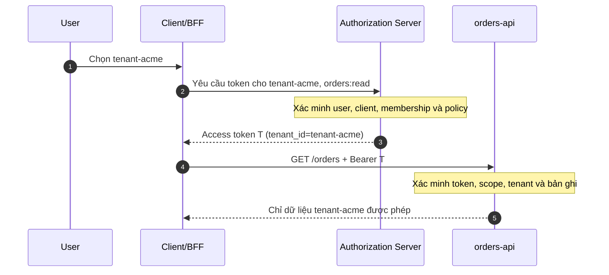
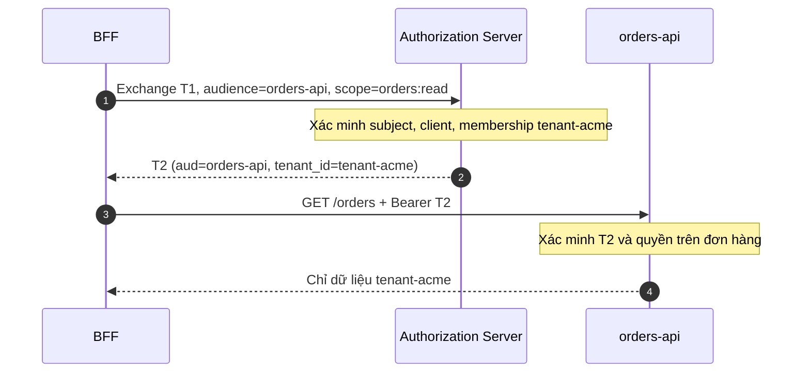

# Tenant-specific scope

Trong hệ thống SaaS nhiều khách hàng, một API có thể phục vụ hàng trăm tổ chức (tenant). Người dùng thuộc tenant A có thể được phép đọc đơn hàng của A nhưng không được xem dữ liệu của tenant B. Một service account của tenant A cũng không được dùng token để thao tác tài nguyên của tenant khác. **Tenant-specific scope** giúp biểu đạt quyền truy cập trong ngữ cảnh tenant, kết hợp với định danh tenant đáng tin cậy và kiểm tra quyền trên tài nguyên.

Bài học **Tenant-specific scope** thuộc chương **Multi-tenant** của mô-đun **SECURITY_TOKEN_SECURITY_FUNDAMENTALS**. Chủ đề cần được hiểu cùng mô hình tin cậy và vòng đời token bảo mật: phân biệt JWT, opaque token, access token, refresh token; hiểu phát hành, kiểm tra claims, scope, audience, lưu trữ, thu hồi và phòng chống token bị đánh cắp hoặc phát lại trong OAuth 2.0/OIDC.

Sau bài này, bạn có thể:

- Phân biệt **scope của action** với **tenant context** và quyền trên tài nguyên.
- Thiết kế token gắn với một tenant cụ thể hoặc một tập tenant được ủy quyền.
- Đánh giá khi nào dùng scope chung kèm claim tenant, khi nào cần scope có tenant namespace.
- Xác minh issuer, audience, subject, client, tenant, scope và trạng thái token tại resource server.
- Ngăn tenant switching trái phép, IDOR/cross-tenant access, confused deputy và cache key bị trộn tenant.
- Thiết kế luồng đổi tenant, client credentials, token exchange, thu hồi và kiểm thử cách ly dữ liệu.

## 1. Bài toán phân quyền theo tenant

Giả sử một nền tảng SaaS có hai tổ chức:

- **Tenant A:** `tenant-acme`, nhân viên Alice và service `acme-order-worker`.
- **Tenant B:** `tenant-north`, nhân viên Bob và service `north-order-worker`.

API dùng chung endpoint:

```http
GET /orders/ord-1001 HTTP/1.1
Host: api.example.com
Authorization: Bearer <access-token>
```

Nếu chỉ kiểm tra token có scope `orders:read`, hệ thống mới biết chủ thể được đọc loại tài nguyên nào. Nó chưa biết **được đọc trong tenant nào**. Nếu backend truy vấn theo `orderId` mà không ràng buộc tenant, Alice có thể thử thay ID thành đơn hàng của Bob.

Quyền truy cập đúng cần xét đồng thời:

1. Token do issuer tin cậy phát hành và còn hiệu lực.
2. Token dành cho API/resource server đang nhận request (`audience` phù hợp).
3. Token có quyền thực hiện action, ví dụ `orders:read`.
4. Token hoặc ngữ cảnh xác thực xác định tenant mà chủ thể được phép hoạt động.
5. Chủ thể/caller được phép dùng tenant đó và có quyền với bản ghi cụ thể.

**Tenant-specific scope không thay thế tenant authorization.** Scope là một phần của quyết định quyền; backend vẫn phải kiểm tra quan hệ chủ thể–tenant–tài nguyên và áp dụng ràng buộc tenant trong truy vấn dữ liệu.

## 2. Phân biệt scope, tenant và audience

| Khái niệm | Câu hỏi | Ví dụ |
|---|---|---|
| **Subject (`sub`)** | Ai là chủ thể được xác thực/ủy quyền? | `user-42` hoặc định danh service theo profile |
| **Client identity** | Ứng dụng nào đang xin hoặc sử dụng token? | `order-worker-prod` |
| **Tenant context** | Request đang hoạt động trong tổ chức/không gian dữ liệu nào? | `tenant-acme` |
| **Scope** | Token được phép yêu cầu action nào? | `orders:read`, `orders:create` |
| **Audience (`aud`)** | Token dành cho resource server nào? | `orders-api` |
| **Resource authorization** | Chủ thể có quyền với đơn hàng cụ thể không? | Alice được xem `ord-1001` thuộc `tenant-acme` |

Các trường này không thay thế nhau:

- `aud=orders-api` không cho biết tenant nào được phép.
- `scope=orders:read` không tự giới hạn dữ liệu về tenant của người dùng.
- `tenant_id=tenant-acme` không tự cấp quyền đọc hoặc ghi đơn hàng.
- `sub=user-42` không chứng minh người dùng hiện còn là thành viên tenant A nếu membership đã bị thu hồi.

OAuth 2.0 định nghĩa scope là các chuỗi phạm vi quyền do authorization server/resource server thống nhất. **OAuth không quy định một cú pháp tenant-specific scope bắt buộc**. Claim như `tenant_id`, `tenant_ids` hay `active_tenant` thường là custom claim theo hợp đồng giữa AS và API. Resource server phải biết rõ claim nào được tin cậy và cách diễn giải.

## 3. Ba cách biểu đạt quyền theo tenant

### 3.1. Scope chung + tenant claim (thường dễ quản lý)

Token mang scope theo action, đồng thời mang claim tenant đã được AS xác minh:

```json
{
  "iss": "https://id.example.com",
  "sub": "user-42",
  "aud": ["orders-api"],
  "scope": "orders:read orders:create",
  "tenant_id": "tenant-acme",
  "exp": 1795509000
}
```

Trong mô hình này:

- `orders:read` cho biết action được cấp.
- `tenant_id=tenant-acme` ràng buộc token/ngữ cảnh với tenant đang hoạt động.
- `orders-api` xác minh cả scope lẫn tenant, sau đó kiểm tra đơn hàng thuộc tenant đó.

Đây thường là cách dễ mở rộng khi có rất nhiều tenant: tên scope ổn định, không phải tạo một scope mới cho mỗi tenant. Tuy nhiên, claim tenant phải được AS phát hành dựa trên membership/authorization đã xác minh; không được sao chép trực tiếp từ header hoặc query của client.

### 3.2. Scope có tenant namespace

Một hệ thống có thể định nghĩa scope như:

```text
tenant:tenant-acme:orders:read
tenant:tenant-acme:orders:create
tenant:tenant-north:orders:read
```

Scope thể hiện tenant và action trong một chuỗi. Đây là **quy ước riêng của hệ thống**, không phải cú pháp OAuth 2.0 tiêu chuẩn. Resource server phải parse theo grammar đã thống nhất và kiểm tra đúng toàn bộ phần tử.

Ưu điểm là policy có thể nhìn thấy rõ tenant trong quyền được cấp. Nhược điểm:

- Số lượng scope tăng theo số tenant × số action.
- Token dài và khó quản lý khi người dùng tham gia nhiều tenant.
- Việc đổi tenant, đổi membership hoặc thu hồi một tenant có thể yêu cầu cấp lại token.
- Dễ tạo lỗi parse nếu tenant ID chứa ký tự phân cách hoặc được encode không nhất quán.

Chỉ nên dùng khi có lý do quản trị cụ thể, tenant có số lượng hữu hạn hoặc AS/policy engine hỗ trợ namespace tốt. Không dùng chuỗi scope để thay thế kiểm tra membership và quyền trên bản ghi.

### 3.3. Token chứa danh sách tenant được ủy quyền

Một token có thể chứa:

```json
{
  "sub": "user-42",
  "aud": ["orders-api"],
  "scope": "orders:read",
  "tenant_ids": ["tenant-acme", "tenant-north"]
}
```

Điều này có thể phù hợp khi ứng dụng thực sự cần truy cập nhiều tenant trong một phiên. Nhưng token bị lộ sẽ mở rộng phạm vi dữ liệu; membership thay đổi có thể không được phản ánh cho tới khi token hết hạn hoặc được thu hồi. Nếu API hỗ trợ tenant switching, thường an toàn và dễ audit hơn khi phát hành/exchange token cho **một active tenant tại một thời điểm**.

| Mô hình | Phạm vi token | Ưu điểm | Rủi ro/đánh đổi |
|---|---|---|---|
| Scope chung + `tenant_id` | Một tenant trong token | Scope ổn định, token gọn, dễ đổi tenant bằng token mới | Phải xác minh claim tenant và membership |
| Tenant namespace trong scope | Một hoặc nhiều tenant tùy scope | Tenant/action hiển thị ngay trong quyền | Cardinality lớn, parse/versioning phức tạp |
| Danh sách `tenant_ids` | Nhiều tenant | Ít lần xin token khi user làm việc đa tenant | Blast radius rộng, claim stale và khó thu hồi từng tenant |

## 4. Cấp token trong ngữ cảnh tenant

### 4.1. Người dùng chọn tenant

Giả sử Alice là thành viên của `tenant-acme` và `tenant-north`, nhưng chỉ có quyền đọc đơn hàng tại Acme. Sau khi xác thực người dùng, ứng dụng chọn tenant Acme. AS phải xác minh:

1. Người dùng đã được xác thực và session/token đầu vào còn hiệu lực.
2. `user-42` thực sự là thành viên `tenant-acme`.
3. Membership còn hiệu lực, không bị khóa hoặc thu hồi.
4. Người dùng có quyền yêu cầu scope `orders:read` trong tenant này.
5. Client/ứng dụng được phép yêu cầu audience `orders-api`.

Sau đó AS phát hành access token gắn với tenant đã được xác minh. Tham số chọn tenant có thể là extension riêng của AS hoặc một phần của quy trình cấp token; **giá trị client gửi chỉ là yêu cầu**, không phải bằng chứng membership.



Nếu Alice chọn `tenant-north` nhưng không có quyền đọc đơn hàng tại đó, AS phải từ chối hoặc chỉ cấp các quyền thật sự được phép. Không được phát token chỉ vì client đã gửi một tenant ID tồn tại.

### 4.2. Service account hoạt động trong tenant

Với machine-to-machine, service identity và tenant context cũng phải tách bạch. Ví dụ `acme-order-worker` được cấp quyền gọi `inventory-api` để giữ hàng cho tenant Acme:

```text
client_id = acme-order-worker
aud      = inventory-api
scope    = inventory:reserve
tenant_id = tenant-acme
```

AS cần xác minh service account được phép hoạt động cho tenant Acme. Không suy ra quyền tenant từ tên client ID, namespace hoặc header do service tự gửi. Nếu một worker phục vụ nhiều tenant, policy cần giới hạn tập tenant được phép và resource server phải kiểm tra từng request.

### 4.3. Đổi tenant trong phiên

Khi Alice chuyển từ Acme sang North, ứng dụng không nên chỉ đổi header:

```http
X-Tenant-ID: tenant-north
```

và giữ nguyên token cũ. Token cũ có `tenant_id=tenant-acme`; request gửi `tenant-north` phải bị từ chối do tenant context không khớp.

Luồng đúng là yêu cầu AS cấp token mới hoặc exchange token theo policy để có `tenant_id=tenant-north`, scope và audience phù hợp. Token cũ có thể được giữ trong phiên nếu ứng dụng cần quay lại tenant Acme, nhưng phải được tách theo context và lifetime; không dùng lẫn cache token giữa hai tenant.

## 5. Xác minh tenant-specific scope tại resource server

Một access token có thể là JWT hoặc opaque:

- **JWT:** resource server xác minh chữ ký bằng khóa từ issuer tin cậy, kiểm tra `iss`, `aud`, `exp`, `nbf`, token type, scope và claim tenant theo profile.
- **Opaque token:** resource server/gateway gọi introspection tới AS; ngoài `active`, phải kiểm tra các thuộc tính tenant, audience, scope và expiry mà hợp đồng AS cung cấp.

Không dùng việc giải mã JWT để thay cho xác minh chữ ký. Không tin `tenant_id` trong payload cho tới khi token đã được xác minh và claim được xác định là do issuer tin cậy phát hành.

### Quy trình kiểm tra

Giả sử request:

```http
GET /tenants/tenant-acme/orders/ord-1001 HTTP/1.1
Authorization: Bearer <access-token>
X-Tenant-ID: tenant-acme
```

Backend nên thực hiện:

1. Xác thực token và lấy principal/claims đáng tin.
2. Kiểm tra issuer, audience, thời hạn, loại token và trạng thái thu hồi theo policy.
3. Kiểm tra scope chính xác, ví dụ `orders:read`.
4. Lấy tenant context từ token hoặc context đã được xác minh.
5. Nếu request có tenant ID, so sánh với tenant context đáng tin; nếu khác nhau thì từ chối.
6. Kiểm tra subject/client có membership và quyền hiện hành với tenant nếu policy yêu cầu kiểm tra trạng thái mới nhất.
7. Truy vấn dữ liệu với tenant predicate bắt buộc, sau đó kiểm tra quyền với resource cụ thể.

`X-Tenant-ID` trong ví dụ chỉ là tín hiệu định tuyến/context từ client; nó **không phải chứng cứ xác thực**. Backend phải đối chiếu nó với tenant đã được xác minh, hoặc bỏ qua và tự lấy tenant từ token.

### Bảng quyết định

| Token | Tenant request | Scope | Kết quả |
|---|---|---|---|
| `tenant_id=tenant-acme` | `tenant-acme` | `orders:read` | Tiếp tục kiểm tra quyền bản ghi |
| `tenant_id=tenant-acme` | `tenant-north` | `orders:read` | Từ chối do tenant mismatch |
| `tenant_id=tenant-acme` | `tenant-acme` | Chỉ `orders:write` | Từ chối action read |
| `tenant_id=tenant-acme` | Không gửi | `orders:read` | Có thể dùng tenant từ token theo API contract |
| Không có tenant binding | `tenant-acme` | `orders:read` | Chỉ chấp nhận nếu có cơ chế xác minh membership/context khác được thiết kế rõ |
| Token sai audience | `tenant-acme` | `orders:read` | Từ chối; scope và tenant đúng không bù được audience sai |

## 6. Tránh cross-tenant access trong tầng dữ liệu

Một lỗi thường gặp là xác thực token và scope đúng nhưng truy vấn dữ liệu chỉ theo ID:

```sql
SELECT *
FROM orders
WHERE order_id = :orderId;
```

Nếu `order_id` đoán được hoặc bị lộ, request có thể lấy dữ liệu của tenant khác. Truy vấn phải ràng buộc tenant đã xác minh:

```sql
SELECT *
FROM orders
WHERE order_id = :orderId
  AND tenant_id = :authorizedTenantId;
```

`authorizedTenantId` phải đến từ principal/authorization context đáng tin, không lấy trực tiếp từ request body hoặc query string.

Các lớp bảo vệ có thể phối hợp:

- **Repository/service layer:** mọi truy vấn tenant-owned đều nhận tenant context bắt buộc.
- **Database row-level security (RLS):** nếu nền tảng hỗ trợ, áp dụng tenant predicate ở database để giảm nguy cơ một đường code quên filter.
- **Foreign key và uniqueness:** cân nhắc khóa ghép `(tenant_id, resource_id)` để quan hệ giữa các bảng không nối chéo tenant.
- **Background jobs:** message/job phải mang tenant context có nguồn gốc đáng tin; worker xác minh tenant và scope trước khi thực thi.
- **File/object storage:** bucket/key/path phải gắn tenant; không chỉ dựa vào URL object do client cung cấp.
- **Search/index/cache:** filter tenant ở truy vấn và index; tránh trả dữ liệu cross-tenant qua cache hoặc autocomplete.

RLS không thay thế authorization ở ứng dụng; ngược lại, ứng dụng cũng không nên giả định RLS đã được bật nếu migration/connection pool chưa cấu hình đúng. Nếu dùng connection pool, phải đặt tenant context trong transaction và reset an toàn khi tái sử dụng connection để tránh rò tenant giữa request.

### Tenant isolation ở tầng cache

Cache key phải bao gồm tenant context nếu kết quả phụ thuộc tenant:

```text
cache_key =
    tenant_id
    + resource_type
    + resource_id
    + action
    + authorization_policy_version
```

Không dùng key chỉ gồm `orderId` hoặc `sub` khi dữ liệu/quyền phụ thuộc tenant. Cache token cũng phải tách theo issuer, subject/client, tenant, audience và scope context; token của Acme không được dùng cho request của North.

Với HTTP response cache, dữ liệu nhạy cảm thường nên trả `Cache-Control: no-store`. Nếu có nhu cầu cache dùng chung, phải thiết kế cache key và invalidation theo tenant/principal, và xác minh rằng reverse proxy/CDN không bỏ qua header ảnh hưởng quyền.

## 7. Tenant-specific scope trong JWT và opaque token

### 7.1. JWT với claim tenant

Payload minh họa:

```json
{
  "iss": "https://id.example.com",
  "sub": "user-42",
  "aud": ["orders-api"],
  "scope": "orders:read orders:create",
  "tenant_id": "tenant-acme",
  "exp": 1795509000,
  "jti": "tok-acme-42"
}
```

Đây là custom claim `tenant_id`, không phải claim bắt buộc chuẩn hóa cho mọi JWT/OAuth deployment. Hợp đồng giữa AS và API cần quy định:

- Ai có quyền phát hành/ghi claim tenant.
- Claim đại diện tenant đang hoạt động hay tập tenant được ủy quyền.
- Claim có thể thay đổi trong thời hạn token hay cần cấp token mới.
- Tenant ID có định dạng/canonicalization nào; có phân biệt hoa thường hay alias không.
- Backend xử lý token thiếu claim, claim null, claim trùng hoặc tenant không tồn tại như thế nào.

Không đưa dữ liệu nhạy cảm hoặc danh sách membership quá lớn vào token. Token thường có thể bị lưu ở client, proxy hoặc log nếu triển khai sai; chỉ đưa claims tối thiểu cần cho quyết định.

### 7.2. Opaque token với introspection

Với opaque token, AS có thể trả:

```json
{
  "active": true,
  "sub": "user-42",
  "aud": ["orders-api"],
  "scope": "orders:read",
  "tenant_id": "tenant-acme",
  "exp": 1795509000
}
```

Resource server chỉ tin response từ endpoint introspection đã xác thực qua TLS và credential của resource server. Cần xử lý timeout theo hướng fail closed cho request chưa xác minh; không giả định mọi AS trả `tenant_id` nếu hợp đồng chưa định nghĩa.

### 7.3. Tenant scope được mã hóa trong chuỗi scope

Ví dụ:

```text
tenant:tenant-acme:orders:read
tenant:tenant-acme:orders:create
```

Resource server cần parse token scope theo tập phần tử chính xác, không dùng `contains("orders:read")` trên chuỗi chưa phân tích. Nếu tenant ID có ký tự phân cách, phải có quy tắc escaping/encoding thống nhất hoặc dùng claim riêng để tránh ambiguity.

Nếu scope string chứa tenant, không được cho client tự thêm chuỗi `tenant:tenant-north:orders:read`. AS phải cấp scope dựa trên membership và policy đã xác minh. Backend vẫn cần đối chiếu tenant trong scope với tenant của resource được truy cập.

## 8. Token exchange khi chuyển tenant hoặc resource

Một service có thể cần đổi token đầu vào thành token cho audience khác, hoặc một tenant context mới. OAuth 2.0 Token Exchange (RFC 8693) có thể hỗ trợ, nếu AS triển khai và policy cho phép.

Ví dụ user có token `T1` cho `portal-api`, tenant Acme. BFF muốn gọi `orders-api`:



Nếu BFF muốn chuyển sang tenant North, không được tự sửa claim `tenant_id` của T2. Nó cần yêu cầu AS cấp/exchange token trong ngữ cảnh North; AS xác minh Alice có membership và scope tương ứng ở North. Nếu không, exchange bị từ chối.

Với service-to-service, AS cần kiểm tra cả:

- Client/actor nào đang yêu cầu exchange.
- Subject token có hợp lệ và tenant context nguồn nào.
- Tenant đích có thuộc phạm vi delegation của subject/actor không.
- Audience/resource và scope đích có được phép cho tenant đó không.
- Token mới có lifetime phù hợp và giữ được actor/subject context cần thiết không.

Không mặc định token T2 bị thu hồi khi T1 bị thu hồi. Tác động phụ thuộc AS có quản lý quan hệ token nguồn–token đổi hay không, định dạng token và cơ chế kiểm tra trạng thái của resource server. Với tenant nhạy cảm, cần TTL ngắn hoặc cơ chế revocation/introspection đáp ứng mục tiêu thu hồi.

## 9. Tenant-specific scope cho service account

Service account có thể được phép hoạt động cho một tenant hoặc một tập tenant:

| Service account | Audience | Scope | Tenant binding |
|---|---|---|---|
| `acme-order-worker` | `inventory-api` | `inventory:reserve` | `tenant-acme` |
| `north-order-worker` | `inventory-api` | `inventory:reserve` | `tenant-north` |
| `billing-worker-acme` | `payments-api` | `payments:charge` | `tenant-acme` |

Hai client có cùng scope `inventory:reserve` nhưng tenant binding khác nhau. `inventory-api` phải xác minh caller identity và tenant context, sau đó chỉ giữ hàng trong tenant tương ứng.

Một worker dùng chung phục vụ nhiều tenant có thể được cấp quyền theo danh sách tenant đã được AS phê duyệt, nhưng cần cân nhắc blast radius. Với tác vụ nhạy cảm, có thể tạo service account riêng theo tenant hoặc đổi token ngắn hạn cho tenant đang xử lý. Không dùng một client secret toàn cục có quyền trên tất cả tenant nếu không có lý do và biện pháp kiểm soát tương xứng.

Nếu message queue mang `tenant_id`, worker phải xác minh message đến từ producer/queue tin cậy và tenant đó thuộc phạm vi service account. Header hoặc message field do caller tự gửi không tự trở thành authorization context.

## 10. Tenant switching, membership và vòng đời token

### 10.1. Membership thay đổi

Người dùng có thể bị xóa khỏi tenant, khóa tài khoản hoặc mất role trong khi access token vẫn còn hạn. JWT được xác minh offline không tự biết membership mới nếu claim trong token là snapshot tại thời điểm phát hành.

Các lựa chọn:

- Access token lifetime ngắn để giảm cửa sổ quyền cũ.
- Introspection hoặc kiểm tra membership hiện hành tại API cho thao tác nhạy cảm.
- Revocation/denylist hoặc sự kiện invalidation để chặn token/phiên bị thu hồi.
- Token theo active tenant để phạm vi bị ảnh hưởng nhỏ hơn.
- Kiểm tra quyền tài nguyên trong backend ngay cả khi scope và tenant claim hợp lệ.

### 10.2. Refresh token

Refresh token dùng với AS để xin access token mới, không dùng trực tiếp gọi API. Khi refresh, AS phải áp dụng lại policy phù hợp: membership tenant còn hiệu lực không, scope có còn được cấp không, client có còn được phép không. Không mặc định refresh token cũ cho phép giữ mãi tenant mà người dùng đã bị loại.

Với refresh token rotation, phải xử lý đồng thời nhiều request refresh, phát hiện reuse theo khả năng AS và lưu token mới an toàn. BFF phải gắn authorized client/refresh token với đúng subject, client registration và tenant context; không lấy refresh token của Acme để cấp token cho North nếu AS chưa xác minh quyền.

### 10.3. Cache và lifetime

Cache introspection, token exchange hoặc authorization decision cần phân biệt tenant. TTL không được vượt `exp`, chính sách cache của AS hoặc ngân sách chậm thu hồi. Cache hit không được gia hạn `active=true` vô hạn.

Một key cache khái niệm:

```text
cache_key =
    issuer
    + token_fingerprint
    + subject_or_client
    + tenant_context
    + audience
    + scope_context
    + policy_version
```

Khi membership hoặc policy tenant thay đổi, cần invalidation theo version/sự kiện hoặc chờ hết TTL theo SLA đã xác định. Không dùng cache key chỉ theo `sub`, vì cùng người dùng có thể có nhiều tenant và scope khác nhau.

## 11. Các lỗi bảo mật thường gặp

| Lỗi | Hậu quả | Cách xử lý |
|---|---|---|
| Tin `X-Tenant-ID` client gửi | Client đổi tenant tùy ý | Lấy tenant từ token/context đã xác minh; đối chiếu header nếu dùng |
| Chỉ kiểm tra `orders:read`, bỏ tenant | Cross-tenant data access | Bắt buộc tenant binding và resource authorization |
| Chỉ kiểm tra tenant claim, bỏ scope | Người dùng đọc/ghi ngoài quyền action | Kiểm tra scope theo method + route |
| Tin tenant ID trong body/path | IDOR hoặc confused deputy | Tenant từ principal; kiểm tra resource ownership |
| Dùng token nhiều tenant cho mọi request | Blast radius lớn khi token bị lộ | Active tenant token hoặc giới hạn danh sách tenant |
| Dùng scope namespace nhưng parse bằng substring | Khớp nhầm tenant/action | Parse grammar, kiểm tra exact membership |
| Scope chứa tenant do client tự thêm | Nâng quyền | AS chỉ phát scope sau khi xác minh membership |
| Cache theo `sub` hoặc resource ID đơn lẻ | Trộn dữ liệu/quyền tenant | Cache key có tenant, audience, scope và policy context |
| Chuyển tenant chỉ bằng header | Token cũ vẫn gắn tenant trước | Xin/exchange token cho tenant mới |
| Membership bị thu hồi nhưng JWT còn hạn | Quyền cũ tiếp tục được dùng | TTL, revocation/introspection và policy check |
| Token `aud=portal-api` dùng gọi `orders-api` | Token sai resource | Token exchange hoặc access token đúng audience |
| Service account dùng chung toàn tenant | Một workload có thể đi ngang tenant khác | Account/credential/policy theo workload và tenant |
| RLS context không reset trong connection pool | Request sau có thể dùng tenant trước | Set/reset trong transaction, kiểm thử connection reuse |
| HTTP response cache không phân biệt tenant | Dữ liệu tenant A trả cho B | `no-store` cho dữ liệu nhạy cảm hoặc cache partition đúng |
| Refresh token/cache token trộn tenant | Cấp token sai tenant | Ràng buộc kho token theo subject/client/tenant |
| Log token hoặc tenant data quá mức | Rò credential và thông tin khách hàng | Redaction, minimization, access control và audit |

## 12. Kiểm thử tenant isolation

Tạo tối thiểu hai tenant `tenant-acme` và `tenant-north`, mỗi tenant có user, service account và đơn hàng riêng. Dùng token test do AS tin cậy phát hành:

| Ca kiểm thử | Token/request | Kết quả mong đợi |
|---|---|---|
| Đọc đúng tenant | Token `tenant_id=tenant-acme`, scope `orders:read`, đọc đơn Acme | Thành công nếu quyền bản ghi đạt |
| Đọc chéo tenant | Token Acme đọc đơn North | 403/404 theo policy; không trả body hoặc metadata |
| Giả header | Token Acme nhưng `X-Tenant-ID=tenant-north` | Từ chối tenant mismatch |
| Thiếu scope | Token Acme chỉ có `orders:create`, gọi GET | 403 |
| Sai audience | Token có `aud=portal-api`, gọi `orders-api` | 401 |
| Membership bị thu hồi | Token cũ còn hạn nhưng user đã rời tenant | Bị chặn theo revocation/membership policy đã công bố |
| Tenant ID không tồn tại | Yêu cầu tenant ngẫu nhiên | AS không cấp token; API không lộ dữ liệu |
| Scope namespace sai | `tenant:tenant-acme:orders:read-extra` | Không được coi là `orders:read` |
| Token nhiều tenant | Danh sách tenant gồm Acme/North | Chỉ truy cập tenant thuộc tập được cấp và action được phép |
| Cache trộn tenant | Cùng `sub`, request lần lượt Acme rồi North | Không dùng lại response/token cache sai tenant |
| Refresh sau khi bị loại tenant | Refresh token cũ của Acme | AS đánh giá membership mới; không giữ quyền cũ vô hạn |
| Exchange đổi tenant | T1 Acme yêu cầu T2 North | Chỉ thành công nếu AS xác minh membership/delegation North |
| Service account chéo tenant | `acme-order-worker` gửi request cho North | Bị từ chối |
| Background job | Message ghi tenant North nhưng worker chỉ được Acme | Không thực thi |
| Database RLS | Truy vấn trực tiếp bỏ tenant predicate từ ứng dụng | RLS vẫn ngăn đọc chéo tenant nếu được thiết kế |
| Connection pool reuse | Request Acme rồi North trên cùng connection | Context được reset; không rò tenant |
| Token hết hạn/bị thu hồi | `exp` qua hoặc introspection `active=false` | 401, kể cả cache cũ đã hết TTL |

Kiểm thử phải bao gồm cả API, repository, database, cache, search, object storage, message consumer và tác vụ nền. Chỉ test endpoint gateway là chưa đủ nếu backend có đường gọi trực tiếp.

## 13. Ví dụ policy minh họa

Policy khái niệm cho `orders-api`:

```yaml
resourceServer:
  issuer: https://id.example.com
  audience: orders-api

tenantAuthorization:
  tenantClaim: tenant_id
  requireActiveMembership: true
  rejectClientTenantMismatch: true

routes:
  - method: GET
    path: /orders/**
    requiredScopes: [orders:read]
    resourceTenantField: tenant_id

  - method: POST
    path: /orders
    requiredScopes: [orders:create]
    resourceTenantFromVerifiedPrincipal: true

  - method: POST
    path: /orders/*/cancel
    requiredScopes: [orders:cancel]
    resourceTenantField: tenant_id

cache:
  authorizationDecision:
    includeTenant: true
    includePolicyVersion: true
    absoluteExpiration: true
```

Đây là cấu hình minh họa, không phải schema mặc định của Spring Security, gateway hay một authorization server cụ thể. Cần triển khai mapping route/action và tenant predicate thật trong ứng dụng; policy khai báo không có tác dụng nếu không được enforcement.

## 14. Checklist thiết kế và vận hành

- **Định nghĩa tenant model:** tenant ID canonical, quan hệ user/service–tenant, trạng thái membership, quyền và owner của dữ liệu.
- **Chọn cách biểu đạt token:** scope chung + tenant claim thường dễ mở rộng; tenant namespace hoặc danh sách tenant chỉ dùng khi có lý do và policy quản trị phù hợp.
- **Cấp token từ nguồn tin cậy:** AS xác minh membership/client/delegation trước khi ghi tenant claim hoặc cấp tenant-specific scope.
- **Ràng buộc audience và scope:** mỗi resource server kiểm tra audience riêng, action scope đúng và token type hợp lệ.
- **Không tin tenant do client khai:** header/path/body chỉ là input; so sánh với tenant context đã xác minh.
- **Bảo vệ dữ liệu:** mọi query, cache, search, object storage, queue và background job phải giữ tenant boundary.
- **Quản lý vòng đời:** access token lifetime, refresh, token exchange, revocation, introspection/JWKS cache và thay đổi membership có SLA.
- **Phân tách service account:** credential, audience, scope và tenant grant chỉ cấp cho workload cần thiết.
- **Quan sát và audit:** ghi subject/client, tenant, audience, action, decision và request ID ở mức tối thiểu; không log token.
- **Kiểm thử âm tính:** cross-tenant IDOR, forged tenant header, cache poisoning, membership revoke, token reuse, RLS và connection pool reuse.

### Bài tập suy luận

Alice thuộc `tenant-acme` và `tenant-north`. AS phát hành JWT:

```json
{
  "iss": "https://id.example.com",
  "sub": "user-42",
  "aud": ["orders-api"],
  "scope": "orders:read",
  "tenant_id": "tenant-acme",
  "exp": 1795509000
}
```

**Tình huống A:** Alice gửi GET đơn hàng thuộc Acme, không gửi header tenant. Backend lấy tenant từ claim đã xác minh và kiểm tra quyền bản ghi. Request có thể thành công.

**Tình huống B:** Alice gửi cùng token nhưng thêm `X-Tenant-ID: tenant-north`. Backend phải từ chối do tenant request không khớp tenant context của token.

**Tình huống C:** Alice đổi path sang đơn hàng North nhưng bỏ header. Backend vẫn truy vấn theo `tenant_id=tenant-acme`; không tìm thấy bản ghi trong tenant này hoặc từ chối theo policy, không được truy vấn chỉ theo order ID.

**Tình huống D:** Alice thực sự được cấp quyền đọc North. Cô cần một token/ngữ cảnh mới do AS phát hành sau khi xác minh membership North; không được sửa claim `tenant_id` của token cũ.

**Tình huống E:** Alice bị loại khỏi Acme trong khi JWT còn hạn. Nếu API chỉ kiểm tra chữ ký và `exp`, claim tenant cũ có thể tiếp tục được chấp nhận. Hệ thống phải có lifetime/revocation/membership-check policy phù hợp với yêu cầu thu hồi.

**Nguyên tắc cốt lõi:** *scope xác định action, tenant binding xác định không gian dữ liệu, audience xác định API nhận token, còn resource authorization xác định bản ghi cụ thể có được phép truy cập hay không.* Bốn lớp phải nhất quán trong toàn bộ vòng đời token để ngăn một tenant sử dụng quyền của tenant khác.

### Tiêu chuẩn tham khảo

- [RFC 6749 — The OAuth 2.0 Authorization Framework](https://www.rfc-editor.org/rfc/rfc6749)
- [RFC 6750 — OAuth 2.0 Bearer Token Usage](https://www.rfc-editor.org/rfc/rfc6750)
- [RFC 7009 — OAuth 2.0 Token Revocation](https://www.rfc-editor.org/rfc/rfc7009)
- [RFC 7662 — OAuth 2.0 Token Introspection](https://www.rfc-editor.org/rfc/rfc7662)
- [RFC 8693 — OAuth 2.0 Token Exchange](https://www.rfc-editor.org/rfc/rfc8693)
- [RFC 8707 — Resource Indicators for OAuth 2.0](https://www.rfc-editor.org/rfc/rfc8707)
- [RFC 8725 — JSON Web Token Best Current Practices](https://www.rfc-editor.org/rfc/rfc8725)
- [RFC 9068 — JWT Profile for OAuth 2.0 Access Tokens](https://www.rfc-editor.org/rfc/rfc9068)
- [RFC 9396 — OAuth 2.0 Rich Authorization Requests](https://www.rfc-editor.org/rfc/rfc9396)
