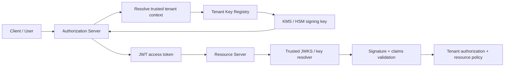

# Tenant-specific signing key trong hệ thống multi-tenant

## 1. Vì sao mỗi tenant có thể cần khóa ký riêng?

Trong hệ thống **multi-tenant**, nhiều tổ chức hoặc khách hàng cùng sử dụng một nền tảng API. Mỗi tenant có người dùng, dữ liệu và chính sách truy cập riêng. Authorization Server có thể phát hành JWT access token cho public API hoặc API nội bộ. Một câu hỏi quan trọng là: **có nên dùng cùng một khóa ký JWT cho tất cả tenant, hay mỗi tenant có một signing key riêng?**

**Tenant-specific signing key** là cách quản lý khóa trong đó mỗi tenant được gắn với một khóa ký riêng (hoặc một bộ khóa theo phiên bản). Authorization Server dùng private key của tenant để ký token; Resource Server dùng public key tương ứng để xác minh chữ ký và kiểm tra tenant context.

Ví dụ: hệ thống SaaS có tenant `acme` và `northwind`. Một access token của Acme được ký bằng private key `K_acme_v3`; token của Northwind dùng `K_northwind_v2`. Khi API xác minh token, nó phải xác nhận chữ ký bằng public key đúng tenant, đồng thời kiểm tra `iss`, `aud`, thời hạn, scope và tenant claim.

Mục tiêu chính:

- **Giới hạn phạm vi ảnh hưởng:** nếu một signing key của tenant bị lộ, việc thay khóa và vô hiệu hóa token có thể giới hạn ở tenant đó.
- **Tách biệt niềm tin:** một token ký cho tenant A không được chấp nhận như token của tenant B.
- **Hỗ trợ vòng đời độc lập:** mỗi tenant có thể được provision, rotate hoặc disable khóa theo chính sách riêng.
- **Phục vụ yêu cầu quản trị:** audit, key ownership, HSM/KMS policy và kiểm soát truy cập có thể gắn với tenant.

Tuy vậy, khóa riêng từng tenant **không tự động bảo đảm cô lập dữ liệu**. API vẫn phải kiểm tra tenant của token với tenant của tài nguyên và tenant context đã xác thực. Nếu truy vấn database thiếu điều kiện tenant, attacker vẫn có thể khai thác lỗi phân quyền dù JWT được ký bằng khóa riêng.

## 2. Khóa ký, token và tenant context

Một JWT access token dạng JWS thường có ba phần: header, payload và signature.

```text
base64url(header).base64url(payload).base64url(signature)
```

Header có thể chứa thuật toán và `kid`:

```json
{
  "typ": "at+jwt",
  "alg": "RS256",
  "kid": "acme-signing-2026-03"
}
```

Payload có thể chứa claims:

```json
{
  "iss": "https://auth.example.com/",
  "sub": "user-1842",
  "aud": ["orders-api"],
  "tid": "acme",
  "scope": "orders:read orders:write",
  "iat": 1795400000,
  "exp": 1795400300,
  "jti": "token-id-example"
}
```

Đây là ví dụ minh họa, không phải JWT đã ký hợp lệ. `tid` là tenant claim theo quy ước của hệ thống; cần thống nhất tên và semantics giữa issuer và resource servers. Các trường `iss`, `sub`, `aud`, `iat`, `exp`, `jti` có semantics theo JWT/OAuth profile tương ứng.

Cần phân biệt:

| Thành phần | Ý nghĩa |
|---|---|
| **Tenant** | Không gian dữ liệu/chính sách của một khách hàng hoặc tổ chức |
| **Signing key** | Khóa private dùng để ký JWS hoặc khóa tương ứng trong hệ thống ký |
| **Verification key** | Public key mà Resource Server dùng để xác minh chữ ký |
| **`kid`** | Key ID trong JOSE header, gợi ý chọn key trong tập key đáng tin |
| **`tid` / tenant claim** | Claim đã ký thể hiện tenant mà token đại diện |
| **`iss`** | Issuer phát hành token; phải khớp issuer được cấu hình tin cậy |
| **`aud`** | Resource server hoặc nhóm resource mà token được cấp cho |
| **`scope`** | Quyền mà token thể hiện trong API contract |

`kid` **không phải bằng chứng xác thực**. Đây chỉ là giá trị chọn key; attacker có thể tự tạo header với `kid` bất kỳ. Chỉ sau khi chữ ký được xác minh bằng key nằm trong trust configuration, claims mới được sử dụng cho quyết định bảo mật.

## 3. Ba mô hình quản lý signing key

### 3.1. Một khóa dùng chung cho mọi tenant

Tất cả token của mọi tenant được ký bằng một private key chung.

**Ưu điểm:** triển khai đơn giản, ít key phải quản lý, JWKS nhỏ và vận hành rotation dễ hơn.

**Nhược điểm:** nếu khóa bị lộ, mọi tenant có thể bị ảnh hưởng. Lỗi cấp quyền hoặc cấu hình sai ở issuer có phạm vi tác động lớn. Khó đáp ứng yêu cầu cô lập khóa theo tenant.

Mô hình này có thể phù hợp hệ thống nhỏ hoặc threat model chấp nhận được, nhưng cần tenant claim, tenant authorization và audit độc lập. Một khóa dùng chung không nên được xem là ranh giới cách ly giữa tenant.

### 3.2. Một signing key riêng cho mỗi tenant

Mỗi tenant có một key riêng; có thể có nhiều key version trong giai đoạn rotation.

**Ưu điểm:** giới hạn blast radius theo tenant, hỗ trợ rotate/disable độc lập, có thể áp dụng KMS policy và audit theo tenant.

**Nhược điểm:** số lượng key tăng theo số tenant và phiên bản; cần quản lý JWKS, cache, quota KMS/HSM, backup, rotation và trạng thái tenant. Một lỗi mapping `tenant → key` có thể gây từ chối hợp lệ hoặc nghiêm trọng hơn là xác minh nhầm tenant.

Đây là mô hình bài học tập trung. Nó phù hợp khi yêu cầu isolation, compliance hoặc tenant có vòng đời bảo mật riêng đủ mạnh để biện minh chi phí vận hành.

### 3.3. Mỗi tenant có issuer và JWKS namespace riêng

Ngoài key riêng, mỗi tenant có issuer riêng, ví dụ:

- `https://acme.auth.example.com/`
- `https://northwind.auth.example.com/`

Mỗi issuer công bố metadata/JWKS theo cấu hình riêng. Cách này làm namespace tin cậy rõ ràng hơn, nhưng tăng số lượng issuer, metadata, domain, cache và cấu hình Resource Server.

Không nhất thiết phải tạo một hostname riêng cho từng tenant. Có thể dùng issuer path hoặc một issuer chung cùng key registry nội bộ. Quyết định phụ thuộc vào OIDC discovery, khả năng triển khai của thư viện và yêu cầu tenant isolation.

| Mô hình | Cô lập khóa | Độ phức tạp | Blast radius khi lộ key |
|---|---|---|---|
| Shared key | Thấp | Thấp | Có thể ảnh hưởng toàn hệ thống |
| Per-tenant key, shared issuer | Cao hơn | Trung bình/cao | Có thể giới hạn theo tenant nếu mapping đúng |
| Per-tenant key + issuer riêng | Cao, namespace tách rõ | Cao | Thường giới hạn theo tenant/issuer |

## 4. Kiến trúc phát hành và xác minh token

Một kiến trúc điển hình:



Issuer phải xác định tenant từ **nguồn tin cậy** như authenticated client, tenant membership đã được xác minh, route/domain mapping đã kiểm soát hoặc phiên đăng nhập hợp lệ. Không được để caller tự chọn `tid` rồi yêu cầu signer ký mọi claim theo giá trị đó.

Signing service nên nhận yêu cầu ở mức nghiệp vụ, ví dụ `issueAccessToken(principal, tenantContext, audience, scopes)`, rồi tự kiểm tra:

1. Tenant tồn tại và đang hoạt động.
2. Principal được phép hoạt động trong tenant đó.
3. OAuth client được phép xin token cho audience đã chọn.
4. Scope yêu cầu nằm trong policy tối đa.
5. Signing key được registry ánh xạ cho tenant và đang ở trạng thái active.
6. Claims được tạo bởi issuer; caller không được tự ghi đè `iss`, `sub`, `tid`, `aud`, `exp` hoặc `jti`.

Resource Server nhận token và cần xác minh:

1. Chữ ký bằng public key trong tập key tin cậy.
2. Thuật toán và key type phù hợp allowlist.
3. `iss` đúng issuer đã cấu hình.
4. `aud` chứa đúng API hiện tại.
5. `exp`, `nbf`, `iat` theo chính sách thời gian.
6. Tenant claim khớp tenant context của request đã được xác minh.
7. Scope/permission cho phép endpoint.
8. Quyền trên bản ghi/tài nguyên cụ thể thuộc tenant đó.

## 5. Chọn đúng tenant key khi xác minh JWT

Đây là một trong những điểm dễ tạo lỗ hổng nhất. **Không chọn signing key chỉ vì token chưa xác minh tự khai `tid`.**

Ví dụ attacker tạo JWT giả với payload `tid=northwind`, header `kid=northwind-key`, rồi gửi vào endpoint tenant `acme`. Nếu server tin các giá trị chưa xác minh để tự động tải key hoặc chọn issuer tùy ý, có thể dẫn tới key confusion, SSRF hoặc cross-tenant acceptance.

Một quy trình an toàn:

1. Xác định tenant context từ host/route/client/session đã được xác minh; không tin raw `Host`, query parameter hoặc header client tự gửi nếu chúng chưa qua proxy/tenant resolution tin cậy.
2. Chọn issuer và key namespace được cấu hình cho tenant đó.
3. Đọc `kid` từ JOSE header như **selector không đáng tin**, chỉ tìm trong key registry/JWKS của issuer/tenant đã chọn.
4. Chỉ cho phép thuật toán đã cấu hình và key type tương ứng; không để `alg` do token quyết định tự do.
5. Xác minh chữ ký.
6. Sau khi verify thành công, kiểm tra `iss`, `aud`, `exp`, `nbf` và tenant claim.
7. So sánh tenant claim đã ký với tenant context của request. Nếu khác, từ chối.

Trong một số kiến trúc, issuer chung và JWKS chứa public key của nhiều tenant. Khi đó cần một registry nội bộ ánh xạ key ID → tenant/key metadata; sau khi xác minh phải kiểm tra tenant claim khớp owner của key. Dùng `kid` globally unique giúp giảm ambiguity, nhưng không thay thế kiểm tra tenant binding.

**Không dùng `jku` hoặc `x5u` tùy ý từ token để tải khóa.** JWKS endpoint/certificate URL phải đến từ issuer metadata hoặc cấu hình tin cậy. Nếu tải URL do attacker kiểm soát, token có thể biến Resource Server thành SSRF client hoặc khiến nó tin một public key do attacker tạo.

## 6. Thuật toán và loại khóa

### 6.1. Asymmetric signing: RS256, PS256 hoặc ES256

Với chữ ký bất đối xứng, Authorization Server giữ private key; Resource Server chỉ cần public key để xác minh. Đây thường là lựa chọn phù hợp khi nhiều API cần xác minh token nhưng không được phép tự phát hành token.

- **RS256:** RSA PKCS#1 v1.5 với SHA-256; cần key size và chính sách phù hợp.
- **PS256:** RSA-PSS với SHA-256; cần thư viện và profile tương thích.
- **ES256:** ECDSA P-256 với SHA-256; cần quản lý đúng curve và định dạng chữ ký JOSE.

Chọn thuật toán cố định theo cấu hình hệ thống. Không cho token header tự bật thuật toán bất kỳ. Key type, curve, modulus và thuật toán phải tương thích; không cho phép thuật toán `none`.

### 6.2. Symmetric signing: HS256

Với HMAC, issuer và mọi verifier đều phải giữ cùng secret. Nếu một Resource Server có secret HMAC, nó cũng có khả năng ký token mới. Vì vậy, dùng HS256 trong môi trường nhiều service làm tăng số nơi có thể phát hành token.

Per-tenant HMAC secret có thể giảm blast radius so với một secret dùng chung, nhưng việc phân phối secret tới từng API tạo gánh nặng bảo vệ. Nếu cần nhiều resource server chỉ xác minh, asymmetric signing thường có ranh giới quyền rõ hơn.

### 6.3. Không tự tạo thuật toán hoặc key derivation

Không lấy một master secret rồi nối chuỗi tenant ID để tạo “khóa ký” bằng cách tự nghĩ ra công thức. Nếu dùng hierarchical key derivation hoặc envelope encryption, cần thiết kế dựa trên KMS/HSM, KDF chuẩn, quản lý phiên bản và threat model được review. Mặc định an toàn là key riêng được KMS/HSM quản lý hoặc key hierarchy có kiểm soát rõ ràng.

## 7. Quản lý key registry và KMS/HSM

Một registry nội bộ có thể lưu metadata:

| Trường | Ví dụ | Mục đích |
|---|---|---|
| `tenant_id` | `acme` | Chủ sở hữu key |
| `issuer` | `https://auth.example.com/` | Namespace issuer |
| `kid` | `acme-signing-2026-03` | Key ID |
| `kms_key_ref` | `kms://prod/tenant/acme/signing-v3` | Tham chiếu key trong KMS |
| `algorithm` | `RS256` | Thuật toán được cho phép |
| `key_version` | `3` | Phiên bản key |
| `status` | `ACTIVE` | Trạng thái sử dụng |
| `not_before` | thời điểm bắt đầu | Ngăn dùng key trước khi kích hoạt |
| `sign_until` | thời điểm dừng ký | Kiểm soát phát hành token mới |
| `verify_until` | thời điểm ngừng xác minh | Giữ public key trong rotation overlap |

Private key nên được giữ trong **KMS/HSM** hoặc cơ chế bảo vệ khóa tương đương. Ứng dụng ký token gọi thao tác ký được phân quyền; không cần tải private key thô về memory nếu KMS hỗ trợ ký từ xa.

Các biện pháp quản trị:

- Tách quyền **provision key**, **sign token**, **rotate key**, **disable key** và **read public JWKS**.
- Dùng IAM policy ràng buộc tenant/key reference; signer của tenant A không được gọi key của tenant B.
- Ghi audit ai/ứng dụng nào ký, rotate hoặc disable key, nhưng không log key material hoặc token nguyên văn.
- Có quy trình backup/recovery phù hợp KMS/HSM; không xuất private key hàng loạt để tiện vận hành.
- Giới hạn quota và rate cho signing operation để tránh một tenant làm cạn tài nguyên ký của toàn hệ thống.
- Theo dõi lỗi key not found, permission denied, KMS throttling và latency.
- Khi tenant bị suspend, chặn phát hành token mới theo tenant policy; không chỉ dựa vào việc xóa tenant khỏi UI.

KMS key per tenant có thể là key vật lý riêng hoặc key logical được quản lý bằng policy tùy nền tảng. Cần đọc rõ ranh giới cô lập thực tế của dịch vụ KMS/HSM đang dùng; không tuyên bố “physical isolation” nếu dịch vụ chỉ cung cấp logical access control.

## 8. JWKS: công bố public key cho Resource Server

Với asymmetric JWT, Authorization Server có thể công bố public keys dưới dạng **JSON Web Key Set (JWKS)**. Mỗi JWK thường có metadata như `kty`, `kid`, `use`, `alg` và public key parameters. Không công bố private parameters như RSA `d`, `p`, `q` hoặc EC private scalar.

Ví dụ JWKS rút gọn:

```json
{
  "keys": [
    {
      "kty": "RSA",
      "kid": "acme-signing-2026-03",
      "use": "sig",
      "alg": "RS256",
      "n": "<base64url-modulus>",
      "e": "AQAB"
    },
    {
      "kty": "RSA",
      "kid": "northwind-signing-2026-02",
      "use": "sig",
      "alg": "RS256",
      "n": "<base64url-modulus>",
      "e": "AQAB"
    }
  ]
}
```

Đây là dữ liệu minh họa, không chứa key thật. Trong thực tế, issuer có thể dùng một JWKS endpoint chung chứa key của nhiều tenant hoặc endpoint riêng cho từng issuer/tenant. Resource Server chỉ tải JWKS từ issuer đã cấu hình tin cậy.

Không đưa private key vào JWKS. `kid` phải duy nhất trong phạm vi resolver sử dụng; nếu endpoint chung chứa nhiều tenant, nên dùng ID không đụng nhau và registry giữ mapping owner. JWK `use=sig` và `alg` có thể hỗ trợ lựa chọn key nhưng verifier vẫn phải áp dụng allowlist riêng.

### 8.1. JWKS cache và key rotation

Resource Server thường cache JWKS để giảm tải. Vì vậy, khi rotate key cần phối hợp thời điểm:

1. Tạo key version mới ở KMS/HSM.
2. Đưa **public key mới** vào JWKS trước khi ký token bằng key đó.
3. Chờ cache TTL hoặc cơ chế refresh để verifier nhìn thấy key mới.
4. Chuyển issuer sang ký bằng key mới, với `kid` mới.
5. Tiếp tục giữ public key cũ trong thời gian các token cũ còn hiệu lực, cộng clock skew và khoảng đệm cache.
6. Sau khi token cũ hết hạn và không còn cần xác minh, loại public key cũ khỏi JWKS theo policy.

Nếu xóa public key cũ ngay khi bắt đầu ký key mới, các token cũ còn hiệu lực sẽ bị từ chối. Nếu giữ key cũ quá lâu sau sự cố compromise, attacker có thể tiếp tục dùng token đã ký bằng key đó nếu resource server vẫn tin.

## 9. Quy trình rotation và thu hồi

Một tenant có thể có các trạng thái key:

```text
PENDING -> ACTIVE -> VERIFY_ONLY -> RETIRED
                    |
                    +-> COMPROMISED / REVOKED
```

- **PENDING:** key đã tạo nhưng chưa được dùng để ký.
- **ACTIVE:** key được phép ký token mới và xác minh token tương ứng.
- **VERIFY_ONLY:** ngừng ký mới, nhưng vẫn xác minh token còn hiệu lực đã phát hành.
- **RETIRED:** không còn dùng sau khi hết cửa sổ xác minh.
- **COMPROMISED/REVOKED:** key bị nghi lộ; ngừng ký ngay và loại khỏi trust theo quy trình sự cố.

### 9.1. Rotation bình thường

Giả sử Acme chuyển từ `K_acme_v3` sang `K_acme_v4`:

| Giai đoạn | Issuer ký bằng | Verifier chấp nhận |
|---|---|---|
| Trước rotation | `v3` | `v3` |
| Publish key mới | `v3` | `v3`, `v4` |
| Chuyển signing | `v4` | `v3`, `v4` |
| Hết token cũ | `v4` | `v4` |
| Hoàn tất | `v4` | `v4` |

Cửa sổ giữ key cũ phải dựa trên **maximum token lifetime + clock skew + JWKS cache/refresh behavior** và yêu cầu thu hồi thực tế. Không dùng một con số cố định cho mọi tenant nếu chính sách token khác nhau.

### 9.2. Key bị compromise

Nếu private key của tenant Acme bị lộ:

1. Dừng ký token mới bằng key bị compromise.
2. Disable key trong KMS/HSM hoặc chặn thao tác ký.
3. Phát hành key version mới và publish public key mới.
4. Cập nhật verifier/cache để **không còn tin key cũ** theo mức khẩn cấp.
5. Xử lý token đã ký bằng key cũ: denylist theo `jti`, introspection, thu hồi session hoặc policy chặn key tùy kiến trúc.
6. Đánh giá log/audit để xác định khoảng thời gian và phạm vi bị ảnh hưởng.
7. Thông báo và điều phối tenant theo incident process; không lộ key material trong báo cáo.

Thu hồi public key ngay sẽ làm mọi token còn hạn ký bằng key đó không xác minh được. Đây có thể là hành vi cần thiết khi compromise nhưng sẽ gây gián đoạn cho tenant. Phải có kế hoạch phục hồi và phân biệt sự cố của một tenant với sự cố issuer toàn hệ thống.

**JWT signature validation offline không tự cung cấp revocation tức thời.** Nếu yêu cầu thu hồi gần thời gian thực, cân nhắc opaque token + introspection, token status/revocation service hoặc denylist có đồng bộ; mỗi lựa chọn có chi phí độ trễ và khả năng sẵn sàng riêng.

## 10. Ngăn cross-tenant token substitution

Một lỗi nguy hiểm là token ký hợp lệ cho tenant A được sử dụng trong request tenant B. Ví dụ:

- Client đang ở tenant `northwind`.
- Nó gửi token hợp lệ của tenant `acme`.
- API chỉ kiểm tra chữ ký, issuer và audience chung `orders-api`.
- API lấy `tid=acme` từ token nhưng query database theo tenant từ header `X-Tenant: northwind`, hoặc ngược lại.

Hệ quả có thể là truy cập chéo dữ liệu, confused deputy hoặc ghi dữ liệu vào sai tenant.

**Quy tắc bắt buộc:** tenant context dùng để quyết định quyền phải được ràng buộc với danh tính đã xác thực. Sau khi xác minh token, service so sánh tenant claim đã ký với tenant context đã được resolve từ request/authenticated client. Nếu mismatch, từ chối. Mọi truy vấn dữ liệu cần áp dụng tenant filter ở lớp repository/database hoặc cơ chế row-level security phù hợp.

Các kiểm tra cần phối hợp:

| Kiểm tra | Mục tiêu |
|---|---|
| Tenant context từ nguồn tin cậy | Không cho client tự chuyển tenant bằng header/query |
| `iss` | Token đến từ issuer đúng |
| `kid` và key ownership | Key thuộc trust namespace/tenant được phép |
| Chữ ký | Claims không bị sửa sau khi ký |
| `tid` claim | Tenant trong token khớp tenant đã xác thực |
| `aud` | Token dành đúng resource server |
| Scope/role | Chỉ cho phép hành động được cấp |
| Resource ownership | Bản ghi thực sự thuộc tenant đang hoạt động |

Không coi `kid` là tenant identity. Cũng không coi `tid` trong JWT chưa xác minh là nguồn chân lý để mở database connection hoặc tải key từ một URL do client điều khiển.

## 11. Mẫu logic xác minh token an toàn

Mã giả dưới đây minh họa thứ tự xử lý. Các API cụ thể phụ thuộc thư viện JWT/OIDC đang dùng:

```java
VerifiedTenantToken verify(
        String rawToken,
        TrustedTenantContext requestTenant) {

    // Tenant context đến từ route/client/session đã xác minh.
    TenantKeySet keySet = trustedKeyRegistry
            .keySetForIssuer(requestTenant.issuer());

    // Header chưa xác minh: chỉ dùng kid như selector trong key set tin cậy.
    UntrustedHeader header = jwtParser.readHeaderOnly(rawToken);

    requireAllowedAlgorithm(header.algorithm(), keySet.allowedAlgorithms());
    VerificationKey key = keySet.findByKid(header.keyId());
    require(key != null, "unknown signing key");
    require(key.tenantId().equals(requestTenant.tenantId()),
            "key belongs to another tenant");

    // Chữ ký phải được verify trước khi dùng claims.
    VerifiedJwt jwt = jwtParser.verify(rawToken, key.publicKey());

    require(jwt.issuer().equals(requestTenant.issuer()), "wrong issuer");
    require(jwt.audience().contains("orders-api"), "wrong audience");
    require(jwt.expiresAt().isAfter(now()), "expired token");
    require(jwt.tenantId().equals(requestTenant.tenantId()),
            "tenant mismatch");

    return new VerifiedTenantToken(jwt);
}
```

Đây là **pseudocode**, không phải một JWT verifier production hoàn chỉnh. Trong triển khai thật:

- Dùng thư viện JOSE/JWT được duy trì, cấu hình algorithm allowlist và issuer/audience validators rõ ràng.
- Không parse/verify bằng cách tự viết crypto.
- Xử lý `nbf`, `iat`, clock skew, key type/size, token type và claim profile theo policy.
- Key resolver chỉ đọc JWKS/registry đã được tin cậy; không truy cập `jku`/`x5u` tùy ý từ token.
- Khi `kid` không tồn tại, refresh JWKS có kiểm soát một lần rồi từ chối; tránh mỗi token giả gây request vô hạn tới JWKS.
- Sau verify, vẫn kiểm tra scope và quyền trên resource, không dừng ở tenant claim.

## 12. Tenant-specific signing key có thay thế tenant authorization không?

**Không.** Khóa riêng tenant giúp phân biệt nguồn ký và giới hạn blast radius, nhưng không trả lời mọi câu hỏi phân quyền.

Ví dụ token hợp lệ:

```json
{
  "iss": "https://auth.example.com/",
  "sub": "service-account-orders",
  "aud": "orders-api",
  "tid": "acme",
  "scope": "orders:read"
}
```

Token này không tự cho phép service đọc mọi đơn hàng của Acme. API cần xác minh service account có quyền trong tenant Acme, scope phù hợp và resource cụ thể thuộc tenant đó. Nếu user/service có nhiều tenant membership, token cần đại diện cho tenant context đã được chọn và xác minh trong phiên hiện tại.

Một policy có thể yêu cầu:

- Principal được phép hoạt động trong tenant.
- Client/service có quyền gọi API.
- Token có scope tương ứng.
- Resource thuộc đúng tenant.
- Tenant đang active và không bị suspend.
- Với tác vụ thay người dùng, actor/delegation hợp lệ.

Đây là **authorization** ở tầng ứng dụng. Chữ ký chỉ bảo vệ tính toàn vẹn và nguồn phát hành của token.

## 13. Vận hành ở quy mô nhiều tenant

Khi có hàng nghìn hoặc hàng trăm nghìn tenant, key riêng từng tenant làm thay đổi đáng kể cách vận hành.

### 13.1. Provisioning và onboarding

Khi tạo tenant mới:

1. Tạo tenant record và trạng thái ban đầu.
2. Provision signing key theo policy KMS/HSM.
3. Tạo key ID duy nhất và metadata key registry.
4. Publish public key vào JWKS hoặc tenant-specific discovery endpoint.
5. Kiểm tra verifier đã nhận key.
6. Chỉ sau khi trust setup hoàn tất mới bật phát hành token cho tenant.

Không phát token bằng shared fallback key nếu provision key tenant thất bại. Hệ thống phải fail closed hoặc đưa tenant về trạng thái onboarding pending.

### 13.2. Disable và xóa tenant

Khi tenant bị suspend, có thể cần:

- Chặn phát hành token mới.
- Thu hồi refresh/session theo policy.
- Ngừng chấp nhận token/key tenant đó.
- Chặn access vào data plane và background jobs.
- Lưu audit theo retention policy.
- Xử lý yêu cầu export/deletion dữ liệu theo quy trình riêng.

Xóa key không đồng nghĩa xóa hết dữ liệu hoặc chặn mọi cache. Các resource server và token cache cần nhận biết trạng thái tenant. Cần phân biệt **suspend tạm thời**, **offboarding**, **key compromise** và **deletion**.

### 13.3. Quota và chi phí

Per-tenant key tăng số key, số lần KMS operation, số metadata/JWKS entries và công việc rotation. Cần:

- Theo dõi số key active/retired theo tenant.
- Giới hạn provisioning và signing rate.
- Dùng cache public key có TTL và refresh hợp lý.
- Giảm JWKS refresh storm khi gặp `kid` không biết.
- Theo dõi KMS latency, quota, throttling và error rate.
- Có quy trình xử lý key orphaned sau tenant deletion.
- Đảm bảo một tenant có traffic lớn không làm cạn tài nguyên ký của tenant khác.

Nếu JWKS endpoint gom public key của rất nhiều tenant, cần pagination/sharding hoặc tenant-specific endpoint khi quy mô khiến response quá lớn. Việc chọn cách nào phải bảo đảm verifier vẫn có thể lấy key tin cậy và rotation không tạo khoảng trống xác minh.

## 14. Kiểm thử và tình huống tấn công

| Ca kiểm thử | Kết quả mong đợi |
|---|---|
| Token Acme ký bằng key Acme, `tid=acme`, đúng audience | Xác minh thành công nếu scope và quyền resource hợp lệ |
| Token Acme gửi vào tenant Northwind | Từ chối do tenant context/key ownership mismatch |
| Header `kid` không tồn tại | Refresh key set có giới hạn rồi từ chối |
| Attacker thay `tid` trong payload nhưng giữ signature cũ | Chữ ký thất bại |
| Attacker tự ký JWT bằng key do nó tạo, cùng `kid` | Không được tin vì key không thuộc registry/JWKS tin cậy |
| JWT tự đặt `alg=none` hoặc thuật toán không allowlist | Từ chối |
| JWT có `jku` trỏ tới server attacker | Verifier bỏ qua URL không tin cậy; không fetch |
| Hai tenant vô tình có cùng `kid` trong một resolver chung | Registry phát hiện collision hoặc dùng namespace tách rõ; không chọn nhầm key |
| Key tenant A bị disable | Token ký bằng key đó bị từ chối theo trạng thái compromise/revocation policy |
| Rotation trong lúc JWKS cache cũ | Verifier xử lý overlap; không lỗi hàng loạt với token mới |
| Token đúng tenant nhưng thiếu scope | 403 theo policy |
| Token đúng chữ ký nhưng resource thuộc tenant khác | Từ chối ở resource authorization/data layer |
| KMS timeout khi phát hành token | Không fallback sang shared key hoặc key tenant khác |
| Tenant suspended nhưng token chưa hết hạn | Resource server kiểm tra trạng thái/policy theo yêu cầu thu hồi |
| Tenant key metadata bị sửa trái phép | Integrity/access control/audit phát hiện; signer không dùng mapping sai |

Test cần bao gồm cả **positive và negative cases**. Chỉ kiểm tra token của tenant hợp lệ chưa đủ; quan trọng là chứng minh token của tenant A không thể thay thế token tenant B và key resolver không bị điều khiển từ header/JWT untrusted.

## 15. Checklist triển khai production

1. **Chọn mô hình key:** shared key, per-tenant key hay issuer riêng; ghi rõ isolation requirement và blast radius.
2. **Provision key có kiểm soát:** KMS/HSM, tenant registry, key ID duy nhất và IAM policy ràng buộc tenant.
3. **Ký token ở issuer đáng tin:** tenant context và claims được xác minh server-side; caller không tự chọn `tid`, `iss`, `aud`, `scope`, `exp`.
4. **Verify JWT đúng thứ tự:** trusted issuer/key set → `kid` selector → algorithm allowlist → signature → issuer/audience/time/tenant claims.
5. **Ngăn key confusion:** không tải `jku`/`x5u` tùy ý; không chọn key chỉ từ unverified tenant claim.
6. **Cô lập tenant ở data plane:** tenant claim khớp request context, scope đúng, resource ownership và tenant filter được kiểm tra.
7. **Rotation có overlap:** publish public key mới trước khi ký, giữ key cũ theo lifetime/cache policy; có quy trình emergency revoke.
8. **Vận hành tenant lifecycle:** onboarding, suspend, offboarding, deletion và key compromise có trạng thái riêng.
9. **Giám sát:** KMS usage, JWKS refresh, unknown `kid`, signature failure, tenant mismatch, cross-tenant denial và key rotation.
10. **Kiểm thử âm:** forged JWT, wrong issuer/audience, key substitution, `alg` confusion, tenant mismatch, stale JWKS và KMS outage.

**Nguyên tắc cốt lõi:** Tenant-specific signing key giúp ràng buộc token với một miền tin cậy và giới hạn phạm vi sự cố. Nhưng chỉ khi kết hợp **key registry đáng tin, issuer/audience/algorithm validation, tenant-context matching, resource authorization và quy trình rotation/revocation** thì hệ thống multi-tenant mới bảo vệ được ranh giới giữa các tenant.

### Tài liệu tiêu chuẩn tham khảo

- [RFC 7515 — JSON Web Signature (JWS)](https://www.rfc-editor.org/rfc/rfc7515): cấu trúc và xác minh chữ ký JOSE.
- [RFC 7517 — JSON Web Key (JWK)](https://www.rfc-editor.org/rfc/rfc7517): biểu diễn public/private key và JWKS.
- [RFC 7519 — JSON Web Token (JWT)](https://www.rfc-editor.org/rfc/rfc7519): JWT claims và cấu trúc token.
- [RFC 8414 — OAuth 2.0 Authorization Server Metadata](https://www.rfc-editor.org/rfc/rfc8414): discovery metadata của Authorization Server.
- [RFC 8725 — JSON Web Token Best Current Practices](https://www.rfc-editor.org/rfc/rfc8725): kiểm tra thuật toán, issuer, audience và ngăn JWT confusion.
- [RFC 9068 — JWT Profile for OAuth 2.0 Access Tokens](https://www.rfc-editor.org/rfc/rfc9068): profile JWT access token.
- [RFC 9700 — Best Current Practice for OAuth 2.0 Security](https://www.rfc-editor.org/rfc/rfc9700): khuyến nghị bảo mật OAuth 2.0.
