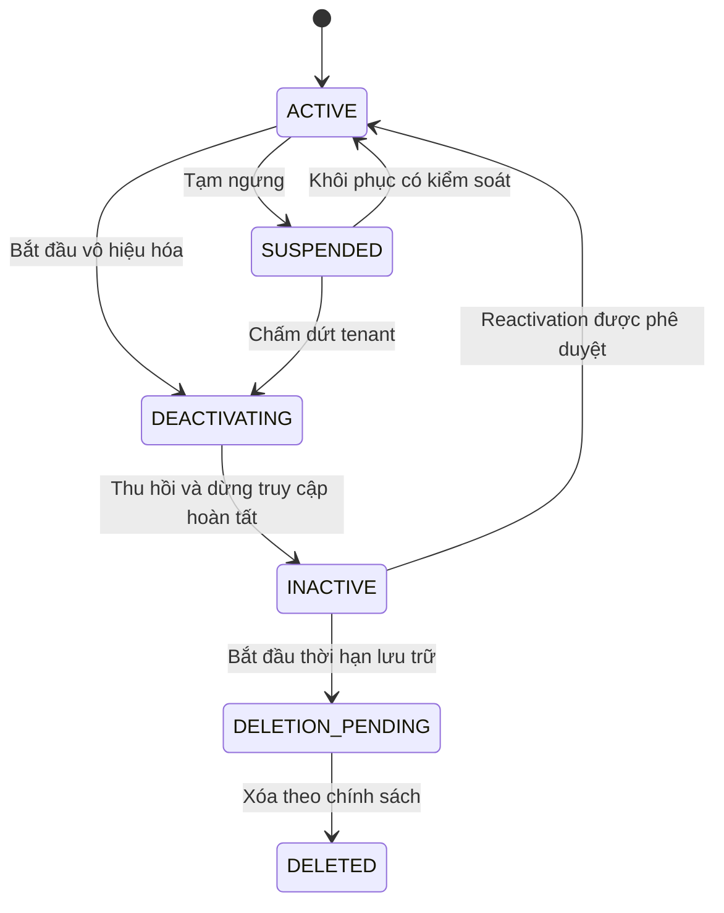
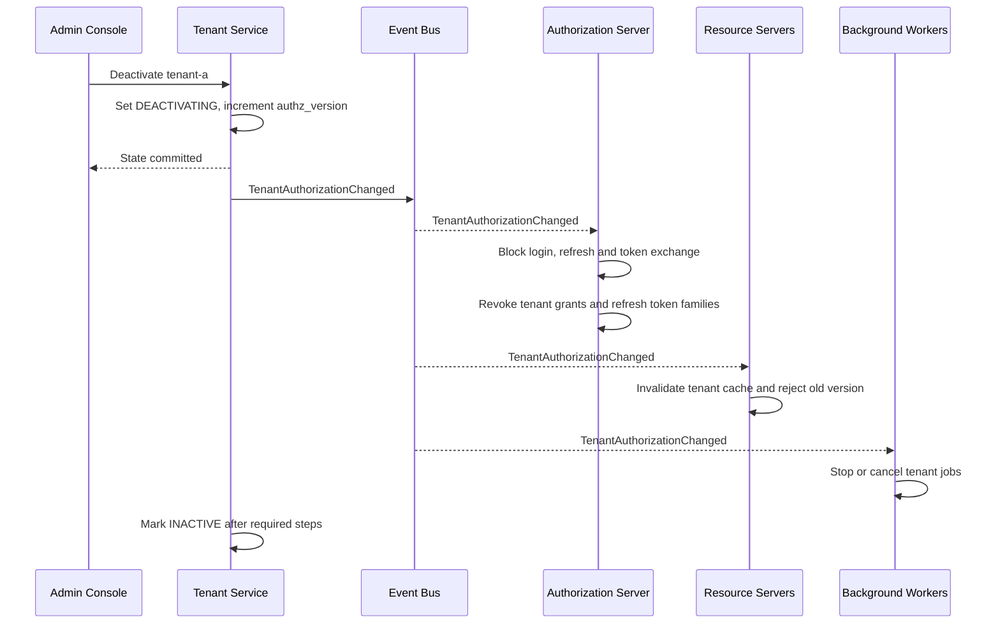

# Tenant deactivation

Trong hệ thống multi-tenant, mỗi tenant là một phạm vi khách hàng hoặc tổ chức có dữ liệu, người dùng, cấu hình và quyền truy cập riêng. **Tenant deactivation** là quy trình chuyển một tenant sang trạng thái không còn được phép sử dụng dịch vụ. Khi tenant bị vô hiệu hóa, hệ thống phải ngăn việc tạo phiên mới, phát hành token mới và tiếp tục dùng token cũ để truy cập tài nguyên của tenant đó.

Đây là một quyết định về vòng đời tenant và chính sách authorization của ứng dụng. OAuth 2.0, JWT và OpenID Connect cung cấp các cơ chế token, introspection và revocation có thể dùng để triển khai, nhưng không định nghĩa một claim hoặc endpoint chuẩn mang tên `tenant_deactivation`. Vì vậy, hệ thống phải xác định rõ trạng thái tenant, phạm vi ảnh hưởng và cách mọi thành phần thực thi quyết định đó.

Trong module **SECURITY_TOKEN_SECURITY_FUNDAMENTALS**, chủ đề này liên kết vòng đời token với mô hình tin cậy và phân quyền: token chứng minh một lần cấp quyền đã xảy ra, còn trạng thái tenant hiện tại quyết định quyền đó có còn được sử dụng hay không.

## 1. Tenant deactivation là gì?

Tenant deactivation là hành động ngừng cho một tenant truy cập vào một phần hoặc toàn bộ nền tảng theo chính sách vận hành. Lý do có thể là khách hàng chấm dứt hợp đồng, vi phạm điều khoản, yêu cầu bảo mật, phát hiện xâm nhập, nợ thanh toán hoặc quyết định tạm ngưng của quản trị viên.

Một tenant có thể có nhiều người dùng, nhiều ứng dụng OAuth client, API key, service account và tiến trình nền. Do đó, vô hiệu hóa tenant phải được áp dụng cho toàn bộ các đường truy cập gắn với tenant, chứ không chỉ ẩn tenant khỏi giao diện hoặc khóa một tài khoản người dùng.

Ví dụ, Công ty A sử dụng một SaaS với tenant ID `tenant-a`. Người dùng Alice có thể thuộc `tenant-a` và `tenant-b`. Khi `tenant-a` bị vô hiệu hóa, Alice không còn được gọi API trong ngữ cảnh `tenant-a`. Nếu tài khoản Alice và membership của cô tại `tenant-b` vẫn hợp lệ, cô vẫn có thể làm việc trong `tenant-b`.

Điều này đòi hỏi hệ thống phân biệt ba khái niệm:

- **User identity:** danh tính người dùng ở cấp nền tảng hoặc identity provider.
- **Tenant membership:** quan hệ giữa người dùng và một tenant, bao gồm vai trò, trạng thái và quyền trong tenant đó.
- **Tenant status:** trạng thái hoạt động của chính tenant, áp dụng cho mọi principal và ứng dụng hoạt động trong tenant.

Một user hợp lệ không đồng nghĩa mọi tenant mà user từng tham gia đều còn hoạt động. Tương tự, tenant còn hoạt động không đồng nghĩa mọi user hoặc service account trong tenant đều được phép truy cập.

## 2. Phân biệt deactivation, suspension và deletion

Các trạng thái vòng đời cần có ý nghĩa rõ ràng để các service không tự diễn giải khác nhau. Một mô hình thường dùng:

| Trạng thái | Ý nghĩa | Quyền truy cập |
|---|---|---|
| `ACTIVE` | Tenant đang hoạt động bình thường. | Cho phép đăng nhập, cấp token và gọi API nếu principal có quyền. |
| `SUSPENDED` | Tenant bị tạm ngưng, có thể do rủi ro hoặc quyết định vận hành. | Từ chối truy cập thông thường; chỉ luồng quản trị được ủy quyền mới có thể hoạt động. |
| `DEACTIVATING` | Đang thực hiện quy trình vô hiệu hóa, thu hồi thông tin xác thực và dừng tác vụ. | Từ chối yêu cầu mới; tiến trình dọn dẹp đang được thực hiện. |
| `INACTIVE` | Tenant đã bị vô hiệu hóa hoàn tất. | Không phát hành token và không cho truy cập tài nguyên tenant. |
| `DELETION_PENDING` | Đã lên lịch xóa dữ liệu sau thời gian lưu giữ hoặc kiểm tra pháp lý. | Không cho tenant hoạt động; dữ liệu được giữ theo chính sách lưu trữ. |
| `DELETED` | Dữ liệu tenant đã được xóa hoặc xử lý theo chính sách. | Không còn tenant để sử dụng; việc khôi phục cần quy trình riêng nếu còn khả thi. |

`SUSPENDED` và `INACTIVE` có thể cùng chặn truy cập của khách hàng, nhưng khác nhau về mục đích và quy trình khôi phục. `DEACTIVATING` biểu thị trạng thái chuyển tiếp để hệ thống theo dõi công việc thu hồi. `DELETED` là trạng thái dữ liệu, không nên được xem như một cách khác để biểu thị khóa đăng nhập.

Không nên xóa dữ liệu ngay khi quản trị viên bấm nút deactivate. Việc giữ, xuất, ẩn, lưu trữ hoặc xóa dữ liệu phải tuân theo hợp đồng, thời hạn lưu trữ, yêu cầu pháp lý và quy trình offboarding riêng.

### Mô hình chuyển trạng thái



Chuyển trạng thái cần được kiểm soát bởi một service hoặc workflow có thẩm quyền. Không để mỗi microservice tự thay đổi trạng thái tenant trong cơ sở dữ liệu riêng mà không có nguồn sự thật thống nhất.

## 3. Những đường truy cập phải bị ảnh hưởng

Một tenant thường được truy cập thông qua nhiều loại principal và credential. Khi tenant bị vô hiệu hóa, cần lập danh sách các đường truy cập liên quan:

| Đường truy cập | Hành động khi tenant bị vô hiệu hóa |
|---|---|
| Đăng nhập người dùng | Không tạo phiên hoặc token có tenant context đó. |
| Access token hiện có | Từ chối token khi tenant không còn hoạt động, kể cả chữ ký JWT còn hợp lệ. |
| Refresh token | Thu hồi hoặc đánh dấu không còn được dùng để cấp access token mới. |
| Token Exchange | Từ chối exchange nếu subject, actor hoặc tenant context gắn với tenant đã bị vô hiệu hóa. |
| Opaque token | Introspection phải phản ánh token không còn active theo chính sách. |
| API key | Vô hiệu hóa key thuộc tenant và từ chối xác thực bằng key đó. |
| Client credentials/service account | Ngừng cấp token và chặn token hiện có của workload thuộc tenant. |
| Session cookie | Hủy phiên phía server hoặc kiểm tra trạng thái phiên/tenant ở mỗi request. |
| Background job | Dừng job mới và kiểm tra tenant status trước khi thực thi job đang chờ. |
| Webhook hoặc integration | Ngừng gửi sự kiện ra ngoài và từ chối callback theo chính sách tenant. |

Chỉ khóa trang đăng nhập là chưa đủ. Một service có thể tiếp tục chấp nhận access token đã cấp trước đó; một worker có thể tiếp tục xử lý message đã nằm trong queue; một API key cũ có thể vẫn xác thực thành công nếu không có kiểm tra trạng thái.

## 4. Token vẫn còn hạn không có nghĩa tenant vẫn được truy cập

Access token thường có thời hạn hữu hạn. Với JWT, resource server kiểm tra chữ ký, issuer, audience, thời điểm hiệu lực và claim `exp`. Nếu token chưa đến `exp`, nó có thể vượt qua kiểm tra thời hạn. Tuy nhiên, tenant có thể đã bị vô hiệu hóa sau thời điểm token được phát hành.

Ví dụ:

1. Lúc 09:00, authorization server phát hành JWT access token cho `tenant-a`, hết hạn lúc 10:00.
2. Lúc 09:15, quản trị viên vô hiệu hóa `tenant-a`.
3. Lúc 09:20, client gửi JWT cũ đến Inventory API.

Chữ ký JWT vẫn hợp lệ và `exp` còn ở tương lai. Nếu Inventory API chỉ kiểm tra chữ ký và `exp`, nó có thể tiếp tục cho phép truy cập trong 40 phút còn lại. Đây là khoảng thời gian mà trạng thái tenant đã thay đổi nhưng quyết định authorization chưa được cập nhật.

Vì vậy, authorization phải kết hợp hai câu hỏi:

- Token có được phát hành hợp lệ và còn trong thời hạn không?
- Tenant và membership liên quan có còn được phép hoạt động tại thời điểm request không?

Token là bằng chứng về một lần cấp quyền trong quá khứ. Nó không tự chứng minh rằng tenant vẫn hoạt động ở hiện tại.

## 5. Thiết kế claim tenant trong token

Access token dành cho hoạt động trong tenant thường cần mang tenant context. Ví dụ JWT minh họa:

```json
{
  "iss": "https://auth.example.com",
  "sub": "user-123",
  "aud": "https://inventory.example.com",
  "iat": 1795431000,
  "exp": 1795431900,
  "jti": "at-7f2c91",
  "scope": "inventory.read",
  "tenant_id": "tenant-a",
  "tenant_authz_version": 12,
  "membership_id": "membership-456",
  "membership_version": 4
}
```

Đây là ví dụ về claim tùy chỉnh. `tenant_id`, `tenant_authz_version`, `membership_id` và `membership_version` không phải tên claim bắt buộc chung của OAuth 2.0 hoặc JWT. Hệ thống phải thống nhất tên, kiểu dữ liệu và ý nghĩa giữa authorization server và resource server.

Các nguyên tắc quan trọng:

- Tenant context phải do thành phần tin cậy xác định và được issuer ký trong token.
- Không lấy tenant ID từ request body, query string hoặc header do client tự đặt rồi coi đó là bằng chứng authorization.
- So khớp tenant trong token với tenant mà endpoint hoặc tài nguyên đang yêu cầu.
- Kiểm tra membership và quyền của principal trong tenant, không chỉ kiểm tra `tenant_id` có tồn tại.
- Không đặt thông tin nhạy cảm hoặc dữ liệu cá nhân không cần thiết vào token.
- Chỉ phát hành token cho một tenant context cụ thể nếu client và người dùng đã được ủy quyền cho context đó.

Nếu người dùng thuộc nhiều tenant, client phải chọn tenant context thông qua luồng được server kiểm soát. Authorization server xác minh membership của người dùng trong tenant đã chọn rồi mới phát hành token. Không nên phát hành một access token chung chứa danh sách hàng trăm tenant để resource server tự quyết định quyền.

## 6. Các cách làm cho token cũ mất hiệu lực

Không có một cơ chế duy nhất phù hợp với mọi hệ thống. Cần chọn dựa trên loại token, mức độ nhạy cảm của dữ liệu, yêu cầu thu hồi và độ trễ chấp nhận được.

### 6.1. Kiểm tra tenant status trực tuyến

Resource server kiểm tra trạng thái tenant từ một authorization service hoặc tenant security service trong quá trình authorization. Nếu tenant không còn `ACTIVE`, request bị từ chối dù JWT còn hạn.

```text
request = receive_api_request()
token = validate_signature_issuer_audience_and_exp(request)

tenant = tenant_security_service.get_status(token.tenant_id)
if tenant.status != ACTIVE:
    deny_request()

membership = membership_service.get(token.membership_id)
if membership.status != ACTIVE:
    deny_request()

authorize_scope_and_resource(token, request)
allow_request()
```

Ưu điểm là trạng thái mới có thể có hiệu lực nhanh. Đổi lại, hệ thống thêm phụ thuộc mạng và tải đọc vào luồng request. Cần xác định timeout, retry và hành vi khi dịch vụ kiểm tra tenant không truy cập được. Với thao tác nhạy cảm, thường nên fail closed: không xác minh được tenant còn hoạt động thì không cho phép thao tác.

Không nên để một lỗi kết nối tenant service tự động chuyển thành `ACTIVE`. Trạng thái không xác định không phải trạng thái cho phép.

### 6.2. Opaque token và introspection

Opaque token không mang payload JWT có thể tự xác minh tại resource server. Resource server gọi authorization server qua endpoint introspection theo RFC 7662 để kiểm tra trạng thái token. Authorization server có thể kết hợp trạng thái token, tenant và membership để trả `active: false` khi tenant đã bị vô hiệu hóa.

Ví dụ response minh họa:

```json
{
  "active": false
}
```

Nếu tenant còn hoạt động và token còn hợp lệ, introspection có thể trả thêm `sub`, `client_id`, `scope`, `aud`, `exp` và tenant context theo hợp đồng của hệ thống. Resource server phải từ chối khi `active` là `false`.

Introspection tập trung giúp thu hồi thuận tiện, nhưng cache response có thể làm trạng thái cũ tiếp tục được sử dụng. Nếu cache báo `active: true` trong 60 giây, việc vô hiệu hóa tenant có thể chưa được mọi resource server nhận biết ngay lập tức. TTL cache phải phù hợp với yêu cầu thu hồi.

### 6.3. Tenant authorization version

Một cách tiếp cận với JWT là thêm một claim phiên bản bảo mật của tenant, ví dụ `tenant_authz_version`.

- Khi phát hành token, authorization server ghi phiên bản hiện tại của tenant vào claim.
- Khi tenant bị vô hiệu hóa hoặc có sự kiện bảo mật cần thu hồi token, hệ thống tăng phiên bản tenant.
- Resource server so sánh phiên bản trong token với phiên bản hiện tại được lấy từ kho trạng thái tin cậy.
- Nếu hai giá trị khác nhau, resource server từ chối token.

Ví dụ:

```text
Token được phát hành: tenant_authz_version = 12
Tenant hiện tại:      tenant_authz_version = 13
Kết quả:              từ chối token cũ
```

Phiên bản tenant giúp vô hiệu hóa đồng loạt nhiều token mà không cần lưu từng `jti`. Có thể có thêm `membership_version` để thu hồi quyền của một người dùng trong một tenant mà không ảnh hưởng người dùng khác.

Claim version không tự có tác dụng nếu resource server không kiểm tra nó với nguồn trạng thái hiện tại. Nếu resource server chỉ đọc giá trị version nằm trong JWT thì token cũ vẫn tự xác nhận chính nó. Cần cache có cơ chế invalidation hoặc một lần đọc trực tuyến; sự kiện cập nhật phải được truyền tới các instance đang xử lý request.

Khi tenant được kích hoạt lại, không giảm version về giá trị cũ. Tiếp tục tăng version để token trước khi vô hiệu hóa không thể tự hợp lệ trở lại.

### 6.4. JWT có thời hạn ngắn

Nếu resource server xác minh JWT hoàn toàn offline, một phương án là dùng access token TTL ngắn. Khi tenant bị vô hiệu hóa, authorization server ngừng phát hành token và refresh token; token đã cấp sẽ tự hết hạn sau một khoảng thời gian giới hạn.

Đây là cách giảm cửa sổ rủi ro, không phải thu hồi tức thời. Nếu token sống 10 phút, hệ thống có thể vẫn chấp nhận token cũ tối đa gần 10 phút sau khi tenant bị vô hiệu hóa, tùy thời điểm phát hành và độ trễ đồng hồ.

TTL ngắn cũng làm tăng số lần cấp token và tải lên authorization server. Cần cân bằng giữa hiệu năng, trải nghiệm và yêu cầu thu hồi. Với thao tác quản trị hoặc dữ liệu có rủi ro cao, nên kết hợp kiểm tra tenant status hoặc cơ chế thu hồi trực tuyến.

### 6.5. Denylist theo `jti`

JWT có thể chứa `jti` để định danh token. Khi cần thu hồi một token cụ thể, hệ thống thêm `jti` vào denylist cho đến khi token hết hạn. Resource server kiểm tra denylist trước khi cho phép request.

Denylist hữu ích khi chỉ một số token cần bị thu hồi, nhưng thu hồi tất cả token của một tenant có thể tạo ra lượng bản ghi lớn. Có thể kết hợp denylist với tenant version để xử lý theo phạm vi: version cho toàn tenant hoặc membership; denylist cho ngoại lệ ở từng token.

## 7. Thu hồi refresh token và ngăn phát hành token mới

Nếu chỉ vô hiệu hóa access token hiện tại mà vẫn để refresh token hoạt động, client có thể nhận access token mới ngay sau đó. Vì vậy, quy trình deactivation phải xử lý refresh token và authorization grant gắn với tenant.

Các bước thường cần có:

1. Ngừng tạo authorization grant mới cho tenant.
2. Đánh dấu refresh token, token family hoặc grant liên quan là revoked theo mô hình lưu trữ của authorization server.
3. Từ chối refresh nếu tenant không còn `ACTIVE`, kể cả refresh token chưa đến hạn.
4. Nếu có refresh token rotation, thu hồi cả token family khi phát hiện reuse theo chính sách bảo mật.
5. Ngăn token exchange sử dụng subject token hoặc actor token thuộc tenant đã bị vô hiệu hóa.
6. Ghi nhận kết quả thu hồi và xử lý các token access đang tồn tại bằng introspection, version, denylist hoặc TTL.

RFC 7009 định nghĩa OAuth 2.0 Token Revocation Endpoint. Cơ chế revocation giúp client yêu cầu thu hồi token; authorization server cũng cần có chính sách nội bộ để thu hồi grant và các token liên quan. Không nên giả định mọi resource server sẽ biết token đã bị thu hồi nếu chúng chỉ xác minh JWT offline.

Ví dụ điều kiện ở authorization server:

```text
function refresh(refreshToken):
    grant = loadGrant(refreshToken.grantId)
    tenant = loadTenant(grant.tenantId)

    if tenant.status != ACTIVE:
        revokeTokenFamily(grant.id)
        reject("tenant_inactive")

    if grant.status != ACTIVE or refreshToken.revoked:
        reject("invalid_grant")

    verifyClientAndRotation(refreshToken)
    return issueAccessToken(grant)
```

Kiểm tra tenant status phải diễn ra trong mỗi lần refresh. Chỉ kiểm tra lúc đăng nhập ban đầu sẽ để refresh token trở thành đường vòng vượt qua deactivation.

## 8. Ngăn Token Exchange tạo lại quyền cho tenant đã tắt

Trong mô hình service-to-service, một gateway hoặc backend có thể dùng Token Exchange để nhận token dành cho resource server khác. Khi tenant bị vô hiệu hóa, authorization server phải kiểm tra tenant context ở mọi lần exchange.

Luồng kiểm tra nên bao gồm:

- Xác minh chữ ký hoặc introspection của `subject_token` và `actor_token` nếu có.
- Xác định tenant context từ claim đã được issuer tin cậy ký hoặc từ grant được lưu phía server.
- Kiểm tra tenant đang `ACTIVE`.
- Kiểm tra membership hoặc quan hệ delegation của subject và actor.
- Kiểm tra client được phép exchange cho audience/resource đích.
- Chỉ cấp scope cần thiết và gắn tenant context chính xác vào token mới.

Không được chỉ kiểm tra `subject_token` còn hạn rồi phát hành token mới. Một subject token hợp lệ về mặt mật mã vẫn có thể thuộc tenant đã bị vô hiệu hóa.

Nếu actor là một service account cấp nền tảng có quyền truy cập nhiều tenant, chính sách phải xác định rõ actor có được phép hoạt động trong tenant đã tắt hay không. Quyền quản trị nền tảng phải là quyền đặc biệt, có phạm vi, phê duyệt và audit riêng; không được ngầm suy ra từ việc actor là service account.

## 9. Thực thi tenant status ở resource server

Resource server là nơi cuối cùng bảo vệ dữ liệu và hành động nghiệp vụ. Mỗi request phải được ràng buộc với tenant context rõ ràng.

Một thứ tự kiểm tra điển hình:

1. Xác minh credential: chữ ký JWT hoặc trạng thái opaque token.
2. Xác minh `iss`, `aud`, thời hạn và loại token theo profile đã thống nhất.
3. Xác định tenant từ claim hoặc mapping tin cậy.
4. So khớp tenant context với tenant của tài nguyên đang truy cập.
5. Kiểm tra trạng thái tenant và membership hiện tại.
6. Kiểm tra scope, role và policy cho hành động cụ thể.
7. Chỉ sau đó mới truy xuất hoặc thay đổi dữ liệu tenant.

Không nên tải dữ liệu tenant rồi mới kiểm tra tenant status. Với các thao tác ghi, kiểm tra trạng thái và thực hiện thao tác cần có semantics nhất quán để tránh tenant bị vô hiệu hóa giữa hai bước. Có thể dùng transaction, version check hoặc authorization decision có thời hạn ngắn tùy kiến trúc.

Ví dụ pseudocode:

```text
function authorizeTenantRequest(request, token):
    verifyToken(token)

    requestedTenant = resolveTenantFromResource(request)
    if token.tenant_id != requestedTenant.id:
        deny("tenant_context_mismatch")

    state = tenantStateCache.get(requestedTenant.id)
    if state is missing or state.isStale:
        state = tenantSecurityService.fetch(requestedTenant.id)

    if state.status != ACTIVE:
        deny("tenant_inactive")

    if token.tenant_authz_version != state.authzVersion:
        deny("tenant_authorization_changed")

    verifyMembershipAndScope(token, request)
    allow()
```

Đây là logic minh họa. Hệ thống cần xử lý lỗi truy cập cache hoặc tenant security service theo chính sách fail closed phù hợp với mức độ nhạy cảm. Không được bỏ qua kiểm tra tenant status chỉ vì một dependency tạm thời không phản hồi.

## 10. Cache và truyền trạng thái deactivation

Tenant status thường được cache để giảm truy vấn đến database hoặc authorization service. Cache giúp tăng hiệu năng nhưng có thể khiến một số instance tiếp tục nhìn thấy trạng thái `ACTIVE` cũ.

Một kiến trúc phổ biến gồm:

1. Tenant service ghi trạng thái mới và tăng `authz_version` trong transaction.
2. Sau khi commit, phát sự kiện `TenantDeactivated` hoặc `TenantAuthorizationChanged`.
3. Authorization server thu hồi grant/refresh token và ngừng phát token.
4. Resource server nhận sự kiện, xóa cache hoặc cập nhật version.
5. Worker và scheduler nhận sự kiện để dừng job của tenant.
6. Các thành phần định kỳ đối chiếu trạng thái để phục hồi nếu sự kiện bị mất.



Sự kiện nên có `tenant_id`, `event_id`, `occurred_at`, `authz_version`, loại thay đổi và correlation ID. Không đưa access token, refresh token hoặc bí mật vào event payload.

Event bus thường cung cấp giao nhận ít nhất một lần, vì vậy consumer cần idempotent. Nếu nhận lại cùng `event_id`, xử lý lặp không được làm trạng thái sai hoặc kích hoạt tenant trở lại. Có thể dùng transactional outbox để bảo đảm trạng thái tenant và sự kiện được ghi nhận nhất quán.

Đặt TTL cache ngắn hơn giúp giới hạn độ trễ nhưng không thay thế invalidation. Cần đo thời gian từ lúc tenant service commit đến khi tất cả resource server áp dụng version mới. Với thao tác nhạy cảm, có thể yêu cầu kiểm tra trực tuyến thay vì chờ cache hết hạn.

## 11. Xử lý request và job đang chạy

Deactivation có thể xảy ra khi một request hoặc job đã bắt đầu. Chính sách cần xác định thời điểm nào được xem là điểm chặn:

- **Request mới:** từ chối ngay sau khi trạng thái mới có hiệu lực.
- **Request đang xử lý:** có thể hoàn tất nếu đã qua authorization checkpoint, hoặc bị hủy nếu thao tác kéo dài và có thể kiểm tra lại trạng thái.
- **Job trong queue:** kiểm tra tenant status tại thời điểm worker lấy job và trước các bước ghi dữ liệu quan trọng.
- **Job định kỳ:** không lập lịch lần chạy tiếp theo cho tenant không hoạt động.
- **Message đã phát ra:** consumer downstream phải xác minh tenant status trước khi thực hiện side effect.
- **Webhook:** ngừng gửi khi tenant bị tắt; nếu có retry, retry worker cũng phải kiểm tra trạng thái.

Không thể đảm bảo mọi tác vụ đang chạy dừng tức thời chỉ bằng cách phát một sự kiện. Với tác vụ có side effect lớn, cần checkpoint hoặc cancellation token. Nếu nghiệp vụ yêu cầu tính nguyên tử, transaction phải bảo đảm trạng thái tenant và thao tác dữ liệu được kiểm tra trong cùng ranh giới nhất quán phù hợp.

Ví dụ: một job xuất báo cáo đã nằm trong queue từ trước khi tenant bị vô hiệu hóa. Worker không được tin rằng job hợp lệ chỉ vì nó được tạo lúc tenant còn hoạt động. Khi bắt đầu chạy, worker đọc trạng thái tenant và từ chối job nếu tenant đã chuyển sang `INACTIVE` hoặc `DEACTIVATING` theo policy.

## 12. Tenant deactivation và người dùng thuộc nhiều tenant

Một user có thể có membership ở nhiều tenant. Do đó, không nên vô hiệu hóa tài khoản người dùng toàn nền tảng chỉ vì một tenant bị deactivation.

Ví dụ:

| User | Tenant | Membership | Tenant status | Kết quả |
|---|---|---|---|---|
| Alice | `tenant-a` | `ACTIVE` | `INACTIVE` | Từ chối trong `tenant-a`. |
| Alice | `tenant-b` | `ACTIVE` | `ACTIVE` | Có thể truy cập nếu các quyền khác hợp lệ. |
| Bob | `tenant-a` | `ACTIVE` | `INACTIVE` | Từ chối trong `tenant-a`. |
| Carol | `tenant-b` | `SUSPENDED` | `ACTIVE` | Từ chối do membership bị đình chỉ. |

Khi phát hành token cho Alice trong `tenant-b`, authorization server phải tạo token với tenant context của `tenant-b`. Không tái sử dụng token của `tenant-a` hoặc đổi tenant bằng cách sửa header phía client.

Nếu một người dùng chỉ có một tenant và tenant đó bị vô hiệu hóa, ứng dụng có thể hiển thị trạng thái tài khoản không còn quyền truy cập. Nhưng quyết định này nên xuất phát từ tenant context và membership, không nhất thiết thay đổi trạng thái danh tính toàn cục của user.

## 13. Reactivation: kích hoạt lại tenant an toàn

Kích hoạt lại tenant không nên chỉ đổi `status` về `ACTIVE` rồi khôi phục mọi token cũ. Trong thời gian tenant bị vô hiệu hóa, có thể đã xảy ra thay đổi nhân sự, membership, client secret, API key hoặc chính sách bảo mật.

Quy trình reactivation có thể gồm:

1. Xác minh người yêu cầu có quyền kích hoạt lại tenant.
2. Kiểm tra điều kiện hợp đồng, dữ liệu, cấu hình và các yêu cầu bảo mật.
3. Xác minh hoặc đặt lại credential của service account, integration và client cần thiết.
4. Khôi phục membership theo danh sách đã được phê duyệt; không tự động mở lại membership đã bị thu hồi.
5. Tăng `tenant_authz_version` để mọi token cũ tiếp tục không hợp lệ.
6. Chuyển trạng thái tenant sang `ACTIVE` và phát sự kiện trạng thái mới.
7. Yêu cầu người dùng đăng nhập hoặc thực hiện luồng cấp token mới.
8. Kiểm tra resource server, worker và cache đã nhận trạng thái mới.

Sau reactivation, token mới được phát hành dựa trên trạng thái và quyền hiện tại. Không khôi phục refresh token hoặc session cũ nếu chính sách không cho phép rõ ràng.

## 14. Quản trị nền tảng và quyền truy cập khẩn cấp

Một số SaaS cần nhân viên vận hành hoặc security engineer truy cập tenant để hỗ trợ, điều tra sự cố hoặc xuất dữ liệu theo yêu cầu hợp lệ. Đây là quyền quản trị nền tảng và cần được thiết kế riêng.

Các nguyên tắc:

- Tách platform administrator khỏi principal thông thường của tenant.
- Yêu cầu quyền rõ ràng, có phạm vi và thời hạn cho từng hành động hỗ trợ.
- Với thao tác nhạy cảm, áp dụng phê duyệt hai người hoặc quy trình break-glass.
- Ghi audit đầy đủ: ai truy cập, tenant nào, lý do, thời điểm, hành động và kết quả.
- Không dùng quyền platform admin để âm thầm bỏ qua trạng thái tenant trong các API nghiệp vụ thông thường.
- Token quản trị phải có audience, scope và thời hạn riêng; không tái sử dụng token quản trị làm token người dùng tenant.

Nếu tenant bị vô hiệu hóa do nghi ngờ xâm nhập, việc hỗ trợ vẫn phải tuân theo chính sách incident response. Quyền break-glass không được trở thành đường vòng để tenant hoặc integration tiếp tục hoạt động.

## 15. Audit và quan sát quy trình

Deactivation là một sự kiện bảo mật và vận hành quan trọng. Hệ thống nên ghi nhận tối thiểu:

- `tenant_id` và trạng thái trước/sau.
- Người hoặc service yêu cầu thay đổi, cùng quyền đã dùng để thực hiện.
- Lý do, ticket hoặc mã phê duyệt liên quan.
- Thời điểm yêu cầu, thời điểm commit và thời điểm hoàn tất thu hồi.
- `authz_version` trước/sau và correlation ID.
- Số lượng grant, refresh token family, API key hoặc session đã vô hiệu hóa nếu có thể thống kê.
- Trạng thái xử lý của authorization server, resource server, worker và integration.
- Lỗi hoặc thành phần chưa xác nhận đã áp dụng trạng thái mới.

Không ghi nguyên văn access token, refresh token, cookie, client secret hoặc API key vào log. Dùng ID định danh, fingerprint không thể đảo ngược phù hợp hoặc metadata an toàn để điều tra.

Các chỉ số hữu ích:

- Thời gian từ yêu cầu deactivation đến lúc tenant status được commit.
- Thời gian truyền trạng thái tới authorization server và resource server cuối cùng.
- Số lần refresh hoặc exchange bị từ chối do tenant không hoạt động.
- Số request bị chặn do tenant status hoặc version không khớp.
- Số worker/job còn chạy sau khi tenant chuyển sang trạng thái inactive.
- Số consumer chưa xử lý sự kiện hoặc cache chưa được invalidation.

## 16. Các lỗi triển khai thường gặp

| Lỗi | Hậu quả | Cách khắc phục |
|---|---|---|
| Chỉ ẩn tenant khỏi giao diện | API và token cũ vẫn có thể truy cập dữ liệu. | Thực thi trạng thái ở authorization server, resource server và worker. |
| Chỉ khóa đăng nhập | Refresh token hoặc access token cũ tiếp tục hoạt động. | Chặn refresh, exchange và request sử dụng token hiện có. |
| Chỉ kiểm tra JWT signature và `exp` | Token còn hạn vẫn được chấp nhận sau deactivation. | Kiểm tra tenant status hoặc version hiện tại. |
| Tin `tenant_id` từ header do client gửi | Người dùng có thể đổi tenant context và truy cập chéo tenant. | Dùng tenant context đã được issuer tin cậy ký và so khớp tài nguyên. |
| Tăng version nhưng resource server không đọc version hiện tại | Token cũ vẫn tự vượt qua kiểm tra. | So sánh claim với kho trạng thái tin cậy hoặc cache được invalidation. |
| Cache trạng thái `ACTIVE` quá lâu | Deactivation có hiệu lực chậm. | Đặt TTL phù hợp, phát sự kiện invalidation và đo propagation delay. |
| Tenant service lỗi thì mặc định `ACTIVE` | Lỗi hạ tầng trở thành đường bypass authorization. | Với thao tác bảo vệ dữ liệu, fail closed khi không xác minh được trạng thái. |
| Chỉ revoke access token mà quên refresh token | Client có thể nhận token mới sau khi tenant đã tắt. | Thu hồi grant/token family và kiểm tra tenant trong mỗi lần refresh. |
| Không kiểm tra Token Exchange | Service có thể đổi token cũ thành token mới cho tenant đã tắt. | Kiểm tra tenant và membership ở authorization server trong mọi lần exchange. |
| Chỉ dừng job mới | Job cũ trong queue vẫn ghi dữ liệu sau deactivation. | Kiểm tra trạng thái tại thời điểm thực thi và trước side effect. |
| Reactivation giữ nguyên version cũ | Token trước deactivation có thể hoạt động trở lại. | Tăng version và yêu cầu cấp token mới. |
| Xóa dữ liệu ngay khi deactivate | Có thể vi phạm retention, audit hoặc yêu cầu xuất dữ liệu. | Tách deactivation, offboarding, retention và deletion thành các quy trình riêng. |

## 17. Checklist triển khai

**Tenant service và workflow**

- Có state machine và định nghĩa rõ từng trạng thái tenant.
- Chỉ principal có thẩm quyền mới được suspend, deactivate hoặc reactivate tenant.
- Ghi trạng thái và tăng `authz_version` một cách nhất quán.
- Phát sự kiện sau khi commit; consumer xử lý idempotent và có cơ chế đối soát.
- Theo dõi tiến trình thu hồi và chỉ đánh dấu hoàn tất khi đạt điều kiện vận hành đã định nghĩa.

**Authorization server**

- Không cấp token mới cho tenant không hoạt động.
- Kiểm tra tenant và membership trong đăng nhập, refresh và Token Exchange.
- Thu hồi refresh token, token family hoặc grant theo chính sách.
- Phát hành tenant context và version đáng tin cậy trong access token khi cần.
- Có cách phản ánh trạng thái thu hồi cho opaque token/introspection.

**Resource server**

- Xác minh issuer, audience, chữ ký, thời hạn và profile token.
- Ràng buộc token với đúng tenant của tài nguyên.
- Kiểm tra tenant status và membership hiện tại theo mức độ rủi ro.
- Từ chối token có authorization version cũ.
- Không fail open khi không xác minh được trạng thái tenant.
- Có cơ chế invalidation cache và đo độ trễ truyền trạng thái.

**Worker và integration**

- Kiểm tra tenant status khi lấy job và trước side effect quan trọng.
- Dừng lịch chạy, webhook và integration theo chính sách.
- Không tin tenant status tại thời điểm message được tạo là còn đúng khi message được xử lý.
- Có thể hủy hoặc checkpoint các tác vụ dài đang chạy.

**Reactivation và audit**

- Không khôi phục token/session cũ một cách tự động.
- Tăng version khi tenant được kích hoạt lại.
- Kiểm tra lại membership, service account, API key và client credential.
- Ghi audit đầy đủ và không lưu token hoặc secret nguyên văn.

## 18. Ma trận kiểm thử tình huống

| Tình huống | Kết quả mong đợi |
|---|---|
| Tenant `ACTIVE`, JWT hợp lệ, scope đúng | Cho phép nếu membership và tài nguyên cũng hợp lệ. |
| Tenant chuyển `INACTIVE`, JWT cũ chưa hết hạn | Từ chối theo tenant status/version hoặc cơ chế thu hồi đã chọn. |
| Refresh token của tenant inactive | Từ chối và không phát access token mới. |
| Token Exchange với subject token thuộc tenant inactive | Từ chối exchange. |
| Opaque token introspection trả `active: false` | Resource server từ chối. |
| JWT có `tenant_id` khác tenant của resource | Từ chối do tenant context mismatch. |
| Alice thuộc hai tenant, một tenant inactive | Từ chối ở tenant inactive; tenant còn active vẫn được xét theo membership riêng. |
| Cache còn trạng thái active cũ sau event | Invalidation/version check phải chặn token cũ trong giới hạn propagation đã cam kết. |
| Tenant service không truy cập được | Thao tác nhạy cảm bị từ chối hoặc tạm dừng theo fail-closed policy. |
| Job cũ được xử lý sau deactivation | Worker kiểm tra lại và không thực hiện side effect trái phép. |
| Tenant reactivated nhưng token cũ còn lưu | Token cũ vẫn bị từ chối do version không khớp; client cần token mới. |
| Event deactivation được giao lặp | Consumer xử lý idempotent, không tạo trạng thái sai. |

Nên kiểm thử cả luồng đồng bộ và bất đồng bộ: đăng nhập, refresh, exchange, API request, introspection, cache invalidation, queue consumer và reactivation. Kiểm thử cần xác nhận cả hành vi từ chối lẫn việc không làm lộ dữ liệu tenant trong response hoặc log.

## 19. Kết luận

Tenant deactivation phải được xem là thay đổi trạng thái authorization có ảnh hưởng đến toàn bộ credential và tiến trình của tenant. Việc token còn chữ ký hợp lệ hoặc chưa đến `exp` không đủ để cho phép truy cập khi tenant đã bị vô hiệu hóa. Hệ thống cần ngừng phát token, thu hồi refresh grant, kiểm tra tenant status tại resource server, xử lý cache và job đang chạy, đồng thời giữ ranh giới giữa tenant membership và danh tính người dùng toàn cục.

Một quy trình deactivation đáng tin cậy có trạng thái rõ ràng, cơ chế truyền thay đổi tới mọi thành phần, chính sách fail closed cho thao tác nhạy cảm, audit đầy đủ và quy trình reactivation cấp token mới. Nhờ đó, việc vô hiệu hóa một tenant không làm ảnh hưởng sai phạm vi tới tenant khác và không để token cũ trở thành đường truy cập ngoài ý muốn.

## Tài liệu tham khảo

- [RFC 7519 — JSON Web Token (JWT)](https://www.rfc-editor.org/rfc/rfc7519): định nghĩa JWT và các claim thời gian như `exp`, `iat`.
- [RFC 7662 — OAuth 2.0 Token Introspection](https://www.rfc-editor.org/rfc/rfc7662): định nghĩa endpoint kiểm tra trạng thái token và thuộc tính `active`.
- [RFC 7009 — OAuth 2.0 Token Revocation](https://www.rfc-editor.org/rfc/rfc7009): định nghĩa cơ chế thu hồi access token và refresh token.
- [RFC 8693 — OAuth 2.0 Token Exchange](https://www.rfc-editor.org/rfc/rfc8693): định nghĩa trao đổi token, subject token, actor token và token được phát hành.
- [RFC 9068 — JWT Profile for OAuth 2.0 Access Tokens](https://www.rfc-editor.org/rfc/rfc9068): quy định profile JWT dành cho OAuth access token.
- [RFC 9700 — Best Current Practice for OAuth 2.0 Security](https://www.rfc-editor.org/rfc/rfc9700): hướng dẫn thực hành bảo mật OAuth 2.0 hiện hành, bao gồm bảo vệ refresh token và giảm rủi ro token.
