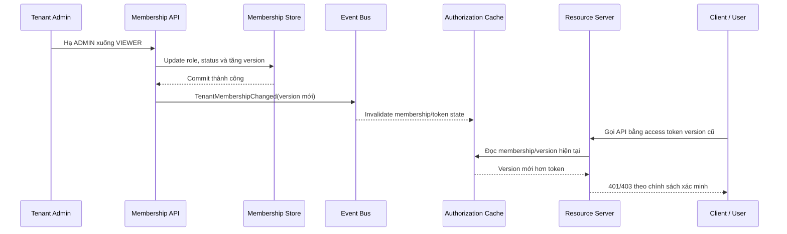

# Token sau khi tenant membership thay đổi

## 1. Vấn đề: token còn hợp lệ về mật mã nhưng quyền đã thay đổi

Trong hệ thống multi-tenant, một người dùng có thể là thành viên của nhiều tenant với vai trò khác nhau. Ví dụ, người dùng `user-42` là `ADMIN` ở `tenant-A`, là `VIEWER` ở `tenant-B`, và không có tư cách thành viên ở `tenant-C`. Access token được phát hành tại một thời điểm thường chứa hoặc đại diện cho ngữ cảnh tenant và quyền đã được cấp tại thời điểm đó.

Sau khi token được phát hành, quản trị viên có thể xóa người dùng khỏi tenant, hạ vai trò, khóa membership, chuyển người dùng sang nhóm khác hoặc xóa tenant. Chữ ký JWT vẫn có thể hợp lệ, `exp` vẫn ở tương lai và `iss` vẫn đáng tin cậy. Tuy vậy, quyền truy cập đã thay đổi. Nếu Resource Server chỉ xác minh chữ ký và đọc các claim cũ, người dùng có thể tiếp tục truy cập bằng quyền đã bị thu hồi cho tới khi token hết hạn.

Đây là vấn đề **stale authorization**: bằng chứng token chưa hết hạn nhưng dữ liệu cấp quyền mà token phản ánh đã lỗi thời. Bài học này tập trung vào cách giữ quyền truy cập nhất quán sau thay đổi membership trong bối cảnh token security: JWT và opaque token, access token và refresh token, phát hành, xác minh, thu hồi, lưu trữ và chống tái sử dụng token.

Mục tiêu thiết kế là bảo đảm mọi yêu cầu được đánh giá theo membership hiện hành hoặc theo một giới hạn trễ đã được chấp nhận rõ ràng. Việc phát hành token mới, refresh token hay exchange token đều phải áp dụng lại chính sách tenant đang có hiệu lực.

## 2. Phân biệt các loại thay đổi membership

Không phải mọi thay đổi đều có cùng mức độ rủi ro. Cần xác định sự kiện nào làm giảm quyền, sự kiện nào cấp thêm quyền và phạm vi token/session cần xử lý.

| Thay đổi | Rủi ro nếu token cũ tiếp tục được chấp nhận | Hành vi mong muốn |
| --- | --- | --- |
| Xóa user khỏi tenant | User tiếp tục đọc hoặc ghi dữ liệu tenant sau khi bị loại | Từ chối mọi yêu cầu thuộc tenant đó ngay theo SLA thu hồi đã cam kết. |
| Hạ vai trò `ADMIN` xuống `VIEWER` | Token cũ còn claim `ADMIN`, cho phép thao tác quản trị | Quyền quản trị bị vô hiệu; chỉ quyền đọc còn được phép nếu membership hiện tại cho phép. |
| Khóa hoặc đình chỉ membership | Tài khoản bị khóa ở tenant nhưng token cũ vẫn hoạt động | Từ chối toàn bộ truy cập theo membership bị khóa. |
| Chuyển nhóm hoặc thay đổi permission set | Claim role/group cũ không còn phản ánh chính sách | Tính quyền lại từ membership và policy hiện tại. |
| Thêm user vào tenant | Token cũ chưa có membership mới | Không tự động cấp quyền mới dựa trên dữ liệu client gửi; phát hành token mới hoặc kiểm tra membership hiện tại theo thiết kế. |
| Nâng vai trò | Token cũ có thể chưa chứa quyền mới | Không cần làm token cũ mạnh hơn; cấp quyền mới qua lần cấp token hoặc đánh giá policy có kiểm soát. |
| Xóa hoặc đóng tenant | Token cũ vẫn trỏ tới tenant đã ngừng hoạt động | Từ chối yêu cầu và xử lý dữ liệu theo chính sách vòng đời tenant. |

Các thay đổi thu hồi quyền như xóa membership, khóa membership và hạ vai trò thường cần lan truyền nhanh hơn thay đổi cấp quyền. Tuy nhiên, cả hai loại đều phải có quy tắc rõ ràng. Đặc biệt, hệ thống không được xem `tenant_id` xuất hiện trong request là bằng chứng rằng người dùng thuộc tenant đó.

## 3. Vì sao kiểm tra chữ ký JWT chưa đủ?

JWT có chữ ký giúp Resource Server kiểm tra token có được issuer đáng tin cậy phát hành và nội dung có bị sửa đổi hay không. Nó không chứng minh rằng dữ liệu membership bên ngoài token vẫn còn đúng ở thời điểm request.

Giả sử lúc 09:00 issuer phát hành JWT:

```json
{
  "iss": "https://auth.example.test",
  "sub": "user-42",
  "aud": "https://api.example.test",
  "tenant_id": "tenant-A",
  "roles": ["ADMIN"],
  "scope": "orders.read orders.write members.manage",
  "iat": 1900000000,
  "exp": 1900003600,
  "jti": "token-7f91"
}
```

Lúc 09:10, quản trị viên hạ vai trò của `user-42` từ `ADMIN` xuống `VIEWER`. JWT trên vẫn có chữ ký hợp lệ và chỉ hết hạn lúc 10:00. Nếu API chỉ kiểm tra `roles` trong JWT, user vẫn có thể gọi `members.manage` trong gần 50 phút tiếp theo.

Các claim như `iat`, `exp`, `jti`, `tenant_id` và `roles` có vai trò khác nhau:

- `iat` cho biết thời điểm token được phát hành; nó không tự thông báo một membership đã thay đổi sau đó.
- `exp` giới hạn tuổi thọ token; rút ngắn thời hạn làm giảm cửa sổ rủi ro nhưng không bảo đảm thu hồi tức thời.
- `jti` định danh một token và có thể hỗ trợ denylist hoặc điều tra; bản thân claim này không phải trạng thái thu hồi.
- `tenant_id` ràng buộc token với ngữ cảnh tenant theo quy ước issuer; nó không thay thế kiểm tra membership và quyền trên tài nguyên.
- `roles`/`scope` là dữ liệu ủy quyền được chụp tại thời điểm phát hành; chúng có thể cũ đi khi membership hoặc policy thay đổi.

Opaque access token cũng có thể trở nên lỗi thời nếu Resource Server cache kết quả introspection quá lâu. Khác biệt chủ yếu là opaque token thường cần hỏi Authorization Server hoặc một dịch vụ xác minh trạng thái để lấy thông tin token, trong khi JWT thường được xác minh cục bộ. Vì vậy, khả năng thu hồi phụ thuộc vào đường kiểm tra trạng thái và chính sách cache, không chỉ phụ thuộc định dạng token.

## 4. Thiết kế token gắn với một tenant

Một lựa chọn dễ kiểm soát là phát hành access token theo **một tenant context cụ thể**. Ví dụ, user có thể nhận một token cho `tenant-A` và một token khác cho `tenant-B`, mỗi token có audience và quyền phù hợp với API đích.

```json
{
  "iss": "https://auth.example.test",
  "sub": "user-42",
  "aud": "https://orders.api.example.test",
  "tenant_id": "tenant-A",
  "membership_id": "membership-8842",
  "membership_version": 12,
  "scope": "orders.read",
  "iat": 1900000000,
  "exp": 1900000300,
  "jti": "access-9c2a"
}
```

Các claim `tenant_id`, `membership_id` và `membership_version` trong ví dụ là quy ước ứng dụng, không phải claim bắt buộc do OAuth 2.0 quy định. Issuer phải tạo chúng từ dữ liệu đã xác minh. Client không được tự sửa claim hoặc gửi một `membership_version` khác để yêu cầu quyền cao hơn.

Khi nhận request, API cần kiểm tra ít nhất:

1. Chữ ký hoặc trạng thái token, `iss`, `aud`, `exp`, `nbf` (nếu có) và loại token được phép.
2. Tenant context của token khớp tenant mà endpoint/tài nguyên đang xử lý.
3. Membership hiện tại vẫn tồn tại và đang hoạt động, hoặc phiên bản membership trong token vẫn là phiên bản hiện hành theo cơ chế kiểm tra đã chọn.
4. Scope/role cho phép hành động đang gọi.
5. Người dùng có quyền trên **đối tượng cụ thể** trong tenant đó, chẳng hạn đơn hàng thuộc tenant và nằm trong phạm vi người dùng được xem.

Nếu một token chứa danh sách nhiều tenant, mỗi lần truy cập vẫn phải xác định tenant context rõ ràng và kiểm tra quyền cho tenant đang thao tác. Danh sách tenant trong claim không có nghĩa người dùng được phép truy cập mọi bản ghi của tất cả tenant đó. Token đơn tenant thường giúp giảm nhầm lẫn giữa context, scope và audience, đồng thời giới hạn tác động khi một token bị lộ.

## 5. Các chiến lược xử lý token sau membership change

Không có một kỹ thuật duy nhất phù hợp mọi hệ thống. Có thể kết hợp các chiến lược dưới đây theo mức độ nhạy cảm của API, yêu cầu độ sẵn sàng và SLA thu hồi.

### 5.1. Access token ngắn hạn

Phát hành access token có thời hạn ngắn, ví dụ 5 phút, để giới hạn khoảng thời gian một JWT cũ có thể được chấp nhận nếu API chỉ xác minh cục bộ. Khi token hết hạn, client phải xin token mới; Authorization Server đọc membership hiện tại và chỉ cấp quyền còn hợp lệ.

Ưu điểm là đơn giản, giảm phụ thuộc truy vấn trạng thái trên mỗi request và phù hợp với API có mức rủi ro vừa phải. Giới hạn là thay đổi membership vẫn có thể chưa có hiệu lực cho đến khi token cũ hết hạn. Thời hạn ngắn không thay thế quy trình thu hồi cho thao tác nhạy cảm như quản trị tenant, xuất dữ liệu hoặc thay đổi billing.

### 5.2. Opaque token và introspection

Với opaque token, Resource Server gọi introspection endpoint của Authorization Server (theo RFC 7662) hoặc một dịch vụ trạng thái tương đương. Kết quả có thể cho biết token còn active hay không và các thuộc tính cần cho authorization.

Khi membership thay đổi, hệ thống có thể đánh dấu token/session liên quan không còn active. API sẽ từ chối token ở lần introspection tiếp theo. Cần đặt timeout và cache TTL phù hợp: cache 10 phút có nghĩa thay đổi có thể chậm được nhận biết tới gần 10 phút, tùy thời điểm cache và cơ chế invalidation.

Không nên cache `active=true` lâu hơn SLA thu hồi. Với thao tác rủi ro cao, có thể kiểm tra trực tiếp hoặc dùng cache có cơ chế invalidation đáng tin cậy. Nếu introspection không truy cập được, quyết định fail-open hay fail-closed phải được quy định theo mức độ nhạy cảm; thao tác quản trị thường nên từ chối khi không thể xác minh trạng thái cần thiết.

### 5.3. Membership version / authorization version

Mỗi quan hệ user-tenant có một số phiên bản tăng đơn điệu. Khi membership bị xóa, khóa, đổi vai trò hoặc permission set thay đổi, hệ thống tăng version. Token chứa version tại thời điểm cấp. Resource Server so sánh version trong token với version hiện tại của membership.

```text
Membership hiện tại trong DB:
  user_id = user-42
  tenant_id = tenant-A
  status = ACTIVE
  role = VIEWER
  version = 13

Token được cấp trước thay đổi:
  sub = user-42
  tenant_id = tenant-A
  role = ADMIN
  membership_version = 12

So sánh: 12 != 13  -> token không còn phản ánh membership hiện tại.
Kết quả: từ chối token cũ hoặc yêu cầu cấp token mới.
```

Mã giả Java:

```java
AuthorizationDecision authorize(Request request, VerifiedAccessToken token) {
    if (!request.tenantId().equals(token.tenantId())) {
        return AuthorizationDecision.deny("tenant_context_mismatch");
    }

    Membership current = membershipRepository.find(
        token.subject(), token.tenantId());

    if (current == null || current.status() != MembershipStatus.ACTIVE) {
        return AuthorizationDecision.deny("membership_inactive");
    }

    if (current.version() != token.membershipVersion()) {
        return AuthorizationDecision.deny("stale_membership_token");
    }

    return policy.evaluate(current, request.action(), request.resource());
}
```

Đây là mã giả thể hiện ý tưởng, không phải API có sẵn của Spring Security. Trong triển khai thực tế cần xử lý membership không tồn tại, lỗi kho dữ liệu, cache, consistency và quyền trên tài nguyên. Nếu membership version đã đổi, hệ thống có thể yêu cầu client refresh hoặc thực hiện lại authorization flow; không được tự động chấp nhận claim cũ chỉ vì chữ ký token hợp lệ.

Version nên được quản lý theo đúng phạm vi. Một `membership_version` cho cặp `(user_id, tenant_id)` cho phép thu hồi quyền ở một tenant mà không buộc user đăng xuất khỏi tất cả tenant khác. Một `user_token_version` toàn cục có thể hữu ích khi khóa toàn bộ tài khoản hoặc thu hồi tất cả phiên, nhưng phạm vi ảnh hưởng rộng hơn.

### 5.4. Denylist theo `jti` hoặc session

Issuer có thể ghi nhận token/session cần thu hồi và Resource Server tra cứu denylist theo `jti`, session ID hoặc một định danh nội bộ. Cách này hữu ích khi cần thu hồi một số token cụ thể mà không thay đổi khóa ký.

Phải giới hạn thời gian lưu mục denylist đến khi token tương ứng hết hạn, chống tăng trưởng vô hạn và bảo vệ kho denylist. Nếu API chỉ xác minh JWT cục bộ mà không tra denylist hoặc nhận sự kiện invalidation, việc ghi `jti` vào database không tự làm token bị vô hiệu.

### 5.5. Event-driven cache invalidation

Khi transaction thay đổi membership được commit, hệ thống phát sự kiện như `TenantMembershipChanged` chứa định danh user, tenant, version mới và loại thay đổi. Resource Server, token service và cache authorization nhận sự kiện để xóa hoặc cập nhật dữ liệu đã cache.

Sự kiện nên được phát qua transactional outbox hoặc cơ chế tương đương để tránh trường hợp DB đã đổi nhưng sự kiện bị mất. Consumer phải idempotent, xử lý sự kiện trùng lặp và đến sai thứ tự bằng cách chỉ áp dụng version mới hơn. Cần có cơ chế retry, dead-letter, giám sát độ trễ và đối soát định kỳ.

Event invalidation giúp giảm truy vấn đồng bộ trên mỗi request nhưng vẫn có một cửa sổ trễ khi sự kiện đang truyền. Với endpoint nhạy cảm, có thể kết hợp cache invalidation với kiểm tra version trực tiếp hoặc introspection.

## 6. Refresh token và token exchange phải đọc membership hiện tại

Thu hồi access token không đủ nếu refresh token cũ vẫn có thể xin một access token mới chứa quyền đã bị gỡ. Tương tự, token exchange không được biến claims cũ thành token mới có thời hạn dài hơn mà không kiểm tra membership.

### Refresh token

Khi client gửi refresh token, Authorization Server cần:

- Xác minh refresh token còn hiệu lực, thuộc đúng client/session và chưa bị thu hồi.
- Kiểm tra trạng thái membership hiện tại của user trong tenant tương ứng.
- Tính lại scope/role từ policy hiện hành, không copy nguyên quyền từ access token cũ.
- Nếu membership bị xóa hoặc khóa, từ chối refresh và thu hồi refresh token hoặc token family liên quan theo thiết kế.
- Nếu membership chỉ bị hạ quyền, phát hành access token mới với quyền đã giảm; không tiếp tục duy trì scope cũ.

Refresh token rotation và phát hiện reuse giúp hạn chế việc sử dụng lại refresh token đã bị đánh cắp. Khi có sự kiện membership change, có thể thu hồi refresh token family của tenant bị ảnh hưởng hoặc toàn bộ session nếu chính sách yêu cầu. Không nên nhầm việc thu hồi refresh token với việc access token đã phát hành lập tức mất hiệu lực; hai loại token có vòng đời và cơ chế kiểm tra khác nhau.

### Token exchange

Nếu Service A đổi token nguồn lấy token cho API của tenant, STS phải kiểm tra membership hiện tại và quyền ủy quyền của actor tại thời điểm exchange. Token nguồn còn hợp lệ về chữ ký không có nghĩa quyền tenant trong token đó vẫn còn hiệu lực. Token đích phải có audience, tenant và scope cụ thể, cùng thời hạn phù hợp. Không cho phép client tự gửi `tenant_id`, role hoặc actor để ghi đè thông tin đã được xác minh.

## 7. Luồng xử lý membership change

Ví dụ user bị hạ quyền trong `tenant-A`. Dữ liệu membership và version được cập nhật trong transaction; sau khi commit, sự kiện được phát để các thành phần liên quan thu hồi cache hoặc session. Những request tiếp theo bị chặn bởi version check, introspection hoặc cơ chế trạng thái tương đương.



Sơ đồ minh họa một cách triển khai. Nếu cache chưa nhận event, version check trực tiếp hoặc introspection vẫn cần bảo đảm SLA đã cam kết. Mã HTTP cụ thể tùy hợp đồng API: `401 Unauthorized` thường phù hợp khi credential/token không còn được chấp nhận; `403 Forbidden` phù hợp khi token còn hợp lệ nhưng chủ thể không còn quyền thực hiện hành động. Không nên tiết lộ chi tiết nội bộ của membership trong thông báo lỗi.

## 8. Cô lập tenant ở Resource Server

Ngay cả khi token đã được kiểm tra trạng thái membership, API vẫn phải áp dụng tenant isolation tại tầng dữ liệu. Một lỗi phổ biến là kiểm tra user có membership ở `tenant-A` nhưng truy vấn bản ghi theo `order_id` mà quên thêm điều kiện tenant. Kẻ tấn công có thể thay ID để đọc dữ liệu tenant khác.

Ví dụ truy vấn có tenant predicate:

```sql
SELECT id, status, total
FROM orders
WHERE id = :order_id
  AND tenant_id = :verified_tenant_id;
```

`verified_tenant_id` phải đến từ tenant context đã được xác minh và authorization policy, không lấy trực tiếp từ query parameter/body. Với hệ quản trị hỗ trợ Row-Level Security, có thể áp dụng thêm chính sách ở database như một lớp phòng thủ. Khóa ngoại, unique constraint và quan hệ dữ liệu cũng cần xem xét tenant ID để tránh liên kết nhầm bản ghi giữa các tenant.

Khi kiểm tra quyền trên object, phải xác minh cả:

- Token được phát hành cho đúng API (`aud`) và đúng tenant context.
- Membership hiện tại đang active và có quyền cho action.
- Bản ghi thực sự thuộc tenant đó.
- Điều kiện theo ownership, nhóm, trạng thái hoặc phân loại dữ liệu được đáp ứng.

Không sử dụng `tenant_id` đơn lẻ như một role. Biết tenant nào đang được chọn không chứng minh người dùng có quyền trong tenant đó.

## 9. Các tình huống lỗi và quyết định vận hành

| Tình huống | Cách xử lý đề xuất |
| --- | --- |
| Membership bị xóa nhưng JWT chưa hết hạn | Từ chối qua version check, denylist, introspection hoặc cơ chế thu hồi đã cam kết. |
| Cache chưa nhận sự kiện thay đổi | Đo độ trễ; với hành động nhạy cảm, xác minh nguồn trạng thái đáng tin trước khi cho phép. |
| Membership store không truy cập được | Quyết định fail-closed cho thao tác nhạy cảm; không tự coi token cũ là còn quyền. |
| Refresh token được dùng sau khi membership bị khóa | Từ chối refresh, thu hồi family/session theo policy và ghi nhận sự kiện bảo mật. |
| User bị hạ role nhưng token cũ còn scope quản trị | So sánh version hoặc kiểm tra policy hiện tại; không dựa vào scope cũ. |
| User đổi tenant đang hoạt động | Xác minh membership ở tenant mới và cấp token context mới; không sửa tenant claim phía client. |
| Sự kiện invalidation bị lặp hoặc đến sai thứ tự | Consumer idempotent, dùng version đơn điệu và bỏ qua event cũ. |
| Tenant bị đóng trong lúc request đang chạy | Kiểm tra trạng thái tenant tại ranh giới xử lý quan trọng; xác định rõ cách xử lý transaction đang thực thi. |

Thiết kế cần xác định **revocation latency**: khoảng thời gian tối đa từ lúc membership change được commit đến lúc mọi API có liên quan từ chối token cũ. Ví dụ, SLA 30 giây phải được hỗ trợ bởi TTL cache, event delivery, retry và kiểm tra trạng thái phù hợp; không thể chỉ tuyên bố “JWT bị thu hồi ngay” nếu API không có đường kiểm tra trạng thái trực tuyến.

## 10. Kiểm thử sau tenant membership change

Các bài kiểm thử nên xác minh hành động thực tế ở API, không chỉ so sánh nội dung claim.

| Kịch bản kiểm thử | Kết quả mong đợi |
| --- | --- |
| Cấp token `ADMIN`, sau đó hạ membership xuống `VIEWER` | Token cũ không thể thực hiện thao tác quản trị sau SLA thu hồi. |
| Xóa membership trong khi JWT vẫn còn hạn | Request tới tenant đó bị từ chối theo SLA. |
| Khóa membership nhưng refresh token vẫn còn hạn | Refresh bị từ chối; không phát hành access token mới cho membership đã khóa. |
| User có membership ở A nhưng gửi `tenant_id=B` trong body | Không truy cập được dữ liệu B nếu không có membership và quyền tương ứng. |
| User có quyền ở A và B, nhưng chỉ membership A thay đổi | Token/session của A bị xử lý theo policy; B vẫn hoạt động nếu không bị ảnh hưởng. |
| Sự kiện invalidation bị gửi hai lần | Cache và consumer không tạo trạng thái sai hoặc lùi version. |
| Sự kiện version 12 đến sau version 13 | Không ghi đè trạng thái mới bằng version cũ. |
| Introspection hoặc membership store timeout | Hành vi đúng với fail-open/fail-closed policy đã phê duyệt; không âm thầm bỏ qua kiểm tra. |
| Token đúng tenant nhưng order thuộc tenant khác | Resource Server từ chối truy cập object. |
| Tenant bị đóng hoặc user bị đình chỉ | Không thể tiếp tục dùng access token/refresh token để vượt qua trạng thái mới. |

Kiểm thử tích hợp cần đo thời gian từ commit membership change đến khi request bị từ chối ở từng Resource Server. Nên kiểm tra cả cache nóng, cache lạnh, consumer bị dừng, event retry, sự kiện trùng lặp và tình huống kho trạng thái tạm thời mất kết nối.

## 11. Ghi log và giám sát

Ghi nhận các sự kiện có thể phục vụ kiểm toán và điều tra:

- User/subject tham chiếu và tenant ID đã được xác minh.
- Membership ID, version cũ/mới và loại thay đổi (removed, suspended, role_changed, permissions_changed).
- Thời điểm commit, thời điểm phát event và thời điểm các consumer xác nhận invalidation.
- Token/session family bị thu hồi theo định danh nội bộ; không ghi token thô.
- Quyết định authorization, lý do từ chối ở mức mã lỗi an toàn và Resource Server đã xử lý.

Các chỉ số hữu ích gồm revocation latency p50/p95/p99, độ trễ consumer, số cache invalidation thất bại, số refresh bị từ chối do membership, số token stale bị phát hiện và số lần fallback sang kiểm tra trực tiếp. Cảnh báo khi độ trễ vượt SLA, event bị kẹt trong dead-letter queue hoặc một user liên tục thử truy cập tenant sau khi bị xóa membership.

Không ghi access token, refresh token, client secret, private key hoặc toàn bộ claims nhạy cảm vào log. Nếu cần tương quan request, dùng `jti` hoặc định danh đã được bảo vệ và giới hạn quyền truy cập log.

## 12. Checklist thiết kế

- [ ] Token có tenant context rõ ràng; tenant được chọn không đến từ dữ liệu client chưa xác minh.
- [ ] Issuer chỉ phát hành token dựa trên membership và policy đã kiểm tra.
- [ ] Resource Server xác minh issuer, audience, thời hạn, loại token và chữ ký/trạng thái token.
- [ ] Có chiến lược xử lý token stale sau remove, suspend, role downgrade và tenant closure.
- [ ] Refresh token và token exchange luôn đánh giá lại membership hiện tại.
- [ ] Cache TTL, event invalidation, retry và fail-open/fail-closed policy đáp ứng SLA thu hồi.
- [ ] Quyền trên object và tenant predicate được kiểm tra tại Resource Server/data layer.
- [ ] Có kiểm thử cho event trùng lặp, sai thứ tự, timeout, cache stale và nhiều tenant.
- [ ] Log không chứa token hoặc bí mật; có chỉ số và cảnh báo revocation latency.

**Điểm cốt lõi:** Membership là trạng thái ủy quyền có thể thay đổi sau khi token được phát hành. Token chỉ mang bằng chứng và ngữ cảnh tại thời điểm cấp; Resource Server phải có cách phát hiện trạng thái cũ theo SLA của hệ thống. Khi membership bị thu hồi hoặc thay đổi, mọi lần refresh, exchange và truy cập tài nguyên tiếp theo đều phải tuân theo chính sách tenant hiện hành.

## Tài liệu tham khảo

- IETF, **RFC 6749 — The OAuth 2.0 Authorization Framework**: access token, refresh token và token endpoint. <https://www.rfc-editor.org/rfc/rfc6749>
- IETF, **RFC 7009 — OAuth 2.0 Token Revocation**: endpoint thu hồi token và các lưu ý về lan truyền thu hồi. <https://www.rfc-editor.org/rfc/rfc7009>
- IETF, **RFC 7662 — OAuth 2.0 Token Introspection**: cách Resource Server truy vấn trạng thái token. <https://www.rfc-editor.org/rfc/rfc7662>
- IETF, **RFC 7519 — JSON Web Token (JWT)**: cấu trúc JWT và các registered claims như `iss`, `sub`, `aud`, `exp`, `iat`, `jti`. <https://www.rfc-editor.org/rfc/rfc7519>
- IETF, **RFC 9700 — Best Current Practice for OAuth 2.0 Security**: thực hành bảo mật hiện hành cho triển khai OAuth 2.0. <https://www.rfc-editor.org/rfc/rfc9700>
