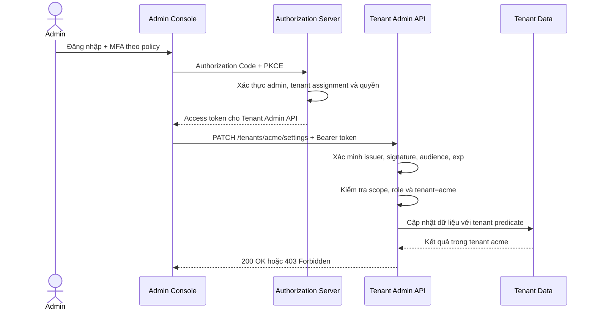

# Admin token và tenant isolation

## 1. Admin token trong hệ thống multi-tenant là gì?

Một nền tảng **multi-tenant** phục vụ nhiều tổ chức hoặc khách hàng trên cùng hệ thống. Mỗi tenant có người dùng, dữ liệu, cấu hình và chính sách riêng. Ví dụ, nền tảng quản lý bán hàng có tenant `acme` và tenant `northwind`; quản trị viên của Acme có thể quản lý người dùng và đơn hàng của Acme, nhưng không được đọc dữ liệu của Northwind.

**Admin token** là cách gọi trong ứng dụng cho access token mang quyền quản trị. OAuth 2.0 không định nghĩa một grant hay token type riêng tên là “admin token”. Về kỹ thuật, đây vẫn là access token được AS phát hành sau khi xác thực client/chủ thể và áp dụng chính sách cấp quyền. Token có thể mang scope, role hoặc claim tùy chỉnh để biểu đạt quyền quản trị.

Điều quan trọng là quyền quản trị phải gắn với **phạm vi tenant cụ thể**. Một token có role `TENANT_ADMIN` nhưng không xác định tenant hoặc không được kiểm tra tenant khi xử lý request có thể dẫn đến lỗi truy cập chéo tenant (*cross-tenant access*).

Tenant isolation (cách ly tenant) là tập hợp các kiểm soát bảo đảm một tenant chỉ truy cập dữ liệu và tài nguyên mà nó được phép sử dụng. Kiểm soát này phải được thực thi xuyên suốt:

- Tại API: xác thực token, kiểm tra tenant và quyền của actor trên tenant mục tiêu.
- Tại tầng nghiệp vụ: xác minh thao tác có hợp lệ với đối tượng thuộc tenant đó hay không.
- Tại tầng dữ liệu: mọi truy vấn, cập nhật và xóa đều được ràng buộc tenant.
- Tại cache, file, search index, message queue và job nền: dữ liệu phải giữ đúng tenant context.
- Trong audit và vận hành: ghi nhận ai đã thực hiện hành động quản trị, trên tenant nào và vì lý do gì.

**Một token hợp lệ không tự động cho phép truy cập mọi tenant.** Chữ ký chứng minh token được phát hành bởi issuer có khóa tin cậy và chưa bị sửa; scope/role biểu đạt quyền đã cấp; tenant policy xác định quyền đó áp dụng ở đâu.

## 2. Phân biệt các loại danh tính quản trị

Không nên gộp mọi quản trị viên thành một role toàn cục. Một nền tảng thường có nhiều nhóm actor:

| Actor | Phạm vi | Ví dụ quyền |
|---|---|---|
| Tenant administrator | Một tenant được gán | Quản lý user, cấu hình và tài nguyên của tenant đó |
| Tenant operator | Một tenant, quyền giới hạn | Xem trạng thái, xử lý tác vụ vận hành được phép |
| Platform administrator | Nền tảng hoặc các tenant được ủy quyền rõ ràng | Quản lý cấu hình nền tảng, xử lý sự cố có kiểm soát |
| Support operator | Tenant được cấp quyền hỗ trợ trong thời gian nhất định | Xem metadata hoặc hỗ trợ một chức năng cụ thể |
| Service administrator | Workload/service account | Thực hiện tác vụ tự động được cấp quyền, không mặc nhiên có quyền người dùng |

Một nhân viên hỗ trợ không nên dùng token của platform administrator để xử lý mọi yêu cầu khách hàng. Hãy cấp quyền hỗ trợ theo tenant, mục đích, loại thao tác và thời hạn. Với platform administrator, cần tách quyền vận hành nền tảng khỏi quyền đọc nội dung dữ liệu khách hàng.

### Role, scope và tenant là ba chiều khác nhau

| Thành phần | Trả lời câu hỏi | Ví dụ |
|---|---|---|
| Role | Actor thuộc nhóm trách nhiệm nào? | `TENANT_ADMIN` |
| Scope | API cho phép thao tác nào? | `users.manage`, `settings.update` |
| Tenant context | Quyền áp dụng trên tenant nào? | `tenant_id=acme` |
| Resource/object policy | Actor có được thao tác đối tượng cụ thể không? | User cần sửa thuộc tenant Acme |
| Audience | Token dành cho API nào? | `urn:service:tenant-admin-api` |

Role `TENANT_ADMIN` không có ý nghĩa đầy đủ nếu không biết tenant nào. Scope `users.manage` cũng không đủ để quyết định người dùng mục tiêu có thuộc tenant mà actor quản trị hay không.

## 3. Claims thường gặp trong admin access token

Một JWT access token dành cho Tenant Admin API có thể có payload minh họa:

```json
{
  "iss": "https://auth.example.internal",
  "sub": "admin-user-204",
  "aud": ["urn:service:tenant-admin-api"],
  "client_id": "admin-console",
  "scope": "users.manage settings.update",
  "roles": ["TENANT_ADMIN"],
  "tenant_id": "acme",
  "iat": 1795400000,
  "exp": 1795400300,
  "jti": "admin-token-91",
  "amr": ["pwd", "mfa"]
}
```

Đây là ví dụ minh họa. `roles`, `tenant_id` và `amr` không phải lúc nào cũng là claims bắt buộc trong mọi OAuth access token; ý nghĩa và tên claim phải được AS và Resource Server thống nhất. Với JWT access token theo RFC 9068, cần tuân thủ profile tương ứng và kiểm tra loại token.

| Claim | Ý nghĩa | Kiểm tra ở đâu? |
|---|---|---|
| `iss` | Issuer phát hành token | So khớp issuer được cấu hình tin cậy |
| `sub` | Chủ thể được token đại diện | Ánh xạ đến tài khoản/admin identity |
| `aud` | Resource Server nhận token | Phải chứa audience của Admin API hiện tại |
| `client_id` | OAuth client đã xin token | Giới hạn client được phép dùng admin API |
| `scope` / `scp` | Quyền API được cấp | Kiểm tra ở endpoint/action |
| `roles` | Nhóm vai trò theo hợp đồng ứng dụng | Áp chính sách role và phạm vi |
| `tenant_id` | Tenant mà token bị ràng buộc | So khớp với tenant mục tiêu |
| `exp`, `nbf` | Giới hạn hiệu lực theo thời gian | Kiểm tra mỗi lần xác thực |
| `jti` | Định danh token | Hỗ trợ audit/denylist nếu có cơ chế |
| `amr` / `acr` | Thông tin phương thức hoặc mức xác thực (nếu profile cung cấp) | Dùng cho step-up policy khi cần |

**Không tin claim trước khi xác thực token.** Với JWT, phải xác minh chữ ký bằng khóa tin cậy, issuer, audience, thời hạn, loại token và các điều kiện của profile trước khi dùng `tenant_id` hoặc `roles`. Với opaque token, Resource Server phải introspect hoặc dùng cơ chế xác thực tương đương.

### Tenant của token khác tenant mục tiêu của request

Một điểm dễ nhầm là `tenant_id` trong token và `targetTenantId` trong URL có thể là hai giá trị khác nhau.

- Với **tenant admin**, token thường bị ràng buộc vào một tenant. API phải yêu cầu `targetTenantId` trùng với tenant đã được xác thực trong token.
- Với **platform/support operator**, token có thể không mang một tenant duy nhất. Tuy nhiên, việc chọn tenant mục tiêu phải được kiểm tra qua grant/assignment phía server, gồm thao tác được phép, lý do, thời hạn và phê duyệt nếu chính sách yêu cầu.
- Không được coi việc client gửi `X-Tenant-Id` hoặc `tenantId` trong body là bằng chứng rằng actor có quyền với tenant đó.

Nếu một actor có quyền trên nhiều tenant, có thể dùng danh sách assignment phía server hoặc token exchange để phát hành token mới bị giới hạn cho một tenant và một tập scope. Tránh nhét danh sách hàng nghìn tenant vào access token; token lớn, khó thu hồi quyền từng tenant và dễ gây sai lệch khi membership thay đổi.

## 4. Luồng cấp và sử dụng admin token

Một luồng đăng nhập quản trị viên người dùng thường dùng OpenID Connect Authorization Code Flow với PKCE. Sau khi xác thực và hoàn tất MFA/step-up theo policy, AS cấp access token cho Admin API. ID token phục vụ client hiểu sự kiện đăng nhập; **không dùng ID token thay access token để gọi API**.



Với service-to-service administration, workload có thể dùng Client Credentials hoặc workload identity phù hợp. Token của service chỉ có quyền tác vụ tự động đã được cấp; không gán `TENANT_ADMIN` toàn cục chỉ vì workload chạy trong mạng nội bộ.

### Cấp token theo nguyên tắc tối thiểu

- Chỉ phát admin token sau khi xác thực actor và kiểm tra assignment/approval.
- Giới hạn audience cho đúng Admin API.
- Chỉ cấp scope cần cho tác vụ, ví dụ `users.read` thay vì `users.manage` nếu chỉ xem.
- Ràng buộc tenant trong token hoặc trong grant được kiểm tra phía server.
- Access token quản trị có TTL ngắn phù hợp độ nhạy cảm; refresh token nếu có phải được bảo vệ và xoay vòng theo policy.
- Với hành động nhạy cảm, yêu cầu xác thực mạnh hơn hoặc step-up authentication; không chỉ dựa vào việc token còn hạn.
- Tách client của admin console, automation và service backend; không dùng chung credential.

## 5. Kiểm tra tenant isolation ở API

Giả sử endpoint quản lý người dùng:

```http
PATCH /tenants/acme/users/user-901
Authorization: Bearer <admin-access-token>
Content-Type: application/json

{ "enabled": false }
```

API cần thực hiện tuần tự:

1. Xác thực access token: issuer, chữ ký hoặc introspection, audience, token type và thời hạn.
2. Xác định actor và client đã được xác thực.
3. Kiểm tra scope phù hợp với hành động, ví dụ `users.manage`.
4. Kiểm tra role/assignment: actor có quyền quản trị tenant `acme` không?
5. Tải đối tượng với điều kiện tenant: user `user-901` phải thuộc `acme`.
6. Thực thi thay đổi trong cùng tenant context và ghi audit event.
7. Trả lỗi phù hợp nếu tenant, đối tượng hoặc quyền không khớp.

Đối với tenant admin, điều kiện đơn giản thường là:

```text
validated_token.tenant_id == requested_tenant_id
AND has_role(validated_token, "TENANT_ADMIN")
AND has_scope(validated_token, "users.manage")
AND user.tenant_id == requested_tenant_id
```

Đây là mô hình minh họa. Quyền thực tế có thể dùng policy engine hoặc authorization service; điểm bắt buộc là mọi thành phần tenant/resource phải được kiểm tra từ dữ liệu đáng tin cậy.

### Không lấy tenant từ header chưa được tin cậy

Ví dụ nguy hiểm:

```java
String tenantId = request.getHeader("X-Tenant-Id");
return userRepository.findById(userId);
```

Đoạn này để client tự chọn tenant qua header và truy vấn user chỉ bằng ID. Nếu ID đoán được hoặc bị lộ, request có thể đọc/sửa dữ liệu tenant khác.

Thiết kế đúng phải tạo tenant context sau khi xác thực và phân quyền:

```java
String targetTenant = pathVariableTenantId;
tenantAccessPolicy.requireCanManage(authentication, targetTenant);

User user = userRepository
    .findByIdAndTenantId(userId, targetTenant)
    .orElseThrow(NotFoundException::new);
```

Tenant context phải đến từ token/grant đã xác thực và quyết định authorization của server. Path parameter có thể chỉ định tài nguyên đích, nhưng không tự cấp quyền. Tránh dùng một biến tenant toàn cục hoặc ThreadLocal không được dọn sạch giữa các request trong thread pool.

## 6. Cô lập tenant ở tầng dữ liệu

Kiểm tra API là cần thiết nhưng chưa đủ. Một endpoint có thể xác thực đúng token rồi vẫn truy vấn nhầm dữ liệu nếu câu SQL thiếu tenant predicate.

### Luôn ràng buộc tenant trong truy vấn

Ví dụ truy vấn an toàn:

```sql
SELECT id, email, status
FROM users
WHERE tenant_id = :authorizedTenantId
  AND id = :userId;
```

Câu truy vấn chỉ tìm user bên trong tenant đã được authorization. Không nên chỉ lấy theo `id` rồi hy vọng tầng controller đã lọc đúng.

Với update/delete cũng cần predicate tenant:

```sql
UPDATE users
SET enabled = FALSE
WHERE tenant_id = :authorizedTenantId
  AND id = :userId;
```

Kiểm tra số bản ghi được cập nhật. Nếu bằng 0, không được báo thành công giả. Tùy chính sách chống dò ID, API có thể trả 404 để không tiết lộ đối tượng thuộc tenant khác, hoặc 403 khi cần thể hiện rõ lỗi quyền.

### Các mô hình lưu trữ

| Mô hình | Cách cô lập | Điểm cần chú ý |
|---|---|---|
| Shared database, shared schema | Mỗi row có `tenant_id` | Mọi truy vấn và unique constraint phải bao gồm tenant khi thích hợp |
| Schema per tenant | Mỗi tenant có schema riêng | Kiểm soát schema routing, migration và connection pool |
| Database per tenant | Mỗi tenant có database riêng | Cấu hình connection, backup, restore và quyền vận hành phức tạp hơn |
| Hybrid | Kết hợp shared và dedicated storage | Policy định tuyến tenant phải nhất quán giữa các dịch vụ |

Với shared schema, cân nhắc Row-Level Security (RLS) ở database như một lớp bảo vệ bổ sung. Ứng dụng phải thiết lập tenant context an toàn cho transaction và reset context khi trả connection về pool. RLS không thay thế xác thực token; nếu ứng dụng đặt session variable tenant từ dữ liệu client tùy ý thì kẻ tấn công vẫn có thể chọn tenant khác.

Các ràng buộc quan trọng khác:

- Unique constraint cho email/slug có thể cần là `UNIQUE(tenant_id, value)` thay vì unique toàn hệ thống.
- Foreign key giữa bảng tenant-scoped cần bảo đảm hai đối tượng cùng tenant.
- Object storage key và quyền truy cập file phải gắn tenant; không dựa vào tên file do client gửi.
- Cache key phải bao gồm tenant, ví dụ `tenant:acme:user:user-901`.
- Search index/filter, analytics, export và report phải duy trì tenant filter.
- Background job và message event phải mang tenant context đã được xác thực và kiểm tra lại khi consumer xử lý.

## 7. Platform admin, cross-tenant và break-glass

Platform administrator có thể cần hỗ trợ nhiều tenant, nhưng không nên dùng một token quyền toàn cục để mọi request tự do chọn tenant.

Một luồng hỗ trợ an toàn nên có:

1. Actor đăng nhập bằng danh tính quản trị riêng và MFA/step-up theo mức độ nhạy cảm.
2. Chọn tenant mục tiêu trong giao diện; server kiểm tra actor có assignment hoặc được phê duyệt hỗ trợ tenant đó không.
3. Chọn hành động và mục đích; quyền được giới hạn theo scope, resource, tenant và thời hạn.
4. Nếu cần, AS phát token exchange mới có audience Admin API và quyền tối thiểu cho tenant đó.
5. Mọi request ghi dữ liệu đều kiểm tra lại grant và tenant; audit ghi actor, tenant, action, lý do, ticket, thời điểm và kết quả.
6. Hết thời hạn hoặc kết thúc phiên hỗ trợ thì grant bị thu hồi; token không được tái sử dụng cho tenant khác.

**Break-glass access** là quyền khẩn cấp dùng khi quy trình bình thường không đủ để xử lý sự cố. Nó cần lý do bắt buộc, phê duyệt hoặc hậu kiểm, thời hạn rất ngắn, cảnh báo và audit đầy đủ. Không tạo một tài khoản admin khẩn cấp dùng chung cho cả nhóm.

Nếu có tính năng impersonation (đăng nhập/thao tác dưới danh tính người dùng khác), phải phân biệt rõ:

- **Acting as / delegation:** admin vẫn là actor, người dùng là subject hoặc đối tượng được đại diện.
- **Impersonation:** hệ thống mô phỏng danh tính người dùng; phải ghi lại admin gốc trong audit và giới hạn hành động.

Không chỉ thay `sub` thành user mục tiêu rồi bỏ mất admin gốc. Token/assertion cần biểu đạt actor chain theo hợp đồng tin cậy, ví dụ claim `act` nếu profile và AS hỗ trợ. Không để impersonation biến thành cách vượt qua tenant boundary.

## 8. Ví dụ với Spring Security

Spring Security Resource Server có thể xác thực JWT, sau đó ứng dụng áp chính sách tenant riêng. Ví dụ dưới đây lược bỏ import và phần cấu hình authority converter; `roles` là claim tùy chỉnh đã được ánh xạ thành authorities bởi cấu hình tin cậy.

```java
@Component("tenantAccessPolicy")
public class TenantAccessPolicy {

    private final PlatformAdminGrantService platformAdminGrants;

    public TenantAccessPolicy(
            PlatformAdminGrantService platformAdminGrants) {
        this.platformAdminGrants = platformAdminGrants;
    }

    public boolean canManage(
            Authentication authentication,
            String targetTenantId) {

        if (!(authentication instanceof JwtAuthenticationToken jwtAuth)
                || !authentication.isAuthenticated()
                || targetTenantId == null
                || targetTenantId.isBlank()) {
            return false;
        }

        Jwt jwt = jwtAuth.getToken();
        boolean hasManageScope = authentication.getAuthorities().stream()
            .anyMatch(a -> a.getAuthority().equals("SCOPE_users.manage"));

        if (!hasManageScope) {
            return false;
        }

        boolean isTenantAdmin = authentication.getAuthorities().stream()
            .anyMatch(a -> a.getAuthority().equals("ROLE_TENANT_ADMIN"));

        if (isTenantAdmin) {
            String boundTenant = jwt.getClaimAsString("tenant_id");
            return targetTenantId.equals(boundTenant);
        }

        boolean isPlatformAdmin = authentication.getAuthorities().stream()
            .anyMatch(a -> a.getAuthority().equals("ROLE_PLATFORM_ADMIN"));

        return isPlatformAdmin
            && platformAdminGrants.isAllowed(
                jwt.getSubject(),
                targetTenantId,
                "users.manage"
            );
    }
}
```

Controller sử dụng policy trước khi thực hiện thao tác:

```java
@RestController
@RequestMapping("/tenants/{tenantId}/users")
public class TenantUserController {

    private final UserRepository users;

    public TenantUserController(UserRepository users) {
        this.users = users;
    }

    @PreAuthorize("@tenantAccessPolicy.canManage(authentication, #tenantId)")
    @PatchMapping("/{userId}/enabled")
    ResponseEntity<Void> setEnabled(
            @PathVariable String tenantId,
            @PathVariable String userId,
            @RequestBody SetEnabledRequest request) {

        User user = users.findByIdAndTenantId(userId, tenantId)
            .orElseThrow(NotFoundException::new);

        user.setEnabled(request.enabled());
        users.save(user);
        return ResponseEntity.noContent().build();
    }
}
```

Đây là ví dụ minh họa kiến trúc. Trong production cần cấu hình issuer/JWKS, validator audience, token type, ánh xạ scope/role, kiểm soát grant cho platform admin, transaction và audit. Không gọi trực tiếp service với `tenantId` trước khi authorization hoàn tất. Với async hoặc reactive stack, cách truyền security/tenant context phải theo cơ chế context propagation của framework, tránh rò tenant giữa request.

## 9. Audit, giám sát và phản ứng sự cố

Admin API có khả năng thay đổi quyền và dữ liệu nên cần audit riêng. Một event quản trị hữu ích thường gồm:

| Trường | Mục đích |
|---|---|
| Actor subject/client | Ai hoặc workload nào thực hiện |
| Actor type/role | Tenant admin, platform admin, support hay service |
| Target tenant | Tenant bị tác động |
| Target resource | User, setting, invoice hoặc object cụ thể |
| Action/scope | Hành động thực hiện |
| Reason/ticket | Lý do hoặc mã yêu cầu hỗ trợ |
| Correlation/request ID | Liên kết log giữa các service |
| Timestamp/result | Thời điểm và kết quả |
| Authentication context | Mức xác thực/MFA nếu policy cho phép ghi metadata |

Không ghi raw access token, refresh token, secret hoặc dữ liệu cá nhân không cần thiết vào audit. Có thể ghi `jti` hoặc token fingerprint nếu cần liên kết sự kiện, nhưng phải đánh giá quyền truy cập và thời hạn lưu trữ log.

Khi phát hiện cross-tenant access:

1. Chặn đường truy cập hoặc vô hiệu grant/credential liên quan.
2. Xác định actor, token issuer/audience, tenant nguồn và tenant đích qua metadata an toàn.
3. Kiểm tra dữ liệu đã đọc/sửa/xóa, cache, file, search index và các job downstream.
4. Thu hồi token/assignment theo khả năng; nhớ rằng đổi secret không tự vô hiệu JWT đã cấp còn hạn nếu RS xác minh offline.
5. Khắc phục thiếu sót ở API và data layer, thêm kiểm thử hồi quy, rồi giám sát lại.

## 10. Lỗi thường gặp

| Lỗi | Hệ quả | Cách kiểm soát |
|---|---|---|
| Có role admin nhưng không ràng buộc tenant | Admin tenant A có thể thao tác tenant B | Ràng buộc tenant claim/grant và kiểm tra ở mọi request |
| Tin `X-Tenant-Id` từ client | Client tự chọn tenant khác | Lấy tenant từ token/grant đã xác thực; path chỉ là target |
| Truy vấn theo object ID mà thiếu tenant predicate | IDOR/cross-tenant data access | Truy vấn theo cả tenant và object ID |
| Platform admin có quyền toàn cục mọi lúc | Tăng blast radius khi token bị lộ | JIT grant, step-up, scope hẹp, TTL ngắn và audit |
| Chỉ kiểm tra scope mà bỏ qua tenant | Scope đúng nhưng dữ liệu tenant sai | Kiểm tra scope + tenant + object policy |
| Cache không có tenant trong key | Trả dữ liệu tenant khác | Tenant-aware cache key và invalidation |
| RLS dùng tenant session variable từ input chưa xác thực | Kẻ tấn công đổi tenant context | Thiết lập từ security context đã xác thực trong transaction |
| Background job thiếu tenant context | Job xử lý nhầm dữ liệu tenant | Đính kèm tenant ID có nguồn gốc tin cậy và kiểm tra khi consume |
| Dùng ID token cho Admin API | Sai mục đích token/audience | Chỉ chấp nhận access token dành cho Admin API |
| Impersonation làm mất actor gốc | Không truy vết được người thao tác thực | Lưu actor chain và audit cả admin lẫn subject |
| Đổi client secret rồi cho rằng token cũ hết hiệu lực | JWT offline có thể còn dùng được đến exp | Revocation/introspection/denylist hoặc TTL ngắn |

## 11. Ma trận kiểm thử tenant isolation

Giả sử `admin-user-204` là Tenant Admin của `acme`, có `users.manage` và token dành cho `urn:service:tenant-admin-api`.

| Tình huống | Kết quả mong đợi | Lý do |
|---|---|---|
| Token hợp lệ, đúng audience, tenant Acme, scope và object cùng Acme | Cho phép nếu nghiệp vụ hợp lệ | Đúng identity, tenant và quyền |
| Token Acme gọi `/tenants/northwind/users/...` | 403 | Tenant mục tiêu khác tenant được ràng buộc |
| Token thiếu `tenant_id` đối với tenant-admin flow | Từ chối | Không xác định được tenant được phép |
| Token có audience của API khác | 401 | Token không dành cho Admin API |
| Token hết hạn hoặc issuer lạ | 401 | Không xác thực được token |
| Scope đúng nhưng object thuộc tenant khác | 403/404 theo chính sách | Phải cô lập object theo tenant |
| Client gửi `X-Tenant-Id: northwind` nhưng token Acme | Từ chối truy cập Northwind | Header không có thẩm quyền vượt tenant binding |
| Platform admin có grant hỗ trợ Acme còn hiệu lực | Cho phép trong phạm vi grant | Có assignment rõ ràng |
| Platform admin không có grant cho Northwind | 403 | Role toàn nền tảng không tự động cho phép mọi thao tác dữ liệu |
| Grant hỗ trợ đã hết hạn | 403 | Không tiếp tục dùng quyền cũ |
| Cache chứa dữ liệu Acme được truy cập từ Northwind | Không được trả dữ liệu Acme | Cache key phải bao gồm tenant |
| Background event thiếu tenant context hoặc context không hợp lệ | Dừng xử lý/đưa vào dead-letter theo policy | Không đoán tenant từ payload tùy ý |

Nên kiểm thử cả API, repository, cache, export, file download, message consumer và job nền. Kiểm thử chỉ ở controller không chứng minh toàn hệ thống đã cô lập tenant.

## 12. Checklist triển khai

- Admin token được định nghĩa là access token có quyền quản trị theo policy của ứng dụng; không nhầm với ID token.
- Tenant admin, platform admin, support operator và service identity có role/client riêng.
- Mọi token được xác minh issuer, chữ ký/introspection, audience, token type và thời hạn.
- Tenant admin bị ràng buộc vào tenant cụ thể; platform/support admin cần grant theo tenant và mục đích.
- Scope, role, tenant context và object-level authorization được kiểm tra độc lập.
- Không tin tenant ID hoặc role từ header/body do client tự gửi.
- Mọi truy vấn dữ liệu, update/delete và unique constraint được thiết kế có tenant boundary.
- Cache, file, search, event, report và background job duy trì tenant context.
- Platform admin dùng quyền tạm thời, step-up, approval/break-glass và audit phù hợp.
- Impersonation lưu được actor gốc và subject được đại diện.
- Có kiểm thử cross-tenant, IDOR, sai audience, thiếu scope, grant hết hạn và rò cache.
- Token/credential không bị ghi vào log; có quy trình thu hồi và ứng phó sự cố.

## Tài liệu tham khảo

- [RFC 6749 — The OAuth 2.0 Authorization Framework](https://www.rfc-editor.org/rfc/rfc6749): access token, scope, client và authorization server.
- [RFC 9068 — JWT Profile for OAuth 2.0 Access Tokens](https://www.rfc-editor.org/rfc/rfc9068): profile JWT access token và cách Resource Server xác minh.
- [RFC 8725 — JSON Web Token Best Current Practices](https://www.rfc-editor.org/rfc/rfc8725): xác minh JWT và ngăn token bị dùng sai mục đích.
- [RFC 8693 — OAuth 2.0 Token Exchange](https://www.rfc-editor.org/rfc/rfc8693): delegation, subject/actor token và token cho resource đích.
- [RFC 9700 — Best Current Practice for OAuth 2.0 Security](https://www.rfc-editor.org/rfc/rfc9700): khuyến nghị bảo mật OAuth 2.0 hiện hành.
- [OpenID Connect Core 1.0](https://openid.net/specs/openid-connect-core-1_0.html): ID token, xác thực người dùng và luồng OIDC.
- [OWASP Authorization Cheat Sheet](https://cheatsheetseries.owasp.org/cheatsheets/Authorization_Cheat_Sheet.html): nguyên tắc kiểm tra quyền và deny-by-default.
- [Spring Security — OAuth 2.0 Resource Server JWT](https://docs.spring.io/spring-security/reference/servlet/oauth2/resource-server/jwt.html): cấu hình xác thực JWT ở Resource Server.

**Ghi nhớ:** Admin token cho biết actor đã được cấp quyền quản trị; tenant policy xác định quyền đó áp dụng trên tenant nào. Mọi thao tác phải kiểm tra token, scope/role, tenant và quyền trên đối tượng, sau đó giữ tenant boundary ở cả database, cache và các luồng xử lý nền.
