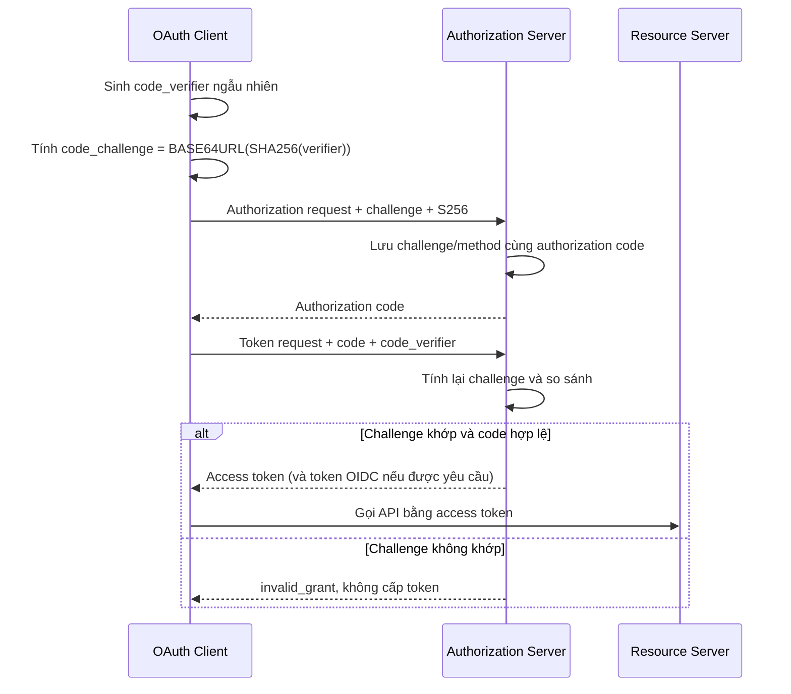

# Kiểm thử PKCE khi `code_verifier` không khớp

## 1. Mục tiêu của bài kiểm thử

PKCE (Proof Key for Code Exchange, RFC 7636) bổ sung một bằng chứng cho OAuth 2.0 Authorization Code Flow. Client tạo một giá trị bí mật ngẫu nhiên `code_verifier`, tính `code_challenge` rồi gửi challenge trong authorization request. Khi đổi authorization code lấy token, client gửi verifier. Authorization Server tính lại challenge từ verifier và so sánh với challenge đã gắn với authorization code.

Nếu hai giá trị không khớp, Authorization Server phải từ chối việc đổi code. Bài kiểm thử này xác nhận rằng một người chỉ có authorization code nhưng không có đúng verifier không thể nhận access token. Với OpenID Connect, phản hồi thất bại cũng không được cấp ID token hoặc refresh token.

Nội dung thuộc phạm vi kiểm thử bảo mật token: xác minh ràng buộc giữa authorization code và client transaction, kiểm tra cách xử lý lỗi, ngăn code bị đổi nhiều lần, và bảo đảm log không làm lộ verifier. Các ví dụ dùng tên miền giả và mã giả; tên helper trong ví dụ không phải API bắt buộc của Spring Security hay một thư viện OAuth cụ thể.

## 2. Hiểu đúng phép so sánh PKCE

Một client tạo verifier có độ ngẫu nhiên cao. Theo RFC 7636, `code_verifier` dài từ 43 đến 128 ký tự và chỉ dùng các ký tự unreserved: chữ cái, chữ số, dấu gạch ngang (`-`), dấu chấm (`.`), dấu gạch dưới (`_`) và dấu ngã (`~`). Client tạo challenge theo một trong các phương thức được hỗ trợ.

Với phương thức `S256`:

```text
code_challenge = BASE64URL-ENCODE(SHA256(ASCII(code_verifier)))
```

`BASE64URL-ENCODE` dùng Base64 URL-safe và bỏ padding `=`. Authorization request mang `code_challenge` cùng `code_challenge_method=S256`. Khi token request đến, Authorization Server lấy challenge và method đã lưu cùng authorization code, tính challenge từ `code_verifier` nhận được rồi so sánh.



Verifier phải thuộc đúng authorization transaction đã tạo ra code. Dùng verifier của lần đăng nhập khác, một chuỗi ngẫu nhiên mới hoặc một chuỗi bị sửa dù chỉ một ký tự đều phải thất bại. Authorization Server không được lấy verifier do client gửi để ghi đè challenge đã lưu.

`S256` là phương thức nên dùng trong triển khai hiện đại. `plain` gửi challenge bằng chính verifier nên không bảo vệ trước kẻ quan sát được authorization request; chỉ duy trì khi có yêu cầu tương thích được kiểm soát. Authorization Server cần hỗ trợ S256 và chính sách client nên yêu cầu PKCE, đặc biệt với public client.

## 3. Dữ liệu mẫu để kiểm thử

RFC 7636 cung cấp test vector hữu ích để kiểm tra phép tính S256:

```text
code_verifier = dBjftJeZ4CVP-mB92K27uhbUJU1p1r_wW1gFWFOEjXk
code_challenge = E9Melhoa2OwvFrEMTJguCHaoeK1t8URWbuGJSstw-cM
code_challenge_method = S256
```

Trong kiểm thử tích hợp, có thể dùng vector cố định này để kiểm tra thuật toán, sau đó dùng verifier ngẫu nhiên cho kiểm thử luồng thực tế. Tạo thêm một verifier khác có cùng định dạng hợp lệ nhưng khác giá trị, ví dụ thay một ký tự ở cuối. Không dùng chuỗi sai định dạng làm trường hợp duy nhất, vì server có thể từ chối do cú pháp trước khi thực hiện phép so sánh.

Ví dụ authorization request:

```http
GET /authorize?
  response_type=code&
  client_id=web-client&
  redirect_uri=https%3A%2F%2Fclient.example.test%2Fcallback&
  scope=openid%20profile%20orders.read&
  state=<random-state>&
  nonce=<random-nonce>&
  code_challenge=E9Melhoa2OwvFrEMTJguCHaoeK1t8URWbuGJSstw-cM&
  code_challenge_method=S256 HTTP/1.1
Host: auth.example.test
```

Ví dụ token request hợp lệ dùng verifier đúng:

```http
POST /token HTTP/1.1
Host: auth.example.test
Content-Type: application/x-www-form-urlencoded

grant_type=authorization_code&
client_id=web-client&
code=<authorization-code>&
redirect_uri=https%3A%2F%2Fclient.example.test%2Fcallback&
code_verifier=dBjftJeZ4CVP-mB92K27uhbUJU1p1r_wW1gFWFOEjXk
```

Nếu client là confidential client, token request còn phải xác thực client theo cấu hình (ví dụ `private_key_jwt`, mTLS hoặc phương thức được đăng ký). PKCE không thay thế xác thực confidential client. Để kiểm thử mismatch chính xác, giữ nguyên client authentication, authorization code, redirect URI và các điều kiện khác; chỉ thay verifier.

## 4. Kịch bản cốt lõi: verifier hợp lệ nhưng không khớp

Đây là trường hợp âm quan trọng nhất:

1. Tạo authorization request với challenge được tính từ `verifier-A` và method `S256`.
2. Hoàn tất đăng nhập/consent trong môi trường test để nhận authorization code `code-A`.
3. Gửi token request với đúng `code-A`, đúng client, đúng redirect URI và verifier `verifier-B`.
4. Bảo đảm `verifier-B` có định dạng hợp lệ nhưng khác `verifier-A`.
5. Xác minh Authorization Server trả lỗi `invalid_grant` và không phát hành token.

Phản hồi minh họa theo OAuth token endpoint:

```http
HTTP/1.1 400 Bad Request
Content-Type: application/json
Cache-Control: no-store
Pragma: no-cache

{
  "error": "invalid_grant"
}
```

RFC 7636 quy định verifier không hợp lệ phải dẫn tới lỗi `invalid_grant`. Thông báo chi tiết có thể khác nhau theo sản phẩm, nhưng không nên tiết lộ challenge đã lưu, verifier mong đợi, thông tin phiên hoặc lý do nội bộ giúp dò đoán. Client nên xử lý như một lần đổi code thất bại và khởi động lại authorization flow khi cần.

**Điều kiện PASS:** response là lỗi; không có `access_token`, `refresh_token`, `id_token` hay token nào khác; không có side effect cấp quyền; server không ghi verifier vào log. Việc authorization code còn được giữ hay bị vô hiệu sau một lần thử sai phụ thuộc chính sách triển khai; cần xác định rõ chính sách đó và kiểm thử nhất quán, không giả định RFC bắt buộc một hành vi cụ thể cho lần retry sau mismatch.

## 5. Ma trận kiểm thử PKCE

| Trường hợp | Dữ liệu gửi tại token endpoint | Kết quả mong đợi |
| --- | --- | --- |
| Verifier đúng | Verifier đã tạo ra challenge của code | Đổi code thành công; token gắn đúng client và transaction. |
| Verifier sai một ký tự | Verifier hợp lệ về cú pháp nhưng khác giá trị | `invalid_grant`; không cấp token. |
| Verifier của transaction khác | Code A đi cùng verifier B | `invalid_grant`; không dùng chéo phiên. |
| Thiếu verifier | Code được cấp có PKCE nhưng token request không có `code_verifier` | Từ chối; không bỏ qua PKCE. |
| Verifier quá ngắn | Ít hơn 43 ký tự | Từ chối theo quy tắc verifier. |
| Verifier quá dài | Nhiều hơn 128 ký tự | Từ chối theo quy tắc verifier. |
| Verifier có ký tự ngoài unreserved | Ví dụ có khoảng trắng hoặc ký tự không hợp lệ | Từ chối; không chuẩn hóa theo cách làm thay đổi ý nghĩa. |
| Sai chữ hoa/chữ thường | Verifier khác casing so với giá trị gốc | Mismatch; so sánh phân biệt hoa thường. |
| Challenge S256 bị lưu sai | Challenge lưu không tương ứng verifier ban đầu | Không cấp token; sự cố phải được phát hiện qua kiểm thử và log an toàn. |
| Dùng lại code sau lần đổi thành công | Gửi lại code đã redeem cùng verifier đúng | Từ chối; authorization code chỉ được dùng một lần. |
| Client khác dùng code | Code của client A được gửi bởi client B | Từ chối; code phải gắn với client đã khởi tạo transaction. |
| PKCE bị bỏ khỏi authorization request | Client thuộc nhóm bắt buộc PKCE nhưng không gửi challenge | Authorization Server từ chối request hoặc không cấp code có thể đổi thiếu PKCE theo policy. |

Các trường hợp sai client, redirect URI, code hết hạn hoặc code đã dùng cũng phải được kiểm thử, nhưng nên đặt thành test riêng. Nếu gộp chúng vào ca mismatch, test có thể PASS do một lỗi khác mà không chứng minh phép so sánh PKCE đang hoạt động.

### Phân biệt mismatch với lỗi đầu vào khác

- **Mismatch:** code và client transaction hợp lệ, verifier hợp lệ về cú pháp nhưng challenge tính lại không bằng challenge đã lưu.
- **Malformed verifier:** verifier vi phạm độ dài hoặc tập ký tự. Server từ chối do định dạng; đây chưa phải bằng chứng rằng phép so sánh mismatch hoạt động.
- **Invalid/expired code:** không có code hợp lệ để tra challenge; lỗi này không kiểm chứng PKCE.
- **Client/redirect mismatch:** ràng buộc OAuth khác không đúng; cần test độc lập.

Khi thiết kế test, tạo fixture và assertion để chứng minh chỉ có một biến thay đổi. Cách này tránh false positive và giúp định vị lỗi ở parser, transaction store, thuật toán S256 hay bước token validation.

## 6. Kiểm tra thuật toán S256 bằng Java

Đoạn Java dưới đây minh họa cách tạo challenge từ verifier và cách so sánh hai chuỗi challenge. Dùng UTF-8/ASCII cho verifier hợp lệ, SHA-256 và Base64 URL encoder bỏ padding.

```java
import java.nio.charset.StandardCharsets;
import java.security.MessageDigest;
import java.security.NoSuchAlgorithmException;
import java.util.Base64;

final class PkceSupport {
    static String s256Challenge(String verifier) {
        validateVerifier(verifier);
        try {
            byte[] digest = MessageDigest.getInstance("SHA-256")
                .digest(verifier.getBytes(StandardCharsets.US_ASCII));
            return Base64.getUrlEncoder().withoutPadding()
                .encodeToString(digest);
        } catch (NoSuchAlgorithmException e) {
            throw new IllegalStateException("SHA-256 is unavailable", e);
        }
    }

    static void validateVerifier(String verifier) {
        if (verifier == null || verifier.length() < 43 || verifier.length() > 128) {
            throw new IllegalArgumentException("Invalid code_verifier length");
        }
        if (!verifier.matches("[A-Za-z0-9._~-]+")) {
            throw new IllegalArgumentException("Invalid code_verifier characters");
        }
    }

    static boolean matchesS256(String verifier, String storedChallenge) {
        String calculated = s256Challenge(verifier);
        return MessageDigest.isEqual(
            calculated.getBytes(StandardCharsets.US_ASCII),
            storedChallenge.getBytes(StandardCharsets.US_ASCII));
    }
}
```

`MessageDigest.isEqual` được dùng để tránh tạo phép so sánh chuỗi dừng ngay tại ký tự đầu tiên khác nhau. Challenge vốn không phải bí mật, nhưng hàm so sánh constant-time là lựa chọn phòng thủ tốt. Server phải kiểm tra `storedChallenge` tồn tại và method đã lưu được hỗ trợ trước khi gọi hàm; không mặc định challenge rỗng là hợp lệ.

Kiểm tra test vector:

```java
@Test
void computesRfc7636S256Vector() {
    String verifier = "dBjftJeZ4CVP-mB92K27uhbUJU1p1r_wW1gFWFOEjXk";
    String expected = "E9Melhoa2OwvFrEMTJguCHaoeK1t8URWbuGJSstw-cM";

    assertEquals(expected, PkceSupport.s256Challenge(verifier));
}

@Test
void rejectsDifferentValidVerifier() {
    String original = "dBjftJeZ4CVP-mB92K27uhbUJU1p1r_wW1gFWFOEjXk";
    String other =   "dBjftJeZ4CVP-mB92K27uhbUJU1p1r_wW1gFWFOEjYk";
    String challenge = PkceSupport.s256Challenge(original);

    assertFalse(PkceSupport.matchesS256(other, challenge));
}
```

Đây là unit test cho phép tính và so sánh. Nó chưa thay thế integration test qua authorization endpoint và token endpoint, vì các lỗi thường gặp còn nằm ở việc lưu challenge sai transaction, không gắn challenge với code, hoặc bỏ qua bước xác minh trong token endpoint.

## 7. Ví dụ integration test cho token endpoint

Mã giả dưới đây mô tả cấu trúc test độc lập framework. `authorizeForTest`, `redeem` và `TokenResponse` là helper do test suite của ứng dụng cung cấp:

```java
@Test
void tokenEndpointRejectsPkceVerifierMismatch() {
    String verifierA = randomValidVerifier();
    String verifierB = randomValidVerifierDifferentFrom(verifierA);
    String challengeA = s256Challenge(verifierA);

    AuthorizationResult authorization = authorizeForTest(
        "web-client", challengeA, "S256");

    TokenResponse response = redeem(
        "web-client",
        authorization.code(),
        authorization.redirectUri(),
        verifierB);

    assertEquals(400, response.status());
    assertEquals("invalid_grant", response.error());
    assertNull(response.accessToken());
    assertNull(response.refreshToken());
    assertNull(response.idToken());
}
```

Để test đáng tin cậy:

1. `verifierA` và `verifierB` phải khác nhau, đồng thời cả hai đều vượt qua kiểm tra độ dài/ký tự.
2. `challengeA` được tính từ `verifierA`; authorization server hoàn tất việc lưu challenge cùng code trước khi test redeem.
3. Token request dùng đúng client, redirect URI và code nhận từ transaction vừa tạo.
4. Assertion xác nhận lỗi `invalid_grant`, không có token và không có dữ liệu nhạy cảm trong response.
5. Kiểm tra audit/log test không chứa `verifierA`, `verifierB` hoặc request body đầy đủ.

Không mock chính hàm xác minh PKCE trong integration test. Nếu mock trả về `false`, test chỉ chứng minh mock được gọi, không chứng minh server đang lấy đúng challenge gắn với authorization code và áp dụng đúng thuật toán.

## 8. Các lỗi triển khai cần chủ động phát hiện

| Lỗi | Vì sao nguy hiểm | Cách test phát hiện |
| --- | --- | --- |
| Không lưu `code_challenge` cùng authorization code | Server không có bằng chứng để đối chiếu verifier | Tạo hai transaction song song, thử đổi chéo verifier. |
| Lưu challenge theo session dùng chung thay vì từng code | Một lần đăng nhập có thể ghi đè transaction khác | Chạy hai authorization flow đồng thời trong cùng browser/session. |
| Bỏ qua `code_challenge_method` đã lưu | Server có thể tính sai hoặc fallback không an toàn | Gửi request có method S256 rồi kiểm tra server dùng đúng S256. |
| Dùng Base64 thường thay vì Base64URL | Ký tự `+`, `/` hoặc padding làm challenge sai | Kiểm tra test vector RFC và challenge có ký tự URL-safe. |
| Giữ padding `=` | Challenge khác giá trị chuẩn | So sánh kết quả với test vector RFC 7636. |
| Hash UTF-16 hoặc chuỗi đã trim/normalize | Challenge tính ra không còn tương ứng verifier | Dùng vector ASCII và verifier có các ký tự `-`, `_`, `~`, `.`. |
| So sánh verifier trực tiếp với challenge trong S256 | Bỏ qua bước SHA-256 | Test verifier đúng vẫn phải qua phép tính S256, verifier khác phải thất bại. |
| Chấp nhận code không có PKCE cho client bắt buộc PKCE | Kẻ tấn công có thể bỏ qua lớp bảo vệ | Gửi authorization request không có challenge và xác nhận bị từ chối theo policy. |
| Không ràng buộc code với client | Code có thể bị redeem từ client khác | Tạo code cho client A, thử redeem bằng client B. |
| Log verifier hoặc toàn bộ token request | Bí mật dùng để đổi code bị lộ qua log/APM | Quét log và trace trong test để tìm verifier cố định. |

Authorization Server nên gắn challenge, method, client ID, redirect URI và trạng thái code vào cùng một transaction record có thời hạn. Authorization code cần ngẫu nhiên đủ mạnh, thời gian sống ngắn và chỉ dùng một lần. Khi đổi code thành công, cập nhật trạng thái đã redeem theo thao tác nguyên tử để hai request đồng thời không cùng nhận token.

## 9. Bảo vệ dữ liệu trong test, log và môi trường CI

Verifier là dữ liệu nhạy cảm trong thời gian thực hiện authorization flow. Dù verifier không phải password của người dùng, người có cả authorization code và verifier có thể hoàn tất việc đổi code trong điều kiện phù hợp. Vì vậy:

- Không in verifier, authorization code, access token, refresh token hoặc ID token vào log, console CI, screenshot hay report test.
- Dùng dữ liệu giả, issuer test, client test và callback URL nội bộ; không dùng tài khoản hoặc token production.
- Khi cần debug, log transaction ID, client ID đã được phép ghi, phương thức PKCE và kết quả `match/mismatch`; không log giá trị challenge/verifier nếu không có nhu cầu kiểm toán đặc biệt.
- Xóa fixture, secret tạm và dữ liệu phiên sau test; bảo đảm artifact CI không lưu request body nhạy cảm.
- Nếu test thất bại, báo loại assertion và correlation ID, không đính kèm token hoặc verifier để tiện tái hiện.

## 10. Tiêu chí nghiệm thu

Một triển khai đạt yêu cầu cho chủ đề này khi các điều kiện sau đều được xác minh:

- [ ] Test vector RFC 7636 cho S256 cho kết quả challenge chính xác.
- [ ] Verifier đúng đổi được code hợp lệ trong cùng transaction.
- [ ] Verifier sai nhưng hợp lệ về cú pháp bị từ chối bằng `invalid_grant`.
- [ ] Verifier thiếu hoặc sai định dạng không làm server bỏ qua PKCE.
- [ ] Verifier của transaction khác không thể đổi code hiện tại.
- [ ] Authorization Server không cấp access token, refresh token hoặc ID token khi mismatch.
- [ ] Code được gắn với client/redirect URI và không thể dùng lại sau khi redeem thành công.
- [ ] Client bắt buộc PKCE không thể hoàn tất authorization flow thiếu challenge.
- [ ] S256 được hỗ trợ và được chọn theo policy; không có downgrade ngoài ý muốn.
- [ ] Log, trace và artifact CI không chứa verifier hoặc token thô.
- [ ] Integration test thực sự đi qua authorization endpoint và token endpoint, không mock bỏ qua phần xác minh cần kiểm tra.

**Điểm cần nhớ:** Test PKCE mismatch phải chứng minh authorization code chỉ được đổi khi client đưa đúng verifier của chính transaction đã tạo ra code đó. Một phản hồi lỗi đơn lẻ chưa đủ; test cần cô lập biến verifier, xác nhận không có token được cấp và kiểm tra ràng buộc transaction vẫn được thực thi.

## Tài liệu tham khảo

- IETF, **RFC 7636 — Proof Key for Code Exchange by OAuth Public Clients**: định dạng verifier, phép tính S256 và xử lý mismatch. <https://www.rfc-editor.org/rfc/rfc7636>
- IETF, **RFC 6749 — The OAuth 2.0 Authorization Framework**: authorization code grant, token endpoint, lỗi `invalid_grant` và quy tắc sử dụng code một lần. <https://www.rfc-editor.org/rfc/rfc6749>
- IETF, **RFC 9700 — Best Current Practice for OAuth 2.0 Security**: khuyến nghị bảo mật OAuth 2.0 hiện hành, bao gồm sử dụng PKCE. <https://www.rfc-editor.org/rfc/rfc9700>
