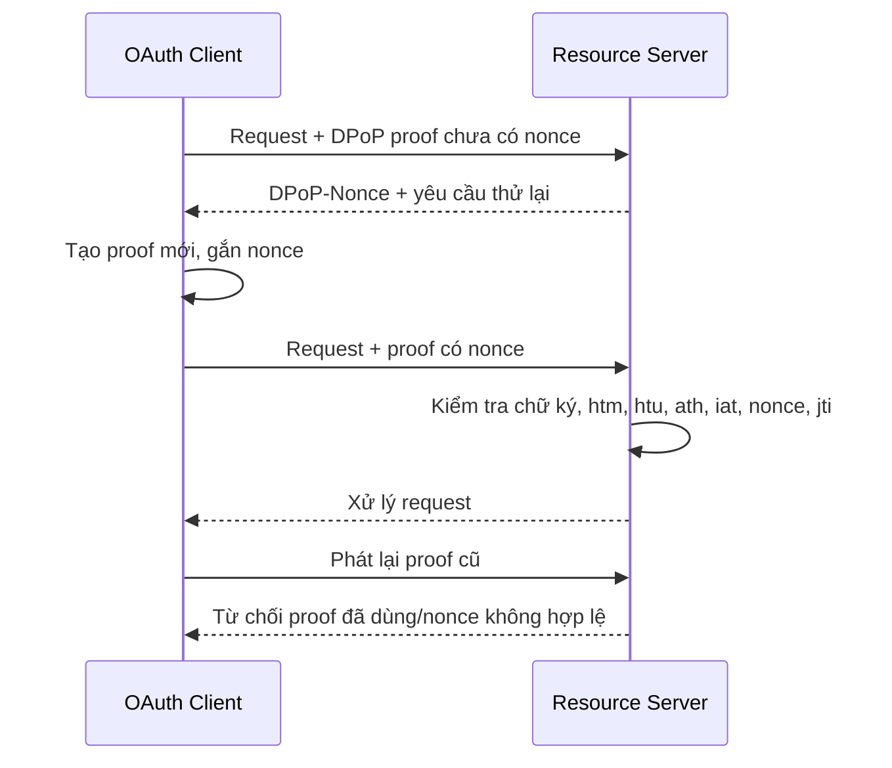
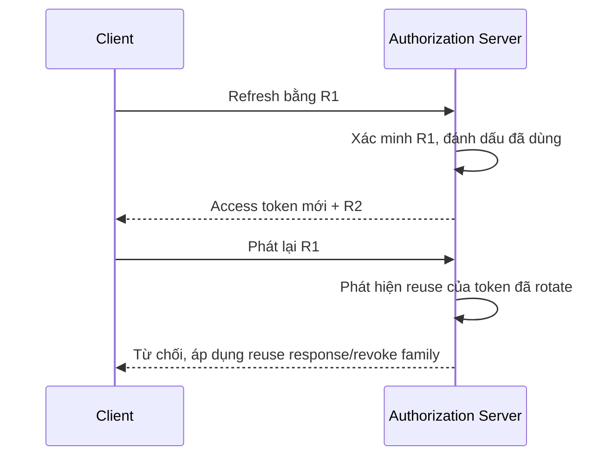

# Test replay

## 1. Replay attack trong bảo mật token là gì?

**Replay attack** (tấn công phát lại) xảy ra khi kẻ tấn công thu thập một thông điệp, bằng chứng xác thực hoặc request hợp lệ rồi gửi lại để thực hiện hành động lần nữa. Trong hệ thống OAuth 2.0/OIDC, dữ liệu bị phát lại có thể là access token, refresh token, DPoP proof, signed request hoặc request nghiệp vụ đã được gửi trước đó.

Ví dụ: `payment-api` nhận yêu cầu thu tiền cho đơn hàng `order-901`. Một request hợp lệ bị sao chép từ log hoặc từ thiết bị bị xâm nhập. Kẻ tấn công gửi lại request nhiều lần nhằm tạo giao dịch trùng hoặc sử dụng quyền trong token bị đánh cắp.

Cần phân biệt ba hiện tượng:

- **Token reuse hợp lệ:** một bearer access token được dùng cho nhiều request trong thời gian hiệu lực, đúng audience và scope. Đây là hành vi bình thường của Bearer token; bản thân việc dùng lại token không chứng minh có tấn công.
- **Replay attack:** kẻ tấn công phát lại token, proof hoặc request đã thu thập được trong ngữ cảnh không được phép, hoặc để lặp lại một tác động ngoài ý muốn.
- **Retry hợp lệ:** client gửi lại request do timeout hoặc lỗi mạng và không biết server đã xử lý lần đầu hay chưa. Retry cần được thiết kế để tránh tạo tác động nghiệp vụ trùng lặp.

Kiểm thử replay phải trả lời: **đối tượng nào được phép dùng lại, dùng lại trong khoảng thời gian nào, bằng chứng nào phải dùng một lần, và tác động nghiệp vụ có được thực hiện trùng hay không?**

## 2. Những dạng replay cần kiểm thử

| Dạng replay | Ví dụ | Kiểm soát cần đánh giá |
|---|---|---|
| Bearer access token bị đánh cắp | Token bị lấy từ log được dùng từ một máy khác | HTTPS, bảo vệ token, TTL ngắn, audience/scope hẹp, sender-constrained token |
| DPoP proof bị phát lại | Cùng một proof JWT được gửi hai lần | Kiểm tra `jti`, thời gian, nonce và lưu dấu proof đã dùng |
| mTLS-bound token dùng sai certificate | Token gắn với cert A nhưng request trình cert B | So khớp certificate thumbprint với claim `cnf` |
| Refresh token bị phát lại | Refresh token đã được rotate vẫn bị gửi lại | Rotation, phát hiện reuse và thu hồi token family |
| Request nghiệp vụ bị phát lại | Gửi lại `POST /payments` đã thành công | Idempotency key, transaction state và deduplication |
| Message/event bị phát lại | Consumer nhận cùng event nhiều lần | Event ID, inbox/deduplication store và xử lý idempotent |
| Replay giữa các API | Token dành cho API A bị dùng tại API B | Audience validation ở từng Resource Server |
| Replay giữa môi trường | Token staging bị gửi vào production | Tách issuer, audience, client và trust policy |

Không phải mọi loại token đều có cơ chế chống replay giống nhau. Access token thường có thể được tái sử dụng đến khi hết hạn; DPoP proof được thiết kế để ràng buộc một request; refresh token rotation có thể phát hiện việc dùng lại token đã tiêu thụ; còn request nghiệp vụ cần cơ chế chống thực hiện trùng ở tầng ứng dụng.

## 3. Kiểm thử Bearer access token

### Bearer token có thể được dùng lại

Với Bearer scheme, người nắm giữ token có thể trình token để truy cập resource được cấp quyền. Một access token hợp lệ thường được dùng cho nhiều request cho đến khi hết hạn hoặc bị thu hồi. Vì vậy, trong môi trường kiểm thử:

1. Cấp access token thử nghiệm có audience và scope đúng.
2. Gửi một request hợp lệ tới Resource Server.
3. Gửi request thứ hai với cùng token, cùng quyền và cùng resource.
4. Xác nhận API xử lý theo chính sách bình thường; không coi mọi lần sử dụng lặp lại là lỗi.
5. Ghi nhận rủi ro bearer: nếu token bị đánh cắp, người khác có thể sử dụng nó trong thời gian còn hiệu lực.

Bài kiểm thử này giúp xác nhận đúng đặc tính của Bearer token. Nó **không chứng minh hệ thống chống replay**. Muốn hạn chế người khác sử dụng token bị đánh cắp, cần thêm biện pháp như DPoP hoặc certificate-bound access token, cùng bảo vệ token và giảm thời gian sống.

### Negative tests cho bearer token

| Trường hợp | Kết quả mong đợi | Mục tiêu |
|---|---|---|
| Token hợp lệ, đúng issuer/audience/scope, chưa hết hạn | Cho phép theo policy | Baseline |
| Token hết hạn | 401 | Chặn token quá hạn |
| Token sai chữ ký hoặc issuer | 401 | Chặn token giả/không tin cậy |
| Token có audience của API khác | 401 | Chặn token substitution |
| Token thiếu scope | 403 | Chặn hành động ngoài quyền |
| Token đã bị thu hồi và RS có cơ chế kiểm tra trạng thái | 401 | Xác nhận revocation có hiệu lực theo SLA |
| Token bị lộ nhưng vẫn hợp lệ và là bearer | Có thể vẫn được chấp nhận nếu không có sender binding | Xác nhận rủi ro cần kiểm soát bổ sung |
| Token bị đưa vào query string | Từ chối theo chính sách/API gateway và không ghi log token | Ngăn rò token qua URL |

Không nên viết test khẳng định một bearer token bị từ chối chỉ vì nó đã được dùng trước đó, trừ khi hệ thống có hợp đồng one-time token riêng. Nếu muốn một token chỉ dùng một lần, phải có cơ chế server-side tiêu thụ token nguyên tử và xác định rõ trường hợp retry.

## 4. Kiểm thử DPoP proof replay

**DPoP (Demonstrating Proof of Possession)** theo RFC 9449 là cơ chế sender-constraining cho OAuth 2.0. Client tạo một proof JWT được ký bằng private key của nó cho từng HTTP request. Resource Server xác minh proof và kiểm tra nó ràng buộc với request, access token và public key tương ứng.

Các thành phần thường cần kiểm tra trong DPoP proof:

| Thành phần | Vai trò |
|---|---|
| `jti` | Định danh duy nhất của proof; dùng để phát hiện proof đã được sử dụng |
| `htm` | HTTP method mà proof ràng buộc |
| `htu` | HTTP URI mà proof ràng buộc |
| `iat` | Thời điểm proof được tạo |
| `ath` | Hash của access token được trình trong request, khi dùng DPoP với access token |
| `nonce` | Server-provided nonce nếu server yêu cầu |
| `cnf.jkt` | Thumbprint public key gắn với access token trong mô hình DPoP-bound |

Proof phải được kiểm tra chữ ký và thuật toán theo quy tắc DPoP; public key được lấy từ header proof theo cấu trúc được chuẩn cho phép. Resource Server cần kiểm tra proof gắn với access token bằng `ath`, kiểm tra `htm`/`htu`, thời gian và nonce nếu áp dụng, rồi kiểm tra `jti` chưa được chấp nhận trước đó trong cửa sổ chống replay.

### Test cùng proof được gửi hai lần

Giả sử client tạo proof cho request `POST https://payment.example/payments/authorize`, với `jti=proof-001`.

```http
POST /payments/authorize HTTP/1.1
Host: payment.example
Authorization: DPoP <access-token-bound-to-key>
DPoP: <proof-jwt-with-jti-proof-001>
Content-Type: application/json

{ "orderId": "order-901", "amount": 100000, "currency": "VND" }
```

Quy trình test:

1. Gửi request với proof hợp lệ lần đầu.
2. Xác nhận proof được chấp nhận và kết quả nghiệp vụ được trả về.
3. Gửi lại đúng request, cùng access token và **cùng proof JWT**.
4. Xác nhận Resource Server từ chối proof đã dùng theo chính sách replay detection.
5. Tạo proof mới, có `jti` mới, `iat` hợp lệ và chữ ký đúng; gửi lại request.
6. Xác nhận proof mới có thể vượt qua bước chống replay, sau đó kết quả nghiệp vụ phụ thuộc idempotency của endpoint.

Một phản hồi lỗi thường là `400` với OAuth/DPoP error phù hợp như `invalid_dpop_proof`; mã và body cụ thể cần theo cách triển khai. Không chỉ kiểm tra HTTP status, hãy xác minh request bị chặn trước khi tác động nghiệp vụ lần thứ hai.

### Các biến thể DPoP negative test

| Test case | Thay đổi | Kết quả mong đợi |
|---|---|---|
| Duplicate proof | Dùng lại cùng `jti`/proof | Từ chối |
| Wrong method | Proof có `htm=GET`, request là `POST` | Từ chối |
| Wrong URI | `htu` không khớp URI request theo quy tắc chuẩn hóa | Từ chối |
| Stale proof | `iat` ngoài cửa sổ thời gian cho phép | Từ chối |
| Future proof | `iat` vượt quá clock skew cho phép | Từ chối |
| Wrong access-token hash | `ath` không khớp token được gửi | Từ chối |
| Wrong key | Proof ký bằng key không khớp key binding của token | Từ chối |
| Invalid signature | Proof bị sửa sau khi ký | Từ chối |
| Missing required nonce | Server yêu cầu nonce nhưng proof không có nonce phù hợp | Từ chối và có thể yêu cầu client thử lại với nonce |
| Reused nonce | Dùng nonce đã tiêu thụ khi policy yêu cầu nonce một lần | Từ chối |
| Wrong proof type/algorithm | `typ` hoặc thuật toán không đáp ứng DPoP policy | Từ chối |

DPoP proof thường có thời hạn chấp nhận ngắn; chính sách clock skew và cửa sổ `iat` cần được cấu hình rõ ràng. Server phải lưu `jti` đã chấp nhận trong khoảng thời gian đủ dài để ngăn proof cũ được gửi lại trong cửa sổ còn hợp lệ. Khóa chống replay nên được phân vùng theo public key hoặc thumbprint phù hợp, không chỉ theo client IP.

### Replay trên nhiều instance

Một lỗi triển khai thường gặp là mỗi instance API có replay cache riêng:

- Request đầu tiên đến instance A, `jti` được lưu ở cache A.
- Request phát lại đến instance B, cache B chưa có `jti`.
- Instance B chấp nhận proof trùng.

Kiểm thử phải gửi cùng proof đồng thời hoặc liên tiếp tới nhiều instance sau load balancer. Hệ thống cần cơ chế chia sẻ trạng thái chống replay hoặc một thiết kế tương đương bảo đảm cùng proof không được chấp nhận hai lần trên toàn cụm.

Thao tác kiểm tra và đánh dấu `jti` phải **nguyên tử**. Nếu hai request đồng thời cùng kiểm tra “chưa tồn tại” rồi cùng ghi, cả hai có thể được chấp nhận. Dùng primitive như insert-if-absent/SET NX với TTL, unique constraint hoặc cơ chế atomic tương đương. TTL của replay entry phải bao phủ cửa sổ proof còn có thể được chấp nhận cộng clock skew.

## 5. Kiểm thử DPoP nonce

Nonce cho phép Resource Server yêu cầu client chứng minh freshness theo challenge do server cấp. Luồng tổng quát:



Các test quan trọng:

- Client nhận nonce từ đúng Resource Server và gắn nonce vào proof mới.
- Nonce sai hoặc do nguồn không tin cậy cấp bị từ chối.
- Nonce cũ/hết hạn bị từ chối theo policy.
- Proof đã dùng không được chấp nhận lại chỉ vì nonce vẫn còn thời hạn.
- Khi server trả nonce mới, client tạo proof mới; không sửa payload của proof đã ký.
- Nhiều instance có cùng quy tắc nonce và chống replay.

Nonce là cơ chế freshness bổ sung. Nó không thay thế kiểm tra chữ ký, `jti`, `htm`, `htu`, `ath` hay token binding.

## 6. Kiểm thử mTLS-bound access token

Với OAuth 2.0 Mutual-TLS (RFC 8705), access token có thể được ràng buộc với certificate của client. Resource Server kiểm tra certificate thực tế trong TLS connection có khớp thumbprint được token tham chiếu, thường thông qua claim `cnf` và `x5t#S256`.

Các test:

1. Cấp token gắn với certificate A.
2. Gửi request qua TLS bằng certificate A; xác nhận được chấp nhận nếu các điều kiện khác đúng.
3. Gửi cùng token bằng certificate B; xác nhận từ chối.
4. Gửi token tới endpoint không yêu cầu/không thiết lập client certificate; xác nhận fail theo policy.
5. Thay certificate giữa các kết nối hoặc sau khi rotate cert; xác nhận token cũ chỉ hoạt động với certificate được bind.
6. Kiểm tra proxy/load balancer truyền danh tính certificate đến ứng dụng bằng một kênh nội bộ được bảo vệ và không cho client giả mạo header certificate.

**mTLS-bound token không phải one-time token.** Client sở hữu private key của certificate vẫn có thể gửi nhiều request hợp lệ với cùng token trong thời gian hiệu lực. mTLS hạn chế người đánh cắp riêng chuỗi token nhưng không tự ngăn cùng một client hợp lệ phát lại request nghiệp vụ hoặc kẻ tấn công đã chiếm được workload và private key. Vì vậy vẫn cần kiểm soát quyền, TTL, audit và idempotency.

## 7. Kiểm thử refresh token rotation và reuse detection

Refresh token có giá trị cao vì có thể dùng để xin access token mới. Khi AS áp dụng **refresh token rotation**, mỗi lần refresh thành công sẽ phát hành refresh token mới và làm token cũ mất hiệu lực.

Luồng bình thường:

1. Client có refresh token `R1`.
2. Client gửi `R1` tới token endpoint.
3. AS phát access token mới và refresh token `R2`.
4. `R1` bị đánh dấu đã tiêu thụ.
5. Client lưu an toàn `R2` và loại bỏ `R1`.

Nếu `R1` được sử dụng lại sau khi đã rotate, AS có thể phát hiện reuse và coi đây là dấu hiệu refresh token bị đánh cắp. Với cơ chế rotation có token family, AS thường thu hồi family liên quan theo chính sách để kẻ tấn công không tiếp tục dùng token con.



### Test matrix cho refresh token

| Test case | Thao tác | Kết quả mong đợi |
|---|---|---|
| Normal rotation | Dùng R1 lần đầu | Cấp access token và R2; R1 hết hiệu lực |
| Reuse old token | Dùng lại R1 | Phát hiện reuse, từ chối và xử lý token family theo policy |
| Use current token | Dùng R2 | Thành công nếu session/grant còn hiệu lực |
| Expired refresh token | Dùng token hết hạn | Từ chối |
| Revoked refresh token | Dùng token đã thu hồi | Từ chối |
| Client mismatch | Dùng refresh token với client khác khi token bị ràng buộc client | Từ chối |
| Concurrent refresh | Hai request cùng dùng R1 gần như đồng thời | Chỉ một rotation được chấp nhận theo thiết kế; kết quả còn lại phải được xử lý an toàn |
| Lost response | AS rotate R1 nhưng response bị mất; client thử lại R1 | Kiểm tra recovery/reuse policy; không vô tình mở rộng cửa sổ replay |
| Family revocation | Reuse R1 sau khi đã có R2/R3 | Kiểm tra các token thuộc family bị vô hiệu theo policy |

Một điểm cần chú ý là **race condition khi refresh đồng thời**. Hai tab hoặc hai tiến trình có thể cùng gửi R1. Nếu AS coi request thứ hai là reuse độc hại thì có thể thu hồi cả session hợp lệ. Client nên điều phối refresh bằng single-flight/lock và chỉ một thành phần chịu trách nhiệm rotation. AS cần có semantics rõ ràng cho concurrency và lost response; không nên tùy tiện chấp nhận lại refresh token cũ trong thời gian dài vì sẽ làm suy yếu replay detection.

## 8. Kiểm thử replay ở tầng nghiệp vụ và idempotency

Token replay và request replay là hai lớp khác nhau. DPoP có thể chặn một proof bị phát lại, nhưng client hợp lệ vẫn có thể tạo proof mới cho cùng một lệnh thanh toán. Vì vậy endpoint có tác động không lặp lại được cần cơ chế **idempotency**.

Ví dụ request:

```http
POST /payments HTTP/1.1
Authorization: DPoP <access-token>
DPoP: <fresh-proof>
Idempotency-Key: pay-order-901-attempt-1
Content-Type: application/json

{ "orderId": "order-901", "amount": 100000, "currency": "VND" }
```

Server lưu idempotency key trong phạm vi tenant/client/operation thích hợp và liên kết nó với fingerprint của request. Khi nhận lại cùng key và cùng nội dung, server trả lại kết quả đã lưu thay vì tạo khoản thanh toán mới. Nếu cùng key nhưng payload khác, server từ chối theo hợp đồng API.

Test cases:

- Gửi hai request giống nhau, cùng idempotency key: chỉ tạo một tác động nghiệp vụ.
- Gửi cùng key nhưng amount hoặc order ID khác: từ chối xung đột.
- Gửi hai request đồng thời với cùng key: chỉ một transaction thực hiện side effect.
- Gửi lại request với key mới: đây là yêu cầu mới; nghiệp vụ vẫn phải kiểm tra trạng thái để tránh thanh toán trùng.
- Mất response sau khi commit, client retry: server trả lại kết quả đã lưu.
- Key hết thời gian lưu: hành vi retry phải được định nghĩa theo vòng đời giao dịch và chính sách sản phẩm.

Idempotency key không phải credential và không chứng minh danh tính. Phải xác thực token và phân quyền trước khi truy cập kết quả idempotency; key cần được scope theo tenant và actor/client để người tenant khác không lấy được response.

## 9. Replay ở message queue và tác vụ nền

Một số luồng token security được kích hoạt bởi event: webhook, queue message, scheduled job hoặc event bus. Consumer có thể nhận lại một message do broker retry, consumer restart hoặc attacker gửi message đã thu thập được.

Kiểm soát nên có:

- Event ID duy nhất và lưu dấu đã xử lý.
- Xác minh chữ ký/message authentication và nguồn phát nếu message đi qua trust boundary.
- Ràng buộc tenant, subject/actor, resource và quyền khi consumer thực hiện hành động.
- Deduplication store có TTL theo thời gian broker có thể phát lại.
- Transactional inbox/outbox hoặc cơ chế atomic giữa lưu dấu event và side effect.
- Dead-letter queue, retry policy và audit để phân biệt lỗi tạm thời với replay.

Không chỉ dựa vào timestamp của message. Clock skew, delayed delivery và retry hợp lệ có thể làm timestamp cũ; timestamp phải kết hợp event ID, signature và policy freshness.

## 10. Xây dựng bộ kiểm thử replay

### Test fixtures

Tạo fixture chỉ dành cho môi trường kiểm thử:

- Một Authorization Server sandbox hoặc mock theo contract rõ ràng.
- Hai Resource Server test với audience khác nhau.
- Client có key pair DPoP riêng; certificate mTLS test riêng.
- Access token và refresh token giả lập, TTL ngắn để kiểm tra expiry/rotation.
- Replay cache dùng chung nhiều instance hoặc test adapter có thể mô phỏng race.
- Đồng hồ có thể điều khiển (*clock abstraction*) để test `iat`, `exp`, nonce và clock skew.
- Database/test store để kiểm tra side effect và idempotency.

Không dùng access token, refresh token, private key hoặc certificate production trong test. Không hard-code token thật vào fixture, screenshot hoặc log.

### Cấu trúc test theo lớp

| Lớp kiểm thử | Phạm vi | Điều cần chứng minh |
|---|---|---|
| Unit test | Validator, replay cache, nonce validator, token family state | Quy tắc nhỏ hoạt động đúng |
| Integration test | Authorization Server ↔ Resource Server | Token/proof được kiểm tra theo contract |
| Multi-instance test | Nhiều API instance và shared cache | Không chấp nhận cùng proof hai lần trên cluster |
| Concurrency test | Request đồng thời cùng `jti`, refresh token hoặc idempotency key | Check-and-set là atomic |
| End-to-end test | Client → gateway → API → database/queue | Không tạo side effect ngoài ý muốn |
| Security regression | Các case sai issuer/audience/signature/expiry/replay | Lỗi đã sửa không tái xuất hiện |

### Ví dụ pseudo-test DPoP

```text
given:
  token = valid_dpop_bound_access_token(public_key = K)
  proof = signed_dpop_proof(
      key = K,
      jti = "proof-001",
      htm = "POST",
      htu = "https://payment.example/payments/authorize",
      ath = hash(token),
      iat = fixed_test_time
  )

when:
  first = send_request(token, proof)
  second = send_request(token, proof)

then:
  first.authentication_is_accepted == true
  second.error == "invalid_dpop_proof"
  payment_side_effect_count == 1
```

Đây là pseudo-test mô tả hành vi mong đợi, không phải cú pháp của một framework cụ thể. Test tiếp theo cần tạo proof mới với `jti` mới để xác nhận request mới được xác thực; sau đó dùng cùng idempotency key để xác nhận side effect vẫn chỉ xảy ra một lần nếu đó là cùng một giao dịch.

### Kiểm tra nguyên tử và phân tán

Với replay cache, cần test race chứ không chỉ test tuần tự:

```text
parallel_requests = N requests with identical (key_thumbprint, proof_jti)

accepted_count = submit_to_multiple_api_instances(parallel_requests)

assert accepted_count == 1
assert replay_store_contains(key_thumbprint, proof_jti)
assert business_side_effect_count <= 1
```

`accepted_count` chỉ bằng một nếu mọi request đều dùng cùng một proof và chính sách yêu cầu mỗi proof chỉ được chấp nhận một lần. Hệ thống có thể trả lỗi khác nhau cho các request thua race; điều quan trọng là không có nhiều instance cùng chấp nhận proof.

Kiểm tra thêm khi replay store không khả dụng. Với endpoint yêu cầu chống replay, nếu không thể xác minh trạng thái chống replay thì không được âm thầm bỏ qua kiểm tra và cho request đi qua. Thiết kế cần timeout, fail-closed, circuit breaker và cảnh báo vận hành; cân nhắc tác động availability trước khi chọn cách xử lý.

## 11. Quan sát, log và xử lý lỗi

Log replay detection nên đủ để điều tra nhưng không tiết lộ credential:

| Nên ghi | Không nên ghi |
|---|---|
| Request/correlation ID | Raw access token |
| Issuer/client/subject identifier đã chuẩn hóa | Raw refresh token |
| Audience và scope cần thiết | DPoP proof đầy đủ nếu chứa thông tin nhạy cảm |
| Key thumbprint hoặc certificate fingerprint theo policy | Private key/certificate private material |
| Proof `jti` hoặc hash định danh đã xử lý | Authorization header nguyên vẹn |
| Lý do từ chối: duplicate proof, stale proof, nonce mismatch | Payload chứa secret hoặc PII không cần thiết |
| Kết quả policy và số side effect | Nội dung body nhạy cảm ngoài mục đích audit |

Cần phân biệt lỗi xác thực và lỗi nghiệp vụ:

- `401 Unauthorized`: token/proof thiếu, sai, hết hạn, bị thu hồi hoặc không chứng minh được sender binding.
- `403 Forbidden`: token đã xác thực nhưng không có quyền thực hiện hành động.
- `400 Bad Request` hoặc lỗi DPoP cụ thể: proof không hợp lệ theo giao thức, tùy implementation.
- `409 Conflict`: có thể phù hợp khi idempotency key bị dùng với payload khác, tùy API contract.

Không tiết lộ chi tiết cho attacker biết cách vượt kiểm tra. Tuy nhiên, log nội bộ phải giữ lý do đủ cụ thể để vận hành và điều tra.

## 12. Lỗi thường gặp khi test replay

| Lỗi | Vì sao không đúng | Cách khắc phục |
|---|---|---|
| Coi mọi lần dùng lại bearer token là tấn công | Bearer access token vốn được dùng cho nhiều request | Phân biệt token reuse hợp lệ và proof/request replay |
| Chỉ test duplicate request trên một instance | Không phát hiện replay cache phân tán bị lệch | Test qua load balancer và nhiều instance |
| Replay cache check rồi insert riêng rẽ | Race có thể cho hai request cùng qua | Dùng thao tác atomic |
| TTL replay entry ngắn hơn cửa sổ chấp nhận proof | Proof cũ có thể được replay sau khi entry hết hạn | TTL bao phủ freshness window và clock skew |
| Chỉ kiểm tra `jti`, bỏ qua `htm`/`htu`/`ath` | Proof có thể bị dùng cho request khác hoặc token khác | Kiểm tra đầy đủ ràng buộc DPoP |
| Coi mTLS là one-time protection | Client có certificate vẫn có thể gửi nhiều request | Kết hợp idempotency và policy nghiệp vụ |
| Refresh rotation không phát hiện reuse | Kẻ lấy token cũ có thể tiếp tục refresh | Quản lý token family và reuse detection |
| Không test concurrent refresh | Race có thể gây mất session hoặc false positive | Single-flight phía client, semantics rõ ở AS |
| Chỉ test token validator, không đếm side effect | Request bị từ chối nhưng side effect đã chạy trước đó | Assert database/event/payment effect |
| Log token để debug replay | Tạo thêm nguồn rò credential | Log metadata và fingerprint an toàn |
| Bỏ kiểm tra khi replay store lỗi | Attacker có thể khai thác lúc hệ thống suy giảm | Fail-closed cho endpoint cần replay protection |

## 13. Ma trận kiểm thử tổng hợp

| Nhóm | Case bắt buộc | Kết quả mong đợi |
|---|---|---|
| Bearer | Token đúng issuer/audience/scope | Cho phép theo policy |
| Bearer | Token sai audience, expired, revoked | Từ chối |
| DPoP | Proof hợp lệ lần đầu | Chấp nhận |
| DPoP | Cùng proof/`jti` phát lại | Từ chối |
| DPoP | Sai `htm`, `htu`, `ath`, key hoặc signature | Từ chối |
| DPoP | Proof stale/future hoặc nonce sai | Từ chối |
| DPoP cluster | Cùng proof tới hai instance | Chỉ một lần được chấp nhận |
| mTLS | Token và cert đúng cặp | Chấp nhận theo policy |
| mTLS | Token gắn cert A nhưng trình cert B | Từ chối |
| Refresh | Refresh token cũ được dùng lần đầu | Rotate thành công |
| Refresh | Token cũ được dùng lại sau rotate | Phát hiện reuse và áp policy |
| Refresh concurrency | Hai request đồng thời dùng cùng token | Không tạo hai nhánh token hợp lệ ngoài thiết kế |
| Business request | Cùng idempotency key, cùng payload | Một side effect, trả kết quả nhất quán |
| Business request | Cùng key, payload khác | Từ chối conflict |
| Queue/event | Cùng event ID được gửi lại | Consumer không lặp side effect |
| Failure mode | Replay store không sẵn sàng | Không bypass kiểm tra; xử lý theo fail policy |

## 14. Checklist triển khai

- Xác định rõ token, proof, request hay event nào cần chống replay.
- Không nhầm việc tái sử dụng bearer access token hợp lệ với replay attack.
- Access token có issuer, audience, scope và TTL phù hợp; token được bảo vệ khỏi log/URL.
- DPoP kiểm tra chữ ký, key binding, `jti`, `htm`, `htu`, `ath`, `iat` và nonce khi yêu cầu.
- Replay cache dùng thao tác atomic, chia sẻ trạng thái giữa instance và có TTL phù hợp.
- mTLS-bound token được kiểm tra đúng certificate; không coi mTLS là cơ chế one-time.
- Refresh token rotation phát hiện reuse và quản lý token family.
- Client điều phối refresh đồng thời và xử lý lost response theo contract.
- Endpoint có side effect dùng idempotency/deduplication theo tenant và actor.
- Message consumer kiểm tra event ID, nguồn phát và tenant context.
- Có test concurrency, multi-instance, clock skew, cache outage và revocation.
- Log đủ metadata để điều tra, tuyệt đối không ghi raw token hoặc private key.
- Có cảnh báo khi phát hiện replay, refresh token reuse hoặc tỷ lệ proof bị từ chối tăng bất thường.

## Tài liệu chuẩn để tra cứu

- [RFC 6750 — OAuth 2.0 Bearer Token Usage](https://www.rfc-editor.org/rfc/rfc6750): đặc tính và rủi ro của bearer token.
- [RFC 9449 — OAuth 2.0 Demonstrating Proof of Possession (DPoP)](https://www.rfc-editor.org/rfc/rfc9449): proof theo request, nonce và sender-constrained access token.
- [RFC 8705 — OAuth 2.0 Mutual-TLS Client Authentication and Certificate-Bound Access Tokens](https://www.rfc-editor.org/rfc/rfc8705): certificate-bound token.
- [RFC 9700 — Best Current Practice for OAuth 2.0 Security](https://www.rfc-editor.org/rfc/rfc9700): khuyến nghị bảo vệ refresh token và phát hiện reuse.
- [RFC 6749 — The OAuth 2.0 Authorization Framework](https://www.rfc-editor.org/rfc/rfc6749): access token, refresh token và grant.
- [RFC 7009 — OAuth 2.0 Token Revocation](https://www.rfc-editor.org/rfc/rfc7009): thu hồi token.
- [RFC 7662 — OAuth 2.0 Token Introspection](https://www.rfc-editor.org/rfc/rfc7662): kiểm tra trạng thái token.
- [OWASP Web Security Testing Guide](https://owasp.org/www-project-web-security-testing-guide/): phương pháp kiểm thử xác thực, session và kiểm soát truy cập.

**Ghi nhớ:** Replay protection phải được kiểm tra ở đúng lớp. Bearer token có thể được tái sử dụng hợp lệ; DPoP proof cần chống dùng lại; mTLS ràng buộc token với certificate; refresh rotation phát hiện token cũ bị dùng lại; còn side effect nghiệp vụ cần idempotency và deduplication. Một bài test chỉ thực sự đạt khi vừa xác minh kết quả xác thực vừa kiểm tra số lần tác động dữ liệu/hệ thống.
