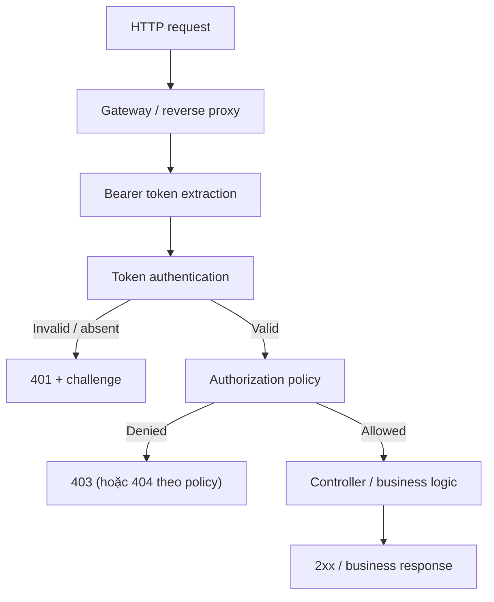

# Test 401 và 403 trong bảo mật token

## 1. Mục tiêu: phân biệt xác thực thất bại và phân quyền bị từ chối

Trong API sử dụng OAuth 2.0/OIDC, **401 Unauthorized** và **403 Forbidden** là hai kết quả bảo mật khác nhau. Kiểm thử đúng hai trạng thái này giúp xác nhận hệ thống đang phân biệt được:

- **Authentication (xác thực):** request có chứng minh được danh tính bằng credential hợp lệ hay không?
- **Authorization (phân quyền):** principal đã xác thực có được phép thực hiện hành động trên endpoint hoặc tài nguyên cụ thể hay không?

Quy tắc thực hành phổ biến:

- **401:** thiếu thông tin xác thực hoặc thông tin xác thực không được chấp nhận (token thiếu, sai chữ ký, hết hạn, sai issuer/audience theo policy, bị thu hồi hoặc sai loại).
- **403:** danh tính đã được xác thực nhưng không đủ quyền (thiếu scope/authority, sai tenant, không có quyền trên đối tượng hoặc policy từ chối).

Ví dụ một API quản lý đơn hàng:

| Request | Kết quả thường mong đợi | Lý do |
|---|---|---|
| Không có Bearer token | 401 | Chưa có credential |
| Token sai chữ ký hoặc hết hạn | 401 | Credential không hợp lệ |
| Token hợp lệ nhưng thiếu `orders:read` | 403 | Đã xác thực, thiếu quyền |
| Token có `orders:read` nhưng Alice không sở hữu đơn hàng 42 | 403 hoặc 404 theo chính sách chống dò tài nguyên | Không có quyền trên đối tượng |
| Token hợp lệ cho `inventory-api` được gửi tới `orders-api` | 401 | Audience không dành cho API này |
| Token hợp lệ, đủ scope và đúng tenant | 2xx nếu nghiệp vụ thành công | Đủ điều kiện xác thực và phân quyền |

Không nên quyết định test chỉ dựa vào tên status. Cần kiểm tra **body, WWW-Authenticate, side effect, log an toàn và hành vi của downstream** theo hợp đồng API.

## 2. Ngữ nghĩa HTTP và OAuth Bearer challenge

HTTP định nghĩa 401 là request chưa được áp dụng vì thiếu thông tin xác thực hợp lệ cho resource; response 401 phải có ít nhất một challenge `WWW-Authenticate`. 403 biểu thị server hiểu request nhưng từ chối thực hiện. OAuth Bearer Token Usage (RFC 6750) mô tả cách dùng Bearer token và error response.

Ví dụ challenge khi không có credential:

```http
HTTP/1.1 401 Unauthorized
WWW-Authenticate: Bearer realm="orders"
Content-Type: application/json

{"error":"unauthorized"}
```

Ví dụ token không hợp lệ:

```http
HTTP/1.1 401 Unauthorized
WWW-Authenticate: Bearer realm="orders", error="invalid_token"
Content-Type: application/json

{"error":"invalid_token"}
```

Ví dụ token hợp lệ nhưng không đủ scope:

```http
HTTP/1.1 403 Forbidden
WWW-Authenticate: Bearer error="insufficient_scope", scope="orders:write"
Content-Type: application/json

{"error":"forbidden"}
```

RFC 6750 định nghĩa các lỗi Bearer như `invalid_request`, `invalid_token` và `insufficient_scope`. Server có thể chọn body/format lỗi theo API contract, nhưng không nên tiết lộ chi tiết nhạy cảm như token nào sai, key nội bộ, stack trace hoặc chính sách admin. Không phải mọi 403 đều bắt buộc phải có `error="insufficient_scope"`; một số quyết định authorization là tenant/object policy và có thể được biểu diễn theo hợp đồng khác.

**Lưu ý:** 401 không có nghĩa “người dùng chưa đăng nhập vào giao diện” trong mọi tình huống. Nó là kết quả HTTP của resource request. Với API machine-to-machine, client có thể không có UI login nhưng vẫn phải gửi access token hoặc credential theo cơ chế được cấu hình.

## 3. Xác định lớp nào chịu trách nhiệm trả 401/403

Một request thường đi qua nhiều lớp:



| Lớp | Có thể tạo 401/403 khi | Điều cần test |
|---|---|---|
| API Gateway | Không có token, token không hợp lệ, route policy từ chối | Gateway không bỏ qua authentication; header được chuyển đúng |
| Authentication filter/resource server | JWT/opaque token không xác minh được | Signature, issuer, audience, expiry, token type |
| Method/URL authorization | Principal thiếu authority/scope | Mapping scope/role và rule đúng |
| Tenant authorization | Tenant trong token khác tenant request | Không truy cập chéo tenant |
| Domain service/repository | Không có quyền với đơn hàng/tài khoản cụ thể | Object-level authorization |
| Exception handler | Chuẩn hóa access denied/authentication exception | Không biến 401 thành 403 hoặc ngược lại ngoài contract |

Một lỗi hay gặp là test chỉ kiểm tra controller, trong khi Security Filter Chain chặn request trước khi controller chạy. Ngược lại, unit test service gọi trực tiếp có thể bỏ qua toàn bộ HTTP authentication. Cần phân lớp test và có ít nhất một số **integration tests đi qua filter chain thực**.

## 4. Ma trận kiểm thử authentication

Dùng access token thử nghiệm, không dùng token production. Với JWT, tạo token có chữ ký bằng test key; với opaque token, dùng mock introspection endpoint hoặc test authorization server.

| Trường hợp | Setup | Kết quả mong đợi |
|---|---|---|
| Không có Authorization header | Không gửi credential | 401; có Bearer challenge theo contract |
| Header sai scheme | Gửi `Basic` trong API chỉ chấp nhận Bearer | 401 |
| Bearer rỗng / cú pháp lỗi | `Authorization: Bearer` hoặc malformed | 400/401 theo RFC và contract; không xử lý như principal hợp lệ |
| Token ngẫu nhiên | `Bearer abc.invalid.token` | 401 |
| JWT signature sai | Sửa payload/signature sau khi ký | 401 |
| JWT hết hạn | `exp` nằm trong quá khứ ngoài clock skew | 401 |
| JWT chưa có hiệu lực | `nbf` trong tương lai ngoài clock skew | 401 |
| Issuer sai | `iss` không thuộc allowlist | 401 |
| Audience sai | `aud` không chứa API hiện tại | 401 |
| Algorithm không cho phép | `alg=none` hoặc thuật toán ngoài allowlist | 401 |
| Key ID không tồn tại | `kid` không có trong trusted JWKS | 401; refresh JWKS có kiểm soát nếu contract cho phép |
| Token type sai | ID token hoặc refresh token được gửi như access token | 401 |
| Token bị thu hồi | Introspection inactive hoặc revocation policy phát hiện | 401 |
| Opaque token inactive | Introspection trả `active=false` | 401 |
| Token hợp lệ | Claims và trạng thái đúng | Qua authentication, chuyển sang authorization |

Đối với JWT, test nên xác minh đầy đủ **signature + algorithm + issuer + audience + exp/nbf + token profile**. Decode payload thành công không phải xác thực. Đối với opaque token, không thử parse chuỗi token như JWT; kiểm tra phản hồi introspection và hành vi cache/revocation theo hợp đồng.

## 5. Ma trận kiểm thử authorization

Authentication thành công mới chỉ xác định principal. Các test authorization cần xác minh quyền theo endpoint, tenant và tài nguyên.

| Trường hợp | Token/principal | Kết quả mong đợi |
|---|---|---|
| Thiếu scope đọc | Token không có `orders:read` gọi GET | 403 |
| Thiếu scope ghi | Token có `orders:read` gọi POST | 403 |
| Có scope phù hợp | Token có `orders:read` gọi GET | Qua authorization |
| Sai role/authority | Principal không có `ROLE_ADMIN` gọi admin endpoint | 403 |
| Tenant mismatch | Token `tid=acme` truy cập tài nguyên tenant northwind | 403 hoặc 404 theo policy |
| Object ownership mismatch | Alice đọc order thuộc Bob | 403 hoặc 404 theo contract |
| Service identity không được phép | `inventory-worker` gọi admin endpoint | 403 |
| Delegation không hợp lệ | Actor không được phép hành động thay subject | 403 |
| Scope hợp lệ nhưng resource state không cho phép | Đơn hàng đã khóa hoặc thao tác không hợp lệ | Business status theo contract, không giả làm 401 |
| Quyền tối thiểu đúng | Token chỉ có scope được route yêu cầu | Chỉ hành động được cấp thành công |

Không nên cấp scope rộng hơn để làm test pass. Ví dụ, nếu endpoint chỉ cần `orders:read`, test nên dùng token chỉ có scope đó và xác nhận thao tác ghi bị từ chối. Đây là cách kiểm tra **least privilege** thực tế.

### 5.1. Kiểm tra quyền trên đối tượng (object-level authorization)

Ví dụ Alice có `orders:read` nhưng chỉ được xem đơn hàng của tenant Acme. Request:

```http
GET /api/orders/ORD-9002 HTTP/1.1
Host: api.example.com
Authorization: Bearer <alice-token>
```

Nếu ORD-9002 thuộc tenant khác, API không được chỉ kiểm tra scope rồi trả dữ liệu. Cần xác minh ownership/tenant trong domain service hoặc truy vấn dữ liệu có tenant constraint.

Tùy chính sách, API có thể trả 404 thay vì 403 để không tiết lộ resource có tồn tại hay không. Test phải cố định lựa chọn này trong API contract và xác nhận không có side effect hoặc dữ liệu nhạy cảm trong body.

## 6. JWT access token: test các claims ảnh hưởng đến 401/403

Một test suite nên có token fixtures riêng cho từng lỗi:

| Claim/thuộc tính | Thay đổi trong test | Kết quả thường mong đợi |
|---|---|---|
| `iss` | Issuer khác cấu hình | 401 |
| `aud` | Audience khác API | 401 |
| `exp` | Token hết hạn | 401 |
| `nbf` | Token chưa có hiệu lực | 401 |
| `alg` | Thuật toán không allowlist | 401 |
| Signature | Ký bằng key không được tin | 401 |
| `kid` | Key không tồn tại hoặc bị loại khỏi JWKS | 401 |
| `scope` | Token hợp lệ nhưng thiếu scope | 403 |
| `tid` | Tenant không khớp context | 403/404 theo policy |
| `sub` | Subject khác, không sở hữu tài nguyên | 403/404 theo policy |
| `act` | Actor không được policy cho phép | 403 |

Nên có test về **key rotation**: token ký bằng key mới được chấp nhận sau khi JWKS cập nhật; token ký bằng key cũ được xử lý đúng trong overlap window; key bị compromise bị từ chối theo incident policy. Tránh test phụ thuộc đồng hồ thực tế: dùng fixed clock hoặc cấu hình clock skew trong test.

Nếu issuer phát JWT access token theo RFC 9068, test nên kiểm tra token profile và loại token (`typ`) theo contract, không chấp nhận ID token chỉ vì cùng issuer và có chữ ký hợp lệ.

## 7. Opaque access token: test introspection và trạng thái

Opaque token không chứa claims có thể tự xác minh offline. Resource Server thường gọi introspection endpoint hoặc dùng cơ chế validation do Authorization Server cung cấp.

Các test cơ bản:

| Introspection response | Kết quả |
|---|---|
| `active=true`, đúng audience/scope, chưa hết hạn | Qua authentication |
| `active=false` | 401 |
| Timeout/5xx từ introspection | Fail closed hoặc hành vi được định nghĩa rõ; không tự chấp nhận token |
| Response thiếu trường bắt buộc | Từ chối theo contract |
| Token active nhưng thiếu scope | 403 |
| Cache còn active sau khi token bị revoke | Kiểm tra thời gian stale tối đa theo SLA revocation |
| Introspection credential sai | Lỗi hệ thống; không biến thành principal hợp lệ |

Kiểm tra **revocation latency** bằng cách thu hồi token trong Authorization Server, rồi đo thời gian Resource Server ngừng chấp nhận token. Nếu dùng cache introspection, test phải xác nhận TTL và invalidation phù hợp yêu cầu. Không tuyên bố thu hồi tức thời khi hệ thống vẫn cache trạng thái active.

## 8. Kiểm tra response 401/403 và side effects

Test không nên dừng ở status assertion. Cần xác minh:

- 401 có `WWW-Authenticate: Bearer` đúng theo contract.
- Error code không tiết lộ private key, token value, raw claims, stack trace hoặc cấu hình nội bộ.
- 403 không vô tình trả dữ liệu hoặc chi tiết resource mà principal không được phép đọc.
- Request bị từ chối không tạo đơn hàng, không ghi database, không phát message, không gọi downstream có tác dụng phụ.
- `Content-Type` và error schema ổn định cho client.
- Header CORS/security vẫn đúng nếu request đến từ browser client.
- Log/traces chỉ ghi error category, request ID, route và thông tin an toàn; không log Authorization header.

Ví dụ response 403:

```http
HTTP/1.1 403 Forbidden
Content-Type: application/problem+json
Cache-Control: no-store

{
  "type": "about:blank",
  "title": "Forbidden",
  "status": 403,
  "detail": "The caller is not allowed to perform this operation.",
  "traceId": "trace-123"
}
```

Thông điệp cần đủ hữu ích cho client nhưng không tiết lộ role nội bộ, tenant khác, policy expression hay trạng thái bảo mật nhạy cảm.

## 9. Ví dụ kiểm thử với Spring Security và MockMvc

Giả sử controller có endpoint:

```java
@RestController
@RequestMapping("/api/orders")
class OrderController {

    @GetMapping("/{id}")
    @PreAuthorize("hasAuthority('SCOPE_orders:read')")
    OrderDto getOrder(@PathVariable String id) {
        return orderService.getOrderVisibleToCurrentPrincipal(id);
    }

    @PostMapping
    @PreAuthorize("hasAuthority('SCOPE_orders:write')")
    OrderDto create(@RequestBody CreateOrderRequest request) {
        return orderService.create(request);
    }
}
```

Một test authorization dùng Spring Security Test có thể giả lập principal đã được xác thực:

```java
@WebMvcTest(OrderController.class)
@Import(SecurityConfiguration.class)
class OrderControllerAuthorizationTest {

    @Autowired MockMvc mvc;

    @MockBean OrderService orderService;

    @Test
    void missingScopeIsForbidden() throws Exception {
        mvc.perform(get("/api/orders/42")
                .with(jwt().authorities(
                        new SimpleGrantedAuthority("SCOPE_profile:read"))))
            .andExpect(status().isForbidden());

        verifyNoInteractions(orderService);
    }

    @Test
    void requiredScopeCanReachController() throws Exception {
        given(orderService.getOrderVisibleToCurrentPrincipal("42"))
            .willReturn(new OrderDto("42"));

        mvc.perform(get("/api/orders/42")
                .with(jwt().authorities(
                        new SimpleGrantedAuthority("SCOPE_orders:read"))))
            .andExpect(status().isOk());

        verify(orderService).getOrderVisibleToCurrentPrincipal("42");
    }
}
```

Đây là ví dụ cần điều chỉnh theo phiên bản Spring Boot/Spring Security, constructor DTO và test dependencies của dự án. `jwt()` trong Spring Security Test tạo một authentication test; nó **không kiểm tra chữ ký JWT thật, issuer, audience hay decoder/JWKS**. Vì vậy test này chỉ chứng minh authorization rule hoạt động với authorities đã cấp.

Test thiếu credential có thể dùng request không gắn principal:

```java
@Test
void missingBearerTokenIsUnauthorized() throws Exception {
    mvc.perform(get("/api/orders/42"))
        .andExpect(status().isUnauthorized())
        .andExpect(header().string(
            HttpHeaders.WWW_AUTHENTICATE,
            containsString("Bearer")));

    verifyNoInteractions(orderService);
}
```

Nếu SecurityConfiguration cho phép anonymous hoặc custom entry point, hãy xác nhận response theo đúng contract. Không mock toàn bộ filter chain nếu mục tiêu là kiểm tra authentication entry point.

## 10. Integration test cho JWT decoder và audience

Để test JWT thực, dùng test key pair và một JWKS test endpoint hoặc cấu hình decoder với public key test. Ký token bằng private key trong test, rồi gửi qua MockMvc/WebTestClient để request đi qua resource-server filter thật.

Các fixture cần có:

- JWT ký đúng key, đúng issuer, audience và thời hạn.
- JWT ký bằng key khác.
- JWT đúng chữ ký nhưng issuer sai.
- JWT đúng chữ ký nhưng audience sai.
- JWT hết hạn/chưa có hiệu lực.
- JWT đúng claims nhưng thiếu scope.
- JWT có tenant claim khác tenant request.

Có thể chia test thành hai nhóm:

1. **Decoder/authentication integration:** chứng minh token sai chữ ký/issuer/audience/expiry bị 401.
2. **Authorization integration:** chứng minh token hợp lệ nhưng thiếu scope/tenant/object permission bị 403 hoặc 404 theo contract.

Không dùng `jwt()` post processor cho nhóm thứ nhất vì nó bypass decoder. Không chỉ unit test `JwtDecoder` rồi kết luận filter chain HTTP hoạt động; cần một số test qua HTTP security chain thật.

Ví dụ logic tạo token giả lập (pseudocode):

```java
String validToken = signJwt(testPrivateKey,
    claims("iss", TEST_ISSUER,
           "aud", "orders-api",
           "exp", futureTime,
           "scope", "orders:read"));

String wrongAudience = signJwt(testPrivateKey,
    claims("iss", TEST_ISSUER,
           "aud", "inventory-api",
           "exp", futureTime,
           "scope", "orders:read"));
```

Các hàm `signJwt` và `claims` ở đây là helper minh họa. Trong test thật, dùng thư viện JOSE/JWT và test key được tạo riêng; không hardcode private key production. Đảm bảo clock được cố định để test expiry ổn định.

## 11. Test với curl: xác minh contract bên ngoài

Với API test environment và token canary:

**Không có token:**

```bash
curl -i "https://api.test.example/orders/42"
```

**Token không hợp lệ:**

```bash
curl -i "https://api.test.example/orders/42" \
  -H "Authorization: Bearer invalid-test-token"
```

**Token hợp lệ nhưng thiếu scope:**

```bash
curl -i "https://api.test.example/orders/42" \
  -H "Authorization: Bearer <valid-token-without-orders-read>"
```

**Token hợp lệ và đủ scope:**

```bash
curl -i "https://api.test.example/orders/42" \
  -H "Authorization: Bearer <valid-token-with-orders-read>"
```

Các placeholder phải được thay bằng token test được cấp trong môi trường được phép. Không dán token thật vào ticket, chat, shell history dùng chung hoặc ảnh chụp terminal. Nếu cần chia sẻ kết quả, chỉ lưu status, challenge/error code đã làm sạch, trace ID và thời điểm.

## 12. Kiểm thử tenant, object ownership và service identity

Với multi-tenant API, kiểm tra 401/403 cần có context tenant:

| Token | Request context | Tài nguyên | Kết quả |
|---|---|---|---|
| Acme, đúng issuer/audience | Acme | Đơn hàng Acme do Alice sở hữu | Cho phép nếu scope đủ |
| Acme, đúng issuer/audience | Northwind | Đơn hàng Northwind | 403/404; không được dùng token Acme để vào tenant Northwind |
| Acme, đúng issuer/audience | Acme | Đơn hàng của Bob | 403/404 nếu Alice không có quyền |
| Service token inventory | Acme | Endpoint admin orders | 403 nếu service không có authority |
| Delegated token subject Alice, actor Gateway hợp lệ | Acme | Resource Alice được phép | Cho phép theo delegation policy |
| Delegated token actor không hợp lệ | Acme | Resource bất kỳ | 403 |

Test phải xác nhận tenant context đến từ nguồn đáng tin cậy và được so sánh với claim đã xác minh. Không cho client thay tenant bằng header tự khai. Nếu API trả 404 để chống enumeration, vẫn cần xác minh không có side effect và response không tiết lộ tenant/resource khác.

## 13. Test chống bypass và lỗi cấu hình

Một bộ regression bảo mật nên kiểm tra:

- Gọi thẳng upstream không qua Gateway vẫn cần xác thực và phân quyền.
- Header giả mạo như `X-Authenticated-User`, `X-User-Roles` hoặc `X-Tenant-Id` không làm tăng quyền.
- ID token, refresh token hoặc token dành cho service khác không được chấp nhận làm access token.
- Không chấp nhận thuật toán JWT ngoài allowlist hoặc key resolver từ `jku`/`x5u` không tin cậy.
- Khi JWKS/introspection/STS không truy cập được, hệ thống không fail open.
- 401/403 không bị cache sai giữa user/tenant; response chứa dữ liệu riêng tư nên có cache policy phù hợp, thường là `Cache-Control: no-store` khi cần.
- Retry không biến 401 thành vòng lặp refresh vô hạn hoặc làm lộ Authorization header.
- CORS/preflight không vô tình bỏ qua authorization cho business request.
- Method-level security và URL-level security nhất quán; endpoint mới không mặc định public.
- Audit log ghi nhận từ chối theo chính sách nhưng không ghi token hoặc secret.

Đặc biệt, test **deny-by-default**: endpoint mới hoặc route không có policy không được tự động cho phép truy cập chỉ vì request đến từ mạng nội bộ.

## 14. Các lỗi thiết kế trong test 401/403

| Lỗi | Vì sao test sai | Cách sửa |
|---|---|---|
| Chỉ assert status code | Không biết challenge/body/side effect có đúng không | Assert header, schema, không gọi service và log an toàn |
| Dùng `jwt()` để test chữ ký | Test helper bypass decoder | Dùng signed JWT thật qua filter chain |
| Dùng token thiếu scope để mong 401 | Token có thể đã xác thực hợp lệ | Kỳ vọng 403 theo authorization contract |
| Mong mọi 403 phải là insufficient_scope | 403 có thể do tenant/object policy | Kiểm tra API error contract và policy cụ thể |
| Không test audience | Token đúng chữ ký có thể bị dùng sai API | Tạo token đúng issuer nhưng sai audience và kỳ vọng 401 |
| Chỉ test user thường | Bỏ sót service identity/actor/tenant | Thêm test workload, client, delegated token và tenant mismatch |
| Dùng token production trong fixture | Có nguy cơ lộ credential và test không tái lập | Dùng test issuer/key/token canary |
| Không kiểm tra side effect | Request bị từ chối nhưng vẫn ghi dữ liệu | Verify service/repository/message publisher không được gọi |
| Mock cả Security Filter Chain | Không kiểm tra authentication thực tế | Có integration test với chain thật |
| Chấp nhận 200 từ mock service | Bỏ qua policy của Resource Server | Test authorization tại chính service đích |

## 15. Checklist hoàn tất test suite

1. **Authentication 401:** missing token, malformed Bearer, invalid signature, expired/not-before, wrong issuer, wrong audience, unsupported algorithm, unknown key, revoked/inactive opaque token và sai token type.
2. **Authorization 403:** missing scope/authority, wrong role, tenant mismatch, object ownership, service identity và delegation policy.
3. **HTTP contract:** `WWW-Authenticate`, error schema, status mapping, `Cache-Control`, CORS/security headers và không tiết lộ chi tiết nội bộ.
4. **JWT/opaque integration:** decoder/JWKS hoặc introspection thật trong test environment, rotation và revocation latency.
5. **Side effects:** request bị từ chối không ghi DB, không publish event và không gọi downstream.
6. **Multi-tenant:** token A không thể truy cập tenant B; kiểm tra cả dữ liệu và cache.
7. **Regression:** spoofed headers, bypass Gateway, ID/refresh token confusion, JWKS outage và fail-closed.
8. **Telemetry:** không log Authorization, token, secret, private key hoặc raw introspection response.
9. **Test stability:** fixed clock, test key riêng, dữ liệu seed có kiểm soát và cleanup.
10. **Coverage theo ranh giới:** unit tests cho policy, integration tests cho filter chain, contract tests cho API và security regression tests cho các lỗi đã từng gặp.

**Nguyên tắc cốt lõi:** 401 xác nhận hệ thống không chấp nhận bằng chứng xác thực; 403 xác nhận principal đã được nhận diện nhưng hành động bị từ chối. Test tốt phải chứng minh cả hai ranh giới này, đồng thời bảo đảm request bị từ chối không gây side effect và không làm rò token.

### Tài liệu tiêu chuẩn tham khảo

- [RFC 9110 — HTTP Semantics](https://www.rfc-editor.org/rfc/rfc9110): định nghĩa 401, 403 và `WWW-Authenticate`.
- [RFC 6750 — OAuth 2.0 Bearer Token Usage](https://www.rfc-editor.org/rfc/rfc6750): Bearer challenge và `invalid_token`/`insufficient_scope`.
- [RFC 7662 — OAuth 2.0 Token Introspection](https://www.rfc-editor.org/rfc/rfc7662): trạng thái active và metadata của opaque token.
- [RFC 7519 — JSON Web Token (JWT)](https://www.rfc-editor.org/rfc/rfc7519): JWT claims như `iss`, `sub`, `aud`, `exp`, `nbf`, `jti`.
- [RFC 8725 — JSON Web Token Best Current Practices](https://www.rfc-editor.org/rfc/rfc8725): kiểm tra JWT an toàn và ngăn token confusion.
- [RFC 9068 — JWT Profile for OAuth 2.0 Access Tokens](https://www.rfc-editor.org/rfc/rfc9068): profile JWT access token.
- [RFC 9700 — Best Current Practice for OAuth 2.0 Security](https://www.rfc-editor.org/rfc/rfc9700): khuyến nghị bảo mật OAuth 2.0 hiện đại.
- [Spring Security — OAuth 2.0 Resource Server JWT](https://docs.spring.io/spring-security/reference/servlet/oauth2/resource-server/jwt.html): cấu hình JWT resource server.
- [Spring Security — Testing](https://docs.spring.io/spring-security/reference/servlet/test/index.html): hỗ trợ kiểm thử bảo mật với MockMvc.
