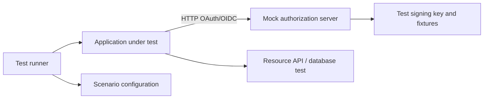
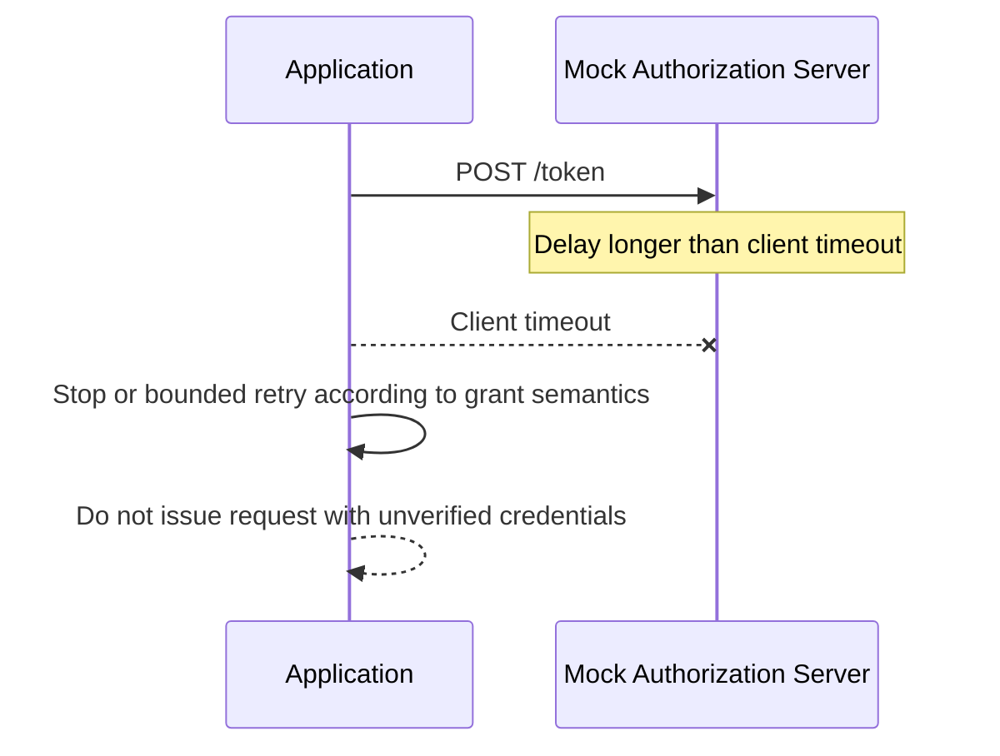

# Mock authorization server

Trong integration testing của hệ thống bảo mật token, **Mock authorization server** là một máy chủ OAuth 2.0 hoặc OpenID Connect (OIDC) giả lập hành vi của authorization server thật. Ứng dụng cần kiểm thử có thể gửi yêu cầu cấp token, đổi authorization code, refresh token, introspection hoặc Token Exchange đến máy chủ này như khi tích hợp với nhà cung cấp danh tính thực tế.

Mock authorization server giúp kiểm tra cách ứng dụng giao tiếp với hệ thống cấp quyền: tạo request đúng, xử lý response đúng, xác minh token, phản ứng với lỗi và bảo vệ tài nguyên khi trạng thái token thay đổi. Nó đặc biệt hữu ích khi cần chạy test nhanh, lặp lại được và không phụ thuộc mạng Internet, tài khoản thật hay tenant dùng chung.

Mock server không tự chứng minh authorization server thật tuân thủ đầy đủ OAuth 2.0/OIDC. Nó chỉ kiểm tra được những hành vi mà mock đã mô phỏng. Vì vậy, cần xác định rõ ranh giới: integration test với mock xác minh ứng dụng và hợp đồng giao tiếp; contract test xác minh hợp đồng với nhà cung cấp; test với một authorization server thật hoặc môi trường tương đương xác minh khả năng tương thích giao thức ở mức rộng hơn.

## 1. Vì sao cần mock authorization server?

Một ứng dụng thường phụ thuộc authorization server ở nhiều thời điểm:

- Khi người dùng đăng nhập qua Authorization Code Flow và PKCE.
- Khi backend lấy access token bằng Client Credentials Grant.
- Khi client đổi refresh token lấy access token mới.
- Khi resource server xác minh opaque token qua introspection.
- Khi client hoặc gateway thực hiện Token Exchange để gọi dịch vụ downstream.
- Khi ứng dụng đọc OIDC discovery metadata, tải JWKS và xác minh chữ ký JWT.
- Khi ứng dụng xử lý token hết hạn, bị thu hồi, sai audience hoặc thiếu scope.

Nếu chỉ unit test bằng cách mock một interface như `TokenService`, test có thể bỏ qua lỗi ở HTTP layer: sai URL, sai HTTP method, thiếu form parameter, xác thực client không đúng, parse JSON sai, xử lý status code sai hoặc cache JWKS không hoạt động như dự kiến.

Mock authorization server tạo một điểm tích hợp HTTP thật trong môi trường test. Ứng dụng vẫn chạy code HTTP client, decoder, filter, middleware và authorization logic thực tế. Chỉ phía authorization server được thay bằng một server giả lập có hành vi xác định.

Các lợi ích chính:

1. **Tái lập được:** test dùng key, client, user, scope và response đã định nghĩa; không phụ thuộc dữ liệu bên ngoài.
2. **Kiểm soát tình huống lỗi:** có thể chủ động trả `invalid_grant`, `invalid_client`, `invalid_token`, HTTP 500, timeout hoặc JWKS thiếu key.
3. **Kiểm tra toàn bộ giao tiếp:** quan sát request thực tế mà ứng dụng gửi đến endpoint OAuth/OIDC.
4. **Chạy nhanh và độc lập:** không cần đăng ký ứng dụng hoặc tạo tài khoản ở identity provider thật cho mỗi lần chạy.
5. **Bảo vệ môi trường:** tránh dùng client secret, refresh token hay dữ liệu người dùng thật trong test thông thường.

## 2. Ranh giới giữa mock và hệ thống cần kiểm thử

Một kiến trúc integration test điển hình:



Mock authorization server cần đứng ở đúng ranh giới HTTP mà ứng dụng sử dụng. Nếu ứng dụng cấu hình `issuer-uri`, `jwks_uri` hoặc token endpoint, các URL trong test phải trỏ về mock server. Ứng dụng vẫn phải tự:

- Tạo request theo grant type và client authentication đã cấu hình.
- Parse token response và xử lý OAuth error response.
- Kiểm tra chữ ký JWT bằng public key tải từ JWKS.
- Kiểm tra `iss`, `aud`, `exp`, `nbf`, scope và các claim cần thiết.
- Gọi introspection hoặc revocation endpoint nếu thiết kế ứng dụng yêu cầu.
- Từ chối request không hợp lệ và chỉ cho phép thao tác khi policy thỏa mãn.

Không nên thay decoder, JWT verifier hoặc authorization filter của ứng dụng bằng mock trong chính integration test đang nhằm xác minh các thành phần đó. Nếu mock luôn trả về `true` cho hàm xác minh token, test không còn kiểm tra được bảo mật token.

### Phân biệt các cấp kiểm thử

| Cấp kiểm thử | Thành phần giả lập | Điều được xác minh |
|---|---|---|
| Unit test | Interface hoặc dependency nhỏ | Logic đơn vị với đầu vào/đầu ra đã kiểm soát. |
| Integration test với mock AS | Authorization server ở ranh giới HTTP | Ứng dụng tạo request, nhận response và thực thi token policy đúng. |
| Contract test | Hợp đồng request/response đã thống nhất với nhà cung cấp | Ứng dụng và nhà cung cấp cùng tuân theo schema, endpoint, lỗi và cấu hình đã cam kết. |
| Integration test với AS thật | Một triển khai OAuth/OIDC thật trong môi trường test | Khả năng tương thích với hành vi giao thức và cấu hình thực tế của triển khai đó. |
| End-to-end test | Toàn bộ luồng qua nhiều hệ thống | Luồng người dùng và nghiệp vụ hoàn chỉnh trong môi trường gần production. |

Mock tốt có thể phát hiện lỗi tích hợp của ứng dụng, nhưng không thể thay thế mọi test với triển khai thật. Mock chỉ nên mô phỏng những endpoint và hành vi mà ứng dụng thực sự sử dụng; phần chưa mô phỏng phải được ghi nhận rõ.

## 3. Các endpoint OAuth 2.0 và OIDC thường cần mô phỏng

Không phải ứng dụng nào cũng dùng tất cả endpoint. Hãy đọc cấu hình và luồng tích hợp của ứng dụng để chọn tập endpoint tối thiểu cần thiết.

| Endpoint | Method thường dùng | Mục đích trong test |
|---|---|---|
| Discovery metadata | `GET` | Công bố issuer, authorization endpoint, token endpoint, JWKS URI và các capability OIDC/OAuth. |
| JWKS URI | `GET` | Cung cấp public signing keys để ứng dụng xác minh JWT. |
| Authorization endpoint | `GET` và redirect | Mô phỏng đăng nhập, consent và trả authorization code. |
| Token endpoint | `POST` | Đổi authorization code, client credentials hoặc refresh token lấy token. |
| UserInfo endpoint | `GET` | Trả claims của người dùng theo access token khi OIDC UserInfo được dùng. |
| Introspection endpoint | `POST` | Kiểm tra trạng thái opaque token hoặc trạng thái token theo hợp đồng. |
| Revocation endpoint | `POST` | Mô phỏng yêu cầu thu hồi token. |
| Token Exchange | `POST` tại token endpoint | Mô phỏng yêu cầu đổi subject/actor token sang token mới theo RFC 8693 nếu hệ thống hỗ trợ. |

Một mock server có thể chỉ hỗ trợ `client_credentials`, token JWT và JWKS nếu ứng dụng backend chỉ dùng machine-to-machine authentication. Nếu ứng dụng dùng OIDC login, cần bổ sung authorization endpoint, callback flow, state, nonce, PKCE và ID token. Không nên tuyên bố mock hỗ trợ OIDC đầy đủ khi chỉ có một endpoint trả JWT.

### Discovery metadata

Với OIDC Discovery, ứng dụng thường lấy metadata từ đường dẫn well-known tương ứng issuer. Ví dụ response rút gọn:

```json
{
  "issuer": "http://127.0.0.1:9090",
  "authorization_endpoint": "http://127.0.0.1:9090/authorize",
  "token_endpoint": "http://127.0.0.1:9090/token",
  "jwks_uri": "http://127.0.0.1:9090/jwks",
  "userinfo_endpoint": "http://127.0.0.1:9090/userinfo",
  "response_types_supported": ["code"],
  "subject_types_supported": ["public"],
  "id_token_signing_alg_values_supported": ["RS256"],
  "grant_types_supported": ["authorization_code", "client_credentials", "refresh_token"]
}
```

Các giá trị trên chỉ là ví dụ cho một mock local. `issuer` phải khớp chính xác với issuer mà ứng dụng cấu hình và với claim `iss` trong token. Endpoint trong metadata phải trỏ về mock server đang chạy. Nếu metadata công bố JWKS URI ở host hoặc port khác, ứng dụng có thể cố gọi ra ngoài hoặc thất bại khi test.

Discovery metadata cần phản ánh đúng capability mock thực sự hỗ trợ. Nếu mock không xử lý `response_type`, `grant_types` hoặc signing algorithm được công bố, không nên liệt kê chúng như tính năng được hỗ trợ.

## 4. JWKS và khóa ký dành cho test

Với JWT, mock authorization server cần ký token bằng private key dành riêng cho test và cung cấp public key tương ứng qua JWKS. Ứng dụng lấy JWKS, chọn key theo `kid`, rồi xác minh chữ ký.

Ví dụ JWK public key RSA đã rút gọn:

```json
{
  "keys": [
    {
      "kty": "RSA",
      "use": "sig",
      "alg": "RS256",
      "kid": "test-key-2026-01",
      "n": "<base64url-modulus>",
      "e": "AQAB"
    }
  ]
}
```

Các giá trị `n` và `e` phải là public key hợp lệ tương ứng private key mà mock dùng để ký token. Không đưa private key vào JWKS hoặc response HTTP.

### Quy tắc quản lý khóa test

- Dùng khóa fixture dành riêng cho test; không dùng private key production hoặc key cá nhân của developer.
- Có thể tạo khóa một lần trong test resource hoặc tạo động khi suite khởi chạy. Chọn cách phù hợp với tốc độ và tính ổn định cần có.
- Nếu dùng fixture cố định, lưu trong test resources với quyền truy cập phù hợp và ghi rõ đây là khóa không dùng ngoài môi trường test.
- Dùng `kid` ổn định để kiểm tra lựa chọn key; có thể tạo nhiều key để mô phỏng rotation.
- Public key trên JWKS phải khớp chính xác private key ký JWT.
- Không cho verifier production chấp nhận `alg: none` hoặc tự động tin algorithm do token tự chọn.
- Không chia sẻ cache JWKS giữa các test nếu điều đó khiến key của scenario trước ảnh hưởng scenario sau.

### Mô phỏng key rotation

Một tình huống thường gặp là authorization server đổi signing key. Mock có thể cung cấp hai public key trong JWKS, sau đó chuyển key đang dùng để ký từ `kid-old` sang `kid-new`.

Test nên xác minh:

1. Ứng dụng xác minh được token ký bởi key hiện hành.
2. Khi gặp `kid` chưa có trong cache, ứng dụng có thể tải lại JWKS theo chính sách.
3. Token ký bằng key mới được chấp nhận sau khi JWKS được cập nhật.
4. Token có chữ ký sai hoặc `kid` không tồn tại sau lần refresh hợp lệ bị từ chối.
5. Ứng dụng không tải JWKS vô hạn hoặc retry không giới hạn khi endpoint lỗi.

Nếu test dùng cache JWKS, cần kiểm soát cache TTL và thời điểm refresh để kết quả không phụ thuộc thứ tự test.

## 5. Sinh token fixture đúng mục đích

Mock authorization server thường cần sinh ít nhất hai loại token khác nhau trong OIDC/OAuth:

- **Access token:** được gửi đến resource server để truy cập API. `aud` phải đại diện đúng resource server; scope và quyền phải phù hợp.
- **ID token:** được client OIDC dùng để xác nhận kết quả xác thực người dùng. `aud` thường là client ID; token có các claim OIDC như `sub`, `iss`, `exp`, `iat` và `nonce` khi request có nonce.

Không dùng ID token thay cho access token khi gọi API. Hai token có thể cùng định dạng JWT nhưng có mục đích và audience khác nhau.

Ví dụ payload access token minh họa:

```json
{
  "iss": "http://127.0.0.1:9090",
  "sub": "user-1001",
  "aud": "inventory-api",
  "iat": 1795431000,
  "exp": 1795431300,
  "jti": "access-test-001",
  "scope": "inventory.read inventory.write",
  "client_id": "inventory-client"
}
```

Ví dụ ID token minh họa:

```json
{
  "iss": "http://127.0.0.1:9090",
  "sub": "user-1001",
  "aud": "web-client",
  "iat": 1795431000,
  "exp": 1795434600,
  "nonce": "nonce-from-auth-request",
  "email": "user@example.test"
}
```

Các timestamp chỉ để minh họa. Khi chạy test, nên dùng clock có thể điều khiển hoặc fixture thời gian nhất quán thay vì phụ thuộc vào ngày giờ ghi cứng đã trôi qua.

Một token fixture hữu ích nên cho phép cấu hình:

| Thuộc tính | Giá trị hợp lệ và biến thể cần test |
|---|---|
| `iss` | Đúng issuer; issuer khác; issuer thiếu. |
| `aud` | Đúng resource/client; audience khác; audience thiếu hoặc không phù hợp. |
| `sub` | Subject hợp lệ; subject không tồn tại hoặc sai kiểu theo policy. |
| `exp` | Còn hạn; hết hạn; sát ranh giới hết hạn. |
| `nbf` | Đã hiệu lực; nằm trong tương lai. |
| `iat` | Hợp lệ; quá xa trong quá khứ hoặc tương lai theo policy. |
| `scope` | Đủ quyền; thiếu quyền; scope không được công nhận. |
| `kid` | Key đang công bố; key cũ; key không tồn tại. |
| `jti` | ID duy nhất; ID đã bị denylist nếu ứng dụng có kiểm tra. |
| `nonce` | Khớp authorization request; sai hoặc thiếu khi bắt buộc. |

Không nên chỉ tạo một token hợp lệ duy nhất dùng cho tất cả test. Một bộ fixture tốt cần cả token hợp lệ và token có lỗi cụ thể, mỗi token chỉ thay đổi một yếu tố để xác định nguyên nhân thất bại.

## 6. Mô phỏng Token endpoint

Token endpoint là điểm tích hợp quan trọng nhất của nhiều OAuth client. Mock cần kiểm tra request theo grant type thay vì trả cùng một token cho mọi POST.

### Client Credentials Grant

Client credentials dùng cho ứng dụng hoặc workload xác thực bằng thông tin client. Mock nên kiểm tra:

- `grant_type=client_credentials`.
- Client authentication theo phương thức được cấu hình, ví dụ HTTP Basic hoặc `client_secret_post` nếu được phép.
- Client ID và credential có tồn tại, đúng và đang hoạt động.
- Scope yêu cầu có nằm trong quyền client được cấp.
- Token response có access token, `token_type` và `expires_in` phù hợp.

Ví dụ token response:

```json
{
  "access_token": "<signed-test-access-token>",
  "token_type": "Bearer",
  "expires_in": 300,
  "scope": "inventory.read"
}
```

Mock nên có scenario `invalid_client`, `invalid_scope`, client bị disable và token endpoint trả lỗi tạm thời. Không trả token có scope rộng hơn scope đã được cấp chỉ vì client yêu cầu.

### Authorization Code và PKCE

Với ứng dụng web hoặc native dùng Authorization Code Flow, mock cần mô phỏng hai bước chính:

1. Nhận yêu cầu tại authorization endpoint, kiểm tra `client_id`, `redirect_uri`, `response_type`, `state`, scope và PKCE parameters.
2. Trả redirect về callback với authorization code và `state`; sau đó nhận POST đến token endpoint để đổi code.

Authorization code nên có thời hạn ngắn, chỉ dùng một lần và được ràng buộc với client, redirect URI và PKCE code challenge. Mock phải từ chối code đã dùng, code hết hạn, redirect URI không khớp và `code_verifier` sai.

Với PKCE `S256`, mock kiểm tra code challenge được tính từ verifier theo đúng quy tắc của RFC 7636. Không chỉ kiểm tra parameter có tồn tại; cần kiểm tra quan hệ giữa verifier và challenge.

`state` giúp client liên kết callback với request ban đầu và phòng chống CSRF trong luồng redirect. Với OIDC, `nonce` được gửi trong authentication request phải được đối chiếu với claim `nonce` trong ID token khi ứng dụng yêu cầu. Mock có thể phát lại state hoặc nonce sai để xác minh ứng dụng từ chối callback.

### Refresh token

Mock nên lưu trạng thái refresh token ở phía server, kể cả khi token biểu diễn bằng chuỗi opaque. Có thể mô phỏng:

- Refresh token còn hiệu lực và thuộc đúng client/grant.
- Refresh token đã hết hạn hoặc bị thu hồi.
- Refresh token được dùng lại sau rotation.
- Client authentication không khớp.
- Tenant, user hoặc grant đã bị vô hiệu hóa.

Nếu ứng dụng dùng refresh token rotation, mock cần phát refresh token mới theo từng lần đổi và đánh dấu token cũ đã dùng. Khi phát hiện reuse, phản ứng của mock phải khớp với chính sách mà hệ thống đang kiểm thử, ví dụ thu hồi token family.

### Token Exchange

Nếu ứng dụng sử dụng RFC 8693, mock cần nhận `subject_token`, `subject_token_type`, `requested_token_type`, `audience` hoặc `resource`, `scope` và `actor_token` nếu có. Mock xác minh subject/actor theo policy test, sau đó trả token mới dành cho audience và scope được phép.

Các tình huống nên mô phỏng:

- Subject token hợp lệ, audience và scope được phép.
- Subject token hết hạn hoặc sai issuer.
- Actor token không hợp lệ hoặc không được phép đại diện.
- Client không được phép exchange sang audience yêu cầu.
- Scope yêu cầu rộng hơn quyền có thể ủy quyền.
- Tenant hoặc grant nguồn đã bị vô hiệu hóa.
- Token Exchange không được hỗ trợ và trả lỗi phù hợp.

Không nên giả định mọi authorization server đều hỗ trợ Token Exchange. Chỉ công bố capability này trong mock khi ứng dụng hoặc hợp đồng nhà cung cấp cần nó.

## 7. Mô phỏng Introspection và Revocation

### Introspection

Với opaque token, resource server không thể tự đọc claims như JWT. Nó gọi introspection endpoint theo RFC 7662 để biết token có active hay không. Mock nên duy trì một registry ánh xạ token test tới trạng thái và metadata.

Ví dụ response active:

```json
{
  "active": true,
  "scope": "inventory.read",
  "client_id": "inventory-client",
  "username": "service-inventory",
  "token_type": "Bearer",
  "exp": 1795431300,
  "sub": "service-1001",
  "aud": "inventory-api",
  "iss": "http://127.0.0.1:9090"
}
```

Ví dụ response inactive:

```json
{
  "active": false
}
```

Test cần xác minh resource server từ chối khi `active=false`, khi introspection endpoint không phản hồi và khi response không hợp lệ theo hợp đồng. Cần kiểm tra cả xác thực của resource server khi gọi introspection; endpoint này không nên mở công khai để bất kỳ ai cũng tra cứu trạng thái token.

### Revocation

Mock revocation endpoint nên đánh dấu token hoặc token family đã thu hồi. Sau khi revoke, lần introspection tiếp theo phải phản ánh trạng thái inactive. Nếu hệ thống dùng JWT offline, test cần xác minh cơ chế bổ sung mà ứng dụng triển khai để phản ánh revocation; chỉ gọi revocation endpoint không khiến mọi verifier offline tự biết token đã bị thu hồi.

Theo RFC 7009, response thành công của revocation endpoint được thiết kế để không tiết lộ token có tồn tại hay không. Mock nên mô phỏng hành vi response theo chuẩn hoặc hợp đồng cụ thể thay vì trả lỗi khác nhau làm lộ trạng thái token.

## 8. Xử lý OAuth error response

Ứng dụng phải phân biệt lỗi giao thức, lỗi xác thực, lỗi quyền và lỗi hạ tầng. Mock nên có scenario riêng cho từng loại.

Ví dụ OAuth error response:

```json
{
  "error": "invalid_grant",
  "error_description": "The authorization code is expired or already used"
}
```

Một số lỗi thường gặp:

| Lỗi | Nguyên nhân có thể | Hành vi ứng dụng cần xác minh |
|---|---|---|
| `invalid_request` | Thiếu hoặc sai parameter bắt buộc. | Ghi nhận lỗi cấu hình/request, không retry vô hạn. |
| `invalid_client` | Client authentication sai hoặc client không hợp lệ. | Không tiếp tục luồng cấp token; không log secret. |
| `invalid_grant` | Code/refresh token không hợp lệ, hết hạn hoặc đã dùng. | Yêu cầu đăng nhập lại hoặc xử lý grant theo policy. |
| `unauthorized_client` | Client không được phép dùng grant type. | Từ chối và báo cấu hình client. |
| `unsupported_grant_type` | Authorization server không hỗ trợ grant yêu cầu. | Không retry cùng request vô ích. |
| `invalid_scope` | Scope không hợp lệ hoặc vượt quyền. | Không dùng token có quyền rộng hơn; báo lỗi authorization. |
| `temporarily_unavailable` | Server tạm thời không thể xử lý. | Retry có giới hạn, backoff và jitter nếu phù hợp. |
| HTTP 401/403 | Xác thực client hoặc quyền endpoint không đạt theo triển khai. | Xử lý theo status code và contract; tránh suy diễn thành token người dùng hết hạn. |
| HTTP 429 | Rate limit. | Tôn trọng `Retry-After` nếu có và giới hạn retry. |
| HTTP 5xx | Lỗi server hoặc gateway. | Retry có giới hạn cho thao tác an toàn; không tạo vòng lặp cấp token. |

OAuth error code thường được trả trong JSON cùng HTTP status phù hợp với endpoint và loại lỗi. Mock nên tái hiện đúng response shape mà ứng dụng kỳ vọng, bao gồm `Content-Type`, status code và header liên quan.

## 9. Fault injection: kiểm thử lỗi mạng và lỗi phụ thuộc

Một mock authorization server hữu ích không chỉ trả success và error JSON. Nó còn cho phép kiểm soát lỗi ở tầng HTTP/network để kiểm tra khả năng phục hồi của ứng dụng.

Các tình huống nên hỗ trợ:

- Connection refused hoặc endpoint không khả dụng.
- Response timeout trước khi nhận header.
- Response chậm hơn timeout của client.
- HTTP 500, 502, 503 và 504.
- HTTP 429 kèm `Retry-After`.
- JSON sai định dạng hoặc thiếu field bắt buộc.
- `Content-Type` không đúng.
- JWKS trả key rỗng, key trùng `kid`, key sai định dạng hoặc không có key được yêu cầu.
- Discovery metadata trỏ đến endpoint sai hoặc issuer không khớp.
- Connection bị đóng giữa chừng hoặc response body bị cắt.

Test cần kiểm tra timeout được cấu hình, retry có giới hạn, circuit breaker nếu có, metric/log phù hợp và ứng dụng không cho phép request được bảo vệ khi không thể xác minh token. Với token endpoint, retry POST cần thận trọng vì authorization code hoặc refresh token có thể chỉ dùng một lần. Không được mặc định mọi POST đều an toàn để retry.

### Ví dụ kịch bản timeout



Với authorization code, timeout sau khi server đã tiêu thụ code nhưng trước khi client nhận response có thể tạo trạng thái không xác định. Test nên mô phỏng trường hợp này để ứng dụng xử lý yêu cầu đăng nhập lại hoặc recovery theo policy, thay vì retry vô hạn cùng authorization code.

## 10. Thiết kế scenario và điều khiển trạng thái mock

Một mock server dễ bảo trì nên có các scenario rõ ràng thay vì các điều kiện rải rác trong handler.

Ví dụ mô hình cấu hình:

```yaml
scenario: client-credentials-success
client:
  id: inventory-client
  authentication: client_secret_basic
  secret: test-secret
grant:
  type: client_credentials
  allowed_scopes:
    - inventory.read
token:
  format: jwt
  issuer: http://127.0.0.1:9090
  audience: inventory-api
  expires_in: 300
  signing_key_id: test-key-2026-01
response:
  status: 200
```

Scenario lỗi có thể chỉ thay một yếu tố:

```yaml
scenario: client-credentials-invalid-scope
client:
  id: inventory-client
  authentication: client_secret_basic
  secret: test-secret
grant:
  type: client_credentials
  allowed_scopes:
    - inventory.read
request:
  scope: inventory.admin
response:
  status: 400
  error: invalid_scope
```

Đây là cấu trúc minh họa; không phải schema tiêu chuẩn. Điều quan trọng là scenario phải dễ đọc, có tên mô tả hành vi, và cho phép test chọn scenario mà không cần sửa code ứng dụng.

### Điều khiển scenario an toàn

- Có thể cấu hình scenario qua test setup, stub registry hoặc endpoint quản trị chỉ mở trong test process.
- Không cung cấp endpoint điều khiển mock ra mạng ngoài hoặc môi trường production.
- Reset state giữa test: authorization code đã dùng, refresh token rotation, revoked token, client state và event log.
- Tránh dùng chung state mutable giữa test chạy song song.
- Nếu cần kiểm tra request đã nhận, cung cấp request journal hoặc verification API trong mock test harness.
- Không dùng dữ liệu nhạy cảm thật làm fixture.

## 11. Ví dụ kiểm tra integration với ứng dụng

Ví dụ dưới đây là pseudocode độc lập framework. Mục tiêu là giữ HTTP client và token verifier thật của ứng dụng trong test.

```text
beforeEach:
    mockAuthorizationServer.startOnRandomPort()
    mockAuthorizationServer.reset()
    mockAuthorizationServer.loadScenario("client-credentials-success")
    application.configureIssuer(mockAuthorizationServer.issuer())
    application.start()

test "backend obtains token and calls inventory API":
    response = application.get("/internal/inventory/summary")

    assert response.status == 200
    assert mockAuthorizationServer.receivedTokenRequest(
        grant_type = "client_credentials",
        client_id = "inventory-client",
        scope = "inventory.read"
    )
    assert resourceApi.receivedBearerToken()

afterEach:
    application.stop()
    mockAuthorizationServer.stop()
```

Test trên nên được mở rộng để xác minh ứng dụng không chỉ gửi request mà còn xử lý token response đúng. Ví dụ mock ký access token bằng private key fixture, public key được cung cấp ở JWKS; resource API test xác minh token bằng verifier thật hoặc chính middleware của ứng dụng.

### Test token hết hạn

```text
test "expired access token is rejected":
    token = mockAuthorizationServer.issueAccessToken(
        audience = "inventory-api",
        scope = "inventory.read",
        expires_at = fixedClock.now() - 1 second
    )

    response = application.callInventoryApi(token)

    assert response.status == 401
    assert response.error == "invalid_token"
```

### Test sai audience

```text
test "token for another API is rejected":
    token = mockAuthorizationServer.issueAccessToken(
        audience = "billing-api",
        scope = "inventory.read"
    )

    response = application.callInventoryApi(token)

    assert response.status == 401
```

### Test thiếu scope

```text
test "valid token without required scope is forbidden":
    token = mockAuthorizationServer.issueAccessToken(
        audience = "inventory-api",
        scope = "inventory.read"
    )

    response = application.deleteInventoryItem(token)

    assert response.status == 403
```

Hai test cuối cần phân biệt lỗi xác thực và lỗi phân quyền: sai audience khiến token không dành cho API đó; thiếu scope có thể là token hợp lệ nhưng không đủ quyền cho hành động. Status code cụ thể cần theo policy API và contract của ứng dụng.

## 12. Kiểm tra request mà ứng dụng gửi đến mock

Mock authorization server nên ghi nhận request để test xác minh client thực sự gửi đúng dữ liệu.

Với token endpoint, có thể kiểm tra:

- HTTP method là `POST`.
- `Content-Type` phù hợp, thường là `application/x-www-form-urlencoded` cho OAuth token request.
- `grant_type` đúng.
- Client authentication nằm ở đúng vị trí và phương thức đã cấu hình.
- Scope, audience/resource và các extension parameter đúng theo hợp đồng.
- Authorization code, redirect URI và PKCE verifier đúng khi dùng Authorization Code Flow.
- Không gửi client secret trong URL hoặc log.
- Không gửi access token trong query string.

Với JWKS/discovery, kiểm tra ứng dụng dùng đúng issuer và URL đã công bố. Với introspection, kiểm tra resource server xác thực chính nó và gửi đúng token cần kiểm tra. Với revocation, kiểm tra đúng token và client context được gửi đến endpoint.

Không nên chỉ assert rằng endpoint được gọi một lần. Một ứng dụng có thể gọi endpoint đúng nhưng gửi sai body. Hãy xác minh các parameter quan trọng và kiểm tra số lần gọi trong những scenario cần bảo đảm cache hoặc retry.

## 13. Test isolation, lifecycle và chạy song song

Integration test thường chạy trên CI với nhiều test class hoặc worker đồng thời. Nếu mock server dùng chung port, client registry, token state hoặc key cache, test có thể phụ thuộc thứ tự và gây lỗi khó tái lập.

Các nguyên tắc isolation:

1. Khởi động mock server trên port động hoặc một endpoint được cấp riêng cho test.
2. Cấu hình issuer và endpoint sau khi biết địa chỉ mock server, trước khi application khởi động.
3. Mỗi test hoặc test class có state độc lập theo mức cần thiết.
4. Reset authorization code, refresh token, revocation registry và request journal giữa các scenario.
5. Dùng clock có thể điều khiển để kiểm thử `exp`, `nbf`, code expiry và refresh expiry.
6. Dừng server và application trong `finally` hoặc lifecycle hook để tránh rò rỉ thread/port.
7. Không để test phụ thuộc vào thứ tự chạy hoặc thời gian chờ cố định dài.
8. Nếu chạy song song, tách state theo test ID hoặc tạo server riêng.

Một cách tiếp cận khác là chạy mock server trong container. Khi đó cần chờ health check sẵn sàng trước khi khởi động application và lấy dynamic mapped port từ runtime container, không ghi cứng port của máy developer.

## 14. Chọn WireMock, MockWebServer, custom server hay authorization server thật

Không có công cụ mock duy nhất phù hợp với mọi bài toán. Chọn theo độ phức tạp của protocol và phần hành vi cần xác minh.

| Giải pháp | Phù hợp khi | Điểm cần chú ý |
|---|---|---|
| WireMock | Cần stub HTTP, request matching, response mapping, delay và fault injection. | Phải tự xây logic token/JWT/JWKS và trạng thái grant nếu cần. |
| MockWebServer | Test HTTP client, quan sát request và trả response theo thứ tự. | Scenario phức tạp hoặc stateful OAuth có thể cần helper bổ sung. |
| Custom lightweight server | Cần mô phỏng state machine, code reuse, refresh rotation, token registry hoặc key rotation. | Phải tự chịu trách nhiệm về tính đúng của mô phỏng và không mở rộng thành một AS production ngoài phạm vi. |
| Authorization server thật trong container/test environment | Cần kiểm tra cấu hình, protocol behavior, discovery, login và feature của một triển khai cụ thể. | Chạy chậm hơn, cần cấu hình client/realm/tenant và quản lý dữ liệu test. |

Một chiến lược cân bằng là dùng mock cho phần lớn integration test vì nhanh và dễ kiểm soát; dùng một nhóm nhỏ contract hoặc integration test với authorization server thật để xác minh các khác biệt quan trọng của nhà cung cấp. Nếu ứng dụng phụ thuộc nhiều extension riêng, contract test với nhà cung cấp càng quan trọng.

## 15. Các lỗi thường gặp khi xây mock authorization server

| Lỗi | Vì sao nguy hiểm | Cách khắc phục |
|---|---|---|
| Mock luôn trả JWT hợp lệ cho mọi request | Không phát hiện sai grant, client authentication hoặc scope. | Kiểm tra request và trạng thái client/grant trước khi phát token. |
| Dùng ID token gọi API | Che giấu lỗi nhầm lẫn audience và mục đích token. | Tạo access token và ID token riêng, kiểm tra audience riêng. |
| `iss` trong token khác discovery issuer | Ứng dụng có thể từ chối token hoặc mock bỏ qua kiểm tra issuer. | Dùng một issuer thống nhất ở cấu hình, metadata và JWT. |
| JWKS public key không khớp private key ký | Test thất bại không ổn định hoặc verifier bị bypass. | Quản lý cặp khóa test và xác minh chữ ký thật. |
| Mock không kiểm tra PKCE verifier | Không phát hiện lỗi triển khai Authorization Code Flow. | Kiểm tra `S256` challenge/verifier và code binding. |
| Authorization code dùng lại được | Không mô phỏng đúng tính chất one-time của code. | Đánh dấu code đã tiêu thụ và từ chối lần dùng tiếp theo. |
| Refresh token không có trạng thái | Không test được rotation, revocation hoặc reuse detection. | Duy trì token registry và token family. |
| Không mô phỏng lỗi HTTP | Ứng dụng có thể treo hoặc retry vô hạn khi AS lỗi. | Thêm timeout, delay, 429, 5xx và malformed response. |
| Mock tự xác minh token thay ứng dụng | Integration test không còn kiểm tra verifier của ứng dụng. | Mock chỉ phát token; ứng dụng phải tự xác minh. |
| Chia sẻ state giữa test song song | Token hoặc scenario của test này ảnh hưởng test khác. | Tách server/state theo test hoặc namespace. |
| Dùng credential production trong fixture | Bí mật có thể rò rỉ vào log hoặc artifact CI. | Dùng client/key giả lập, không tái sử dụng secret thật. |
| Chỉ test happy path | Không phát hiện lỗi token sai, hết hạn, bị thu hồi hoặc thiếu quyền. | Tạo ma trận negative test có mục tiêu. |
| Cho mock truy cập từ mạng ngoài | Endpoint quản trị hoặc test token có thể bị lạm dụng. | Bind vào loopback hoặc network test riêng, tắt sau test. |

## 16. Ma trận kiểm thử gợi ý

| Nhóm | Scenario | Kết quả mong đợi |
|---|---|---|
| Discovery | Metadata đúng issuer và endpoint | Ứng dụng tải metadata và cấu hình đúng endpoint. |
| Discovery | Issuer mismatch | Ứng dụng từ chối metadata/token theo policy. |
| JWKS | Key hiện hành, `kid` đúng | JWT hợp lệ được xác minh. |
| JWKS | `kid` lạ hoặc signature sai | Token bị từ chối; refresh JWKS có giới hạn nếu phù hợp. |
| JWT | Sai `iss` hoặc `aud` | Request bị từ chối. |
| JWT | `exp` đã qua hoặc `nbf` ở tương lai | Request bị từ chối. |
| JWT | Thiếu scope cần thiết | Xác thực có thể thành công nhưng hành động bị cấm. |
| Client Credentials | Client hợp lệ và scope cho phép | Nhận access token đúng audience/scope. |
| Client Credentials | Secret sai hoặc client bị disable | Không nhận token; lỗi được xử lý an toàn. |
| Authorization Code | Code, redirect URI và PKCE hợp lệ | Token endpoint trả token hợp lệ. |
| Authorization Code | Code dùng lại, hết hạn hoặc verifier sai | Token endpoint từ chối. |
| OIDC | State/nonce khớp | Callback được xử lý; ID token được xác minh. |
| OIDC | State hoặc nonce sai | Callback/ID token bị từ chối. |
| Refresh | Refresh token hợp lệ | Cấp access token mới theo policy. |
| Refresh | Token bị revoke hoặc reuse | Từ chối và xử lý token family theo policy. |
| Introspection | `active=true` | Resource server tiếp tục kiểm tra audience/scope và policy. |
| Introspection | `active=false` | Resource server từ chối token. |
| Revocation | Revoke token rồi introspect | Trạng thái phản ánh inactive theo mô hình mock. |
| Token Exchange | Subject/actor hợp lệ | Cấp token mới với audience và scope được phép. |
| Token Exchange | Subject hết hạn hoặc scope vượt quyền | Từ chối exchange. |
| Resilience | AS timeout hoặc 5xx | Ứng dụng fail safely, retry có giới hạn nếu phù hợp. |
| Resilience | JWKS endpoint unavailable | Không chấp nhận token chưa xác minh được. |
| Isolation | Hai test chạy song song | Không dùng chung state, key hoặc token ngoài dự kiến. |

Không nhất thiết triển khai toàn bộ ma trận cho mọi ứng dụng. Chọn scenario theo flow thực tế, rủi ro và endpoint mà ứng dụng sử dụng; các test bảo mật cốt lõi như issuer, audience, chữ ký, thời hạn, scope và xử lý token bị thu hồi cần được ưu tiên.

## 17. Checklist trước khi đưa test vào CI

**Mock server**

- Có issuer nhất quán và discovery metadata đúng với endpoint đang chạy.
- Có JWKS public key khớp với private key fixture dùng để ký JWT.
- Chỉ mô phỏng grant và endpoint mà ứng dụng cần; capability công bố đúng với thực tế.
- Kiểm tra client, grant, scope, code, PKCE và token state theo scenario.
- Có success, protocol error và HTTP/network fault scenario.
- Có request journal để xác minh method, header và body.
- Có reset state và shutdown lifecycle đáng tin cậy.

**Ứng dụng cần kiểm thử**

- Dùng HTTP client, JWT verifier, discovery/JWKS client và authorization middleware thật.
- Xác minh issuer, audience, signature, thời hạn, scope và claim bắt buộc.
- Phân biệt access token với ID token.
- Xử lý lỗi OAuth, timeout, rate limit và response không hợp lệ.
- Không log token hoặc client secret.
- Không cho phép request khi token không thể được xác minh.

**Môi trường CI**

- Không dùng credential hoặc dữ liệu production.
- Bind mock vào loopback hoặc network test biệt lập.
- Dùng port động và readiness check.
- Tách state khi chạy song song.
- Thu thập log an toàn và dừng mọi process/container sau test.
- Có một nhóm test contract hoặc test với authorization server thật cho những capability quan trọng.

## 18. Kết luận

Mock authorization server là một thành phần test ở ranh giới OAuth 2.0/OIDC, cho phép ứng dụng chạy qua HTTP flow thực tế với response và lỗi có thể điều khiển. Một mock hữu ích phải mô phỏng đúng endpoint mà ứng dụng dùng, giữ nhất quán giữa discovery, issuer, JWKS và JWT, quản lý trạng thái authorization code/refresh token/revocation khi cần, đồng thời hỗ trợ các tình huống lỗi.

Giá trị của integration test đến từ việc ứng dụng vẫn tự thực hiện xác minh chữ ký, issuer, audience, thời hạn, scope và trạng thái token. Mock chỉ đóng vai trò authorization server giả lập ở phía đối tác. Kết hợp mock với contract test và một số test trên triển khai thật giúp phát hiện cả lỗi trong ứng dụng lẫn sai khác khi tích hợp với nhà cung cấp.

## Tài liệu tham khảo

- [RFC 6749 — The OAuth 2.0 Authorization Framework](https://www.rfc-editor.org/rfc/rfc6749): authorization endpoint, token endpoint, grant và error response.
- [RFC 6750 — OAuth 2.0 Bearer Token Usage](https://www.rfc-editor.org/rfc/rfc6750): cách sử dụng bearer access token và xử lý lỗi tài nguyên.
- [RFC 7009 — OAuth 2.0 Token Revocation](https://www.rfc-editor.org/rfc/rfc7009): endpoint thu hồi token.
- [RFC 7517 — JSON Web Key (JWK)](https://www.rfc-editor.org/rfc/rfc7517): định dạng JSON Web Key và JWKS.
- [RFC 7519 — JSON Web Token (JWT)](https://www.rfc-editor.org/rfc/rfc7519): cấu trúc JWT và các registered claims.
- [RFC 7636 — Proof Key for Code Exchange (PKCE)](https://www.rfc-editor.org/rfc/rfc7636): cơ chế PKCE cho Authorization Code Flow.
- [RFC 7662 — OAuth 2.0 Token Introspection](https://www.rfc-editor.org/rfc/rfc7662): endpoint introspection và thuộc tính `active`.
- [RFC 8414 — OAuth 2.0 Authorization Server Metadata](https://www.rfc-editor.org/rfc/rfc8414): metadata discovery cho OAuth authorization server.
- [RFC 8693 — OAuth 2.0 Token Exchange](https://www.rfc-editor.org/rfc/rfc8693): trao đổi subject/actor token lấy token mới.
- [OpenID Connect Core 1.0](https://openid.net/specs/openid-connect-core-1_0.html): authentication request, ID token, nonce và UserInfo.
