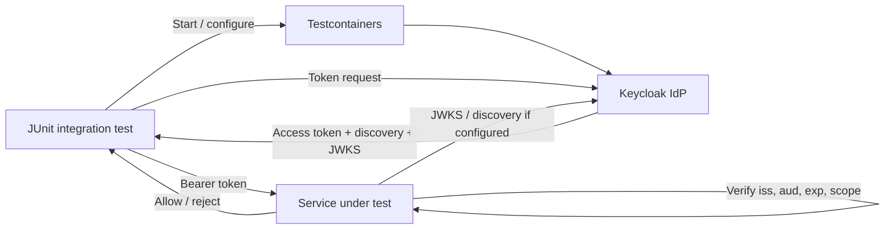
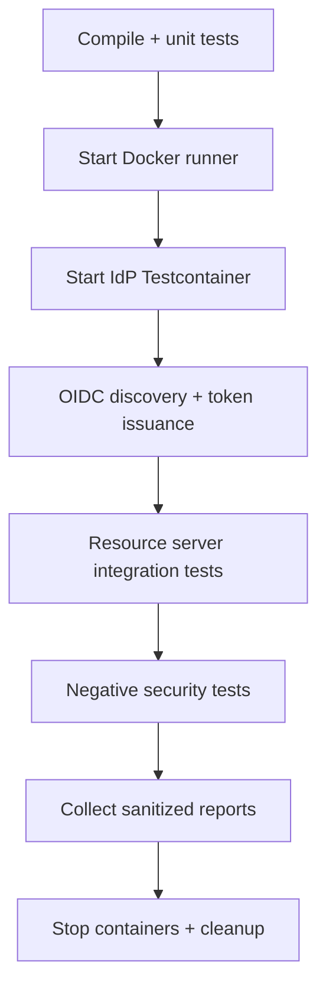

# Testcontainers cho identity provider trong kiểm thử tích hợp token

## 1. Vì sao cần chạy identity provider thật trong integration test?

Một service bảo vệ API bằng OAuth 2.0/OIDC thường phụ thuộc vào Authorization Server (AS) hoặc Identity Provider (IdP) để lấy metadata, khóa ký, access token và thông tin xác thực. Unit test có thể mock JwtDecoder, OAuth2AuthorizedClientManager hoặc token endpoint, nhưng mock không chứng minh toàn bộ giao thức hoạt động đúng khi service kết nối với IdP thật.

Các lỗi thường chỉ xuất hiện khi tích hợp:

- Issuer (iss) trong discovery document không khớp issuer mà resource server cấu hình.
- JWKS URI sai, khóa ký không tải được hoặc kid không được nhận diện.
- Token endpoint từ chối client credentials, client secret hoặc scope.
- Token được phát hành nhưng audience (aud) không dành cho API đang kiểm tra.
- Service nhận JWT đúng chữ ký nhưng bỏ sót kiểm tra audience, thời hạn hoặc scope.
- Cấu hình realm/client/role của IdP khác với giả định trong ứng dụng.
- Container khởi động chưa sẵn sàng nhưng test đã gửi request.
- Test chạy được trên máy lập trình viên nhưng thất bại trong CI vì Docker, port hoặc network khác.

**Testcontainers** cho phép test khởi chạy dependency thật trong container, cấu hình endpoint động và dọn container theo vòng đời test. Với bài học này, ta dùng Keycloak làm ví dụ IdP OIDC; nguyên tắc cũng áp dụng cho IdP tương thích OAuth/OIDC khác nếu có image hoặc môi trường test phù hợp.

Mục tiêu là kiểm chứng luồng **IdP → cấp token → service/resource server xác minh token → phân quyền API** trong một môi trường cô lập, lặp lại được và không phụ thuộc IdP production.

## 2. Kiến trúc kiểm thử và ranh giới cần xác minh



Một bài integration test nên kiểm tra được các ranh giới:

1. **Container lifecycle:** IdP thực sự khởi động, sẵn sàng nhận request và được dọn sau test.
2. **OIDC discovery:** service truy cập được endpoint well-known; issuer và endpoint đúng.
3. **Client authentication:** test client xác thực được với token endpoint bằng phương thức đã đăng ký.
4. **Token issuance:** AS cấp access token với loại, audience, scope và thời hạn mong đợi.
5. **JWT validation hoặc introspection:** resource server xác minh token qua khóa/metadata thật của IdP.
6. **Authorization:** endpoint chỉ cho phép thao tác khi scope và policy phù hợp.
7. **Negative cases:** token sai issuer/audience, hết hạn, chữ ký sai, scope thiếu hoặc client credential sai đều bị từ chối đúng cách.

Mock vẫn hữu ích cho unit test xử lý lỗi hiếm hoặc mô phỏng timeout. Tuy nhiên, test tích hợp IdP cần sử dụng **token và metadata thực do IdP test phát hành**, để kiểm tra hợp đồng giữa các thành phần.

## 3. Chọn IdP và cấu hình môi trường test

Keycloak là một lựa chọn phổ biến vì có thể chạy độc lập, hỗ trợ OIDC discovery, authorization code, client credentials, service account, JWT access token, JWKS và các API quản trị. Với IdP khác, hãy chọn image/tag được nhà cung cấp hỗ trợ và xác định cách khởi tạo realm/tenant/client tương ứng.

Các nguyên tắc:

- **Pin phiên bản image:** chọn một version đã được nhóm kiểm thử chấp thuận, ví dụ `quay.io/keycloak/keycloak:26.0.7`; không dùng `latest` vì hành vi có thể đổi ngoài ý muốn.
- **Dùng realm dành riêng cho test:** ví dụ `token-test`, không import dữ liệu production.
- **Tạo client riêng cho từng mục đích:** ví dụ `orders-service` dùng client credentials và `web-test-client` dùng authorization code + PKCE nếu cần test luồng người dùng.
- **Dùng credential giả lập:** secret chỉ có giá trị trong container/test fixture; không dùng credential production.
- **Cấp audience và scope có chủ đích:** cấu hình audience mapper hoặc client scope để token thực sự có audience của API.
- **Giữ cấu hình test ở test resources:** realm export, test user và client fixture không đưa vào artifact production.
- **Không mở cổng quản trị ra mạng công cộng:** Testcontainers chỉ công bố port cần thiết trên môi trường test.

Không nên dùng một realm dùng chung giữa test suite chạy song song nếu các test thay đổi user, client, role hoặc key. Có thể tạo realm/container riêng cho class/suite, hoặc dùng dữ liệu fixture bất biến và client riêng cho từng nhóm test.

## 4. Khởi chạy Keycloak bằng Testcontainers

### 4.1. Dependency

Với Gradle, dùng Testcontainers BOM để quản lý phiên bản đồng bộ giữa các module. Ví dụ khai báo khái niệm:

```kotlin
dependencies {
    testImplementation(platform("org.testcontainers:testcontainers-bom:<approved-version>"))
    testImplementation("org.testcontainers:junit-jupiter")
    testImplementation("org.testcontainers:testcontainers")

    testImplementation("org.junit.jupiter:junit-jupiter")
}
```

Thay `<approved-version>` bằng version được dự án chọn và đồng bộ với các dependency Testcontainers khác. Kiểm tra tài liệu của version đang dùng vì module coordinates/API có thể thay đổi giữa các major version. Không trộn các phiên bản Testcontainers khác nhau trong cùng test runtime.

### 4.2. Khai báo container

Ví dụ Java với GenericContainer:

```java
import org.junit.jupiter.api.Test;
import org.testcontainers.containers.GenericContainer;
import org.testcontainers.containers.wait.strategy.Wait;
import org.testcontainers.junit.jupiter.Container;
import org.testcontainers.junit.jupiter.Testcontainers;
import org.testcontainers.utility.DockerImageName;
import org.testcontainers.utility.MountableFile;

@Testcontainers
class IdentityProviderIntegrationTest {

    private static final String REALM = "token-test";

    @Container
    static final GenericContainer<?> IDP =
        new GenericContainer<>(
            DockerImageName.parse("quay.io/keycloak/keycloak:26.0.7")
        )
        .withEnv("KC_BOOTSTRAP_ADMIN_USERNAME", "test-admin")
        .withEnv("KC_BOOTSTRAP_ADMIN_PASSWORD", "test-admin-password")
        .withCopyFileToContainer(
            MountableFile.forClasspathResource("keycloak/realm-test.json"),
            "/opt/keycloak/data/import/realm-test.json"
        )
        .withCommand("start-dev", "--import-realm")
        .withExposedPorts(8080)
        .waitingFor(
            Wait.forHttp(
                "/realms/" + REALM + "/.well-known/openid-configuration"
            )
            .forPort(8080)
            .forStatusCode(200)
        );

    static String issuerUri() {
        return "http://" + IDP.getHost() + ":"
            + IDP.getMappedPort(8080) + "/realms/" + REALM;
    }

    @Test
    void identityProviderIsReady() {
        // Test discovery document bằng HTTP client.
    }
}
```

Đây là ví dụ minh họa API Testcontainers/JUnit; import realm và command phải khớp version Keycloak được pin. `KC_BOOTSTRAP_ADMIN_USERNAME` và `KC_BOOTSTRAP_ADMIN_PASSWORD` là thông tin quản trị **chỉ dành cho container test**. Keycloak import realm qua thư mục `/opt/keycloak/data/import` khi chạy với `--import-realm`.

Wait strategy kiểm tra endpoint discovery của realm thay vì chỉ chờ một khoảng `sleep`. Khi discovery trả HTTP 200, test có cơ sở tốt hơn để tiếp tục; vẫn cần kiểm tra nội dung discovery và issuer thực tế.

`getHost()` và `getMappedPort(8080)` lấy địa chỉ/port động của container. Không hardcode `localhost:8080`, vì Testcontainers thường ánh xạ port container sang một host port khác.

### 4.3. Khởi tạo container theo đúng vòng đời

`@Container` static thường giữ container dùng chung cho các test trong một class và được extension dọn sau class. Nếu test cần trạng thái realm độc lập cho từng method, cân nhắc container instance riêng hoặc reset dữ liệu theo cách an toàn.

Không khởi động container mới trong từng test method nếu không cần thiết: việc đó làm suite chậm và tăng tải Docker. Ngược lại, không để container dùng chung giữa các test suite khác nhau nếu chúng có thể sửa chung realm/client/key.

Trong CI, Docker daemon phải sẵn sàng và test bảo mật nên chạy thật. Nếu cho phép bỏ qua test khi thiếu Docker ở máy lập trình viên, phải bảo đảm pipeline bắt buộc có một job chạy các test này; không để toàn bộ integration suite bị silently skipped.

## 5. Import realm, client và service account cho test

### 5.1. Fixture realm

Một file fixture có thể nằm ở:

```text
src/test/resources/
  keycloak/
    realm-test.json
```

Ví dụ rút gọn các trường quan trọng:

```json
{
  "realm": "token-test",
  "enabled": true,
  "clients": [
    {
      "clientId": "orders-service",
      "enabled": true,
      "protocol": "openid-connect",
      "publicClient": false,
      "clientAuthenticatorType": "client-secret",
      "secret": "test-only-secret",
      "serviceAccountsEnabled": true,
      "standardFlowEnabled": false,
      "directAccessGrantsEnabled": false
    }
  ]
}
```

Đây là **fragment minh họa**, không phải realm export hoàn chỉnh cho mọi phiên bản Keycloak. Cấu hình thực tế có thể cần client scope, audience mapper, role mapping hoặc user fixture tùy các test. Secret trong fixture chỉ dùng với IdP container được tạo cho test.

Với client credentials, `serviceAccountsEnabled` phải bật. Nếu test cần scope riêng như `orders.read`, cấu hình client scope/mapper tương ứng và gắn nó vào client theo cách Keycloak version đang dùng. Nếu test cần `aud=api://orders`, thêm audience mapper phù hợp; đừng giả định token tự có audience này chỉ vì client ID là `orders-service`.

### 5.2. Realm import và kiểm tra fixture

Khi IdP sẵn sàng, test nên kiểm tra các cấu hình thiết yếu thông qua OIDC/token endpoint hoặc Admin API trong fixture setup:

- Realm đúng tên và đang enabled.
- Client đúng ID, enabled và dùng đúng authentication method.
- Service account được bật nếu kiểm client credentials.
- Audience mapper phát đúng audience API.
- Client scope/role được cấp đúng phạm vi.
- Test user và client chỉ có quyền tối thiểu cần thiết.
- Không có credential hoặc user production trong realm import.

Không nên để test âm thầm tự tạo client với quyền admin rộng để “làm cho test pass”; như vậy sẽ che lỗi cấu hình quyền thật.

## 6. Kiểm tra OIDC discovery và JWKS

### 6.1. Discovery document

OIDC discovery thường được truy cập tại:

```http
GET /realms/token-test/.well-known/openid-configuration HTTP/1.1
Host: <testcontainers-host>:<mapped-port>
```

Document trả về các endpoint và metadata, ví dụ:

```json
{
  "issuer": "http://<host>:<mapped-port>/realms/token-test",
  "authorization_endpoint": "http://<host>:<mapped-port>/realms/token-test/protocol/openid-connect/auth",
  "token_endpoint": "http://<host>:<mapped-port>/realms/token-test/protocol/openid-connect/token",
  "jwks_uri": "http://<host>:<mapped-port>/realms/token-test/protocol/openid-connect/certs",
  "response_types_supported": ["code"],
  "subject_types_supported": ["public"]
}
```

Document trên chỉ là ví dụ rút gọn. Test nên đọc JSON thật và xác minh:

- HTTP status thành công.
- `issuer` đúng tuyệt đối với issuer mà resource server cấu hình.
- `token_endpoint` và `jwks_uri` nằm trong host/realm dự kiến.
- Các endpoint cần dùng được hỗ trợ.
- Không có cấu hình trỏ ngược về hostname/port nội bộ mà test JVM không truy cập được.

### 6.2. Issuer phải khớp chính xác

Một lỗi thường gặp là discovery trả issuer:

```text
http://localhost:49152/realms/token-test
```

nhưng ứng dụng lại cấu hình:

```text
http://keycloak:8080/realms/token-test
```

Hai URL có thể cùng trỏ đến một container trong những network context khác nhau, nhưng chúng **không phải cùng issuer string**. Resource server kiểm tra `iss` theo giá trị đã cấu hình và có thể từ chối token.

Khi service và IdP chạy ở hai môi trường mạng khác nhau:

- Nếu service chạy trong JVM test trên host, dùng host và mapped port mà JVM truy cập được.
- Nếu service cũng chạy trong Docker network, dùng network alias và port container theo cấu hình; issuer phải được IdP quảng bá đúng URL mà service sử dụng.
- Nếu cấu hình Keycloak hostname/frontend URL, phải bảo đảm discovery document và claim `iss` thống nhất với URL bên kiểm tra.
- Không “fix” lỗi bằng cách tắt issuer validation.

### 6.3. JWKS

`jwks_uri` trả public keys để resource server xác minh chữ ký JWT. Test có thể xác nhận endpoint hoạt động và có key phù hợp với `kid` trong header JWT. Không hardcode một public key test vào resource server nếu mục tiêu là kiểm tra tích hợp JWKS thực.

JWKS cache có thể giữ khóa trong thời gian nhất định; test key rotation cần xác định rõ cách verifier refresh khi gặp `kid` mới và hành vi khi key cũ bị loại bỏ. Không giả định mọi thư viện đều tải JWKS lại ngay lập tức sau một lần lỗi.

## 7. Lấy access token thật từ token endpoint

Với service account, test gửi client credentials grant:

```http
POST /realms/token-test/protocol/openid-connect/token HTTP/1.1
Host: <testcontainers-host>:<mapped-port>
Content-Type: application/x-www-form-urlencoded
Authorization: Basic <test-client-credentials>

grant_type=client_credentials&scope=orders.read
```

Phản hồi thành công có thể gồm:

```json
{
  "access_token": "<test-access-token>",
  "expires_in": 300,
  "token_type": "Bearer",
  "scope": "orders.read"
}
```

Không log giá trị `access_token`. Khi dùng HTTP Basic, client ID và secret cần được mã hóa theo `application/x-www-form-urlencoded` trước khi ghép và Base64 theo RFC 6749; không ghép chuỗi thô nếu credential chứa ký tự đặc biệt.

Ví dụ Java dùng `HttpClient` (giản lược):

```java
HttpClient http = HttpClient.newHttpClient();

String tokenEndpoint = issuerUri()
    + "/protocol/openid-connect/token";

String form = "grant_type=client_credentials"
    + "&scope=orders.read";

String encodedClientId = URLEncoder.encode(
    "orders-service", StandardCharsets.UTF_8
);
String encodedSecret = URLEncoder.encode(
    "test-only-secret", StandardCharsets.UTF_8
);
String basicValue = Base64.getEncoder().encodeToString(
    (encodedClientId + ":" + encodedSecret)
        .getBytes(StandardCharsets.UTF_8)
);

HttpRequest request = HttpRequest.newBuilder()
    .uri(URI.create(tokenEndpoint))
    .header("Content-Type", "application/x-www-form-urlencoded")
    .header("Authorization", "Basic " + basicValue)
    .POST(HttpRequest.BodyPublishers.ofString(form))
    .build();

HttpResponse<String> response = http.send(
    request, HttpResponse.BodyHandlers.ofString()
);

assertEquals(200, response.statusCode());
// Parse JSON để lấy access_token; không in response body ra log.
```

Đoạn code minh họa cần các import JDK tương ứng (`java.net.http`, `java.net`, `java.nio.charset`, `java.util`, và thư viện JSON nếu parse). Trong test thực tế, nên đóng gói thao tác này thành helper trả token cho test và che dữ liệu nhạy cảm khi assertion thất bại.

Sau khi nhận token, kiểm tra metadata/claims bằng verifier hoặc test resource server. Decode JWT để xem payload chỉ phục vụ debug test; **decode không xác thực chữ ký** và không thể thay thế bước verify.

## 8. Kết nối service đang kiểm thử với IdP container

Nếu service dùng Spring Security Resource Server với JWT, có thể cấu hình issuer URI từ Testcontainers:

```java
@DynamicPropertySource
static void securityProperties(DynamicPropertyRegistry registry) {
    registry.add(
        "spring.security.oauth2.resourceserver.jwt.issuer-uri",
        IdentityProviderIntegrationTest::issuerUri
    );
}
```

Tên class trong method reference phải trùng test class thực tế. Với test sử dụng `@Container`, cần bảo đảm container đã sẵn sàng trước khi Spring khởi tạo bean cần issuer metadata; dùng lifecycle pattern phù hợp với Spring/Testcontainers version đang dùng. Có thể dùng container khởi động tường minh ở static setup nếu thứ tự extension làm property được đánh giá quá sớm.

Resource server nên kiểm issuer và audience. Trong Spring Security, audience validator có thể được thêm vào JWT decoder, ví dụ:

```java
OAuth2TokenValidator<Jwt> audienceValidator = jwt ->
    jwt.getAudience().contains("api://orders")
        ? OAuth2TokenValidatorResult.success()
        : OAuth2TokenValidatorResult.failure(
            new OAuth2Error("invalid_token", "Unexpected audience", null)
        );

OAuth2TokenValidator<Jwt> defaults =
    JwtValidators.createDefaultWithIssuer(issuerUri());

jwtDecoder.setJwtValidator(
    new DelegatingOAuth2TokenValidator<>(
        defaults,
        audienceValidator
    )
);
```

Đây là đoạn minh họa cho cấu hình validator, không phải toàn bộ bean setup. Ngoài issuer/audience, resource server phải kiểm thời hạn/token type theo profile và chuyển `scope` thành authority đúng cách. Nếu dùng opaque token, cấu hình introspection endpoint/client authentication và kiểm tra audience/tenant/active theo hợp đồng IdP thay vì áp dụng JWT decoder.

Không tắt security filter chain trong integration test để “dễ gọi endpoint”; bài test cần chạy qua chính đường xác thực/ủy quyền mà ứng dụng sẽ dùng.

## 9. Bộ test tích hợp nên có

### 9.1. Test discovery và token issuance

| Test | Thực hiện | Kết quả mong đợi |
| --- | --- | --- |
| T1 — IdP ready | GET OIDC discovery của realm | HTTP 200, JSON hợp lệ |
| T2 — Issuer consistency | So issuer discovery với issuer cấu hình resource server | Khớp tuyệt đối |
| T3 — JWKS | GET `jwks_uri`, đọc key set | Có key hợp lệ, key ID có thể đối chiếu JWT |
| T4 — Client credentials | Xin token bằng client fixture hợp lệ | AS trả access token |
| T5 — Invalid client | Dùng secret sai | AS từ chối, không cấp token |
| T6 — Disabled client | Disable client hoặc service account trong fixture | AS từ chối theo cấu hình |
| T7 — Scope | Xin scope được phép và scope không được phép | Token chỉ có quyền được AS cho phép hoặc request bị từ chối |
| T8 — Audience mapper | Xin token cho API Orders | Token có audience `api://orders` theo contract |

### 9.2. Test resource server và authorization

| Test | Đầu vào | Kết quả mong đợi |
| --- | --- | --- |
| T9 — Valid token | Token do IdP test phát hành, đúng issuer/audience/scope | API cho qua nếu policy nghiệp vụ đạt |
| T10 — Wrong issuer | Token từ issuer khác | `401 Unauthorized` |
| T11 — Wrong audience | Token hợp lệ nhưng dành cho API khác | `401 Unauthorized` hoặc lỗi token theo contract |
| T12 — Missing scope | Audience đúng nhưng thiếu scope endpoint yêu cầu | `403 Forbidden` |
| T13 — Expired token | Token đã hết hạn | `401 Unauthorized` |
| T14 — Tampered signature | Sửa payload/header nhưng giữ signature cũ | `401 Unauthorized` |
| T15 — Malformed token | Bearer token sai cấu trúc | Từ chối an toàn, không 500 |
| T16 — Wrong token type | ID token được gửi làm access token | Từ chối theo token profile/policy |
| T17 — Tenant mismatch | Token tenant A nhưng route/context tenant B | Từ chối tenant binding |
| T18 — Resource permission | Scope đúng nhưng user/service không có quyền trên record | `403` hoặc response tổng quát theo policy |

### 9.3. Test vận hành và vòng đời khóa

- **JWKS key rotation:** phát hành token bằng key mới, kiểm verifier nhận diện `kid` mới sau refresh; xác định thời gian chấp nhận key cũ theo policy.
- **Container restart:** kiểm discovery/JWKS/token endpoint sau khi IdP restart; không dùng endpoint/port cũ.
- **Client secret rotation:** kiểm token request bằng secret mới và từ chối secret cũ sau khi fixture áp dụng rotation.
- **Clock skew:** kiểm token gần thời điểm `exp`/`nbf` theo clock policy; tránh phụ thuộc `Thread.sleep` dài.
- **AS unavailable:** resource server xử lý lỗi tải JWKS/introspection theo fail policy; không mặc định chấp nhận token không xác minh được.
- **Parallel tests:** test không tranh chấp realm/client/user hoặc xóa trạng thái của nhau.
- **Cleanup:** container dừng sau suite và không để test resource/port tồn tại ngoài ý muốn.

Không nhất thiết chạy toàn bộ test key rotation/thu hồi trong mọi commit nếu chi phí cao; có thể chia smoke integration và security regression suite, nhưng các case trọng yếu phải được thực thi định kỳ trong CI.

## 10. Kiểm thử authorization code + PKCE khi có luồng người dùng

Client Credentials chỉ kiểm chứng danh tính service. Nếu ứng dụng còn hỗ trợ đăng nhập người dùng qua OIDC, cần thêm test cho Authorization Code + PKCE:

1. Tạo public client hoặc confidential client theo loại ứng dụng và bật Standard Flow trong realm test.
2. Sinh `code_verifier` ngẫu nhiên và `code_challenge` S256.
3. Điều hướng đến authorization endpoint với `response_type=code`, `client_id`, `redirect_uri`, `scope=openid` và challenge.
4. Đăng nhập bằng user fixture dành riêng cho test.
5. Nhận authorization code qua redirect URI test harness.
6. Đổi code tại token endpoint kèm `code_verifier`.
7. Kiểm ID token dành cho client, access token dành cho API và các claim liên quan.
8. Thử code đã dùng, verifier sai, redirect URI sai và state không khớp; các trường hợp phải bị từ chối.

ID token và access token có audience/mục đích khác nhau. Test cần chứng minh API không chấp nhận ID token chỉ vì nó là JWT do cùng IdP ký.

Không dùng Direct Access Grants/Resource Owner Password Credentials chỉ để đơn giản hóa test đăng nhập nếu hệ thống không chủ trương hỗ trợ flow đó. Hãy kiểm đúng flow mà ứng dụng production sử dụng.

## 11. Những lỗi Testcontainers thường gặp

| Lỗi | Nguyên nhân | Cách xử lý |
| --- | --- | --- |
| Container chưa ready | Chỉ chờ process chạy hoặc dùng `sleep` cố định | Dùng readiness check vào discovery/token endpoint thực |
| Port không truy cập được | Hardcode port container | Dùng `getHost()` và `getMappedPort()` |
| `issuer` mismatch | Discovery quảng bá hostname/port khác resource server | Dùng một URL nhất quán và kiểm exact issuer |
| Realm không được import | Sai thư mục import, tên realm hoặc command | Kiểm log startup và discovery của realm |
| Token thiếu audience | Chưa cấu hình audience mapper/client scope | Cấu hình mapper và kiểm claim thật |
| Token thiếu scope | Client scope/role không được gắn hoặc scope không được phép | Kiểm realm fixture và AS policy |
| Test pass khi bỏ security | Test gọi controller trực tiếp hoặc mock filter chain | Gửi HTTP request qua server/security filter chain |
| JWKS lỗi ngẫu nhiên | Cache/key rotation/test chạy song song | Pin image, cô lập realm và kiểm `kid`/refresh policy |
| Test chạy local nhưng fail CI | Docker daemon, architecture, image pull hoặc network khác | Chuẩn hóa Docker runner, image pin và log container |
| Dùng `latest` | Image thay đổi giữa các lần chạy | Pin version hoặc digest đã kiểm thử |
| Dữ liệu test rò sang môi trường khác | Fixture chứa credential hoặc realm thật | Chỉ dùng credential giả và test realm cô lập |

### 11.1. Tránh Thread.sleep

Ví dụ không nên dùng:

```java
IDP.start();
Thread.sleep(10_000);
callTokenEndpoint();
```

Máy nhanh có thể sẵn sàng trước 10 giây, nhưng CI chậm có thể vẫn chưa sẵn sàng. Sleep làm test chậm và không xác nhận được service thật đã healthy.

Dùng wait strategy có timeout, kiểm endpoint readiness và báo lỗi kèm log container khi hết thời gian chờ. Nếu readiness cần nhiều bước (realm import rồi discovery), hãy chờ endpoint cụ thể đại diện cho trạng thái cần kiểm.

### 11.2. Không che lỗi bằng retry vô hạn

Retry hữu ích cho lỗi tạm thời trong giới hạn. Nhưng nếu issuer sai, client secret sai hoặc realm không import, retry vô hạn chỉ làm test treo lâu. Chỉ retry các lỗi transient đã xác định, đặt timeout tổng và in metadata chẩn đoán an toàn.

## 12. An toàn dữ liệu và credential trong integration test

Test environment vẫn cần kỷ luật bảo mật:

- Dùng secret/user giả lập và chỉ có giá trị trong container test.
- Không đọc hoặc tái sử dụng credential, realm export, signing key hay token production.
- Không commit private key hoặc token đã phát hành; nếu fixture cần key test, tạo key riêng cho test và giới hạn quyền.
- Không ghi Authorization header, client assertion, access token, refresh token hoặc password vào log khi assertion thất bại.
- Không expose Keycloak admin port hay container port rộng ra mạng bên ngoài.
- Dùng realm riêng, tenant riêng và dữ liệu giả; tránh chứa PII thật.
- Xóa dữ liệu tạm và dừng container sau suite.
- Giữ Docker image đã pin và kiểm soát nguồn image; không kéo image tùy tiện từ registry không tin cậy.

Nếu dùng testcontainers reuse mode để tăng tốc, phải hiểu trạng thái container có thể tồn tại giữa các lần chạy. Không reuse một realm có state mutable mà không reset an toàn; không để credential hoặc dữ liệu test tồn tại ngoài vòng đời mong muốn.

## 13. Tích hợp vào CI/CD

Một pipeline kiểm thử có thể chia thành:



Các điều kiện cần bảo đảm:

1. CI runner có Docker daemon hoặc Testcontainers Cloud/remote runtime được cấu hình hợp lệ.
2. Image tag/digest và Testcontainers dependency được pin.
3. Có cache image nếu cần tối ưu thời gian, nhưng không bỏ qua kiểm tra version.
4. Test dùng port động và không phụ thuộc một service cài sẵn trên runner.
5. Nếu IdP container không khởi động, job phải fail rõ ràng với log phù hợp; không đánh dấu suite security pass vì test bị skip.
6. Chạy test âm tính cho issuer/audience/scope/signature và kiểm tra endpoint thực sự đi qua security chain.
7. Artifact báo cáo chỉ chứa metadata an toàn; không đính kèm token, password, private key hoặc toàn bộ response nhạy cảm.
8. Có timeout cho container startup và test suite; cleanup vẫn thực hiện khi test thất bại.

Không nhất thiết phải chạy một IdP container cho từng method. Dùng một container cho class/suite với realm fixture bất biến thường hiệu quả; các test thay đổi state phải cô lập hoặc reset rõ ràng.

## 14. Checklist nghiệm thu bài test IdP

Trước khi coi integration suite có giá trị, xác minh:

- [ ] IdP là container thật được pin version; không dùng mock thay cho phần cần kiểm chứng.
- [ ] Realm/client/service account/user test được tạo từ fixture rõ ràng.
- [ ] Discovery endpoint và issuer được kiểm tra exact match.
- [ ] JWKS được tải từ metadata IdP và xác minh được chữ ký.
- [ ] Token endpoint thực sự cấp access token cho client hợp lệ.
- [ ] Token có audience/scope mong đợi; test không chỉ decode payload.
- [ ] API test chạy qua security filter chain/resource server thực.
- [ ] Sai issuer, sai audience, hết hạn, signature tampering và thiếu scope đều bị từ chối.
- [ ] OIDC ID token không được nhầm với access token.
- [ ] Test container readiness, port mapping, lifecycle, parallelism và cleanup.
- [ ] Credential/response nhạy cảm được che khỏi log và CI artifacts.
- [ ] CI bắt buộc chạy security integration suite với Docker sẵn sàng.

## 15. Ghi nhớ và tài liệu tham khảo

**Testcontainers cho identity provider** giúp kiểm chứng hợp đồng thật giữa ứng dụng và AS/IdP trong một môi trường tái tạo được. Bài test có giá trị khi container thực sự sẵn sàng, realm/client được cấu hình đúng, discovery/JWKS/token endpoint hoạt động, service xác minh issuer/audience/scope và các token sai đều bị từ chối. Container chỉ là hạ tầng test; nó không thay thế việc thiết kế authorization policy đúng.

Tài liệu đối chiếu:

- [Testcontainers for Java — Documentation](https://java.testcontainers.org/): API container, JUnit integration, wait strategies và lifecycle.
- [Testcontainers — Generic Container](https://java.testcontainers.org/features/creating_container/): tạo container từ Docker image và cấu hình runtime.
- [Keycloak — Server Administration Guide](https://www.keycloak.org/docs/latest/server_admin/): realm, client, service account, client scopes và audience mapper.
- [Keycloak — Securing Applications and Services Guide](https://www.keycloak.org/docs/latest/securing_apps/): OIDC endpoints, adapters/integration và resource server.
- [OpenID Connect Discovery 1.0](https://openid.net/specs/openid-connect-discovery-1_0.html): discovery metadata và issuer.
- [RFC 6749 — OAuth 2.0 Authorization Framework](https://www.rfc-editor.org/rfc/rfc6749): client credentials, token endpoint và client authentication.
- [RFC 7519 — JSON Web Token](https://www.rfc-editor.org/rfc/rfc7519): JWT claims và cấu trúc token.
- [RFC 8725 — JSON Web Token Best Current Practices](https://www.rfc-editor.org/rfc/rfc8725): xác minh JWT đúng issuer/audience và token context.
- [RFC 9068 — JWT Profile for OAuth 2.0 Access Tokens](https://www.rfc-editor.org/rfc/rfc9068): profile access token JWT và validation.
- [RFC 8707 — Resource Indicators for OAuth 2.0](https://www.rfc-editor.org/rfc/rfc8707): audience/resource khi yêu cầu access token.
