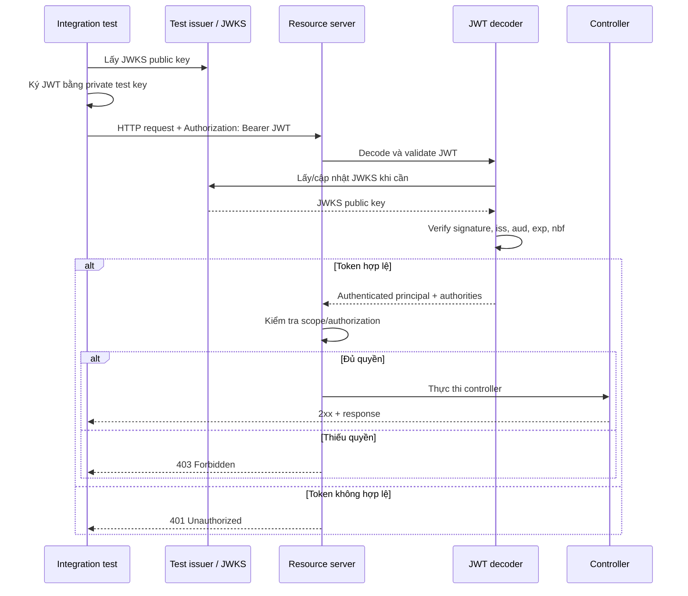

# Test resource server với JWT

## 1. Mục tiêu của integration testing

Resource server là ứng dụng hoặc API nhận access token, xác minh token và quyết định request có được phép truy cập tài nguyên hay không. Khi token là JWT, resource server thường tự xác minh chữ ký bằng public key của issuer, kiểm tra issuer, audience, thời hạn và các claim cần thiết trước khi tạo security context cho request.

**Integration testing** kiểm tra các thành phần đó phối hợp đúng trong một luồng HTTP thực tế: request đi qua security filter chain, bearer token được trích xuất, JWT decoder xác minh token, claim được ánh xạ thành authority, authorization rule quyết định quyền và controller chỉ chạy khi request hợp lệ.

Điểm quan trọng là test phải sử dụng JWT được ký thật bằng khóa riêng của môi trường test và gửi qua HTTP Authorization header. Nếu test chỉ tạo một đối tượng JWT giả hoặc mock decoder trả về một principal đã xác thực, test đó có thể kiểm tra authorization rule nhưng chưa chứng minh resource server xác minh chữ ký và claim đúng.

Bài học tập trung vào **kiểm thử resource server với JWT trong OAuth 2.0/OIDC**, theo phạm vi bảo mật token của module. Sau bài học, người học có thể:

- Dựng issuer/JWKS test cục bộ và phát hành JWT test có chữ ký hợp lệ.
- Gửi token qua HTTP để kiểm tra toàn bộ security filter chain của resource server.
- Xác minh chữ ký, thuật toán, `kid`, issuer, audience, `exp`, `nbf` và claim theo profile.
- Kiểm tra ánh xạ scope/role thành authority và phân biệt `401` với `403`.
- Kiểm thử JWT sai chữ ký, hết hạn, sai issuer/audience, thiếu claim và sai quyền.
- Kiểm tra JWKS cache, key rotation, issuer không truy cập được và hành vi fail-closed.
- Xác nhận request bị từ chối không tạo side effect và log không làm lộ token.

## 2. Phân biệt unit test, slice test và integration test

Mỗi cấp test trả lời một câu hỏi khác nhau. Không nên dùng một loại test để kết luận mọi lớp bảo mật đều đúng.

| Loại test | Thành phần được kiểm tra | Có xác minh JWT thật không? | Phù hợp để chứng minh |
| --- | --- | --- | --- |
| Unit test validator | Một validator hoặc policy riêng lẻ | Có thể không; thường truyền claim fixture | Logic kiểm tra một claim hoặc quy tắc |
| Authorization test với principal giả | Quy tắc endpoint sau khi đã có principal | Không nhất thiết | Scope/role nào được gọi endpoint |
| Security slice test | Một phần Spring Security/filter/controller | Tùy cách dựng decoder | Ánh xạ authority và cấu hình filter trong phạm vi slice |
| Integration test resource server | HTTP request qua ứng dụng, decoder, JWKS và authorization | **Có** | Chuỗi xác minh và phân quyền phối hợp đúng |
| End-to-end test | Client, issuer, resource server và hạ tầng tích hợp | Có | Hành vi của nhiều dịch vụ qua ranh giới triển khai |

Ví dụ, Spring Security Test có request post-processor `jwt()` giúp tạo principal JWT thuận tiện. Cách này hữu ích khi kiểm tra endpoint yêu cầu `SCOPE_orders.read`, nhưng nó thường thiết lập authentication trực tiếp cho test request và **bỏ qua việc giải mã bearer token từ header bằng JwtDecoder thật**. Vì vậy:

- Dùng `jwt()` hoặc mock principal cho test tập trung vào authorization mapping.
- Dùng `Authorization: Bearer <signed-jwt>` và JWKS test để kiểm tra chữ ký, issuer, audience, thời hạn, decoder và filter chain.
- Nếu mục tiêu là kiểm tra ứng dụng như một resource server, phải có ít nhất một nhóm integration test không mock thành phần xác minh JWT.

## 3. Mô hình hệ thống và luồng kiểm thử

Giả sử có một authorization server phát hành access token JWT và một API đơn hàng làm resource server:

- Issuer: `https://issuer.test.example`
- JWKS: endpoint test cục bộ cung cấp public key.
- Resource server: `orders-api`.
- Audience hợp lệ: `orders-api`.
- Endpoint đọc: `GET /api/orders`, yêu cầu `orders.read`.
- Endpoint ghi: `POST /api/orders`, yêu cầu `orders.write`.
- Subject mẫu: `user-42`.
- Signing key: RSA key pair chỉ dùng trong test.

Luồng kiểm thử:



Trong integration test, issuer/JWKS nên chạy trên loopback hoặc mock HTTP server do test quản lý. Không gọi issuer production, không tải khóa tùy ý từ Internet và không dùng private key thật. Test phải kiểm soát được thời gian, khóa, phản hồi JWKS và trạng thái server để có thể tái lập.

## 4. Dựng test issuer và JWKS

### 4.1. Tạo cặp khóa riêng cho test

Dùng thư viện mật mã/JWT đã được dự án chấp nhận để sinh RSA key pair. Private key chỉ dùng ký token test; public key được xuất thành JWK để resource server tải từ JWKS endpoint.

Một fixture nên chứa:

| Thuộc tính | Giá trị minh họa |
| --- | --- |
| `kid` | `test-key-1` |
| `kty` | `RSA` |
| `use` | `sig` |
| `alg` | `RS256` |
| Private key | Chỉ nằm trong test process |
| Public JWK | Được trả qua JWKS endpoint |
| Issuer | `https://issuer.test.example` |

JWKS endpoint thường trả một JSON object có mảng `keys`. Không đưa private exponent hoặc private key material vào JWKS. Không commit private key test có thể bị tái sử dụng ngoài test; tốt nhất sinh khóa khi khởi chạy suite hoặc dùng fixture test không có quyền truy cập production.

### 4.2. Khởi chạy JWKS server giả lập

Có thể dùng MockWebServer, WireMock hoặc HTTP server test tương đương. Server cần hỗ trợ:

- Trả JWKS chứa public key hiện hành.
- Thay JWKS để kiểm tra key rotation.
- Trả JWKS rỗng hoặc thiếu `kid` để kiểm tra key không xác định.
- Trả HTTP 500, timeout hoặc JSON sai định dạng để kiểm tra lỗi tải khóa.
- Đếm số lần gọi JWKS để xác minh cache và refresh.

Không mock phương thức `JwtDecoder.decode()` trong bài test này. JWKS server là dependency HTTP được giả lập; việc parse token và xác minh chữ ký vẫn do decoder thật thực hiện.

### 4.3. Cấu hình issuer và audience

Resource server cần biết issuer tin cậy và nguồn JWKS. Với Spring Security, cấu hình minh họa có thể dùng `jwk-set-uri` trỏ tới JWKS test, đồng thời khai báo validator kiểm tra `iss`, `exp`, `nbf` và `aud`.

```yaml
spring:
  security:
    oauth2:
      resourceserver:
        jwt:
          issuer-uri: https://issuer.test.example
          jwk-set-uri: http://127.0.0.1:<dynamic-test-port>/jwks
```

Tên property và cách khởi tạo decoder cần được điều chỉnh theo phiên bản Spring Security của dự án. Khi cấu hình cả issuer và JWKS URI, phải xác nhận decoder vẫn thực hiện issuer validation; chỉ cung cấp JWKS URI không tự động chứng minh issuer của token là đúng. Audience cũng thường cần validator riêng nếu cấu hình ứng dụng không tự kiểm tra.

Trong test, nên override `spring.security.oauth2.resourceserver.jwt.jwk-set-uri` bằng URL có port động của JWKS server và override issuer bằng giá trị test. Ví dụ `DynamicPropertySource` bên dưới đăng ký trực tiếp hai property này, vì vậy không phụ thuộc placeholder môi trường của máy chạy CI.

Ví dụ validator audience theo Java, diễn giải theo API Spring Security hiện đại:

```java
OAuth2TokenValidator<Jwt> audienceValidator = jwt ->
    jwt.getAudience().contains("orders-api")
        ? OAuth2TokenValidatorResult.success()
        : OAuth2TokenValidatorResult.failure(
            new OAuth2Error("invalid_token", "Invalid audience", null)
        );

OAuth2TokenValidator<Jwt> issuerAndTime =
    JwtValidators.createDefaultWithIssuer("https://issuer.test.example");

OAuth2TokenValidator<Jwt> validator =
    new DelegatingOAuth2TokenValidator<>(issuerAndTime, audienceValidator);

decoder.setJwtValidator(validator);
```

Đây là ví dụ cấu hình, không phải mã copy nguyên xi cho mọi phiên bản. Cần kiểm tra API và cách kết hợp validator đang dùng trong dự án. Tránh vô tình thay validator mặc định bằng validator chỉ kiểm tra audience, làm mất kiểm tra thời hạn hoặc issuer.

## 5. Tạo JWT test có chữ ký thật

JWT test cần được ký bằng private key tương ứng với public key đang có trong JWKS. Một token hợp lệ thường có các claim minh họa:

```json
{
  "iss": "https://issuer.test.example",
  "sub": "user-42",
  "aud": ["orders-api"],
  "iat": 1795428000,
  "nbf": 1795428000,
  "exp": 1795428300,
  "scope": "orders.read orders.write"
}
```

Các thời điểm trên chỉ là giá trị ví dụ; test thực tế nên dùng `Clock` cố định hoặc thời điểm tương đối với clock mà ứng dụng sử dụng. Token factory nên cho phép ghi đè một thuộc tính mỗi lần:

- Issuer đúng hoặc issuer giả.
- Audience đúng hoặc API khác.
- Expiration còn hạn hoặc đã hết hạn.
- Not-before trong quá khứ hoặc tương lai.
- Scope đủ hoặc thiếu.
- `kid` đúng hoặc không tồn tại.
- Chữ ký bằng private key tương ứng hoặc bằng khóa khác.
- Claim bắt buộc có mặt, vắng mặt hoặc sai kiểu dữ liệu.

Một test âm tốt chỉ thay đổi một điều kiện so với token chuẩn. Ví dụ test audience sai vẫn phải có chữ ký hợp lệ, issuer đúng và thời gian còn hạn. Như vậy kết quả từ chối chứng minh audience validator đang hoạt động.

## 6. Ví dụ integration test với Spring Boot và MockMvc

Ví dụ sau mô tả cách tổ chức test. Tên helper `JwtTestIssuer`, `SignedJwtFactory` và `TestJwksServer` là abstraction minh họa; dự án cần triển khai bằng thư viện JWT/JWK đã được chấp nhận. Mục tiêu là giữ **decoder thật và HTTP bearer flow thật** trong test.

```java
@SpringBootTest
@AutoConfigureMockMvc
class OrdersResourceServerIT {

    @Autowired
    MockMvc mockMvc;

    // Static initialization ensures the JWKS endpoint exists before
    // Spring creates the ApplicationContext and resolves dynamic properties.
    static KeyPair signingKey = TestKeys.newRsaKeyPair();
    static TestJwksServer jwks = TestJwksServer.start(
        "test-key-1",
        TestKeys.toPublicJwk(signingKey.getPublic())
    );

    @DynamicPropertySource
    static void securityProperties(DynamicPropertyRegistry registry) {
        registry.add("spring.security.oauth2.resourceserver.jwt.jwk-set-uri", jwks::uri);
        registry.add("spring.security.oauth2.resourceserver.jwt.issuer-uri",
            () -> "https://issuer.test.example");
    }

    @AfterAll
    static void stopIssuer() {
        jwks.close();
    }

    @Test
    void acceptsValidJwtWithReadScope() throws Exception {
        String token = SignedJwtFactory.with(signingKey.getPrivate())
            .keyId("test-key-1")
            .issuer("https://issuer.test.example")
            .subject("user-42")
            .audience("orders-api")
            .expiresIn(Duration.ofMinutes(5))
            .scope("orders.read")
            .sign();

        mockMvc.perform(get("/api/orders")
                .header(HttpHeaders.AUTHORIZATION, "Bearer " + token))
            .andExpect(status().isOk());
    }

    @Test
    void rejectsJwtWithWrongAudience() throws Exception {
        String token = SignedJwtFactory.with(signingKey.getPrivate())
            .keyId("test-key-1")
            .issuer("https://issuer.test.example")
            .subject("user-42")
            .audience("billing-api")
            .expiresIn(Duration.ofMinutes(5))
            .scope("orders.read")
            .sign();

        mockMvc.perform(get("/api/orders")
                .header(HttpHeaders.AUTHORIZATION, "Bearer " + token))
            .andExpect(status().isUnauthorized());
    }

    @Test
    void rejectsValidJwtWithoutRequiredScope() throws Exception {
        String token = SignedJwtFactory.with(signingKey.getPrivate())
            .keyId("test-key-1")
            .issuer("https://issuer.test.example")
            .subject("user-42")
            .audience("orders-api")
            .expiresIn(Duration.ofMinutes(5))
            .scope("profile.read")
            .sign();

        mockMvc.perform(get("/api/orders")
                .header(HttpHeaders.AUTHORIZATION, "Bearer " + token))
            .andExpect(status().isForbidden());
    }
}
```

Để đoạn test có thể chạy trong một dự án cụ thể, cần bổ sung cấu hình endpoint, security filter chain, test server và token factory phù hợp. Cần đảm bảo test không vô tình dùng test slice hoặc profile khiến filter chain production bị thay thế. Nếu `@DynamicPropertySource` cần đọc port JWKS, hãy khởi động test server trước khi Spring context được tạo và quản lý vòng đời fixture phù hợp với test framework.

### 6.1. Vì sao phải gửi bearer header?

Request dùng:

```http
GET /api/orders HTTP/1.1
Host: localhost
Authorization: Bearer <SIGNED_TEST_JWT>
Accept: application/json
```

Nhờ đó, test đi qua bearer token authentication filter và decoder được cấu hình trong resource server. Nếu test chỉ dùng:

```java
mockMvc.perform(get("/api/orders").with(jwt()));
```

thì test có thể tạo authentication đã được xác thực mà không chạy toàn bộ quá trình decode token từ header. Cách đó vẫn hữu ích để kiểm tra scope-to-authority mapping, nhưng không thay thế test JWT chữ ký thật.

## 7. Kiểm tra ánh xạ scope và quyền endpoint

Resource server cần chuyển scope trong access token thành authority theo quy tắc nhất quán. Trong Spring Security, cấu hình mặc định thường ánh xạ scope thành authority có tiền tố `SCOPE_`, ví dụ `orders.read` thành `SCOPE_orders.read`. Nếu dự án tùy chỉnh converter để dùng `roles`, `scp` hoặc claim riêng, test phải phản ánh chính xác converter đó.

| Token | Endpoint | Kết quả mong đợi |
| --- | --- | --- |
| `scope=orders.read` | `GET /api/orders` | Cho phép |
| `scope=orders.write` | `GET /api/orders` | Từ chối nếu endpoint yêu cầu read |
| `scope=orders.read` | `POST /api/orders` | Từ chối nếu endpoint yêu cầu write |
| `scope=orders.read orders.write` | GET và POST | Cho phép nếu các điều kiện resource khác đạt |
| Không có scope | Endpoint yêu cầu scope | Từ chối theo authorization policy |
| Scope đúng nhưng tenant sai | Truy cập order tenant khác | Từ chối theo object/tenant policy |

Test scope không nên chỉ kiểm tra response status. Với endpoint ghi, hãy xác nhận database hoặc fake repository không nhận lệnh ghi khi request bị từ chối. Với endpoint đọc, xác nhận không trả dữ liệu ngoài phạm vi subject/tenant.

Ví dụ một security rule có thể yêu cầu authority:

```java
.requestMatchers(HttpMethod.GET, "/api/orders")
    .hasAuthority("SCOPE_orders.read")
.requestMatchers(HttpMethod.POST, "/api/orders")
    .hasAuthority("SCOPE_orders.write")
```

Test phải khớp với rule thật của ứng dụng. Nếu quyền được kiểm tra ở method security hoặc service layer, cần kiểm tra đường đi qua các lớp đó thay vì chỉ test matcher ở filter chain.

## 8. Ma trận negative testing cho JWT

Dùng một JWT chuẩn hợp lệ làm baseline rồi tạo các biến thể sau. Mỗi test nên ghi rõ điều kiện sai, kết quả mong đợi và lớp chịu trách nhiệm kiểm tra.

| Test case | Biến thể token | Kết quả tại resource server |
| --- | --- | --- |
| Không có bearer token | Không gửi Authorization | `401 Unauthorized` |
| Header sai scheme | `Basic ...` hoặc scheme không hỗ trợ | Từ chối xác thực |
| JWT malformed | Thiếu segment, base64url sai, JSON lỗi | `401 Unauthorized` |
| Sai chữ ký | Sửa payload hoặc ký bằng private key khác | `401 Unauthorized` |
| Thuật toán không được cho phép | `alg=none` hoặc thuật toán ngoài allowlist | `401 Unauthorized` |
| `kid` không tồn tại | Key ID không có trong JWKS | `401 Unauthorized` |
| Issuer sai | `iss` khác issuer tin cậy | `401 Unauthorized` |
| Audience sai | `aud` chỉ tới API khác | `401 Unauthorized` |
| Hết hạn | `exp` ở quá khứ | `401 Unauthorized` |
| Chưa hiệu lực | `nbf` vượt clock skew | `401 Unauthorized` |
| Thiếu claim bắt buộc | Thiếu claim theo access token profile | Từ chối xác thực |
| Claim sai kiểu | `aud`, `exp` hoặc claim policy sai kiểu | Từ chối xác thực |
| Token đúng nhưng thiếu scope | Scope không đủ cho endpoint | `403 Forbidden` khi phù hợp |
| Tenant không khớp | Scope đúng nhưng tài nguyên thuộc tenant khác | Từ chối theo policy dữ liệu |

Không gộp tất cả test âm thành một test “token invalid”. Ví dụ, token sai chữ ký có thể bị từ chối trước khi issuer/audience validator chạy. Nếu cùng lúc sai chữ ký và sai audience, test không chứng minh audience validation. Tạo test riêng cho từng điều kiện để xác định chính xác lỗ hổng nếu một validator bị bỏ sót.

### 8.1. Ranh giới thời gian và clock skew

Kiểm tra các thời điểm:

- `exp` nhỏ hơn thời điểm hiện tại một giây.
- `exp` đúng tại thời điểm hiện tại theo quy tắc so sánh của verifier.
- `nbf` ở tương lai nhưng nằm trong clock skew được phép.
- `nbf` ở tương lai vượt clock skew.
- `iat` trong tương lai hoặc token có tuổi vượt giới hạn ứng dụng.

Dùng clock cố định hoặc injectable clock. Tránh `Thread.sleep()` để chờ token hết hạn; cách này làm test chậm và không ổn định. Nếu decoder đang sử dụng system clock khó thay thế, có thể tạo token với thời gian tương đối đủ xa và cấu hình tolerance rõ ràng, nhưng cần có test riêng cho ranh giới bằng validator unit test.

## 9. Kiểm thử JWKS cache và key rotation

Resource server thường cache public key lấy từ JWKS để giảm số lần gọi issuer. Điều này giúp tăng hiệu năng nhưng tạo ra các trạng thái cần kiểm tra.

**Kịch bản key rotation:**

1. JWKS ban đầu chứa public key `key-1`.
2. Token được ký bằng private key tương ứng và có `kid=key-1`; resource server xác minh thành công.
3. Issuer thêm `key-2` vào JWKS trong giai đoạn overlap.
4. Token mới ký bằng `key-2`; resource server tải hoặc refresh JWKS và xác minh thành công.
5. Issuer ngừng phát hành bằng `key-1`, sau đó loại key cũ theo chính sách.
6. Xác minh hành vi với token ký bằng `key-1` theo cache, overlap và thời hạn token đã công bố.

| Tình huống JWKS | Điều cần xác minh |
| --- | --- |
| JWKS bình thường | Token ký bằng key có `kid` tương ứng được xác minh |
| `kid` mới chưa có trong cache | Decoder có refresh JWKS theo cơ chế thư viện và tìm thấy key mới |
| `kid` không tồn tại sau refresh | Token bị từ chối |
| JWKS trả 500 hoặc timeout | Token không xác minh được phải bị từ chối; không dùng key tùy tiện |
| JWKS JSON malformed | Không chấp nhận key chưa xác minh |
| JWKS có nhiều key | Chọn đúng key theo `kid`, `kty`, `use`, `alg` và chính sách |
| Key cũ bị loại | Hành vi chấp nhận/từ chối phù hợp overlap và cache policy |

Một số thư viện cache negative lookup hoặc JWKS response trong một khoảng thời gian. Test không nên giả định mọi lần token có `kid` lạ đều lập tức tạo một HTTP request mới. Hãy xác minh hành vi theo cache policy của decoder và phiên bản thư viện đang dùng.

Không để test tự truy cập JWKS production. Nếu decoder đang được cấu hình với issuer URI thật, test có nguy cơ phụ thuộc Internet hoặc tải khóa thật. Dùng property override cho issuer/JWKS test và kiểm tra cấu hình được nạp trong Spring context.

## 10. Kiểm thử lỗi hạ tầng và fail-closed

Resource server có thể không lấy được JWKS do DNS, TLS, timeout, HTTP 5xx hoặc dữ liệu lỗi. Hành vi cần an toàn: không thể xác minh chữ ký thì không được coi token là hợp lệ.

Các kịch bản nên có:

- JWKS server không khởi động hoặc không thể kết nối.
- JWKS request timeout.
- JWKS trả `500`.
- TLS certificate của issuer không được tin cậy trong test TLS.
- JWKS trả JSON thiếu `keys`, key không hợp lệ hoặc `kid` trùng.
- Cache có key cũ nhưng issuer đã thay đổi cấu hình; xác định giới hạn stale key theo policy.
- Issuer discovery metadata và JWKS URI không nhất quán nếu ứng dụng sử dụng OIDC discovery.

Phân biệt lỗi token và lỗi hạ tầng. Một JWT sai chữ ký thường dẫn đến `401`; nếu issuer/JWKS không khả dụng, ứng dụng cũng phải từ chối request chưa xác minh, nhưng log/metric nên giúp vận hành nhận biết lỗi dependency thay vì quy kết mọi trường hợp là người dùng gửi token sai.

Không retry vô hạn trong request path. Timeout, số lần retry và cache phải có giới hạn để tránh một issuer lỗi làm cạn thread hoặc connection pool của resource server.

## 11. Kiểm tra response, side effect và log

Integration test cần xác minh cả những gì **không được xảy ra** khi request bị từ chối.

Với request sai token hoặc thiếu quyền:

- Không gọi service xử lý nghiệp vụ nếu authorization phải chặn ở filter chain.
- Không ghi hoặc cập nhật dữ liệu.
- Không trả response body chứa dữ liệu bảo vệ.
- Không đưa JWT, refresh token, private key hoặc toàn bộ Authorization header vào log.
- Không trả stack trace hoặc chi tiết cấu hình nội bộ cho client.
- Trả status và Bearer challenge phù hợp với API contract.

Với request hợp lệ:

- Principal được tạo từ đúng `sub` và issuer đã xác minh.
- Scope/authority được ánh xạ đúng.
- Tenant và actor context được truyền đúng nếu ứng dụng hỗ trợ.
- Chỉ dữ liệu subject được phép truy cập mới xuất hiện trong response.
- Audit event không ghi token thô.

Có thể dùng spy hoặc fake repository để xác nhận số lần gọi service. Nhưng không mock decoder trong test xác minh JWT thật. Nếu cần xác minh transaction không ghi dữ liệu, dùng database test hoặc repository fixture có thể kiểm tra trạng thái trước và sau request.

## 12. Phân biệt 401 và 403 trong test

Với Bearer token theo RFC 6750, cần kiểm tra ngữ nghĩa lỗi:

| Tình huống | Kết quả thường dùng | Ý nghĩa |
| --- | --- | --- |
| Không có token | `401 Unauthorized` | Request chưa được xác thực |
| Token sai chữ ký, hết hạn, sai issuer/audience | `401 Unauthorized`, `invalid_token` khi phù hợp | Bearer token không hợp lệ |
| Token hợp lệ nhưng thiếu scope | `403 Forbidden`, `insufficient_scope` khi phù hợp | Đã xác thực nhưng không đủ quyền |
| Token đủ scope nhưng không sở hữu resource | `403` hoặc `404` theo policy | Authorization ở cấp tài nguyên từ chối |

Cấu trúc `WWW-Authenticate` và response body cần theo API contract. Không nên phụ thuộc vào nội dung lỗi nội bộ của một phiên bản framework nếu nội dung đó không thuộc hợp đồng công khai; hãy kiểm tra status, challenge và các trường cần thiết.

## 13. Mẫu test plan cho một resource server

Trước khi chạy suite, ghi lại phiên bản framework, cấu hình issuer/audience, cách ánh xạ authority, nguồn JWKS, clock skew và cache policy. Mẫu plan sau có thể dùng để review độ bao phủ:

| Nhóm | Test tối thiểu | Tiêu chí đạt |
| --- | --- | --- |
| HTTP bearer flow | Token hợp lệ qua Authorization header | Request đi qua decoder thật và trả kết quả |
| Signature | Chữ ký sai, thuật toán cấm | Bị từ chối |
| Trust | Issuer sai, `kid` lạ | Bị từ chối |
| Audience | Đúng API, sai API | Chỉ token đúng target được chấp nhận |
| Time | Hết hạn, chưa hiệu lực, clock skew | Kết quả đúng ranh giới đã cấu hình |
| Claims | Thiếu claim, sai kiểu | Bị từ chối theo profile |
| Authorization | Đủ scope, thiếu scope | Cho phép đúng endpoint; thiếu quyền bị chặn |
| Resource ownership | Sai tenant hoặc owner | Không lộ dữ liệu và không có side effect |
| JWKS | Rotation, timeout, 5xx, malformed | Refresh và fail-closed đúng policy |
| Observability | Audit/log/error | Không lộ token hoặc secret |
| Repeatability | Clock và key test xác định | Suite chạy ổn định, không phụ thuộc production |

Một suite tốt có cả test thành công và thất bại, kiểm tra response lẫn trạng thái dữ liệu. Với các test key rotation hoặc cache, nên chạy tuần tự theo kịch bản rõ ràng để tránh test song song làm thay đổi JWKS fixture của nhau.

## 14. Những sai lầm thường gặp

**Chỉ dùng `jwt()` trong tất cả test.** Test chứng minh authorization mapping nhưng không kiểm tra chữ ký, issuer, audience hoặc JWKS. Bổ sung integration test gửi JWT đã ký qua bearer header.

**Mock `JwtDecoder` rồi kết luận resource server xác minh JWT an toàn.** Mock bỏ qua thành phần đang cần kiểm tra. Giữ decoder thật và chỉ giả lập JWKS HTTP server.

**Chỉ kiểm tra chữ ký.** JWT có chữ ký đúng vẫn có thể sai issuer, audience, thời hạn hoặc token type. Bổ sung validator theo access token profile.

**Không kiểm tra audience.** Token cấp cho API A có thể được chấp nhận tại API B nếu resource server chỉ kiểm tra issuer và chữ ký. Phải có audience validator và test sai audience.

**Dùng issuer/JWKS production trong CI.** Test phụ thuộc mạng, khóa và trạng thái bên ngoài. Dựng test issuer/JWKS cục bộ, override cấu hình và chặn kết nối ngoài nếu cần.

**Tắt filter chain trong test để tiện gọi controller.** Test đó không còn kiểm tra resource server. Chỉ tắt security trong test controller không thuộc phạm vi kiểm chứng này.

**Kiểm tra status nhưng không kiểm tra side effect.** Request bị từ chối vẫn có thể đã ghi dữ liệu nếu authorization được đặt sai vị trí. Xác minh repository/database và service invocation.

**Không kiểm tra key rotation và cache.** Ứng dụng có thể từ chối token mới hợp lệ hoặc tiếp tục chấp nhận key đã bị loại ngoài khoảng overlap. Kiểm tra JWKS refresh và cache behavior.

## 15. Checklist nghiệm thu

- [ ] Test chạy qua HTTP và bearer authentication filter thực tế.
- [ ] JWT được ký bằng private test key; public key nằm trong JWKS test.
- [ ] Decoder thật xác minh chữ ký và thuật toán allowlist.
- [ ] Issuer, audience, `exp`, `nbf` và claim theo profile được kiểm tra.
- [ ] Có test sai chữ ký, `kid` lạ, token malformed và token hết hạn.
- [ ] Có test scope/authority và phân biệt `401` với `403`.
- [ ] Có test tenant/resource ownership và không phát sinh side effect khi bị từ chối.
- [ ] Có test JWKS rotation, cache, timeout và HTTP 5xx.
- [ ] Không gọi issuer/JWKS production trong CI.
- [ ] Không mock decoder trong nhóm test xác minh JWT thật.
- [ ] Log, trace và response không làm lộ token hoặc secret.
- [ ] Test có thể chạy lặp lại bằng khóa và thời gian xác định.

## 16. Câu hỏi tự kiểm tra

**1. Vì sao integration test resource server cần gửi JWT qua Authorization header?**

Để request đi qua bearer authentication filter, JWT decoder và các validator thật. Tạo principal trực tiếp có thể bỏ qua bước xác minh token.

**2. Token có chữ ký đúng và issuer đúng nhưng audience là `billing-api` có được `orders-api` chấp nhận không?**

Không, nếu policy yêu cầu audience `orders-api`. Chữ ký và issuer không chứng minh token được phát hành cho resource server hiện tại.

**3. Vì sao cần kiểm thử scope riêng với chữ ký?**

Chữ ký hợp lệ chỉ xác nhận token toàn vẹn và nguồn phát hành; scope quyết định quyền. Token hợp lệ nhưng thiếu scope thường phải được xác thực thành công rồi bị authorization từ chối.

**4. JWKS server trả lỗi thì resource server có thể cho request tiếp tục không?**

Không thể chấp nhận token mới nếu không có public key đáng tin để xác minh. Nếu cache còn key hợp lệ, hành vi phụ thuộc cache policy; khi không xác minh được, phải fail-closed.

**5. Có thể chỉ dùng `jwt()` của Spring Security Test để nghiệm thu resource server không?**

Không. Nó hữu ích cho test authorization mapping, nhưng không thay thế integration test dùng signed JWT và decoder thật.

**6. Test key rotation cần xác minh điều gì?**

Resource server nhận key mới, chọn đúng `kid`, duy trì key cũ trong khoảng overlap được phép, và ngừng tin key cũ theo chính sách sau khi rotation hoàn tất.

## Tài liệu chuẩn tham khảo

- [RFC 7519 – JSON Web Token (JWT)](https://www.rfc-editor.org/rfc/rfc7519): cấu trúc token và các claim registered như `iss`, `sub`, `aud`, `exp`, `nbf`, `iat`.
- [RFC 8725 – JSON Web Token Best Current Practices](https://www.rfc-editor.org/rfc/rfc8725): xác minh thuật toán, issuer, audience và các rủi ro JWT.
- [RFC 9068 – JWT Profile for OAuth 2.0 Access Tokens](https://www.rfc-editor.org/rfc/rfc9068): profile access token JWT.
- [RFC 6750 – OAuth 2.0 Bearer Token Usage](https://www.rfc-editor.org/rfc/rfc6750): bearer header, `invalid_token` và `insufficient_scope`.
- [RFC 8414 – OAuth 2.0 Authorization Server Metadata](https://www.rfc-editor.org/rfc/rfc8414): metadata của authorization server.
- [OpenID Connect Discovery 1.0](https://openid.net/specs/openid-connect-discovery-1_0.html): discovery metadata và JWKS URI.
- [Spring Security – OAuth 2.0 Resource Server JWT](https://docs.spring.io/spring-security/reference/servlet/oauth2/resource-server/jwt.html): cấu hình resource server và JWT decoder.
- [Spring Security – Testing OAuth 2.0](https://docs.spring.io/spring-security/reference/servlet/test/mockmvc/oauth2.html): hỗ trợ test OAuth2/JWT trong MockMvc.

