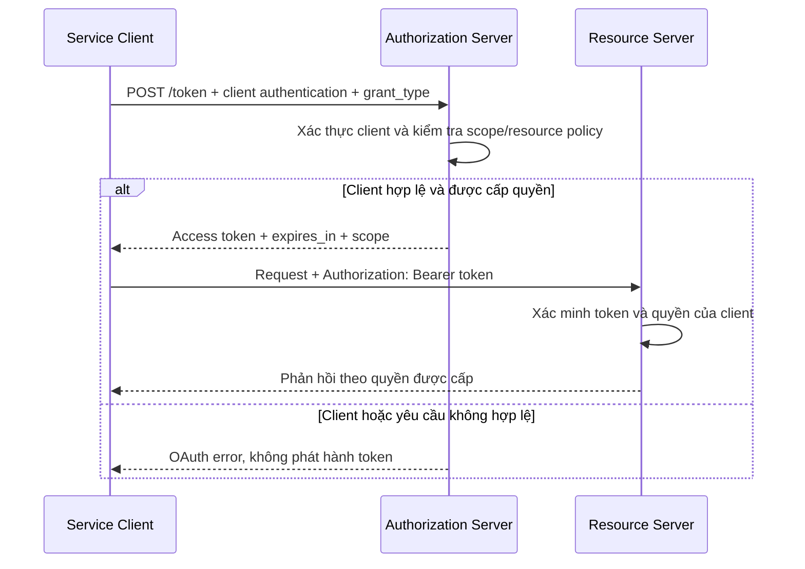

# Kiểm thử luồng Client Credentials

## 1. Mục tiêu và phạm vi

OAuth 2.0 Client Credentials Grant cho phép một **confidential client** lấy access token để gọi API nhân danh chính ứng dụng/dịch vụ đó. Luồng này phù hợp cho giao tiếp service-to-service khi không có người dùng cuối tham gia vào lần cấp token. Client xác thực với Authorization Server, yêu cầu token theo scope và có thể theo resource/audience, sau đó gửi access token tới Resource Server.

Kiểm thử tích hợp cần chứng minh toàn bộ chuỗi hoạt động đúng: client được xác thực bằng phương thức đã đăng ký; Authorization Server chỉ cấp scope và resource mà client được phép; token có thời hạn và loại phù hợp; Resource Server xác minh token và thực thi quyền; các yêu cầu sai bị từ chối; bí mật và token không bị lộ qua log.

Phạm vi bài này là **test client credential flow** trong mô hình token security. Nội dung bao gồm request/response tại token endpoint, xác thực client, kiểm tra access token JWT hoặc opaque, gọi API được bảo vệ, các tình huống âm, cache token và bảo vệ dữ liệu test. Bài không dùng Client Credentials để giả lập đăng nhập người dùng, consent hay quyền của một user cụ thể.

## 2. Hiểu đúng luồng Client Credentials

Theo RFC 6749, Client Credentials Grant dùng `grant_type=client_credentials`. Client phải là confidential client có khả năng bảo vệ thông tin xác thực. Authorization Server xác thực client và kiểm tra quyền được cấp trước khi phát hành access token.



Khác với Authorization Code Flow, luồng này không có browser redirect, authorization code, PKCE, user login hay consent của người dùng. Subject của token đại diện cho client/service theo profile và cấu hình của Authorization Server. Không nên suy ra có người dùng chỉ vì access token chứa claim `sub`; ý nghĩa của claim phải theo hợp đồng issuer và token profile.

Client Credentials thường không trả refresh token. Client có thể lấy access token mới bằng cách xác thực lại khi token cũ hết hạn. Theo RFC 6749, Authorization Server không nên phát hành refresh token cho grant này. Test cần phát hiện việc hệ thống vô tình cấp refresh token nếu hợp đồng triển khai quy định không cấp.

## 3. Chuẩn bị fixture kiểm thử

Trước khi gọi token endpoint, xác định rõ các fixture và quyền dự kiến. Không dùng credential production hoặc token thật trong test.

| Fixture | Cấu hình minh họa | Mục đích |
| --- | --- | --- |
| Client hợp lệ | `inventory-worker` | Confidential client được phép gọi token endpoint. |
| Client credential | Secret test hoặc private key test | Xác thực client theo phương thức đăng ký. |
| Scope được phép | `inventory.read` | Quyền đọc dữ liệu tồn kho đã được cấp cho client. |
| Scope không được phép | `inventory.admin` | Kiểm tra server không cấp quyền quản trị ngoài policy. |
| Resource/API đích | `https://inventory.api.example.test` | Ràng buộc token với đúng API nếu Authorization Server hỗ trợ resource/audience. |
| Resource Server | Inventory API trong môi trường test | Xác minh token và thực thi scope. |
| Client khác | `reporting-worker` | Kiểm tra credential và quyền không bị dùng chéo giữa client. |

Đảm bảo Authorization Server có cấu hình rõ client ID, loại client, phương thức xác thực, scope được cấp, resource được phép và thời hạn token. Fixture test nên tạo dữ liệu có thể tái lập và dọn dẹp sau mỗi test suite.

## 4. Gửi token request hợp lệ

Ví dụ dưới đây dùng `client_secret_basic` và dữ liệu giả. Trong môi trường thật, client ID và secret phải được mã hóa theo quy tắc HTTP Basic của OAuth (form-encode từng thành phần trước khi ghép `client_id:client_secret` và Base64), truyền qua TLS và được quản lý trong secret store.

```http
POST /oauth2/token HTTP/1.1
Host: auth.example.test
Authorization: Basic <base64-encoded-client-credentials>
Content-Type: application/x-www-form-urlencoded

grant_type=client_credentials&scope=inventory.read
```

Nếu Authorization Server hỗ trợ Resource Indicators (RFC 8707), request có thể chỉ rõ resource:

```http
POST /oauth2/token HTTP/1.1
Host: auth.example.test
Authorization: Basic <base64-encoded-client-credentials>
Content-Type: application/x-www-form-urlencoded

grant_type=client_credentials&scope=inventory.read&resource=https%3A%2F%2Finventory.api.example.test
```

`resource` không phải tham số bắt buộc của mọi Authorization Server. Nếu hệ thống dùng `audience` theo một profile hoặc extension riêng, test phải theo hợp đồng được cấu hình. Không gửi đồng thời nhiều biến thể chỉ để mong server tự chọn; kiểm thử đúng tham số và profile mà hệ thống công bố.

Phản hồi thành công thường có dạng:

```http
HTTP/1.1 200 OK
Content-Type: application/json
Cache-Control: no-store
Pragma: no-cache

{
  "access_token": "<opaque-or-jwt-access-token>",
  "token_type": "Bearer",
  "expires_in": 300,
  "scope": "inventory.read"
}
```

Các giá trị trên chỉ minh họa. Thời hạn, scope thực tế và định dạng token phụ thuộc policy của Authorization Server. Nếu scope được cấp khác scope yêu cầu, response phải thể hiện scope thực tế theo quy tắc OAuth; client không được tự giả định server đã cấp toàn bộ scope xin.

## 5. Kiểm tra response và access token

Không dừng test ở HTTP 200. Cần kiểm tra nội dung response và token được phát hành:

- `access_token` tồn tại và không rỗng.
- `token_type` phù hợp với cách client gửi token tới API, thường là `Bearer` trong ví dụ này.
- `expires_in` là số dương và nằm trong giới hạn policy test.
- Scope thực tế là scope được cấp, không vượt quá scope mà client được phép.
- Không có `refresh_token` nếu hợp đồng Client Credentials của hệ thống yêu cầu không phát hành refresh token.
- Token chỉ dành cho resource/audience dự kiến; không thể dùng token của Inventory API để gọi API quản trị hoặc API khác.

### Nếu access token là JWT

Khi hệ thống phát hành JWT access token, test nên xác minh chữ ký bằng khóa lấy từ JWKS tin cậy, thuật toán theo allowlist, issuer, audience, thời hạn và claims theo token profile. Ví dụ payload minh họa:

```json
{
  "iss": "https://auth.example.test",
  "sub": "inventory-worker",
  "aud": "https://inventory.api.example.test",
  "client_id": "inventory-worker",
  "scope": "inventory.read",
  "iat": 1900000000,
  "exp": 1900000300,
  "jti": "access-8f31"
}
```

Đây là claims ví dụ, không phải mọi claim đều bắt buộc trong mọi JWT. Nếu áp dụng JWT Access Token Profile (RFC 9068), cần kiểm tra đúng các yêu cầu profile tương ứng, bao gồm loại token và claims được profile quy định. Không chỉ Base64-decode JWT rồi tin payload; giải mã không xác minh chữ ký.

### Nếu access token là opaque

Opaque token không cho Resource Server tự đọc claims. Resource Server có thể dùng introspection endpoint theo RFC 7662 hoặc cơ chế xác minh trạng thái nội bộ đã được tin cậy. Integration test cần xác nhận token active, client identity, scope và audience/resource được trả về phù hợp. Cũng cần kiểm tra hành vi khi token inactive, hết hạn hoặc introspection timeout theo chính sách fail-open/fail-closed của hệ thống.

## 6. Gọi Resource Server bằng token vừa cấp

Sau khi nhận access token, client gọi đúng API đích:

```http
GET /v1/inventory/items HTTP/1.1
Host: inventory.api.example.test
Authorization: Bearer <access-token>
Accept: application/json
```

Kết quả thành công phải chứng minh API chấp nhận token đúng issuer, audience, thời hạn và scope. Nếu endpoint yêu cầu `inventory.read`, token có scope này có thể được chấp nhận khi các điều kiện khác đều đúng.

Tiếp theo, dùng cùng token gọi một endpoint yêu cầu `inventory.admin` hoặc một API thuộc audience khác. Resource Server phải từ chối. Đây là phần quan trọng của integration test: nó chứng minh scope và audience được thực thi ở API, thay vì chỉ xuất hiện trong response của token endpoint.

Nếu token là Bearer, bất kỳ bên nào sở hữu token đều có thể sử dụng token trong thời hạn hiệu lực, do đó test cần bảo vệ token và xác minh TLS. Với hệ thống yêu cầu sender-constrained token, ví dụ mTLS-bound access token theo RFC 8705, phải kiểm tra token chỉ được sử dụng với đúng chứng thư/client key đã ràng buộc.

## 7. Ma trận kiểm thử thành công và thất bại

| Trường hợp | Cách thực hiện | Kết quả mong đợi |
| --- | --- | --- |
| Client hợp lệ, scope hợp lệ | Xác thực client và xin `inventory.read` | Cấp access token đúng policy. |
| Sai client secret | Dùng secret không đúng với client ID | Token endpoint từ chối, không cấp token. |
| Thiếu client authentication | Bỏ Authorization header hoặc phương thức xác thực bắt buộc | Từ chối request. |
| Client ID không tồn tại | Gửi thông tin client không được đăng ký | Từ chối xác thực client. |
| Client bị vô hiệu hóa | Dùng credential đúng của client disabled | Từ chối cấp token. |
| Sai phương thức xác thực | Dùng `client_secret_post` khi client chỉ đăng ký `client_secret_basic` | Từ chối; không tự fallback sang phương thức khác. |
| Thiếu `grant_type` | Gửi request không có grant type | Từ chối request theo OAuth error contract. |
| Grant type không hỗ trợ | Gửi một grant khác với `client_credentials` | Từ chối; không cấp token. |
| Scope hợp lệ | Xin scope nằm trong allowlist của client | Chỉ cấp scope được phép. |
| Scope vượt quyền | Xin `inventory.admin` khi client chỉ được cấp read | Từ chối hoặc xử lý phần scope theo policy OAuth đã công bố; tuyệt đối không cấp quyền vượt policy. |
| Scope rỗng | Không gửi scope | Chỉ cấp default scope tối thiểu nếu đã cấu hình rõ; nếu không thì từ chối. |
| Resource không được phép | Xin token cho API quản trị | Từ chối với lỗi phù hợp, ví dụ `invalid_target` nếu dùng RFC 8707. |
| Token hết hạn | Gọi API bằng token đã hết hạn | Resource Server từ chối. |
| Sai audience | Dùng token Inventory cho API Billing | Resource Server từ chối. |
| Thiếu scope API yêu cầu | Dùng token chỉ có `inventory.read` cho thao tác admin | Resource Server từ chối. |
| Token bị sửa chữ ký | Sửa payload JWT mà không ký lại | Resource Server từ chối. |
| Token opaque inactive | Introspection trả `active=false` | Resource Server từ chối. |
| Token bị thu hồi | Thu hồi theo cơ chế của hệ thống rồi gọi lại API | Token không còn được chấp nhận trong SLA thu hồi. |
| Dùng refresh token | Thử dùng refresh token từ Client Credentials | Không có refresh token được cấp theo policy thông thường; không thể refresh bằng một token không hợp lệ. |
| Client khác dùng token | Dùng token hoặc credential của service khác | Quyền và audience không bị mở rộng; chỉ hành động được policy cho phép. |

Với lỗi xác thực client, OAuth token endpoint thường dùng `invalid_client`; với grant type không hỗ trợ có thể dùng `unsupported_grant_type`; scope không hợp lệ có thể dùng `invalid_scope`; resource đích không được hỗ trợ có thể dùng `invalid_target` khi áp dụng RFC 8707. Assertion nên kiểm tra mã lỗi theo hợp đồng và không phụ thuộc quá mức vào thông báo văn bản.

## 8. Ví dụ cấu trúc integration test

Đoạn mã dưới đây là mã giả theo phong cách JUnit. Các helper như `tokenClient`, `resourceApi`, `validClient`, `invalidClient` và `assertNoSecretsInLogs` cần được cung cấp bởi test harness của dự án:

```java
@Test
void clientCredentialsIssuesLeastPrivilegeTokenAndCallsApi() {
    TokenResponse token = tokenClient.requestClientCredentials(
        validClient(), Set.of("inventory.read"),
        "https://inventory.api.example.test");

    assertNotNull(token.accessToken());
    assertEquals("Bearer", token.tokenType());
    assertTrue(token.expiresIn() > 0);
    assertTrue(token.scopes().contains("inventory.read"));
    assertFalse(token.scopes().contains("inventory.admin"));
    assertNull(token.refreshToken());

    ApiResponse read = resourceApi.getInventory(token.accessToken());
    assertEquals(200, read.status());

    ApiResponse admin = resourceApi.performAdminAction(token.accessToken());
    assertEquals(403, admin.status());
}

@Test
void clientCredentialsRejectsInvalidClientSecret() {
    OAuthError error = tokenClient.requestAndCaptureError(
        invalidClient(), Set.of("inventory.read"));

    assertEquals("invalid_client", error.code());
    assertNull(error.accessToken());
}
```

Mã giả thể hiện hai luồng quan trọng: client hợp lệ nhận token tối thiểu và sử dụng token đúng quyền; client không hợp lệ không nhận token. Trong test thật, tránh hard-code giả định HTTP status cho mọi lỗi nếu framework hoặc hợp đồng server quy định khác; theo OAuth, token endpoint thường trả lỗi client authentication bằng HTTP 401 khi phù hợp, nhưng assertion cần khớp triển khai chuẩn và cấu hình thực tế.

Không mock Authorization Server hoặc Resource Server trong bài integration test chính. Có thể dùng test server, container hoặc môi trường ephemeral có cấu hình tương đương để test đi qua xác thực client, cấp token, xác minh token và authorization ở API. Unit test riêng vẫn hữu ích cho parser, validator và scope policy.

## 9. Kiểm thử các phương thức xác thực client

OAuth cho phép nhiều phương thức xác thực confidential client. Test phải phù hợp với phương thức đã đăng ký cho từng client:

| Phương thức | Nội dung cần xác minh |
| --- | --- |
| `client_secret_basic` | Client ID/secret được mã hóa đúng trong HTTP Basic; secret sai hoặc thiếu bị từ chối. |
| `client_secret_post` | Chỉ chấp nhận nếu server và client đã đăng ký phương thức này; không log body chứa secret. |
| `private_key_jwt` | Assertion được ký bằng khóa đúng, có `iss`, `sub`, `aud`, `exp`, `jti` theo profile; assertion hết hạn hoặc chữ ký sai bị từ chối. |
| Mutual TLS | Client certificate được xác minh theo trust configuration; chứng thư không hợp lệ hoặc không khớp client bị từ chối. |

Không nên cho phép một client thử nhiều phương thức cho tới khi một phương thức thành công nếu điều đó làm yếu cấu hình xác thực. Thay đổi phương thức phải là thay đổi cấu hình có kiểm soát. Với secret, kiểm thử rotation cần xác nhận secret cũ bị vô hiệu đúng thời điểm, secret mới hoạt động và không xuất hiện trong log.

## 10. Token cache và vòng đời ở phía client

Service client thường cache access token để tránh gọi token endpoint trên mỗi API request. Cache key cần gắn với client identity, scope, resource/audience và các thuộc tính ràng buộc token. Không dùng một token chung cho nhiều dịch vụ chỉ vì các dịch vụ chạy cùng ứng dụng.

Các test quan trọng:

- Khi token còn hiệu lực và scope/resource giống nhau, client tái sử dụng token theo policy cache.
- Khi token sắp hết hạn, client lấy token mới trước khi gửi request hoặc xử lý phản hồi hết hạn theo cơ chế an toàn.
- Khi scope hoặc resource thay đổi, client không tái sử dụng token có quyền/audience không phù hợp.
- Khi client secret hoặc key được rotate, client dùng credential mới và không tiếp tục cache token quá giới hạn chính sách.
- Khi token endpoint timeout hoặc trả lỗi tạm thời, client có retry/backoff có giới hạn, không tạo vòng lặp gọi liên tục.
- Không ghi access token vào cache dùng chung không được bảo vệ; giới hạn thời gian sống và quyền đọc cache.

Với Client Credentials, client lấy token mới bằng cách thực hiện lại grant sau khi xác thực client. Không dùng refresh token như một cơ chế mặc định cho luồng này.

## 11. Bảo vệ bí mật và dữ liệu test

Client secret, private key, client assertion, access token và dữ liệu introspection có thể cho phép truy cập API. Test harness phải bảo vệ chúng như dữ liệu nhạy cảm:

- Chỉ dùng credential riêng cho môi trường test; không sao chép secret production vào file cấu hình, source code hoặc pipeline log.
- Lấy secret từ secret manager hoặc biến môi trường được bảo vệ; không commit giá trị thật vào repository.
- Không log `Authorization` header, request body chứa secret, access token hoặc private key.
- Tắt hoặc lọc HTTP wire logging ở những client có thể ghi lại credential/token.
- Dùng TLS cho kết nối token endpoint và Resource Server; không tắt xác minh chứng thư trong test tích hợp ngoài cấu hình test CA có chủ đích.
- Khi test JWT, dùng khóa test riêng và bảo vệ private key; public key/JWKS có thể được cung cấp cho Resource Server theo cấu hình test.
- Dọn credential, token, cache và dữ liệu fixture sau test; hạn chế quyền đọc artifact CI.

Nếu cần correlation, dùng request ID, client ID test và mã lỗi. Không cần in token để debug; có thể ghi fingerprint đã được thiết kế an toàn nếu hệ thống cần tương quan token trong môi trường test.

## 12. Tiêu chí nghiệm thu

- [ ] Confidential client hợp lệ xác thực thành công bằng đúng phương thức đã đăng ký.
- [ ] Sai secret, thiếu credential, client bị disable và sai phương thức đều bị từ chối.
- [ ] Token request dùng `grant_type=client_credentials` và scope/resource theo policy.
- [ ] Access token có thời hạn, loại token, scope và audience/resource phù hợp.
- [ ] JWT được xác minh chữ ký, issuer, audience và thời gian; opaque token được kiểm tra trạng thái qua introspection hoặc cơ chế tin cậy.
- [ ] Resource Server chấp nhận thao tác được phép và từ chối scope/audience không phù hợp.
- [ ] Không cấp scope cao hơn quyền của client; không tự tạo user context hoặc quyền delegated.
- [ ] Không phát hành refresh token nếu policy Client Credentials quy định không có refresh token.
- [ ] Cache token được phân tách theo client, scope và resource; hết hạn/rotation được xử lý đúng.
- [ ] Token, secret, assertion và private key không xuất hiện trong log hoặc CI artifacts.
- [ ] Integration test đi qua cả token endpoint và Resource Server thực tế trong môi trường kiểm thử.

**Điểm cần nhớ:** Client Credentials chứng minh một ứng dụng/dịch vụ đã xác thực để hành động trong phạm vi quyền được cấp cho chính client đó. Một test hoàn chỉnh phải xác minh cả việc cấp token lẫn hành vi của API đích, đồng thời chứng minh rằng client không thể tự xin thêm scope, audience hoặc danh tính người dùng ngoài chính sách.

## Tài liệu tham khảo

- IETF, **RFC 6749 — The OAuth 2.0 Authorization Framework**, đặc biệt mục 4.4 về Client Credentials Grant và mục 2.3 về Client Authentication. <https://www.rfc-editor.org/rfc/rfc6749>
- IETF, **RFC 7662 — OAuth 2.0 Token Introspection**: kiểm tra trạng thái opaque access token. <https://www.rfc-editor.org/rfc/rfc7662>
- IETF, **RFC 8707 — Resource Indicators for OAuth 2.0**: ràng buộc token với resource server đích. <https://www.rfc-editor.org/rfc/rfc8707>
- IETF, **RFC 8705 — OAuth 2.0 Mutual-TLS Client Authentication and Certificate-Bound Access Tokens**: xác thực client và token gắn với chứng thư. <https://www.rfc-editor.org/rfc/rfc8705>
- IETF, **RFC 7523 — JSON Web Token (JWT) Profile for OAuth 2.0 Client Authentication and Authorization Grants**: client assertion JWT. <https://www.rfc-editor.org/rfc/rfc7523>
- IETF, **RFC 9068 — JWT Profile for OAuth 2.0 Access Tokens**: profile JWT access token. <https://www.rfc-editor.org/rfc/rfc9068>
