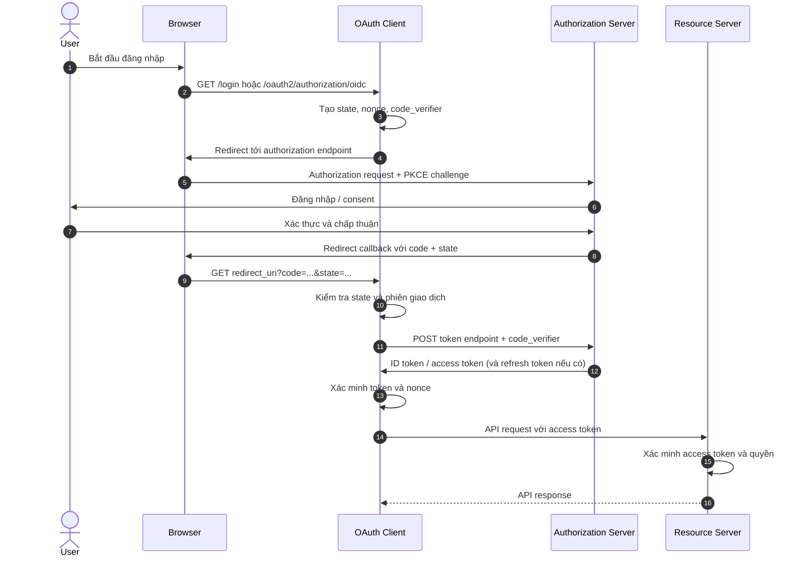

# Test authorization code flow: kiểm thử luồng cấp mã ủy quyền

## 1. Bối cảnh và mục tiêu

OAuth 2.0 Authorization Code Flow cho phép ứng dụng nhận access token thông qua một authorization code ngắn hạn. Trình duyệt được chuyển tới authorization server để người dùng đăng nhập và chấp thuận quyền; sau đó ứng dụng nhận code tại redirect URI và đổi code lấy token qua token endpoint. Với OpenID Connect (OIDC), luồng này còn có thể trả về ID token để client xác minh kết quả đăng nhập.

Một luồng đăng nhập chạy được ở môi trường phát triển chưa chứng minh nó an toàn. Lỗi có thể xuất hiện ở nhiều ranh giới: ứng dụng tạo sai tham số redirect, không ràng buộc callback với phiên trình duyệt, bỏ qua `state`, không dùng PKCE, đổi code nhiều lần, chấp nhận ID token sai issuer/audience/nonce hoặc để lộ code và token trong log.

Trong nền tảng **Security Token Security Fundamentals**, bài kiểm thử này kết nối vòng đời token với hành vi thực tế của OAuth 2.0/OIDC: yêu cầu cấp quyền, phát hành code, đổi code, xác minh token và gọi API. Người học cần hiểu rằng Authorization Code Flow là một giao thức nhiều bước; test chỉ gọi một controller đã mock sẵn principal sẽ không kiểm chứng toàn bộ giao thức.

Sau bài này, người học có thể:

- Mô tả vai trò của browser, OAuth client, authorization server và resource server trong Authorization Code Flow.
- Kiểm tra các tham số `response_type`, `client_id`, `redirect_uri`, `scope`, `state`, `nonce` và PKCE.
- Xác minh callback, token exchange, tính dùng một lần và thời hạn của authorization code.
- Kiểm thử OIDC ID token, access token, issuer, audience, nonce, chữ ký và scope.
- Thiết kế test âm cho CSRF, code injection, code replay, redirect URI sai, PKCE sai và token không hợp lệ.
- Chọn đúng mức kiểm thử unit, integration, contract và browser end-to-end.

## 2. Các thành phần và ranh giới tin cậy

Một hệ thống điển hình có bốn vai trò:

| Thành phần | Trách nhiệm | Dữ liệu cần bảo vệ |
| --- | --- | --- |
| **User-Agent / browser** | Điều hướng người dùng tới authorization server và quay lại callback của client. | Cookie phiên, dữ liệu đăng nhập, authorization code trong quá trình redirect. |
| **OAuth client** | Tạo authorization request, lưu trạng thái giao dịch, nhận callback và đổi code lấy token. | `state`, `nonce`, PKCE verifier, client credential, access/refresh token. |
| **Authorization server (AS)** | Xác thực người dùng, xử lý consent, phát hành code và token. | Phiên đăng nhập, grant, code, khóa ký và dữ liệu client. |
| **Resource server (RS)** | Nhận access token và quyết định quyền truy cập API. | API data, audience, scope, tenant và policy. |

Luồng tổng quát:



Authorization server và resource server có thể là hai dịch vụ khác nhau hoặc cùng một nền tảng. Dù triển khai theo cách nào, test vẫn cần phân biệt **xác thực người dùng tại client** với **ủy quyền truy cập tài nguyên tại resource server**.

## 3. Những tham số phải được kiểm tra

### 3.1. Authorization request

Client chuyển browser tới authorization endpoint bằng request có các tham số chính:

| Tham số | Mục đích | Điều cần xác minh trong test |
| --- | --- | --- |
| `response_type=code` | Yêu cầu authorization code. | Client dùng đúng response type của flow. |
| `client_id` | Xác định OAuth client đã đăng ký. | Giá trị khớp registration đang dùng. |
| `redirect_uri` | Địa chỉ AS được phép gửi kết quả về. | Khớp chính xác URI đã đăng ký và callback của client. |
| `scope` | Các quyền client yêu cầu. | Có `openid` nếu thực hiện OIDC; scope API chỉ được yêu cầu khi cần. |
| `state` | Tương quan request và callback, chống callback giả mạo/CSRF. | Giá trị khó đoán, gắn với phiên/giao dịch và được kiểm tra khi callback. |
| `nonce` | Ràng buộc ID token với yêu cầu đăng nhập OIDC. | Giá trị ngẫu nhiên được gửi đi và đối chiếu với claim trong ID token. |
| `code_challenge` | PKCE challenge tính từ verifier. | Dùng phương thức `S256`; challenge được tính đúng từ verifier bí mật. |
| `code_challenge_method=S256` | Chọn SHA-256 cho PKCE. | Không hạ xuống `plain` khi client có thể dùng S256. |

`state`, `nonce` và PKCE giải quyết các vấn đề liên quan nhưng không thay thế nhau. `state` giúp client nhận biết callback thuộc giao dịch nào; `nonce` bảo vệ liên kết giữa authorization request và ID token trong OIDC; PKCE ràng buộc code với client giữ `code_verifier`. Test nên kiểm tra riêng từng cơ chế.

### 3.2. PKCE: challenge và verifier

Client tạo `code_verifier` ngẫu nhiên bằng bộ sinh số mật mã. Theo RFC 7636, verifier có độ dài 43–128 ký tự từ tập ký tự unreserved. Với phương thức S256, công thức là:

\[
\text{code\_challenge} = \text{BASE64URL\_NOPAD}(\text{SHA256}(\text{ASCII}(\text{code\_verifier})))
\]

Verifier được giữ ở phía client cho tới khi đổi code; chỉ challenge được gửi trong authorization request. Khi token request, client gửi verifier. Authorization server tính lại challenge và chỉ cấp token nếu hai giá trị khớp.

Ví dụ Java minh họa cách tính challenge:

```java
static String s256Challenge(String verifier) throws Exception {
    byte[] digest = MessageDigest.getInstance("SHA-256")
            .digest(verifier.getBytes(StandardCharsets.US_ASCII));
    return Base64.getUrlEncoder()
            .withoutPadding()
            .encodeToString(digest);
}
```

Test nên xác minh challenge được tính từ đúng verifier, dùng Base64URL không padding và không gửi verifier trong authorization URL. Không ghi verifier vào log hoặc telemetry. Với ứng dụng web confidential client, client authentication tại token endpoint vẫn cần được kiểm tra; PKCE là lớp bảo vệ bổ sung, không làm client secret trở nên thừa trong mọi mô hình.

### 3.3. Token request

Sau callback hợp lệ, client gửi token request qua kênh back-channel HTTPS. Request thường có:

```http
POST /token HTTP/1.1
Host: authorization.example.test
Content-Type: application/x-www-form-urlencoded
Authorization: Basic <client-authentication-if-required>

grant_type=authorization_code&code=<authorization-code>&redirect_uri=https%3A%2F%2Fclient.example.test%2Fcallback&code_verifier=<original-verifier>
```

Các điểm cần kiểm tra:

- `grant_type` phải là `authorization_code`.
- `code` là code nhận từ callback đang xử lý.
- `redirect_uri` khớp URI đã dùng trong authorization request theo yêu cầu của server.
- `code_verifier` là verifier gốc tương ứng với `code_challenge`.
- Confidential client xác thực bằng phương thức đã đăng ký, ví dụ `client_secret_basic` hoặc `private_key_jwt`; không gửi secret ở URL.
- Client xử lý response lỗi như `invalid_grant` hoặc `invalid_client` an toàn và không đưa token/code vào trang lỗi.

## 4. Dựng môi trường integration test

Một integration test có giá trị cần chạy client thật qua các thành phần giao thức chính. Có thể dùng authorization server test chuyên dụng, server giả lập theo contract hoặc một AS tạm thời được khởi động cho test. Mỗi lựa chọn có mức tin cậy khác nhau.

| Mô hình | Khi phù hợp | Giới hạn |
| --- | --- | --- |
| **Mock token/authorization endpoints** | Kiểm tra client tạo request đúng, xử lý callback và lỗi theo contract. | Không chứng minh hành vi của AS thật. Mock phải kiểm tra request chặt chẽ, tránh luôn trả token thành công. |
| **Authorization server ephemeral** | Kiểm tra giao thức từ browser redirect đến code exchange, PKCE và token validation. | Cần quản lý cấu hình, key fixture, dữ liệu người dùng và thời gian khởi động. |
| **Provider sandbox** | Kiểm tra tương thích với nhà cung cấp thật. | Có thể phụ thuộc mạng, rate limit, dữ liệu sandbox và thay đổi cấu hình ngoài test. |
| **Browser end-to-end** | Kiểm tra cookie, redirect, trang login/consent và hành vi browser. | Chậm và khó chẩn đoán hơn test cấp HTTP; nên giữ số kịch bản trọng yếu. |

Thiết lập test đề xuất:

1. Khởi động OAuth client với cấu hình test riêng, callback URL cố định và client registration dành cho test.
2. Khởi động AS test hoặc mock server trên loopback; tạo user và client riêng cho từng suite.
3. Với OIDC, cung cấp discovery metadata và JWKS chứa public key tương ứng với private key test dùng để ký ID token.
4. Dùng HTTP client/browser test có cookie jar để giữ phiên giữa bước khởi tạo và callback.
5. Ghi nhận request tới authorization endpoint và token endpoint để assert tham số, header và body; lọc bí mật khỏi log.
6. Dọn user, session, code, grant và key fixture sau test; không gọi authorization server production.

Nếu dùng mock server, mock token endpoint cần xác minh code, redirect URI, client authentication và PKCE verifier trước khi trả token. Một mock chỉ trả HTTP 200 với token cố định sẽ bỏ qua phần lớn điều kiện quan trọng của flow.

## 5. Kiểm thử happy path từ đầu đến cuối

Happy path phải chứng minh client hoàn tất toàn bộ chuỗi và chỉ tạo phiên đăng nhập sau khi callback cùng token hợp lệ.

### Bước 1 — Bắt đầu đăng nhập

Gọi endpoint bắt đầu đăng nhập của client, ví dụ `/oauth2/authorization/oidc` trong cấu hình Spring Security OAuth2 Client. Xác nhận response redirect tới authorization endpoint của đúng issuer.

Assert các điểm sau:

- `response_type=code` và `client_id` đúng.
- `redirect_uri` khớp callback đã đăng ký.
- `scope` có `openid` khi test OIDC.
- `state` có mặt, đủ khó đoán và được lưu trong session/giao dịch tương ứng.
- `nonce` có mặt trong OIDC request và được lưu để so sánh sau này.
- `code_challenge` đúng với verifier đã tạo; `code_challenge_method=S256`.
- Không có `code_verifier`, client secret hoặc access token trong URL redirect.

Không nên assert giá trị ngẫu nhiên cố định. Hãy kiểm tra định dạng, độ dài, tính duy nhất qua nhiều request và quan hệ toán học giữa challenge với verifier mà test harness giữ được.

### Bước 2 — Xử lý đăng nhập và consent tại AS

Trong test server, xác thực user test và chấp thuận scope được yêu cầu. AS trả redirect về callback với authorization code và `state` tương ứng. Với response mode query, code và state xuất hiện trong query string của redirect URI.

Assert:

- AS chỉ redirect tới URI đã đăng ký.
- Callback có code không rỗng và state giống request đang chờ.
- Code có thời hạn ngắn và gắn với client, redirect URI, user/grant và PKCE challenge theo cấu hình AS.
- Code không được gửi qua fragment hoặc một redirect không thuộc callback đã đăng ký.

### Bước 3 — Client xác minh callback

Client phải tìm được giao dịch đăng nhập đang chờ trong session/browser context phù hợp, so sánh `state`, sau đó tiêu thụ trạng thái giao dịch theo cách chống replay. Callback không có giao dịch tương ứng phải bị từ chối.

Đừng chỉ kiểm tra response HTTP. Xác nhận client chưa tạo authenticated session, chưa phát hành cookie đăng nhập và chưa gọi business service nếu state không hợp lệ.

### Bước 4 — Đổi code lấy token

Client gửi back-channel POST tới đúng token endpoint. Test ghi nhận request và xác minh:

- Code gửi lên đúng code vừa nhận ở callback.
- `code_verifier` đúng với challenge ở authorization request.
- `redirect_uri` nhất quán.
- Confidential client gửi đúng kiểu client authentication đã cấu hình.
- Request dùng HTTPS trong môi trường triển khai; test loopback có thể dùng HTTP theo giới hạn của môi trường test.
- Không gửi token request qua browser redirect hoặc query string.

AS test kiểm tra code và verifier rồi trả token response. Client không được coi một HTTP 200 bất kỳ là thành công nếu body thiếu trường bắt buộc hoặc token không hợp lệ.

### Bước 5 — Xác minh OIDC ID token

Nếu scope có `openid`, client xác minh ID token theo OIDC Core và cấu hình issuer tin cậy. Những kiểm tra thường cần gồm:

- Chữ ký hợp lệ theo thuật toán được phép và khóa thuộc issuer đã cấu hình/JWKS tin cậy.
- `iss` khớp issuer mong đợi.
- `aud` chứa `client_id`; nếu có nhiều audience, kiểm tra `azp` theo quy tắc OIDC áp dụng.
- `exp` chưa hết hạn, `iat` hợp lệ theo chính sách thời gian; kiểm tra `auth_time` khi request dùng `max_age`.
- `nonce` trong ID token khớp nonce của authorization request.
- Các kiểm tra bổ sung của profile/flow đang dùng, chẳng hạn `at_hash` nếu trường hợp cụ thể yêu cầu.

Không dùng ID token làm bearer token để gọi API. ID token dành cho client biết thông tin xác thực người dùng; resource server phải nhận access token có audience và quyền phù hợp.

### Bước 6 — Gọi resource server

Client gọi API bằng access token. Resource server xác minh token theo loại token được phát hành, issuer, audience, thời hạn, scope/role và tenant/resource policy. Test happy path xác nhận request hợp lệ được cho phép, còn access token không hợp lệ không tạo ra side effect.

## 6. Ví dụ cấu trúc test với Java

Đoạn mã sau minh họa cách tổ chức một test harness có browser session, client thật và authorization server giả lập. Tên helper là API giả định của test fixture; cần ánh xạ chúng sang MockWebServer, WireMock, test AS hoặc thư viện browser mà dự án chọn.

```java
@Test
void completesAuthorizationCodeFlowWithPkceAndOidcNonce() {
    TestBrowser browser = testBrowser.withCookieJar();

    HttpResponse start = browser.get(clientBaseUrl + "/oauth2/authorization/oidc");
    assertEquals(302, start.statusCode());

    URI authorizationUri = URI.create(start.header("Location"));
    AuthorizationRequest request = AuthorizationRequest.parse(authorizationUri);

    assertEquals("code", request.responseType());
    assertEquals("web-client", request.clientId());
    assertEquals(callbackUri, request.redirectUri());
    assertTrue(request.scopes().contains("openid"));
    assertEquals("S256", request.codeChallengeMethod());
    assertEquals(s256Challenge(testTransactions.verifierFor(browser)),
            request.codeChallenge());

    AuthorizationResult result = testAuthorizationServer
            .loginAs("alice")
            .approve(request)
            .redirectResult();

    HttpResponse callback = browser.follow(result.redirectUri());
    assertTrue(callback.isSuccessfulLoginRedirect());

    TokenRequest tokenRequest = testAuthorizationServer.lastTokenRequest();
    assertEquals(result.code(), tokenRequest.code());
    assertEquals(testTransactions.verifierFor(browser), tokenRequest.codeVerifier());
    assertEquals(callbackUri, tokenRequest.redirectUri());

    assertTrue(clientSession(browser).isAuthenticatedAs("alice"));
    assertTrue(resourceApi.callAs(browser).isAuthorized());
}
```

Test harness cần quan sát được verifier đã tạo mà không đọc dữ liệu production. Có thể cung cấp một `OAuth2AuthorizationRequestResolver` hoặc repository thay thế chỉ trong test để ghi fixture vào bộ nhớ test; không thêm endpoint debug hay log verifier trong ứng dụng production.

Với Spring Security, `oauth2Login()` trong MockMvc test support thường dựng sẵn một `OAuth2AuthenticationToken` hoặc principal đã xác thực. Nó hữu ích để kiểm tra controller, role mapping và authorization rule sau đăng nhập. Nó **không tự chạy** browser redirect, state correlation, PKCE exchange hoặc xác minh ID token như một Authorization Code Flow thật. Hãy bổ sung test HTTP/browser đi qua filter chain và client registration thực.

## 7. Test âm và các tình huống tấn công

Test âm phải chứng minh request bị từ chối đúng tại ranh giới giao thức và không tạo phiên đăng nhập hay side effect nghiệp vụ.

| ID | Tình huống | Cách tạo | Kết quả mong đợi |
| --- | --- | --- | --- |
| ACF-01 | State không khớp | Thay `state` trong callback. | Callback bị từ chối; không đăng nhập. |
| ACF-02 | State thiếu | Bỏ `state` khi client đã yêu cầu state. | Từ chối theo policy; không tạo phiên. |
| ACF-03 | Callback từ browser/session khác | Dùng code/state của session A trong session B. | Không chấp nhận giao dịch chéo session. |
| ACF-04 | Callback replay | Gửi lại cùng callback sau khi giao dịch đã được tiêu thụ. | Từ chối; không tạo phiên thứ hai. |
| ACF-05 | Code đã dùng | Gửi lại cùng authorization code tới token endpoint. | AS trả `invalid_grant`; không phát token lần hai. |
| ACF-06 | Code hết hạn | Đợi hoặc cấu hình code hết hạn trong test server. | Token exchange bị từ chối. |
| ACF-07 | Code của client khác | Dùng code cấp cho client A ở client B. | Từ chối. |
| ACF-08 | Redirect URI sai | Đổi redirect URI trong token request. | Từ chối `invalid_grant` hoặc lỗi giao thức tương ứng. |
| ACF-09 | PKCE verifier sai | Gửi verifier khác verifier tạo challenge. | AS từ chối token exchange. |
| ACF-10 | PKCE thiếu | Bỏ verifier với code đã gắn challenge. | AS từ chối. |
| ACF-11 | Hạ cấp PKCE | Dùng `plain` hoặc bỏ challenge trái với policy client/AS. | Từ chối theo cấu hình yêu cầu S256. |
| ACF-12 | Client authentication sai | Dùng secret hoặc assertion không hợp lệ. | Token endpoint trả lỗi; không cấp token. |
| ACF-13 | Nonce sai | ID token chứa nonce khác authorization request. | Client từ chối đăng nhập. |
| ACF-14 | ID token sai issuer/audience | Dùng issuer khác hoặc audience không có client ID. | Client từ chối ID token. |
| ACF-15 | ID token sai chữ ký | Ký bằng key không thuộc JWKS tin cậy hoặc sửa signature. | Client từ chối. |
| ACF-16 | ID token hết hạn | Đặt `exp` trong quá khứ. | Client từ chối. |
| ACF-17 | Authorization bị từ chối | AS trả `error=access_denied` cùng state. | Client xử lý lỗi an toàn, không tạo phiên đăng nhập. |
| ACF-18 | Error response state sai | AS trả lỗi với state không khớp. | Client từ chối callback. |
| ACF-19 | Redirect URI không được đăng ký | Yêu cầu dùng host/path tùy ý. | AS không redirect tới URI tùy ý. |
| ACF-20 | Token response lỗi | Body thiếu access token hoặc sai định dạng. | Client không tạo authenticated session. |
| ACF-21 | API token sai audience/scope | Dùng access token dành cho API khác hoặc thiếu scope. | Resource server từ chối. |
| ACF-22 | ID token dùng gọi API | Gửi ID token trong Authorization header. | Resource server từ chối nếu token không phải access token hợp lệ cho API. |

### 7.1. CSRF, login CSRF và mix-up

Một callback chỉ hợp lệ khi nó khớp với giao dịch đăng nhập do chính client khởi tạo. Test state cần kiểm tra cả giá trị và mối liên hệ với browser session. Chỉ so sánh state với một giá trị toàn cục hoặc chấp nhận state bất kỳ có thể làm mất tác dụng chống giả mạo.

PKCE với S256 là biện pháp quan trọng chống authorization code injection và có thể góp phần chống CSRF khi được triển khai đúng. Client vẫn cần quản lý state và session correlation rõ ràng, đặc biệt khi state dùng để giữ đường dẫn quay lại hoặc dữ liệu ứng dụng. Không đưa URL tùy ý trong state rồi redirect mà không kiểm tra allowlist.

Với client hỗ trợ nhiều authorization server/issuer, cần test authorization server mix-up. Client phải biết giao dịch thuộc issuer nào, gửi code tới token endpoint của đúng issuer và xác minh issuer của response/token. Không để callback từ issuer B khiến client gửi code tới token endpoint của issuer A.

### 7.2. Open redirect và rò rỉ code/token

Kiểm thử rằng:

- `redirect_uri` được so khớp với URI đã đăng ký; không chấp nhận wildcard host hoặc URI do người dùng tùy ý đưa vào.
- Tham số `returnUrl`/`continue` của ứng dụng chỉ chuyển tới đích được cho phép.
- Authorization code không bị ghi vào access log, analytics, error tracker hoặc referrer ngoài dự kiến.
- Token endpoint chỉ được gọi bằng back-channel; access token và refresh token không xuất hiện trong URL.
- Trang callback không tải tài nguyên bên thứ ba không cần thiết trước khi xử lý và làm sạch URL chứa code.
- Log chỉ lưu correlation ID, issuer, client ID và mã lỗi an toàn; không lưu raw code, token, verifier, nonce hay client secret.

## 8. Kiểm thử cookie, session và browser

Authorization Code Flow thường đi qua nhiều lần redirect. Vì vậy, test browser cần xác nhận cookie và session vẫn được bảo vệ trong quá trình điều hướng.

| Kiểm soát | Nội dung kiểm tra |
| --- | --- |
| Cookie `Secure` | Cookie phiên chỉ được gửi qua HTTPS trong môi trường triển khai. |
| Cookie `HttpOnly` | JavaScript phía client không đọc được cookie phiên nhạy cảm. |
| `SameSite` | Cấu hình phù hợp với callback cross-site; kiểm tra browser thực tế với response mode đang dùng. |
| Session fixation | Session ID được đổi hoặc được bảo vệ phù hợp sau khi xác thực thành công. |
| Session correlation | Callback chỉ hoàn tất giao dịch trong browser/session đã khởi tạo. |
| CSRF tại ứng dụng | Các thao tác thay đổi dữ liệu sau login vẫn có CSRF protection phù hợp; OAuth state không thay thế mọi CSRF token của ứng dụng. |
| Logout | Xóa session/cookie phía client theo policy; phân biệt local logout với end-session tại OP nếu dùng OIDC. |

Không nên suy ra `SameSite` đúng chỉ từ unit test cookie. Dùng browser automation để kiểm tra hành vi cookie trong redirect cross-site, đặc biệt khi ứng dụng có nhiều domain hoặc triển khai sau reverse proxy.

## 9. Kiểm thử token response và quản lý vòng đời

Token response cần được kiểm tra cả cấu trúc lẫn ý nghĩa:

- `access_token` phải hiện diện, không rỗng và có `token_type` phù hợp, thường là `Bearer` nếu API dùng bearer token.
- `expires_in` được xử lý đúng kiểu và không được diễn giải thành thời hạn vô hạn khi thiếu hoặc sai.
- `scope` trong response có thể khác scope yêu cầu theo quyền được cấp; client không được giả định đã được cấp mọi scope ban đầu.
- `refresh_token` chỉ được xử lý khi authorization server cấp; lưu trữ theo mô hình client và không gửi tới resource server.
- ID token chỉ được xử lý khi client thực hiện OIDC và phải qua đầy đủ validation.
- Token response không được cache công khai hoặc đưa vào response cho browser nếu kiến trúc yêu cầu giữ token phía server.

Nếu ứng dụng hỗ trợ refresh token, test thêm rotation, reuse detection và thu hồi theo chính sách của AS. Refresh token không thuộc bước đổi authorization code ban đầu trong mọi response; test cần phản ánh cấu hình grant và quyền thực tế.

Resource server phải xác minh access token độc lập. Nếu access token là JWT, kiểm tra chữ ký, issuer, audience, thời hạn, token type và scope. Nếu opaque, dùng introspection tới authorization server tin cậy và kiểm tra `active` cùng metadata liên quan. Không dùng ID token để thay access token chỉ vì hai token cùng xuất hiện trong một token response.

## 10. Chiến lược test theo tầng

Không cần dùng browser thật cho mọi trường hợp. Chia test theo trách nhiệm giúp bộ test vừa nhanh vừa bao phủ đúng ranh giới:

| Tầng | Phạm vi | Ví dụ |
| --- | --- | --- |
| Unit | Hàm tạo state/nonce/verifier, PKCE S256, parse callback và kiểm tra tham số. | Verifier ngẫu nhiên, challenge đúng, state mismatch bị từ chối. |
| Client integration | OAuth client + HTTP mock AS + session store. | Redirect request, token request, lỗi `invalid_grant`, token response không hợp lệ. |
| Authorization server integration | AS test + client registration + user/grant. | Code one-time, expiry, client binding, redirect URI và PKCE. |
| OIDC integration | Discovery/JWKS + ID token được ký bằng key fixture. | Issuer, audience, nonce, chữ ký, `exp`, `azp`. |
| Resource server integration | API nhận access token thật từ test AS. | Audience, scope, token type, tenant policy và 401/403. |
| Browser end-to-end | Browser thật hoặc automation. | Cookie, redirect, login/consent, callback, session fixation và logout. |
| Contract/provider test | So khớp request/response với giao thức hoặc provider. | Tham số token endpoint, error response, discovery metadata và JWKS. |

Trong Spring Security, có thể dùng MockMvc và các helper OAuth2 test support để kiểm tra authorization rule sau khi authentication đã được dựng. Để kiểm thử Authorization Code Flow, cần gửi request tới endpoint khởi tạo login, theo redirect tới AS test, quay lại callback và cho client thực hiện token exchange thực sự. Nếu mock `OAuth2AuthorizedClientService` hoặc `JwtDecoder`, phải ghi rõ test đang bỏ qua phần nào.

## 11. Chẩn đoán lỗi và quan sát an toàn

Một flow thất bại có thể do sai cấu hình hoặc một kiểm soát bảo mật đã hoạt động đúng. Phân loại theo bước giúp tránh sửa nhầm:

| Dấu hiệu | Vị trí cần kiểm tra |
| --- | --- |
| Không redirect tới AS | Login entry point, client registration, issuer metadata và redirect resolver. |
| AS báo `invalid_request` | Thiếu/sai `response_type`, `client_id`, `redirect_uri`, scope hoặc PKCE parameter. |
| Callback báo state mismatch | Session cookie, cookie domain/SameSite, session store, nhiều tab hoặc callback replay. |
| Token endpoint báo `invalid_grant` | Code hết hạn/đã dùng, redirect URI khác, client binding hoặc PKCE verifier sai. |
| Token endpoint báo `invalid_client` | Client authentication method, credential, clock hoặc registration. |
| ID token bị từ chối | Discovery issuer, JWKS/kid, chữ ký, audience, nonce, thời gian hoặc profile OIDC. |
| Login thành công nhưng API 401 | Access token sai issuer/audience/type, hết hạn hoặc resource server không tin khóa. |
| API 403 | Scope, role, tenant membership hoặc policy tài nguyên không đủ. |

Log nên dùng correlation ID xuyên suốt các bước và ghi mã lý do như `STATE_MISMATCH`, `PKCE_VERIFICATION_FAILED`, `CODE_REPLAY`, `ID_TOKEN_INVALID` hoặc `TOKEN_AUDIENCE_INVALID`. Không ghi raw authorization code, access token, refresh token, ID token, `code_verifier`, nonce hay client secret. Khi điều tra, dùng `kid`, issuer đã cấu hình, timestamp và mã giao dịch an toàn.

## 12. Checklist hoàn thành

- [ ] Authorization request dùng `response_type=code`, đúng client ID, redirect URI và scope.
- [ ] Client tạo `state`, OIDC `nonce` và PKCE verifier bằng nguồn ngẫu nhiên mật mã.
- [ ] PKCE dùng S256; verifier không xuất hiện trong front-channel URL hoặc log.
- [ ] Callback chỉ được chấp nhận trong session/giao dịch tương ứng và state được kiểm tra.
- [ ] Code được đổi qua token endpoint bằng POST back-channel, đúng redirect URI và client authentication.
- [ ] AS từ chối code hết hạn, code đã dùng, code sai client, redirect URI sai và verifier sai.
- [ ] OIDC ID token được xác minh chữ ký, issuer, audience, thời hạn và nonce.
- [ ] Access token được resource server xác minh audience, scope, thời hạn và tenant/resource policy.
- [ ] Test error response, callback replay, login CSRF, issuer mix-up và open redirect.
- [ ] Browser test xác nhận cookie, session fixation, callback và URL không làm lộ code/token.
- [ ] Có test dương và test âm; mock không che khuất phần giao thức mà test tuyên bố kiểm tra.
- [ ] Không dùng tài khoản, secret, code hoặc token production trong test và log.

**Ghi nhớ:** Authorization Code Flow chỉ hoàn tất an toàn khi client chứng minh callback thuộc đúng giao dịch, code được đổi bằng đúng client và PKCE verifier, ID token (nếu dùng OIDC) được xác minh, và access token được resource server kiểm tra theo audience cùng quyền của API.

## Tài liệu đối chiếu

- [RFC 6749 — The OAuth 2.0 Authorization Framework](https://www.rfc-editor.org/rfc/rfc6749): Authorization Code Grant, authorization endpoint, token endpoint và error response.
- [RFC 7636 — Proof Key for Code Exchange by OAuth Public Clients (PKCE)](https://www.rfc-editor.org/rfc/rfc7636): `code_verifier`, `code_challenge` và phương thức S256.
- [RFC 9700 — Best Current Practice for OAuth 2.0 Security](https://www.rfc-editor.org/rfc/rfc9700): khuyến nghị bảo mật OAuth 2.0 hiện hành, gồm PKCE, redirect URI và chống tấn công authorization flow.
- [OpenID Connect Core 1.0](https://openid.net/specs/openid-connect-core-1_0.html): Authorization Code Flow OIDC, ID token, nonce và validation.
- [OpenID Connect Discovery 1.0](https://openid.net/specs/openid-connect-discovery-1_0.html): discovery metadata và endpoint của OpenID Provider.
- [RFC 8414 — OAuth 2.0 Authorization Server Metadata](https://www.rfc-editor.org/rfc/rfc8414): metadata discovery cho authorization server OAuth 2.0.
- [RFC 6750 — OAuth 2.0 Bearer Token Usage](https://www.rfc-editor.org/rfc/rfc6750): cách gửi access token tới resource server và lỗi bearer token.
- [Spring Security — OAuth 2.0 Client](https://docs.spring.io/spring-security/reference/servlet/oauth2/client/index.html): cấu hình và tích hợp OAuth2 Client trong Spring Security.
