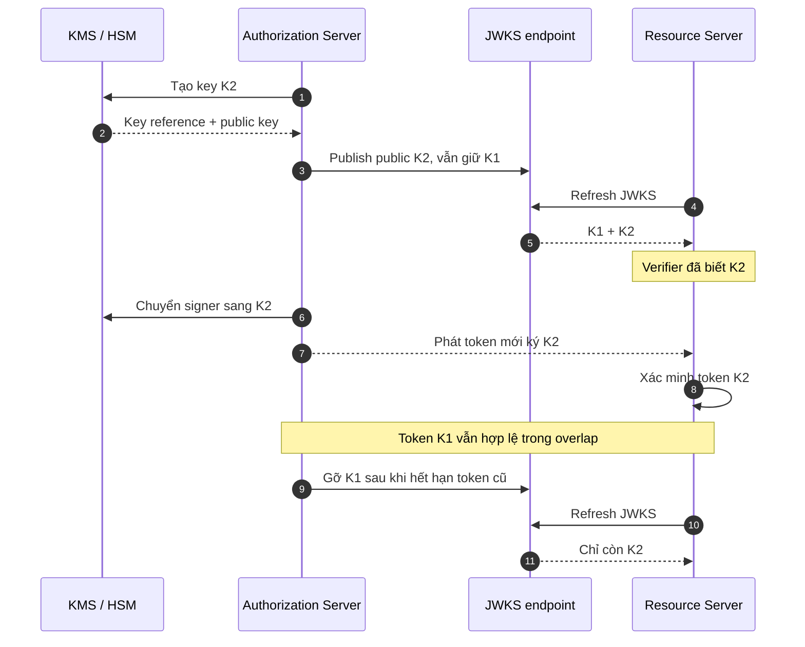

# Test key rotation trong hệ thống JWT

## 1. Mục tiêu của kiểm thử key rotation

**Key rotation** là quá trình thay khóa ký token đang sử dụng bằng một khóa mới, đồng thời giữ cho Resource Server xác minh được token hợp lệ trong khoảng chuyển tiếp. Với JWT access token ký bằng JWS, Authorization Server giữ private signing key; API/resource server thường nhận public key qua JWKS để xác minh chữ ký.

Kiểm thử tích hợp phải chứng minh toàn bộ chuỗi hoạt động đúng:

- Authorization Server phát hành token mới bằng đúng key version đã kích hoạt.
- Public key mới được công bố và các verifier có thể lấy được trước khi token mới được phát hành.
- Token ký bằng key cũ vẫn được chấp nhận trong cửa sổ overlap theo policy.
- Token ký bằng key mới được chấp nhận sau khi signer chuyển key.
- Key cũ bị loại khỏi khả năng ký và cuối cùng bị loại khỏi trust khi không còn token hợp lệ cần xác minh.
- Key bị compromise có thể bị vô hiệu hóa theo thời gian đáp ứng sự cố đã cam kết.
- Tenant, issuer, audience và thuật toán không bị nhầm lẫn trong lúc đổi key.

**Một bài test chỉ gọi hàm tạo JWT hoặc chỉ kiểm tra JWKS JSON chưa phải integration test key rotation.** Cần chạy luồng giữa signer/Authorization Server, endpoint JWKS, cache key của Resource Server và một API thực sự xác minh token.

## 2. Thuật ngữ và trạng thái key cần thống nhất

| Thành phần | Ý nghĩa trong rotation |
|---|---|
| **Signing key** | Private key dùng ký JWT; phải được bảo vệ trong KMS/HSM hoặc kho khóa được kiểm soát |
| **Verification key** | Public key dùng xác minh chữ ký; có thể công bố qua JWKS |
| **JWK / JWKS** | Biểu diễn một public key / tập public key |
| **kid** | Key ID trong JOSE header; giúp chọn public key trong tập key đã tin cậy |
| **Issuer (iss)** | Authorization Server phát hành token; xác định namespace tin cậy |
| **Audience (aud)** | Resource Server mà token được cấp cho |
| **Key version** | Phiên bản khóa trong registry/KMS; không nhất thiết bằng kid |
| **Overlap window** | Khoảng thời gian verifier chấp nhận cả key cũ và key mới |
| **Emergency revocation** | Vô hiệu hóa key bị compromise theo quy trình sự cố |

Một lifecycle thường dùng:

```text
PENDING -> PUBLISHED -> ACTIVE -> VERIFY_ONLY -> RETIRED
                           |
                           +-> COMPROMISED / REVOKED
```

- **PENDING:** key đã được tạo nhưng chưa công bố hoặc sử dụng.
- **PUBLISHED:** public key đã xuất hiện trong JWKS; signer vẫn có thể ký bằng key cũ.
- **ACTIVE:** key được phép ký token mới và xác minh token.
- **VERIFY_ONLY:** key ngừng ký mới nhưng vẫn xác minh token cũ còn hiệu lực.
- **RETIRED:** key không còn được sử dụng để ký hoặc xác minh sau khi hết cửa sổ cần thiết.
- **COMPROMISED/REVOKED:** key bị nghi lộ; dừng ký và loại khỏi trust theo quy trình khẩn cấp.

Không phải mọi hệ thống cần lưu trạng thái đúng các tên này, nhưng phải có trạng thái tương đương để test được transition và quyền thao tác.

## 3. Quy trình rotation bình thường và thứ tự bắt buộc

Giả sử Authorization Server đang ký bằng `K1` và chuẩn bị chuyển sang `K2`.



Thứ tự khuyến nghị:

1. Tạo `K2` trong KMS/HSM với thuật toán và key type được cho phép.
2. Lưu metadata và gắn `kid` mới, duy nhất trong phạm vi resolver.
3. Publish **public key K2 trước khi ký token bằng K2**.
4. Chờ hoặc xác nhận các Resource Server có thể nhận K2 qua JWKS refresh/cache policy.
5. Chuyển signer sang K2; từ thời điểm này token mới mang `kid=K2`.
6. Giữ public key K1 để xác minh token cũ còn hiệu lực.
7. Sau khi token K1 cuối cùng hết hạn, cộng clock skew và khoảng đệm cache/propagation theo policy, gỡ K1 khỏi JWKS.
8. Xác minh các verifier đã ngừng chấp nhận K1.

**Không xóa K1 ngay khi chuyển signer.** Nếu làm vậy, access token K1 vẫn còn hạn sẽ bị từ chối dù đã được phát hành hợp lệ. Ngược lại, không giữ K1 vô thời hạn nếu không còn nhu cầu xác minh.

Công thức thời gian giữ key cũ phải căn cứ vào cấu hình thực tế:

```text
minimum_retention_for_K1 =
    latest_expiry_of_tokens_signed_by_K1
  + allowed_clock_skew
  + verifier_cache_and_propagation_margin
```

Nếu có token lifetime khác nhau theo client hoặc tenant, phải tính từ **thời điểm hết hạn muộn nhất của token thực sự đã phát hành bằng K1**, không chỉ lấy default TTL hiện tại.

## 4. Kiến trúc môi trường integration test

Một môi trường test đủ dùng có thể gồm:

| Thành phần | Cách dựng trong test | Điều cần quan sát |
|---|---|---|
| Authorization Server / signer | Test instance hoặc service chạy với test key provider | Token phát ra có kid, iss, aud, exp đúng |
| KMS/HSM adapter | Fake/stub cho integration test; sandbox KMS cho test hệ thống | Tạo key, ký, permission, disable và lỗi |
| JWKS endpoint | HTTP server test có thể thay đổi nội dung theo từng giai đoạn | Public key được publish/removed, cache headers |
| Resource Server | Ứng dụng thật dùng JWT decoder/JWKS resolver | Token K1/K2 được chấp nhận/từ chối |
| Clock | FixedClock hoặc controllable clock | Kiểm tra ranh giới exp, overlap và clock skew |
| Cache | Cache thật của thư viện hoặc cache adapter test | TTL, refresh, unknown kid, invalidation |
| Test observer | HTTP recorder, audit sink và log capture | Số lần fetch JWKS, không lộ private key/token |

Tách test thành ba lớp:

1. **Unit test:** trạng thái key registry, mapping tenant/key, tính toán thời gian và policy transition.
2. **Component/integration test:** signer, JWKS endpoint, JWT decoder và cache giao tiếp với nhau.
3. **End-to-end/security test:** phát token qua Authorization Server, gọi API qua security filter chain, rotate key và quan sát kết quả HTTP thực tế.

Không dùng private key production trong test. Tạo key pair riêng cho từng test run hoặc dùng key fixture chỉ dành cho môi trường test. Nếu dùng sandbox KMS/HSM, tách account/project và IAM policy khỏi production.

## 5. Bộ token fixture cần chuẩn bị

Một test suite nên tạo các token có thể kiểm soát key và claims:

| Token fixture | Key ký | Claims chính | Mục đích |
|---|---|---|---|
| `T1-old` | K1 | iss đúng, aud=orders-api, exp còn hạn | Token trước rotation |
| `T2-new` | K2 | iss đúng, aud=orders-api, exp còn hạn | Token sau rotation |
| `T-wrong-kid` | K1 hoặc key khác | kid không tồn tại | Test unknown key |
| `T-wrong-iss` | K2 | Issuer khác cấu hình | Test issuer validation |
| `T-wrong-aud` | K2 | Audience khác API | Test audience validation |
| `T-expired` | K1 | exp đã qua | Test hết hạn |
| `T-forged` | Key do attacker tạo | Có thể giả kid=K1 | Test chữ ký không hợp lệ |
| `T-wrong-alg` | Key không tương thích | Thuật toán ngoài allowlist | Test algorithm policy |
| `T-tenant-A` | Key tenant A | tid=A | Test tenant binding |
| `T-tenant-B` | Key tenant B | tid=B | Test cross-tenant rejection |

Các token cần được ký bằng thư viện JOSE/JWT thực. Không sửa payload của token đã ký rồi giả định chữ ký vẫn hợp lệ; muốn test claim khác, tạo token fixture mới và ký bằng test key tương ứng.

## 6. Test publish-before-sign

Đây là test quan trọng nhất để ngăn khoảng trống xác minh khi đổi key.

**Setup:**

- JWKS ban đầu chỉ chứa public K1.
- Authorization Server đang ký token bằng K1.
- Resource Server đã tải JWKS K1 và cache.

**Thực hiện:**

1. Tạo K2.
2. Thêm public K2 vào JWKS, vẫn giữ K1.
3. Yêu cầu Resource Server refresh JWKS hoặc mô phỏng cache hết TTL.
4. Xác minh verifier đã thấy K2.
5. Chuyển signer sang K2.
6. Phát T2 và gọi endpoint bảo vệ bằng T2.

**Assertions:**

- JWKS có cả K1 và K2 trước khi signer bắt đầu phát T2.
- T2 có header `kid=K2`.
- Resource Server xác minh T2 thành công.
- T1 vẫn xác minh thành công trong overlap.
- Không có khoảng thời gian token mới bị 401 do verifier chưa biết public K2.

Nếu hệ thống cho phép unknown `kid` kích hoạt refresh JWKS, vẫn phải test cơ chế đó có giới hạn và không thay thế thứ tự publish-before-sign. Việc dựa hoàn toàn vào unknown-kid refresh có thể tạo lỗi tạm thời khi endpoint JWKS chậm hoặc cache không cập nhật.

## 7. Test overlap: token cũ và mới cùng hợp lệ

Sau khi signer chuyển sang K2, Resource Server cần chấp nhận cả token K1 còn hạn và token K2 mới.

| Thời điểm | JWKS | Token được phát | Kết quả cần có |
|---|---|---|---|
| Trước rotation | K1 | T1 bằng K1 | T1 thành công |
| K2 đã publish | K1 + K2 | T1 bằng K1 | T1 thành công |
| Signer đã chuyển | K1 + K2 | T2 bằng K2 | T2 thành công |
| Trong overlap | K1 + K2 | T1 và T2 | Cả hai thành công nếu claims hợp lệ |
| Sau khi T1 hết hạn | K1 + K2 | T1 | 401 do token hết hạn |
| K1 đã gỡ và cache cập nhật | K2 | T2 | T2 thành công; token K1 bị từ chối |

Cần kiểm tra cả các instance Resource Server khác nhau. Nếu có nhiều pod với cache JWKS độc lập, một pod có thể biết K2 trong khi pod khác vẫn dùng cache cũ. Test phân tán nên xác nhận rollout/refresh strategy đáp ứng SLA, không chỉ test một instance.

## 8. Test JWKS cache, refresh và unknown kid

Resource Server thường cache JWKS theo HTTP cache headers hoặc cache nội bộ của thư viện. Rotation phải được kiểm thử với cache thật.

Các tình huống:

- **Cache còn mới:** token K1 được xác minh bằng key đã cache; không fetch JWKS cho mỗi request.
- **Cache hết hạn:** verifier tải JWKS mới và xác minh được K2.
- **Unknown kid:** verifier có thể thực hiện một lần refresh có kiểm soát rồi từ chối nếu key vẫn không tồn tại.
- **Nhiều request cùng unknown kid:** không tạo hàng trăm request JWKS đồng thời; cần single-flight/coalescing hoặc rate limit.
- **JWKS endpoint timeout:** không tự chấp nhận token có key không xác minh được.
- **JWKS trả JSON lỗi hoặc key sai schema:** verifier từ chối refresh, không thay cache tốt bằng dữ liệu hỏng.
- **JWKS có key trùng kid:** resolver phải từ chối hoặc xử lý theo policy rõ ràng; không chọn ngẫu nhiên.
- **JWKS trả public key bị thay nội dung nhưng giữ kid:** không được coi cùng kid là cùng key nếu key material thay đổi ngoài rotation contract.

Ví dụ JWKS response:

```http
HTTP/1.1 200 OK
Content-Type: application/jwk-set+json
Cache-Control: public, max-age=60
ETag: "jwks-version-2"

{"keys":[{"kty":"RSA","kid":"K1","use":"sig","alg":"RS256","n":"...","e":"AQAB"},{"kty":"RSA","kid":"K2","use":"sig","alg":"RS256","n":"...","e":"AQAB"}]}
```

Ví dụ trên đã rút gọn key parameters. Test nên kiểm tra `ETag`, `Cache-Control`, conditional request (`If-None-Match`) và cách thư viện xử lý 304 nếu hệ thống dùng HTTP caching. Không mặc định mọi JWT decoder xử lý cache giống nhau; cần xác minh behavior của implementation đang chạy.

**Unknown kid không được dẫn tới trust-on-first-use.** Verifier không được lấy URL `jku`/`x5u` tùy ý từ token hoặc tự tải key từ domain do caller kiểm soát. Chỉ dùng JWKS URI gắn với issuer đã được cấu hình tin cậy.

## 9. Test loại bỏ key cũ sau overlap

Khi token K1 cuối cùng đã hết hạn, issuer có thể gỡ public K1 khỏi JWKS. Test cần kiểm tra hai điều kiện:

1. Không còn token hợp lệ cần K1 để xác minh theo lifetime/clock skew policy.
2. Verifier đã refresh key set và không còn chấp nhận token K1.

Quy trình test với fixed clock:

- Phát T1 tại thời điểm t0, với lifetime xác định.
- Chuyển signer sang K2.
- Giữ K1 trong JWKS trong overlap.
- Dịch test clock tới sau T1.exp + allowedClockSkew.
- Gỡ K1 khỏi JWKS.
- Ép hoặc chờ cache refresh theo contract.
- Gọi API với T1 và xác nhận 401.
- Gọi API với T2 và xác nhận vẫn thành công.

Phân biệt nguyên nhân 401: sau khi T1 hết hạn, request có thể bị từ chối do exp ngay cả khi K1 vẫn còn trong JWKS. Vì vậy cần thêm test sau khi token K1 **vẫn còn hạn nhưng K1 đã bị gỡ** để chứng minh verifier không còn tin key cũ; dùng fixture và clock phù hợp để xác nhận chính xác nguyên nhân.

## 10. Test emergency rotation khi key bị compromise

Rotation bình thường cho phép overlap để không làm gián đoạn token hợp lệ. Khi private key bị compromise, yêu cầu khác: **ngừng tin key bị lộ nhanh nhất có thể theo incident policy**, kể cả token đã ký còn hạn.

Các bước cần kiểm thử:

1. Đánh dấu K1 là `COMPROMISED`.
2. Ngăn mọi thao tác ký mới bằng K1 tại KMS/HSM và signer.
3. Chuyển signer sang key mới K2 nếu K2 đã provision; nếu chưa, tạo key mới theo incident procedure.
4. Gỡ K1 khỏi JWKS hoặc phát tín hiệu denylist/key-status tới verifier.
5. Invalidate cache/refresh key set theo SLA thu hồi.
6. Xác minh T1 bị từ chối tại tất cả Resource Server instance.
7. Xác minh T2 bằng K2 được chấp nhận.
8. Xác minh hệ thống không fallback sang shared key hoặc key của tenant khác.
9. Ghi audit sự kiện compromise/disable/rotation mà không lưu private key hoặc token nguyên văn.

**JWT offline verification không tự có revocation tức thời.** Nếu Resource Server vẫn cache public K1 và chỉ xác minh chữ ký local, T1 có thể tiếp tục được chấp nhận cho đến khi cache cập nhật hoặc token hết hạn. Nếu yêu cầu emergency revocation chặt, cần một trong các cơ chế như key denylist/status check, introspection, push invalidation hoặc token lifetime rất ngắn kết hợp cache policy. Test phải đo **thời gian từ lúc đánh dấu compromise đến lúc mọi verifier từ chối token**, không chỉ kiểm tra JWKS endpoint đã xóa K1.

## 11. Test key rotation với multi-tenant

Nếu mỗi tenant có signing key riêng, rotation phải giữ tenant binding:

- Tenant Acme có K1-A và K2-A.
- Tenant Northwind có K1-N và K2-N.
- JWKS có thể dùng chung hoặc tách theo issuer, nhưng resolver phải xác định đúng trust namespace.
- `kid` cần duy nhất trong phạm vi resolver; registry phải biết key thuộc tenant nào.
- Token của Acme không được xác minh bằng key của Northwind dù `kid` tình cờ trùng.
- Tenant A rotation không làm tenant B bị từ chối token hợp lệ.
- KMS signer của tenant A không được gọi key reference của tenant B.

| Test | Kết quả mong đợi |
|---|---|
| T1-A và T2-A trong overlap | Cả hai hợp lệ cho Acme nếu claims còn hạn |
| T1-N trong khi Acme rotate | Northwind không bị ảnh hưởng |
| Token Acme gửi vào request tenant Northwind | 403/401 theo policy; không cross-tenant |
| kid trùng giữa hai namespace | Resolver dùng issuer/namespace đã tin cậy; không chọn nhầm |
| KMS permission của Acme truy cập key Northwind | Access denied và có audit |
| Disable key Acme | Chỉ Acme bị ảnh hưởng, trừ khi có issuer/shared-key failure được xác định rõ |

Không chọn tenant key chỉ từ unverified `tid` trong JWT. Tenant context phải đến từ route/client/session đã xác minh; `kid` chỉ là selector trong key set tin cậy. Sau khi verify chữ ký, kiểm tra `iss`, `aud` và tenant claim khớp request context.

## 12. Test thuật toán, key type và key confusion

Key rotation cũng là thời điểm dễ phát sinh lỗi do thay thuật toán hoặc thay loại key. Nên có test:

- RS256 → RS256 với RSA key version mới.
- Thay key size/curve chỉ khi verifier và profile hỗ trợ rõ.
- PS256/ES256 chỉ được chấp nhận khi được cấu hình allowlist.
- JWT `alg=none` bị từ chối.
- Token tự khai thuật toán khác với key type bị từ chối.
- Không dùng chung một `kid` cho hai key material khác nhau trong cùng resolver namespace.
- Không tin `jku`/`x5u` do token tự khai.
- Không chấp nhận key có `use`/`key_ops` không phù hợp nếu implementation kiểm tra các thuộc tính đó.
- Không fallback sang HMAC secret khi RSA verification thất bại hoặc ngược lại.
- Không chấp nhận ID token như access token chỉ vì ký cùng key.

**Rotation key không đồng nghĩa rotation thuật toán.** Nếu cần đổi cả thuật toán, hãy tách thành một migration có compatibility matrix và test riêng. Việc thay đồng thời key, algorithm, issuer và token profile làm khó xác định nguyên nhân khi verifier từ chối.

## 13. Test KMS/HSM và quyền ký

Với signer sử dụng KMS/HSM, integration test cần xác minh quyền truy cập key chứ không chỉ kiểm tra JWT tạo được.

| Ca test | Kết quả mong đợi |
|---|---|
| Signer có quyền dùng key ACTIVE của tenant | Ký thành công |
| Signer gọi key PENDING chưa được kích hoạt | Bị từ chối |
| Signer gọi key VERIFY_ONLY/RETIRED | Không được ký token mới |
| Signer tenant A gọi key tenant B | Access denied |
| Key bị disable/compromise | Lệnh ký thất bại |
| KMS throttling/timeout | Issuer fail closed, không dùng shared fallback |
| KMS trả public key không khớp key reference | Không publish hoặc sử dụng key |
| KMS rotate version nhưng registry chưa cập nhật | Không phát token với kid/key mapping sai |
| Audit log của KMS | Có principal, key reference, operation, timestamp; không có private key/token |

Không cần dùng KMS production để chạy mọi test. Có thể dùng fake adapter cho component test, rồi dùng sandbox KMS/HSM để chạy một nhóm smoke/integration tests có kiểm soát. Fake phải mô phỏng cả success, permission denied, timeout và key disabled để không bỏ sót failure mode.

## 14. Ví dụ Spring Security test qua JWKS endpoint giả lập

Một Resource Server Spring Security có thể cấu hình JWT decoder trỏ tới JWKS endpoint test. Cách cụ thể phụ thuộc phiên bản Spring Security/Nimbus và HTTP mock server đang dùng.

Mã giả minh họa:

```java
@Test
void acceptsOldAndNewKeysDuringOverlap() {
    // JWKS initially contains K1.
    jwksServer.publish(publicJwk(k1));
    resourceServer.startWithJwkSetUri(jwksServer.uri());

    String oldToken = tokenSignedBy(k1, "K1", clock.instant().plusSeconds(600));
    assertStatus(resourceServer.get("/api/orders", oldToken), 200);

    // Publish K2 before switching signer.
    jwksServer.publish(publicJwk(k1), publicJwk(k2));
    resourceServer.refreshJwks();

    signer.activate(k2);
    String newToken = tokenSignedBy(k2, "K2", clock.instant().plusSeconds(600));

    assertStatus(resourceServer.get("/api/orders", newToken), 200);
    assertStatus(resourceServer.get("/api/orders", oldToken), 200);
}
```

Đây là **pseudocode**, không phải test class compile-ready. Trong test thật, `jwksServer`, `resourceServer`, `signer` và helper phải được nối với ứng dụng thật hoặc test harness của dự án. Điểm quan trọng là test đi qua **HTTP resource endpoint và JWT decoder thực**, không gọi trực tiếp một hàm `verifySignature()` rồi kết luận rotation hoạt động.

Một nhóm test bổ sung:

```java
@Test
void rejectsOldKeyAfterEmergencyRevocation() {
    jwksServer.publish(publicJwk(k1), publicJwk(k2));
    resourceServer.refreshJwks();

    String oldToken = tokenSignedBy(k1, "K1", futureExpiry());

    keyRegistry.markCompromised("K1");
    jwksServer.publish(publicJwk(k2));
    resourceServer.invalidateKeyCache();

    assertStatus(resourceServer.get("/api/orders", oldToken), 401);
}
```

Pseudocode trên giả định verifier có cơ chế invalidation/status đủ mạnh. Nếu implementation chỉ dùng JWKS cache offline và không có push invalidation, test phải mô phỏng đúng TTL/refresh và đo độ trễ thực tế; không được thêm một lời gọi `invalidateKeyCache()` giả định không tồn tại rồi tuyên bố revocation tức thời.

## 15. Kiểm thử observability và vận hành rollout

Trong rotation, telemetry cần cho biết trạng thái nhưng không tiết lộ credential.

Có thể ghi:

```json
{
  "event": "jwt_key_rotation",
  "issuerId": "auth-prod",
  "keyId": "K2",
  "keyState": "ACTIVE",
  "operation": "signing_key_activated",
  "timestamp": "2026-11-23T10:00:00Z",
  "correlationId": "rotation-123"
}
```

Không ghi private key, secret, raw JWT, full claims nhạy cảm hoặc token response. `kid` thường không phải bí mật, nhưng cần xem xét liệu nó có tiết lộ cấu trúc tenant/key nội bộ hay không trước khi đưa vào log công khai.

Chỉ số nên theo dõi:

- Số token phát hành theo `kid`/issuer/tenant.
- Tỷ lệ xác minh thành công/thất bại theo key ID và lý do.
- Unknown-kid refresh count và JWKS fetch latency.
- Cache age, JWKS version/ETag và số verifier đã nhận key mới.
- KMS signing latency, throttling và permission errors.
- Số token còn hạn được ký bằng key cũ.
- Thời gian hoàn tất normal rotation và emergency revocation.
- Tỷ lệ 401 bất thường trong từng bước rollout.

Test rollout trên nhiều Resource Server replica, nhiều region nếu có, và các cache độc lập. Một instance thành công không chứng minh mọi instance đã nhận key mới. Với multi-region, phải đo propagation và đặt rollout gate theo dữ liệu thực tế.

## 16. Bộ test matrix tổng hợp

| Nhóm | Test chính | Kỳ vọng |
|---|---|---|
| Initial state | K1 ký và verify | Token K1 thành công |
| Publish | K2 xuất hiện trong JWKS trước khi ký | Không có khoảng trống key |
| Switch signer | T2 mang kid=K2 | T2 thành công |
| Overlap | T1 và T2 cùng còn hạn | Cả hai thành công |
| Retire | T1 hết hạn, K1 gỡ khỏi JWKS | T1 bị từ chối, T2 vẫn thành công |
| Unknown kid | kid lạ, JWKS refresh có giới hạn | Không trust key lạ |
| JWKS outage | Endpoint lỗi trong lúc cache hết hạn | Fail closed theo policy |
| Cache | Nhiều verifier/replica có cache khác nhau | Tất cả hội tụ trong SLA |
| Compromise | K1 bị disable/denylist | Token K1 bị từ chối trong revocation SLA |
| Tenant | A rotate, B vẫn hoạt động | Không cross-tenant, không ảnh hưởng tenant khác |
| Algorithm | alg ngoài allowlist, key type sai | Từ chối |
| KMS | Permission/timeout/disabled key | Không fallback key sai |
| Observability | Logs/traces/metrics | Không lộ token/private key |
| Recovery | Rollback signer hoặc phục hồi JWKS theo runbook | Không tạo khoảng trống trust hoặc dùng key compromised |

Mỗi test nên assert cả **HTTP status**, **WWW-Authenticate/error category**, **token header/claims ở fixture**, **JWKS fetch count**, **key state** và **audit event** khi phù hợp. Không chỉ assert status 200/401; cần biết request bị từ chối vì hết hạn, unknown key, issuer mismatch hay tenant mismatch.

## 17. Checklist trước khi hoàn tất rotation

1. Key mới được tạo trong KMS/HSM và có metadata/key ID duy nhất.
2. Public key mới đã được publish vào JWKS trước khi signer dùng key mới.
3. Các Resource Server đã có thể lấy key mới; cache/propagation được đo.
4. Token mới được ký bằng đúng key version và có kid chính xác.
5. Token cũ và mới cùng xác minh được trong overlap bình thường.
6. K1 ngừng ký token mới nhưng vẫn verify trong khoảng cần thiết.
7. K1 bị gỡ sau khi token cũ hết hạn và cache window kết thúc.
8. Unknown kid, JWKS outage và malformed JWKS không làm verifier fail open.
9. Emergency compromise test chứng minh mọi verifier từ chối key cũ trong SLA.
10. Multi-tenant test xác nhận key của tenant A không xác minh token tenant B.
11. KMS/HSM permission test xác nhận signer chỉ dùng key được cấp.
12. Logs, traces, metrics và audit không chứa token hoặc private key.
13. Có runbook cho normal rotation, emergency revocation và recovery.
14. Rollout được xác minh trên tất cả replica/region liên quan.

**Nguyên tắc cốt lõi:** Rotation thành công khi issuer chỉ ký bằng key mới sau khi public key đã được phân phối, verifier chấp nhận token cũ/mới đúng trong overlap, và key cũ bị loại khỏi trust đúng thời điểm. Khi compromise, ưu tiên vô hiệu hóa key theo SLA và đo kết quả ở tất cả Resource Server, thay vì chỉ kiểm tra JWKS endpoint.

### Tài liệu tiêu chuẩn tham khảo

- [RFC 7515 — JSON Web Signature (JWS)](https://www.rfc-editor.org/rfc/rfc7515): cấu trúc chữ ký và JOSE header.
- [RFC 7517 — JSON Web Key (JWK)](https://www.rfc-editor.org/rfc/rfc7517): JWK và JWKS.
- [RFC 7519 — JSON Web Token (JWT)](https://www.rfc-editor.org/rfc/rfc7519): JWT claims và thời hạn.
- [RFC 8414 — OAuth 2.0 Authorization Server Metadata](https://www.rfc-editor.org/rfc/rfc8414): metadata và discovery của Authorization Server.
- [RFC 8725 — JSON Web Token Best Current Practices](https://www.rfc-editor.org/rfc/rfc8725): algorithm, issuer, audience và JWT validation.
- [RFC 9068 — JWT Profile for OAuth 2.0 Access Tokens](https://www.rfc-editor.org/rfc/rfc9068): profile JWT access token.
- [RFC 9700 — Best Current Practice for OAuth 2.0 Security](https://www.rfc-editor.org/rfc/rfc9700): khuyến nghị bảo mật OAuth 2.0 hiện đại.
