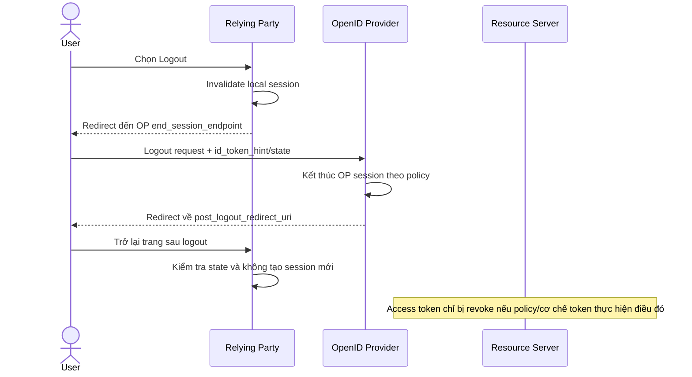
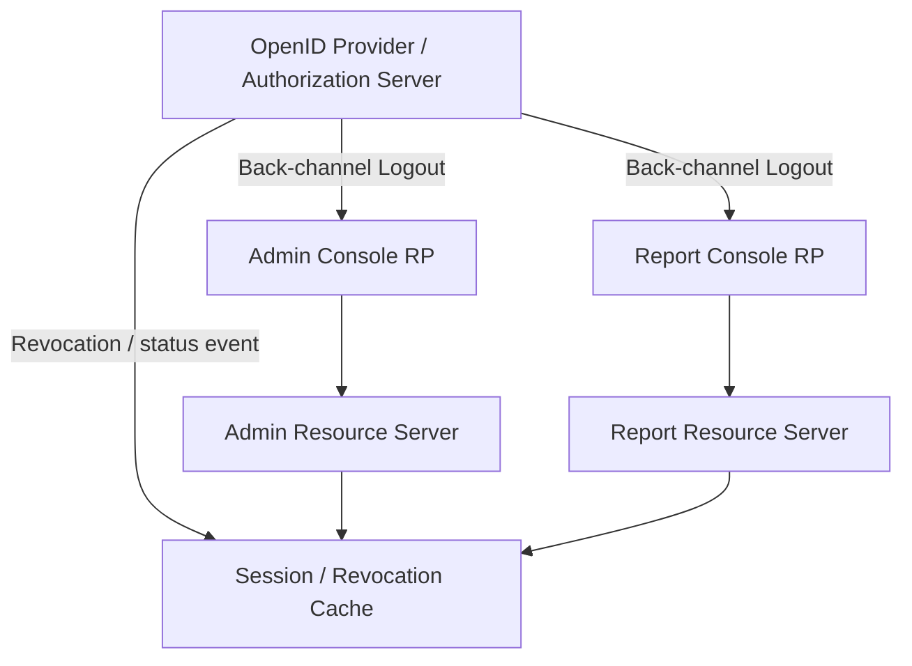

# Test logout và revoke

## 1. Logout và revoke giải quyết hai vấn đề khác nhau

Trong hệ thống xác thực dùng OAuth 2.0/OIDC, **logout** và **token revocation** có liên quan nhưng không đồng nghĩa.

- **Logout tại ứng dụng (Relying Party, RP):** kết thúc phiên đăng nhập của người dùng tại ứng dụng, vô hiệu session/cookie phía RP và xóa trạng thái đăng nhập cục bộ.
- **Logout tại OpenID Provider (OP):** kết thúc hoặc thay đổi phiên đăng nhập SSO tại nhà cung cấp danh tính theo giao thức OIDC. Các ứng dụng khác có thể nhận thông báo logout qua front-channel hoặc back-channel nếu được cấu hình.
- **Token revocation:** yêu cầu Authorization Server (AS) vô hiệu hóa token hoặc quyền cấp phát liên quan theo chính sách và khả năng của AS. OAuth 2.0 Token Revocation được định nghĩa trong RFC 7009.
- **Session termination:** kết thúc một phiên hoặc một nhóm phiên cụ thể. Một người dùng có thể có nhiều phiên trên nhiều thiết bị và ứng dụng.

Một thao tác logout ở giao diện không tự động chứng minh rằng access token đã bị vô hiệu ở mọi Resource Server. Tương tự, revoke refresh token không nhất thiết kết thúc session cookie của ứng dụng. Phải xác định chính sách logout của sản phẩm muốn kết thúc những trạng thái nào, rồi kiểm thử từng trạng thái đó.

Ví dụ: người dùng đăng nhập vào Admin Console, nhận access token và refresh token. Khi nhấn Logout, hệ thống có thể cần:

1. Kết thúc session của Admin Console.
2. Điều hướng người dùng đến OP để kết thúc phiên SSO.
3. Gửi refresh token tới revocation endpoint.
4. Vô hiệu access token ngay hoặc trong một khoảng propagation đã cam kết.
5. Thông báo cho các RP khác nếu dùng OIDC logout.
6. Ngăn client tiếp tục dùng refresh token cũ để lấy access token mới.

Các bước trên là một **policy lựa chọn của hệ thống**, không phải mọi triển khai OIDC/OAuth đều mặc định thực hiện tất cả.

## 2. Các lớp trạng thái cần quan sát trong bài test

Một test logout/revoke có thể thất bại nếu chỉ kiểm tra trình duyệt đã chuyển về trang đăng nhập. Cần quan sát trạng thái ở các thành phần liên quan:

| Thành phần | Trạng thái trước logout | Điều cần xác minh sau logout |
|---|---|---|
| RP local session | Session đang hoạt động | Session bị vô hiệu, cookie không còn được chấp nhận |
| OP/SSO session | Người dùng đăng nhập tại OP | Phiên OP kết thúc nếu luồng logout yêu cầu |
| Access token | Token còn hiệu lực | RS từ chối theo cơ chế revocation đã thiết kế |
| Refresh token | Có thể xin access token mới | Refresh token bị thu hồi hoặc family bị vô hiệu theo policy |
| OIDC RP session khác | Có thể đang đăng nhập cùng OP | RP nhận logout notification và kết thúc đúng session |
| Token/introspection cache | Có thể lưu trạng thái active | Cache được invalidation hoặc hết hạn trong SLA |
| Audit/event store | Có lịch sử đăng nhập | Ghi nhận logout/revoke đúng actor, session và thời điểm |

Không phải hệ thống nào cũng dùng session phía OP, refresh token hay back-channel logout. Test phải dựa vào luồng thực tế và hợp đồng bảo mật đã chọn.

## 3. Chuẩn bị môi trường integration test

Một môi trường kiểm thử tích hợp nên có các thành phần:

- **Authorization Server / OpenID Provider:** phát access token, refresh token và hỗ trợ endpoint logout/revocation theo cấu hình.
- **Relying Party (RP):** ứng dụng web có session cookie và OIDC client.
- **Resource Server (RS):** API nhận access token, có endpoint bảo vệ để kiểm tra token còn được chấp nhận hay không.
- **Session store:** nơi lưu trạng thái đăng nhập của RP, có thể là database hoặc distributed cache.
- **Introspection/revocation state:** nếu dùng opaque token hoặc JWT có kiểm tra trạng thái.
- **Một RP thứ hai:** dùng để kiểm tra logout notification từ OP đến nhiều ứng dụng.
- **Clock/test time:** hỗ trợ kiểm tra expiry, propagation window và clock skew.
- **Audit/event collector:** xác minh sự kiện logout, revoke và kết quả xử lý.

Nên dùng AS sandbox hoặc test container có contract gần với hệ thống thật. Mock có thể dùng cho unit test, nhưng không thay thế integration test với hành vi token family, revocation, OIDC logout và cache thực tế. Không dùng tài khoản, refresh token, private key hoặc session cookie production trong fixture.

### Tạo bộ dữ liệu kiểm thử

Mỗi test nên tạo danh tính và session riêng, ví dụ:

| Fixture | Giá trị minh họa |
|---|---|
| User | `logout-user-01` |
| RP client | `admin-console-test` |
| RP session | `rp-session-101` |
| OP session ID | `sid-201` |
| Access token | `AT-01` |
| Refresh token | `RT-01` |
| Resource Server audience | `urn:service:admin-api` |
| Second RP | `report-console-test` |

Các giá trị trên chỉ là ID giả lập. Token thật trong test cần được giữ trong bộ nhớ test hoặc secret fixture riêng, không in ra output. Tạo thêm một user khác và một session khác để xác nhận logout không vô tình kết thúc phiên không liên quan.

## 4. Kiểm thử logout cục bộ tại RP

Local logout phải vô hiệu session của ứng dụng ngay cả khi OP vẫn còn phiên SSO. Một luồng kiểm thử cơ bản:

1. Đăng nhập vào RP qua OIDC.
2. Xác nhận RP tạo session cookie và truy cập được trang bảo vệ.
3. Gửi yêu cầu logout theo endpoint của ứng dụng, có CSRF token nếu endpoint yêu cầu.
4. Xác nhận session server-side bị invalidate.
5. Gửi lại cookie cũ tới endpoint bảo vệ.
6. Xác nhận RP yêu cầu đăng nhập lại hoặc trả lỗi phù hợp.
7. Kiểm tra cookie logout được xóa với đúng thuộc tính `Path`, `Domain`, `Secure`, `HttpOnly` và `SameSite` theo cấu hình.
8. Kiểm tra một session khác của cùng user hoặc user khác không bị ảnh hưởng nếu policy chỉ logout phiên hiện tại.

### Test matrix local logout

| Test case | Thao tác | Kết quả mong đợi |
|---|---|---|
| Normal logout | Logout từ session đang đăng nhập | Session bị invalidate |
| Reuse old cookie | Gửi cookie cũ sau logout | Không được xác thực |
| Session store cluster | Logout ở instance A, gọi instance B | Instance B cũng từ chối session cũ |
| CSRF protection | Gửi logout request thiếu/sai CSRF token nếu endpoint dùng CSRF | Bị từ chối |
| Repeated logout | Gọi logout lần nữa với session đã kết thúc | Kết quả an toàn, không khôi phục session |
| Other user session | Logout user A, kiểm tra session user B | Session B còn nguyên |
| Other device session | Logout một session của user A | Kết quả đúng với policy current-session/all-sessions |
| Cookie clearing | Kiểm tra response logout | Cookie được xóa đúng scope và attributes |

Không coi việc trình duyệt xóa cookie là đủ. Cookie cũ có thể bị gửi lại bởi client đã lưu nó; server-side session phải thực sự bị vô hiệu nếu ứng dụng dùng stateful session.

## 5. Kiểm thử OIDC RP-Initiated Logout

OIDC RP-Initiated Logout cho phép RP yêu cầu OP đăng xuất người dùng. RP thường điều hướng user agent đến endpoint logout được công bố trong metadata OP, thường là `end_session_endpoint`.

Các tham số có thể xuất hiện:

| Tham số | Mục đích |
|---|---|
| `id_token_hint` | Gợi ý OP về phiên đăng nhập của người dùng/RP |
| `post_logout_redirect_uri` | URI đã đăng ký để điều hướng sau logout |
| `state` | Giá trị RP dùng liên kết response/redirect với yêu cầu ban đầu |
| `client_id` | Client định danh trong một số trường hợp hoặc triển khai |
| `logout_hint` | Gợi ý danh tính/session để OP tìm phiên, nếu hỗ trợ |

RP phải dùng endpoint và quy tắc được OP công bố; không tự đoán URL logout. `post_logout_redirect_uri` phải khớp URI đã đăng ký theo policy OP. Không dùng redirect URI tùy ý lấy từ query string vì có thể tạo open redirect.

### Luồng test RP-Initiated Logout



Các test cần thực hiện:

- OP nhận `id_token_hint` hợp lệ và kết thúc đúng session.
- Redirect URI hợp lệ được chấp nhận; URI không đăng ký hoặc sai chính xác bị từ chối.
- `state` được giữ nguyên qua redirect và được RP xác minh.
- Request logout không thể bị lợi dụng để điều hướng tới domain tùy ý.
- Logout không tạo session RP mới khi quay về.
- Nếu OP session đã hết hạn, logout vẫn kết thúc an toàn theo hành vi OP.
- Nếu thiếu `id_token_hint`, xác nhận đúng hành vi theo khả năng và policy của OP; không giả định mọi OP đều xử lý giống nhau.
- Kiểm tra việc logout tại OP có ảnh hưởng các RP khác qua cơ chế front/back-channel nếu hệ thống triển khai.

RP-Initiated Logout kết thúc phiên OIDC/SSO theo giao thức. **Nó không tự động tương đương với gọi OAuth revocation endpoint cho từng access token và refresh token.** Nếu cần thu hồi token, ứng dụng phải thực hiện riêng theo policy.

## 6. Kiểm thử front-channel và back-channel logout

OIDC có các cơ chế thông báo logout đến RP. Chúng có mục tiêu và điều kiện vận hành khác nhau.

### Front-channel logout

OP dùng user agent để gọi endpoint logout của RP, thường thông qua iframe hoặc điều hướng được mô tả trong metadata. Test cần xác nhận:

- RP đã đăng ký đúng front-channel logout URI.
- OP gọi đúng RP endpoint và RP kết thúc session phù hợp.
- RP xử lý được trường hợp cookie/session không có hoặc đã hết hạn.
- Logout của một RP không xóa nhầm session khác.
- Hành vi trong trình duyệt chặn third-party cookies hoặc iframe được ghi nhận; không giả định front-channel luôn hoạt động như khi test trong cùng site.
- Endpoint không thực hiện hành động nhạy cảm dựa trên request không được xác thực theo hợp đồng OIDC.

Front-channel phụ thuộc user agent và cookie policy của trình duyệt. Integration test nên chạy với browser thật ở các cấu hình cookie liên quan nếu tính năng này quan trọng.

### Back-channel logout

OP gửi Logout Token trực tiếp tới back-channel logout endpoint của RP qua kênh server-to-server. RP cần xác minh Logout Token theo OIDC Back-Channel Logout:

- Chữ ký và issuer phải hợp lệ.
- `aud` phải chứa client ID của RP.
- `iat` phải được kiểm tra theo policy freshness.
- `events` phải chứa sự kiện back-channel logout đúng URI chuẩn.
- `nonce` không được xuất hiện trong Logout Token.
- Token cần có `jti` và RP nên chống replay bằng cách theo dõi token đã xử lý.
- `sub` và/hoặc `sid` phải xác định session cần kết thúc theo hợp đồng.
- Logout notification phải được xử lý idempotent; nhận lại cùng notification không tạo lỗi hoặc tác động ngoài ý muốn.

### Test matrix logout notification

| Test case | Thao tác | Kết quả mong đợi |
|---|---|---|
| Valid back-channel token | Gửi Logout Token hợp lệ cho RP | Session tương ứng bị kết thúc |
| Wrong issuer | Token từ issuer không tin cậy | Từ chối |
| Wrong audience | `aud` không chứa client ID RP | Từ chối |
| Invalid signature | Sửa token sau khi ký | Từ chối |
| Missing logout event | Thiếu claim `events` hợp lệ | Từ chối |
| Contains nonce | Logout Token có `nonce` | Từ chối |
| Unknown `sid` | Session ID không tồn tại | Xử lý idempotent, không tạo session |
| Subject-only logout | Token có `sub`, không có `sid` | Kết thúc các session phù hợp theo spec/policy |
| Duplicate `jti` | Gửi lại Logout Token đã xử lý | Không xử lý lặp ngoài ý muốn |
| Delayed notification | Gửi notification hợp lệ đến muộn | Kết thúc đúng session còn liên quan, không tác động session mới |
| Front-channel cookie unavailable | RP không nhận được cookie trong iframe | Xác nhận fallback/giới hạn theo thiết kế |

Khi logout theo `sid`, chỉ kết thúc session tương ứng. Khi chỉ có `sub`, phạm vi có thể rộng hơn và phụ thuộc quy tắc của OIDC Back-Channel Logout. Test phải xác nhận không vô tình logout toàn bộ phiên nếu notification chỉ định một session cụ thể.

## 7. Kiểm thử OAuth 2.0 Token Revocation

RFC 7009 định nghĩa revocation endpoint để client yêu cầu AS thu hồi token. Endpoint phải được gọi qua HTTPS và client phải xác thực theo yêu cầu của AS.

Request minh họa:

```http
POST /oauth2/revoke HTTP/1.1
Host: auth.example.internal
Authorization: Basic <client-credentials-redacted>
Content-Type: application/x-www-form-urlencoded

token=<redacted-refresh-token>&token_type_hint=refresh_token
```

`token_type_hint` là gợi ý cho AS về loại token; AS vẫn phải xác định token theo cơ chế của nó. Token có thể là refresh token hoặc access token nếu AS hỗ trợ. Không gửi token trong URL/query string.

Một điểm quan trọng của RFC 7009: response thành công thường là HTTP 200 ngay cả khi token đã không còn hợp lệ hoặc không tồn tại. Điều này giúp tránh tiết lộ trạng thái token. Vì vậy, **không chỉ dựa vào HTTP 200 để kết luận token đã bị vô hiệu**. Cần kiểm tra hành vi ở token endpoint/Resource Server theo contract.

RFC 7009 còn khuyến nghị AS khi revoke một refresh token và có hỗ trợ access-token revocation thì nên vô hiệu các access token được cấp từ cùng authorization grant. Khi revoke access token, AS có thể revoke refresh token tương ứng. Integration test nên xác minh hành vi liên quan này theo khả năng và contract của AS, đồng thời đo thời gian để các RS nhận biết trạng thái mới.

### Quy trình test revocation

1. Xin access token và refresh token cho test client.
2. Gọi Resource Server bằng access token; xác nhận request được chấp nhận.
3. Gọi token endpoint bằng refresh token; xác nhận có thể cấp access token mới.
4. Gửi refresh token tới revocation endpoint.
5. Gọi lại token endpoint với refresh token cũ; xác nhận không thể lấy token mới.
6. Kiểm tra Resource Server nhận access token cũ theo cơ chế revocation đã thiết kế.
7. Nếu có token family, kiểm tra các token liên quan bị thu hồi theo policy.
8. Nếu AS hỗ trợ thu hồi access token theo authorization grant, kiểm tra các access token liên quan không còn được chấp nhận theo revocation SLA.
9. Gửi revoke lần thứ hai; xác nhận thao tác idempotent và không làm hỏng trạng thái.
10. Kiểm tra log/audit không chứa raw token.

### Test matrix revocation endpoint

| Test case | Thao tác | Kết quả mong đợi |
|---|---|---|
| Revoke valid refresh token | Revoke RT còn hiệu lực | Endpoint phản hồi theo RFC 7009; refresh token không dùng được nữa |
| Reuse revoked refresh token | Gửi token cũ tới token endpoint | Bị từ chối, thường là `invalid_grant` |
| Revoke valid access token | Revoke AT nếu AS hỗ trợ | RS từ chối theo cơ chế revocation được triển khai |
| Revoke unknown token | Gửi chuỗi token không tồn tại | Response không tiết lộ token có tồn tại hay không |
| Revoke already revoked token | Gửi lại revoke | An toàn/idempotent |
| Wrong client authentication | Client xác thực sai | Từ chối theo chính sách client authentication |
| Missing token parameter | Request không có `token` | Trả lỗi request theo RFC/implementation |
| Unsupported token type | Token type không được hỗ trợ | Hành vi theo AS contract, không giả định đã revoke |
| Network timeout | Client không nhận được response | Client không suy ra revoke thành công; xác minh lại trạng thái an toàn |
| Concurrent revoke/use | Revoke và refresh/access request đồng thời | Kết quả tuân theo thứ tự/consistency policy, không cấp quyền mới sau khi revocation đã có hiệu lực |

## 8. Kiểm thử thu hồi access token: JWT và opaque token

Cách Resource Server biết token đã bị revoke phụ thuộc loại token và kiến trúc.

### Opaque access token với introspection

Với opaque token, RS thường gọi introspection endpoint của AS (RFC 7662). Sau khi revoke, introspection nên phản ánh trạng thái không active theo SLA của hệ thống.

Test:

1. Gọi RS bằng opaque token còn hiệu lực.
2. Xác nhận introspection trả `active=true` và RS cho phép request nếu scope/audience phù hợp.
3. Revoke token.
4. Gọi introspection lại; xác nhận `active=false` sau thời gian propagation được cam kết.
5. Gọi RS; xác nhận token bị từ chối.
6. Nếu RS cache kết quả introspection, kiểm tra cache invalidation hoặc giới hạn thời gian stale theo SLA.

### JWT được xác minh offline

Nếu RS chỉ kiểm tra chữ ký, issuer, audience và `exp` mà không kiểm tra trạng thái tập trung, JWT có thể vẫn được chấp nhận cho đến khi hết hạn dù AS đã nhận yêu cầu revoke. Đây là đặc tính kiến trúc, không nhất thiết là lỗi test.

Muốn thu hồi JWT sớm cần cơ chế bổ sung, ví dụ:

- Denylist theo `jti` hoặc token fingerprint tại RS/gateway.
- Introspection hoặc token status check cho endpoint nhạy cảm.
- Token version/session version được kiểm tra server-side.
- Access token TTL ngắn để giới hạn cửa sổ sử dụng sau logout.
- Event invalidation truyền tới các RS/cache nếu có cơ chế đáng tin cậy.

Integration test cần xác định chính xác **revocation SLA**: ngay lập tức, trong vài giây, trong thời gian cache TTL hay chỉ khi JWT hết hạn. Không viết test đòi JWT offline bị vô hiệu tức thì nếu kiến trúc không có cơ chế đó; thay vào đó kiểm tra đúng giới hạn đã cam kết.

### Bảng so sánh kiểm thử

| Tiêu chí | Opaque + introspection | JWT offline |
|---|---|---|
| Trạng thái sau revoke | Có thể được phản ánh qua `active=false` | Có thể vẫn hợp lệ đến `exp` |
| Phụ thuộc mạng tới AS | Thường có, trừ khi cache | Không bắt buộc cho mỗi request |
| Cache stale | Cache introspection có thể trì hoãn revoke | JWKS/cache trạng thái và denylist tùy thiết kế |
| Test trọng tâm | Introspection status, cache TTL, timeout | Denylist/version, TTL và giới hạn revoke |
| Failure mode | AS/introspection unavailable | Key/JWKS hoặc status store unavailable nếu dùng |

## 9. Refresh token, rotation và revoke toàn bộ phiên

Logout có thể chỉ kết thúc một phiên RP, một phiên OP hoặc toàn bộ phiên/refresh token family. Phải mô tả rõ semantics:

- **Current device/session:** kết thúc phiên đang dùng, không ảnh hưởng thiết bị khác.
- **All sessions:** kết thúc các phiên của subject trên các thiết bị/RP trong phạm vi policy.
- **Revoke current refresh token:** ngăn token đó tiếp tục cấp access token.
- **Revoke token family/grant:** ngăn các refresh token liên quan tiếp tục được sử dụng.
- **Revoke access token:** chỉ có hiệu lực tức thì nếu RS có cơ chế kiểm tra trạng thái/denylist hoặc token đã hết hạn.

### Test refresh token sau logout

1. Tạo session và token family có refresh token hiện hành `RT-1`.
2. Logout theo policy cần kiểm thử.
3. Gửi `RT-1` tới token endpoint.
4. Xác nhận AS từ chối cấp access token mới.
5. Nếu rotation đã phát hành `RT-2`, thử `RT-2` theo policy sau logout; token phải bị từ chối nếu toàn bộ family đã bị revoke.
6. Nếu policy chỉ logout current session, xác nhận refresh token của session khác vẫn hoạt động.
7. Nếu refresh token cũ bị replay sau rotation, xác nhận reuse detection và family revocation theo RFC 9700/AS contract.

Kiểm thử race giữa logout và refresh là quan trọng. Nếu refresh bắt đầu trước logout nhưng hoàn tất sau đó, hệ thống cần định nghĩa kết quả. Không để response refresh muộn ghi đè trạng thái logout và lưu token mới trở lại client. Client nên khóa refresh trong lúc logout; AS/session store cần bảo đảm thứ tự cập nhật token family phù hợp.

## 10. Kiểm thử propagation giữa nhiều RP và Resource Server

Một user có thể đăng nhập vào nhiều ứng dụng bằng cùng OP. Khi logout toàn cục, hệ thống có thể dùng back-channel logout để thông báo tới từng RP, và token revocation/status propagation để RS ngừng chấp nhận token.

Test topology:



Các test:

- Logout một RP cục bộ không kết thúc RP khác nếu policy chỉ local logout.
- OP global logout phát back-channel notification đến tất cả RP đăng ký liên quan.
- Mỗi RP kết thúc đúng session dựa trên `sid` hoặc `sub`.
- Notification bị gửi trùng không gây lỗi hoặc tác động lặp.
- Một RP không sẵn sàng không làm hỏng logout của các RP khác; hệ thống retry/queue theo policy.
- RS dùng introspection/denylist nhận được trạng thái revoke trong SLA.
- Cache ở nhiều instance không tiếp tục cho phép token sau thời điểm propagation deadline.
- Logout của user A không ảnh hưởng user B hoặc session mới được tạo sau logout nếu policy không yêu cầu.
- Sự kiện cũ đến trễ không được xóa nhầm session mới; dùng session ID/version và timestamp/policy phù hợp.

Không giả định OP logout tự động gửi notification tới mọi RP. Chỉ test front-channel/back-channel nếu OP và RP đã đăng ký, cấu hình và hỗ trợ profile tương ứng.

## 11. Ví dụ integration test theo hành vi

Ví dụ pseudo-test dưới đây minh họa test với RP, AS và RS chạy trong môi trường tích hợp. Tên endpoint chỉ là ví dụ; thay bằng contract thực của hệ thống.

```text
given:
  user = create_test_user()
  rp_session = login_via_oidc(user)
  access_token = rp_session.access_token
  refresh_token = rp_session.refresh_token

when:
  before_logout = call_protected_api(access_token)
  logout_response = rp.logout(rp_session.cookie, csrf_token)
  refresh_after_logout = as.refresh(refresh_token)
  api_after_logout = call_protected_api(access_token)

then:
  before_logout.status == 200
  rp_session.cookie_is_invalid == true
  refresh_after_logout.is_rejected == true
  api_after_logout.matches_configured_revocation_sla
  audit.contains_logout(user.id, rp_session.sid)
```

Phần `matches_configured_revocation_sla` cần được cụ thể hóa theo token architecture: với opaque/introspection có thể kiểm tra `active=false` sau propagation window; với JWT offline có thể chỉ kiểm tra denylist hoặc thời hạn. Không dùng một assertion chung cho mọi loại token.

### Ví dụ kiểm tra refresh token bị revoke

```text
given:
  refresh_token = issue_refresh_token(client, user)

when:
  revoke_response = revoke_endpoint(client, refresh_token)
  refresh_response = token_endpoint(client, refresh_token)

then:
  revoke_response.status == 200
  refresh_response.error == "invalid_grant"
  no_new_access_token_was_issued == true
```

`revoke_response.status == 200` một mình không chứng minh token đã bị revoke, vì RFC 7009 cho phép response thành công với token không còn hợp lệ/không tồn tại. Assertion quan trọng là refresh token không còn được dùng để xin token mới và RS áp dụng đúng chính sách đối với access token liên quan.

## 12. Kiểm thử failure mode và tính nhất quán

Logout/revoke thường chạy qua nhiều thành phần và có thể gặp timeout, retry hoặc message delivery chậm. Cần kiểm thử:

| Failure mode | Điều cần xác minh |
|---|---|
| AS timeout khi revoke | RP vẫn kết thúc local session; trạng thái revoke được retry/ghi nhận theo policy |
| RP không nhận back-channel logout | OP/RP có retry, queue hoặc cảnh báo; không báo hoàn tất toàn cục nếu chưa có xác nhận theo contract |
| Revocation event bị gửi trùng | Consumer idempotent |
| Revocation event đến trễ | Không làm sống lại token/session đã revoke |
| Session store unavailable | Không fallback sang chấp nhận session cũ cho endpoint nhạy cảm |
| Introspection unavailable | Fail mode đúng policy; không mặc định `active=true` |
| Cache invalidation thất bại | Cảnh báo và giới hạn stale acceptance trong SLA |
| Revoke và refresh đồng thời | Không phát hành token mới sau khi grant/family đã bị vô hiệu theo thứ tự xử lý |
| Browser đóng trước redirect OP | Local logout vẫn hoàn tất; OP logout có thể chưa hoàn thành và phải phản ánh đúng trạng thái |
| Một RP bị lỗi | Các RP khác vẫn nhận và xử lý logout notification độc lập |

### Retry và idempotency

Revoke và logout notification nên được xử lý idempotent: gửi lặp không khôi phục session, không phát hành token mới và không tạo audit event gây hiểu nhầm. Khi client không nhận được response revoke do timeout, không nên in token ra log hoặc gửi token qua kênh khác để debug. Hãy retry có giới hạn theo policy và kiểm tra trạng thái qua luồng được bảo vệ.

## 13. Audit và tiêu chí hoàn thành test

Một logout/revoke test cần lưu metadata đủ để chứng minh:

- Actor/subject hoặc client đã yêu cầu logout.
- RP client, OP session ID hoặc RP session ID liên quan.
- Token family/session reference đã được revoke (không lưu raw token).
- Thời điểm yêu cầu, thời điểm có hiệu lực và propagation delay.
- Resource Server nào đã xác nhận từ chối token.
- RP nào đã xử lý front/back-channel logout notification.
- Kết quả refresh token sau logout.
- Correlation ID để liên kết log giữa OP, RP, AS và RS.

Không ghi access token, refresh token, ID token, Logout Token nguyên vẹn, cookie session hoặc private key vào log. Có thể lưu `jti`, `sid`, token fingerprint hoặc hash theo chính sách dữ liệu và thời hạn lưu trữ.

Một bài test đạt khi:
1. Local session bị kết thúc đúng phạm vi.
2. OP session được kết thúc nếu test yêu cầu OIDC logout.
3. Refresh token không thể cấp access token mới sau revoke/logout theo policy.
4. Access token bị từ chối đúng SLA và đúng kiến trúc JWT/opaque.
5. RP khác xử lý logout notification đúng session nếu có front/back-channel.
6. Không có side effect ngoài ý muốn với user, tenant hoặc session khác.
7. Audit và log không rò credential.
8. Retry, duplicate notification và concurrency không làm sống lại quyền đã revoke.

## 14. Lỗi thường gặp khi test logout và revoke

| Lỗi | Hệ quả | Cách kiểm soát |
|---|---|---|
| Chỉ kiểm tra redirect về trang login | Session/token có thể vẫn còn hiệu lực | Kiểm tra RP session, OP session, refresh và RS |
| Nhầm OIDC logout với OAuth token revocation | Access token vẫn được chấp nhận sau logout | Kiểm tra riêng logout endpoint và revocation endpoint |
| Chỉ revoke refresh token | Access token đã phát hành có thể còn hạn | Kiểm tra access token theo cơ chế RS |
| Mong JWT offline bị revoke tức thì | Test sai với kiến trúc không có trạng thái tập trung | Định nghĩa SLA hoặc triển khai denylist/introspection |
| Chỉ kiểm tra HTTP 200 từ revocation endpoint | Token có thể vốn không tồn tại/đã revoke | Thử refresh và gọi RS sau revoke |
| Xóa cookie nhưng giữ server-side session | Cookie cũ hoặc session ID bị lộ có thể tiếp tục dùng | Invalidate session phía server |
| Logout một `sid` nhưng xóa mọi session của `sub` | Đăng xuất nhầm thiết bị khác | Test chính xác session scope |
| Back-channel endpoint không xác minh Logout Token | Kẻ ngoài có thể giả mạo logout notification | Kiểm tra signature, issuer, audience, events và replay |
| Replay Logout Token không được phát hiện | Notification có thể bị xử lý lại | Theo dõi `jti` và idempotency |
| Cache introspection quá lâu | Token đã revoke vẫn được RS chấp nhận | TTL/invalidation theo SLA |
| Race giữa refresh và logout | Token mới được phát hành sau logout | Đồng bộ client và transaction/token-family state |
| Log raw token để debug | Credential bị rò | Log metadata và fingerprint an toàn |

## 15. Ma trận kiểm thử tổng hợp

| Nhóm | Case | Kết quả mong đợi |
|---|---|---|
| RP local | Logout và gửi lại cookie cũ | Session bị từ chối |
| RP local | Logout một session, kiểm tra session khác | Đúng phạm vi current/all sessions |
| OIDC OP | RP-Initiated Logout hợp lệ | OP xử lý và redirect theo URI đã đăng ký |
| OIDC OP | Redirect URI lạ hoặc state sai | Từ chối/không chấp nhận redirect |
| Front-channel | OP gọi logout endpoint của RP | Session liên quan kết thúc theo policy |
| Back-channel | Logout Token hợp lệ | RP kết thúc đúng session |
| Back-channel | Token sai issuer/audience/signature/events | Từ chối |
| Back-channel | Duplicate `jti` | Không xử lý lặp ngoài ý muốn |
| Revocation | Revoke refresh token | Refresh token cũ không xin được access token mới |
| Revocation | Revoke access token opaque | Introspection/RS từ chối sau propagation SLA |
| Revocation | Revoke JWT offline | Hành vi đúng denylist/TTL đã thiết kế |
| Refresh race | Refresh đồng thời với logout | Không phát hành quyền mới sau revoke theo policy |
| Multi-RP | Global logout | Các RP nhận notification và kết thúc đúng session |
| Cache | Invalidation chậm hoặc lỗi | Không vượt stale acceptance SLA |
| Audit | Logout/revoke hoàn tất | Có metadata, không có raw credential |

## 16. Checklist triển khai

- Phân biệt local RP logout, OP/SSO logout, session termination và OAuth token revocation.
- Định nghĩa rõ current-session logout hay all-sessions logout.
- RP kết thúc server-side session và xóa cookie đúng scope.
- RP-Initiated Logout dùng `end_session_endpoint` và redirect URI đã đăng ký.
- Kiểm tra `state` và không cho phép open redirect.
- Front-channel/back-channel chỉ được dùng khi đã đăng ký và cấu hình đúng.
- Back-channel Logout Token được xác minh signature, issuer, audience, events, thời gian và replay.
- Revocation endpoint được gọi qua HTTPS và client authentication đúng.
- Không suy luận hiệu lực revoke chỉ từ HTTP 200; kiểm tra token ở token endpoint và RS.
- Opaque token/introspection có cache TTL và propagation SLA rõ ràng.
- JWT offline có denylist/status check hoặc TTL phù hợp với yêu cầu revoke.
- Refresh token rotation/revocation và token family được kiểm thử.
- Race giữa logout, refresh và revoke được kiểm thử.
- Nhiều RP/RS instance đồng bộ trạng thái trong SLA.
- Audit ghi actor/session/result, không ghi raw token.
- Có test duplicate, retry, timeout, outage và failure mode.

## Tài liệu chuẩn để tra cứu

- [RFC 7009 — OAuth 2.0 Token Revocation](https://www.rfc-editor.org/rfc/rfc7009): revocation endpoint, request và response.
- [RFC 7662 — OAuth 2.0 Token Introspection](https://www.rfc-editor.org/rfc/rfc7662): kiểm tra trạng thái token ở Resource Server.
- [OpenID Connect RP-Initiated Logout 1.0](https://openid.net/specs/openid-connect-rpinitiated-1_0.html): RP yêu cầu OP logout.
- [OpenID Connect Front-Channel Logout 1.0](https://openid.net/specs/openid-connect-frontchannel-1_0.html): thông báo logout qua user agent.
- [OpenID Connect Back-Channel Logout 1.0](https://openid.net/specs/openid-connect-backchannel-1_0.html): Logout Token và thông báo server-to-server.
- [RFC 9700 — Best Current Practice for OAuth 2.0 Security](https://www.rfc-editor.org/rfc/rfc9700): bảo vệ refresh token, rotation và reuse detection.
- [RFC 9068 — JWT Profile for OAuth 2.0 Access Tokens](https://www.rfc-editor.org/rfc/rfc9068): kiểm tra JWT access token.
- [Spring Security — OAuth 2.0 Login](https://docs.spring.io/spring-security/reference/servlet/oauth2/login/index.html): tích hợp OIDC login/logout trong ứng dụng Spring Security.

**Ghi nhớ:** Logout là kết thúc phiên theo phạm vi đã định; revoke là vô hiệu token hoặc quyền cấp phát. Một integration test đầy đủ phải kiểm tra local session, OP session, refresh token, access token tại Resource Server và logout notification giữa các RP, đồng thời đo propagation delay theo SLA của kiến trúc.
