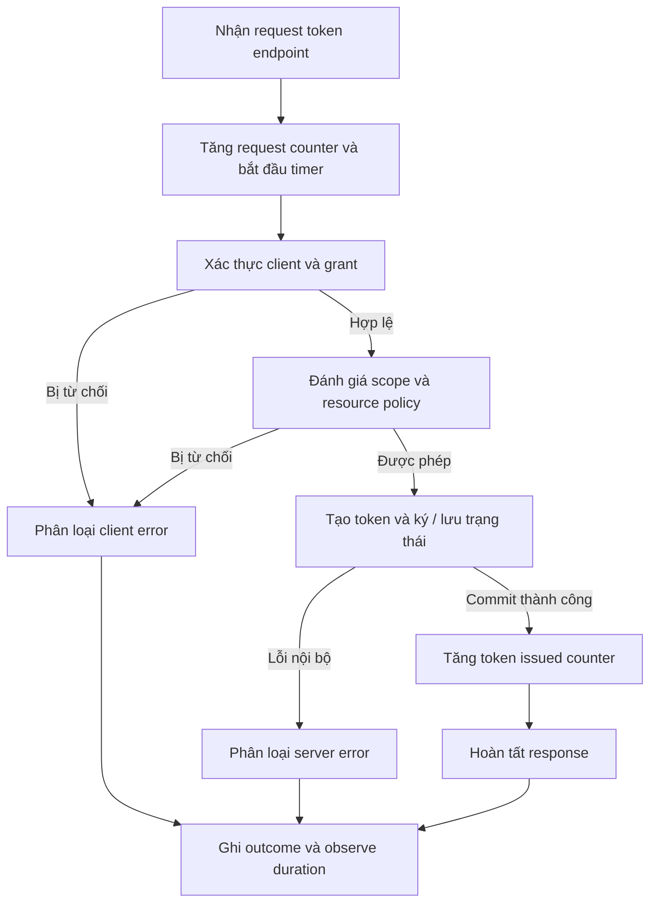
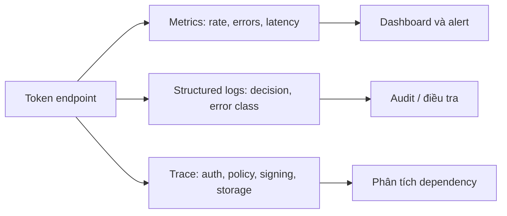

# Đo lường hoạt động phát hành token

## 1. Vì sao cần metric cho token issuance?

Authorization Server là một thành phần quan trọng trong vòng đời token. Nó tiếp nhận yêu cầu từ client, xác thực client hoặc grant, đánh giá scope/resource, phát hành access token và trong một số flow có thể phát hành refresh token hoặc ID token. Khi endpoint token chậm, lỗi tăng hoặc cấp sai loại quyền, các dịch vụ phía sau có thể không truy cập được API hoặc có nguy cơ bị cấp quyền ngoài chính sách.

**Token issuance metrics** giúp đội vận hành trả lời các câu hỏi:

- Có bao nhiêu yêu cầu đến token endpoint, bao nhiêu yêu cầu thành công và bao nhiêu yêu cầu bị từ chối?
- Tỷ lệ phát hành thành công và độ trễ cấp token thay đổi ra sao theo grant type hoặc nhóm client?
- Lỗi đến từ xác thực client, scope/resource policy, hệ thống ký token, kho dữ liệu hay dependency bên ngoài?
- Có đột biến yêu cầu hoặc phát hành token cho một flow/resource bất thường không?
- Sau khi triển khai phiên bản mới, chất lượng token endpoint có suy giảm không?

Trong module bảo mật token, metric phải giúp quan sát cả tính sẵn sàng lẫn hành vi bảo mật của quá trình phát hành. Tuy nhiên, metric chỉ là dữ liệu tổng hợp. Nó không thay thế việc xác minh chữ ký, introspection, kiểm tra membership, audit log hay điều tra một token cụ thể. Đặc biệt, không đưa token, refresh token, subject hoặc dữ liệu nhận dạng nhạy cảm vào label của metric.

## 2. Xác định ranh giới cần đo

Một request tới token endpoint có thể kết thúc theo nhiều cách: client được xác thực và token được cấp; client không hợp lệ; grant không được hỗ trợ; scope/resource bị từ chối; authorization code hoặc refresh token không hợp lệ; hoặc server gặp lỗi nội bộ. Cần phân biệt **lượt yêu cầu** với **số token thực tế được phát hành**.

Ví dụ, một request OIDC có thể trả access token và ID token; một số grant có thể phát hành thêm refresh token. Nếu chỉ đếm HTTP response 200, hệ thống không biết đã tạo ra bao nhiêu artifact token và thuộc loại nào. Ngược lại, nếu chỉ đếm token, ta không thấy số request bị từ chối hoặc lỗi.

| Ranh giới | Sự kiện được đo | Ý nghĩa |
| --- | --- | --- |
| Token endpoint nhận request | Một request đã đến endpoint | Đo lưu lượng và làm mẫu số cho tỷ lệ kết quả. |
| Hoàn tất xác thực và policy | Client/grant/scope/resource được đánh giá | Phân biệt lỗi đầu vào với lỗi dịch vụ. |
| Phát hành token được commit | Một token artifact được tạo và hệ thống xác nhận phát hành | Đo số access/refresh/ID token thực sự được phát hành. |
| Trả response | Server hoàn tất phản hồi HTTP | Quan sát latency và lỗi truyền tải; không luôn chứng minh client đã nhận được token. |
| Resource Server sử dụng token | API xác minh token và ra quyết định | Thuộc metric validation/authorization ở phía Resource Server, không phải issuance. |

Nên ghi nhận request ở đầu token endpoint và chỉ tăng bộ đếm phát hành sau khi bước tạo token thành công theo ranh giới commit của hệ thống. Nếu token đã được tạo nhưng kết nối bị ngắt trước khi client nhận response, metric phát hành và metric response delivery có thể khác nhau; cần định nghĩa rõ trong tài liệu vận hành.

## 3. Bộ metric cốt lõi

Các tên metric dưới đây là quy ước minh họa cho ứng dụng. Có thể đổi prefix theo hệ thống, nhưng phải giữ ý nghĩa, đơn vị, loại instrument và nhãn nhất quán giữa các phiên bản.

| Metric | Loại | Label gợi ý | Ý nghĩa |
| --- | --- | --- | --- |
| `oauth_token_endpoint_requests_total` | Counter | `grant_type`, `client_class`, `outcome`, `error_code` | Tổng số request tới token endpoint, phân loại kết quả. |
| `oauth_tokens_issued_total` | Counter | `grant_type`, `token_kind`, `token_format`, `resource_class` | Số token artifact đã phát hành. |
| `oauth_token_endpoint_request_duration_seconds` | Histogram | `grant_type`, `outcome` | Thời gian xử lý request tại token endpoint, tính bằng giây. |
| `oauth_token_endpoint_inflight_requests` | Gauge | `grant_type` (nếu số loại nhỏ) | Số request đang được xử lý tại thời điểm đo. |
| `oauth_token_policy_denials_total` | Counter | `reason`, `grant_type` | Số lần policy từ chối yêu cầu phát hành. |
| `oauth_token_signing_failures_total` | Counter | `signing_key_class`, `failure_class` | Số lỗi ký token theo nhóm nguyên nhân đã chuẩn hóa. |
| `oauth_token_introspection_requests_total` | Counter | `outcome` | Lưu lượng introspection nếu Authorization Server cung cấp endpoint này. |
| `oauth_token_revocation_requests_total` | Counter | `outcome`, `token_kind` | Lưu lượng và kết quả yêu cầu thu hồi token. |

Không cần tạo mọi metric ngay từ đầu. Một bộ tối thiểu hữu ích thường gồm request counter, issued-token counter và duration histogram. Bổ sung metric policy denial, signing failure, introspection hoặc revocation khi hệ thống có các luồng đó và cần vận hành chúng.

### 3.1. Đếm request và kết quả

`oauth_token_endpoint_requests_total` tăng một lần cho mỗi HTTP request được xử lý, bất kể thành công hay thất bại. Label `outcome` nên có tập giá trị hữu hạn, chẳng hạn:

- `success`: request hoàn tất và có kết quả thành công.
- `client_error`: request bị từ chối do client, grant, credential, scope hoặc input không hợp lệ.
- `server_error`: lỗi nội bộ hoặc dependency khiến server không thể hoàn thành yêu cầu.

`error_code` chỉ chứa mã lỗi OAuth đã chuẩn hóa như `invalid_client`, `invalid_grant`, `invalid_scope`, `unsupported_grant_type`, `invalid_request`, `server_error` hoặc `none`. Không đưa nội dung `error_description` tùy ý vào label. Nếu một lỗi không nằm trong allowlist, gom vào `other`.

### 3.2. Đếm token được phát hành

`oauth_tokens_issued_total` tăng theo **số token artifact** được phát hành, không phải số response. `token_kind` có thể gồm `access`, `refresh`, `id`; `token_format` có thể gồm `jwt`, `opaque`, `other`. Nếu một response tạo một access token và một ID token, counter tăng hai lần với hai giá trị `token_kind` tương ứng.

Chỉ dùng label `resource_class` từ danh mục cấu hình ổn định, ví dụ `orders_api`, `inventory_api`, `identity_api`. Không dùng URL resource tùy ý hoặc audience do client gửi trực tiếp nếu giá trị có thể không giới hạn.

### 3.3. Độ trễ xử lý

Histogram `oauth_token_endpoint_request_duration_seconds` đo từ lúc server nhận request đến lúc hoàn tất xử lý token endpoint. Dùng đơn vị giây với hậu tố `_seconds`; chọn bucket theo mục tiêu latency của dịch vụ, ví dụ:

```text
0.005, 0.01, 0.025, 0.05, 0.1, 0.25, 0.5, 1, 2.5, 5
```

Các bucket chỉ là điểm bắt đầu. Nếu signing hoặc policy lookup có latency đặc thù, điều chỉnh bucket dựa trên dữ liệu thực tế và SLO. Histogram nên có label ít chiều; tránh nhân bucket với hàng trăm client hoặc hàng nghìn tenant.

## 4. Chọn label an toàn và kiểm soát cardinality

Label quyết định khả năng phân tích metric, nhưng cũng quyết định số lượng time series và nguy cơ lộ thông tin. Một label có nhiều giá trị khác nhau sẽ tạo cardinality cao; hệ thống metrics có thể tốn bộ nhớ, tăng chi phí truy vấn hoặc quá tải.

| Label | Khuyến nghị | Lý do |
| --- | --- | --- |
| `grant_type` | Dùng danh sách allowlist | Các grant OAuth thường có số lượng nhỏ và hữu ích để phân tích. |
| `client_class` | Dùng nhóm cố định như `service`, `web`, `mobile`, `partner` | Ít chiều hơn client ID và đủ cho dashboard vận hành tổng quan. |
| `client_id` | Chỉ dùng nếu danh mục client nhỏ, ổn định, đã được kiểm soát; nếu không thì tránh | Client có thể được tạo động hoặc tăng theo thời gian. |
| `outcome` | Dùng enum cố định | Phân biệt success, client error và server error. |
| `error_code` | Chuẩn hóa theo allowlist, gom mã lạ thành `other` | Không để chuỗi lỗi tự do tạo series mới. |
| `token_kind` / `token_format` | Dùng enum cố định | Phân biệt access, refresh, ID và JWT/opaque. |
| `resource_class` | Dùng ID nội bộ từ cấu hình hữu hạn | Tránh URL/audience tùy ý làm label. |
| `tenant_id`, `sub`, `jti`, email, username | Không dùng | Giá trị có cardinality rất cao và có thể là dữ liệu cá nhân. |
| Token, refresh token, client secret, assertion, raw scope | Tuyệt đối không dùng | Là bí mật hoặc dữ liệu có thể gây rò rỉ quyền. |
| IP, user-agent, request ID, trace ID | Không dùng làm label metric | Giá trị đa dạng; dùng log/trace có kiểm soát nếu cần điều tra. |

Một cách kiểm soát tốt là phân loại client và resource tại thời điểm cấu hình, sau đó chỉ xuất các nhãn đã được chuẩn hóa. Nếu cần xem một client cụ thể, dùng audit log hoặc trace có kiểm soát truy cập, không mở rộng label metric vô hạn.

### Ví dụ dữ liệu metric an toàn

```text
oauth_token_endpoint_requests_total{
  grant_type="client_credentials",
  client_class="service",
  outcome="success",
  error_code="none"
} 12840

oauth_tokens_issued_total{
  grant_type="client_credentials",
  token_kind="access",
  token_format="jwt",
  resource_class="inventory_api"
} 12840
```

Dữ liệu ví dụ không chứa client secret, token, user ID, tenant ID hay request-specific value. Nếu cần thêm chiều `environment`, `region` hoặc `issuer_cluster`, chỉ thêm khi danh sách giá trị nhỏ và được quản lý.

## 5. Đo lường theo các grant và vòng đời token

Các grant khác nhau có hành vi và rủi ro khác nhau. `grant_type` là chiều phân tích quan trọng, nhưng cần chuẩn hóa giá trị và không dùng request input chưa được xác minh trực tiếp làm label.

| Flow | Metric cần quan sát | Tín hiệu cần chú ý |
| --- | --- | --- |
| Authorization Code | Request, access/refresh/ID token được cấp, latency, lỗi `invalid_grant` | Tăng lỗi đổi code, callback hoặc dependency session; code replay. |
| Client Credentials | Request, access token được cấp, latency, `invalid_client` | Secret/key sai, client bị disable nhưng vẫn thử lấy token, lưu lượng service bất thường. |
| Refresh Token | Request refresh, access/refresh token mới, lỗi và reuse detection | Đột biến refresh, token family bị reuse, refresh sau khi session/membership bị thu hồi. |
| Token Exchange | Request exchange, token đích, resource class, policy denial | Tăng yêu cầu đổi audience/scope hoặc exchange bị từ chối bất thường. |
| Device Authorization | Request cấp device code/token và lỗi polling | Polling quá thường xuyên, tăng `authorization_pending` hoặc `slow_down`. |

Một số giá trị như `authorization_pending` và `slow_down` có thể xuất hiện trong Device Authorization Flow; không nên gộp chúng với lỗi xác thực client. Với từng flow, hãy xác định tập error code hợp lệ và gom vào nhóm có ý nghĩa vận hành.

Đối với refresh token rotation, metric có thể theo dõi số lần refresh thành công, số lần reuse bị phát hiện và số token family bị thu hồi. Đối với token exchange, có thể theo dõi policy denial theo nhóm nguyên nhân như `subject_invalid`, `actor_not_allowed`, `scope_denied`, `resource_denied`. Những label này phải là enum do server tạo ra, không phải nội dung tùy ý từ request.

## 6. Instrumentation tại Authorization Server

Đo metric ở đúng ranh giới xử lý để số liệu không bị đếm thiếu hoặc đếm trùng. Luồng khái quát:



Pseudocode minh họa:

```java
TokenResponse handleTokenRequest(TokenRequest request) {
    Timer.Sample timer = Timer.start(meterRegistry);
    String grant = normalizeGrantType(request.grantType());
    String clientClass = "unknown";
    String outcome = "server_error";
    String errorCode = "none";

    try {
        AuthenticatedClient client = clientAuthenticator.authenticate(request);
        clientClass = client.classification();
        AuthorizationDecision decision = policy.evaluate(client, request);
        if (!decision.allowed()) {
            outcome = "client_error";
            errorCode = normalizeOAuthError(decision.errorCode());
            throw new OAuthException(errorCode);
        }

        List<IssuedToken> issued = tokenIssuer.issue(client, decision);
        // Chỉ ghi nhận artifact sau khi issuer xác nhận phát hành thành công.
        for (IssuedToken token : issued) {
            tokensIssued.increment(grant, token.kind(), token.format(),
                decision.resourceClass());
        }
        outcome = "success";
        return TokenResponse.from(issued);
    } catch (OAuthException ex) {
        throw ex;
    } catch (RuntimeException ex) {
        outcome = "server_error";
        errorCode = "server_error";
        throw ex;
    } finally {
        // Mỗi HTTP request chỉ tăng request counter đúng một lần.
        tokenRequests.increment(grant, clientClass, outcome, errorCode);
        requestDuration.record(timer.stop(), grant, outcome);
    }
}
```

Đây là pseudocode để giải thích vị trí instrument, không phải API thực tế của Micrometer hay Spring Security. Counter request được tăng trong `finally` đúng một lần với outcome cuối cùng, kể cả khi xử lý ném exception. Nếu cần đo request đang chạy, dùng một gauge riêng: tăng tại entry và giảm trong `finally`; không trộn trạng thái `started` vào counter kết quả.

Trong triển khai thực tế nên tách `requests_total` (mỗi request tăng đúng một lần với outcome cuối cùng) và `inflight` (tăng khi vào, giảm trong `finally`). Nếu cần đo thời gian ở các giai đoạn như client authentication, policy evaluation, signing hoặc database lookup, tạo histogram riêng cho từng stage khi có nhu cầu chẩn đoán; tránh tạo quá nhiều metric trùng lặp.

## 7. Dashboard và truy vấn Prometheus

Dashboard token issuance nên cho người vận hành thấy lưu lượng, tỷ lệ kết quả, latency, số token phát hành và lỗi bảo mật đáng chú ý trong cùng một khoảng thời gian. Không nên chỉ hiển thị tổng token; tổng tăng có thể là hoạt động bình thường hoặc dấu hiệu client bị lặp request.

### Request rate

```promql
sum by (grant_type) (
  rate(oauth_token_endpoint_requests_total[5m])
)
```

Biểu đồ cho biết số request mỗi giây theo grant type. So sánh với cùng khung giờ hoặc baseline để phát hiện đột biến.

### Tỷ lệ thành công của dịch vụ

```promql
sum(rate(oauth_token_endpoint_requests_total{outcome="success"}[5m]))
/
clamp_min(
  sum(rate(oauth_token_endpoint_requests_total{outcome=~"success|server_error"}[5m])),
  1
)
```

Tỷ lệ trên đánh giá độ tin cậy phía server, loại các request bị từ chối do lỗi đầu vào/client khỏi mẫu số. Nếu mục tiêu là theo dõi tỷ lệ chấp nhận toàn bộ request, hãy hiển thị thêm tỷ lệ `success / all requests`; hai con số trả lời hai câu hỏi khác nhau. Đừng xem `invalid_client` hoặc `invalid_scope` là lỗi hạ tầng nếu server từ chối đúng chính sách.

### Token issuance rate

```promql
sum by (token_kind, token_format, resource_class) (
  rate(oauth_tokens_issued_total[5m])
)
```

Truy vấn này cho biết tốc độ phát hành từng loại token. Nếu access token tăng đột ngột nhưng request rate không tăng tương ứng, cần kiểm tra xem một request có đang phát hành nhiều artifact hơn dự kiến hay instrumentation bị đếm trùng.

### Latency p95

```promql
histogram_quantile(
  0.95,
  sum by (le, grant_type) (
    rate(oauth_token_endpoint_request_duration_seconds_bucket[5m])
  )
)
```

Đọc p50/p95/p99 cùng request rate và server error rate. p99 có thể dao động mạnh khi lưu lượng thấp; không nên dùng một percentile đơn lẻ để kết luận sự cố.

### Tỷ lệ lỗi server

```promql
sum(rate(oauth_token_endpoint_requests_total{outcome="server_error"}[5m]))
/
clamp_min(
  sum(rate(oauth_token_endpoint_requests_total[5m])),
  1
)
```

Có thể bổ sung breakdown theo `error_code`, nhưng chỉ dùng mã lỗi đã chuẩn hóa. Khi phân tích `client_error`, xem riêng `invalid_client`, `invalid_scope`, `invalid_grant` và `unsupported_grant_type` để phân biệt credential lỗi, client cấu hình sai hoặc hành vi dò quét.

## 8. Alert và SLO cho token endpoint

Alert nên dựa trên tác động tới dịch vụ và tín hiệu bảo mật. Không nên gửi cảnh báo cho mọi lần `invalid_grant` đơn lẻ, vì người dùng hoặc client có thể gửi một yêu cầu không hợp lệ trong hoạt động bình thường.

| Tín hiệu | Điều kiện cảnh báo minh họa | Hành động điều tra |
| --- | --- | --- |
| Server error tăng | Tỷ lệ server error vượt ngưỡng trong 5 phút và có đủ request mẫu | Kiểm tra deployment, signing key, DB, policy service và dependency. |
| Latency cao | p95 vượt SLO liên tục | Phân tích stage authentication, policy, signing và storage. |
| Lưu lượng tăng bất thường | Request rate vượt baseline theo grant/client class | Kiểm tra retry loop, client bị lỗi hoặc credential bị lạm dụng. |
| `invalid_client` tăng | Tỷ lệ hoặc số lượng vượt baseline | Kiểm tra secret/key rotation, client bị disable, cấu hình client và hành vi dò credential. |
| `invalid_scope` / `invalid_target` tăng | Đột biến theo flow hoặc resource class | Kiểm tra thay đổi policy, client configuration hoặc nỗ lực xin quyền ngoài phạm vi. |
| Signing failure | Có lỗi ký token ngoài ngưỡng rất thấp | Kiểm tra key store, KMS/HSM, key rotation và quyền truy cập. |
| Refresh reuse detection | Phát hiện reuse theo policy | Thu hồi token family/session liên quan và điều tra sự cố. |

Các ngưỡng cụ thể phải được chọn từ baseline, tải thực tế và SLO của hệ thống. Ví dụ, một dịch vụ có mục tiêu p95 dưới 200 ms có thể cảnh báo khi p95 vượt mục tiêu liên tục 10 phút; con số này chỉ là ví dụ, không phải chuẩn chung cho OAuth.

SLO nên xác định rõ:

- **Availability:** tỷ lệ request hợp lệ được xử lý thành công, không tính lỗi đầu vào do client gửi.
- **Latency:** tỷ lệ request hoàn thành trong ngưỡng thời gian, có thể phân theo grant type.
- **Correct issuance:** token được cấp đúng scope, audience/resource, token type và TTL theo policy. Metric tổng hợp không tự chứng minh điều này; cần test, audit và kiểm tra policy.
- **Security response:** thời gian phát hiện và xử lý các tín hiệu như credential abuse, refresh token reuse hoặc policy denial bất thường.

## 9. Kết hợp metrics, logs và traces

Metrics cho biết xu hướng và mức độ; logs lưu sự kiện chi tiết; traces nối các bước xử lý trong một request. Ba loại telemetry bổ sung cho nhau:



Structured log có thể ghi correlation ID, grant type, client reference đã được bảo vệ, resource class, outcome, error code và policy decision. Chỉ ghi thông tin cần thiết, áp dụng quyền truy cập và thời hạn lưu phù hợp. Không ghi access token, refresh token, authorization code, client secret, private key, client assertion hoặc raw request body chứa credential.

Trace có thể gắn metric exemplar hoặc correlation ID để chuyển từ spike trên dashboard sang một trace mẫu. Không đưa trace ID thành label metric vì mỗi request có một giá trị riêng. Với trace attributes, áp dụng chính sách tương tự: tránh subject, tenant, token hoặc dữ liệu cá nhân nếu không có lý do và kiểm soát phù hợp. Sampling phải đủ để điều tra sự cố nhưng không làm lộ bí mật.

## 10. Kiểm thử instrumentation

Instrumentation cũng cần được kiểm thử như một phần của ứng dụng. Nếu metric đếm sai, dashboard và alert sẽ đưa ra quyết định sai.

| Kịch bản | Assertion cho metric |
| --- | --- |
| Client hợp lệ xin token thành công | Request counter tăng đúng 1 với `outcome=success`; issued counter tăng theo số token artifact được phát hành. |
| Client secret sai | Request counter tăng đúng 1 với `client_error` và error code đã chuẩn hóa; issued counter không tăng. |
| Scope bị policy từ chối | Policy denial counter tăng; không có token artifact mới. |
| Signing service lỗi | Server error và signing failure tăng; không ghi nhận token đã phát hành nếu commit chưa thành công. |
| Response bị lỗi sau khi token commit | Request/response outcome phản ánh lỗi truyền tải theo định nghĩa; issued counter vẫn phản ánh token đã commit. |
| Một OIDC response có access và ID token | Issued counter tăng hai artifact với `token_kind` tương ứng. |
| Request bị retry từ client | Mỗi HTTP attempt được đếm một lần; không gộp các attempt thành một request. |
| Error description chứa chuỗi tùy ý | Không tạo label mới; chỉ dùng error code chuẩn hóa hoặc `other`. |
| Request chứa tenant ID, subject hoặc token | Không giá trị nào xuất hiện trong metric label hoặc log không an toàn. |
| Client/resource mới ngoài danh mục | Nhãn được chuẩn hóa hoặc gom nhóm, không làm cardinality tăng không giới hạn. |

Ví dụ test ý tưởng với registry giả lập:

```java
@Test
void successfulClientCredentialsRequestRecordsOneRequestAndOneAccessToken() {
    tokenEndpoint.handle(validClientCredentialsRequest());

    assertCounterValue("oauth_token_endpoint_requests_total",
        Map.of("grant_type", "client_credentials", "outcome", "success"), 1);
    assertCounterValue("oauth_tokens_issued_total",
        Map.of("grant_type", "client_credentials", "token_kind", "access"), 1);
}

@Test
void invalidClientDoesNotRecordIssuedToken() {
    assertThrows(OAuthException.class,
        () -> tokenEndpoint.handle(invalidClientCredentialsRequest()));

    assertCounterValue("oauth_token_endpoint_requests_total",
        Map.of("grant_type", "client_credentials", "outcome", "client_error"), 1);
    assertCounterValue("oauth_tokens_issued_total", Map.of(), 0);
}
```

Đây là mã giả; helper assertion và metric registry phụ thuộc thư viện dự án. Trong test thật, cần reset registry hoặc dùng registry riêng cho từng test để tránh dữ liệu từ test trước ảnh hưởng kết quả.

## 11. Những lỗi quan sát thường gặp

1. **Chỉ đếm response HTTP 200:** không phân biệt số request, số token artifact và response bị ngắt sau khi token đã commit.
2. **Gộp client error vào server availability:** làm SLO xấu đi khi client gửi input sai, dù Authorization Server đang hoạt động đúng.
3. **Dùng raw client ID, tenant ID hoặc scope làm label:** cardinality tăng và có thể lộ dữ liệu nội bộ.
4. **Đếm hai lần một request:** tăng counter ở entry và lại tăng cùng counter khi success/error.
5. **Đo latency không nhất quán:** một số code path không observe timer trong `finally`, hoặc timer dừng trước bước ký/lưu token.
6. **Không phân biệt artifact token:** một OIDC response có thể chứa nhiều token nhưng dashboard chỉ đếm một lần.
7. **Coi số token đã cấp là số token còn active:** token có thể hết hạn, bị thu hồi hoặc không còn được Resource Server chấp nhận.
8. **Không chuẩn hóa lỗi:** `error_description` hoặc exception message tạo hàng nghìn label và làm lộ thông tin.
9. **Thiếu metric cho dependency:** chỉ thấy token endpoint chậm nhưng không biết KMS, DB, introspection hay policy service gây ra.
10. **Alert theo một mẫu nhỏ:** tỷ lệ lỗi có thể tăng mạnh khi chỉ có một request; cần minimum traffic hoặc cửa sổ thời gian phù hợp.

Đặc biệt, counter `oauth_tokens_issued_total` là số token đã được phát hành tích lũy. Nó không cho biết số token còn hiệu lực tại thời điểm hiện tại. Muốn biết trạng thái active cần một nguồn dữ liệu vòng đời đáng tin cậy, chẳng hạn introspection hoặc kho trạng thái token; không suy ra bằng cách lấy tổng token đã cấp trừ tổng token thu hồi nếu hệ thống không quản lý đầy đủ expiration và các trạng thái khác.

## 12. Checklist triển khai

- [ ] Xác định rõ ranh giới request, policy decision, token commit và response delivery.
- [ ] Có counter cho token endpoint requests với outcome được chuẩn hóa.
- [ ] Có counter riêng cho token artifact theo kind và format.
- [ ] Có histogram latency dùng đơn vị giây và bucket phù hợp SLO.
- [ ] Phân biệt client errors với server errors khi tính availability.
- [ ] Label dùng enum hoặc danh mục cấu hình hữu hạn; có kiểm soát cardinality.
- [ ] Không đưa token, secret, subject, tenant, jti, raw scope, IP hay request ID vào label.
- [ ] Dashboard có request rate, success/error rate, issuance rate và p95/p99 latency.
- [ ] Alert có baseline, minimum traffic và hướng dẫn điều tra rõ ràng.
- [ ] Logs/traces hỗ trợ điều tra nhưng không ghi bí mật hoặc dữ liệu nhạy cảm không cần thiết.
- [ ] Test xác minh metric tăng đúng một lần, không tăng issued counter khi phát hành thất bại và không rò rỉ label.
- [ ] Tài liệu hóa metric semantics để dashboard, alert và các phiên bản service hiểu cùng một cách.

**Điểm cốt lõi:** Quan sát token issuance phải đo riêng số request, kết quả xử lý, độ trễ và số token artifact được phát hành. Dùng label ít chiều, đã chuẩn hóa và không chứa bí mật. Kết hợp metrics với logs, traces, audit và kiểm thử để phát hiện sự cố mà vẫn bảo vệ token và danh tính.

## Tài liệu tham khảo

- IETF, **RFC 6749 — The OAuth 2.0 Authorization Framework**: token endpoint, grant types, client authentication và error response. <https://www.rfc-editor.org/rfc/rfc6749>
- IETF, **RFC 7662 — OAuth 2.0 Token Introspection**: truy vấn trạng thái token tại Resource Server. <https://www.rfc-editor.org/rfc/rfc7662>
- IETF, **RFC 7009 — OAuth 2.0 Token Revocation**: yêu cầu thu hồi token. <https://www.rfc-editor.org/rfc/rfc7009>
- Prometheus, **Metric types**: counter, gauge, histogram và summary. <https://prometheus.io/docs/concepts/metric_types/>
- Prometheus, **Naming and labels**: quy ước đặt tên metric và hướng dẫn sử dụng label. <https://prometheus.io/docs/practices/naming/>
- OpenTelemetry, **Metrics concepts**: instrument, aggregation và mô hình metric telemetry. <https://opentelemetry.io/docs/concepts/signals/metrics/>
