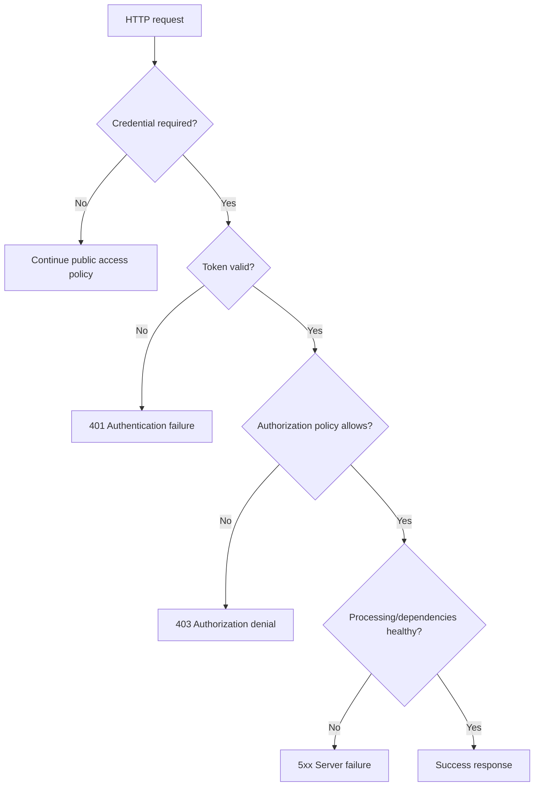

# Metric 401, 403 và 5xx

Trong một hệ thống xác thực và phân quyền bằng token, các mã HTTP **401, 403 và 5xx** cho biết những nhóm kết quả khác nhau của request. Theo dõi chúng bằng metric giúp đội vận hành nhận biết lỗi đăng nhập, lỗi quyền truy cập và sự cố dịch vụ; tìm ra API hoặc dependency đang gặp vấn đề; đồng thời đánh giá tác động của thay đổi chính sách token.

Metric chỉ có ý nghĩa khi hệ thống phân loại đúng nguyên nhân. `401 Unauthorized` thường biểu thị request chưa được xác thực hợp lệ; `403 Forbidden` biểu thị request đã được hiểu nhưng không được phép thực hiện hành động; `5xx` biểu thị server hoặc thành phần trung gian không thể hoàn tất request do lỗi phía server. Trong OAuth 2.0 Bearer Token, RFC 6750 còn phân biệt `invalid_token` với `insufficient_scope`, giúp gắn kết mã HTTP với kết quả xác thực và phân quyền.

Trong module **SECURITY_TOKEN_SECURITY_FUNDAMENTALS**, các metric này tạo tín hiệu vận hành cho vòng đời token: token hết hạn, sai issuer/audience, thiếu scope, bị thu hồi, authorization server không phản hồi hoặc resource server gặp lỗi đều cần được quan sát theo cách có thể phân tích mà không làm lộ token hay dữ liệu nhạy cảm.

## 1. Ý nghĩa của 401, 403 và 5xx

### 401 Unauthorized: xác thực chưa thành công

HTTP `401` cho biết request chưa cung cấp thông tin xác thực hợp lệ cho tài nguyên được yêu cầu. Với Bearer Token, các nguyên nhân phổ biến gồm:

- Không có access token trong request đến endpoint yêu cầu xác thực.
- Token sai định dạng hoặc không thể parse.
- Chữ ký JWT không hợp lệ hoặc `kid` không tìm thấy trong JWKS.
- `iss` không khớp issuer tin cậy.
- `aud` không dành cho resource server đang xử lý.
- Token đã hết hạn theo `exp` hoặc chưa đến thời điểm `nbf`.
- Opaque token bị introspection trả `active: false`.
- Token bị thu hồi hoặc không còn hợp lệ theo trạng thái mà resource server kiểm tra.

Với HTTP authentication, response `401` thường đi kèm `WWW-Authenticate` challenge để client biết phương thức xác thực được yêu cầu. Với Bearer Token, server có thể cung cấp error code như `invalid_token` trong challenge theo RFC 6750. API cần thực hiện đúng contract của mình và tránh đưa thông tin nội bộ nhạy cảm vào `error_description`.

Một số endpoint công khai có thể cho phép request không có token. Vì vậy, không nên mặc định mọi request không có `Authorization` đều là lỗi. Chỉ ghi nhận `401` khi request thực sự bị từ chối với status đó; có thể bổ sung metric về lý do từ chối nếu ứng dụng có phân loại an toàn.

### 403 Forbidden: đã xác thực nhưng không đủ quyền

HTTP `403` biểu thị server hiểu request nhưng từ chối thực hiện hành động. Trong hệ thống token, các nguyên nhân thường gặp:

- Access token hợp lệ nhưng thiếu scope cần thiết.
- Principal không có role hoặc permission cho hành động.
- User không có membership hợp lệ trong tenant của tài nguyên.
- Policy từ chối theo thuộc tính, trạng thái tài nguyên hoặc điều kiện nghiệp vụ.
- Tenant bị đình chỉ hoặc vô hiệu hóa theo chính sách.
- Client đã xác thực nhưng không được phép truy cập API hoặc resource cụ thể.

RFC 6750 quy định `insufficient_scope` là một trường hợp Bearer Token có thể dẫn tới `403`. Đây là tín hiệu khác với `invalid_token`: token có thể hợp lệ về xác thực nhưng không chứa quyền đủ để truy cập tài nguyên. Ứng dụng nên giữ ranh giới này rõ ràng để client biết khi nào cần xác thực lại và khi nào cần yêu cầu quyền phù hợp.

Không nên tự động đổi mọi lỗi authorization thành `401`. Làm như vậy có thể khiến client refresh token hoặc đăng nhập lại liên tục dù quyền của principal không thay đổi. Ngược lại, nếu token thực sự không hợp lệ thì trả `403` có thể che giấu vấn đề xác thực và gây hiểu nhầm cho client.

### 5xx: server không hoàn tất được request

Nhóm `5xx` cho biết lỗi xảy ra khi server hoặc gateway xử lý request. Các mã thường cần quan sát:

| Mã | Ý nghĩa thường gặp | Ví dụ trong hệ thống token |
|---|---|---|
| `500 Internal Server Error` | Lỗi không dự kiến trong ứng dụng. | Exception trong JWT validation, policy engine hoặc xử lý claim. |
| `502 Bad Gateway` | Gateway nhận response không hợp lệ từ upstream. | Gateway gọi authorization service hoặc introspection endpoint và nhận response sai. |
| `503 Service Unavailable` | Service tạm thời không sẵn sàng. | Authorization server, JWKS endpoint hoặc dependency quá tải/bảo trì. |
| `504 Gateway Timeout` | Gateway không nhận response kịp thời từ upstream. | Introspection hoặc token service vượt quá timeout. |

Không phải mọi lỗi xác thực đều là `5xx`. Token hết hạn hoặc thiếu scope thường là kết quả nghiệp vụ dự kiến và cần được biểu diễn bằng `401` hoặc `403` theo contract. Một lỗi kết nối đến authorization server có thể làm request không thể được xác minh; nếu ứng dụng trả `503` hoặc `5xx` thì metric cần phản ánh sự cố dependency. Hành vi cuối cùng phụ thuộc chính sách fail closed và thiết kế của hệ thống.

## 2. Phân biệt authentication failure, authorization denial và server failure

Một cách phân loại hữu ích là đặt ba câu hỏi theo thứ tự:

1. **Có xác minh được danh tính hoặc credential không?** Nếu không, request có thể kết thúc bằng `401`.
2. **Principal đã xác thực có quyền thực hiện hành động không?** Nếu không, request có thể kết thúc bằng `403`.
3. **Hệ thống có thể hoàn tất quyết định và xử lý request không?** Nếu không vì lỗi nội bộ hoặc dependency, response có thể là `5xx`.



Sơ đồ thể hiện logic tổng quát; hệ thống thực tế có thể kiểm tra dependency trước hoặc trong quá trình xác thực/phân quyền. Điều quan trọng là metric phải phân biệt kết quả từ chối có chủ đích với lỗi kỹ thuật khiến quyết định không thể hoàn tất.

Ví dụ: nếu introspection trả `active: false`, đây thường là kết quả xác thực thất bại và API trả `401`. Nếu introspection endpoint timeout, ứng dụng không biết token có active hay không; có thể trả `503` theo chính sách fail closed. Không ghi timeout này thành `401 invalid_token`, vì điều đó làm sai số liệu về chất lượng token và che giấu sự cố authorization server.

## 3. Những metric cốt lõi cần thu thập

Nên bắt đầu từ một số metric có định nghĩa ổn định, sau đó mở rộng theo nhu cầu điều tra.

| Metric logic | Loại | Dùng để trả lời câu hỏi |
|---|---|---|
| Tổng số HTTP request | Counter | Lưu lượng request đang đi qua service là bao nhiêu? |
| Request theo HTTP status | Counter | Bao nhiêu request kết thúc với 2xx, 4xx hoặc 5xx? |
| Authentication failure | Counter | Bao nhiêu lần xác thực token thất bại? |
| Authorization denial | Counter | Bao nhiêu lần policy từ chối quyền? |
| Server/dependency error | Counter | Bao nhiêu lỗi xử lý hoặc lỗi dependency xảy ra? |
| Request duration | Histogram | Request thành công và request lỗi mất bao lâu? |
| Dependency duration | Histogram | JWKS, introspection, token endpoint hoặc policy service phản hồi trong bao lâu? |
| In-flight requests | Gauge | Có bao nhiêu request đang được xử lý tại thời điểm đo? |
| JWKS refresh / cache miss | Counter | Có bao nhiêu lần phải tải hoặc làm mới signing keys? |
| Token validation result | Counter | Token bị từ chối vì lý do nào trong nhóm lý do đã định nghĩa? |

Tên metric cụ thể tùy hệ thống và convention đang dùng. Ví dụ Prometheus có thể dùng `http_server_requests_total`, `http_server_request_duration_seconds`, `authn_failures_total`, `authz_denials_total` và `oauth_dependency_requests_total`. Tránh tạo nhiều metric có cùng ý nghĩa nhưng tên hoặc cách tính khác nhau giữa các service.

### Counter, gauge và histogram

- **Counter** tăng dần theo số sự kiện. Dùng cho request, 401, 403, 5xx, refresh failure và dependency error. Khi phân tích theo thời gian, dùng `rate()` hoặc `increase()` thay vì đọc giá trị tích lũy thô.
- **Gauge** biểu diễn giá trị tại thời điểm hiện tại. Dùng cho in-flight request, queue depth hoặc trạng thái số lượng worker. Không dùng gauge cho tổng số request đã xảy ra.
- **Histogram** ghi nhận phân bố giá trị như latency. Có thể tính p50, p95, p99 hoặc tỷ lệ request vượt ngưỡng từ bucket và count/sum.

Đối với metric request, nên tăng counter một lần cho mỗi request hoàn tất tại một điểm quan sát nhất quán. Nếu gateway và application đều xuất metric, cần hiểu đó là hai góc nhìn khác nhau; không cộng chúng như thể cùng một request duy nhất.

## 4. Instrumentation trong luồng xác thực và phân quyền

Metric cần được phát ra tại nơi biết chính xác kết quả. Có thể tách instrumentation thành các lớp:

1. **HTTP server/gateway:** ghi nhận request, route template, method, status code và latency cuối cùng.
2. **Authentication middleware:** ghi nhận kết quả kiểm tra credential/token như valid, missing, expired, invalid signature hoặc introspection inactive.
3. **Authorization layer:** ghi nhận policy decision như allow, insufficient scope, role denied hoặc tenant inactive.
4. **OAuth dependency client:** ghi nhận request đến discovery, JWKS, introspection, revocation hoặc token endpoint; bao gồm latency, timeout và HTTP result.
5. **Background processing:** ghi nhận lỗi token khi worker xử lý message hoặc gọi service downstream.

Mỗi lớp cần có trách nhiệm riêng. Ví dụ một request đến API có thể phát sinh một `401` ở HTTP server và một authentication failure ở middleware. Đây là hai góc nhìn cho cùng một lần xử lý, không nên cộng hai counter rồi gọi là tổng số lần thất bại. Hãy đặt tên metric rõ ràng và xác định metric nào dùng cho dashboard request, metric nào dùng cho phân tích nguyên nhân.

### Bảng phân loại kết quả xác thực

| Kết quả nội bộ | HTTP thường trả về | Metric nhóm |
|---|---:|---|
| Thiếu credential ở endpoint yêu cầu đăng nhập | 401 | Authentication failure: missing credential |
| JWT signature hoặc issuer không hợp lệ | 401 | Authentication failure: invalid token |
| Token hết hạn | 401 | Authentication failure: expired token |
| Opaque token inactive | 401 | Authentication failure: inactive token |
| Introspection/JWKS timeout | 5xx theo fail-closed policy | Dependency/server failure |
| Thiếu scope | 403 | Authorization denial: insufficient scope |
| Membership hoặc role không hợp lệ | 403 | Authorization denial: policy denied |
| Tenant inactive | 403 hoặc mã theo contract | Authorization denial: tenant inactive |
| Exception không xử lý trong policy engine | 5xx | Server failure |

Các giá trị ở cột HTTP là quy ước thường dùng, không thay thế contract API. Ví dụ một API có thể dùng `404` để không tiết lộ sự tồn tại của tài nguyên; khi đó cần metric riêng cho policy decision để không suy ra mọi denial từ status code.

## 5. Thiết kế label và tránh cardinality bùng nổ

Metric có label giúp phân tích theo service, route hoặc status. Tuy nhiên, mỗi tổ hợp label tạo một time series. Nếu label chứa giá trị thay đổi liên tục như user ID, token, session ID hoặc raw URL, số time series có thể tăng rất nhanh, làm tăng chi phí lưu trữ và giảm hiệu năng truy vấn.

### Label có cardinality thấp

Các label thường hữu ích:

- `service`: tên service từ danh sách hữu hạn.
- `method`: GET, POST, PUT, PATCH, DELETE hoặc nhóm method đã chuẩn hóa.
- `route`: route template như `/api/orders/{orderId}`, không phải URL có ID thực.
- `status_code`: mã HTTP hoặc nhóm status.
- `auth_result`: success, missing, invalid, expired, inactive.
- `auth_reason`: tập lý do đã chuẩn hóa và giới hạn.
- `dependency`: jwks, introspection, token_endpoint, policy_service.
- `environment`: dev, staging, production.

Ví dụ series có thể dùng:

```text
http_server_requests_total{
  service="inventory-api",
  method="GET",
  route="/api/items/{itemId}",
  status_code="401"
}
```

### Những label cần tránh

Không đưa các giá trị sau vào label metric:

- Raw access token, refresh token, authorization code hoặc cookie.
- `sub`, email, username, session ID hoặc client secret.
- Request ID, trace ID, correlation ID hoặc `jti`.
- Raw tenant ID nếu số tenant lớn hoặc tăng không giới hạn.
- URL đầy đủ có query parameter hoặc path ID thực.
- Error message tùy ý, exception text hoặc chuỗi do client kiểm soát.

Các giá trị này có thể chứa dữ liệu nhạy cảm hoặc tạo cardinality gần như không giới hạn. Nếu cần điều tra một request cụ thể, dùng trace/log có kiểm soát truy cập và retention phù hợp; không biến mọi định danh thành label metric. Với tenant, có thể phân nhóm theo plan, region hoặc tier có số lượng hữu hạn, hoặc dùng dashboard tổng hợp theo nhóm được phê duyệt.

### Chuẩn hóa reason code

Thay vì dùng exception message làm label, ánh xạ lỗi vào một enum cố định:

```text
INVALID_SIGNATURE
ISSUER_MISMATCH
AUDIENCE_MISMATCH
TOKEN_EXPIRED
TOKEN_NOT_ACTIVE
INSUFFICIENT_SCOPE
MEMBERSHIP_DENIED
TENANT_INACTIVE
JWKS_UNAVAILABLE
INTROSPECTION_TIMEOUT
INTERNAL_ERROR
```

Chỉ thêm reason khi có thể phân loại ổn định. Nếu một reason hiếm hoặc không đáng tin cậy, nhóm vào `OTHER` để giữ tập giá trị hữu hạn.

## 6. Tính tỷ lệ 401, 403 và 5xx

Số lượng tuyệt đối cho biết khối lượng, còn tỷ lệ giúp so sánh giữa các thời điểm có lưu lượng khác nhau.

Các định nghĩa phổ biến:

```text
request_rate = requests / time_window

401_rate = 401_requests / all_requests * 100
403_rate = 403_requests / all_requests * 100
5xx_rate = 5xx_requests / all_requests * 100
```

Mẫu số cần được xác định rõ. Khi đo tỷ lệ lỗi của API, thường dùng tổng request trong cùng service/route/method và cùng cửa sổ thời gian. Với authentication failure, có thể bổ sung tỷ lệ trên số request đến các endpoint yêu cầu xác thực; không nên chia cho toàn bộ traffic có cả endpoint công khai nếu điều đó làm tín hiệu bị loãng.

Ví dụ trong 5 phút:

| Kết quả | Số request |
|---|---:|
| Tổng request | 100.000 |
| 401 | 2.000 |
| 403 | 500 |
| 5xx | 300 |

Tỷ lệ tương ứng là 2% cho 401, 0,5% cho 403 và 0,3% cho 5xx. Các tỷ lệ này không cộng thành một chỉ số lỗi duy nhất vì 401/403 có thể là kết quả policy dự kiến, còn 5xx thường phản ánh lỗi dịch vụ.

Một endpoint login có thể có nhiều 401 do mật khẩu sai hoặc token hết hạn; điều đó không nhất thiết là sự cố. Một endpoint admin có 403 tăng đột biến có thể cho thấy policy thay đổi, membership bị thu hồi hoặc client đang gọi sai scope. Cần đặt ngưỡng theo route và hành vi bình thường của ứng dụng.

## 7. Ví dụ Prometheus và PromQL

Giả sử ứng dụng xuất metric `http_server_requests_total` với label `service`, `route`, `method` và `status_code`.

### Tốc độ request tổng

```promql
sum by (service) (
  rate(http_server_requests_total[5m])
)
```

### Tốc độ 401 theo service

```promql
sum by (service) (
  rate(http_server_requests_total{status_code="401"}[5m])
)
```

### Tỷ lệ 403 theo route

```promql
100 *
sum by (service, route) (
  rate(http_server_requests_total{status_code="403"}[5m])
)
/
clamp_min(
  sum by (service, route) (rate(http_server_requests_total[5m])),
  1e-9
)
```

### Tỷ lệ 5xx theo service

```promql
100 *
sum by (service) (
  rate(http_server_requests_total{status_code=~"5.."}[5m])
)
/
clamp_min(
  sum by (service) (rate(http_server_requests_total[5m])),
  1e-9
)
```

`clamp_min` tránh phép chia cho 0 khi không có traffic. Tên metric và label trong ví dụ phải được điều chỉnh theo instrumentation thực tế. Nếu metric được xuất ở gateway và application cùng lúc, không cộng chéo hai nguồn nếu chúng đếm cùng request.

### Latency p95 của request

Với histogram có bucket theo giây:

```promql
histogram_quantile(
  0.95,
  sum by (service, le) (
    rate(http_server_request_duration_seconds_bucket[5m])
  )
)
```

Nên quan sát latency tổng và latency dependency riêng. Nếu p95 của API tăng cùng p95 của introspection, dependency có thể là nguyên nhân. Nếu API latency tăng nhưng introspection ổn định, cần điều tra application, database hoặc policy engine.

### Tỷ lệ lỗi introspection

```promql
sum by (dependency) (
  rate(oauth_dependency_requests_total{dependency="introspection", result="error"}[5m])
)
```

Counter dependency cần có định nghĩa `result` hữu hạn, ví dụ `success`, `oauth_error`, `timeout`, `http_error`, `invalid_response`. Không gộp `active=false` thành lỗi mạng: đó là kết quả token inactive, không phải dependency failure.

## 8. Dashboard cho vận hành token security

Một dashboard nên trả lời được ba câu hỏi: traffic đang ra sao, request bị từ chối vì lý do nào, và dependency có đang ảnh hưởng đến quyết định bảo mật không.

### Hàng tổng quan

- Request rate theo service.
- 401, 403 và 5xx rate theo service.
- p50/p95/p99 latency.
- Số request đang xử lý và tỷ lệ timeout.
- Availability hoặc success rate của các dependency quan trọng.

### Hàng authentication

- 401 theo route và auth reason.
- Token expired, invalid signature, issuer mismatch, audience mismatch và introspection inactive.
- JWKS cache hit/miss, refresh count và refresh error.
- Tỷ lệ request thiếu credential trên endpoint yêu cầu xác thực.

### Hàng authorization

- 403 theo route và policy reason.
- Insufficient scope, role denied, membership denied và tenant inactive.
- Tỷ lệ denial trên endpoint nhạy cảm.
- Thay đổi đột ngột theo phiên bản ứng dụng hoặc policy release.

### Hàng dependency

- Latency và error rate của JWKS, introspection, token endpoint và policy service.
- Timeout, HTTP 429, 5xx và circuit breaker state.
- Token refresh/exchange success và failure.
- Số lần retry và request đang chờ.

Dashboard cần có bộ lọc theo môi trường, service, route template và phiên bản ứng dụng. Tránh filter tự do theo user ID, token hoặc raw tenant ID.

## 9. Alert: cảnh báo theo tác động, không chỉ theo mã status

Một metric vượt ngưỡng chưa chắc cần paging. Alert nên kết hợp tỷ lệ, số lượng tối thiểu, thời gian kéo dài và phạm vi ảnh hưởng.

### 5xx alert

5xx tăng cao thường cần ưu tiên vì có thể biểu thị lỗi server đang ảnh hưởng người dùng. Ví dụ điều kiện:

- Tỷ lệ 5xx vượt ngưỡng trong một cửa sổ liên tục.
- Có đủ request để loại bỏ nhiễu từ một hoặc hai request lẻ.
- p95 latency hoặc dependency error cũng tăng.
- Một service hoặc route quan trọng bị ảnh hưởng.

Có thể dùng cảnh báo nhiều cửa sổ để tránh báo động giả: cửa sổ ngắn phát hiện sự cố nhanh, cửa sổ dài xác nhận lỗi còn tiếp diễn. Với hệ thống có SLO, gắn cảnh báo với error budget burn rate thay vì một ngưỡng status code duy nhất.

### 401 alert

401 tăng có thể do:

- Authorization server phát token sai issuer hoặc audience.
- Signing key rotate nhưng JWKS cache/refresh có lỗi.
- Clock skew làm token bị xem là hết hạn hoặc chưa có hiệu lực.
- Client gửi sai token hoặc ngừng gửi credential.
- Một đợt tấn công thử token hoặc credential.

401 cũng có thể tăng do người dùng nhập sai thông tin hoặc token hết hạn tự nhiên. Do đó, cần phân biệt endpoint, reason code, client category và baseline trước khi paging. Không đưa username hoặc token vào alert label.

### 403 alert

403 tăng có thể là dấu hiệu:

- Scope hoặc role mapping bị thay đổi sai.
- Client yêu cầu API mà không có quyền.
- Membership hoặc tenant status thay đổi hàng loạt.
- Policy engine triển khai phiên bản lỗi.
- Một principal liên tục thử hành động vượt quyền.

403 thường là một kết quả authorization có chủ đích. Nên cảnh báo theo route nhạy cảm, reason code và tỷ lệ tăng bất thường; không mặc định mọi 403 là lỗi dịch vụ.

### Ví dụ Prometheus alert rule

```yaml
groups:
  - name: token-security-http
    rules:
      - alert: HighServerErrorRate
        expr: |
          (
            sum by (service) (rate(http_server_requests_total{status_code=~"5.."}[5m]))
            /
            clamp_min(sum by (service) (rate(http_server_requests_total[5m])), 1e-9)
          ) > 0.05
          and
          sum by (service) (rate(http_server_requests_total[5m])) > 1
        for: 10m
        labels:
          severity: page
        annotations:
          summary: "High 5xx rate for {{ $labels.service }}"
          description: "5xx rate is above 5% for 10 minutes with sustained traffic."

      - alert: IntrospectionDependencyUnavailable
        expr: |
          sum by (service) (
            rate(oauth_dependency_requests_total{dependency="introspection",result=~"timeout|http_error|invalid_response"}[5m])
          ) > 0.1
        for: 5m
        labels:
          severity: page
        annotations:
          summary: "Introspection dependency errors for {{ $labels.service }}"
```

Ngưỡng `5%`, `1 request/second` và `0.1 error/second` chỉ là giá trị minh họa. Cần điều chỉnh theo lưu lượng, SLO và mức độ quan trọng của từng service. Không copy rule mẫu vào production mà không xác nhận tên metric, label và baseline.

## 10. Liên kết metric với trace và log

Metric cho biết vấn đề xảy ra bao nhiêu lần và ở đâu; trace giúp lần theo một request qua gateway, application, authorization service và database; log cung cấp chi tiết sự kiện. Ba tín hiệu cần liên kết nhưng có vai trò khác nhau.

Một quy trình điều tra có thể là:

1. Dashboard phát hiện 401 tăng trên `/api/orders/{orderId}`.
2. Lọc theo `auth_reason` thấy `AUDIENCE_MISMATCH` tăng sau một lần deploy.
3. Mở exemplar hoặc trace liên quan để xem service nhận token từ client nào và bước xác minh nào thất bại.
4. Kiểm tra log bảo mật đã redact để xác định cấu hình issuer/audience.
5. So sánh phiên bản ứng dụng và thay đổi cấu hình gần thời điểm lỗi.

Không đưa token, authorization header, cookie, client secret, authorization code hoặc refresh token vào trace attribute hay log. Nếu cần nhận diện token trong sự kiện bảo mật, dùng fingerprint an toàn đã được thiết kế cho mục đích đó; không lưu token gốc. Trace ID và request ID phù hợp ở log/trace nhưng không phù hợp làm label metric.

### OpenTelemetry

OpenTelemetry có thể ghi HTTP server/client metrics và span attributes theo semantic conventions. Khi instrument ứng dụng:

- Ghi HTTP method, route template và status code theo convention đang sử dụng.
- Ghi span cho outbound request đến JWKS, introspection và token endpoint.
- Ghi kết quả authentication/authorization dưới dạng thuộc tính có cardinality được kiểm soát.
- Không ghi credential hoặc claim nhạy cảm vào span event.
- Giữ nhất quán service name, environment và deployment version giữa metric, trace và log.

Semantic conventions thay đổi theo phiên bản. Hãy chọn một phiên bản convention và áp dụng nhất quán thay vì tự tạo nhiều tên thuộc tính gần giống nhau.

## 11. Bảo vệ dữ liệu và chống metric bị lạm dụng

Metric security có thể trở thành nguồn rò rỉ dữ liệu hoặc điểm gây quá tải nếu thiết kế thiếu kiểm soát.

- Không ghi raw token hoặc Authorization header vào bất kỳ metric label nào.
- Không dùng input do client điều khiển làm label không giới hạn.
- Giới hạn tập `auth_reason`, `route`, `dependency` và `client_type`.
- Áp dụng retention và quyền truy cập phù hợp cho dashboard/log/trace.
- Không trả chi tiết nội bộ như tên signing key, exception stack hoặc trạng thái user khác trong HTTP error response.
- Giới hạn tốc độ và bảo vệ endpoint metrics; không để endpoint `/metrics` công khai ngoài ý muốn.
- Phát hiện traffic bất thường nhưng tránh tạo metric riêng cho từng attacker IP nếu cardinality không được kiểm soát; dùng hệ thống security analytics phù hợp khi cần phân tích định danh.

Khi có yêu cầu audit theo tenant, hãy cân nhắc event/audit store có quyền truy cập và retention rõ ràng. Prometheus-style metric phù hợp cho xu hướng tổng hợp, không phải kho lưu lịch sử chi tiết từng user hoặc token.

## 12. Các tình huống vận hành thực tế

### 12.1. 401 tăng ngay sau khi rotate signing key

Triệu chứng: `401` tăng trên nhiều route; reason `KID_NOT_FOUND` hoặc `INVALID_SIGNATURE` tăng; JWKS refresh error cũng tăng.

Hướng điều tra:

- Kiểm tra JWKS endpoint có công bố key mới chưa.
- Kiểm tra token `kid` có khớp một key trong JWKS không.
- Kiểm tra cache TTL và hành vi refresh khi gặp `kid` lạ.
- Kiểm tra issuer và algorithm allowlist có thay đổi cùng lúc không.
- Xác minh public key được công bố khớp private key dùng để ký.

Không nên tắt kiểm tra chữ ký hoặc chấp nhận mọi `kid` để giảm 401. Khắc phục phải giữ nguyên quy tắc xác minh token.

### 12.2. 403 tăng sau khi thay đổi scope

Triệu chứng: request vẫn xác thực thành công nhưng API trả `403`; reason `INSUFFICIENT_SCOPE` tăng trên một số route.

Hướng điều tra:

- So sánh scope được cấp trong token với scope endpoint yêu cầu.
- Kiểm tra mapping scope giữa authorization server và resource server.
- Kiểm tra client có đang yêu cầu đúng scope không.
- Xem thay đổi policy có làm scope bị thu hẹp ngoài dự kiến không.
- Kiểm tra API gateway có chuyển tiếp đúng access token và audience không.

Không giải quyết bằng cách cấp scope rộng hơn cho tất cả client. Điều chỉnh quyền theo nguyên tắc least privilege.

### 12.3. 5xx tăng khi introspection chậm

Triệu chứng: p95 latency API tăng; timeout của introspection tăng; 503 hoặc 504 tăng cùng thời điểm.

Hướng điều tra:

- Kiểm tra latency, error rate và saturation của authorization server.
- Kiểm tra connection pool, DNS, TLS handshake và timeout ở client.
- Xem cache introspection có được cấu hình hợp lý và tuân thủ yêu cầu thu hồi không.
- Kiểm tra retry có làm tăng tải lên dependency không.
- Xác minh ứng dụng fail closed mà không biến dependency timeout thành `invalid_token`.

Không chuyển sang fail open để giảm 5xx, vì khi không xác minh được token thì hệ thống có thể cho phép truy cập trái phép. Cần cải thiện độ sẵn sàng, cache có kiểm soát hoặc thay đổi kiến trúc xác minh phù hợp.

### 12.4. 401 và 403 tăng ở một tenant

Nếu cần điều tra một tenant cụ thể, dùng audit event hoặc security analytics có quyền truy cập phù hợp. Metric tổng hợp có thể phân nhóm theo tier/region hoặc một tập tenant đã được giới hạn. Không thêm raw `tenant_id` tùy ý vào mọi metric series.

Kiểm tra tenant status, membership, authorization version và thời điểm phát hành token. Token cũ có thể vẫn có chữ ký hợp lệ nhưng không còn được chấp nhận nếu tenant hoặc membership đã bị thu hồi.

## 13. Quy trình xây dựng metric từ đầu

Một quy trình triển khai có thể thực hiện theo các bước:

1. **Xác định contract HTTP:** thống nhất trường hợp nào trả 401, 403, 5xx và có cần mã lỗi nội bộ hay không.
2. **Xác định điểm instrumentation:** HTTP layer, authentication middleware, authorization policy, OAuth dependency client và worker.
3. **Định nghĩa metric:** tên, loại, đơn vị, label, ý nghĩa và nơi phát ra.
4. **Chuẩn hóa reason code:** tạo tập giá trị hữu hạn, không lấy exception message làm label.
5. **Kiểm tra cardinality:** ước tính số tổ hợp label ở lưu lượng và số service thực tế.
6. **Tạo dashboard:** tổng request, 401, 403, 5xx, latency và dependency health.
7. **Đặt alert theo SLO/baseline:** tách lỗi dịch vụ khỏi denial nghiệp vụ bình thường.
8. **Liên kết trace/log an toàn:** hỗ trợ điều tra mà không lưu token hoặc secret.
9. **Kiểm thử instrumentation:** tạo token hợp lệ, token hết hạn, sai audience, thiếu scope, introspection timeout và lỗi server; xác minh metric tăng đúng nhóm.
10. **Đánh giá sau triển khai:** so sánh số liệu với traffic thật, điều chỉnh label và ngưỡng để tránh nhiễu.

## 14. Ma trận kiểm thử metric

| Tình huống test | HTTP mong đợi | Metric cần tăng |
|---|---:|---|
| Request không có token tại endpoint bắt buộc xác thực | 401 | HTTP request 401; authentication failure missing credential. |
| JWT sai chữ ký | 401 | HTTP request 401; authentication failure invalid signature. |
| JWT sai issuer hoặc audience | 401 | HTTP request 401; reason tương ứng. |
| JWT hết hạn | 401 | HTTP request 401; reason expired token. |
| Opaque token introspection `active=false` | 401 | HTTP request 401; inactive token. |
| Token hợp lệ nhưng thiếu scope | 403 | HTTP request 403; authorization denial insufficient scope. |
| Membership bị thu hồi | 403 theo API policy | Authorization denial membership denied. |
| Tenant bị vô hiệu hóa | 403 hoặc contract đã định nghĩa | Authorization denial tenant inactive. |
| JWKS endpoint timeout | 5xx theo fail-closed policy | Dependency timeout; HTTP 5xx. |
| Introspection endpoint trả 503 | 5xx theo policy | Dependency HTTP error; HTTP 5xx. |
| Policy engine ném exception | 5xx | Server failure; không ghi thành 403. |
| Request thành công | 2xx | HTTP request counter; latency histogram. |
| Route công khai không yêu cầu token | Theo nghiệp vụ | Không tự tăng authentication failure chỉ vì thiếu token. |

Test nên xác minh không chỉ status code mà cả metric label, counter increment và histogram observation. Mỗi test cần reset hoặc dùng delta counter để tránh ảnh hưởng từ test trước. Nếu request đi qua gateway và application, xác định rõ nguồn metric đang được kiểm tra.

## 15. Kết luận

Metric 401, 403 và 5xx giúp quan sát ba khía cạnh khác nhau: xác thực credential, quyết định phân quyền và khả năng xử lý của server. Để số liệu đáng tin cậy, ứng dụng phải phân loại đúng `invalid_token`, `insufficient_scope` và lỗi dependency; dùng counter cho số lần xảy ra, histogram cho latency; chuẩn hóa label có cardinality thấp; và liên kết metric với trace/log mà không làm lộ token hoặc dữ liệu cá nhân.

Dashboard và alert cần dựa trên baseline, route, mức độ nhạy cảm và SLO. 401/403 có thể là kết quả bảo mật dự kiến; 5xx thường là dấu hiệu lỗi kỹ thuật. Khi hiểu đúng sự khác biệt này, đội vận hành có thể xử lý sự cố nhanh hơn mà vẫn giữ nguyên nguyên tắc xác minh token và least privilege.

## Tài liệu tham khảo

- [RFC 6750 — The OAuth 2.0 Authorization Framework: Bearer Token Usage](https://www.rfc-editor.org/rfc/rfc6750): định nghĩa Bearer Token error `invalid_token` và `insufficient_scope`.
- [RFC 6749 — The OAuth 2.0 Authorization Framework](https://www.rfc-editor.org/rfc/rfc6749): token endpoint, scope và OAuth error response.
- [RFC 7662 — OAuth 2.0 Token Introspection](https://www.rfc-editor.org/rfc/rfc7662): trạng thái token qua thuộc tính `active`.
- [RFC 7519 — JSON Web Token (JWT)](https://www.rfc-editor.org/rfc/rfc7519): claim thời gian và cấu trúc JWT.
- [Prometheus — Metric types](https://prometheus.io/docs/concepts/metric_types/): counter, gauge, histogram và summary.
- [Prometheus — Instrumentation practices](https://prometheus.io/docs/practices/instrumentation/): thực hành instrument ứng dụng và thiết kế metric.
- [Prometheus — Naming](https://prometheus.io/docs/practices/naming/): quy tắc đặt tên metric và label.
- [OpenTelemetry — HTTP semantic conventions](https://opentelemetry.io/docs/specs/semconv/http/): thuộc tính chuẩn cho HTTP server/client metrics và spans.
