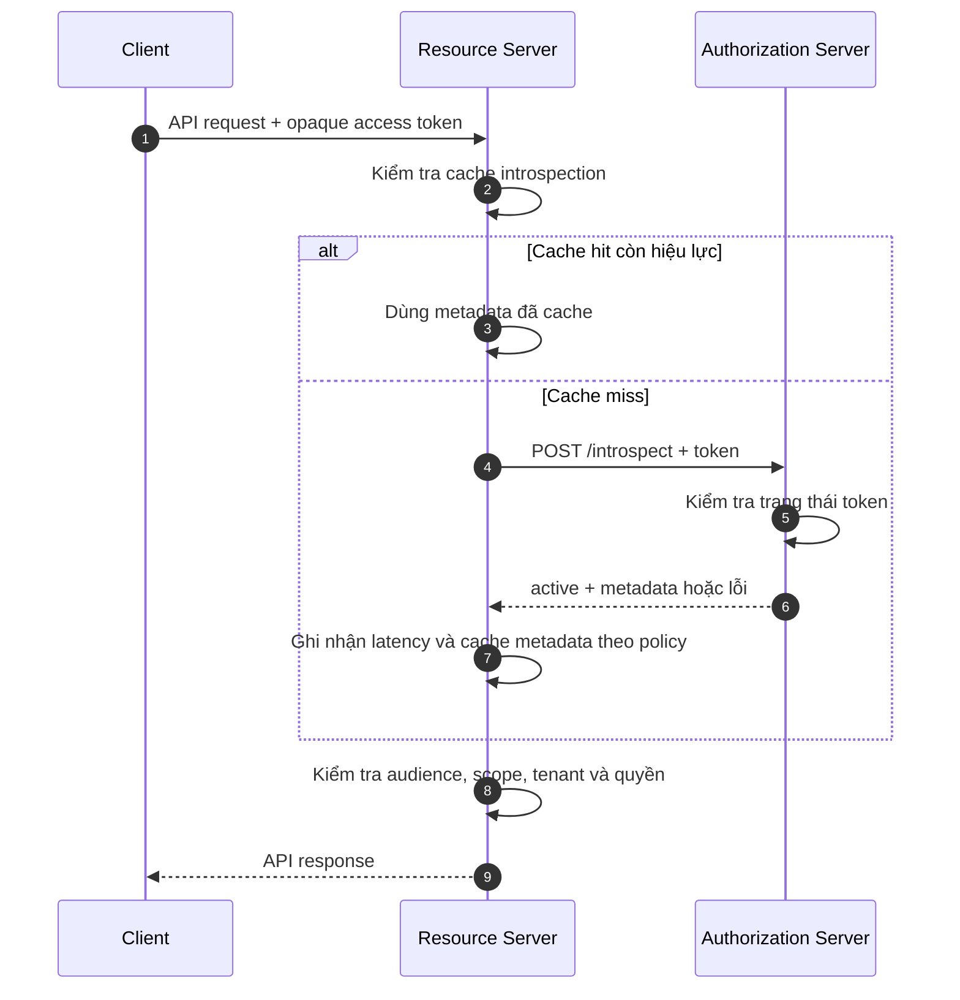

# Metric introspection latency: đo độ trễ kiểm tra token

## 1. Bối cảnh và mục tiêu

Với **opaque access token**, resource server thường không tự giải mã và xác minh token như JWT. Thay vào đó, nó gọi endpoint introspection của authorization server (AS) để hỏi token còn active hay không và lấy các thuộc tính cần thiết cho quyết định truy cập. Mỗi lần gọi từ xa có thể thêm độ trễ vào API request, đặc biệt khi lưu lượng tăng, AS quá tải, mạng chậm hoặc cache không có dữ liệu.

**Introspection latency** là thời gian xử lý một lần gọi introspection tại ranh giới mà hệ thống đã chọn để đo. Đo đúng ranh giới giúp trả lời các câu hỏi vận hành: AS phản hồi chậm đến mức nào, bao nhiêu request bị timeout, độ trễ tăng ở percentile cao ra sao và cache đang giảm số lần gọi từ xa được bao nhiêu.

Trong nền tảng **Security Token Security Fundamentals**, metric này gắn với vòng đời token, opaque token, access token, refresh token, OAuth 2.0/OIDC và kiểm tra trạng thái token. Người học cần phân biệt introspection của opaque token với xác minh JWT cục bộ: JWT có thể được xác minh bằng chữ ký và claims ngay tại resource server, trong khi opaque token thường cần một nguồn trạng thái có thẩm quyền như AS.

Sau bài này, người học có thể:

- Xác định chính xác khoảng thời gian cần đo cho một lần introspection.
- Thiết kế timer, histogram, percentile và metric lỗi bằng Micrometer/Prometheus.
- Phân tích p50, p95, p99, timeout, cache hit và tải của AS.
- Thiết lập SLO và cảnh báo dựa trên độ trễ cùng tỷ lệ lỗi.
- Tránh rò rỉ token và tránh cardinality bùng nổ khi gắn label cho metric.
- Kiểm thử instrumentation để bảo đảm mọi kết quả introspection đều được ghi nhận đúng.

## 2. Introspection diễn ra ở đâu trong luồng xác thực?

RFC 7662 định nghĩa OAuth 2.0 Token Introspection. Resource server gửi token tới endpoint introspection qua HTTPS, thường bằng HTTP POST với tham số `token`. Resource server cũng phải xác thực với endpoint theo cơ chế được AS cấu hình. AS trả về metadata của token; thuộc tính quan trọng nhất là `active`.

Ví dụ request minh họa:

```http
POST /introspect HTTP/1.1
Host: auth.example.test
Content-Type: application/x-www-form-urlencoded
Authorization: Basic <resource-server-credentials>

token=<opaque-access-token>
```

Phản hồi active có thể chứa các thuộc tính như `active`, `scope`, `client_id`, `sub`, `aud`, `iss`, `exp`, `iat`, `nbf` hoặc `jti`, tùy AS và hợp đồng triển khai. Khi `active` là `false`, resource server không được coi token là hợp lệ. Khi `active` là `true`, resource server vẫn phải kiểm tra audience, scope, tenant context và quyền trên tài nguyên theo policy của API.



Introspection có thể được gọi cho từng request, hoặc chỉ khi cache miss. Vì vậy, phải xác định metric đo **lần gọi AS thực tế** hay **thời gian xử lý toàn bộ bước xác thực token**, bao gồm cache. Hai chỉ số này trả lời hai câu hỏi khác nhau và nên có tên riêng.

## 3. Định nghĩa ranh giới đo latency

Trước khi tạo metric, thống nhất thời điểm bắt đầu và kết thúc. Một định nghĩa hữu ích cho `security.token.introspection` là:

- **Bắt đầu:** ngay trước khi resource server gọi HTTP client để gửi request tới AS.
- **Kết thúc:** khi nhận và đọc xong response introspection, hoặc khi phát sinh timeout/lỗi mạng/lỗi xử lý response.

Khoảng thời gian này bao gồm chi phí HTTP client, DNS/TLS nếu có thiết lập kết nối mới, mạng hai chiều, hàng đợi tại AS, xử lý tại AS, response transfer và deserialize. Nếu connection pool tái sử dụng kết nối, thời gian đo thường ngắn hơn do không cần tạo kết nối mới.

Không trộn lẫn các khoảng thời gian sau:

| Chỉ số | Bắt đầu / kết thúc | Dùng để trả lời |
| --- | --- | --- |
| **Remote introspection latency** | Quanh lần gọi HTTP tới AS. | AS và đường truyền phản hồi nhanh hay chậm? |
| **Token validation duration** | Từ lúc bắt đầu xác thực token đến khi có quyết định, gồm cache và policy cục bộ. | Bước xác thực token đóng góp bao nhiêu vào request? |
| **API request latency** | Từ lúc server nhận request đến lúc trả response. | Người dùng/API chịu tổng độ trễ bao nhiêu? |
| **AS processing duration** | Đo bên trong AS, quanh xử lý introspection. | AS tự xử lý mất bao lâu, chưa tính mạng client. |

Ví dụ, remote introspection p95 là 180 ms nhưng API request p95 là 700 ms. Điều đó cho thấy introspection là một thành phần cần theo dõi, còn thời gian còn lại có thể nằm ở database, business logic, queue hoặc các dịch vụ khác. Không được kết luận toàn bộ 700 ms là do AS.

### 3.1. Dùng đồng hồ đơn điệu

Độ trễ là khoảng thời gian, vì vậy cần đồng hồ đơn điệu như `System.nanoTime()` hoặc timer của Micrometer. Không lấy hiệu hai timestamp từ `LocalDateTime.now()` hay đồng hồ wall-clock vì đồng hồ hệ thống có thể được đồng bộ hoặc điều chỉnh trong lúc request đang chạy.

Micrometer `Timer` dùng đơn vị thời gian phù hợp và có thể xuất histogram. Nếu dùng `Timer.Sample`, sample cần được dừng trong `finally` để cả kết quả thành công và lỗi đều được ghi nhận. Với HTTP client bất đồng bộ, chỉ dừng timer khi future hoàn tất hoặc timeout; không dừng ngay sau khi gửi request.

### 3.2. Timeout và retry

Đặt connect timeout, response/read timeout và deadline tổng cho lần introspection. Timeout cần ngắn hơn hoặc phù hợp với latency budget của API. Nếu API phải trả trong 300 ms thì một lần introspection có timeout 2 giây sẽ khiến request vượt ngân sách.

Nếu có retry, xác định rõ metric:

- **Attempt latency:** đo riêng từng lần gọi AS. Một request có thể tạo nhiều attempt.
- **Logical introspection latency:** đo từ lần thử đầu tiên tới khi có kết quả cuối cùng, bao gồm backoff/retry.
- **Retry count:** số lần thử bổ sung cho một logical call.

Không chỉ đo attempt latency rồi kết luận người dùng không bị ảnh hưởng. Hai lần gọi 100 ms cùng backoff 50 ms tạo logical latency khoảng 250 ms. Retry cũng có thể làm AS quá tải nặng hơn; chỉ retry lỗi tạm thời, có giới hạn và có backoff/jitter phù hợp. Không retry lỗi token inactive hoặc lỗi xác thực client như thể đó là lỗi mạng.

## 4. Thiết kế bộ metric

Một bộ metric nhỏ nhưng đủ dùng có thể gồm:

| Metric | Loại | Ý nghĩa |
| --- | --- | --- |
| `security.token.introspection` | Timer / histogram | Độ trễ từng lần gọi remote introspection. |
| `security.token.introspection.cache` | Counter | Số cache hit và miss theo kết quả bounded. |
| `security.token.introspection.retry` | Counter | Số attempt bổ sung do retry. |
| `security.token.introspection.in_flight` | Gauge | Số lần gọi đang chờ AS, nếu hệ thống có nhu cầu theo dõi. |
| `security.token.validation` | Timer | Tổng thời gian validation token, gồm cache và bước policy theo định nghĩa đã chọn. |

Tên metric là quy ước của ứng dụng; cần giữ nhất quán giữa service và dashboard. Micrometer có thể chuẩn hóa tên theo backend. Với Prometheus, timer thường được xuất thành các series như `_bucket`, `_count` và `_sum`, cùng hậu tố đơn vị tùy registry/configuration.

### 4.1. Tag có cardinality thấp

Tag giúp phân tích theo kết quả nhưng mỗi tổ hợp tag tạo thêm time series. Chỉ dùng giá trị hữu hạn, có giới hạn và có ý nghĩa vận hành.

Tag có thể dùng:

- `outcome`: `active`, `inactive`, `error`, `timeout`.
- `issuer`: bí danh cấu hình có số lượng hữu hạn, ví dụ `primary` hoặc `partner-idp`; không dùng issuer URL tùy ý từ request.
- `client`: tên registration cấu hình sẵn nếu số lượng nhỏ và ổn định.
- `cache`: `hit` hoặc `miss` cho metric cache riêng.
- `retry`: `true` hoặc `false` nếu cần phân tích attempt; tránh tag động không giới hạn.

Không dùng các giá trị sau làm metric tag:

- Raw access token, refresh token, hash token hoặc `jti`.
- `sub`, username, email, session ID, request ID hoặc correlation ID.
- Tenant ID, resource ID hoặc client ID do người dùng tự do tạo nếu số lượng có thể lớn.
- URL tùy ý, exception message hoặc nội dung response.

Hash token vẫn tạo cardinality gần như một time series cho mỗi token và có thể hỗ trợ liên kết dữ liệu nhạy cảm. Đừng đưa token hoặc biến thể của token vào label. Dùng trace/log có kiểm soát và correlation ID riêng nếu cần điều tra một request cụ thể.

### 4.2. Active và inactive là hai kết quả khác nhau

Một response introspection hợp lệ với `active=false` không nhất thiết là lỗi của AS. Đây là kết quả nghiệp vụ: token không còn active hoặc AS không công nhận token. Metric nên phân biệt:

- `active`: AS trả response hợp lệ và token active.
- `inactive`: AS trả response hợp lệ nhưng token không active.
- `error`: request lỗi HTTP, response sai định dạng, lỗi xác thực resource server hoặc lỗi khác.
- `timeout`: không nhận được kết quả trong deadline.

Khi dùng abstraction như `OpaqueTokenIntrospector`, thư viện có thể biến response inactive thành exception. Nếu muốn phân biệt `inactive` với `error`, đặt instrumentation tại lớp còn nhìn thấy response introspection thô hoặc dùng loại exception được tài liệu của phiên bản thư viện xác định. Không suy diễn mọi exception là token inactive.

## 5. Instrumentation với Java và Micrometer

Đặt timer quanh đúng lời gọi remote introspection. Đoạn mã dưới đây dùng một interface ứng dụng `IntrospectionClient` và `IntrospectionResponse` để minh họa ranh giới; adapter thực tế có thể dùng Spring Security `OpaqueTokenIntrospector`, `RestClient`, `WebClient` hoặc HTTP client khác.

```java
public record IntrospectionResponse(boolean active) {}

public interface IntrospectionClient {
    IntrospectionResponse introspect(String token);
}

public final class MeteredIntrospectionClient implements IntrospectionClient {
    private final IntrospectionClient delegate;
    private final MeterRegistry registry;

    public MeteredIntrospectionClient(
            IntrospectionClient delegate,
            MeterRegistry registry) {
        this.delegate = delegate;
        this.registry = registry;
    }

    @Override
    public IntrospectionResponse introspect(String token) {
        Timer.Sample sample = Timer.start(registry);
        String outcome = "error";

        try {
            IntrospectionResponse response = delegate.introspect(token);
            outcome = response.active() ? "active" : "inactive";
            return response;
        } catch (IntrospectionTimeoutException exception) {
            outcome = "timeout";
            throw exception;
        } finally {
            Timer timer = Timer.builder("security.token.introspection")
                    .description("Remote OAuth token introspection latency")
                    .tag("outcome", outcome)
                    .register(registry);
            sample.stop(timer);
        }
    }
}
```

`IntrospectionTimeoutException` là kiểu exception minh họa của adapter; hãy ánh xạ timeout của HTTP client đang dùng. Nếu HTTP client trả response lỗi thay vì ném exception, adapter cần phân loại outcome trước khi kết thúc timer. Không bắt exception rồi trả `active=true` để che lỗi.

Trong triển khai thật, có thể đăng ký timer với histogram và các bucket phù hợp latency budget:

```java
Timer introspectionTimer = Timer.builder("security.token.introspection")
        .description("Remote OAuth token introspection latency")
        .publishPercentileHistogram()
        .serviceLevelObjectives(
                Duration.ofMillis(25),
                Duration.ofMillis(50),
                Duration.ofMillis(100),
                Duration.ofMillis(250),
                Duration.ofMillis(500),
                Duration.ofSeconds(1))
        .register(registry);
```

Các ngưỡng trên chỉ là ví dụ. Chọn bucket theo latency budget, timeout và SLO thực tế của hệ thống. Histogram phải được bật ở nơi cần tính percentile tổng hợp từ nhiều instance; percentile tính riêng trong từng process không thể cộng gộp chính xác như histogram bucket.

Với Spring Security Resource Server, `OpaqueTokenIntrospector` là abstraction để lấy principal đã xác thực từ token introspection. Có thể bọc implementation đang dùng bằng decorator để đo thời gian, nhưng cần giữ nguyên semantics của exception và authentication. Nếu dùng cache, hãy đo riêng cache hit/miss và chỉ ghi remote introspection timer khi thực sự gọi AS.

## 6. Histogram, percentile và Prometheus

### 6.1. Vì sao cần p50, p95 và p99?

Average có thể che giấu request chậm. Giả sử 99 lần introspection mất 30 ms và một lần mất 2 giây. Trung bình có thể vẫn trông chấp nhận được, nhưng người dùng của request chậm chịu ảnh hưởng lớn. Percentile cho thấy phần đuôi của phân phối:

- **p50:** một nửa số lần gọi có latency bằng hoặc thấp hơn giá trị này; phản ánh mức điển hình.
- **p95:** 95% lần gọi hoàn tất trong ngưỡng này; hữu ích để theo dõi trải nghiệm phần lớn request.
- **p99:** làm lộ các đợt chậm hiếm nhưng nghiêm trọng; cần đủ lưu lượng để diễn giải có ý nghĩa.

Histogram ghi số lần quan sát rơi vào các bucket. Với Prometheus, có thể tính percentile từ bucket:

```promql
histogram_quantile(
  0.95,
  sum by (le) (
    rate(security_token_introspection_seconds_bucket[5m])
  )
)
```

Để xem p95 theo outcome:

```promql
histogram_quantile(
  0.95,
  sum by (le, outcome) (
    rate(security_token_introspection_seconds_bucket[5m])
  )
)
```

Tên series ở ví dụ giả định Prometheus registry xuất timer thành `security_token_introspection_seconds`. Kiểm tra tên thực tế tại `/actuator/prometheus` hoặc endpoint scrape tương ứng trước khi dùng query.

### 6.2. Average latency và throughput

Average trong cửa sổ 5 phút có thể tính từ tổng thời gian chia số quan sát:

```promql
sum(rate(security_token_introspection_seconds_sum[5m]))
/
sum(rate(security_token_introspection_seconds_count[5m]))
```

Throughput introspection mỗi giây:

```promql
sum(rate(security_token_introspection_seconds_count[5m]))
```

Tỷ lệ timeout nếu timer có tag `outcome`:

```promql
sum(rate(security_token_introspection_seconds_count{outcome="timeout"}[5m]))
/
clamp_min(sum(rate(security_token_introspection_seconds_count[5m])), 1)
```

Tỷ lệ response hợp lệ (active hoặc inactive) có thể được tính bằng tổng count của hai outcome đó chia tổng count. Đây là tỷ lệ AS trả response có thể xử lý, không phải tỷ lệ token hợp lệ. Để đo tỷ lệ token active, chỉ lấy outcome `active` và diễn giải theo traffic thực tế.

## 7. Cache introspection và tác động đến latency

Cache có thể giảm tải AS và giảm độ trễ, nhưng làm thay đổi thời điểm resource server nhận biết token bị thu hồi. Vì vậy, TTL cache phải phù hợp với chính sách revocation và rủi ro của hệ thống.

Đo riêng:

- `cache_hit`: token metadata được lấy từ cache mà không gọi AS.
- `cache_miss`: cần gọi AS.
- `remote_introspection_latency`: chỉ ghi khi cache miss và có HTTP request thực tế.
- `token_validation_duration`: có thể ghi cả cache lookup, remote call và policy check.

Ví dụ, nếu 95% request là cache hit thì p95 của remote introspection chỉ mô tả 5% miss còn lại. Dashboard cần hiển thị cả hit ratio và remote latency để tránh kết luận sai về trải nghiệm tổng thể.

### 7.1. TTL và thu hồi token

Không cache metadata active lâu hơn giới hạn mà policy revocation cho phép. Các cách chọn TTL có thể gồm:

- TTL tối đa ngắn, phù hợp yêu cầu phát hiện thu hồi nhanh.
- Giới hạn TTL theo thời gian còn lại tới `exp`.
- Invalidate cache theo event revocation nếu hệ thống có kênh đáng tin cậy.
- Dùng cache key an toàn và không đưa raw token vào metric/log.

Khi AS trả `active=false`, có thể cache negative result trong thời gian ngắn theo policy để tránh lặp lại truy vấn cho token vô hiệu. Không cache lỗi mạng hoặc timeout thành kết quả inactive vĩnh viễn; đó là hai trạng thái khác nhau.

### 7.2. Phân tích hit ratio

Hit ratio:

```promql
sum(rate(security_token_introspection_cache_total{result="hit"}[5m]))
/
clamp_min(
  sum(rate(security_token_introspection_cache_total[5m])),
  1
)
```

Tên metric cache ở đây là ví dụ. Nếu hit ratio giảm đột ngột, kiểm tra TTL, cache eviction, phân tán cache giữa instance, key rotation, deployment restart và thay đổi traffic. Nếu hit ratio tăng nhưng API vẫn chậm, hãy xem `token_validation_duration` và các bước khác ngoài introspection.

## 8. SLO và cảnh báo

SLO nên được xác định từ trải nghiệm API và năng lực AS, không chọn chỉ vì một con số phổ biến. Ví dụ minh họa: 99% remote introspection calls hoàn tất trong 200 ms trong cửa sổ 30 ngày, với timeout dưới 0,1%. Các giá trị này không phải chuẩn bắt buộc; hãy điều chỉnh theo latency budget và hợp đồng dịch vụ.

Một dashboard hữu ích nên có:

1. p50, p95, p99 remote introspection latency.
2. Request rate và số lượng in-flight call.
3. Tỷ lệ `active`, `inactive`, `error`, `timeout`.
4. Cache hit ratio và remote call rate.
5. HTTP status của AS, retry count và connection pool utilization.
6. API request latency để so sánh tác động end-to-end.
7. Phân tách theo issuer alias hoặc client registration đã cấu hình, nếu số lượng nhỏ.

Cảnh báo nên kết hợp độ trễ và lỗi. Ví dụ, p95 vượt SLO liên tục trong vài cửa sổ và timeout tăng là tín hiệu mạnh hơn một spike ngắn. Cũng cần cảnh báo khi in-flight call tăng kéo dài, connection pool cạn hoặc AS trả 5xx tăng. Tránh alert chỉ dựa trên một request chậm đơn lẻ.

Khi có nhiều instance, dùng histogram bucket để tổng hợp. Không lấy trung bình các p95 riêng lẻ của từng instance; phép tính đó không tạo ra p95 toàn cụm. Dùng `histogram_quantile` trên tổng bucket đã `sum by (le, ...)`.

## 9. Phân tích nguyên nhân latency tăng

Latency introspection tăng có thể bắt nguồn từ nhiều lớp. Đối chiếu các metric theo cùng time window:

| Quan sát | Nguyên nhân có thể | Hướng kiểm tra |
| --- | --- | --- |
| p50 và p95 cùng tăng | AS xử lý chậm, network/TLS chậm hoặc dependency AS gặp vấn đề. | AS processing time, network, DNS, TLS và dependency của AS. |
| p50 ổn định nhưng p99 tăng | Queueing, GC pause, connection pool, tải đột biến hoặc một vùng mạng chậm. | In-flight, pool wait, thread pool, GC và phân bố theo instance/zone. |
| Timeout tăng cùng 5xx | AS hoặc network không đáp ứng. | AS health, load balancer, retry, timeout và circuit breaker. |
| Remote latency ổn định nhưng API latency tăng | Chậm ở database, business logic hoặc service khác. | Trace end-to-end và các span còn lại. |
| Cache hit giảm, remote call tăng | Cache eviction, TTL thay đổi, restart hoặc key churn. | Cache metrics, deployment và policy invalidation. |
| Latency tăng sau bật retry | Nhiều attempt/backoff làm logical latency dài hơn hoặc AS bị khuếch đại tải. | Attempt count, logical latency và retry policy. |
| Một issuer chậm hơn rõ rệt | AS hoặc network của issuer đó có vấn đề. | Issuer alias, endpoint health và tuyến mạng tương ứng. |

Distributed tracing có thể bổ sung chi tiết từng request: span outbound HTTP tới AS, status code, thời gian chờ connection pool và thời gian response. Trace attribute chỉ chứa dữ liệu không nhạy cảm như issuer alias, outcome, HTTP status và retry attempt. Không đưa token, `sub`, `jti` hoặc body introspection vào span.

## 10. Kiểm thử metric introspection latency

Instrumentation cũng cần được kiểm thử để tránh metric bị thiếu, đếm hai lần hoặc phân loại sai. Có thể dùng `SimpleMeterRegistry` và một `IntrospectionClient` giả để kiểm tra timer mà không gọi AS thật.

| ID | Kịch bản | Kết quả mong đợi |
| --- | --- | --- |
| OBS-01 | AS trả `active=true`. | Timer count tăng một; outcome `active`. |
| OBS-02 | AS trả `active=false`. | Timer count tăng một; outcome `inactive`. |
| OBS-03 | AS trả HTTP 5xx hoặc response lỗi. | Timer vẫn được ghi; outcome `error`. |
| OBS-04 | HTTP client timeout. | Timer được ghi tới thời điểm timeout; outcome `timeout`. |
| OBS-05 | HTTP client ném exception. | Timer vẫn được ghi trong `finally`; exception được truyền theo policy. |
| OBS-06 | Cache hit. | Cache hit tăng; remote introspection timer không tăng. |
| OBS-07 | Cache miss rồi gọi AS. | Cache miss tăng và remote timer tăng đúng một lần cho attempt đó. |
| OBS-08 | Retry một lần. | Attempt timer ghi hai lần; retry counter tăng một; logical latency đo riêng nếu có. |
| OBS-09 | Nhiều issuer alias đã cấu hình. | Metric tách được issuer với tập label hữu hạn. |
| OBS-10 | Token/user/tenant khác nhau. | Không phát sinh label chứa token, subject, tenant hoặc request ID. |
| OBS-11 | Request đồng thời. | Timer count và outcome không bị ghi trùng hoặc mất do race condition. |
| OBS-12 | Kiểm tra Prometheus scrape. | Có bucket, count, sum và tên metric đúng như dashboard query. |

Ví dụ unit test với registry trong bộ nhớ:

```java
@Test
void recordsLatencyWhenIntrospectionTimesOut() {
    SimpleMeterRegistry registry = new SimpleMeterRegistry();
    IntrospectionClient timeoutClient = token -> {
        throw new IntrospectionTimeoutException("timeout");
    };
    MeteredIntrospectionClient client =
            new MeteredIntrospectionClient(timeoutClient, registry);

    assertThrows(IntrospectionTimeoutException.class,
            () -> client.introspect("test-token"));

    Timer timer = registry.find("security.token.introspection")
            .tag("outcome", "timeout")
            .timer();

    assertNotNull(timer);
    assertEquals(1L, timer.count());
    assertTrue(timer.totalTime(TimeUnit.MILLISECONDS) >= 0);
}
```

`test-token` chỉ là dữ liệu giả trong bộ nhớ test; tuyệt đối không dùng token production. Test timeout nên có thể kiểm tra count và outcome ổn định; không nên assert một latency millisecond cố định vì scheduler và môi trường CI làm thời gian thực biến động.

Ngoài unit test, chạy integration test với HTTP server giả để kiểm tra timeout thật của HTTP client, response chậm, connection reset, status 5xx và body sai định dạng. Kiểm tra scrape endpoint để xác nhận registry export metric đúng, không chỉ xác nhận Timer trong bộ nhớ.

## 11. Bảo mật và vận hành

Introspection endpoint là endpoint nhạy cảm: resource server gửi bearer token tới AS và phải xác thực chính nó với endpoint. Vì vậy:

- Luôn dùng HTTPS và xác minh certificate của AS.
- Giữ credential introspection trong secret store phù hợp; không đưa vào metric, trace hoặc log.
- Không log form body chứa `token` hoặc response có dữ liệu định danh.
- Giới hạn quyền của resource server credential theo audience/client/policy nếu AS hỗ trợ.
- Đặt timeout, connection pool và concurrency limit để AS không bị quá tải bởi một resource server.
- Cân nhắc circuit breaker có trạng thái rõ ràng; khi AS không khả dụng, fail closed cho quyết định xác thực mới trừ khi policy cache hợp lệ cho phép dùng metadata còn hiệu lực.
- Không coi lỗi introspection là `active=true`; không bỏ qua bước xác minh khi AS chậm.
- Không cache token active vượt giới hạn revocation đã định nghĩa.

Nếu metric được xuất qua endpoint quản trị, bảo vệ endpoint scrape theo mạng và quyền truy cập. Metric không chứa token nhưng vẫn tiết lộ thông tin tải, issuer và trạng thái xác thực của hệ thống.

## 12. Checklist hoàn thành

- [ ] Định nghĩa rõ remote introspection latency và tách khỏi token validation/API latency.
- [ ] Đo bằng timer đơn điệu và dừng timer cả khi thành công lẫn exception/timeout.
- [ ] Có outcome bounded: active, inactive, error và timeout.
- [ ] Có histogram bucket phù hợp latency budget và SLO.
- [ ] Dashboard hiển thị p50/p95/p99, throughput, timeout, error, cache hit và in-flight.
- [ ] PromQL tổng hợp histogram từ bucket trên toàn cụm, không trung bình percentile từng instance.
- [ ] Cache hit không bị tính nhầm thành remote introspection call.
- [ ] Retry attempt và logical latency được phân biệt.
- [ ] Tag không chứa token, subject, tenant, request ID hoặc dữ liệu có cardinality cao.
- [ ] Timeout, retry, pool và circuit breaker được cấu hình theo latency budget.
- [ ] Có unit/integration test cho active, inactive, lỗi, timeout, cache và retry.
- [ ] Introspection failure không bao giờ được diễn giải thành token active.

**Ghi nhớ:** Metric introspection latency chỉ hữu ích khi đo đúng lần gọi AS, phân biệt active/inactive/error/timeout và được đọc cùng cache hit ratio, throughput cùng API latency. Không để token hoặc định danh người dùng lọt vào metric label; khi AS không phản hồi, quyết định xác thực phải tuân theo policy fail-closed đã thiết kế.

## Tài liệu đối chiếu

- [RFC 7662 — OAuth 2.0 Token Introspection](https://www.rfc-editor.org/rfc/rfc7662): giao thức introspection, request, response và thuộc tính `active`.
- [RFC 6749 — The OAuth 2.0 Authorization Framework](https://www.rfc-editor.org/rfc/rfc6749): vai trò authorization server/resource server và access token.
- [Micrometer — Timers](https://docs.micrometer.io/micrometer/reference/concepts/timers.html): đo thời gian, histogram và percentile với Timer.
- [Micrometer — Histograms and Percentiles](https://docs.micrometer.io/micrometer/reference/concepts/histogram-quantiles.html): histogram, service level objectives và percentile.
- [Prometheus — Histograms and summaries](https://prometheus.io/docs/practices/histograms/): cách tổng hợp histogram và tính quantile.
- [Prometheus — Querying basics](https://prometheus.io/docs/prometheus/latest/querying/basics/): cú pháp PromQL và truy vấn time series.
- [Spring Security — OAuth 2.0 Resource Server Opaque Token](https://docs.spring.io/spring-security/reference/servlet/oauth2/resource-server/opaque-token.html): tích hợp opaque token introspection trong Spring Security.
