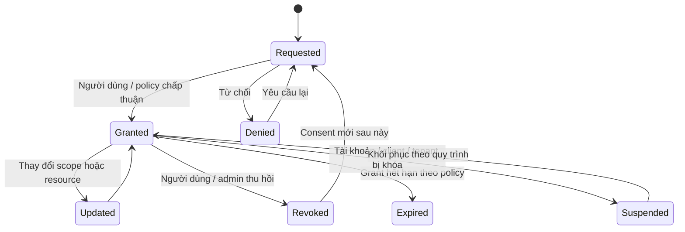
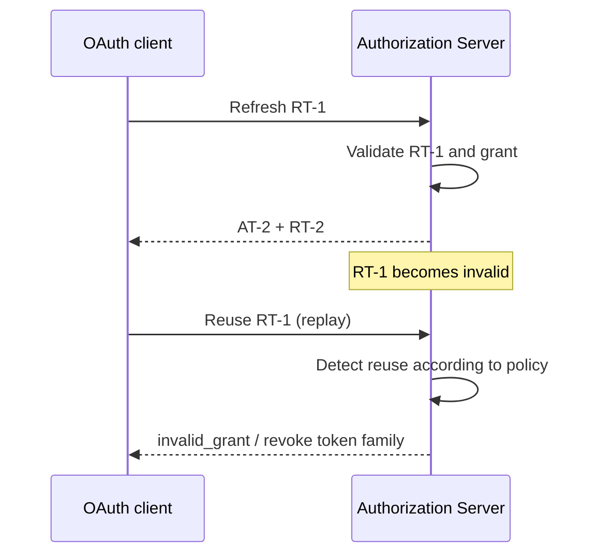
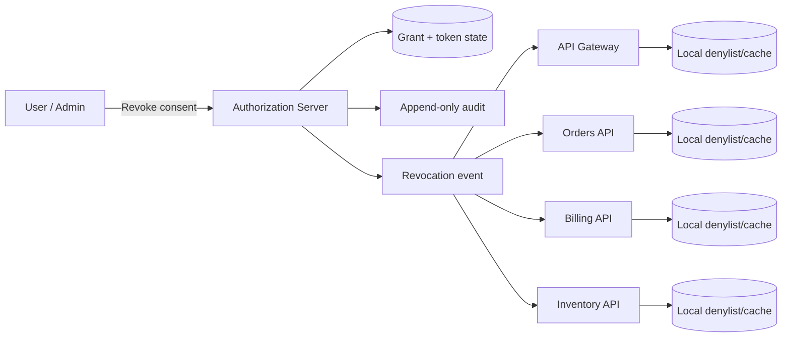

# Audit consent và revoke trong vòng đời token bảo mật

## 1. Vì sao phải audit consent và thu hồi token?

Trong OAuth 2.0/OIDC, một ứng dụng có thể được người dùng cho phép truy cập một số dữ liệu hoặc thao tác thay mặt họ. Quyền đã cấp có thể thay đổi: người dùng rút lại consent, quản trị viên vô hiệu hóa ứng dụng, tài khoản bị khóa, refresh token bị đánh cắp hoặc tổ chức phải chấm dứt một tích hợp. Hệ thống cần biết **đã cấp quyền gì, cho ai, vào lúc nào, dựa trên phiên bản điều khoản/chính sách nào, ai đã thay đổi và những credential nào cần ngừng chấp nhận**.

Hai khả năng liên quan nhưng khác nhau:

- **Audit consent** ghi lại bằng chứng và lịch sử về việc cấp, thay đổi, từ chối hoặc rút lại sự đồng ý/ủy quyền trong hệ thống.
- **Token revocation** yêu cầu Authorization Server (AS) vô hiệu hóa token hoặc credential theo cơ chế được hỗ trợ, để resource server ngừng chấp nhận chúng theo chính sách.

Chỉ ghi log rằng người dùng đã bấm “Revoke” không bảo đảm access token đang lưu trong cache lập tức mất hiệu lực. Ngược lại, thu hồi một refresh token không tự động chứng minh rằng mọi access token JWT đã phát hành trước đó đều bị chặn ngay nếu resource server xác minh offline.

Bài học tập trung vào vòng đời consent/grant, bằng chứng audit, OAuth token revocation, refresh-token rotation, thu hồi theo phiên hoặc theo client, lan truyền sự kiện đến resource server và kiểm thử thời gian hiệu lực sau revoke.

## 2. Phân biệt consent, authorization grant, session và token

Các khái niệm này thường bị gọi chung là “quyền đã cấp”, nhưng chúng có vòng đời riêng:

| Khái niệm | Ý nghĩa | Ví dụ |
| --- | --- | --- |
| **Consent** | Ghi nhận việc người dùng đồng ý cho client truy cập phạm vi được mô tả, khi luồng/policy yêu cầu consent | Alice đồng ý cho ứng dụng đọc email |
| **Authorization grant** | Quyền/ủy quyền mà AS quản lý để cấp token theo một luồng OAuth | Grant của Alice cho client `mail-app` với scope đã duyệt |
| **Access token** | Credential ngắn hạn dùng gọi resource server | Token có `aud=api://mail` |
| **Refresh token** | Credential dùng tại token endpoint để xin access token mới theo grant | Refresh token của phiên ứng dụng |
| **Login session** | Trạng thái đăng nhập tại OpenID Provider/browser | Phiên SSO của Alice |
| **ID token** | Assertion OIDC về sự kiện xác thực dành cho OIDC client | ID token có `aud=web-client` |
| **Client authorization** | Quyền của ứng dụng/service được quản trị hoặc cấp bởi AS | Client credentials của `billing-service` |
| **Audit event** | Bản ghi về sự kiện bảo mật/ủy quyền đã xảy ra | `consent.revoked` |

**Consent không đồng nghĩa với mọi loại authorization.** Trong Client Credentials Grant, service thường được quản trị viên cấp quyền theo client policy; không có người dùng cuối bấm consent cho từng lần xin token. Một client có thể được cấp quyền bởi tổ chức, policy hoặc hợp đồng quản trị. Audit vẫn cần ghi nhận ai đã phê duyệt và phạm vi được cấp.

Consent trong OAuth cũng không tự động đồng nghĩa với “sự đồng ý hợp lệ” theo mọi luật bảo vệ dữ liệu. Việc xác định cơ sở pháp lý, mục đích xử lý, thông báo quyền riêng tư và cách chứng minh consent pháp lý thuộc phạm vi governance/pháp chế của tổ chức; log OAuth chỉ là một phần bằng chứng kỹ thuật.

## 3. Vòng đời consent và authorization grant

Một luồng consent điển hình có các trạng thái:



Đây là mô hình trạng thái khái niệm; AS thực tế có thể dùng trạng thái hoặc data model khác. Những nguyên tắc cần giữ:

- **Requested:** ghi lại client, resource, scope và mục đích đang yêu cầu.
- **Granted:** ghi chính xác quyền đã được chấp thuận, không chỉ lưu chuỗi “consented=true”.
- **Updated:** scope, resource, client metadata hoặc privacy notice thay đổi; cần xác định có yêu cầu consent lại hay không.
- **Denied:** ghi nhận từ chối để tránh hiển thị lặp lại ngoài policy; không được biến từ chối thành cấp quyền.
- **Revoked:** grant không còn được dùng làm căn cứ cấp token mới; xử lý các token đã phát hành theo chính sách thu hồi.
- **Expired/Suspended:** quyền hết hạn hoặc tạm dừng do trạng thái tài khoản/client/tenant; cần phân biệt với hành động người dùng chủ động revoke.

Không xóa lịch sử consent chỉ vì trạng thái hiện tại thay đổi. Lịch sử là bằng chứng audit, còn trạng thái hiện tại là kết quả của chuỗi sự kiện. Khi cần xóa dữ liệu cá nhân theo retention policy, phải có chính sách lưu trữ/ẩn danh phù hợp và không phá vỡ yêu cầu kiểm toán bắt buộc.

## 4. Những gì một audit record về consent cần ghi

Một audit record hữu ích phải cho phép trả lời: **ai cấp quyền, cho client nào, trên resource nào, scope gì, tại thời điểm nào và dựa trên thông tin nào?**

| Trường | Ý nghĩa | Lưu ý |
| --- | --- | --- |
| `event_id` | ID duy nhất của sự kiện | Dùng để chống ghi trùng/tra cứu |
| `event_type` | `consent.granted`, `consent.updated`, `consent.denied`, `consent.revoked` | Tên event thống nhất |
| `subject_id` | Người dùng/principal liên quan | Dùng ID nội bộ/pseudonymous nếu phù hợp |
| `tenant_id` | Tenant của grant | Canonical tenant đã xác minh |
| `client_id` | Ứng dụng nhận quyền | Không ghi client secret |
| `resource` / `audience` | API/dữ liệu được cấp quyền | Lưu giá trị canonical |
| `requested_scopes` | Scope đã yêu cầu | Giúp so sánh yêu cầu và quyết định |
| `granted_scopes` | Scope thực tế được chấp thuận | Không chỉ lưu scope request |
| `consent_version` | Phiên bản màn hình/notice/chính sách | Cần để biết người dùng đã thấy thông tin nào |
| `occurred_at` | Thời điểm sự kiện | Dùng UTC và đồng bộ clock |
| `actor` | Người dùng, admin hoặc hệ thống thực hiện thay đổi | Phân biệt subject và actor |
| `decision` / `reason_code` | Kết quả và lý do theo taxonomy | Tránh ghi nội dung nhạy cảm tự do |
| `correlation_id` | Liên kết với request/trace | Không dùng làm credential |
| `source` | Kênh thực hiện, ví dụ account settings/admin console | Không lưu quá nhiều fingerprint thiết bị nếu không cần |

Ví dụ một sự kiện cấp consent:

```json
{
  "event_id": "evt-01J-CONSENT-42",
  "event_type": "consent.granted",
  "subject_id": "user-123",
  "tenant_id": "tenant-01",
  "client_id": "reporting-app",
  "resource": "api://reports",
  "requested_scopes": ["reports:read", "profile"],
  "granted_scopes": ["reports:read", "profile"],
  "consent_version": "privacy-notice-v5",
  "actor": {
    "type": "user",
    "id": "user-123"
  },
  "occurred_at": "2026-11-23T10:00:00Z",
  "decision": "granted",
  "correlation_id": "req-7f31"
}
```

Đây là schema minh họa. Không lưu access token, refresh token, client secret, private key, toàn bộ HTTP Authorization header hoặc nội dung dữ liệu người dùng vào audit event. Nếu cần liên kết một token cụ thể, dùng identifier/fingerprint được thiết kế an toàn và giới hạn quyền truy cập audit.

## 5. Audit trail phải bảo vệ được tính toàn vẹn

Audit log chỉ hữu ích nếu người có quyền vận hành không thể âm thầm sửa hoặc xóa lịch sử mà không bị phát hiện. Một thiết kế có thể dùng:

- **Append-only event store:** tạo event mới thay vì cập nhật/xóa event cũ.
- **Restricted writer:** chỉ AS/consent service được phép ghi event theo danh tính workload được xác thực.
- **Read separation:** quyền đọc audit tách khỏi quyền cấp/revoke consent; hỗ trợ kiểm tra độc lập.
- **Integrity protection:** hash chain, chữ ký sự kiện hoặc cơ chế lưu trữ bất biến/WORM khi yêu cầu rủi ro và kiểm toán đòi hỏi.
- **Time integrity:** đồng bộ thời gian, ghi UTC, có quy tắc xử lý clock skew.
- **Retention policy:** thời hạn lưu rõ ràng theo mục đích và nghĩa vụ; hết hạn thì xóa/ẩn danh có kiểm soát.
- **Sensitive data minimization:** chỉ ghi claim/metadata cần thiết, che định danh khi có thể.
- **Alerting:** phát hiện revoke hàng loạt, thay đổi scope bất thường, admin thay đổi grant ngoài giờ hoặc audit pipeline bị gián đoạn.

Ví dụ hash chain ở mức khái niệm:

```text
eventHash[n] = H(
    canonical(event[n]) ||
    eventHash[n - 1]
)
```

Hash chain giúp phát hiện sửa/xóa/đổi thứ tự khi có một điểm neo đáng tin được bảo vệ độc lập. Nếu attacker có thể sửa cả event lẫn toàn bộ chain và điểm neo, hash chain đơn thuần không bảo đảm bất biến. Với yêu cầu cao, cần ký/neo hash định kỳ hoặc dùng kho audit có kiểm soát độc lập.

**Không ghi log thất bại bằng cách bỏ qua sự kiện.** Nếu audit store không sẵn sàng, hệ thống phải có policy rõ ràng: thao tác cấp/revoke nhạy cảm có thể fail closed hoặc ghi vào durable local queue được bảo vệ rồi chuyển tiếp. Không tuyên bố revoke thành công nếu trạng thái grant đã thay đổi nhưng bằng chứng audit bắt buộc chưa được lưu theo quy trình.

## 6. OAuth 2.0 Token Revocation theo RFC 7009

RFC 7009 định nghĩa endpoint để client yêu cầu AS thu hồi token. Client gửi token cần thu hồi tới **revocation endpoint**, không gửi token đó tới resource server.

Request minh họa:

```http
POST /oauth2/revoke HTTP/1.1
Host: auth.example.test
Content-Type: application/x-www-form-urlencoded
Authorization: Basic <client-authentication>

token=<token-to-revoke>&token_type_hint=refresh_token
```

Các điểm cần nhớ:

- Client phải xác thực với AS theo policy của client và revocation endpoint.
- `token` là giá trị token cần thu hồi; bảo vệ request qua TLS.
- `token_type_hint` là gợi ý loại token, ví dụ `refresh_token` hoặc `access_token`; AS vẫn cần xác định token thực tế.
- Không ghi token request vào access log/debug log.
- AS có thể xử lý token liên quan theo policy, ví dụ access token được phát từ refresh token đó.

Phản hồi thường là:

```http
HTTP/1.1 200 OK
Content-Length: 0
```

Theo RFC 7009, endpoint trả HTTP 200 khi token đã bị thu hồi hoặc token không hợp lệ/không còn tồn tại. Cách phản hồi này tránh tiết lộ cho client liệu một token cụ thể có đang hợp lệ hay không. Nếu loại token không được hỗ trợ, AS có thể trả lỗi `unsupported_token_type` theo chuẩn.

**HTTP 200 không phải bằng chứng duy nhất rằng mọi resource server đã ngừng chấp nhận token.** Nó cho biết AS đã xử lý yêu cầu theo hợp đồng revocation; độ trễ lan truyền tới các API phụ thuộc cơ chế xác minh token, cache và event propagation.

## 7. Thu hồi consent/grant khác thu hồi một token

Đây là phân biệt quan trọng nhất trong thiết kế:

| Thao tác | Điều bị thay đổi | Tác động tới token |
| --- | --- | --- |
| **Revoke consent/grant** | Cơ sở ủy quyền của subject cho client/resource/scope | AS nên ngừng cấp token mới dựa trên grant; token hiện có cần policy revoke/denylist/introspection/TTL |
| **Revoke refresh token** | Credential dùng xin access token mới | Không thể tiếp tục refresh bằng token đó; token liên quan có thể bị thu hồi theo policy |
| **Revoke access token** | Một access token cụ thể | Resource server phải có cách nhận biết token không còn hợp lệ trước `exp` nếu cần |
| **Logout OIDC session** | Phiên đăng nhập tại OP/IdP | Không tự động bảo đảm mọi access token của user/client đều bị revoke |
| **Disable OAuth client** | Client registration/khả năng xác thực hoặc xin token | AS có thể từ chối token request mới; token đã phát hành cần xử lý riêng |
| **Disable user/tenant** | Trạng thái principal hoặc tổ chức | Cần chặn token, membership và quyết định authorization liên quan theo SLA |

Ví dụ: Alice revoke consent của `reporting-app`. AS đánh dấu grant không còn active và từ chối refresh/token request mới cho grant đó. Nhưng một JWT access token đã cấp 5 phút trước vẫn có thể được API chấp nhận nếu API chỉ kiểm chữ ký và `exp`, không kiểm trạng thái grant/token. Nếu yêu cầu “revoke phải có hiệu lực trong 30 giây”, hệ thống phải thiết kế cơ chế truyền trạng thái thu hồi để đáp ứng SLA này.

Không được giả định một nút “Disconnect app” chỉ xóa refresh token ở browser là đã thu hồi toàn bộ quyền. Hành động cần gọi đúng API/endpoint quản lý consent và token của AS.

## 8. Refresh token rotation và thu hồi cả token family

Refresh token thường có thời hạn dài hơn access token và có thể tạo access token mới. Khi AS hỗ trợ rotation, mỗi lần sử dụng refresh token sẽ phát hành token mới và vô hiệu hóa token cũ.



Một số AS có cơ chế *token family* hoặc reuse detection: khi refresh token cũ đã dùng bị phát lại, AS có thể vô hiệu hóa toàn bộ family liên quan. Hành vi cụ thể tùy AS và policy, cần kiểm tra tài liệu nhà cung cấp.

Các yêu cầu triển khai:

1. Lưu refresh token trong kho bảo mật, mã hóa và giới hạn quyền đọc.
2. Đồng bộ refresh cùng principal/client/grant để tránh nhiều worker dùng cùng token cũ.
3. Khi nhận refresh response, ghi access token và refresh token mới theo thao tác nguyên tử/CAS phù hợp.
4. Ngừng sử dụng refresh token cũ sau rotation.
5. Nếu phát hiện reuse/replay, đánh dấu phiên/grant/family theo policy, revoke token liên quan và yêu cầu xác thực lại nếu cần.
6. Audit sự kiện rotation/reuse/revocation nhưng không ghi giá trị token.
7. Không gửi refresh token tới resource server, log, queue hoặc service không có nhiệm vụ quản lý token.

Client Credentials Grant thông thường không cần refresh token; service xác thực lại bằng credential để xin access token mới. Không tạo refresh-token workflow cho grant nếu AS không cấp.

## 9. JWT và opaque token: revoke có hiệu lực đến đâu?

### 9.1. Opaque access token

Với opaque token, resource server thường gọi introspection endpoint (RFC 7662) hoặc cơ chế xác minh được AS cung cấp. Nếu AS đánh dấu token `active=false`, API có thể từ chối. Nhưng nếu resource server cache kết quả `active=true` trong 5 phút, token bị revoke ngay sau cache refresh có thể vẫn được chấp nhận đến khi cache hết hạn hoặc được invalidated.

Do đó cần định nghĩa:

- TTL cache introspection tối đa.
- Event invalidation khi token/grant/consent bị revoke.
- Hành vi khi AS/introspection endpoint timeout.
- Có fail closed hay dùng cache stale trong trường hợp sự cố.
- Cách phân biệt `inactive` với lỗi kết nối/5xx.

Không chuyển lỗi introspection thành `active=true` mặc định. Nếu API không thể xác minh token theo policy, không nên âm thầm chấp nhận.

### 9.2. JWT access token

JWT có thể được xác minh offline bằng chữ ký, issuer, audience và các claim thời gian. Khi token đã phát hành, resource server không nhất thiết gọi AS mỗi request; vì vậy thu hồi tức thì khó hơn.

Các lựa chọn:

| Chiến lược | Cách hoạt động | Đánh đổi |
| --- | --- | --- |
| **Short-lived access token** | Giảm TTL, token hết hạn nhanh | Giảm cửa sổ rủi ro nhưng không revoke ngay |
| **Denylist theo `jti`/fingerprint** | API kiểm tra token ID có bị thu hồi | Cần store/cache và lookup; phải xác minh token trước khi tin `jti` |
| **Grant/session version** | Token mang version/session ID; API so với trạng thái hiện tại | Cần nguồn trạng thái cập nhật và policy rõ |
| **Introspection** | Resource server hỏi AS về trạng thái token | Thêm latency/phụ thuộc AS; có thể cache |
| **Revocation event push** | AS phát sự kiện để API xóa cache/chặn token | Cần bảo đảm delivery, ordering, retry và replay event |
| **Signing-key rotation** | Thay/loại khóa ký | Tác động rộng đến mọi token dùng key đó; không dùng như revoke một token riêng lẻ |

Nếu dùng `jti`, API phải xác minh chữ ký/issuer/audience trước khi tra denylist. Không tin `jti` trong JWT chưa xác thực. Denylist entry phải sống ít nhất đến thời điểm token hết hạn hoặc theo policy; key cần gắn issuer để tránh trùng ID giữa các issuer.

**Không xoay signing key toàn hệ thống để thu hồi một access token đơn lẻ** trừ khi đó là ứng phó compromise khóa ký. Rotation key có thể làm hỏng nhiều token hợp lệ khác và gây gián đoạn trên diện rộng.

## 10. Lan truyền revocation tới các service

Một hệ thống có API Gateway, Orders, Billing và Inventory cần có đường truyền trạng thái revoke. Ví dụ:



Sự kiện revoke có thể chứa metadata:

```json
{
  "event_id": "rev-00042",
  "event_type": "token.grant.revoked",
  "issuer": "https://auth.example.test",
  "tenant_id": "tenant-01",
  "subject_id": "user-123",
  "client_id": "reporting-app",
  "grant_id": "grant-9f81",
  "resource": "api://reports",
  "revoked_at": "2026-11-23T10:05:00Z",
  "reason_code": "user_withdrawal",
  "version": 8
}
```

Đây là event schema minh họa; không gửi token nguyên văn trong event. Nếu cần chặn một access token cụ thể, event có thể mang `jti` đã được xác minh hoặc fingerprint có khóa và namespace issuer. Nếu revoke toàn grant, event cần định danh grant/session/client/subject/tenant đủ để các resource server tra cứu trạng thái liên quan.

### 10.1. Yêu cầu cho event propagation

- **Reliable delivery:** broker/outbox, retry và dead-letter handling để không mất revoke event.
- **Idempotency:** mỗi consumer lưu `event_id`/version và xử lý event lặp an toàn.
- **Ordering/versioning:** sự kiện cũ không được ghi đè trạng thái mới hơn; dùng version/sequence theo grant hoặc aggregate.
- **Authentication:** consumer chỉ nhận event từ producer được xác thực; bảo vệ kênh bằng TLS/mTLS và ACL.
- **Tenant binding:** event tenant A không được invalidation nhầm tenant B nếu phạm vi revoke chỉ thuộc A.
- **Bounded processing time:** đo thời gian từ lúc AS ghi revoke đến lúc tất cả resource server áp dụng.
- **Recovery:** khi consumer offline, cần replay event hoặc reconcile với trạng thái AS trước khi phục vụ traffic nhạy cảm.
- **Audit:** ghi nhận consumer đã nhận/áp dụng event, nhưng không log token.

Outbox pattern có thể giúp đồng bộ transaction cập nhật grant và phát event: ghi trạng thái revoke cùng outbox record trong một transaction; publisher gửi event sau đó; consumer idempotent. Không nên cập nhật database thành revoked rồi gửi event best-effort mà không có cơ chế khôi phục nếu process chết giữa hai bước.

## 11. Audit event taxonomy và ví dụ lịch sử

Nên thống nhất tên event theo loại đối tượng và hành động:

| Event | Khi phát sinh | Nội dung chính |
| --- | --- | --- |
| `consent.requested` | Bắt đầu yêu cầu consent | Subject, client, requested resource/scope |
| `consent.granted` | Consent được cấp | Granted scope, consent version, actor |
| `consent.denied` | Người dùng từ chối | Client, request context, reason code |
| `consent.updated` | Scope/resource/notice thay đổi | Before/after có kiểm soát, policy version |
| `consent.revoked` | Người dùng/admin rút consent | Grant ID, actor, thời điểm, reason |
| `token.issued` | AS phát token | Client, grant, audience, scope, token type, expiry; không lưu token |
| `token.revocation.requested` | Client yêu cầu revoke | Client, token type hint, request ID; không log token |
| `token.revoked` | AS xử lý revoke | Token/grant reference an toàn, kết quả |
| `refresh.reuse_detected` | Refresh token cũ bị dùng lại | Family/grant ID, client, risk signal |
| `client.disabled` | Client bị vô hiệu | Actor/admin, lý do, phạm vi ảnh hưởng |
| `tenant.suspended` | Tenant bị tạm dừng | Tenant, actor, policy action |
| `revocation.propagated` | Resource server áp dụng revoke event | Consumer, event ID/version, latency |

Một chuỗi audit rút gọn có thể là:

```text
10:00 consent.granted       subject=user-123 client=reporting-app scopes=reports:read
10:01 token.issued          grant=grant-9f81 audience=api://reports ttl=300s
10:05 consent.revoked       grant=grant-9f81 actor=user-123
10:05 token.revoked         grant=grant-9f81 result=accepted
10:05 revocation.propagated consumer=reports-api version=8
10:05 authorization.denied subject=user-123 reason=grant_revoked
```

Các timestamp trong ví dụ chỉ minh họa thứ tự. Audit nên có độ chính xác thời gian, correlation ID, actor, outcome và version để điều tra. Không dùng log dạng text tự do làm nguồn trạng thái duy nhất; cần event schema có version và data store phục vụ truy vấn/retention.

## 12. Logout OIDC khác revoke consent/token

OIDC logout liên quan tới kết thúc phiên đăng nhập tại OpenID Provider hoặc thông báo cho Relying Party rằng phiên người dùng đã kết thúc. Các cơ chế như RP-Initiated Logout và Back-Channel Logout có thể giúp đồng bộ trạng thái session giữa OP và client.

Tuy nhiên:

- **Logout** không mặc nhiên thu hồi mọi OAuth access token đã phát hành.
- **Token revocation** không nhất thiết kết thúc browser SSO session.
- **Consent revocation** thay đổi quyền/grant giữa subject và client; nó không đồng nghĩa logout khỏi mọi ứng dụng.
- **Disable account** có thể yêu cầu đồng thời kết thúc session, vô hiệu grant và revoke token tùy policy.

Ví dụ Alice logout khỏi portal nhưng access token đang được một background job dùng có thể còn hiệu lực đến `exp`, trừ khi hệ thống có cơ chế revoke/denylist/session check. Ngược lại, Alice revoke consent cho một app có thể vẫn đăng nhập SSO ở các ứng dụng khác.

Nếu ứng dụng cần hành vi “disconnect” toàn diện, phải định nghĩa rõ những thứ bị thu hồi: consent/grant, refresh token family, access token, session, client authorization hay tất cả. UI cần mô tả chính xác phạm vi tác động.

## 13. Xử lý lỗi, retry và trạng thái không chắc chắn

Revoke là thao tác bảo mật có side effect. Client cần phân biệt:

| Tình huống | Cách xử lý |
| --- | --- |
| AS trả HTTP 200 từ revocation endpoint | Ghi nhận AS đã xử lý theo RFC 7009; theo dõi propagation nếu yêu cầu SLA |
| Client timeout sau khi gửi request | Kết quả chưa chắc chắn; retry an toàn theo semantics endpoint, dùng correlation ID và kiểm trạng thái grant khi cần |
| Token không hợp lệ/đã revoke | RFC 7009 thường vẫn trả 200 để tránh token probing |
| `unsupported_token_type` | Kiểm loại token và khả năng AS hỗ trợ |
| `invalid_client` | Sửa client authentication; không retry vô hạn |
| Audit store không ghi được | Áp dụng policy fail closed/durable queue cho thao tác nhạy cảm; không báo hoàn tất nếu chưa đáp ứng yêu cầu audit |
| Revocation event không tới consumer | Retry/replay/reconcile; đo propagation lag và cảnh báo |
| Resource server mất kết nối AS | Áp dụng fail policy đã định nghĩa; không mặc định token chưa kiểm chứng là hợp lệ |

Với timeout, không nên giả định request chưa được xử lý. AS có thể đã revoke token nhưng response bị mất. Thiết kế client cần idempotency/reconciliation phù hợp, không tái cấp quyền chỉ để khôi phục request.

Nếu revoke một token không thể xác định trạng thái ngay, UI có thể hiển thị trạng thái “đang xử lý” cho tới khi workflow xác nhận. Không báo “đã ngắt kết nối hoàn toàn” chỉ vì request HTTP đã gửi đi.

## 14. Thiết kế API quản lý consent/revoke

Một ứng dụng quản lý quyền có thể cung cấp các thao tác như:

```http
GET /account/authorized-apps
GET /account/authorized-apps/{clientId}
POST /account/authorized-apps/{clientId}/revoke
```

Đây là API nghiệp vụ minh họa, không phải endpoint chuẩn của OAuth. AS/vendor có thể cung cấp API quản lý consent riêng; endpoint RFC 7009 chỉ xử lý token revocation.

Khi người dùng revoke một app, backend cần:

1. Xác thực user session và kiểm tra CSRF nếu dùng browser cookie.
2. Xác định grant/client/tenant từ dữ liệu server-side; không tin `clientId` hoặc `tenantId` do client tự chọn nếu chưa kiểm quyền.
3. Kiểm tra user có quyền quản lý grant đó.
4. Cập nhật trạng thái grant/revoke theo transaction và ghi audit.
5. Revoke refresh token/token liên quan theo policy AS.
6. Phát sự kiện invalidation tới resource server hoặc cập nhật trạng thái để introspection/denylist có thể tra cứu.
7. Trả kết quả và trạng thái propagation rõ ràng.
8. Giữ lịch sử audit theo retention policy.

API này phải có authorization chặt. Người dùng không thể revoke grant của user khác; admin chỉ được thực hiện trong phạm vi tenant/role được cấp. Bảo vệ CSRF, rate limit và audit admin action.

## 15. Kiểm thử consent audit và revoke

| Test | Điều kiện | Kết quả mong đợi |
| --- | --- | --- |
| T1 — Grant audit | User chấp thuận client và scope | Có `consent.granted` với scope thực tế, version và actor |
| T2 — Denial audit | User từ chối consent | Có `consent.denied`; không tạo grant |
| T3 — Update consent | Scope thay đổi | Ghi before/after phù hợp và yêu cầu consent lại nếu policy cần |
| T4 — Revoke grant | User rút consent | Grant chuyển revoked; token request/refresh mới bị từ chối |
| T5 — Revoke refresh token | Refresh token hợp lệ được gửi tới AS | Không thể dùng refresh token đó để xin access token mới |
| T6 — Revoke access token | Token access bị thu hồi | Resource server từ chối theo cơ chế revocation đã thiết kế |
| T7 — Unknown token | Gửi token không tồn tại đến RFC 7009 endpoint | Phản hồi không tiết lộ token có tồn tại hay không |
| T8 — Invalid client | Client auth sai tại revocation endpoint | AS từ chối client theo policy |
| T9 — Rotation reuse | Refresh token cũ được dùng lại sau rotation | Phát hiện reuse và xử lý token family theo policy |
| T10 — JWT offline | JWT chưa hết hạn nhưng grant bị revoke | API từ chối trong SLA nếu có denylist/version/introspection/event |
| T11 — Introspection cache | Token revoke nhưng cache active cũ còn tồn tại | Invalidation/TTL giới hạn thời gian chấp nhận |
| T12 — Event duplicate | Consumer nhận cùng revoke event nhiều lần | Xử lý idempotent, trạng thái không sai |
| T13 — Event out of order | Event version cũ đến sau version mới | Không rollback trạng thái grant |
| T14 — Consumer offline | Resource server ngắt kết nối khi revoke | Replay/reconcile sau khi online; đo propagation lag |
| T15 — Tenant boundary | Revoke grant ở Tenant A | Không revoke nhầm grant của Tenant B nếu policy giới hạn theo tenant |
| T16 — OIDC logout | User logout khỏi OP | Không giả định access token đã revoke; kiểm hành vi theo thiết kế |
| T17 — Audit integrity | Cố sửa/xóa event đã lưu | Phát hiện qua integrity/WORM/hash/signature controls |
| T18 — Audit outage | Audit store unavailable khi revoke | Hệ thống tuân thủ fail policy/durable queue; không báo thành công sai |
| T19 — Token leakage | Bật HTTP debug hoặc error logging | Không có token, secret hoặc Authorization header trong log |
| T20 — Bulk revoke | Admin vô hiệu client hoặc tenant | Phạm vi tác động đúng; có approval/audit/alert và propagation tracking |

Ngoài test chức năng, cần đo **revocation propagation latency**: từ lúc AS ghi nhận revoke đến khi từng resource server thực sự từ chối token. Đặt ngưỡng SLA theo rủi ro, ví dụ 30 giây cho một hệ thống yêu cầu thu hồi nhanh; đây chỉ là ví dụ, không phải chuẩn OAuth. Kiểm thử dưới tải và khi broker/consumer/AS gặp sự cố để xác nhận SLA vẫn có ý nghĩa.

## 16. Ghi nhớ và tài liệu tham khảo

Audit consent trả lời **đã cấp hoặc rút quyền gì, bởi ai, cho client/resource nào và dựa trên thông tin nào**. Token revocation trả lời **AS đã ngừng chấp nhận credential nào và resource server biết điều đó khi nào**. Hai hoạt động cần liên kết bằng grant ID, client, subject, tenant và event correlation, nhưng không thể thay thế nhau.

Thiết kế tốt phải ghi audit có tính toàn vẹn, tách consent/grant khỏi access token và session, revoke đúng token family, xử lý JWT offline validation và introspection cache, lan truyền event đáng tin cậy, đo propagation latency và không bao giờ log credential nguyên văn.

Tài liệu chuẩn để đối chiếu:

- [RFC 7009 — OAuth 2.0 Token Revocation](https://www.rfc-editor.org/rfc/rfc7009): revocation endpoint, client authentication và semantics phản hồi.
- [RFC 6749 — OAuth 2.0 Authorization Framework](https://www.rfc-editor.org/rfc/rfc6749): authorization grant, access token và refresh token.
- [RFC 7662 — OAuth 2.0 Token Introspection](https://www.rfc-editor.org/rfc/rfc7662): kiểm trạng thái token tại resource server.
- [RFC 9700 — Best Current Practice for OAuth 2.0 Security](https://www.rfc-editor.org/rfc/rfc9700): bảo vệ refresh token, rotation và replay detection.
- [OpenID Connect Core 1.0](https://openid.net/specs/openid-connect-core-1_0.html): consent, authentication và ID token trong OIDC.
- [OpenID Connect RP-Initiated Logout 1.0](https://openid.net/specs/openid-connect-rpinitiated-1_0.html): khởi tạo logout tại OpenID Provider.
- [OpenID Connect Back-Channel Logout 1.0](https://openid.net/specs/openid-connect-backchannel-1_0.html): thông báo kết thúc session tới relying parties.
- [RFC 7519 — JSON Web Token](https://www.rfc-editor.org/rfc/rfc7519): claims `iss`, `sub`, `aud`, `exp`, `jti` và cấu trúc JWT.
- [RFC 9068 — JWT Profile for OAuth 2.0 Access Tokens](https://www.rfc-editor.org/rfc/rfc9068): profile access token JWT và validation.
