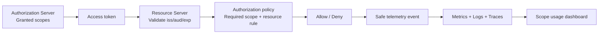

# Dashboard scope usage trong hệ thống token security

## 1. Dashboard scope usage dùng để trả lời điều gì?

Trong OAuth 2.0, **scope** biểu diễn phạm vi quyền mà access token được cấp để client gọi resource server. Ví dụ token có `orders:read` có thể được phép đọc đơn hàng theo API policy; token có `orders:write` có thể được phép tạo hoặc cập nhật đơn hàng. Tuy nhiên, scope xuất hiện trong token **không chứng minh rằng quyền đó thực sự được sử dụng**, và cũng không có nghĩa mọi endpoint đều cho phép hành động chỉ vì scope có mặt.

**Dashboard scope usage** là tập dashboard và chỉ số quan sát giúp đội vận hành, security và product hiểu:

- Scope nào đang được cấp cho client/workload.
- Scope nào được request tới API sử dụng và được policy chấp nhận.
- Scope nào thường xuyên bị từ chối hoặc không còn cần thiết.
- Client, API, tenant hoặc workload nào có xu hướng dùng quyền rộng hơn nhu cầu.
- Thay đổi policy, token issuance hoặc rollout có làm tăng lỗi 401/403 không.
- Có dấu hiệu bất thường như tăng đột biến scope nhạy cảm, cross-tenant denial hoặc token dùng sai audience hay không.

Trong module **SECURITY_TOKEN_SECURITY_FUNDAMENTALS**, dashboard này nối vòng đời access token với thực tế sử dụng quyền: issuer cấp scope, Gateway/resource server xác minh token, authorization policy quyết định request, và telemetry ghi lại kết quả đã được làm sạch.

**Phân biệt ba khái niệm trước khi đo:**

1. **Granted scope:** scope được Authorization Server cấp trong token.
2. **Requested scope:** scope hoặc quyền mà client yêu cầu khi gọi API, nếu API contract có thể xác định rõ.
3. **Used/evaluated scope:** scope/permission được kiểm tra cho một hành động cụ thể và kết quả policy.

Không nên coi ba tập này là giống nhau. Một token có 10 scope nhưng client chỉ gọi 2 API; dashboard cần giúp nhận ra quyền dư thừa mà không suy luận rằng các scope còn lại chắc chắn vô dụng nếu chưa quan sát đủ thời gian và luồng nghiệp vụ.

## 2. Mô hình dữ liệu quan sát scope

Một request API đi qua các bước:



Dashboard nên lấy dữ liệu từ **quyết định authorization thực tế**, kết hợp dữ liệu issuance đã được tổng hợp từ Authorization Server. Không cần đưa raw JWT vào hệ thống quan sát.

Một event nội bộ có thể chứa:

| Trường | Ví dụ | Dùng để làm gì? |
|---|---|---|
| `service.name` | `orders-api` | API/service nhận request |
| `route.id` | `orders-read` | Route hoặc operation đã chuẩn hóa |
| `client.type` | `web-app`, `workload` | Nhóm OAuth client/workload |
| `client.id` | Mã client đã phân loại hoặc pseudonymous | Phân tích client khi có kiểm soát |
| `scope.required` | `orders:read` | Scope policy yêu cầu |
| `scope.decision` | `granted`, `missing` | Kết quả scope check |
| `authz.outcome` | `allow`, `deny` | Quyết định cuối |
| `authz.reason` | `missing_scope`, `tenant_mismatch` | Phân loại lý do |
| `token.format` | `jwt`, `opaque` | Nhóm token, không phải token value |
| `token.issuer_id` | `corp-auth` | Issuer đã chuẩn hóa |
| `token.audience_class` | `orders-api` | Nhóm resource được nhắm tới |
| `tenant.tier` | `standard`, `enterprise` | Phân nhóm không định danh |
| `request.id` / trace ID | Correlation ID | Điều tra theo request |

Các tên trường trên là **schema gợi ý**, không phải chuẩn OpenTelemetry bắt buộc. Nên chuẩn hóa tên attribute trong tổ chức và giới hạn tập giá trị cho dashboard.

### 2.1. Đừng chỉ đếm scope trong token

Nếu request có token chứa `orders:read orders:write inventory:read admin:users`, nhưng route là `GET /orders/{id}`, việc ghi nhận cả bốn scope như “đã sử dụng” là sai. Hệ thống nên ghi scope/permission **được đánh giá cho route cụ thể** (ví dụ `orders:read`) và kết quả allow/deny.

Ngược lại, một số policy dùng role, ACL, ABAC, tenant membership hoặc resource ownership chứ không ánh xạ một-một sang OAuth scope. Dashboard có thể có dimension `policy.type` hoặc `authorization.mode` để tránh gán nhầm mọi quyết định thành scope check.

## 3. Các chỉ số cốt lõi

Một bộ chỉ số hữu ích nên phân biệt issuance, evaluation và outcome:

| Chỉ số | Ý nghĩa | Đơn vị/kiểu |
|---|---|---|
| `oauth_scope_grants_total` | Số scope được cấp khi phát hành access token, theo scope class/client type | Counter |
| `authz_scope_checks_total` | Số lần policy đánh giá scope cho API operation | Counter |
| `authz_scope_decisions_total` | Số quyết định allow/deny theo scope và route | Counter |
| `authz_denials_total` | Số request bị từ chối theo nhóm lý do | Counter |
| `authn_failures_total` | Lỗi xác thực token như invalid signature/issuer/audience/expiry | Counter |
| `access_token_lifetime_seconds` | Thời hạn token được phát hành hoặc thời gian còn lại ở lúc sử dụng | Histogram |
| `token_introspection_duration_seconds` | Độ trễ introspection opaque token | Histogram |
| `authorization_decision_duration_seconds` | Thời gian đánh giá policy | Histogram |
| `jwks_refresh_total` | Số lần refresh JWKS, phân loại success/error | Counter |
| `scope_grant_count` | Số scope trong token hoặc grant theo nhóm client | Histogram/Gauge tổng hợp |

Tên metric phải được điều chỉnh theo conventions của hệ thống metrics đang dùng. Không tạo một metric riêng cho từng user hoặc từng token.

### 3.1. Granted scope coverage

Đo scope được cấp theo nhóm client hoặc loại workload:

```text
granted_scope_count(client_type, scope_class)
granted_scope_share(scope_class) =
    grants_with_scope_class / all_grants
```

Dashboard có thể hiển thị tỷ lệ token có scope nhạy cảm như `admin:*`, `payments:refund`, `users:write` hoặc `secrets:read`. Dùng **scope class** đã được phân loại và quản trị, không dùng wildcard do client tự đặt.

### 3.2. Scope usage rate

Để đo usage, cần định nghĩa mẫu số rõ ràng. Ví dụ:

```text
scope_allow_rate =
    allowed_scope_checks
    / (allowed_scope_checks + denied_scope_checks)
```

Tỷ lệ này chỉ nói về **các lần kiểm tra scope được ghi nhận**, không phải tỷ lệ token có quyền hay tỷ lệ user thành công. Nếu chỉ ghi event khi scope thiếu, mẫu số sẽ sai. Instrumentation phải phát metric cho cả allow và deny.

Một cách đo khác:

```text
scope_request_rate(scope, route) =
    scope checks for (scope, route) / total requests for route
```

Tỷ lệ này cho biết route thường yêu cầu scope nào. Không dùng nó làm bằng chứng scope đã được cấp đúng hoặc người dùng có quyền trên resource.

### 3.3. Unused granted scope

Có thể ước lượng scope được cấp nhưng không thấy đánh giá trong một cửa sổ quan sát:

```text
candidate_unused_scopes =
    granted scopes - scopes evaluated during observation window
```

Đây chỉ là **candidate** để review, không tự động thu hồi. Một scope có thể chỉ được dùng trong báo cáo cuối tháng, luồng sự cố hoặc một tenant ít hoạt động. Trước khi giảm scope, cần bao phủ chu kỳ nghiệp vụ đủ dài, kiểm tra batch/background jobs, API versions và luồng hiếm.

## 4. Dashboard layout: các panel nên có

Một dashboard vận hành có thể chia thành các hàng:

### 4.1. Tổng quan authorization

- Tổng số scope checks theo thời gian.
- Allow/deny rate.
- 401 và 403 theo API/route.
- Top reason codes: `missing_scope`, `wrong_audience`, `tenant_mismatch`, `resource_denied`.
- Latency p50/p95/p99 của authorization decision.

Mục tiêu là phát hiện policy rollout lỗi, API client thiếu quyền hoặc downstream thay đổi bất thường.

### 4.2. Scope được cấp

- Top scope class được cấp theo client type.
- Tỷ lệ token có scope nhạy cảm.
- Số lượng grant chứa nhiều scope hơn baseline.
- Scope grants theo issuer và token type.
- Trend scope grants sau khi thay đổi OAuth client configuration.

Đây là góc nhìn từ Authorization Server/token issuance; cần tránh đếm refresh response như một người dùng mới nếu metric đang đo số phiên hoặc số token.

### 4.3. Scope được đánh giá và sử dụng

- Top route/scope combinations theo số lần check.
- Allow vs deny cho từng scope class.
- Scope check theo service, client type và tenant tier.
- Scope được cấp nhưng không xuất hiện trong evaluation window.
- Các route có policy yêu cầu scope mới hoặc thay đổi.

Panel này phải dựa trên policy evaluation, không suy từ việc token chứa claim.

### 4.4. Bảo mật và bất thường

- Tăng đột biến request yêu cầu scope nhạy cảm.
- Token sai audience hoặc issuer.
- Nhiều 403 do tenant mismatch.
- Client gọi API ngoài baseline scope/route.
- Introspection/JWKS errors.
- Sự kiện policy deny từ workload hoặc client chưa được phê duyệt.

Không nên hiển thị raw subject, JWT, refresh token, session cookie hoặc claim nhạy cảm trong dashboard.

## 5. Thiết kế metric với Prometheus

Ví dụ một bộ metric có label giới hạn:

```text
authz_scope_checks_total{
  service="orders-api",
  route="orders-read",
  scope="orders:read",
  outcome="allow",
  client_type="workload"
}

authz_scope_checks_total{
  service="orders-api",
  route="orders-read",
  scope="orders:read",
  outcome="deny",
  client_type="web-app"
}

oauth_scope_grants_total{
  issuer="corp-auth",
  scope_class="orders-read",
  client_type="web-app"
}

authn_failures_total{
  service="orders-api",
  reason="wrong_audience",
  token_format="jwt"
}
```

Metric labels phải là tập giá trị **nhỏ, có kiểm soát và không chứa bí mật**. Scope và route nên lấy từ registry/policy chuẩn hóa. Nếu hệ thống cho phép client tạo scope tùy ý, cần map chúng sang nhóm `scope_class` hoặc ghi chi tiết vào log có kiểm soát thay vì tạo hàng nghìn label.

### 5.1. Cardinality và dữ liệu định danh

Không dùng các giá trị sau làm Prometheus label:

- Raw JWT, access token, refresh token, `jti`, session ID.
- User ID, email, subject duy nhất của từng người.
- Request ID, trace ID hoặc correlation ID.
- Tenant ID không giới hạn nếu số tenant lớn và thay đổi liên tục.
- URL đầy đủ chứa path parameter, query string hoặc dữ liệu người dùng.
- Scope string do client tự gửi nếu có thể tạo vô hạn giá trị.

Các label cardinality cao làm tăng RAM, index, storage và query latency. Đồng thời chúng có thể tiết lộ danh tính hoặc hoạt động nhạy cảm. Nếu cần phân tích một tenant cụ thể, dùng log/event store được kiểm soát quyền truy cập, hoặc dashboard riêng có filter theo tenant ID sau khi đã pseudonymize và giới hạn truy vấn.

### 5.2. PromQL mẫu

Tỷ lệ allow/deny theo service:

```promql
sum by (service, outcome) (
  rate(authz_scope_checks_total[5m])
)
```

Tỷ lệ deny trên tổng scope checks:

```promql
sum by (service) (
  rate(authz_scope_checks_total{outcome="deny"}[5m])
)
/
clamp_min(
  sum by (service) (rate(authz_scope_checks_total[5m])),
  1
)
```

Top route có scope denial:

```promql
topk(10,
  sum by (service, route, scope) (
    rate(authz_scope_checks_total{outcome="deny"}[15m])
  )
)
```

Tỷ lệ authentication failures theo reason:

```promql
sum by (service, reason) (
  rate(authn_failures_total[5m])
)
```

Các query giả định metric và label đã được instrument như ví dụ. Với production, cần kiểm tra metric naming, unit, scrape interval, counter reset và cách xử lý mẫu số bằng 0. Không coi một tỷ lệ deny tăng cao là sự cố bảo mật nếu chưa đối chiếu release, traffic mix và thay đổi policy.

## 6. Instrumentation ở Resource Server

Điểm đo tốt nhất cho scope usage là **nơi policy thực sự được đánh giá**. Nếu chỉ đo ở Gateway, có thể bỏ sót authorization trong downstream service hoặc policy dựa trên ownership.

Pseudocode minh họa:

```java
AuthorizationDecision authorize(
        VerifiedPrincipal principal,
        RoutePolicy policy,
        ResourceContext resource) {

    boolean hasRequiredScope =
            principal.scopes().contains(policy.requiredScope());

    boolean tenantMatches =
            principal.tenantId().equals(resource.tenantId());

    boolean allowed = hasRequiredScope && tenantMatches;

    metrics.counter("authz_scope_checks",
            "service", "orders-api",
            "route", policy.routeId(),
            "scope", policy.scopeClass(),
            "outcome", allowed ? "allow" : "deny",
            "client_type", principal.clientType()
    ).increment();

    return allowed
            ? AuthorizationDecision.allow()
            : AuthorizationDecision.deny(
                    hasRequiredScope ? "tenant_mismatch" : "missing_scope");
}
```

Đây là pseudocode để giải thích vị trí instrumentation. Code thực tế cần:

- Dùng API metrics của hệ thống (Micrometer/OpenTelemetry/Prometheus exporter).
- Không ghi principal raw hoặc tenant ID không giới hạn vào label.
- Phân biệt scope failure với tenant/object policy failure.
- Ghi metric cho cả allow và deny.
- Không gọi metric builder với label động tùy ý từ request.
- Không làm authorization chậm đáng kể hoặc thất bại chỉ vì telemetry exporter tạm lỗi.
- Tránh tăng counter nhiều lần nếu một request đi qua nhiều filter cùng đánh giá cùng policy; đặt một điểm đo có semantics rõ.

Telemetry là phụ trợ; nếu metrics backend hỏng, authorization vẫn phải thực hiện đúng policy. Không được cho phép request vì không ghi được metric.

## 7. Phân biệt authentication failure với scope denial

Dashboard scope usage dễ gây nhầm nếu gộp mọi lỗi thành “scope denied”.

| Kết quả | Phân loại | Dashboard |
|---|---|---|
| Không có token | Authentication failure | 401 / missing credential |
| JWT signature sai | Authentication failure | invalid signature |
| Issuer hoặc audience sai | Authentication failure | invalid issuer/audience |
| Token hết hạn hoặc inactive | Authentication failure | expired/inactive token |
| Token hợp lệ, thiếu scope | Authorization denial | 403 / missing scope |
| Token hợp lệ, sai tenant | Authorization denial | tenant mismatch |
| Scope đủ nhưng không sở hữu resource | Authorization denial | object policy denial |
| STS/introspection/JWKS timeout | Dependency/verification failure | auth infrastructure error |
| Endpoint không có policy | Configuration/security defect | policy missing / deny-by-default |

401 và 403 có ý nghĩa HTTP khác nhau. Không nên tính lỗi chữ ký JWT hoặc audience mismatch vào mẫu số scope usage; đó là lỗi authentication. Tương tự, một 403 do object ownership không nhất thiết là thiếu OAuth scope.

## 8. Quan sát token issuance mà không lưu token

Authorization Server có thể ghi metric khi phát hành token:

- Số lần cấp token theo client type, issuer và scope class.
- Số lần refresh access token.
- Số lần token exchange theo target audience và scope class.
- Tỷ lệ cấp token bị từ chối theo reason code.
- Thời hạn token theo nhóm client/resource.
- Số token chứa scope nhạy cảm theo policy.

**Không ghi access token, refresh token, subject token hoặc actor token vào metric/log.** Không lưu raw JWT chỉ để sau này decode và xây dashboard. Nếu cần liên kết issuance với request usage, dùng correlation ID hoặc grant/session pseudonymous ID được thiết kế riêng, có kiểm soát truy cập và retention.

Với JWT tự chứa, Authorization Server không tự biết token đã được dùng bao nhiêu lần sau khi phát hành. Usage cần đo ở Resource Server/Gateway. Với opaque token, introspection có thể cho biết trạng thái token tại thời điểm kiểm tra, nhưng không thay thế metric của API request thực tế.

Token exchange cũng cần dimension riêng: target resource/audience, actor type và scope class. Không dùng audience hoặc scope tùy ý từ request làm label.

## 9. Phân tích scope over-provisioning và quyền dư thừa

Dashboard có thể giúp tìm quyền được cấp rộng hơn nhu cầu thực tế:

1. Liệt kê scope class được cấp cho từng loại client/workload.
2. Đo scope check trên route trong một khoảng quan sát bao phủ chu kỳ nghiệp vụ.
3. So sánh granted scope với scope thực sự được đánh giá.
4. Đánh dấu scope không quan sát thấy là **candidate unused**, không tự động kết luận.
5. Review với owner của service, OAuth client và business flow.
6. Tạo thay đổi policy ở môi trường thử nghiệm, chạy integration test và theo dõi 401/403.
7. Thu hẹp scope theo từng nhóm client; có rollback và audit.

Ví dụ:

| Client type | Granted scope | Scope observed | Hành động review |
|---|---|---|---|
| `orders-read-worker` | `orders:read`, `orders:write`, `users:read` | `orders:read` | Xác minh batch/admin flow rồi cân nhắc loại scope dư |
| `billing-service` | `payments:read`, `payments:refund` | Cả hai | Giữ nếu nghiệp vụ refund hợp lệ và có approval |
| `reporting-app` | `orders:read`, `inventory:read` | `orders:read` | Kiểm tra chu kỳ báo cáo inventory trước khi giảm quyền |

Đừng tự động thu hồi scope chỉ vì dashboard không thấy usage trong 7 ngày. Có thể có tác vụ theo tháng/quý, DR workflow, feature flag hoặc tenant ít hoạt động. Chọn cửa sổ quan sát theo chu kỳ nghiệp vụ và có xác nhận của owner.

## 10. Alerting: phát hiện bất thường nhưng tránh cảnh báo nhiễu

Một số alert có thể hữu ích:

| Alert | Điều kiện gợi ý | Phản ứng |
|---|---|---|
| Scope denial spike | Tỷ lệ deny vượt baseline theo service/route trong nhiều cửa sổ | Kiểm tra policy rollout, client config và traffic change |
| Sensitive scope grant spike | Số grant có scope class nhạy cảm tăng bất thường | Kiểm tra OAuth client registration và approval |
| Wrong audience spike | Tăng token gửi nhầm resource | Kiểm tra route mapping, token exchange và client |
| Tenant mismatch spike | Nhiều 403 do tenant mismatch | Kiểm tra tenant resolution, spoofed headers và cross-tenant probing |
| Unknown scope | Scope ngoài registry xuất hiện | Kiểm tra client request hoặc policy drift |
| Introspection latency/error | p95 hoặc error rate vượt SLO | Kiểm tra Authorization Server, network và cache |
| JWKS refresh failure | Không lấy được key mới trong rotation | Kiểm tra issuer metadata, JWKS endpoint và cache |
| Scope usage drop | Route quan trọng đột ngột không còn request | Kiểm tra telemetry, routing hoặc outage; không vội thu hồi scope |

Alert nên có **threshold theo baseline, thời gian duy trì, severity và owner**. Một 403 đơn lẻ không nhất thiết là tấn công; nhiều 403 cùng tenant/route/client hoặc một thay đổi đột ngột mới đáng điều tra.

Không tạo alert dựa trên raw user ID hoặc token. Nếu cần điều tra một request, dùng trace ID/correlation ID đã được kiểm soát trong log/tracing backend.

## 11. OpenTelemetry: metrics, logs và traces phối hợp

Ba tín hiệu có vai trò khác nhau:

- **Metrics:** xu hướng và tỷ lệ tổng hợp, phù hợp dashboard và alert.
- **Logs/events:** chi tiết có cấu trúc để điều tra một quyết định cụ thể; phải redaction và giới hạn retention.
- **Traces:** nối request qua Gateway và downstream service, giúp xác định lớp nào tạo 401/403 và độ trễ authorization.

Span có thể có các attribute an toàn như:

```text
service.name = "orders-api"
http.route = "/api/orders/{id}"
authz.outcome = "deny"
authz.reason = "missing_scope"
authz.scope_class = "orders-read"
token.format = "jwt"
token.audience_class = "orders-api"
```

Không thêm raw Authorization header, JWT payload, refresh token, `jti`, email hoặc full subject vào span. Nếu cần trace principal qua nhiều service, dùng một pseudonymous identifier có rotation/retention policy, và chỉ trong backend tracing có kiểm soát.

Sampling cần được cân nhắc: trace sampling có thể bỏ request hiếm nhưng quan trọng. Metrics counter vẫn nên ghi mọi authorization decision; logs/audit cho event bảo mật quan trọng có thể có sampling policy riêng hoặc không sampling tùy yêu cầu.

## 12. Dashboard cho JWT và opaque token

Một dashboard chung nên phân biệt cách xác minh:

| Dimension | JWT | Opaque |
|---|---|---|
| Signature validation | Có thể xác minh local bằng public key/JWKS | Không áp dụng theo dạng token opaque |
| Issuer/audience | Đọc từ claims sau khi xác minh | Lấy từ introspection hoặc metadata theo contract |
| Expiry | Claim `exp` sau khi verify | Metadata `exp`/TTL từ introspection |
| Revocation | Có thể cần denylist/status hoặc chờ hết hạn | Thường có thể introspect active status |
| Key rotation | JWKS refresh, unknown `kid`, overlap | Có thể không liên quan trực tiếp đến token opaque; phụ thuộc cơ chế xác thực STS |
| Latency | Thường local sau khi cache key | Có thể phụ thuộc network/introspection |
| Metric cần theo dõi | Signature failure, wrong issuer/aud, unknown kid | Introspection latency, inactive token, dependency error |

Không gộp mọi lỗi vào một metric `token_invalid_total` nếu không có reason dimension chuẩn hóa. Cũng không ghi chi tiết token vào metrics. Dashboard nên giúp nhận ra sự khác biệt giữa **credential không hợp lệ** và **policy không cho phép hành động**.

## 13. Quyền riêng tư, bảo mật và retention

Scope usage có thể tiết lộ hành vi người dùng hoặc cấu trúc hệ thống. Ví dụ scope `medical:record:read`, `payroll:write` hoặc `secrets:read` có thể nhạy cảm ngay cả khi không có token value.

Nguyên tắc xử lý:

- Dùng scope class/namespace đã chuẩn hóa; hạn chế tên scope chứa dữ liệu cá nhân hoặc tenant.
- Không thu thập raw JWT, opaque token, refresh token, cookie hoặc client secret.
- Giới hạn ai được xem dashboard theo vai trò; dashboard per-tenant cần tenant isolation.
- Không hiển thị chi tiết request hoặc subject nhạy cảm trên dashboard chung.
- Đặt retention riêng cho metrics, logs, traces và audit events.
- Dùng pseudonymization/aggregation cho client/tenant nếu cần phân tích chi tiết.
- Bảo vệ dashboard, data source credentials và export; dashboard cũng là bề mặt dữ liệu nhạy cảm.
- Không đưa scope/tenant/user động vào label không giới hạn.
- Định nghĩa quy trình xóa/ẩn dữ liệu khi tenant offboard theo retention policy.

Metric thường được giữ lâu hơn trace/log ở dạng tổng hợp. Tuy nhiên, việc aggregation không tự động làm dữ liệu vô danh; tổ hợp service, route, tenant tier và timestamp vẫn có thể nhận diện hoạt động đặc thù.

## 14. Kiểm thử dashboard scope usage

Dashboard cần được kiểm thử bằng các request có kết quả đã biết:

| Scenario | Request | Metric/event mong đợi |
|---|---|---|
| Token đủ scope | `orders:read` gọi GET | Scope check allow tăng 1 |
| Token thiếu scope | Không có `orders:write` gọi POST | Scope check deny, reason `missing_scope` |
| Token sai audience | Token dành cho inventory gọi orders | Authentication failure `wrong_audience`; không tính scope check allow |
| JWT hết hạn | `exp` đã qua | Authentication failure `expired_token` |
| Opaque token inactive | Introspection `active=false` | Authentication failure `inactive_token` |
| Tenant mismatch | `tid` không khớp request tenant | Authorization denial `tenant_mismatch` |
| Object ownership mismatch | Alice đọc order của Bob | Authorization denial `resource_denied` |
| Scope không thuộc registry | Client gửi scope không được cấp/khai báo | Policy/configuration event theo contract |
| KMS/JWKS/introspection lỗi | Dependency timeout | Infrastructure failure riêng, không gộp vào missing scope |
| Telemetry backend lỗi | Metrics exporter unavailable | Authorization vẫn hoạt động, request được xử lý theo policy |
| Token canary trong request | Gửi token test đặc biệt | Không xuất hiện raw value trong logs/traces/metrics |
| Tenant ID rất lớn | Nhiều tenant giả lập | Cardinality không tăng theo từng tenant nếu dimension không được cho phép |

Kiểm tra dashboard query với traffic thấp, không có request, counter reset, deploy/restart và dữ liệu thiếu. Tỷ lệ phải xử lý mẫu số bằng 0; không hiển thị NaN/Inf gây hiểu nhầm. Test label cardinality bằng cách gửi nhiều client/tenant giả lập và đo số time series tăng.

## 15. Ví dụ đọc dashboard và ra quyết định

Giả sử dashboard cho thấy:

- `orders:write` grants tăng 40% sau khi đăng ký một OAuth client mới.
- `orders:write` allow checks không tăng tương ứng.
- `users:read` vẫn xuất hiện trong nhiều token của workload chỉ gọi Orders API.
- `wrong_audience` tăng ở `inventory-api` sau một lần rollout Gateway.
- 403 `tenant_mismatch` tăng đột biến trong một tenant tier.

Các bước điều tra:

1. Đối chiếu thời điểm thay đổi OAuth client registration và release Gateway.
2. Kiểm tra grant policy có vô tình cấp scope rộng cho client mới không.
3. Kiểm tra route → audience mapping và token exchange response; token cho Inventory phải có audience đúng.
4. Kiểm tra tenant resolution ở Gateway và downstream, đặc biệt các header do client tự gửi.
5. Xác minh các scope ít sử dụng có thuộc batch job/feature chưa chạy trong cửa sổ quan sát không.
6. Làm thử policy thu hẹp ở staging, chạy integration/security tests rồi rollout từng nhóm client.
7. Theo dõi 401/403, business error, latency và rollback threshold.

Dashboard không tự động quyết định scope nào phải bị thu hồi. Nó cung cấp bằng chứng để **service owner, security owner và OAuth client owner** review theo least privilege.

## 16. Checklist triển khai production

1. **Định nghĩa semantics:** phân biệt granted scope, requested scope, evaluated scope và authorization outcome.
2. **Đo tại đúng điểm:** instrumentation ở issuer cho grant; ở resource server/policy engine cho usage và allow/deny.
3. **Chuẩn hóa reason:** `missing_scope`, `wrong_audience`, `expired_token`, `tenant_mismatch`, `resource_denied`, `dependency_error`.
4. **Thiết kế metric cardinality thấp:** service, route, scope class, client type, outcome; tránh user/token/request ID và tenant động không giới hạn.
5. **Bảo vệ dữ liệu:** không log token, refresh token, Authorization header, raw claims hoặc secret.
6. **Phân biệt JWT/opaque:** đo JWKS/signature và introspection/inactive status theo đúng cơ chế.
7. **Dashboard có ngữ cảnh:** grants, usage, denials, latency, sensitive scope và trend theo release.
8. **Alert theo baseline:** scope denial spike, sensitive grant spike, audience mismatch, tenant mismatch và dependency errors.
9. **Review unused scopes:** quan sát đủ chu kỳ nghiệp vụ, xác nhận owner, thử ở staging và có rollback.
10. **Kiểm thử observability:** event allow/deny, exporter outage, cardinality, redaction, query zero denominator và retention.
11. **Phân quyền dashboard:** tenant isolation, RBAC, audit truy cập và retention phù hợp.
12. **Không fail open:** telemetry hỏng không được thay đổi authorization decision.

**Nguyên tắc cốt lõi:** Dashboard scope usage chỉ có ý nghĩa khi đo đúng sự khác nhau giữa **quyền được cấp** và **quyền thực sự được đánh giá khi gọi API**. Dữ liệu phải đủ để phát hiện quyền dư thừa và hành vi bất thường, nhưng không chứa token hoặc định danh nhạy cảm và không làm suy giảm cardinality hay quyền riêng tư.

### Tài liệu tiêu chuẩn tham khảo

- [RFC 6749 — The OAuth 2.0 Authorization Framework](https://www.rfc-editor.org/rfc/rfc6749): scope, access token và authorization grant.
- [RFC 6750 — OAuth 2.0 Bearer Token Usage](https://www.rfc-editor.org/rfc/rfc6750): cách truyền Bearer token và lỗi xác thực/phân quyền.
- [RFC 7662 — OAuth 2.0 Token Introspection](https://www.rfc-editor.org/rfc/rfc7662): trạng thái active và metadata token.
- [RFC 7519 — JSON Web Token (JWT)](https://www.rfc-editor.org/rfc/rfc7519): JWT claims và thời hạn.
- [RFC 9068 — JWT Profile for OAuth 2.0 Access Tokens](https://www.rfc-editor.org/rfc/rfc9068): profile access token dạng JWT.
- [RFC 9700 — Best Current Practice for OAuth 2.0 Security](https://www.rfc-editor.org/rfc/rfc9700): khuyến nghị bảo mật OAuth 2.0.
- [OpenTelemetry Metrics](https://opentelemetry.io/docs/concepts/signals/metrics/): metric instruments và aggregation.
- [OpenTelemetry Semantic Conventions](https://opentelemetry.io/docs/specs/semconv/): conventions cho traces, metrics và attributes.
- [Prometheus — Naming](https://prometheus.io/docs/practices/naming/): quy ước tên metric và label.
- [Prometheus — Instrumentation](https://prometheus.io/docs/practices/instrumentation/): cách instrument ứng dụng và tránh metric cardinality cao.
