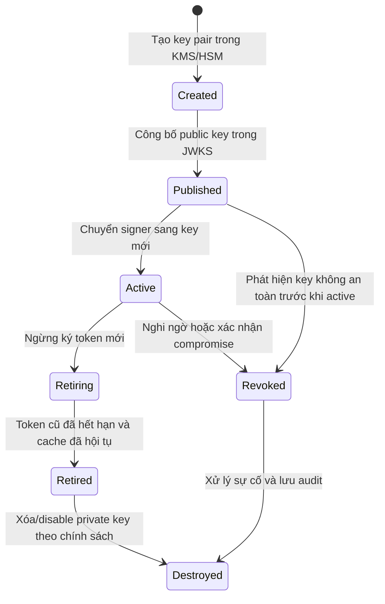

# Xoay vòng khóa ký token

## 1. Vì sao phải xoay vòng khóa ký?

Authorization Server thường ký access token dạng JWT bằng khóa riêng (private key). Resource Server dùng khóa công khai (public key) tương ứng để xác minh chữ ký. Theo thời gian, khóa cần được thay mới vì chính sách mật mã, thời hạn sử dụng, yêu cầu kiểm soát nội bộ, thay đổi thuật toán, hoặc nghi ngờ khóa bị lộ.

**Xoay vòng khóa ký (signing key rotation)** là quy trình đưa một cặp khóa mới vào sử dụng, chuyển việc ký token sang khóa mới, duy trì khả năng xác minh các token còn hạn được ký bằng khóa cũ, rồi ngừng tin cậy và loại bỏ khóa cũ theo kế hoạch. Đây là một thao tác vận hành ảnh hưởng trực tiếp đến khả năng xác thực token trên toàn hệ thống.

Nếu Resource Server không nhận được public key mới trước khi token mới xuất hiện, nó có thể từ chối token hợp lệ. Nếu public key cũ bị gỡ quá sớm, token cũ chưa hết hạn sẽ bị từ chối ngoài dự kiến. Nếu private key cũ đã bị xâm phạm, tiếp tục chấp nhận chữ ký từ khóa đó có thể cho phép kẻ tấn công giả mạo token. Vì vậy, quy trình phải xử lý đồng thời tính sẵn sàng, tính toàn vẹn và khả năng ứng phó sự cố.

Bài này tập trung vào khóa ký JWT trong OAuth 2.0/OIDC, đặc biệt mô hình công bố public key qua JWKS. Opaque token có thể không cần chữ ký JWT tại Resource Server; cơ chế xoay khóa của kho dữ liệu, khóa mã hóa hoặc khóa TLS có vòng đời riêng và cần quy trình tương ứng.

## 2. Thành phần và thuật ngữ cần phân biệt

| Thành phần | Vai trò | Điều cần bảo vệ |
| --- | --- | --- |
| Signing key pair | Cặp private/public key dùng ký và xác minh JWS | Private key phải được bảo vệ nghiêm ngặt; public key có thể công bố. |
| Private signing key | Tạo chữ ký cho JWT mới | Chỉ Authorization Server hoặc KMS/HSM được phép ký; hạn chế quyền và ghi audit. |
| Public verification key | Xác minh chữ ký JWT | Chỉ tin key lấy từ nguồn tin cậy gắn với issuer đã cấu hình. |
| `kid` | Key ID trong JOSE header để chọn khóa | Phải duy nhất trong phạm vi key set/issuer theo chính sách; không phải bằng chứng tin cậy. |
| JWKS | JSON Web Key Set chứa các JWK, thường là public key | Endpoint phải được bảo vệ bằng TLS và gắn với issuer tin cậy. |
| KMS/HSM | Dịch vụ hoặc thiết bị quản lý và thực hiện thao tác mật mã | Quyền tạo, kích hoạt, ký, vô hiệu hóa và xóa khóa phải được kiểm soát. |
| Key cache | Bản sao JWKS/public key tại Resource Server hoặc thư viện xác minh | TTL và cơ chế refresh ảnh hưởng trực tiếp tới rollout và thu hồi khóa. |

Một JWT có thể có JOSE header minh họa:

```json
{
  "alg": "RS256",
  "kid": "signing-key-2026-02",
  "typ": "at+jwt"
}
```

`alg` xác định thuật toán chữ ký theo profile đã cấu hình; `kid` giúp tìm public key tương ứng. Verifier phải có allowlist thuật toán và issuer tin cậy. Không lấy thuật toán hoặc URL tải khóa tùy ý từ token header làm căn cứ tin cậy. Không chấp nhận `alg=none`, thuật toán ngoài allowlist hoặc nhầm lẫn giữa khóa/thuật toán ký và mã hóa.

`kid` chỉ là chỉ mục. Kẻ tấn công có thể tự tạo JWT với `kid` bất kỳ; verifier vẫn phải lấy khóa từ JWKS được cấu hình cho issuer, xác minh chữ ký và kiểm tra `iss`, `aud`, thời hạn cùng các ràng buộc khác. Không tải `jku` hoặc `x5u` từ header JWT không đáng tin cậy.

## 3. Mô hình vòng đời khóa

Một khóa ký nên đi qua các trạng thái có thể kiểm soát và kiểm toán:



Các trạng thái trên là mô hình vận hành minh họa; tên trạng thái trong KMS hoặc hệ thống quản lý khóa có thể khác. Điểm quan trọng là phân biệt **đang được dùng để ký**, **chỉ còn được dùng để xác minh token cũ**, và **đã bị thu hồi**.

Trong một khoảng chuyển tiếp bình thường, JWKS có thể chứa cả khóa cũ và khóa mới:

```json
{
  "keys": [
    {
      "kty": "RSA",
      "use": "sig",
      "alg": "RS256",
      "kid": "signing-key-old",
      "n": "<public-modulus-base64url>",
      "e": "AQAB"
    },
    {
      "kty": "RSA",
      "use": "sig",
      "alg": "RS256",
      "kid": "signing-key-new",
      "n": "<new-public-modulus-base64url>",
      "e": "AQAB"
    }
  ]
}
```

Ví dụ chỉ thể hiện public parameters của RSA JWK. JWKS công bố public key, không công bố RSA private exponent hoặc private key material. Với EC, JWK có các tham số public tương ứng như `crv`, `x`, `y`. Cấu trúc và tham số phải tuân theo loại khóa và thuật toán được chọn.

## 4. Quy trình planned rotation

Xoay vòng theo kế hoạch nên thực hiện theo các bước có thứ tự. Ví dụ hệ thống đang ký bằng `K1` và muốn chuyển sang `K2`.

### Bước 1: Lập inventory và xác định thời gian chuyển tiếp

Trước khi tạo khóa mới, xác định:

- Issuer nào đang dùng khóa và endpoint JWKS tương ứng.
- Các Resource Server, gateway, service-to-service client và bên tích hợp bên ngoài đang xác minh token.
- Thuật toán, loại khóa, `kid`, key usage và nơi lưu private key.
- Thời hạn access token dài nhất, clock skew cho phép, TTL cache JWKS và thời gian propagation giữa các vùng.
- Có consumer nào pin public key/certificate tĩnh hoặc không hỗ trợ nhiều key đồng thời hay không.
- Kế hoạch rollback, người phê duyệt, cửa sổ triển khai và kênh thông báo cho đội phụ thuộc.

Nếu một consumer không thể xác minh đồng thời K1 và K2, cần xử lý tương thích trước khi chuyển signer. Không giả định mọi thư viện JWT đều tự refresh JWKS theo cùng một cách.

### Bước 2: Tạo K2 trong KMS/HSM

Tạo key pair mới với thuật toán và kích thước khóa theo chính sách mật mã đã được phê duyệt. Ưu tiên private key không thể export nếu nền tảng hỗ trợ. Chỉ cấp quyền ký cho identity của Authorization Server; quyền quản trị, kích hoạt và xóa khóa cần được phân tách phù hợp.

Ghi lại metadata không bí mật: `kid`, thuật toán, loại khóa, thời điểm tạo, owner, mục đích sử dụng, trạng thái và phiên bản cấu hình. Không ghi private key hoặc secret vào file cấu hình, source code, ticket hay log.

### Bước 3: Công bố public key K2 trước khi ký

Đưa public key K2 vào JWKS trong khi K1 vẫn được công bố. Chưa chuyển signer sang K2. Chờ các vùng, CDN, proxy và Resource Server có cơ hội tải JWKS mới theo cơ chế cache của chúng.

Kiểm tra JWKS từ góc nhìn các consumer quan trọng: K2 xuất hiện với `kid` chính xác, key type và algorithm đúng; K1 vẫn tồn tại; không có private material; endpoint dùng TLS và issuer metadata trỏ tới đúng JWKS URI. Nếu có cache, xác minh consumer đã refresh hoặc có cơ chế chủ động refresh trước cutover.

### Bước 4: Chuyển signer sang K2

Sau khi K2 đã được công bố và consumer có thể xác minh, cập nhật Authorization Server để ký token mới bằng K2. Token mới phải có header `kid` là K2. Token cũ đã ký bằng K1 tiếp tục được xác minh bằng public key K1 trong giai đoạn chuyển tiếp.

Thực hiện canary hoặc kiểm tra có kiểm soát: phát hành một token test, xác nhận `kid=K2`, xác minh chữ ký tại các Resource Server đại diện, kiểm tra `iss`, `aud`, `exp`, scope và token profile. Theo dõi lỗi `unknown kid`, signature validation failure, latency tải JWKS và tỷ lệ token endpoint error.

### Bước 5: Giữ K1 để xác minh token cũ

Không gỡ public key K1 ngay sau khi ngừng ký bằng K1. Token được ký ngay trước cutover có thể còn hiệu lực tới `exp`. Giữ K1 trong JWKS ít nhất đến khi:

```text
thời điểm gỡ K1 >= thời điểm ký K1 cuối cùng
                    + thời hạn token tối đa
                    + clock skew cho phép
```

Ngoài ra, phải tính đến độ trễ propagation, cache và hành vi refresh của consumer. Công thức là mốc tối thiểu dựa trên tuổi thọ token; lịch thực tế cần xét thêm các consumer đặc biệt và chính sách vận hành. Nếu token có TTL khác nhau theo client/resource, dùng TTL lớn nhất thực sự có thể được ký bằng K1.

### Bước 6: Retire K1 và kết thúc rotation

Khi không còn token hợp lệ cần K1, các consumer đã hội tụ và rollback window đã kết thúc, gỡ public key K1 khỏi JWKS. Sau đó vô hiệu hóa hoặc hủy private key K1 theo quy trình KMS/HSM và chính sách lưu giữ. Giữ metadata/audit record cần thiết để kiểm toán; không giữ bản sao private key chỉ để tiện rollback nếu chính sách yêu cầu hủy.

Kiểm tra lại JWKS ở nhiều vùng, xác nhận token mới vẫn được xác minh, token K1 hết hạn bị từ chối và không còn signer nào dùng K1. Đóng change record với thời điểm, người thực hiện, phê duyệt, kết quả và ngoại lệ.

## 5. Ví dụ timeline chuyển từ K1 sang K2

Giả sử access token có TTL tối đa 10 phút, clock skew 1 phút và JWKS cache TTL 5 phút. Các mốc sau chỉ minh họa:

| Thời điểm | Hành động | Kết quả cần xác nhận |
| --- | --- | --- |
| T0 | Tạo K2 trong KMS/HSM | K2 có metadata, quyền ký và audit hợp lệ. |
| T1 | Publish K1 + K2 trong JWKS | Consumer tải được public key K2 trước cutover. |
| T2 | Chuyển signer sang K2 | Token mới có `kid=K2`; token K1 cũ vẫn xác minh được. |
| T2 đến T2+11 phút | Giữ cả hai public key | Token K1 cuối cùng vẫn còn trong giới hạn TTL + skew. |
| Sau T2+11 phút và khi cache/consumer hội tụ | Gỡ K1 khỏi JWKS | Token K1 đã hết hạn; K2 tiếp tục hoạt động. |
| Sau khi xác nhận | Disable/destroy private K1 theo policy | Không còn khả năng ký bằng K1; audit được lưu. |

Trong thực tế, mốc gỡ K1 có thể phải muộn hơn do cache, consumer bên thứ ba hoặc token có TTL dài hơn. Không lấy cache TTL đơn lẻ làm thời gian giữ key cũ; điều kiện cốt lõi là mọi token được ký bằng K1 đã hết hạn và mọi verifier có trạng thái key phù hợp.

## 6. Xử lý JWKS cache và lỗi `kid`

Resource Server thường cache JWKS để tránh gọi endpoint ở mọi request. Cache giúp tăng hiệu năng và khả năng hoạt động khi JWKS endpoint tạm thời lỗi, nhưng cũng tạo độ trễ khi thêm hoặc thu hồi key.

Các nguyên tắc triển khai:

1. Lấy JWKS URI từ issuer configuration/metadata đã tin cậy hoặc cấu hình tĩnh được quản trị; không lấy URL tùy ý từ JWT header.
2. Cache theo issuer và áp dụng TTL có giới hạn; hỗ trợ refresh theo cache policy và sự kiện vận hành nếu có.
3. Khi gặp `kid` chưa biết, có thể thực hiện một lần refresh JWKS có giới hạn rồi thử xác minh lại. Rate-limit hoặc coalesce refresh để kẻ tấn công không thể tạo bão request bằng nhiều `kid` giả.
4. Nếu sau refresh vẫn không có key phù hợp, từ chối token. Không fallback sang key bất kỳ, không bỏ qua chữ ký và không chấp nhận token chỉ vì payload đọc được.
5. Khi thu hồi khẩn cấp, cần cơ chế buộc refresh/invalidate cache hoặc cập nhật denylist/token state; chỉ xóa key khỏi origin JWKS chưa chắc làm mọi verifier đang cache dừng tin key ngay.

Nếu JWKS endpoint không truy cập được, quyết định dùng key đã cache hay từ chối phải được quy định theo mức độ rủi ro. Một verifier có thể tiếp tục dùng key đã cache trong thời gian giới hạn để chịu lỗi mạng; nhưng không thể xem cache cũ là đủ cho việc thu hồi khẩn cấp nếu key đó đã bị compromise.

## 7. Emergency rotation khi private key bị lộ

Emergency rotation khác planned rotation. Nếu có bằng chứng hoặc nghi ngờ hợp lý rằng private key K1 bị lộ, kẻ tấn công có thể ký JWT giả với bất kỳ claims nào mà verifier chấp nhận. Khi đó, ưu tiên là **ngừng tin K1 càng nhanh càng tốt**, kể cả token hợp lệ đã phát hành bằng K1 cũng có thể bị từ chối.

Quy trình ứng phó tham khảo:

1. Kích hoạt incident response, xác định issuer, `kid`, vùng triển khai, thời gian nghi ngờ và phạm vi hệ thống sử dụng K1.
2. Vô hiệu hóa quyền ký bằng K1 tại signer/KMS/HSM; chặn mọi workload hoặc identity không được phép gọi key.
3. Tạo hoặc kích hoạt khóa thay thế K2 từ môi trường tin cậy. Kiểm tra private key K2 và quyền truy cập trước khi phát hành token mới.
4. Publish K2, chuyển signer sang K2 và phát thông báo cho các đội quản lý Resource Server/gateway.
5. Thu hồi K1 khỏi JWKS và kích hoạt refresh/invalidation ở verifier. Nếu cần, triển khai denylist hoặc token-version check để vô hiệu các token K1 trong lúc cache hội tụ.
6. Đánh giá token và hành động trong cửa sổ nghi ngờ: truy cập API, scope nhạy cảm, token giả, thay đổi dữ liệu và dấu hiệu persistence.
7. Cân nhắc vô hiệu session, refresh token family hoặc yêu cầu người dùng/service xác thực lại theo phạm vi ảnh hưởng. Xoay khóa ký không tự động thu hồi refresh token hoặc session state.
8. Lưu bằng chứng và audit, điều tra nguyên nhân lộ khóa, khắc phục IAM/KMS, rồi chỉ đóng incident khi đã xác minh các verifier không còn tin K1.

Trong emergency rotation, có thể cần từ chối ngay mọi JWT ký bằng K1. Điều này gây gián đoạn cho token chưa hết hạn nhưng là hệ quả chấp nhận được khi rủi ro giả mạo lớn hơn chi phí đăng nhập/cấp token lại. Nếu một số Resource Server không thể cập nhật cache nhanh, phải xử lý trực tiếp theo incident plan; không tuyên bố key đã bị thu hồi hoàn toàn chỉ vì JWKS origin đã bỏ nó.

## 8. Rollback và các điều kiện không được rollback

Trong planned rotation, nếu K2 gặp lỗi kỹ thuật sau cutover nhưng chưa có dấu hiệu compromise, có thể tạm chuyển signer về K1 trong thời gian K1 còn được giữ và private key K1 vẫn được phép dùng. Token K2 đã phát hành vẫn cần K2 public key để xác minh, do đó phải tiếp tục công bố K2 trong JWKS cho đến khi các token K2 hết hạn hoặc được xử lý theo policy.

Không rollback về K1 nếu K1 bị nghi ngờ hoặc xác nhận bị lộ. Trong trường hợp đó, chuyển signer về khóa đã bị compromise sẽ khôi phục khả năng giả mạo token. Nếu K2 có lỗi, tạo K3 hoặc dùng một khóa thay thế đã được xác minh an toàn.

Trước khi rollback planned rotation, xác nhận:

- K1 chưa bị thu hồi vì lý do bảo mật và private key vẫn trong trạng thái được phép sử dụng.
- K1 public key vẫn được công bố và các verifier có thể xác minh.
- K2 public key vẫn được giữ để xác minh token K2 đã phát hành.
- Nguyên nhân lỗi K2 đã được cô lập; rollback có thời hạn và có người chịu trách nhiệm.
- Có giám sát lỗi xác minh, token issuance và cache refresh trong suốt quá trình.

## 9. Các kiểm tra bắt buộc sau rotation

| Kiểm tra | Planned rotation | Emergency rotation |
| --- | --- | --- |
| Token mới có `kid` đúng | K2 | K2 hoặc khóa thay thế an toàn |
| Public key mới có trong JWKS | Trước khi signer dùng K2 | Ngay khi sẵn sàng phát hành token mới |
| Token cũ K1 | Xác minh được tới khi hết hạn | Bị từ chối sau khi verifier nhận thu hồi theo incident plan |
| Token mới K2 | Xác minh được ở các Resource Server | Xác minh được ở các Resource Server |
| Unknown `kid` | Refresh có giới hạn rồi fail closed | Refresh/invalidate khẩn cấp rồi fail closed |
| Cache JWKS | Hội tụ theo TTL/rollout plan | Có xác nhận invalidation hoặc refresh khẩn cấp |
| Private key cũ | Retire sau khi hết cửa sổ token và rollback | Disable ngay; điều tra và destroy theo incident policy |
| Audit | Ghi change, approval và kết quả | Ghi incident, hành động, bằng chứng và phạm vi ảnh hưởng |

Nên có kiểm thử tự động hoặc canary để xác minh ít nhất: token ký bằng K2 được xác minh; token K1 còn hạn vẫn được xác minh trong planned overlap; token K1 hết hạn bị từ chối; token với chữ ký giả bị từ chối; unknown `kid` không kích hoạt fetch vô hạn; và sau emergency invalidation token K1 bị từ chối tại các verifier thuộc phạm vi.

## 10. Metric, log và cảnh báo vận hành

Theo dõi việc xoay vòng bằng telemetry có nhãn hữu hạn. Ví dụ metric ứng dụng:

| Metric | Ý nghĩa | Nhãn phù hợp |
| --- | --- | --- |
| `jwt_signing_operations_total` | Số lần ký token | `issuer_class`, `kid_alias`, `outcome` |
| `jwt_signature_validation_failures_total` | Lỗi xác minh chữ ký | `issuer_class`, `reason`, `verifier_class` |
| `jwks_refresh_total` | Số lần refresh JWKS | `issuer_class`, `outcome`, `trigger` |
| `jwks_refresh_duration_seconds` | Thời gian tải JWKS | `issuer_class`, `outcome` |
| `jwt_unknown_kid_total` | Số token có `kid` không tìm thấy | `issuer_class`, `verifier_class` |
| `signing_key_state` | Trạng thái khóa theo inventory | `issuer_class`, `kid_alias`, `state` |

`kid_alias` phải là mã định danh vận hành có cardinality được kiểm soát, không chứa key material. Không ghi private key, access token, refresh token hoặc toàn bộ JWT vào log. Không dùng raw `kid` do token bên ngoài gửi tới làm label nếu kẻ tấn công có thể tạo giá trị tùy ý; hãy phân loại `known`, `unknown` hoặc ánh xạ sang danh mục key nội bộ.

Các cảnh báo cần cân nhắc:

- Tỷ lệ signature validation failure tăng sau cutover.
- Unknown `kid` tăng đột biến hoặc có nhiều `kid` khác nhau trong thời gian ngắn.
- JWKS refresh thất bại, timeout hoặc độ trễ propagation vượt kế hoạch.
- Signer vẫn sử dụng K1 sau thời điểm cutover.
- Có thao tác ký bằng khóa đã retire/revoke hoặc workload không thuộc allowlist gọi KMS/HSM.
- Key K1 vẫn được Resource Server tin sau thời hạn gỡ hoặc sau emergency revocation.

Khi điều tra, dùng correlation ID, issuer, key alias và thời gian sự kiện. Không yêu cầu người vận hành dán JWT hoặc private key vào ticket/chat để tái hiện lỗi.

## 11. Kiểm soát quyền và lưu trữ khóa

Private signing key là tài sản có giá trị cao. Một số kiểm soát cần có:

- Lưu private key trong KMS/HSM hoặc kho bí mật có kiểm soát tương đương; ưu tiên thao tác ký không export key material.
- Áp dụng least privilege cho service identity; Resource Server chỉ cần public key để xác minh, không cần quyền gọi thao tác ký.
- Tách quyền tạo, kích hoạt, sử dụng, disable và destroy key theo mô hình quản trị phù hợp.
- Bật audit cho thao tác key, cấu hình signer, cập nhật JWKS và thay đổi quyền IAM.
- Có quy trình phê duyệt, dual control hoặc break-glass cho thao tác nhạy cảm.
- Kiểm tra backup, disaster recovery và khả năng khôi phục dịch vụ mà không tạo bản sao private key ngoài chính sách.
- Phân biệt khóa ký token với khóa mã hóa dữ liệu, khóa TLS, khóa mã hóa refresh token hoặc khóa wrapping; không dùng chung một key cho nhiều mục đích.
- Ghi nhận ngày tạo, ngày active, ngày ngừng ký, ngày retire và người/identity thực hiện.

Xoay vòng khóa không thay thế việc quản lý thuật toán. Khi cần chuyển thuật toán, hãy kiểm thử tương thích verifier, allowlist, JWK metadata và profile token. Tách thay đổi thuật toán khỏi rotation nếu có thể để dễ xác định nguyên nhân khi có lỗi.

## 12. Checklist triển khai

- [ ] Inventory issuer, JWKS consumer, thuật toán, `kid`, TTL token và TTL cache đã đầy đủ.
- [ ] Khóa mới được tạo trong KMS/HSM với quyền truy cập tối thiểu.
- [ ] Public key mới được công bố và verifier nhận được trước khi signer sử dụng.
- [ ] Token mới dùng `kid` mới; verifier vẫn xác minh token cũ trong giai đoạn overlap.
- [ ] Public key cũ được giữ đến khi token cũ hết hạn cộng clock skew và điều kiện propagation/cache.
- [ ] Rollback chỉ dùng khóa cũ khi khóa đó chưa bị compromise.
- [ ] Emergency rotation có cách disable signer, invalidate cache và từ chối token bị ảnh hưởng.
- [ ] Unknown `kid` được xử lý có giới hạn và fail closed nếu không tìm thấy key.
- [ ] Private key không xuất hiện trong JWKS, source code, log hoặc artifact CI.
- [ ] Metrics, alerts và audit đủ để xác nhận cutover/retirement hoàn tất.
- [ ] Các Resource Server quan trọng đã được kiểm thử với token K1, K2, token giả và unknown `kid`.

**Điểm cốt lõi:** Xoay vòng khóa an toàn cần công bố public key mới trước khi dùng private key mới để ký, giữ public key cũ đủ lâu để xác minh token còn hạn, và có đường thu hồi khẩn cấp khi private key bị xâm phạm. Trạng thái JWKS ở một endpoint không chứng minh mọi verifier đã cập nhật; phải kiểm tra cache, consumer và kết quả xác minh thực tế.

## Tài liệu tham khảo

- IETF, **RFC 7517 — JSON Web Key (JWK)**: biểu diễn khóa và JSON Web Key Set (JWKS). <https://www.rfc-editor.org/rfc/rfc7517>
- IETF, **RFC 7515 — JSON Web Signature (JWS)**: JOSE header và tham số `kid`. <https://www.rfc-editor.org/rfc/rfc7515>
- IETF, **RFC 7519 — JSON Web Token (JWT)**: cấu trúc JWT và registered claims. <https://www.rfc-editor.org/rfc/rfc7519>
- IETF, **RFC 8725 — JSON Web Token Best Current Practices**: kiểm tra thuật toán, issuer, audience và các rủi ro triển khai JWT. <https://www.rfc-editor.org/rfc/rfc8725>
- IETF, **RFC 8414 — OAuth 2.0 Authorization Server Metadata**: metadata và discovery của Authorization Server. <https://www.rfc-editor.org/rfc/rfc8414>
- IETF, **RFC 9068 — JWT Profile for OAuth 2.0 Access Tokens**: profile JWT access token. <https://www.rfc-editor.org/rfc/rfc9068>
