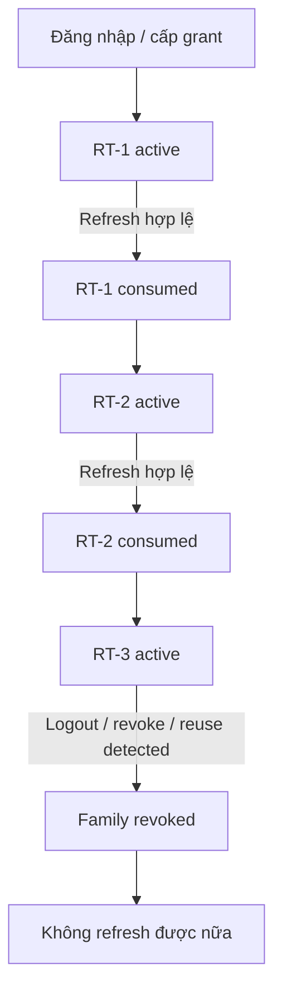

# Rotate refresh token storage: vận hành xoay vòng và lưu trữ refresh token

## 1. Bối cảnh và mục tiêu

Refresh token cho phép OAuth client xin access token mới mà người dùng không phải đăng nhập lại sau mỗi lần access token hết hạn. Vì refresh token thường có thời hạn dài và có thể cấp lại nhiều access token, nó là thông tin xác thực có giá trị cao. Nếu bị đánh cắp, kẻ tấn công có thể duy trì quyền truy cập lâu hơn thời hạn của một access token đơn lẻ.

**Refresh token rotation** là cơ chế phát hành refresh token mới mỗi khi refresh token hiện tại được sử dụng thành công, đồng thời vô hiệu hóa token cũ. Authorization server có thể theo dõi một chuỗi token thuộc cùng một **token family**. Nếu token cũ đã bị sử dụng lại sau khi rotation hoàn tất, server có dấu hiệu refresh token bị sao chép hoặc phát lại và có thể thu hồi token còn hiệu lực trong family đó theo chính sách.

Trong nền tảng **Security Token Security Fundamentals**, bài này kết nối vòng đời access token/refresh token, OAuth 2.0/OIDC, lưu trữ bí mật và phòng chống token bị đánh cắp hoặc replay. Vận hành an toàn cần giải quyết đồng thời ba việc: lưu token đúng cách ở từng phía, xoay vòng nguyên tử khi refresh, và có quy trình phục hồi khi request bị lỗi giữa chừng.

Sau bài này, người học có thể:

- Phân biệt nơi authorization server lưu trạng thái refresh token với nơi OAuth client lưu token để sử dụng.
- Thiết kế token family, rotation, reuse detection, expiry và revocation.
- Chọn hashing hoặc mã hóa dựa trên việc hệ thống có cần khôi phục giá trị token hay không.
- Thực hiện rotation an toàn khi có nhiều request đồng thời hoặc response bị mất.
- Vận hành thay khóa mã hóa, thu hồi phiên, sao lưu và phục hồi dữ liệu token.
- Theo dõi metric, audit và cảnh báo mà không làm lộ refresh token.

## 2. Hai phía lưu trữ refresh token

Trước khi thiết kế schema, cần xác định thành phần nào đang lưu token. Authorization server và OAuth client có nhu cầu khác nhau.

| Vị trí | Vì sao lưu? | Cách lưu phù hợp |
| --- | --- | --- |
| **Authorization server** | Theo dõi token đã phát hành, trạng thái active/revoked, token family, client, subject, thời hạn và quan hệ rotation. | Thường lưu hash/fingerprint của token ngẫu nhiên cùng metadata; không cần lưu lại bearer secret dạng có thể đọc. |
| **Backend OAuth client / BFF** | Cần lấy refresh token hiện tại để gửi token request tới AS. | Mã hóa có xác thực khi lưu bền vững; giới hạn quyền đọc và giải mã. |
| **Ứng dụng mobile** | Cần giữ refresh token qua lần khởi động ứng dụng. | Dùng secure storage của hệ điều hành, ví dụ Android Keystore hoặc iOS Keychain; áp dụng kiểm soát thiết bị phù hợp. |
| **Browser public client** | Có thể cần giữ token giữa các lần tải trang. | Ưu tiên BFF giữ refresh token phía server; tránh lưu bearer token dài hạn trong `localStorage`. |

Một nguyên tắc hữu ích: **hash khi server chỉ cần nhận diện token; mã hóa khi client phải khôi phục token để gửi đi**. Không áp dụng một kiểu lưu trữ cho mọi thành phần.

### 2.1. Authorization server: lưu hash và metadata

Refresh token nên được tạo bằng bộ sinh số ngẫu nhiên mật mã với entropy cao. Nếu token là chuỗi ngẫu nhiên không có cấu trúc, authorization server có thể lưu SHA-256 hash hoặc HMAC fingerprint thay cho giá trị gốc. Khi nhận token, server tính fingerprint rồi tra cứu bản ghi tương ứng.

- Hash một chiều phù hợp khi token có entropy cao và không phải mật khẩu do người dùng chọn. Không dùng hash nhanh cho mật khẩu người dùng; đây là loại bí mật khác.
- HMAC với khóa pepper được giữ ngoài database có thể giảm tác động của việc lộ riêng database. Cần quản lý phiên bản pepper và khả năng tra cứu khi chuyển khóa.
- Không lưu raw refresh token trong log, audit event, trace, metric hoặc bản sao database phục vụ phân tích.
- Chỉ lưu các metadata cần thiết như token ID, family ID, client ID, subject reference, scope/resource, thời điểm phát hành, hết hạn, trạng thái và fingerprint.

Nếu token được tạo từ JWT có thể xác minh cục bộ, vẫn cần cân nhắc trạng thái rotation/revocation ở server. Một JWT refresh token không tự mang lại khả năng one-time-use hoặc reuse detection nếu không có trạng thái được quản lý. Opaque random refresh token thường đơn giản hơn cho việc tra cứu và thu hồi tập trung.

### 2.2. OAuth client: mã hóa vì cần khôi phục

Backend client phải gửi refresh token hiện tại trong request tới token endpoint. Vì vậy, chỉ lưu hash sẽ không đủ. Dùng mã hóa có xác thực (authenticated encryption) để dữ liệu chỉ có thể được đọc khi ứng dụng được phép và ciphertext chưa bị thay đổi.

Một mô hình thường dùng là envelope encryption:

1. Sinh data encryption key (DEK) cho phạm vi token record hoặc một nhóm record.
2. Mã hóa refresh token bằng AEAD như AES-GCM với nonce duy nhất cho mỗi lần mã hóa bằng cùng một key.
3. Dùng key encryption key (KEK) trong KMS/HSM để bọc DEK.
4. Lưu ciphertext, nonce, authentication tag (nếu thư viện không gộp tag vào ciphertext), wrapped DEK và key version.
5. Khi cần refresh, service được cấp quyền gọi KMS giải bọc DEK, xác minh tag và giải mã trong bộ nhớ trong thời gian ngắn.

Có thể gắn Additional Authenticated Data (AAD) gồm record ID, client ID, user/session reference và mục đích lưu trữ để ngăn ciphertext bị tráo giữa các bản ghi. Không đưa raw token hoặc dữ liệu nhạy cảm vào AAD nếu không cần thiết.

Ví dụ cấu trúc record:

```text
refresh_credential
-------------------
id
client_id
subject_ref
session_ref
ciphertext
nonce
wrapped_dek
kek_version
encryption_algorithm
created_at
updated_at
expires_at
```

Không tự thiết kế thuật toán mã hóa hoặc ghép AES-CBC với hash theo cách tùy ý. Dùng thư viện mật mã đã được duy trì, cấu hình AEAD đúng và kiểm tra xác thực tag trước khi sử dụng plaintext.

## 3. Mô hình token family và vòng đời

Rotation dễ quản lý hơn khi mỗi lần đăng nhập hoặc grant tạo một family riêng. Một family đại diện cho một chuỗi refresh token được phát hành cho cùng ngữ cảnh client/subject/grant. Khi token hiện tại được dùng thành công, server phát hành token kế tiếp và đánh dấu token trước đó đã được tiêu thụ.



Các trạng thái điển hình:

| Trạng thái | Ý nghĩa | Có được dùng để refresh? |
| --- | --- | --- |
| `ACTIVE` | Token hiện tại của family, chưa hết hạn hoặc bị thu hồi. | Có, nếu các ràng buộc khác đều hợp lệ. |
| `CONSUMED` | Token đã được dùng thành công để tạo token kế tiếp. | Không. Dùng lại có thể là dấu hiệu replay. |
| `REVOKED` | Token hoặc family đã bị thu hồi theo policy. | Không. |
| `EXPIRED` | Đã qua thời điểm hết hạn. | Không. |

Không phải mọi hệ thống cần lưu một row cho từng token đã hết hạn vô thời hạn. Có thể lưu lịch sử đủ lâu cho reuse detection, audit và điều tra rồi dọn theo retention policy. Tuy nhiên, không được xóa trạng thái consumed quá sớm nếu server vẫn cần nhận biết token cũ bị phát lại.

### 3.1. Metadata cần gắn với token

Một bản ghi refresh token phía authorization server thường cần:

- `token_id`: định danh nội bộ không phải bearer secret.
- `token_hash`: fingerprint của giá trị refresh token.
- `family_id`: liên kết các thế hệ trong cùng grant/session.
- `parent_token_id` hoặc `generation`: thể hiện thứ tự rotation.
- `client_id` và subject reference: ràng buộc token với client và chủ thể.
- Scope/resource/audience được phép: giới hạn grant được kế thừa.
- `issued_at`, `expires_at`, `consumed_at`, `revoked_at`.
- Trạng thái, sender constraint (nếu có), lý do thu hồi và audit reference.

Không coi `family_id` hay `token_id` là bằng chứng xác thực. Chúng chỉ là metadata nội bộ để quản lý trạng thái.

## 4. Quy trình rotation an toàn

Giả sử client gửi refresh token `RT-1` tới token endpoint. Server phải xác minh token và mọi ràng buộc trước khi phát hành token kế tiếp.

### Bước 1 — Xác thực request và client

- Xác thực confidential client bằng phương thức đã đăng ký; public client phải được ràng buộc theo cơ chế phù hợp.
- Xác minh refresh token tồn tại bằng fingerprint, chưa hết hạn, chưa bị revoke và chưa bị consumed.
- Kiểm tra token thuộc đúng client, grant và subject; không cho client A sử dụng token của client B.
- Kiểm tra sender constraint như mTLS hoặc DPoP nếu grant yêu cầu.
- Kiểm tra các giới hạn inactivity, absolute lifetime và policy đăng nhập lại nếu có.

### Bước 2 — Tạo token kế tiếp

Sinh refresh token mới bằng CSPRNG. Giữ nguyên hoặc thu hẹp scope/resource theo policy; không tự mở rộng quyền trong quá trình refresh. Tạo fingerprint và metadata cho token mới, cùng quan hệ parent/family/generation.

### Bước 3 — Cập nhật trạng thái nguyên tử

Trong một transaction hoặc thao tác compare-and-swap có tính nguyên tử:

1. Đổi trạng thái token hiện tại từ `ACTIVE` sang `CONSUMED` nếu nó vẫn active.
2. Tạo record token kế tiếp ở trạng thái `ACTIVE`.
3. Cập nhật generation/current token của family.
4. Commit các thay đổi như một đơn vị.

Chỉ một request đồng thời được phép thắng thao tác consume token cũ. Nếu update không ảnh hưởng đúng một row, request không được phát hành thêm refresh token. Không dùng hai thao tác độc lập “đánh dấu token cũ” và “insert token mới” mà không có transaction hoặc cơ chế nhất quán tương đương.

### Bước 4 — Trả token response

Sau khi trạng thái rotation đã được lưu bền vững, trả access token mới và refresh token kế tiếp. Client cần thay thế credential cũ trong storage bằng credential mới một cách bền vững trước khi tiếp tục dùng nó cho các request sau.

Nếu response bị mất sau khi server commit, client có thể chỉ còn token cũ trong khi server đã tiêu thụ nó. Đây là trường hợp vận hành cần thiết kế trước; xem phần xử lý lỗi và idempotency ở dưới. Không tự động khôi phục token cũ thành active vì có thể mở lại đường replay.

## 5. Tính nguyên tử và request đồng thời

Hai request có thể đồng thời dùng cùng một refresh token, ví dụ nhiều tab, nhiều thread hoặc nhiều instance của client. Nếu cả hai cùng đọc thấy token active rồi cùng phát hành token mới, family có thể có hai nhánh active và trạng thái không còn rõ ràng.

### 5.1. Compare-and-swap trong database

Một cách triển khai là update có điều kiện:

```sql
UPDATE refresh_token
SET status = 'CONSUMED', consumed_at = CURRENT_TIMESTAMP
WHERE token_id = :tokenId
  AND token_hash = :tokenHash
  AND status = 'ACTIVE'
  AND expires_at > CURRENT_TIMESTAMP;
```

Ứng dụng chỉ tiếp tục tạo token kế tiếp nếu số row được cập nhật bằng đúng `1`. Việc consume token cũ và insert token mới phải nằm trong cùng transaction:

```sql
BEGIN;

UPDATE refresh_token
SET status = 'CONSUMED', consumed_at = CURRENT_TIMESTAMP
WHERE token_id = :tokenId
  AND token_hash = :tokenHash
  AND status = 'ACTIVE'
  AND expires_at > CURRENT_TIMESTAMP;

-- Chỉ tiếp tục nếu UPDATE vừa rồi ảnh hưởng đúng một row.
INSERT INTO refresh_token (
    token_id, token_hash, family_id, parent_token_id,
    generation, client_id, subject_ref, status,
    issued_at, expires_at
) VALUES (
    :newTokenId, :newTokenHash, :familyId, :oldTokenId,
    :nextGeneration, :clientId, :subjectRef, 'ACTIVE',
    CURRENT_TIMESTAMP, :newExpiry
);

COMMIT;
```

Đây là pseudo-SQL; cần bổ sung rollback khi update không thành công, constraint duy nhất bảo đảm mỗi family chỉ có một token active, và xử lý isolation/locking phù hợp database. Không chạy câu `INSERT` nếu thao tác consume không thắng.

### 5.2. Single-flight ở phía client

Client nên điều phối refresh theo từng credential/session để chỉ có một refresh request đang chạy tại một thời điểm. Các request API khác chờ kết quả refresh đó thay vì đồng thời dùng token cũ.

- Backend có thể dùng lock theo session/family hoặc hàng đợi theo credential.
- Nhiều instance cần lock phân tán hoặc compare-and-swap tại storage dùng chung; lock trong một JVM không bảo vệ instance khác.
- Mobile app cần đồng bộ refresh giữa background task và request foreground.
- SPA có nhiều tab cần cơ chế phối hợp phù hợp, hoặc chuyển refresh token vào BFF.

Single-flight giảm race hợp lệ nhưng không thay thế reuse detection tại AS. Client vẫn phải xử lý trường hợp process crash hoặc network timeout.

### 5.3. Xử lý response bị mất

Kịch bản khó: AS đã commit `RT-1` thành consumed và tạo `RT-2`, nhưng response bị mất trên đường truyền. Client thử lại `RT-1`; nếu AS chỉ thấy token cũ được dùng lại, nó có thể coi đó là replay và revoke family.

Các hướng thiết kế cần cân nhắc:

- Client chỉ cho một refresh operation chạy tại một thời điểm, lưu token kế tiếp bền vững ngay khi nhận response và không phát nhiều request dùng cùng token.
- Có thể thiết kế idempotency cho token exchange bằng operation identifier được ràng buộc với client, family và request; server phải trả lại đúng kết quả của operation đã commit mà không kích hoạt token cũ lần nữa.
- Nếu cần lưu kết quả response để retry an toàn, chỉ lưu dạng mã hóa có thời hạn ngắn, giới hạn quyền đọc và xóa sau khi hết cửa sổ retry.
- Nếu không có cơ chế idempotency an toàn, yêu cầu client thực hiện lại authorization flow khi trạng thái refresh không thể khôi phục chắc chắn.

Không thêm grace period rộng cho token cũ chỉ để tránh lỗi mạng. Một cửa sổ chấp nhận token cũ có thể giúp kẻ tấn công sử dụng bản sao token. Nếu triển khai grace/idempotency, phải ràng buộc mạnh với cùng client, sender proof, operation ID và thời hạn rất ngắn; đồng thời kiểm thử replay từ một client/thiết bị khác.

## 6. Phát hiện reuse và xử lý replay

Với rotation, authorization server giữ dấu vết token đã consumed đủ lâu để phát hiện việc sử dụng lại. Nếu một token `CONSUMED` xuất hiện lần nữa, server có dấu hiệu token bị sao chép hoặc client đang gặp race/response loss.

Một chính sách thường gặp là:

1. Xác định token cũ thuộc family nào.
2. Ghi nhận sự kiện reuse với thời điểm, client, sender constraint và request correlation an toàn.
3. Thu hồi refresh token còn active trong family hoặc toàn bộ grant theo policy.
4. Yêu cầu client khởi tạo authorization flow mới; nếu cần, yêu cầu người dùng xác thực lại.
5. Phát cảnh báo bảo mật và giữ audit record theo retention policy.

Không ghi raw token trong audit. Có thể ghi token ID nội bộ, family ID, client alias, subject reference đã được bảo vệ, issuer, lý do và timestamp. Giới hạn quyền truy cập audit vì dữ liệu này vẫn có thể tiết lộ hành vi đăng nhập.

Reuse không phải lúc nào cũng là tấn công; có thể do hai request hợp lệ chạy đua hoặc response bị mất. Tuy vậy, nếu không có idempotency được thiết kế rõ, server không thể tự tin phân biệt hai trường hợp. Cần giảm race ở client và có quy trình hỗ trợ người dùng khi family bị thu hồi, thay vì bỏ qua reuse detection.

Sender-constrained refresh token bằng DPoP hoặc mTLS có thể giảm khả năng kẻ đánh cắp chỉ có token sử dụng được token. Nó không thay thế rotation, storage protection, expiry hoặc reuse detection.

## 7. Lưu trữ an toàn ở client

### 7.1. Backend và BFF

Với backend OAuth client, lưu refresh token trong credential store có quyền truy cập hẹp. Nếu lưu database:

- Mã hóa token bằng AEAD; lưu key version để giải mã và migration.
- Dùng KMS/HSM hoặc secret management service để bảo vệ KEK.
- Chỉ service cần refresh mới được quyền giải mã; tách quyền đọc metadata khỏi quyền lấy plaintext.
- Hạn chế truy cập database trực tiếp, export và backup; mã hóa backup theo chính sách riêng.
- Xóa hoặc vô hiệu hóa credential khi logout, revoke grant, user offboarding hoặc phát hiện compromise.
- Không gửi refresh token tới browser nếu BFF có thể thực hiện token exchange ở server.

Nếu client cần lưu token dạng plaintext trong memory để gọi token endpoint, giữ thời gian tồn tại ngắn và tránh đưa vào exception, heap dump hoặc diagnostic snapshot. Không thể đảm bảo xóa tuyệt đối mọi bản sao trong JVM; giới hạn scope và quyền truy cập process vẫn rất quan trọng.

### 7.2. Mobile

Trên thiết bị di động, dùng secure storage do hệ điều hành quản lý. Cân nhắc bảo vệ bằng passcode/biometric hoặc hardware-backed key theo mức bảo đảm ứng dụng yêu cầu. Không tự lưu refresh token vào file cấu hình, shared preferences không mã hóa hoặc log.

Khi refresh thành công, cập nhật token mới theo thao tác an toàn: ghi credential mới bền vững, xác nhận lưu thành công rồi mới xóa bản cũ. Nếu ứng dụng crash trong lúc cập nhật, phải có trạng thái phục hồi để tránh gửi lại token cũ không còn active. Không lưu nhiều bản refresh token active ngoài dự kiến.

### 7.3. Browser và SPA

Refresh token trong browser có nguy cơ bị lấy qua XSS hoặc extension độc hại. Với ứng dụng web có backend, mô hình BFF thường giúp giữ refresh token ở server và browser chỉ giữ session cookie `HttpOnly`, `Secure`, `SameSite` phù hợp. Khi dùng cookie, vẫn cần CSRF protection và kiểm tra origin theo thiết kế.

Nếu public SPA phải giữ token ở browser, đánh giá kỹ threat model, thời hạn, rotation, sender constraint và tác động XSS. `localStorage` không phải kho bí mật chống được JavaScript độc hại. Không ghi refresh token vào URL, browser history, analytics, local debug log hoặc error report.

## 8. Xoay vòng khóa mã hóa và fingerprint

Rotation của refresh token và rotation của khóa mã hóa là hai quy trình độc lập. Một bên thay credential được cấp cho client; bên kia thay khóa dùng để bảo vệ dữ liệu lưu trữ. Cần quản lý riêng version và kế hoạch rollback.

### 8.1. Key version và envelope encryption

Mỗi credential record nên lưu `kek_version` hoặc key reference. Khi KMS chuyển sang KEK mới:

1. Tạo KEK mới trong KMS/HSM và cấp quyền tối thiểu cho workload.
2. Kiểm tra ứng dụng đọc được record cũ bằng key version cũ và ghi record mới bằng key version mới.
3. Rewrap DEK từ KEK cũ sang KEK mới theo batch có giới hạn; không cần giải mã rồi mã hóa lại plaintext nếu cơ chế envelope hỗ trợ rewrap an toàn.
4. Theo dõi số record còn dùng key version cũ và lỗi giải mã/tag.
5. Chỉ vô hiệu hóa KEK cũ sau khi xác minh không còn record, backup hoặc replica cần nó.

Không xóa key cũ ngay sau khi tạo key mới. Backup hợp lệ có thể chứa ciphertext cần key version cũ để phục hồi.

### 8.2. Pepper/hash version

Nếu authorization server dùng HMAC pepper để tạo fingerprint, record cần lưu phiên bản pepper hoặc key ID để tra cứu. Có thể hỗ trợ nhiều phiên bản trong giai đoạn chuyển tiếp: tính fingerprint theo các key version được phép cho tới khi token được rotate hoặc record được migrate. Không thử mọi key vô hạn và không để pepper nằm cùng database chứa fingerprint.

Với token random entropy cao, hash SHA-256 một chiều thường đủ để nhận diện mà không cần lưu plaintext. Chọn HMAC pepper nếu threat model yêu cầu bảo vệ thêm trước việc lộ riêng database; việc quản lý key version phải được tính vào thiết kế vận hành.

## 9. Expiry, revocation, logout và dọn dữ liệu

Refresh token thường có hai giới hạn thời gian:

- **Absolute lifetime:** thời điểm cuối cùng mà grant/family có thể được dùng, kể cả khi token liên tục được rotate.
- **Idle lifetime:** thời gian tối đa không hoạt động trước khi token hết hiệu lực.

Mỗi token kế tiếp không được kéo dài family vượt quá absolute lifetime nếu policy không cho phép. Khi user logout, admin revoke session, client bị compromise hoặc reuse detection xảy ra, server phải thu hồi family/grant liên quan.

Các thao tác vận hành:

- **Logout local:** xóa credential ở client và session cookie; nếu có endpoint revoke, gọi theo policy.
- **OAuth token revocation:** dùng RFC 7009 endpoint nếu AS hỗ trợ; xử lý response theo contract và xóa credential cục bộ sau khi hoàn tất.
- **Admin revoke:** thu hồi family theo user/client/session và ghi audit.
- **User offboarding:** revoke grant và refresh token theo chính sách vòng đời tài khoản.
- **Cleanup:** xóa metadata đã hết retention sau khi hết cửa sổ reuse detection, audit và yêu cầu pháp lý.

Không dựa vào việc client xóa token để coi token đã bị thu hồi ở AS. Client có thể mất kết nối hoặc bị kiểm soát; trạng thái thu hồi phải được thực thi tại nơi có thẩm quyền phát hành token.

## 10. Runbook triển khai rotation

Triển khai thay đổi storage/rotation nên có thể quan sát và phục hồi từng bước:

### Trước khi triển khai

1. Kiểm kê các client và loại token đang dùng: confidential web, BFF, mobile, SPA và service-to-service.
2. Xác nhận AS hỗ trợ rotation, reuse detection, revocation và thời hạn token family.
3. Xác định schema, unique constraint, index, transaction boundary và cách lưu fingerprint.
4. Xác định KMS key, pepper, quyền workload, key version và khả năng giải mã dữ liệu hiện có.
5. Thiết kế timeout, retry, idempotency và single-flight cho client.
6. Thiết lập dashboard/alert cho refresh success, invalid_grant, reuse, family revoke, KMS failure và storage failure.
7. Kiểm tra backup/restore và retention trước khi chuyển dữ liệu.

### Triển khai theo giai đoạn

1. Thêm schema và index tương thích ngược; kiểm tra migration trên bản sao dữ liệu không nhạy cảm.
2. Deploy AS có khả năng đọc trạng thái cũ và mới, nhưng chỉ phát hành rotation theo feature flag hoặc nhóm client đã chọn.
3. Bật rotation cho nhóm nhỏ; theo dõi refresh success, reuse, invalid_grant, latency và lỗi cập nhật storage.
4. Bật cho các client còn lại sau khi xác nhận client lưu token mới bền vững và không tạo request song song.
5. Thu hồi hoặc migrate token cũ theo policy; xác nhận không còn luồng phát hành legacy ngoài dự kiến.
6. Gỡ đường xử lý cũ sau thời gian chuyển tiếp và kiểm thử rollback.

### Khi triển khai thất bại

- Dừng mở rộng rollout và tắt feature flag phát hành rotation mới nếu có thể làm vậy mà không tái kích hoạt token đã consume.
- Giữ nguyên trạng thái consumed/revoked; không reset hàng loạt token về active.
- Kiểm tra lỗi KMS, schema, transaction conflict, client persistence và timeout AS.
- Nếu client đã mất token kế tiếp, yêu cầu re-authentication hoặc dùng cơ chế idempotency an toàn đã thiết kế.
- Nếu nghi ngờ lộ token, revoke family bị ảnh hưởng và xử lý như sự cố bảo mật.
- Ghi nhận phạm vi user/client bị ảnh hưởng và thông tin audit không chứa bearer secret.

Rollback code không có nghĩa rollback trạng thái bảo mật. Không khôi phục refresh token cũ đã consume chỉ để tương thích với phiên bản phần mềm trước.

## 11. Backup, restore và disaster recovery

Refresh token storage là dữ liệu trạng thái bảo mật. Phục hồi database từ backup cũ có thể làm sống lại token đã bị consume hoặc revoke sau thời điểm backup. Vì vậy:

- Mã hóa backup và giới hạn quyền truy cập như dữ liệu credential production.
- Bảo đảm key version cũ cần cho backup vẫn có thể được phục hồi theo quy trình kiểm soát.
- Dùng transaction log/replication phù hợp để giảm mất trạng thái rotation và revocation.
- Sau restore, đối chiếu mốc dữ liệu với audit/revocation log hoặc nguồn trạng thái đáng tin cậy để không kích hoạt lại token đã bị thu hồi.
- Nếu không thể chứng minh trạng thái family an toàn sau restore, revoke các family trong phạm vi không chắc chắn và yêu cầu cấp quyền lại.
- Kiểm thử restore định kỳ bằng dữ liệu giả hoặc môi trường đã làm sạch; không xuất plaintext token vào quy trình kiểm thử DR.

Một bản backup chỉ có thể khôi phục ciphertext nếu hệ thống vẫn có key version tương ứng. Cũng cần kiểm tra wrapped DEK, KMS policy, IAM role và quyền network sau khi phục hồi vùng.

## 12. Observability, audit và cảnh báo

Metric nên phản ánh kết quả và độ tin cậy của quy trình mà không mang dữ liệu định danh không giới hạn:

| Metric/event | Mục đích |
| --- | --- |
| `refresh_token.rotation.success` | Số lần rotation thành công. |
| `refresh_token.rotation.failure` | Lỗi transaction, storage, KMS hoặc token endpoint. |
| `refresh_token.reuse_detected` | Token đã consumed được dùng lại. |
| `refresh_token.family.revoked` | Số family bị thu hồi theo lý do bounded. |
| `refresh_token.refresh.latency` | Thời gian xử lý refresh operation. |
| `refresh_token.storage.decrypt.failure` | Lỗi giải mã credential phía client. |
| `refresh_token.key_version.remaining` | Số record còn dùng key version cũ trong migration. |

Tag nên là giá trị hữu hạn như `client_type`, `outcome`, `reason` hoặc `key_version` đã chuẩn hóa. Không gắn raw token, token hash, `jti`, username, email, tenant ID tùy ý, session ID hoặc request ID vào metric label.

Audit event có thể chứa token ID nội bộ, family ID, client alias, subject reference được bảo vệ, thời điểm, lý do và kết quả. Raw refresh token không được ghi vào audit. Cảnh báo nên kích hoạt khi reuse detection tăng bất thường, tỷ lệ refresh failure tăng, KMS decrypt lỗi, family bị revoke hàng loạt hoặc key version cũ không giảm trong rollout.

## 13. Ma trận kiểm thử vận hành

| ID | Kịch bản | Kết quả mong đợi |
| --- | --- | --- |
| ROT-01 | Refresh token active, đúng client và grant. | Phát access token mới và refresh token kế tiếp; token cũ thành consumed. |
| ROT-02 | Dùng lại token đã consumed. | Phát hiện reuse và thực thi revoke policy của family. |
| ROT-03 | Hai request đồng thời dùng cùng token. | Chỉ một request consume thành công; không tạo hai token kế tiếp active. |
| ROT-04 | Token hết hạn hoặc idle lifetime vượt giới hạn. | Từ chối refresh. |
| ROT-05 | Token bị revoke hoặc family đã revoke. | Từ chối refresh. |
| ROT-06 | Token thuộc client khác. | Từ chối và ghi audit an toàn. |
| ROT-07 | PKCE/sender constraint hoặc client authentication không hợp lệ. | Từ chối theo policy; không rotate. |
| ROT-08 | DB insert successor lỗi sau consume. | Transaction rollback; không để trạng thái nửa chừng. |
| ROT-09 | Response mất sau commit. | Xử lý theo idempotency/re-authentication policy; không kích hoạt lại token cũ tùy tiện. |
| ROT-10 | Client crash khi lưu token kế tiếp. | Phục hồi có kiểm soát; không gửi token cũ vô hạn. |
| ROT-11 | Ciphertext bị sửa. | AEAD authentication thất bại; không sử dụng plaintext. |
| ROT-12 | KMS tạm thời không khả dụng. | Không bỏ qua mã hóa; lỗi được ghi nhận và xử lý theo policy. |
| ROT-13 | Đổi KEK version. | Record cũ đọc được trong chuyển tiếp; record mới dùng key version mới. |
| ROT-14 | Restore backup cũ. | Không làm sống lại token đã revoke/consume sau thời điểm backup. |
| ROT-15 | Logout hoặc admin revoke. | Family/grant bị thu hồi ở AS và credential phía client được xóa theo policy. |
| ROT-16 | Log/metric/trace kiểm tra dữ liệu nhạy cảm. | Không xuất hiện raw token, hash token, verifier hoặc client secret. |

Kiểm thử concurrency nên chạy với nhiều thread và nhiều instance/process nếu hệ thống phân tán. Unit test một repository giả không chứng minh database transaction hoặc distributed lock hoạt động đúng. Cần integration test trên database engine gần với production để xác nhận isolation, unique constraint và compare-and-swap.

## 14. Checklist vận hành

- [ ] Phân biệt storage của authorization server với storage của OAuth client.
- [ ] Authorization server chỉ lưu fingerprint/hash cùng metadata khi không cần khôi phục bearer secret.
- [ ] Backend client mã hóa refresh token bằng AEAD và quản lý KEK/DEK qua KMS/HSM.
- [ ] Mobile dùng secure storage; browser ưu tiên BFF và không đặt refresh token dài hạn trong `localStorage`.
- [ ] Token family có client/subject/grant binding, generation, expiry và trạng thái rõ ràng.
- [ ] Consume token cũ và tạo successor trong một transaction/atomic operation.
- [ ] Client điều phối single-flight; server có reuse detection và xử lý concurrency.
- [ ] Response loss/idempotency có thiết kế rõ; không mở grace period rộng cho token cũ.
- [ ] Absolute lifetime, idle lifetime, logout và revocation được thực thi tại AS.
- [ ] Key rotation có key version, migration, backup compatibility và quy trình loại key cũ.
- [ ] Backup/restore không làm sống lại token đã consume hoặc revoke.
- [ ] Metric/audit không chứa bearer token hoặc label cardinality cao.
- [ ] Có kiểm thử rotation, replay, concurrency, lỗi transaction, KMS, restore và logout.

**Ghi nhớ:** Refresh token rotation chỉ an toàn khi token cũ được tiêu thụ đúng một lần, token kế tiếp được lưu bền vững, và việc dùng lại token cũ được xử lý theo chính sách phát hiện replay. Hash token ở authorization server, mã hóa token ở client cần khôi phục, và bảo vệ key/backup là các phần khác nhau của cùng một quy trình vận hành.

## Tài liệu đối chiếu

- [RFC 6749 — The OAuth 2.0 Authorization Framework](https://www.rfc-editor.org/rfc/rfc6749): refresh token, token endpoint và client authorization.
- [RFC 7009 — OAuth 2.0 Token Revocation](https://www.rfc-editor.org/rfc/rfc7009): thu hồi access token và refresh token.
- [RFC 7662 — OAuth 2.0 Token Introspection](https://www.rfc-editor.org/rfc/rfc7662): truy vấn trạng thái token tại resource server.
- [RFC 9700 — Best Current Practice for OAuth 2.0 Security](https://www.rfc-editor.org/rfc/rfc9700): rotation, refresh token replay detection và sender-constrained tokens.
- [RFC 9449 — OAuth 2.0 Demonstrating Proof of Possession (DPoP)](https://www.rfc-editor.org/rfc/rfc9449): ràng buộc token với khóa của client bằng DPoP.
- [NIST SP 800-57 Part 1 Rev. 5](https://csrc.nist.gov/pubs/sp/800/57/pt1/r5/final): quản lý vòng đời và bảo vệ khóa mật mã.
- [OWASP Secrets Management Cheat Sheet](https://cheatsheetseries.owasp.org/cheatsheets/Secrets_Management_Cheat_Sheet.html): lưu trữ, cấp quyền, rotation và giám sát secrets.
- [OWASP Cryptographic Storage Cheat Sheet](https://cheatsheetseries.owasp.org/cheatsheets/Cryptographic_Storage_Cheat_Sheet.html): mã hóa dữ liệu lưu trữ và quản lý khóa.
