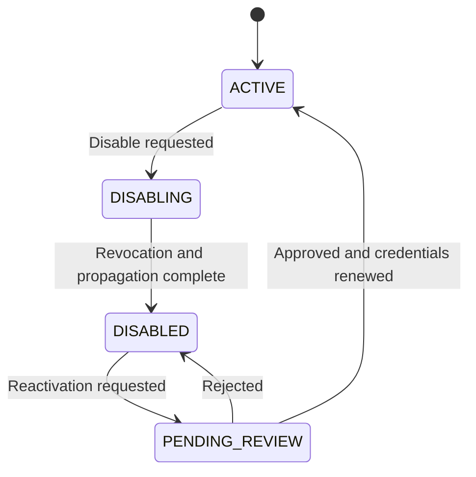
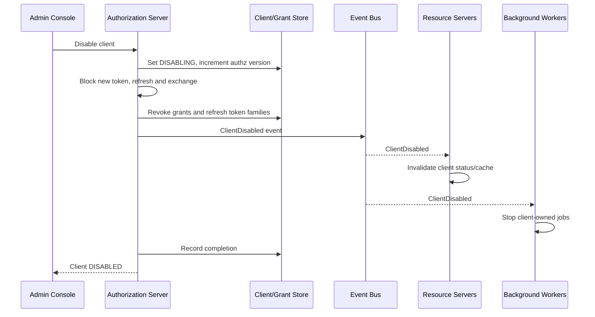

# Disable client

Trong OAuth 2.0 và OpenID Connect (OIDC), một **client** là ứng dụng yêu cầu authorization server cấp quyền truy cập tài nguyên. Client có thể là ứng dụng web phía server, ứng dụng native, SPA, service account hoặc một workload gọi API. Khi client bị lộ credential, ngừng hoạt động, vi phạm chính sách hoặc cần chấm dứt tích hợp, authorization server phải có khả năng **disable client** để ngăn client tiếp tục nhận token và sử dụng quyền đã được cấp.

Disable client là thao tác quản trị vòng đời client trong hệ thống cấp quyền. OAuth 2.0 định nghĩa cách client xác thực, yêu cầu token và thu hồi token, nhưng không quy định một endpoint quản trị chuẩn có tên `disable_client`. Mỗi authorization server cần triển khai trạng thái client và quy trình vận hành tương ứng. Điều quan trọng là quyết định disable phải được áp dụng nhất quán ở token endpoint, refresh, Token Exchange, introspection/revocation, resource server và các tiến trình liên quan.

Trong module **SECURITY_TOKEN_SECURITY_FUNDAMENTALS**, thao tác này liên kết danh tính client với vòng đời token: một token được phát hành hợp lệ trước đó vẫn có thể còn hạn, nhưng client đã bị disable thì quyền tiếp tục sử dụng token phải được đánh giá theo chính sách thu hồi hiện tại.

## 1. Disable client là gì?

Disable client là hành động chuyển một OAuth client sang trạng thái không còn được phép tham gia các luồng cấp quyền đã cấu hình. Sau khi thao tác có hiệu lực, authorization server không được chấp nhận client đó để bắt đầu grant mới, đổi authorization code, lấy token bằng client credentials, refresh token hoặc thực hiện Token Exchange theo quyền của client.

Một client record thường chứa các thông tin như:

- `client_id`: định danh công khai của client trong authorization server.
- Loại client: confidential hoặc public.
- Phương thức xác thực: client secret, `private_key_jwt`, mutual TLS hoặc không có client authentication đối với public client.
- Grant type được phép.
- Redirect URI và cấu hình OIDC liên quan.
- Scope, audience/resource và quyền được cấp.
- Trạng thái hoạt động và thông tin credential/key.
- Chủ sở hữu, tenant hoặc nhóm vận hành chịu trách nhiệm.

Disable client phải làm cho mọi luồng dựa trên client record đó bị kiểm soát. Chỉ xóa client khỏi trang quản trị hoặc ngừng hiển thị client trong UI không ngăn được request HTTP trực tiếp đến authorization server.

### Phân biệt client, user và tenant

Ba đối tượng này có vòng đời độc lập:

| Đối tượng | Đại diện cho | Ví dụ khi bị disable |
|---|---|---|
| User | Người dùng cuối hoặc subject đã xác thực. | User không thể đăng nhập hoặc dùng membership bị thu hồi. |
| Client | Ứng dụng hoặc workload yêu cầu token. | Ứng dụng không thể tiếp tục lấy token hoặc sử dụng quyền gắn với client. |
| Tenant | Tổ chức hoặc phạm vi dữ liệu khách hàng. | Mọi principal trong tenant bị chặn theo chính sách tenant. |

Disable một client không nhất thiết disable user đã đăng nhập qua client đó ở các ứng dụng khác. Tương tự, disable client tích hợp của một tenant không đồng nghĩa toàn bộ tenant bị vô hiệu hóa. Authorization server cần xác định quan hệ giữa client, user, grant và tenant để thu hồi đúng phạm vi.

## 2. Khi nào cần disable client?

Các tình huống phổ biến:

1. **Credential bị lộ:** client secret, private key, certificate hoặc signing key dùng cho client authentication có dấu hiệu bị đánh cắp.
2. **Ứng dụng ngừng hoạt động:** tích hợp đã kết thúc, sản phẩm bị retire hoặc client không còn được hỗ trợ.
3. **Vi phạm chính sách:** client yêu cầu scope ngoài phạm vi, gửi traffic bất thường hoặc sử dụng token sai mục đích.
4. **Incident response:** cần ngăn một workload bị xâm nhập tiếp tục lấy token.
5. **Thay đổi sở hữu:** ứng dụng chuyển đơn vị quản lý hoặc cần đăng ký client mới với cấu hình an toàn hơn.
6. **Sai cấu hình:** redirect URI, grant type, audience hoặc phương thức xác thực không còn phù hợp.
7. **Offboarding:** khách hàng hoặc đối tác chấm dứt tích hợp và yêu cầu thu hồi quyền truy cập.

Không phải mọi sự cố đều cần disable toàn bộ client. Nếu chỉ một credential bị lộ và hệ thống hỗ trợ credential rotation, có thể thu hồi credential cũ, cấp credential mới và giữ client hoạt động. Nếu không thể xác định phạm vi ảnh hưởng hoặc nghi ngờ client bị kiểm soát hoàn toàn, disable client là biện pháp containment phù hợp.

## 3. Mô hình trạng thái client

Một state machine rõ ràng giúp authorization server, portal quản trị và các service hiểu cùng một ý nghĩa.

| Trạng thái | Ý nghĩa | Hành vi cấp quyền |
|---|---|---|
| `ACTIVE` | Client hoạt động bình thường. | Chấp nhận các grant và credential được cấu hình. |
| `DISABLING` | Đang thực hiện disable; quyết định chặn cấp quyền mới đã được ghi nhận. | Từ chối yêu cầu token mới, refresh và exchange; đang thu hồi quyền/token liên quan. |
| `DISABLED` | Client đã bị vô hiệu hóa. | Không xác thực client để cấp quyền và không cho dùng token theo policy disable. |
| `PENDING_REVIEW` | Client cần được xem xét trước khi khôi phục. | Giữ trạng thái chặn cho đến khi có quyết định quản trị. |

Không nên dùng một giá trị boolean `enabled` nếu hệ thống cần theo dõi tiến trình thu hồi hoặc trạng thái khôi phục. Có thể dùng boolean trong mô hình đơn giản, nhưng cần xác định rõ thời điểm thay đổi có hiệu lực và cách ghi nhận công việc còn dang dở.



Ở nhiều hệ thống, chặn cấp token cần có hiệu lực ngay khi chuyển sang `DISABLING`. Các công việc thu hồi, phát sự kiện và xác nhận từ resource server có thể hoàn tất sau đó. Không nên trì hoãn việc chặn token mới cho đến khi toàn bộ công việc dọn dẹp kết thúc.

## 4. Phân biệt disable, delete và credential rotation

| Hành động | Mục đích | Hệ quả |
|---|---|---|
| Disable client | Ngừng toàn bộ hoạt động được cấp quyền cho client. | Client bị chặn; token/grant hiện có được xử lý theo chính sách disable. |
| Delete client | Xóa record client sau quy trình lưu giữ/audit. | Có thể mất dữ liệu cấu hình cần cho điều tra hoặc khôi phục nếu xóa quá sớm. |
| Rotate credential | Thay secret, key hoặc certificate. | Credential cũ bị thu hồi; client có thể tiếp tục hoạt động bằng credential mới. |
| Revoke token/grant | Vô hiệu hóa một token hoặc nhóm token/ủy quyền. | Token tương ứng không còn được chấp nhận theo cơ chế revocation. |

Disable là quyết định về trạng thái client; credential rotation là thay đổi phương thức xác thực; token revocation là thay đổi trạng thái token. Chúng có thể được kết hợp trong một incident nhưng không thay thế lẫn nhau.

Không nên xóa client record ngay khi disable. Giữ metadata cần thiết để audit, tra cứu token đã phát hành, xác định chủ sở hữu và đánh giá khả năng khôi phục. Việc xóa vĩnh viễn phải theo retention policy và quy trình riêng.

## 5. Luồng xử lý disable client

Một quy trình vận hành an toàn có thể chia thành các bước sau:

1. Xác minh người yêu cầu có quyền disable client và ghi nhận lý do/ticket.
2. Chuyển trạng thái client sang `DISABLING` và tăng `client_authz_version` hoặc version tương đương.
3. Ngừng chấp nhận client ở token endpoint và các luồng authorization mới.
4. Vô hiệu hóa client secret, public key registration, certificate hoặc phương thức xác thực đang bị ảnh hưởng.
5. Thu hồi refresh token, authorization grant và token family gắn với client theo chính sách.
6. Ngăn Token Exchange mới nếu client là requesting client hoặc actor không còn được phép.
7. Cập nhật trạng thái access token đang tồn tại qua introspection, denylist, version check hoặc TTL ngắn.
8. Phát sự kiện để resource server, gateway, worker và cache cập nhật trạng thái.
9. Xác nhận các thành phần đã áp dụng chính sách, sau đó chuyển sang `DISABLED`.
10. Ghi audit kết quả, lỗi còn tồn đọng và thời điểm disable có hiệu lực.



Nếu authorization server dùng nhiều node, trạng thái `DISABLING` phải được chia sẻ qua nguồn dữ liệu hoặc cơ chế phân phối có tính nhất quán phù hợp. Không để một node tiếp tục cấp token vì cache client status chưa được cập nhật.

## 6. Ngăn client lấy token mới

Authorization server cần kiểm tra client status tại mọi endpoint hoặc luồng có thể phát hành token.

### Client Credentials Grant

Đây là luồng quan trọng đối với service account và workload. Khi client bị disable, token endpoint phải từ chối request dù client gửi đúng secret cũ hoặc chữ ký client assertion hợp lệ.

```text
function issueClientCredentialsToken(request):
    client = loadClient(request.client_id)

    if client is missing or client.status != ACTIVE:
        rejectOAuthError("invalid_client")

    authenticateClient(request, client)
    validateGrantType(client, "client_credentials")
    scopes = intersect(request.scopes, client.allowedScopes)
    return issueAccessToken(client, scopes)
```

Pseudocode trên minh họa thứ tự kiểm tra. Triển khai thực tế cần xác thực client theo phương thức đã đăng ký và tuân thủ contract lỗi của authorization server. Không được cấp token trước rồi mới kiểm tra trạng thái client.

### Authorization Code Flow

Nếu client bị disable trong lúc người dùng đang đăng nhập:

- Authorization endpoint không nên tiếp tục tạo authorization code cho client disabled.
- Token endpoint phải từ chối đổi authorization code đã được cấp trước đó nếu client đã disabled.
- Redirect URI và PKCE vẫn phải được xác minh khi client còn active; việc disable không được bỏ qua các kiểm tra này.
- Session đăng nhập của user ở identity provider có thể vẫn còn hiệu lực cho ứng dụng khác, tùy policy user/session.

Điều này ngăn client dùng authorization code còn hiệu lực để nhận token sau khi quản trị viên đã chặn client.

### Refresh Token

Refresh token gắn với client và authorization grant. Khi client bị disable, authorization server phải từ chối refresh token thuộc client đó dù refresh token chưa hết hạn.

```text
function refreshAccessToken(refreshToken, authenticatedClient):
    grant = loadGrant(refreshToken.grantId)
    client = loadClient(grant.clientId)

    if client.status != ACTIVE:
        revokeTokenFamily(grant.id)
        rejectOAuthError("invalid_grant")

    if grant.status != ACTIVE or refreshToken.revoked:
        rejectOAuthError("invalid_grant")

    verifyClientBinding(authenticatedClient, grant.clientId)
    return rotateAndIssueTokens(grant)
```

Với refresh token rotation, cần thu hồi token family theo chính sách khi phát hiện reuse. Đối với Client Credentials Grant, RFC 6749 nói authorization server thường không nên cấp refresh token vì client có thể lấy access token mới bằng cách xác thực lại; vì vậy không nên mặc định mọi client đều có refresh token.

### Token Exchange

Nếu client sử dụng RFC 8693, authorization server phải kiểm tra trạng thái requesting client và quyền của actor/subject trước khi phát hành token mới. Một client đã disabled không được dùng subject token hợp lệ để tạo token mới cho audience downstream.

Kiểm tra tối thiểu:

- Client gửi yêu cầu exchange có đang `ACTIVE` không?
- Client có được phép dùng Token Exchange grant hoặc extension tương ứng không?
- Subject token còn hiệu lực và có tenant/resource context hợp lệ không?
- Actor token (nếu có) có đại diện đúng actor được ủy quyền không?
- Audience/resource và scope yêu cầu có nằm trong quyền được phép ủy quyền không?

Nếu client disabled là actor hoặc requesting party, yêu cầu exchange cần bị từ chối theo policy. Nếu client disabled chỉ xuất hiện trong một claim `act` của token nguồn, authorization server cũng cần xét quan hệ delegation đó thay vì chỉ nhìn `sub`.

## 7. Client authentication và credential bị vô hiệu hóa

Client có thể xác thực bằng nhiều phương thức. Disable client phải làm cho mọi credential hoặc key binding thuộc client không còn được dùng để xác thực.

| Phương thức | Cách xác thực | Hành động khi disable |
|---|---|---|
| `client_secret_basic` | Client gửi ID/secret qua HTTP Basic. | Đánh dấu client disabled và vô hiệu hóa secret; không chỉ xóa secret khỏi một node cache. |
| `client_secret_post` | Client gửi ID/secret trong form body. | Từ chối client theo trạng thái; không log secret. |
| `private_key_jwt` | Client ký client assertion bằng private key. | Vô hiệu hóa client registration hoặc key liên kết; từ chối assertion mới. |
| Mutual TLS | Client chứng minh quyền sở hữu certificate. | Thu hồi binding/certificate được đăng ký cho client theo policy. |
| Public client | Không có client secret đáng tin cậy. | Chặn theo `client_id`, redirect URI, grant và trạng thái client. |

`client_id` thường là định danh công khai, không phải credential bí mật. Không thể disable public client chỉ bằng cách xóa một secret vốn không tồn tại. Authorization server phải kiểm tra client record và grant cho mọi request.

Với `private_key_jwt`, việc xóa một JWK khỏi registry có thể ngăn chữ ký từ key đó nhưng không nhất thiết disable toàn bộ client nếu client còn key khác. Với mTLS, một certificate có thể được dùng chung theo cấu hình; cần xác định chính xác binding certificate-client để tránh thu hồi nhầm certificate của client khác.

## 8. Xử lý access token đã phát hành

Đây là phần dễ bị bỏ sót nhất. Chặn token mới không tự động làm access token đã cấp mất hiệu lực.

### Opaque access token

Opaque token thường được authorization server quản lý trong registry hoặc kho dữ liệu token. Khi client disabled, authorization server có thể đánh dấu token inactive. Resource server gọi introspection theo RFC 7662 sẽ nhận `active: false` và từ chối token.

Ví dụ response:

```json
{
  "active": false
}
```

Nếu resource server cache introspection response `active: true`, token có thể tiếp tục được chấp nhận cho đến khi cache hết hạn hoặc bị invalidation. Cần cấu hình cache TTL theo yêu cầu thu hồi và phát sự kiện để xóa cache khi client bị disable.

### JWT access token

JWT thường được resource server xác minh offline bằng chữ ký và claims. Nếu JWT đã phát hành còn `exp` trong tương lai, chữ ký vẫn hợp lệ. Authorization server không thể tự động làm mọi verifier offline biết rằng client đã bị disable.

Các cách xử lý phổ biến:

1. **Introspection hoặc status check:** resource server kiểm tra client status/token state trực tuyến.
2. **Client authorization version:** token chứa claim version của client; resource server so sánh với version hiện tại từ nguồn tin cậy.
3. **Denylist theo `jti`:** đánh dấu token cụ thể không còn được chấp nhận đến khi hết hạn.
4. **TTL ngắn:** giới hạn thời gian token cũ có thể tiếp tục hoạt động nếu không có kiểm tra online.
5. **Signing key riêng theo client:** có thể thu hồi key của một client trong mô hình đã thiết kế phù hợp, nhưng chỉ nên dùng khi key thực sự được tách riêng và ảnh hưởng đã được đánh giá.

Không nên xoay hoặc xóa signing key dùng chung của toàn authorization server chỉ để disable một client. Việc đó có thể làm hỏng token của các client không liên quan và gây outage diện rộng.

### Claim `client_id` và version tùy chỉnh

JWT access token theo RFC 9068 có claim `client_id`. Resource server có thể dùng claim này để xác định client mà token được cấp cho. Một hệ thống có thể bổ sung claim version riêng, ví dụ:

```json
{
  "iss": "https://auth.example.com",
  "sub": "service-account-17",
  "aud": "https://inventory.example.com",
  "client_id": "inventory-worker",
  "iat": 1795431000,
  "exp": 1795431300,
  "jti": "access-91f2",
  "scope": "inventory.read",
  "client_authz_version": 8
}
```

`client_authz_version` là claim tùy chỉnh, không phải claim OAuth/JWT bắt buộc. Khi client bị disable, authorization server tăng version. Resource server so sánh version trong token với version hiện tại; nếu khác nhau, token cũ bị từ chối.

Version claim chỉ có tác dụng khi resource server đọc trạng thái hiện tại từ một kho tin cậy hoặc cache có invalidation. Nếu verifier chỉ đọc version nằm trong JWT, token cũ vẫn tự xác nhận chính nó.

## 9. Revocation endpoint và thu hồi grant

RFC 7009 định nghĩa OAuth 2.0 Token Revocation Endpoint để client yêu cầu thu hồi token. Client gửi token và có thể gửi `token_type_hint`; confidential client phải xác thực theo cơ chế phù hợp.

Khi disable client do thao tác quản trị, authorization server không nên phụ thuộc vào việc client tự gọi revocation endpoint. Client có thể đã bị xâm nhập hoặc không còn kiểm soát được. Thay vào đó, hệ thống quản trị cần có khả năng thu hồi grant và token liên quan từ phía server.

Một số nguyên tắc:

- Thu hồi refresh token và authorization grant gắn với client.
- Thu hồi access token theo khả năng của hệ thống, đặc biệt khi có introspection hoặc token registry.
- Với JWT offline, phối hợp version check, denylist, event invalidation hoặc TTL ngắn.
- Nếu client dùng token theo nhiều grant/user, xác định phạm vi token cần thu hồi để không ảnh hưởng sai đối tượng.
- Không coi HTTP 200 từ revocation endpoint là bằng chứng mọi resource server đã cập nhật cache.

Theo RFC 7009, revocation endpoint trả response thành công ngay cả khi token không hợp lệ hoặc không tồn tại, nhằm tránh tiết lộ trạng thái token. RFC cũng khuyến nghị authorization server thu hồi access token liên quan khi refresh token bị thu hồi nếu có thể.

## 10. Resource server phải thực thi trạng thái client

Resource server là thành phần cuối cùng bảo vệ dữ liệu. Nếu chỉ authorization server biết client bị disable nhưng resource server vẫn chấp nhận JWT cũ, quyền truy cập vẫn có thể tiếp tục.

Một thứ tự kiểm tra điển hình:

1. Xác minh chữ ký, issuer, audience, thời hạn và token profile.
2. Đọc `client_id` hoặc mapping client tin cậy từ token/introspection response.
3. Kiểm tra client status hiện tại nếu policy yêu cầu thu hồi sớm.
4. Kiểm tra `client_authz_version` nếu dùng versioning.
5. Kiểm tra scope, role, tenant context và quyền trên resource.
6. Chỉ xử lý request khi mọi kiểm tra đều đạt.

Pseudocode:

```text
function authorize(request):
    token = validateSignatureIssuerAudienceAndExpiry(request)
    clientId = token.client_id

    clientState = clientStatusCache.get(clientId)
    if clientState is missing or clientState.isStale:
        clientState = clientRegistry.fetch(clientId)

    if clientState.status != ACTIVE:
        deny("client_disabled")

    if token.client_authz_version != clientState.authzVersion:
        deny("client_authorization_changed")

    verifyScopeAndResourcePolicy(token, request)
    allow()
```

Đây là logic minh họa. Không phải mọi hệ thống đều cần kiểm tra client status trực tuyến trên mọi request; lựa chọn phụ thuộc yêu cầu thu hồi và độ trễ cho phép. Với thao tác nhạy cảm, nếu không thể xác minh trạng thái client theo policy thì nên fail closed thay vì mặc định client vẫn active.

Nếu token không có `client_id` hoặc client context đáng tin cậy, resource server cần dùng introspection response hoặc mapping grant phía server. Không suy ra client từ header do caller tự gửi.

## 11. Cache, event propagation và nhiều resource server

Client status thường được cache để giảm tải đến authorization server. Điều này tạo một khoảng trễ giữa thời điểm disable và lúc mọi instance từ chối token cũ.

Một quy trình event-driven có thể gồm:

1. Client registry chuyển client sang `DISABLING` và tăng `authz_version` trong transaction.
2. Authorization server ngừng cấp token và refresh/exchange.
3. Transactional outbox ghi sự kiện `ClientDisabled` hoặc `ClientAuthorizationChanged`.
4. Event bus phân phối sự kiện đến resource server, gateway, introspection service và worker.
5. Consumer xóa cache client/token hoặc cập nhật version.
6. Các thành phần đối soát định kỳ trạng thái để khôi phục khi event bị mất.
7. Khi các điều kiện vận hành đã đạt, client chuyển sang `DISABLED`.

Sự kiện có thể chứa:

```json
{
  "event_id": "evt-client-2048",
  "event_type": "ClientDisabled",
  "client_id": "inventory-worker",
  "client_authz_version": 9,
  "occurred_at": "2026-11-23T10:30:00Z",
  "reason_code": "CREDENTIAL_COMPROMISE"
}
```

Không đưa client secret, private key, certificate private material, access token hoặc refresh token vào event payload.

Event bus có thể giao sự kiện nhiều lần. Consumer phải idempotent: nhận lại cùng `event_id` không được đảo trạng thái hoặc kích hoạt client trở lại. Khi nhận version thấp hơn version đang lưu, bỏ qua sự kiện cũ theo quy tắc nhất quán đã định nghĩa.

### Xác định thời gian disable có hiệu lực

Đội vận hành nên xác định một mục tiêu propagation cụ thể, ví dụ:

- Token mới bị chặn ngay sau khi client registry commit trạng thái `DISABLING`.
- Refresh và Token Exchange bị chặn trong cùng authorization server transaction/policy.
- Resource server cập nhật cache trong một khoảng thời gian cam kết.
- Request nhạy cảm luôn kiểm tra status trực tuyến nếu không chấp nhận propagation delay.

Không nên tuyên bố disable tức thời nếu resource server vẫn cache trạng thái `ACTIVE` trong nhiều phút. Hãy đo thời gian từ commit đến lần xác nhận cuối cùng và hiển thị trạng thái tiến trình cho quản trị viên.

## 12. Tác động đến các workload và tiến trình đang chạy

Disable client không chỉ ảnh hưởng request mới. Một client có thể sở hữu background job, message queue, webhook, scheduled task hoặc kết nối dài hạn.

| Thành phần | Hành động cần xem xét |
|---|---|
| API request mới | Từ chối token gắn với client disabled. |
| Request đang xử lý | Xác định có cần hủy hay cho hoàn tất theo authorization checkpoint. |
| Background job | Kiểm tra client status khi worker lấy job và trước side effect quan trọng. |
| Queue message | Consumer xác minh client/grant còn hợp lệ tại thời điểm xử lý. |
| Scheduled task | Dừng lịch chạy mới của client disabled. |
| Webhook/integration | Ngừng gửi hoặc nhận theo policy và ngăn retry tiếp tục. |
| Long-lived connection | Đóng kết nối hoặc kiểm tra trạng thái định kỳ nếu cần thu hồi sớm. |
| Local token cache | Xóa token/credential cache theo client và không tiếp tục dùng token cũ. |

Một job đã được đưa vào queue khi client còn active có thể được xử lý sau khi client bị disable. Worker không được tin trạng thái tại thời điểm message được tạo; phải kiểm tra lại trước khi thực hiện hành động quan trọng.

## 13. Graceful disable và emergency disable

Không phải tình huống nào cũng cần cùng mức độ gián đoạn. Có thể định nghĩa hai chế độ vận hành:

| Chế độ | Hành vi | Trường hợp phù hợp |
|---|---|---|
| Graceful disable | Ngừng grant/token mới, chờ token access hiện có hết hạn theo TTL hoặc một cửa sổ đã định nghĩa; dừng dần job. | Client được retire có kế hoạch, không có dấu hiệu compromise. |
| Emergency disable | Chặn cấp token ngay, thu hồi grant/refresh token, phát sự kiện invalidation và buộc resource server kiểm tra trạng thái sớm. | Credential bị lộ, client bị xâm nhập hoặc có rủi ro đang diễn ra. |

Hai chế độ là policy vận hành của hệ thống, không phải hai grant type OAuth chuẩn. Ngay cả graceful disable cũng phải chặn việc cấp token mới. Emergency disable cần xác định rõ các thao tác online và offline để giới hạn cửa sổ token cũ.

Không nên gọi disable là emergency nếu hệ thống chỉ ngừng phát token mới nhưng vẫn chấp nhận JWT cũ đến `exp`. Giao diện quản trị nên nêu rõ mức độ thu hồi đã áp dụng và thành phần nào còn chờ xác nhận.

## 14. Reactivation client an toàn

Kích hoạt lại client không nên chỉ đổi `status` về `ACTIVE`. Nếu client bị disable do credential compromise, cần coi credential cũ là không còn tin cậy.

Quy trình reactivation có thể gồm:

1. Xác minh người yêu cầu và phê duyệt khôi phục.
2. Xác định nguyên nhân disable đã được xử lý.
3. Rotate client secret, private key hoặc certificate nếu có khả năng bị lộ.
4. Rà soát grant type, redirect URI, audience/resource và scope được phép.
5. Xác minh owner, tenant và contact vận hành của client.
6. Tăng `client_authz_version`; không khôi phục version cũ.
7. Bật client sau khi credential mới và policy đã sẵn sàng.
8. Yêu cầu ứng dụng lấy token mới; không tự khôi phục refresh token hoặc token family đã revoke.
9. Xác minh resource server, cache và worker đã nhận trạng thái mới.

Token được phát hành trước khi disable phải tiếp tục bị từ chối nếu version cũ không khớp. Điều này ngăn token cũ tự hợp lệ trở lại sau khi client được kích hoạt.

## 15. Audit và giám sát disable client

Disable client là một sự kiện bảo mật quan trọng. Cần ghi lại:

- `client_id` và trạng thái trước/sau.
- Người hoặc service yêu cầu disable, quyền đã sử dụng và thời điểm.
- Lý do, ticket, incident ID hoặc mã phê duyệt.
- Chế độ graceful/emergency và phạm vi token bị thu hồi.
- `client_authz_version` trước/sau.
- Số lượng grant, refresh token family, access token hoặc session đã vô hiệu hóa nếu có thể thống kê.
- Trạng thái cập nhật của authorization server, introspection, resource server, gateway và worker.
- Thành phần chưa xác nhận, lỗi propagation và thời điểm hoàn tất.
- Credential/key đã rotate hoặc thu hồi theo ID tham chiếu an toàn.

Không ghi raw client secret, private key, certificate private key, access token, refresh token hoặc client assertion vào log. Dùng ID/fingerprint an toàn và metadata cần thiết để điều tra.

Metric vận hành hữu ích:

- Số client đang `ACTIVE`, `DISABLING`, `DISABLED`.
- Thời gian từ yêu cầu disable đến lúc chặn token mới.
- Thời gian từ commit đến lúc resource server cuối cùng áp dụng version mới.
- Số lần token/refresh/exchange bị từ chối do client disabled.
- Số token/grant còn active sau khi disable theo registry/introspection.
- Số consumer chưa xử lý sự kiện hoặc cache chưa invalidation.
- Số request còn được chấp nhận bằng token cũ sau thời điểm disable.

Metric label nên dùng tập giá trị giới hạn như `service`, `grant_type`, `reason_code` hoặc `result`. Không đưa access token, client secret, `jti`, raw user ID hoặc danh sách `client_id` không giới hạn vào mọi time series.

## 16. Các lỗi triển khai thường gặp

| Lỗi | Hậu quả | Cách khắc phục |
|---|---|---|
| Chỉ ẩn client khỏi portal | Client vẫn gọi token endpoint trực tiếp. | Kiểm tra trạng thái client ở authorization server. |
| Chỉ xóa client secret | Public key, certificate hoặc public client vẫn có thể dùng flow khác. | Disable client record và mọi phương thức xác thực đã đăng ký. |
| Chỉ chặn Client Credentials | Authorization code, refresh hoặc Token Exchange vẫn phát hành token. | Kiểm tra client status trên mọi grant/extension có liên quan. |
| Không thu hồi refresh token/grant | Client có thể lấy access token mới từ refresh token cũ. | Revoke grant/token family và kiểm tra client status mỗi lần refresh. |
| Cho rằng JWT tự mất hiệu lực khi client disabled | Resource server offline tiếp tục chấp nhận token đến `exp`. | Dùng introspection, version, denylist hoặc TTL ngắn. |
| Chỉ gọi RFC 7009 từ client | Client bị xâm nhập có thể không gọi revocation hoặc không còn credential. | Cung cấp thao tác thu hồi nội bộ phía authorization server. |
| Xóa signing key dùng chung | Token của client không liên quan cũng mất hiệu lực, gây outage. | Thu hồi theo client/token/grant; chỉ dùng key riêng nếu đã thiết kế tách biệt. |
| Cache client status quá lâu | Resource server tiếp tục chấp nhận token cũ. | Invalidate cache, so sánh version và đo propagation delay. |
| Event consumer xử lý không idempotent | Sự kiện lặp có thể đảo trạng thái hoặc gây tác dụng phụ. | Dùng event ID/version và xử lý idempotent. |
| Reactivate bằng credential cũ | Credential bị lộ tiếp tục được sử dụng. | Rotate credential và tăng authorization version. |
| Disable client nhưng quên worker/queue | Job cũ tiếp tục gọi API hoặc tạo side effect. | Kiểm tra trạng thái tại thời điểm thực thi. |
| Ghi token/secret vào audit log | Tạo thêm nơi lưu bí mật có thể bị đánh cắp. | Redact và lưu fingerprint/ID an toàn. |

## 17. Ma trận kiểm thử tình huống

| Tình huống | Kết quả mong đợi |
|---|---|
| Client `ACTIVE`, credential hợp lệ, grant được phép | Token endpoint cấp token theo scope/audience policy. |
| Client `DISABLED` gửi đúng secret cũ | Token endpoint từ chối; không cấp token. |
| Client `DISABLED` gửi client assertion ký hợp lệ | Từ chối do client status. |
| Public client đã disabled gửi authorization request | Không tạo authorization code. |
| Authorization code được cấp trước disable rồi mới đổi | Token endpoint từ chối theo policy client disabled. |
| Refresh token thuộc client disabled | Từ chối và không phát access token mới. |
| Token Exchange từ client disabled | Từ chối exchange. |
| Opaque access token đã bị revoke | Introspection trả `active: false`; resource server từ chối. |
| JWT cũ có `exp` còn tương lai nhưng client version đã đổi | Resource server từ chối nếu version check được áp dụng. |
| JWT offline không có cơ chế thu hồi tức thời | Xác nhận cửa sổ chấp nhận tối đa theo TTL đã định nghĩa. |
| Event `ClientDisabled` được giao lặp | Consumer idempotent, trạng thái không bị đảo. |
| Resource server chưa nhận event | Kiểm tra online/version hoặc hành vi fail-closed theo policy. |
| Background job chạy sau disable | Worker kiểm tra lại và không thực hiện side effect trái phép. |
| Client reactivated với credential mới | Token mới được cấp; token cũ tiếp tục bị từ chối. |

Test nên chạy trên mọi luồng cấp token mà client thực sự sử dụng: client credentials, authorization code, refresh, token exchange và OIDC login nếu có. Ngoài status code, cần xác minh không có token mới được phát hành, grant/token family đã bị cập nhật và resource server thực sự từ chối token cũ theo chính sách.

## 18. Checklist triển khai

**Authorization server và client registry**

- Có trạng thái client rõ ràng và nguồn dữ liệu nhất quán giữa các node.
- Chặn token mới ngay khi client chuyển sang `DISABLING`.
- Kiểm tra trạng thái ở authorization endpoint, token endpoint, refresh và Token Exchange.
- Vô hiệu hóa tất cả phương thức xác thực thuộc client.
- Thu hồi grant, refresh token family và access token theo khả năng hệ thống.
- Có thao tác quản trị phía server, không phụ thuộc client tự gọi revocation endpoint.

**Resource server và dependency**

- Có cách xác định client của access token từ claim/introspection đáng tin cậy.
- Kiểm tra client status/version theo yêu cầu thu hồi.
- Có cache invalidation và propagation metric.
- Từ chối an toàn khi không xác minh được trạng thái trong các luồng nhạy cảm.
- Không thu hồi nhầm signing key hoặc credential dùng chung.

**Workload và vận hành**

- Dừng job, queue consumer, webhook và integration theo policy.
- Có chế độ graceful và emergency với hành vi được mô tả rõ.
- Có audit, correlation ID và lý do disable.
- Không ghi token hoặc secret nguyên văn.
- Reactivation yêu cầu credential mới khi có nguy cơ compromise và tăng version.
- Có kiểm thử negative cho mọi grant và token cũ.

## 19. Kết luận

Disable client là thao tác quản trị vòng đời OAuth client nhằm ngừng cấp quyền và kiểm soát việc sử dụng token đã phát hành. Một triển khai đầy đủ phải chặn grant mới, authorization code exchange, client credentials, refresh và Token Exchange; vô hiệu hóa credential; thu hồi grant/token liên quan; đồng thời bảo đảm resource server nhận biết trạng thái client.

Điểm cần chú ý nhất là access token cũ. Opaque token có thể được kiểm tra qua introspection; JWT xác minh offline cần cơ chế bổ sung như client authorization version, denylist hoặc TTL ngắn để giới hạn cửa sổ rủi ro. Quy trình disable cũng cần xử lý cache, event propagation, background job, audit và reactivation. Nhờ đó, việc vô hiệu hóa một client có hiệu lực đúng phạm vi, không làm gián đoạn client khác và không để credential cũ tiếp tục tạo quyền truy cập.

## Tài liệu tham khảo

- [RFC 6749 — The OAuth 2.0 Authorization Framework](https://www.rfc-editor.org/rfc/rfc6749): client registration context, client authentication, grants, token endpoint và error response.
- [RFC 6750 — OAuth 2.0 Bearer Token Usage](https://www.rfc-editor.org/rfc/rfc6750): cách sử dụng bearer access token và lỗi xác thực tài nguyên.
- [RFC 7009 — OAuth 2.0 Token Revocation](https://www.rfc-editor.org/rfc/rfc7009): endpoint thu hồi access token và refresh token.
- [RFC 7662 — OAuth 2.0 Token Introspection](https://www.rfc-editor.org/rfc/rfc7662): truy vấn trạng thái token qua thuộc tính `active`.
- [RFC 8693 — OAuth 2.0 Token Exchange](https://www.rfc-editor.org/rfc/rfc8693): trao đổi subject token và actor token lấy token mới.
- [RFC 9068 — JWT Profile for OAuth 2.0 Access Tokens](https://www.rfc-editor.org/rfc/rfc9068): profile JWT access token, bao gồm claim `client_id`.
- [RFC 9700 — Best Current Practice for OAuth 2.0 Security](https://www.rfc-editor.org/rfc/rfc9700): khuyến nghị bảo mật OAuth 2.0 hiện hành, bao gồm bảo vệ token và client.
