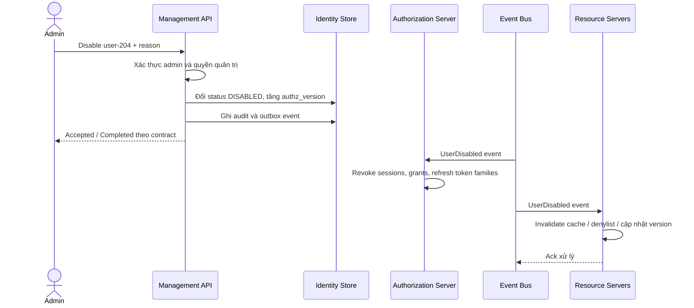

# Disable user hoặc tenant

## 1. Disable là thao tác vận hành quyền truy cập

Trong hệ thống dùng OAuth 2.0/OIDC, **disable user** hoặc **disable tenant** là thao tác quản trị để ngăn một danh tính hoặc một tổ chức tiếp tục sử dụng dịch vụ. OAuth 2.0 không định nghĩa endpoint chuẩn mang tên “disable user” hay “disable tenant”; nền tảng phải triển khai quy trình quản trị, đồng bộ trạng thái và thu hồi credential phù hợp.

Disable cần xử lý nhiều lớp:

- **Identity:** tài khoản người dùng hoặc service principal không còn được phép xác thực.
- **Membership:** quan hệ giữa user và tenant có thể bị vô hiệu trong phạm vi một tenant.
- **Tenant:** toàn bộ tổ chức bị tạm ngưng, thành viên không còn được truy cập tài nguyên tenant.
- **Session/grant:** phiên đăng nhập và quyền cấp phát token liên quan phải bị kết thúc theo policy.
- **Token:** refresh token, access token và token exchange liên quan cần được xử lý theo khả năng của AS/RS.
- **Workload và dữ liệu vận hành:** job nền, API key, cache, message consumer, webhook và tích hợp tenant-scoped phải nhận trạng thái mới.

**Disable không đồng nghĩa xóa dữ liệu.** Tenant có thể bị tạm ngưng để xử lý vi phạm, chờ thanh toán hoặc điều tra sự cố nhưng vẫn cần giữ dữ liệu theo chính sách lưu trữ. User bị disable cũng có thể cần giữ audit history và quan hệ sở hữu dữ liệu.

Mục tiêu là mọi request mới được quyết định dựa trên trạng thái hiện hành, credential cũ không tiếp tục cấp quyền ngoài policy, và việc khôi phục không làm sống lại session/token đã bị vô hiệu.

## 2. Phân biệt disable user, membership và tenant

Một user có thể là thành viên của nhiều tenant. Cần xác định đúng phạm vi trước khi thao tác.

| Trạng thái | Phạm vi ảnh hưởng | Ví dụ |
|---|---|---|
| Disable global user | Tài khoản người dùng trên toàn nền tảng | Nhân viên nghỉ việc hoặc tài khoản bị xâm nhập |
| Disable tenant membership | Chỉ quan hệ user–tenant | Người dùng rời Acme nhưng vẫn là thành viên Northwind |
| Disable tenant | Toàn bộ truy cập và hoạt động của một tenant | Tạm ngưng tổ chức Acme |
| Disable service principal | Workload/client cụ thể | Vô hiệu integration client bị lộ credential |
| Revoke session/grant | Một hoặc nhiều phiên/ủy quyền | Logout thiết bị hiện tại hoặc thu hồi toàn bộ phiên |

Ví dụ, `user-204` là thành viên của `acme` và `northwind`. Nếu chỉ membership Acme bị disable, token dành cho Acme phải bị từ chối; quyền truy cập Northwind có thể tiếp tục nếu tài khoản và membership Northwind vẫn active. Không đặt global user thành disabled khi ý định chỉ là gỡ quyền ở một tenant.

### Mô hình trạng thái

| Đối tượng | Trạng thái ví dụ | Ý nghĩa |
|---|---|---|
| User | `ACTIVE` / `DISABLED` | Tài khoản có được đăng nhập hay không |
| Membership | `ACTIVE` / `SUSPENDED` / `REVOKED` | User có được truy cập tenant cụ thể không |
| Tenant | `ACTIVE` / `SUSPENDED` / `CLOSED` | Tenant có được sử dụng dịch vụ không |
| Service principal | `ACTIVE` / `DISABLED` | Workload có được xin token không |
| Session/grant | `ACTIVE` / `REVOKED` / `EXPIRED` | Phiên hoặc grant có còn hiệu lực không |

`SUSPENDED` thường là tạm dừng và có thể khôi phục; `CLOSED` có thể là trạng thái kết thúc theo quy trình nghiệp vụ. Mỗi trạng thái nên có policy riêng cho token, dữ liệu và khôi phục.

## 3. Quyết định trước khi disable

Trước khi thực hiện, hệ thống cần xác định:

1. **Đối tượng:** user toàn cục, membership, tenant hay service principal?
2. **Phạm vi:** một phiên, mọi phiên, một tenant hay toàn bộ tenant?
3. **Lý do:** yêu cầu quản trị, nghỉ việc, nghi ngờ credential bị lộ, vi phạm policy hay tenant tạm ngưng?
4. **Hiệu lực:** chặn ngay, theo thời điểm đã lên lịch hay sau approval?
5. **Token policy:** revoke refresh token/grant nào; access token được chặn tức thì hay theo propagation SLA?
6. **Tác động vận hành:** dừng job, webhook, scheduled task, API integration và message consumer nào?
7. **Khôi phục:** ai được enable lại, cần phê duyệt nào và có yêu cầu xác thực lại không?

Với tài khoản nghi bị xâm nhập, ưu tiên chặn xác thực và xin token mới, thu hồi session/grant liên quan, đồng thời đánh giá access token đã phát hành. Với tenant tạm ngưng vì lý do thương mại, có thể có policy riêng cho đọc, export, thanh toán hoặc hỗ trợ; không suy đoán mọi endpoint đều có cùng hành vi.

| Yêu cầu | Thao tác phù hợp | Kiểm tra bắt buộc |
|---|---|---|
| User rời một tổ chức | Disable membership | Membership tenant khác không bị ảnh hưởng |
| User nghỉ việc hoàn toàn | Disable global user | Tất cả session/grant và membership theo policy |
| Tenant vi phạm điều khoản | Suspend tenant | Không còn request, job hoặc service integration truy cập tenant |
| Secret integration bị lộ | Disable service principal/credential | Client không xin token mới; token cũ được xử lý |
| Một thiết bị bị mất | Revoke session/device grant | Session thiết bị khác vẫn hoạt động nếu policy là current-session |

## 4. Ảnh hưởng tới OAuth 2.0/OIDC token lifecycle

Disable identity hoặc tenant không tự động làm mọi token đã phát hành biến mất. Cần tách ba hành vi:

- **Chặn phát hành mới:** AS không cho user/client disabled đăng nhập, đổi authorization code, refresh token hoặc exchange token.
- **Thu hồi credential có trạng thái:** AS revoke refresh token, token family, grant hoặc session liên quan.
- **Từ chối access token đang tồn tại:** RS cần nhận biết trạng thái disabled/revoked hoặc chờ token hết hạn nếu token được xác minh offline.

### Token endpoint phải kiểm tra trạng thái hiện tại

| Grant/flow | Kiểm tra khi phát hành |
|---|---|
| Authorization Code + PKCE | User active, tenant/membership active, client và redirect hợp lệ tại lúc authorize và lúc đổi code |
| Refresh Token | User, grant/session, membership, tenant và client vẫn được phép; refresh token chưa bị revoke/rotate |
| Client Credentials | Service principal/client active, tenant active nếu client gắn tenant, scope/resource được cấp |
| Token Exchange | Subject token còn hợp lệ; actor/client được phép exchange; subject, tenant và resource đích còn active |
| OIDC login | OP xác thực user và áp dụng trạng thái tài khoản, session và policy |

Không chỉ kiểm tra trạng thái tại login. Authorization code được cấp trước khi user bị disable nhưng chưa đổi thành token phải bị từ chối nếu policy yêu cầu tài khoản active tại thời điểm token issuance.

### JWT offline và opaque token

| Loại access token | Sau khi disable/revoke | Kiểm thử vận hành |
|---|---|---|
| Opaque + introspection | AS có thể trả `active=false`; RS phải tôn trọng trạng thái và cache policy | Revoke, introspect lại, gọi RS và đo propagation |
| JWT xác minh offline | Có thể vẫn được chấp nhận đến `exp` nếu RS không kiểm tra trạng thái tập trung | Xác định TTL, denylist/version check hoặc SLA |
| JWT có status/version check | RS có thể từ chối khi user/session/tenant version thay đổi | Kiểm tra cache invalidation và consistency |
| Sender-constrained token | Giảm nguy cơ token bị dùng từ nơi khác nhưng không tự vô hiệu khi user/tenant bị disable | Kiểm tra status/revocation bên cạnh mTLS/DPoP |

Nếu RS chỉ xác minh chữ ký, issuer, audience và thời hạn JWT, việc AS disable user không tự làm thay đổi JWT đã ký. Cần thiết kế thêm một hoặc nhiều cơ chế:

- Access token TTL ngắn để giới hạn thời gian còn lại.
- Denylist theo `jti` hoặc token fingerprint.
- Session/user/tenant authorization version được kiểm tra tại RS.
- Introspection hoặc token status endpoint cho API nhạy cảm.
- Sự kiện disable/revoke được truyền tới gateway, RS và cache.
- Policy kiểm tra tenant/user state tại mỗi request hoặc tại các điểm kiểm soát phù hợp.

Không tuyên bố “disable tức thì” nếu kiến trúc chỉ dùng JWT offline và chưa có trạng thái kiểm tra bổ sung.

## 5. Luồng disable user

Giả sử quản trị viên disable `user-204` trên toàn nền tảng vì tài khoản có dấu hiệu bị chiếm quyền.



Một quy trình điển hình:

1. Xác thực admin và quyền disable user; yêu cầu lý do/ticket nếu policy cần.
2. Cập nhật user state sang `DISABLED` bằng transaction.
3. Tăng `authz_version` hoặc session version để token cũ có thể bị nhận diện.
4. Ghi audit event và transactional outbox cùng transaction với thay đổi trạng thái.
5. Chặn login, authorization code exchange, refresh và token exchange mới cho user.
6. Revoke session, refresh token và grant liên quan theo phạm vi đã chọn.
7. Phát event đến RS, gateway, cache, job runner và dịch vụ giữ user context.
8. Xác minh token/session cũ bị từ chối theo SLA; kiểm tra user không thể đăng nhập lại.
9. Giữ dữ liệu và audit theo retention policy; không xóa dữ liệu chỉ vì tài khoản bị disable.

Nếu API xử lý bất đồng bộ, response `202 Accepted` chỉ có nghĩa yêu cầu đã được tiếp nhận. Chỉ báo hoàn tất khi các bước bắt buộc đã được xác nhận hoặc operation status thể hiện rõ phần còn pending.

## 6. Luồng disable một membership

Với user có nhiều tenant, disable membership cần giữ phạm vi hẹp.

Giả sử `user-204` bị gỡ khỏi `acme` nhưng vẫn được phép truy cập `northwind`:

- Cập nhật membership `(user-204, acme)` thành `REVOKED` hoặc `SUSPENDED`.
- Tăng membership authorization version của Acme.
- Chặn token mới có tenant context Acme; refresh/token exchange cho Acme cũng bị từ chối.
- Thu hồi grant/session có phạm vi Acme theo policy.
- RS kiểm tra membership và tenant context; token cũ của Acme bị từ chối theo SLA.
- Token/session của Northwind tiếp tục hoạt động nếu user và membership Northwind còn active.

Không chỉ đổi role trên UI hoặc xóa user khỏi danh sách tenant mà không cập nhật authorization state ở AS/RS. Quyền phải được kiểm tra tại server, không dựa vào dữ liệu giao diện.

## 7. Luồng suspend tenant

Disable tenant thường có phạm vi rộng hơn disable user. Tenant có thể có nhiều user, service principal, integration client, API key, scheduled job và dữ liệu đang xử lý.

Quy trình cần:

1. Xác thực platform admin hoặc workflow quản trị được ủy quyền; ghi lý do, thời điểm và phạm vi.
2. Đổi tenant state sang `SUSPENDED` và tăng `tenant_authz_version`.
3. Chặn đăng nhập vào tenant, xin token mới, refresh token và token exchange có tenant context thuộc tenant.
4. Vô hiệu service principal, API key và integration credential tenant-scoped theo policy.
5. Revoke session/grant/token family thuộc tenant; không ảnh hưởng tenant khác.
6. Phát tenant-disabled event tới API, gateway, cache, queue consumer, scheduler và downstream.
7. Dừng job mới; xử lý job đang chạy theo chính sách an toàn và idempotent.
8. Chặn truy cập dữ liệu, file, search index, report, webhook và export của tenant.
9. Xác minh mọi đường truy cập trực tiếp và gián tiếp đã bị chặn.
10. Giữ dữ liệu, billing/audit record và khả năng export/retention nếu chính sách cho phép.

### Tenant-wide disable không chỉ là khóa đăng nhập

Tenant có thể tiếp tục phát sinh truy cập từ service-to-service hoặc background job ngay cả khi user không đăng nhập được. Vì vậy, phải kiểm tra:

- Client Credentials của service principal tenant.
- Refresh token và token exchange có tenant context.
- Access token còn hạn tại API downstream.
- Job đã xếp lịch hoặc message đã nằm trong queue.
- Webhook callback và integration bên ngoài.
- Cache, signed download URL và file access.
- Tác vụ hỗ trợ hoặc platform operator đang truy cập tenant.

Signed URL đã cấp trước đó có thể còn hiệu lực đến khi hết hạn nếu storage không kiểm tra tenant state. Nếu disable phải có hiệu lực ngay, cần short TTL, proxy authorization hoặc cơ chế thu hồi/denylist phù hợp cho đường truy cập đó.

## 8. Ví dụ API quản trị và idempotency

Một API quản trị có thể nhận yêu cầu như sau:

```http
POST /admin/users/user-204:disable HTTP/1.1
Authorization: Bearer <platform-admin-access-token>
Idempotency-Key: disable-user-204-ticket-8821
Content-Type: application/json

{
  "scope": "GLOBAL",
  "reason": "Suspected account compromise",
  "ticket": "SEC-8821"
}
```

Ví dụ request tenant suspension:

```http
POST /admin/tenants/acme:suspend HTTP/1.1
Authorization: Bearer <platform-admin-access-token>
Idempotency-Key: suspend-tenant-acme-incident-41
Content-Type: application/json

{
  "reason": "Security incident",
  "ticket": "INC-41",
  "effectiveAt": "immediate"
}
```

Đây là API minh họa, không phải endpoint OAuth chuẩn. Hệ thống cần xác thực platform admin, kiểm tra quyền theo resource/tenant, validate lý do và ticket, rồi thực hiện state transition.

Idempotency key giúp retry sau timeout không tạo nhiều tác vụ disable hoặc audit event sai lệch. Key cần được scope theo actor/tenant/operation và liên kết với fingerprint request. Cùng key nhưng payload khác phải bị từ chối.

| Response | Ý nghĩa | Điều cần kiểm tra |
|---|---|---|
| `200 OK` / `204 No Content` | Thao tác đồng bộ đã hoàn tất theo contract | Trạng thái và các bước đồng bộ bắt buộc đã đạt |
| `202 Accepted` | Yêu cầu được tiếp nhận, xử lý bất đồng bộ | Có operation ID, trạng thái pending/failed/completed |
| `403 Forbidden` | Admin không đủ quyền | Không có trạng thái nào bị thay đổi |
| `404 Not Found` | User/tenant không tồn tại hoặc được che theo policy | Không tiết lộ tài nguyên ngoài phạm vi |
| `409 Conflict` | State transition hoặc idempotency conflict | Không ghi đè trạng thái mới hơn |
| `5xx` | Lỗi xử lý | Transaction/outbox không để trạng thái nửa vời không thể phục hồi |

## 9. Kiểm tra tại Resource Server

Mỗi RS cần xác minh access token trước, sau đó kiểm tra trạng thái identity/tenant nếu policy yêu cầu. Mô hình kiểm tra:

```text
validate_access_token(token):
    verify_signature_or_introspection(token)
    require(issuer_is_trusted)
    require(audience_contains_this_api)
    require(token_is_active_and_not_expired)
    require(required_scope_is_present)

    user = load_identity_status(token.subject)
    require(user.status == ACTIVE)

    if request_has_tenant_context:
        tenant = load_tenant_status(request.tenant_id)
        require(tenant.status == ACTIVE)

        membership = load_membership(token.subject, request.tenant_id)
        require(membership.status == ACTIVE)

        require(token_tenant_context_matches_request(token, request))

    require(resource_policy_allows_action(token, request))
```

Đây là pseudo-code. Hệ thống có thể tối ưu bằng cache hoặc token version, nhưng cache phải có TTL/invalidation phù hợp với disable SLA. Không bỏ kiểm tra trạng thái chỉ vì JWT có chữ ký hợp lệ.

### Ví dụ Spring Security: kiểm tra authorization version

Một cách tiếp cận là đưa version vào token và so sánh với version hiện tại trong state store/cache:

```java
@Component
public class AuthorizationVersionService {

    private final IdentityStatusRepository identities;

    public AuthorizationVersionService(IdentityStatusRepository identities) {
        this.identities = identities;
    }

    public boolean isCurrent(String subject, long tokenVersion) {
        return identities.findBySubject(subject)
            .filter(identity -> identity.getStatus() == IdentityStatus.ACTIVE)
            .map(identity -> identity.getAuthorizationVersion() == tokenVersion)
            .orElse(false);
    }
}
```

Trong Resource Server, tích hợp kiểm tra này bằng custom authorization manager, request authorization component hoặc validator phù hợp. Nếu gọi database trực tiếp cho mỗi request thì tăng latency và phụ thuộc availability; production thường dùng cache phân tán với invalidation/version update và TTL giới hạn.

Đối với tenant, cần so sánh thêm tenant version và membership version. User có thể active toàn cục nhưng membership Acme đã bị revoke. Không dùng một global user version để thay thế mọi kiểm tra membership.

## 10. Event propagation và xử lý nhất quán

Disable thường cần cập nhật nhiều dịch vụ. Event user có thể chứa:

```json
{
  "eventId": "evt-901",
  "eventType": "UserDisabled",
  "subject": "user-204",
  "scope": "GLOBAL",
  "authorizationVersion": 18,
  "occurredAt": "2026-11-23T10:30:00Z",
  "reasonCode": "SECURITY_REVIEW"
}
```

Event tenant:

```json
{
  "eventId": "evt-902",
  "eventType": "TenantSuspended",
  "tenantId": "acme",
  "tenantAuthorizationVersion": 7,
  "occurredAt": "2026-11-23T10:31:00Z",
  "reasonCode": "SECURITY_INCIDENT"
}
```

Đây là payload minh họa. Không đưa raw access token, refresh token, password hoặc dữ liệu cá nhân không cần thiết vào event. Consumer phải xác minh nguồn phát và xử lý event idempotent.

### Transactional outbox

Nếu cập nhật trạng thái trong database thành công nhưng publish event thất bại, RS có thể tiếp tục chấp nhận token. Transactional outbox giúp ghi state change và event trong cùng transaction; publisher gửi event sau đó và retry đến khi được xác nhận.

Consumer nên:

- Deduplicate theo `eventId`.
- Chấp nhận event lặp mà không làm sai trạng thái.
- Xử lý event đến sai thứ tự bằng version/sequence; không áp trạng thái cũ đè trạng thái mới.
- Cập nhật cache hoặc denylist một cách atomic.
- Retry lỗi tạm thời và đưa message không xử lý được vào dead-letter queue có giám sát.
- Không coi event publish thành công là tất cả RS đã xử lý xong; cần ack/telemetry hoặc operation status nếu SLA yêu cầu xác nhận.

### Race giữa disable và cấp token

Có thể xảy ra tình huống:

1. Token endpoint đọc user là ACTIVE.
2. Admin disable user.
3. Token endpoint hoàn tất phát hành access/refresh token dựa trên trạng thái cũ.

Để giảm race, cần đồng bộ state transition với việc phát token: kiểm tra version/trạng thái sát thời điểm commit, dùng optimistic locking/transaction phù hợp hoặc cơ chế authorization state có tính nhất quán đủ mạnh. Sau khi disable commit, mọi token issuance mới phải bị từ chối. Nếu token vừa được phát hành trong race window, event/version check phải khiến RS từ chối theo SLA.

## 11. Enable lại user hoặc tenant

Enable lại là một state transition mới, không phải khôi phục nguyên trạng credential cũ.

Khi enable user:

- Xác minh người có thẩm quyền và lý do khôi phục.
- Kiểm tra credential, MFA, recovery factor và nguy cơ compromise đã được xử lý.
- Giữ refresh token/session cũ ở trạng thái revoked.
- Tăng authorization/session version nếu cần để token cũ không trở lại hợp lệ.
- Yêu cầu đăng nhập lại và cấp token mới theo policy.
- Khôi phục membership riêng biệt; user active toàn cục không tự động active mọi membership đã revoke.

Khi enable tenant:

- Xác minh điều kiện khôi phục, billing/legal/security hold và phê duyệt.
- Kiểm tra service principal, API key, webhook, integration và scheduled job trước khi bật.
- Không khôi phục credential đã bị revoke chỉ vì tenant được active lại.
- Kiểm tra tenant config, quota, data access, cache và consumer.
- Chỉ bật từng tích hợp khi credential mới và quyền đã được xác minh.
- Theo dõi request bất thường sau khi mở lại.

**Không tái sử dụng token cũ sau enable.** Nếu token có version cũ hoặc session/grant đã revoke thì vẫn phải bị từ chối. Client thực hiện authentication/authorization flow mới để nhận credential mới.

## 12. Audit, cảnh báo và quy trình ứng phó

Một sự kiện disable cần lưu:

| Trường | Mục đích |
|---|---|
| Actor admin/client | Ai yêu cầu disable |
| Target type/ID | User, membership, tenant hoặc service principal |
| Scope | GLOBAL, TENANT hoặc SESSION |
| Reason/ticket | Lý do và liên kết incident/change |
| Previous/new state | Trạng thái trước và sau |
| Authorization version | Version trước/sau để đối chiếu |
| Requested/effective time | Thời điểm yêu cầu và thời điểm có hiệu lực |
| Operation ID | Theo dõi xử lý bất đồng bộ |
| Consumer acknowledgements | Dịch vụ đã nhận và áp dụng event |
| Result/failure | Thành công, pending hoặc lỗi |

Không ghi raw token, refresh token, session cookie, private key hoặc credential vào audit. Có thể lưu token `jti`, grant/session ID hoặc fingerprint đã chuẩn hóa nếu cần điều tra.

Cảnh báo nên phát khi:

- User/tenant bị disable nhưng RS vẫn chấp nhận request sau propagation deadline.
- Refresh token của user/tenant disabled vẫn cấp được access token mới.
- Service principal disabled tiếp tục gọi API.
- Event consumer bị lag hoặc dead-letter tăng.
- Cache invalidation thất bại.
- Có nhiều lần enable/disable bất thường.
- Tenant bị suspend nhưng background job hoặc webhook vẫn tạo side effect.

Trong incident, giữ bằng chứng an toàn, xác định phạm vi ảnh hưởng, thu hồi credential, kiểm tra token cũ và audit downstream. Không xóa log hoặc dữ liệu liên quan trước khi hoàn thành điều tra và retention review.

## 13. Ma trận kiểm thử disable/enable

Giả sử user `user-204` thuộc tenant Acme và Northwind; service principal `billing-sync-acme` thuộc Acme.

| Test case | Thao tác | Kết quả mong đợi |
|---|---|---|
| Disable global user | Disable `user-204` | Login và token issuance mới bị từ chối |
| Existing refresh token | Refresh sau khi user disabled | Bị từ chối |
| Existing JWT offline | Gọi RS bằng token trước disable | Bị từ chối theo denylist/version hoặc đúng TTL/SLA |
| Existing opaque token | Introspect sau disable/revoke | `active=false` sau propagation SLA |
| Pending authorization code | Đổi code sau disable | Bị từ chối nếu user không còn active |
| Token exchange | Exchange subject token của user disabled | AS từ chối |
| Disable Acme membership | User gọi API Acme | Bị từ chối |
| Disable Acme membership | User gọi API Northwind | Vẫn hoạt động nếu global user và membership Northwind active |
| Suspend Acme tenant | User Acme gọi API | Bị từ chối |
| Suspend Acme tenant | Client Billing Sync của Acme xin token | Bị từ chối |
| Suspend Acme tenant | Job/queue event của Acme | Không tạo side effect mới; xử lý theo suspend policy |
| Other tenant | User Northwind gọi API Northwind | Không bị ảnh hưởng bởi việc suspend Acme |
| Duplicate disable | Gửi lại cùng idempotency key | Trả cùng operation/result, không tạo state transition sai |
| Concurrent disable/refresh | Disable và refresh cùng lúc | Không phát hành token có hiệu lực sau khi disable commit |
| Out-of-order event | Event version cũ đến sau event mới | Không ghi đè trạng thái mới |
| Consumer unavailable | RS chưa nhận event | Operation phản ánh pending; SLA/alert hoạt động |
| Re-enable user | Enable sau disable | Token/session cũ vẫn bị từ chối; phải cấp token mới |
| Re-enable tenant | Enable tenant | Chỉ tích hợp/credential đã được xác minh mới hoạt động |
| Audit | Disable hoặc enable | Ghi actor, target, scope, reason và kết quả; không có raw token |

Test phải kiểm tra login, token endpoint, Resource Server, cache, job nền và integration client. Chỉ kiểm tra cột status trong database không chứng minh quyền truy cập đã bị chặn.

## 14. Lỗi vận hành thường gặp

| Lỗi | Hệ quả | Cách kiểm soát |
|---|---|---|
| Chỉ disable user trong UI | API và token endpoint vẫn chấp nhận token | Cập nhật trạng thái server-side và truyền tới AS/RS |
| Chỉ chặn login, không chặn refresh | User vẫn xin access token mới | Kiểm tra trạng thái ở refresh grant |
| Nghĩ revoke refresh token làm access JWT hết hiệu lực ngay | RS offline có thể tiếp tục chấp nhận JWT | Denylist/version/introspection hoặc TTL phù hợp |
| Disable user toàn cục khi chỉ cần revoke membership | Ảnh hưởng tenant khác | Tách user state và membership state |
| Suspend tenant nhưng bỏ sót service principal | Integration tiếp tục truy cập | Kiểm tra client credentials và workload |
| Publish event trước khi transaction state commit | Consumer thấy trạng thái chưa tồn tại hoặc sai thứ tự | Transactional outbox và version |
| Event cũ ghi đè state mới | Tenant/user bị mở lại hoặc disable sai | Sequence/version và state transition guard |
| Cache TTL quá dài | Token cũ được chấp nhận quá lâu | Invalidation và stale acceptance SLA |
| Enable lại nhưng phục hồi token cũ | Credential bị lộ trước đó hoạt động trở lại | Giữ revoke state, tăng version và yêu cầu cấp token mới |
| Trả 200 trước khi disable hoàn tất nhưng không thể hiện pending | Admin hiểu nhầm đã chặn toàn hệ thống | Dùng operation status và acknowledgements |
| Không dừng job/webhook | Dữ liệu tiếp tục thay đổi sau suspend | Quản lý workload và side effect theo tenant |
| Xóa dữ liệu ngay khi disable | Mất khả năng audit/khôi phục và vi phạm retention | Tách suspension khỏi deletion lifecycle |

## 15. Checklist triển khai

- Xác định rõ disable global user, membership, tenant hay service principal.
- State transition được kiểm soát bằng quyền admin, lý do và audit.
- Login, authorization code exchange, refresh và token exchange đều kiểm tra trạng thái hiện hành.
- Client Credentials kiểm tra service principal và tenant state.
- Refresh token, grant và session liên quan được revoke theo phạm vi.
- Có chính sách cụ thể cho access token JWT offline và opaque/introspection.
- RS có version check, denylist, introspection hoặc TTL phù hợp với disable SLA.
- Tenant state được kiểm tra ở API và các luồng service-to-service.
- Cache, file, queue, webhook, scheduler và background job giữ tenant/user context.
- Transactional outbox, event version và consumer idempotency bảo đảm propagation.
- Có race test giữa disable, refresh, token issuance và event processing.
- Enable lại không khôi phục token/session/credential đã revoke.
- Audit không chứa raw token hoặc secret; có cảnh báo khi propagation vượt SLA.
- Có ma trận kiểm thử global user, membership, tenant, service principal và tenant khác.

## Tài liệu chuẩn để tra cứu

- [RFC 7009 — OAuth 2.0 Token Revocation](https://www.rfc-editor.org/rfc/rfc7009): thu hồi access token và refresh token, cùng hành vi liên quan đến authorization grant.
- [RFC 7662 — OAuth 2.0 Token Introspection](https://www.rfc-editor.org/rfc/rfc7662): kiểm tra trạng thái token tại Resource Server.
- [RFC 6749 — The OAuth 2.0 Authorization Framework](https://www.rfc-editor.org/rfc/rfc6749): token endpoint, refresh token và client credentials.
- [RFC 9700 — Best Current Practice for OAuth 2.0 Security](https://www.rfc-editor.org/rfc/rfc9700): bảo vệ refresh token, rotation và xử lý rủi ro OAuth.
- [RFC 9068 — JWT Profile for OAuth 2.0 Access Tokens](https://www.rfc-editor.org/rfc/rfc9068): profile và xác minh JWT access token.
- [RFC 8693 — OAuth 2.0 Token Exchange](https://www.rfc-editor.org/rfc/rfc8693): kiểm tra subject/actor và phát hành token theo resource đích.
- [OWASP Authorization Cheat Sheet](https://cheatsheetseries.owasp.org/cheatsheets/Authorization_Cheat_Sheet.html): nguyên tắc kiểm tra quyền và deny-by-default.
- [Spring Security — OAuth 2.0 Resource Server JWT](https://docs.spring.io/spring-security/reference/servlet/oauth2/resource-server/jwt.html): xác minh JWT tại Resource Server.

**Ghi nhớ:** Disable là state transition của identity, membership, tenant hoặc workload. Muốn chặn truy cập thực sự, hệ thống phải ngăn token mới được phát hành, revoke grant/session phù hợp, làm cho Resource Server nhận biết trạng thái mới và kiểm soát cả các luồng nền. Enable lại phải cấp credential mới theo policy, không làm sống lại token đã bị vô hiệu.
